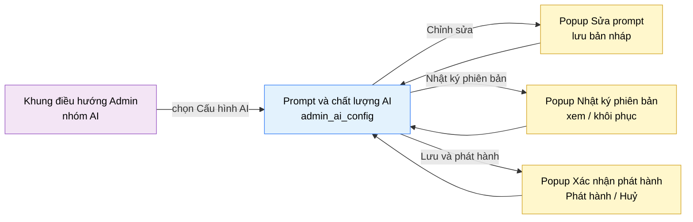

# Tài liệu thiết kế cơ bản (BD) — Prompt và chất lượng AI (`ADM0301`)

## Phương châm tài liệu [Nội bộ — không cần khách duyệt]

- Viết theo **mẫu 9 sheet**. Bộ thẻ đóng, quy ước ID, ký hiệu chuẩn, ranh giới với tài liệu khác và
  checklist kiểm toán nằm ở `02-bd/_rules/bd-template-9sheet.md` — file này không chép lại.
- Phần gắn nhãn `[Nội bộ]` phục vụ sinh mã và tự kiểm toán, không phải yêu cầu của khách hàng: mục 4.5, mục
  7.3 và các ghi chú quy ước.
- Mã màn `ADM0301` theo bảng mã ở `02-bd/_rules/bd-template-9sheet.md` mục 8; tên file mang tiền tố mã.
- Màn này không có màn con, chỉ có 3 popup: Sửa prompt, Nhật ký phiên bản, Xác nhận phát hành.
- **V1.0 (2026-10-10, `DEC-2026-1010-split-ai-admin-screens`)**: màn chỉ còn việc **chỉnh chất lượng AI** theo từng tính năng (prompt, model, nguyên tắc trả lời; **không còn rubric**, V2.0). Giới hạn tần suất, ngân sách, đơn giá, trần sinh testcase và hạn mức token chuyển sang `ADM0303`. Số thứ tự EVT giữ nguyên để truy vết: EVT-9, 15 và 16 đến 21 nay thuộc `ADM0303` (đã đánh số lại ở đó).

> Đọc cùng `01-rd/screens/admin/ADM0301_ai_config.md` (hành vi ở mức yêu cầu, không lặp lại ở đây) và ba file
> BD module: `02-bd/architecture/F5_ai-review.md`, `02-bd/database/F5_ai-review.md`, `02-bd/security/F5_ai-review.md`.
>
> **Không thiết kế** thẻ prompt "Gợi ý theo bậc", dòng giới hạn "Gợi ý mỗi bài" và toggle "Chuyển giảng viên
> khi bí" — đã cắt khỏi phạm vi theo `DEC-2026-0831-remove-tiered-hints-ai-config`
> [Nguồn: 01-rd/screens/admin/ADM0301_ai_config.md:66-67].
> **Không thiết kế** giao diện sửa trọng số rubric Mock Interview (F5-15) — cố định 25/30/25/20%
> [Nguồn: 02-bd/database/F5_ai-review.md:150, 161].
> **Không thiết kế** phần cấu hình rubric chấm bài giải (F5-23) — trọng số lẫn danh sách tiêu chí — đã bỏ hoàn toàn theo `DEC-2026-1014-drop-admin-rubric-config`; từ V2.1 (`DEC-2026-1014-drop-solution-review-rubric`) báo cáo bài giải không còn rubric nào, kể cả 5 tiêu chí cố định.

---

## Sheet 1. Bìa

| Mục | Giá trị |
| :--- | :--- |
| Hệ thống | AlgoPrep |
| Phân hệ | `ai-review` (F5) |
| Công đoạn | BD — Thiết kế cơ bản |
| Phân loại | Màn hình |
| Tên màn | Prompt và chất lượng AI |
| Mã màn hình | `ADM0301` |
| Tên vật lý (slug) | `admin_ai_config` |
| Trục tài liệu | Màn hình (`02-bd/screens/`) |
| Actor | A3 (`ADMIN`) |
| Phiên bản | V2.6 |
| Người tạo | Nhóm phát triển AlgoPrep |
| Ngày tạo | 2026/09/13 |
| Người cập nhật | Nhóm phát triển AlgoPrep |
| Ngày cập nhật | 2026/10/23 |

---

## Sheet 2. Lịch sử sửa đổi

| Ver | Sheet bị sửa | Nội dung sửa | Ngày | Người sửa |
| :--- | :--- | :--- | :--- | :--- |
| V0.1 | Toàn bộ | Tạo mới theo cấu trúc 7 mục văn xuôi (layout regions, component inventory, screen states, APIs consumed, navigation, access rights, câu hỏi mở) | 2026/09/13 | Nhóm phát triển AlgoPrep |
| V0.2 | Toàn bộ | Chuyển sang mẫu 9 sheet. Chốt nguồn dữ liệu của mọi trường hiển thị (đóng Q7: không thêm cột DB nào), chốt nơi lưu giới hạn tần suất là Redis, bổ sung Sheet 8 danh sách sự kiện và Sheet 9 đặc tả kiểm tra, phát sinh thêm câu hỏi mở về bước nhảy trọng số và cảnh báo rời màn | 2026/09/20 | Nhóm phát triển AlgoPrep |
| V0.3 | Sheet 1, 3, 4, 5, 6, 7, 8, 9, Câu hỏi mở | Bổ sung thẻ "Ngân sách và đơn giá" (Khu vực G, cột phải, giữa "Giới hạn tần suất" và "Nguyên tắc trả lời") và popup "Đơn giá token theo mô hình" mà prototype đã dựng ngày 2026-10-01: ngưỡng cảnh báo ngân sách và đơn giá token theo mô hình do ADMIN đặt (`DEC-2026-1001-admin-configurable-settings`, đóng `ADM0302` Q2 và Q7). Thêm DTO, endpoint đề xuất, EVT-16 tới EVT-20, Sheet 9 NO 8-11, Q9-Q11. Sửa dòng phạm vi "Không cấu hình ngân sách token" cho khớp (chỉ hạn mức token vẫn thuộc `ADM0302`). Bảng lưu trữ thuộc DD, không sửa `02-bd/database/F5_ai-review.md` | 2026/10/01 | Nhóm phát triển AlgoPrep |
| V0.4 | Phạm vi, Câu hỏi mở | Chốt 2026-10-02 (owner): ngưỡng cảnh báo ngân sách và đơn giá token do `AI_CONFIG` gác; đóng Q10. | 2026-10-02 | Claude |
| V0.5 | Sheet 6, 8, 9 | Áp `DEC-2026-1003-toast-feedback-channel`: kết quả thao tác và lỗi nhập liệu ghi là toast dùng chung, ô sai chỉ đổi viền đỏ. Chuyển dòng V0.4 nằm nhầm trong Sheet 1 về Sheet 2. | 2026/10/03 | AI |
| V0.6 | Sheet 5, 6, 7, 8, 9, Câu hỏi mở | Chủ dự án chốt 2026-10-03: số lần "Sinh tự động" (F2-14) tối đa mỗi bài do ADMIN cấu hình ở màn này (mặc định 2). Thêm Khu vực H (thẻ "Sinh testcase tự động"), DTO `AiTestcaseGenerationSettingsDto`, endpoint 17 và 18, EVT-21, kiểm nhập liệu 12, Q12 (nơi lưu), Q13 (giới hạn sandbox của script sinh dữ liệu thuộc `ADM0501`). Prototype chưa dựng thẻ | 2026/10/03 | AI |
| V0.7 | Câu hỏi mở | Đóng Q13: giới hạn sandbox của script sinh dữ liệu chuyển sang `ADM0501` Khu vực F. Không đổi màn này | 2026/10/03 | AI |
| V0.8 | Sheet 4, 5, 7, 8, Câu hỏi mở | Dựng thẻ "Sinh testcase tự động" ở prototype và chốt nơi lưu (2026-10-03): bảng singleton `problem_bank_settings` của `problem-bank`, đóng Q12; bỏ toast ở EVT-21 cho khớp cách ghi tức thì của EVT-16; endpoint 17 và 18 thuộc `problem-bank` | 2026/10/03 | AI |
| V0.9 | Sheet 4, 5, 6, 7, 8, 9, Câu hỏi mở | Chủ dự án chốt 2026-10-10 (`DEC-2026-1010-admin-selects-model-per-prompt`): ADMIN chọn model cho từng bản prompt trong danh sách dev khai báo; bỏ hiển thị nhiệt độ; giới hạn token giữ chỉ đọc. Khu vực B NO 7 đổi thành ô chọn, NO 8 bỏ (giữ số thứ tự, không đánh số lại), thêm EVT-22, kiểm nghiệp vụ 13, endpoint trả kèm danh sách model, Q7 mở lại cho phần model, thêm Q14. Prototype dựng ô chọn model và bỏ nhiệt độ | 2026/10/10 | AI |
| V1.0 | Toàn bộ | Chủ dự án chốt 2026-10-10 tách ba màn (`DEC-2026-1010-split-ai-admin-screens`). Màn đổi tên "Prompt và chất lượng AI", chia tab theo tính năng (Phân tích bài giải, Phỏng vấn giả lập, Sinh testcase). Chuyển sang `ADM0303`: Khu vực D (giới hạn tần suất, nay theo giờ), G (ngân sách và đơn giá), H (sinh testcase tự động), popup đơn giá, EVT-9, 15, 16 đến 21, kiểm nhập liệu 4 và 8 đến 12, endpoint và DTO tương ứng, câu hỏi Q5, Q9, Q11, Q12, Q13. Nguyên tắc trả lời lưu theo từng tính năng, "Không đưa lời giải đầy đủ" khoá bật chỉ đọc (đóng Q2, M-10). Nhật ký phiên bản theo tính năng đang chọn (đóng Q4). Bước nhảy rubric là 5 (đóng Q6). Thêm thanh thay đổi chưa phát hành, EVT-23 và EVT-24. Bỏ liên kết "Xem tiêu thụ token" khỏi khối "Trước khi phát hành" (nằm ở `ADM0303` và `ADM0302`). Chưa dựng prototype theo bố cục tab | 2026/10/10 | AI |
| V1.1 | Sheet 4, 6, 8, Câu hỏi mở | Dựng prototype theo V1.0 (`views/admin/ai-config`, 2026-10-10). Đóng Q8: rời màn khi còn thay đổi chưa phát hành thì hiện hộp ba lựa chọn Phát hành và thoát / Thoát không phát hành / Ở lại (`UnsavedChangesDialog`, đề xuất của BD). Ghi nhận khác biệt của prototype: bố cục một cột, bỏ trạng thái `abTest`, "Huỷ thay đổi" qua hộp xác nhận, phát hành tăng phiên bản và ghi nhật ký của đúng tính năng; nút "Chỉnh sửa" và popup Sửa prompt, Xác nhận phát hành, Khôi phục chưa dựng (phase 4) | 2026/10/10 | AI |
| V1.2 | Sheet 5, 6, 8 | Dựng ba popup ở prototype (2026-10-10). **Sửa prompt**: ô chỉ thị hệ thống, "Lưu bản nháp" ghi vào bản nháp và thẻ hiện "Bản nháp"; chỉ thị rỗng thì viền đỏ và toast; đóng khi còn chữ chưa lưu thì hỏi "Bỏ thay đổi?" (EVT-2, 3, 4). **Nhật ký phiên bản**: mỗi dòng có "Khôi phục" (dòng đang chạy hiện nhãn "Đang chạy"), khôi phục chỉ chép chỉ thị về bản nháp, có hộp xác nhận (EVT-6). **Xác nhận phát hành**: liệt kê thay đổi theo tính năng (chỉ thị, model, số tiêu chí rubric, số nguyên tắc) và cảnh báo thay bản đang chạy (EVT-12, 13, 14). Khác biệt: "Phát hành và thoát" ở hộp rời màn phát hành thẳng, không qua hộp xác nhận thứ hai; khôi phục chỉ chép chỉ thị, không chép model và rubric của bản cũ (cột `model_id` và rubric của bản cũ không lưu trong nhật ký mock) | 2026/10/10 | AI |
| V1.3 | Câu hỏi mở | Thêm Q15 (2026-10-10): rubric hiện cho học viên thế nào và bộ tiêu chí lệch với `USR0301`; chủ dự án đánh dấu xem khi làm khu Người học. Không đổi thiết kế | 2026/10/10 | AI |
| V1.4 | Sheet 5 | Ô trọng số rubric nhập tay được (2026-10-10, theo yêu cầu chỉnh số linh động của chủ dự án), nút giảm và tăng vẫn dùng bước 5. Nhập tay được: ô chỉ chứa con số và chọn hết khi bấm vào, đơn vị (lượt/giờ, %, lần) đứng ngoài ô nên không bị gõ đè; gõ số rồi Enter hoặc rời ô thì ghi, Esc bỏ, mũi tên lên xuống đổi một bước; số ngoài khoảng thì đưa về cận gần nhất, chữ không phải số nguyên thì giữ giá trị cũ (không báo lỗi). Tổng vẫn phải bằng 100 mới phát hành được | 2026/10/10 | AI |
| V1.5 | Sheet 5, 6, 8 | Theo báo cáo đối chiếu `06-plan/reports/261010-2041-ai-admin-doi-chieu-hien-trang/` (2026-10-10). **Bỏ** dòng "Kết quả lần chạy gần nhất" của khối "Trước khi phát hành": dữ liệu tĩnh không có nguồn backend, hiện cùng câu "nút chưa hoạt động" gây hiểu nhầm (tiêu chí ponytail bậc 2); nút "Chạy đối chiếu" vẫn giữ, vô hiệu hoá. EVT-6: hộp xác nhận khôi phục nói rõ chỉ khôi phục chỉ thị hệ thống, model, rubric và nguyên tắc giữ nguyên | 2026/10/10 | AI |
| V1.6 | Sheet 5, Câu hỏi mở | Đóng Q1 theo `DEC-2026-1010-ai-generate-testcase-feature-code` (2026-10-10): tab "Sinh testcase" lấy dữ liệu từ `ai.prompt_templates` với `feature_code = GENERATE_TESTCASE`, không bảng riêng; nhãn tính năng thêm "Sinh testcase". Chỉ phần danh sách tính năng và nguồn dữ liệu, không đổi giao diện | 2026/10/10 | AI |
| V1.7 | Sheet 5 | Sửa mô tả phụ của màn cho khớp prototype và việc tách `ADM0303` (giới hạn tần suất không còn ở màn này). Không đổi hành vi. Ghi nhận: Chấm câu luyện F6-08 không có tab ở màn này vì không có prompt admin sửa được (`DEC-2026-1011-ai-practice-feedback-in-shared-budget`). | 2026-10-11 | Claude |
| V1.8 | Sheet 4, 5, 8 | Chủ dự án (2026-10-11): (1) công tắc "Không đưa lời giải đầy đủ" **tắt được** kèm cảnh báo (toast và dòng mô tả), thay cho "luôn bật, chỉ đọc" (`DEC-2026-1011-ai-no-full-solution-can-be-turned-off`); (2) ô chọn Model dùng thành phần dùng chung `FilterMenu`, vẽ đúng như bộ lọc ở Quản lý bài tập (viên "Model: giá trị" mở bảng chọn) thay cho ô `<select>` gốc. | 2026-10-11 | Claude |
| V1.9 | Sheet 4, 5, 6, 7, 8, 9, Câu hỏi mở | Chủ dự án chốt 2026-10-14 (`DEC-2026-1014-instructor-batch5-6-nav-pagination-rubric`, đóng OQ-F5-B, tiêu chí ponytail bậc 2 và 3): **bỏ trọng số rubric**, giữ danh sách tiêu chí admin chỉnh được (thêm, sửa, bật hoặc tắt). Khu vực C: gạch bỏ NO 1 (tổng trọng số), 5 đến 8 (nút giảm, ô trọng số, nút tăng, thanh tỉ lệ), thêm NO 9 đến 11 (công tắc bật tắt, thêm tiêu chí, sửa tiêu chí). EVT-8 đổi thành "Bật, tắt, thêm hoặc sửa tiêu chí". Bỏ chốt chặn "tổng bằng 100" ở nút "Lưu và phát hành", EVT-13 và kiểm nhập liệu NO 2, 3; bỏ `weightPercent` khỏi `RubricConfigDto`, thêm `enabled`. Thêm Q16. Q6 (bước nhảy 5) hết hiệu lực. Prototype (`widgets/rubric-weight-editor`) **chưa sửa theo**, nợ prototype do bước sau ghi vào `06-plan/PROTOTYPE_DEBT.md` | 2026/10/14 | Claude |
| V2.0 | Sheet 4, 5, 6, 7, 8, 9, Câu hỏi mở | Chủ dự án giao quyền chọn, chốt 2026-10-14 (`DEC-2026-1014-drop-admin-rubric-config`, tiêu chí ponytail bậc 3 và 2, thay mục (5) của quyết định V1.9): **bỏ hoàn toàn phần cấu hình rubric chấm bài giải** (không trọng số, không danh sách tiêu chí chỉnh được). Khu vực C gạch bỏ toàn bộ NO 1 đến 11 (gồm NO 9 đến 11 thêm ở V1.9), giữ số dòng; bỏ `RubricConfigDto`, bảng `ai.rubric_configs`, endpoint `GetRubricConfig` và `UpdateRubricConfig`, bước rubric trong EVT-1, 8, 13, bảng `rubric_configs` ở 4.3 và 7.2. Đóng Q15 và Q16 vì không còn đối tượng (Q6 đã hết hiệu lực từ V1.9). Giữ: prompt có phiên bản, model, nguyên tắc trả lời, nhật ký, phát hành, "Chạy đối chiếu". Prototype `widgets/rubric-weight-editor` và `entities/rubric-config` **chưa gỡ**, là nợ prototype | 2026/10/14 | Claude |
| V2.1 | Phương châm, Sheet 4, 6 (bước 2), 9, Câu hỏi mở | Chủ dự án chốt 2026-10-14 (`DEC-2026-1014-drop-solution-review-rubric`, thay `DEC-2026-1014-drop-admin-rubric-config`, tiêu chí ponytail bậc 3 và 2): bỏ nốt 5 thẻ tiêu chí cố định của báo cáo bài giải; sửa các câu nói "5 tiêu chí cố định theo phiên bản prompt/lược đồ" thành "không còn rubric nào". Các dòng gạch bỏ của Khu vực C giữ nguyên. Prototype admin đã gỡ thẻ rubric (`05-coding/frontend/src/views/admin/ai-config/ui/admin-ai-config-view.tsx:17`); không còn thư mục `widgets/rubric-weight-editor` và `entities/rubric-config`. Ghi chú: dòng mô tả "Chạy đối chiếu" (Khu vực regression NO 1) vẫn nói "so sánh điểm rubric", chờ chủ dự án chốt lại câu chữ | 2026/10/14 | Claude |
| V2.2 | Sheet 7 (endpoint NO 4, 8), 8 (EVT-13), 9 (NO 13), Câu hỏi mở Q3, Q14 | Áp `DEC-2026-1014-batch7-remaining-open-questions` (ponytail bậc 5, 4): Q3 đóng, "Lưu và phát hành" là một giao dịch nguyên tử, một endpoint phát hành duy nhất, EVT-13 chỉ gọi `PublishPromptTemplate`; Q14 chốt (a) và (c), danh sách model do dev khai báo ở cấu hình backend, bảng đơn giá `ADM0303` giữ làm dự phòng, chỉ còn mở điểm (b) cổng có trả chi phí từng lần gọi không | 2026/10/14 | AI |
| V2.3 | Sheet 4.3, 5, 7 (trích), Câu hỏi mở | Sửa 2026-10-22 đồng bộ DB, `DEC-2026-1022-ai-judge-schema-sync` (AI-21). `prompt_templates`: `model_id` VARCHAR(50), `version` VARCHAR(20), unique `(feature_code, version)`; `response_guards` nullable, dòng `GENERATE_TESTCASE` để `NULL`. Sửa số dòng trích `02-bd/database/F5_ai-review.md` (`:8-25` thành `:8-28`, `:33-34` thành `:150, 161`, `:37` thành `:20-21`). Sheet không có câu nào nói cấp độ người phỏng vấn do admin cấu hình, nên không phải sửa AI-03 ở đây | 2026/10/22 | Nhóm phát triển AlgoPrep |
| V2.4 | Sheet 5 (khu vực regression NO 1) | Đổi câu mô tả "Chạy đối chiếu" từ "so sánh điểm rubric" thành "so sánh kết quả báo cáo" cho khớp prototype (`05-coding/frontend/messages/vi.json:1041`) và việc báo cáo bài giải không còn rubric (`DEC-2026-1014-drop-solution-review-rubric`). Đóng ghi chú treo ở V2.1. Không đổi hành vi | 2026/10/23 | Claude |
| V2.5 | Sheet 4 (bảng bố cục), 5 (Khu vực F), 6 (bước 6 và Phạm vi), 7 (ghi chú endpoint), 8 (EVT-11), 9 (Khu vực F) | Chủ dự án chốt 2026-10-23 (`DEC-2026-1023-drop-ai-regression-run`, tiêu chí ponytail bậc 2 và 3): **bỏ hẳn "Chạy đối chiếu"** (khối "Trước khi phát hành" cùng nút, mô tả và dòng kết quả gần nhất). Hết rubric nên không còn điểm để so; backend chưa từng được thiết kế (không endpoint, không bảng). Gạch bỏ Khu vực F ở Sheet 5 và Sheet 9, bước 6 ở Sheet 6, EVT-11 ở Sheet 8, dòng trong bảng bố cục; giữ số dòng. Bỏ dòng mồ côi "Xem tiêu thụ token" ở Sheet 9 Khu vực F. Prototype đã gỡ khối này (`05-coding/frontend/src/views/admin/ai-config/ui/admin-ai-config-view.tsx`) và ba chuỗi i18n `preReleaseTitle`, `preReleaseBody`, `runComparison`. Đóng ghi chú V2.4 | 2026/10/23 | Claude |
| V2.6 | Sheet 7 (NO 7, 8), 8 (EVT-1) | Đồng bộ chéo giai đoạn 3 sau `03-dd/api/F5_ai-review.md` mục 1.1 (phát hiện D11): `GetResponseGuardConfig` gộp vào `ListPromptTemplates`, `UpdateResponseGuardConfig` gộp vào `UpdatePromptTemplateDraft` (`response_guards` là cột của `prompt_templates`, tiêu chí ponytail bậc 1 và 4). Không đổi giao diện | 2026/10/23 | Nhóm phát triển AlgoPrep |

---

## Sheet 3. Sơ đồ chuyển màn

> [Nội bộ] Quy ước vẽ: bố trí từ trái sang phải. Màn gọi tới tô tím, màn hiện tại tô xanh nhạt, popup tô
> vàng. Màu và `[Nguồn:]` dùng để truy vết, không phải yêu cầu của khách hàng.

### 3.1 Danh sách chuyển màn

#### Khung điều hướng Admin → Prompt và chất lượng AI

[Điều kiện mở] Chọn mục con "Cấu hình AI" trong nhóm "AI" ở thanh điều hướng bên trái.

[Chế độ mở] Không có.

[Thông tin truyền] Không có.

[Giá trị trả về] Không có.

[Khi thành công] Tải toàn bộ cấu hình hiện hành và hiển thị thanh tab theo tính năng cùng nội dung của tab đầu tiên (Phân tích bài giải) ở trạng thái chỉ xem.

[Khi huỷ] Không có.

#### Prompt và chất lượng AI → Popup Sửa prompt

[Điều kiện mở] Bấm liên kết "Chỉnh sửa" trên một thẻ prompt.

[Chế độ mở] Chế độ sửa bản nháp. Prompt đang ở trạng thái `ACTIVE` thì hệ thống tạo một bản `DRAFT` mới từ
bản đang chạy để sửa; đã có bản `DRAFT` thì mở chính bản đó.

[Thông tin truyền] `feature_code` và `id` của bản prompt được chọn.

[Giá trị trả về] Bản nháp đã lưu, hoặc không có gì nếu người dùng huỷ.

[Khi thành công] Popup hiển thị chỉ thị hệ thống của bản nháp.

[Khi huỷ] Đóng popup, giữ nguyên nội dung thẻ prompt trên màn chính.

#### Prompt và chất lượng AI → Popup Nhật ký phiên bản

[Điều kiện mở] Bấm nút "Nhật ký phiên bản" ở đầu khối "Prompt theo tính năng".

[Chế độ mở] Chế độ chỉ xem, có hành động khôi phục.

[Thông tin truyền] `feature_code` của tab đang chọn: nhật ký chỉ liệt kê phiên bản của tính năng đó (đóng Q4, 2026-10-10).

[Giá trị trả về] Phiên bản được chọn khôi phục, hoặc không có gì.

[Khi thành công] Hiển thị danh sách phiên bản trước đây theo thứ tự thời gian giảm dần.

[Khi huỷ] Đóng popup, màn chính không đổi.

#### Prompt và chất lượng AI → Popup Xác nhận phát hành

[Điều kiện mở] Bấm nút "Lưu và phát hành" khi đang có ít nhất một thay đổi chưa lưu.

[Chế độ mở] Không có.

[Thông tin truyền] Danh sách tóm tắt các thay đổi đang chờ phát hành.

[Giá trị trả về] Kết quả chọn "Phát hành" hoặc "Huỷ".

[Khi thành công] Hiển thị danh sách thay đổi và cảnh báo rằng bản prompt đang chạy sẽ bị thay thế.

[Khi huỷ] Đóng popup, mọi thay đổi vẫn giữ ở trạng thái chưa phát hành.

#### Popup Xác nhận phát hành → Prompt và chất lượng AI

[Điều kiện mở] Bấm "Phát hành" trong popup xác nhận.

[Chế độ mở] Không có.

[Thông tin truyền] Không có.

[Giá trị trả về] Kết quả phát hành.

[Khi thành công] Đóng popup, tải lại cấu hình, các thẻ prompt hiển thị phiên bản và trạng thái mới.

[Khi huỷ] Đóng popup, giữ nguyên trạng thái biên soạn.

### 3.2 Sơ đồ

[Nguồn: 09-layoutBase/Admin - Cấu hình AI.dc.html:67-143,168,178,259; 01-rd/screens/admin/ADM0301_ai_config.md:58-60]

---

## Sheet 4. Bố cục màn hình

### 4.1 Tổng quan màn

[Mục đích màn] Cho quản trị viên chỉnh **chất lượng** của từng tính năng AI: prompt có phiên bản, model và nguyên tắc trả lời, rồi phát hành thay đổi trong một lần [Nguồn: 01-rd/req/F5_ai-review.md — F5-23].

[Luồng nghiệp vụ chính]

1. **Hiển thị ban đầu**: vào màn, hệ thống tải prompt của cả ba tính năng và hiển thị tab "Phân tích bài giải". Nút "Lưu và phát hành" không kích hoạt khi chưa có thay đổi.
2. **Chọn tính năng**: chuyển giữa ba tab. Mỗi tab chỉ hiển thị cấu hình của đúng tính năng đó: prompt, model, nguyên tắc trả lời. Báo cáo Phân tích bài giải không còn rubric nào (`DEC-2026-1014-drop-solution-review-rubric`).
3. **Sửa prompt và model**: bấm "Chỉnh sửa" để sửa chỉ thị hệ thống; chọn model trong danh sách dev khai báo (`DEC-2026-1010-admin-selects-model-per-prompt`). Thay đổi lưu vào bản nháp, **không ảnh hưởng bản đang chạy cho tới khi phát hành**.
4. ~~**Sửa rubric chấm bài giải** (trọng số, rồi danh sách tiêu chí thêm, sửa, bật tắt)~~ — **đã bỏ 2026-10-14** (`DEC-2026-1014-drop-admin-rubric-config`). Giữ số bước để không đánh số lại.
5. **Bật hoặc tắt nguyên tắc trả lời** của tính năng đang chọn: "Trích dẫn dòng mã người học" và "Trả lời bằng tiếng Việt". "Không đưa lời giải đầy đủ" mặc định bật (F5-17) và **tắt được**: tắt thì hiện toast cảnh báo "Đã tắt: AI có thể đưa lời giải đầy đủ cho người học, trái với định hướng giáo dục" và dòng mô tả của nguyên tắc đổi thành chính cảnh báo đó, cho tới khi bật lại.
6. ~~**Đối chiếu trước phát hành**: nút "Chạy đối chiếu" hiển thị nhưng vô hiệu hoá~~ — **đã bỏ 2026-10-23** (`DEC-2026-1023-drop-ai-regression-run`). Giữ số bước để không đánh số lại.
7. **Phát hành**: thanh trên cùng đếm số thay đổi chưa phát hành, kèm "Huỷ thay đổi" và "Lưu và phát hành". Bấm phát hành, xác nhận trong popup, hệ thống chuyển bản nháp thành bản đang chạy.

[Người dùng] Quản trị viên đã đăng nhập, có Function `AI_CONFIG`.

[Tệp liên quan] Không có. Màn này không xuất hay nhập tệp.

[Phạm vi]
- Không cấu hình rubric nào: rubric Mock Interview 4 tiêu chí cố định theo F5-15; báo cáo chấm bài giải không có rubric (`DEC-2026-1014-drop-solution-review-rubric`).
- Không cấu hình giới hạn tần suất, ngân sách, đơn giá, hạn mức token, trần sinh testcase: thuộc `ADM0303` (`admin_ai_limits`).
- Không theo dõi tiêu thụ: thuộc `ADM0302` (`admin_ai_usage`).
- Không có "Chạy đối chiếu" (kiểm thử 30 bài mẫu trước khi phát hành): bỏ hẳn cả giao diện lẫn backend (`DEC-2026-1023-drop-ai-regression-run`).
- Không thiết kế tính năng "Gợi ý theo bậc" (đã cắt phạm vi 2026-08-31).
- Không đổi nhiệt độ và giới hạn token qua giao diện; nhiệt độ không hiển thị; model chọn trong danh sách dev khai báo; khoá API không bao giờ qua giao diện.

[Quyền sử dụng]
- Xem: được, khi có Function `AI_CONFIG`.
- Thêm: được (tạo bản nháp prompt mới từ bản đang chạy).
- Sửa: được.
- Xoá: không. Prompt cũ chuyển trạng thái `ARCHIVED`, không xoá vật lý.

[Số bản ghi tối đa] Tab tính năng: theo số `feature_code` có thật, hiện là 3. Nguyên tắc trả lời: 3 dòng trên tab Phân tích bài giải và Phỏng vấn giả lập, 0 dòng trên tab Sinh testcase. Không phân trang.

[Nguồn: 01-rd/screens/admin/ADM0301_ai_config.md; 02-bd/database/F5_ai-review.md:8-34; 02-bd/security/F5_ai-review.md:79-82]

### 4.2 DTO liên quan

- `PromptTemplateDto`
- ~~`RubricConfigDto`~~ (đã bỏ 2026-10-14)
- `ResponseGuardConfigDto`

`[Suy luận]` — tên DTO do BD này đề xuất, `03-dd/api/F5_ai-review.md` chốt lại.

### 4.3 Bảng dữ liệu liên quan (1)

| NO | Bảng | Ghi chú |
| --: | :--- | :--- |
| 1 | `ai.prompt_templates` | [Nguồn: 02-bd/database/F5_ai-review.md:8-28]. Ràng buộc: `model_id` VARCHAR(50); `version` VARCHAR(20), unique `(feature_code, version)` (không có hai bản cùng số hiệu trong một tính năng); `response_guards` JSON **nullable**, dòng `GENERATE_TESTCASE` để `NULL` (tab Sinh testcase không có nguyên tắc) [Nguồn: 02-bd/database/F5_ai-review.md:16, 20-21] |
| 2 | ~~`ai.rubric_configs`~~ | **Đã bỏ 2026-10-14** (`DEC-2026-1014-drop-admin-rubric-config`), xem `02-bd/database/F5_ai-review.md` mục 1.2. Giữ số dòng |

Nguyên tắc trả lời lưu **kèm bản prompt của từng tính năng** (cột `response_guards` của `ai.prompt_templates`, JSON nullable, kiểu thật do DD chốt; `NULL` ở dòng `GENERATE_TESTCASE`) để đi qua phát hành cùng phiên bản và khôi phục theo nhật ký (đóng Q2, 2026-10-10). Các nhóm dữ liệu khác (giới hạn tần suất, ngân sách, đơn giá, trần sinh testcase) thuộc `ADM0303`.

### 4.4 Vùng bố cục

Đối chiếu `09-layoutBase/Admin - Cấu hình AI.dc.html` — bằng chứng bố cục chỉ-đọc, **không phải** design system cuối cùng. V1.0 đổi bố cục theo tab nên mockup chỉ còn giá trị tham khảo cho từng khối riêng lẻ; chưa có prototype theo bố cục mới.

| Vùng | Nội dung |
| :--- | :--- |
| Thanh điều hướng bên trái, chân trang | Khung chung Admin, mục "Cấu hình AI" đang chọn (nhãn đổi thành "Prompt và chất lượng" khi dựng) |
| Thanh tiêu đề dính | Tiêu đề, mô tả phụ, số thay đổi chưa phát hành, "Huỷ thay đổi", "Lưu và phát hành" |
| Thanh tab | Ba tab theo tính năng; nút "Nhật ký phiên bản" bên phải, theo tab đang chọn |
| Khối "Prompt" của tab | Thẻ prompt: tên, phiên bản, trạng thái, mô tả, ô chọn Model, giới hạn token (chỉ đọc), ngày cập nhật, nút "Chỉnh sửa" |
| ~~Khối "Rubric chấm bài giải"~~ | **Đã bỏ 2026-10-14** (`DEC-2026-1014-drop-admin-rubric-config`) |
| Khối "Nguyên tắc trả lời" | Tab Phân tích bài giải và Phỏng vấn giả lập |
| ~~Khối "Trước khi phát hành"~~ | **Đã bỏ 2026-10-23** (`DEC-2026-1023-drop-ai-regression-run`) |

Hai cột `minmax(0, 1.55fr) minmax(300px, 1fr)` của mockup (`:160`) không còn bắt buộc: một tab có ít khối nên có thể một cột. DD màn hình chốt.

### 4.5 Cấu trúc slice FSD [Nội bộ]

| Khối | Slice dự kiến | Căn cứ |
| :--- | :--- | :--- |
| Trang | `views/admin/ai-config` | Quy ước FSD của dự án |
| Khung Admin | Dùng lại `widgets/admin-shell` | `02-bd/screens/admin/_shell.md` |
| Thanh tab | `shared/ui/data/segmented-tabs` có sẵn | Không cần slice mới |
| Khối prompt, nguyên tắc | `widgets/prompt-feature-list`, `entities/prompt-template`. `widgets/rubric-weight-editor` và `entities/rubric-config` **gỡ khi sửa prototype** (`DEC-2026-1014-drop-admin-rubric-config`) | Cấu trúc cũ, trừ hai slice rubric |
| Popup | `features/prompt-edit`, `features/prompt-version-history`, `features/ai-config-publish` | Cấu trúc cũ, giữ nguyên |

`[Suy luận]` — ánh xạ slice do BD đề xuất, DD màn hình chốt lại.

---

## Sheet 5. Danh sách item màn hình

> Quy ước ID, bộ thẻ và giá trị chuẩn: `02-bd/_rules/bd-template-9sheet.md` mục 2, 3, 4.

### Khu vực A — Thanh tiêu đề

| Khu vực | NO | Tên item | ID item | Bảng DB | Cột DB | Loại UI | Kiểu | Độ dài | Bắt buộc | I/O | Giá trị mặc định | Định dạng | Ghi chú |
| :--- | --: | :--- | :--- | :--- | :--- | :--- | :--- | :--- | :-: | :-: | :--- | :--- | :--- |
| Thanh tiêu đề | | | | | | | | | | | | | |
| | 1 | Tiêu đề màn | `adminAiConfig.header.title` | - | - | Label | String | - | - | O | Prompt và chất lượng AI | - | Tên màn hiển thị cố định [Nguồn giá trị] Nhãn tĩnh i18n [EVT liên quan] - |
| | 2 | Mô tả phụ | `adminAiConfig.header.subtitle` | - | - | Label | String | - | - | O | Prompt, model và nguyên tắc trả lời theo từng tính năng | - | Mô tả ngắn phạm vi màn [Nguồn giá trị] Nhãn tĩnh i18n [EVT liên quan] - |
| | 3 | Lưu và phát hành | `adminAiConfig.header.btnPublish` | - | - | Button | - | - | - | I | - | - | Phát hành toàn bộ thay đổi đang biên soạn [Nguồn giá trị] - [EVT liên quan] EVT-12 |
| | 4 | Tab tính năng | `adminAiConfig.header.featureTabs` | `ai.prompt_templates` | `feature_code` | SegmentedTabs | Enum | - | Có | I/O | Phân tích bài giải | Nhãn tiếng Việt | 3 tab: Phân tích bài giải, Phỏng vấn giả lập, Sinh testcase. Chọn tab chỉ đổi nội dung hiển thị, **không** mất thay đổi chưa phát hành ở tab khác [Nguồn giá trị] Danh sách `feature_code` của `ListPromptTemplates` [EVT liên quan] EVT-23 |
| | 5 | Số thay đổi chưa phát hành | `adminAiConfig.header.pendingCount` | - | - | Label | Number | - | - | O | 0 | `{số} thay đổi` | Đếm số mục đã đổi (prompt, model, nguyên tắc) so với bản đang lưu, trên mọi tab [EVT liên quan] EVT-12 |
| | 6 | Huỷ thay đổi | `adminAiConfig.header.btnDiscard` | - | - | Button | - | - | - | I | - | - | Bỏ mọi thay đổi chưa phát hành, trả về giá trị đang lưu [EVT liên quan] EVT-24 |

### Khu vực B — Prompt theo tính năng

| Khu vực | NO | Tên item | ID item | Bảng DB | Cột DB | Loại UI | Kiểu | Độ dài | Bắt buộc | I/O | Giá trị mặc định | Định dạng | Ghi chú |
| :--- | --: | :--- | :--- | :--- | :--- | :--- | :--- | :--- | :-: | :-: | :--- | :--- | :--- |
| Prompt theo tính năng | | | | | | | | | | | | | |
| | 1 | Nhật ký phiên bản | `adminAiConfig.prompt.btnVersionHistory` | - | - | Button | - | - | - | I | - | - | Mở danh sách phiên bản prompt trước đây (F5-23) [Nguồn giá trị] - [EVT liên quan] EVT-5 |
| | 2 | Danh sách prompt | `adminAiConfig.prompt.list` | `ai.prompt_templates` | - | List | List | - | - | O | rỗng | - | Hiển thị bản prompt của **tính năng đang chọn ở thanh tab** (một thẻ, không còn danh sách ba thẻ). Ba tính năng: Phân tích bài giải (F5.1), Phỏng vấn giả lập (F5.2), Sinh testcase (F2-14, `feature_code = GENERATE_TESTCASE`, V1.6) [Nguồn giá trị] Kết quả gọi `ListPromptTemplates` [EVT liên quan] EVT-1 |
| | 3 | Tên tính năng | `adminAiConfig.prompt.col.featureName` | `ai.prompt_templates` | `feature_code` | ListColumn | Enum | - | - | O | - | Nhãn tiếng Việt | Mã tính năng hiển thị dưới dạng nhãn tiếng Việt [Nguồn giá trị] `SOLUTION_REVIEW` thành "Phân tích bài giải"; `MOCK_INTERVIEW` thành "Phỏng vấn giả lập"; `GENERATE_TESTCASE` thành "Sinh testcase" [EVT liên quan] - |
| | 4 | Phiên bản | `adminAiConfig.prompt.col.version` | `ai.prompt_templates` | `version` | ListColumn | String | 20 | - | O | - | `v{số}.{số}` | Số hiệu phiên bản của bản prompt; duy nhất trong cùng `feature_code` (unique `(feature_code, version)`) [Nguồn giá trị] Cột `version` [Nguồn: 02-bd/database/F5_ai-review.md:16] [EVT liên quan] - |
| | 5 | Trạng thái | `adminAiConfig.prompt.col.status` | `ai.prompt_templates` | `status` | Badge | Enum | - | - | O | - | Nhãn tiếng Việt | Trạng thái vòng đời của bản prompt [Nguồn giá trị] `ACTIVE` thành "Đang chạy"; `DRAFT` thành "Bản nháp"; `ARCHIVED` thành "Đã lưu trữ" [EVT liên quan] - |
| | 6 | Mô tả | `adminAiConfig.prompt.col.description` | - | - | ListColumn | String | - | - | O | - | - | Mô tả ngắn mục đích của prompt [Nguồn giá trị] **Nhãn tĩnh i18n** map từ `feature_code` — chữ cố định, quản trị viên không sửa. Không thêm cột DB, xem Q7 [EVT liên quan] - |
| | 7 | Model | `adminAiConfig.prompt.col.model` | `ai.prompt_templates` | `model_id` | SelectBox (thành phần dùng chung `FilterMenu`: viên "Model: giá trị" mở bảng chọn, đúng kiểu bộ lọc Quản lý bài tập, 2026-10-11) | String | 50 | Có | I/O | Giá trị đang lưu | Tên model | Model dùng cho bản prompt này; ADMIN chọn trong **danh sách do dev khai báo ở cấu hình backend**, không gõ tự do. Đổi model là thay đổi chưa phát hành, đi qua "Lưu và phát hành" cùng bản prompt (V0.9, `DEC-2026-1010-admin-selects-model-per-prompt`) [Nguồn giá trị] Cột `model_id` (VARCHAR(50), `02-bd/database/F5_ai-review.md:20`); danh sách lựa chọn lấy từ phản hồi của `ListPromptTemplates` [EVT liên quan] EVT-22 |
| | 8 | ~~Nhiệt độ~~ | - | - | - | - | - | - | - | - | - | - | **Đã bỏ 2026-10-10**: không hiển thị. Giữ dòng để không đánh số lại NO tham chiếu bên ngoài [EVT liên quan] - |
| | 9 | Giới hạn token | `adminAiConfig.prompt.col.maxTokens` | - | - | ListColumn | Number | 6 | - | O | - | Số nguyên | Số token tối đa cho một lần gọi [Nguồn giá trị] **`application.yml`**, hiển thị chỉ đọc. Không thêm cột DB, xem Q7 [EVT liên quan] - |
| | 10 | Ngày cập nhật | `adminAiConfig.prompt.col.updatedAt` | `ai.prompt_templates` | `published_at` / `created_at` | ListColumn | Date | - | - | O | - | `DD/MM` | Ngày sửa gần nhất của bản prompt [Công thức] Có `published_at` thì lấy `published_at`, ngược lại lấy `created_at` [EVT liên quan] - |
| | 11 | Chỉnh sửa | `adminAiConfig.prompt.col.linkEdit` | - | - | Link | - | - | - | I | - | - | Mở popup sửa bản nháp của prompt trên dòng đó [Nguồn giá trị] - [EVT liên quan] EVT-2 |

### Khu vực C — ~~Rubric chấm bài giải~~ (đã bỏ 2026-10-14)

| Khu vực | NO | Tên item | ID item | Bảng DB | Cột DB | Loại UI | Kiểu | Độ dài | Bắt buộc | I/O | Giá trị mặc định | Định dạng | Ghi chú |
| :--- | --: | :--- | :--- | :--- | :--- | :--- | :--- | :--- | :-: | :-: | :--- | :--- | :--- |
| ~~Rubric chấm bài giải~~ | | | | | | | | | | | | | |
| | 1 | ~~Tổng trọng số~~ | - | - | - | - | - | - | - | - | - | - | **Đã bỏ 2026-10-14** (`DEC-2026-1014-drop-admin-rubric-config`). Giữ dòng để không đánh số lại [EVT liên quan] - |
| | 2 | ~~Danh sách tiêu chí~~ | - | - | - | - | - | - | - | - | - | - | **Đã bỏ 2026-10-14** (`DEC-2026-1014-drop-admin-rubric-config`). Giữ dòng để không đánh số lại [EVT liên quan] - |
| | 3 | ~~Tên tiêu chí~~ | - | - | - | - | - | - | - | - | - | - | **Đã bỏ 2026-10-14** (`DEC-2026-1014-drop-admin-rubric-config`). Giữ dòng để không đánh số lại [EVT liên quan] - |
| | 4 | ~~Mô tả tiêu chí~~ | - | - | - | - | - | - | - | - | - | - | **Đã bỏ 2026-10-14** (`DEC-2026-1014-drop-admin-rubric-config`). Giữ dòng để không đánh số lại [EVT liên quan] - |
| | 5 | ~~Giảm trọng số~~ | - | - | - | - | - | - | - | - | - | - | **Đã bỏ 2026-10-14** (`DEC-2026-1014-drop-admin-rubric-config`). Giữ dòng để không đánh số lại [EVT liên quan] - |
| | 6 | ~~Trọng số~~ | - | - | - | - | - | - | - | - | - | - | **Đã bỏ 2026-10-14** (`DEC-2026-1014-drop-admin-rubric-config`). Giữ dòng để không đánh số lại [EVT liên quan] - |
| | 7 | ~~Tăng trọng số~~ | - | - | - | - | - | - | - | - | - | - | **Đã bỏ 2026-10-14** (`DEC-2026-1014-drop-admin-rubric-config`). Giữ dòng để không đánh số lại [EVT liên quan] - |
| | 8 | ~~Thanh tỉ lệ~~ | - | - | - | - | - | - | - | - | - | - | **Đã bỏ 2026-10-14** (`DEC-2026-1014-drop-admin-rubric-config`). Giữ dòng để không đánh số lại [EVT liên quan] - |
| | 9 | ~~Công tắc bật tắt tiêu chí~~ | - | - | - | - | - | - | - | - | - | - | **Đã bỏ 2026-10-14** (`DEC-2026-1014-drop-admin-rubric-config`). Giữ dòng để không đánh số lại [EVT liên quan] - |
| | 10 | ~~Thêm tiêu chí~~ | - | - | - | - | - | - | - | - | - | - | **Đã bỏ 2026-10-14** (`DEC-2026-1014-drop-admin-rubric-config`). Giữ dòng để không đánh số lại [EVT liên quan] - |
| | 11 | ~~Sửa tiêu chí~~ | - | - | - | - | - | - | - | - | - | - | **Đã bỏ 2026-10-14** (`DEC-2026-1014-drop-admin-rubric-config`). Giữ dòng để không đánh số lại [EVT liên quan] - |

### Khu vực E — Nguyên tắc trả lời

| Khu vực | NO | Tên item | ID item | Bảng DB | Cột DB | Loại UI | Kiểu | Độ dài | Bắt buộc | I/O | Giá trị mặc định | Định dạng | Ghi chú |
| :--- | --: | :--- | :--- | :--- | :--- | :--- | :--- | :--- | :-: | :-: | :--- | :--- | :--- |
| Nguyên tắc trả lời | | | | | | | | | | | | | |
| | 1 | Danh sách nguyên tắc | `adminAiConfig.guard.list` | `ai.prompt_templates` | `response_guards` | List | List | - | - | I/O | 3 dòng | - | **Theo tính năng đang chọn**; hiển thị ở tab Phân tích bài giải và Phỏng vấn giả lập, không hiển thị ở tab Sinh testcase. 3 nguyên tắc: "Không đưa lời giải đầy đủ" (F5-17), "Trích dẫn dòng mã người học", "Trả lời bằng tiếng Việt". Đã bỏ "Chuyển giảng viên khi bí". Cột `response_guards` nullable: tab Sinh testcase không có nguyên tắc nên dòng `GENERATE_TESTCASE` để `NULL` [Nguồn: 02-bd/database/F5_ai-review.md:21] [Nguồn giá trị] Lưu kèm bản prompt của tính năng (đóng Q2, 2026-10-10), đi qua phát hành và khôi phục cùng phiên bản [EVT liên quan] EVT-1 |
| | 2 | Tên nguyên tắc | `adminAiConfig.guard.col.title` | - | - | ListColumn | String | - | - | O | - | - | Tên nguyên tắc hiển thị cho người dùng [Nguồn giá trị] Nhãn tĩnh i18n map từ mã nguyên tắc [EVT liên quan] - |
| | 3 | Mô tả nguyên tắc | `adminAiConfig.guard.col.meta` | - | - | ListColumn | String | - | - | O | - | - | Câu giải thích tác dụng của nguyên tắc [Nguồn giá trị] Nhãn tĩnh i18n map từ mã nguyên tắc [EVT liên quan] - |
| | 4 | Công tắc | `adminAiConfig.guard.col.toggle` | - | - | Toggle | Boolean | - | - | I/O | Bật | Bật / Tắt | Trạng thái áp dụng của nguyên tắc. **"Không đưa lời giải đầy đủ" mặc định bật, tắt được kèm cảnh báo** (chủ dự án, 2026-10-11, `DEC-2026-1011-ai-no-full-solution-can-be-turned-off`; thay cho "luôn bật, chỉ đọc" của 2026-10-10). Máy chủ nhận cả giá trị tắt [Nguồn giá trị] Giá trị đang lưu; mặc định "Bật" là `[Suy luận]` từ prototype, chưa có nguồn khẳng định [EVT liên quan] EVT-10 |

### Khu vực F — ~~Trước khi phát hành~~ (đã bỏ 2026-10-23)

| Khu vực | NO | Tên item | ID item | Bảng DB | Cột DB | Loại UI | Kiểu | Độ dài | Bắt buộc | I/O | Giá trị mặc định | Định dạng | Ghi chú |
| :--- | --: | :--- | :--- | :--- | :--- | :--- | :--- | :--- | :-: | :-: | :--- | :--- | :--- |
| ~~Trước khi phát hành~~ | | | | | | | | | | | | | |
| | 1 | ~~Mô tả đối chiếu~~ | - | - | - | - | - | - | - | - | - | - | **Đã bỏ 2026-10-23** (`DEC-2026-1023-drop-ai-regression-run`). Giữ dòng để không đánh số lại |
| | 2 | ~~Chạy đối chiếu~~ | - | - | - | - | - | - | - | - | - | - | **Đã bỏ 2026-10-23** (`DEC-2026-1023-drop-ai-regression-run`). Giữ dòng để không đánh số lại [EVT liên quan] - |
| | 3 | ~~Kết quả lần chạy gần nhất~~ | - | - | - | - | - | - | - | - | - | - | Đã bỏ V1.5, nay bỏ cả khu vực. Giữ dòng để không đánh số lại |

### Popup

| Khu vực | NO | Tên item | ID item | Bảng DB | Cột DB | Loại UI | Kiểu | Độ dài | Bắt buộc | I/O | Giá trị mặc định | Định dạng | Ghi chú |
| :--- | --: | :--- | :--- | :--- | :--- | :--- | :--- | :--- | :-: | :-: | :--- | :--- | :--- |
| Popup | | | | | | | | | | | | | |
| | 1 | Sửa prompt | `adminAiConfig.popup.promptEdit` | `ai.prompt_templates` | `system_instruction` | Popup | - | - | - | I/O | - | - | Form sửa chỉ thị hệ thống của bản nháp. Model, nhiệt độ và giới hạn token **không sửa ở đây** (đọc từ `application.yml`). Prototype chưa có form chi tiết, trường cụ thể do DD màn hình chốt [Nguồn giá trị] Bản `DRAFT` của prompt được chọn [EVT liên quan] EVT-2, EVT-3, EVT-4 |
| | 2 | Nhật ký phiên bản | `adminAiConfig.popup.versionHistory` | `ai.prompt_templates` | `version`, `status`, `published_at` | Popup | - | - | - | I/O | - | - | Danh sách phiên bản trước đây, có hành động khôi phục (F5-23) [Nguồn giá trị] Các dòng cùng `feature_code`, sắp xếp theo `published_at` giảm dần [EVT liên quan] EVT-5, EVT-6, EVT-7 |
| | 3 | Xác nhận phát hành | `adminAiConfig.popup.publishConfirm` | - | - | Popup | - | - | - | I | - | Phát hành / Huỷ | Xác nhận trước khi chuyển bản nháp thành bản đang chạy [Nguồn giá trị] Tóm tắt các thay đổi đang chờ [EVT liên quan] EVT-12, EVT-13, EVT-14 |

[Nguồn: 09-layoutBase/Admin - Cấu hình AI.dc.html:147-158,163-190,192-218,222-236,238-253,255-260; 02-bd/database/F5_ai-review.md:8-34; 01-rd/screens/admin/ADM0301_ai_config.md:36-50; Khu vực G và Popup NO 4-11: 05-coding/frontend/src/views/admin/ai-config/ui/admin-ai-config-view.tsx:234-260,332-366, 05-coding/frontend/src/entities/ai-budget/model/ai-budget-store.ts:12-29, 05-coding/frontend/messages/vi.json:742-766]

---

## Sheet 6. Đặc tả điều khiển item

> Ký hiệu cột `Hiển thị` và thứ tự thẻ: `02-bd/_rules/bd-template-9sheet.md` mục 2, 3. Dùng đúng NO, tên
> item và thứ tự của Sheet 5. Lỗi nhập liệu ghi ở Sheet 9, xử lý nghiệp vụ ghi ở Sheet 8.

### Khu vực A — Thanh tiêu đề

| Khu vực | NO | Tên item | Hiển thị | Ghi chú |
| :--- | --: | :--- | :-: | :--- |
| Thanh tiêu đề | | | | |
| | 1 | Tiêu đề màn | Có | - |
| | 2 | Mô tả phụ | Có | - |
| | 3 | Lưu và phát hành | Có | [Điều kiện kích hoạt] Kích hoạt khi có ít nhất một thay đổi chưa phát hành. Các trường hợp khác không kích hoạt (bỏ điều kiện tổng trọng số bằng 100% từ 2026-10-14). |
| | 4 | Tab tính năng | Có | [Tự động đặt] Tab có thay đổi chưa phát hành hiện dấu chấm nhỏ. |
| | 5 | Số thay đổi chưa phát hành | Có | [Điều kiện hiển thị] Chỉ hiển thị khi lớn hơn 0. |
| | 6 | Huỷ thay đổi | Điều kiện | [Điều kiện hiển thị] Chỉ hiển thị khi có thay đổi chưa phát hành; hỏi xác nhận trước khi bỏ. |

### Khu vực B — Prompt theo tính năng

| Khu vực | NO | Tên item | Hiển thị | Ghi chú |
| :--- | --: | :--- | :-: | :--- |
| Prompt theo tính năng | | | | |
| | 1 | Nhật ký phiên bản | Có | [Điều kiện kích hoạt] Không kích hoạt trong lúc đang tải dữ liệu, kích hoạt sau khi tải xong. |
| | 2 | Danh sách prompt | Có | [Điều kiện hiển thị] Trong lúc tải hiển thị khung chờ đúng 3 dòng. Tải xong mà không có dòng nào thì hiển thị "Chưa có prompt — Tạo mới" thay cho danh sách. |
| | 3 | Tên tính năng | Có | - |
| | 4 | Phiên bản | Có | - |
| | 5 | Trạng thái | Có | - |
| | 6 | Mô tả | Có | - |
| | 7 | Model | Có | [Điều kiện kích hoạt] Kích hoạt sau khi tải xong; không kích hoạt trên dòng "Đã lưu trữ". Danh sách lựa chọn rỗng thì ô chỉ đọc. |
| | 8 | ~~Nhiệt độ~~ | Không | Đã bỏ 2026-10-10. |
| | 9 | Giới hạn token | Có | - |
| | 10 | Ngày cập nhật | Có | - |
| | 11 | Chỉnh sửa | Có | [Điều kiện kích hoạt] Không kích hoạt trên dòng có trạng thái "Đã lưu trữ"; kích hoạt trên dòng "Đang chạy" và "Bản nháp". |

### Khu vực C — ~~Rubric chấm bài giải~~ (đã bỏ 2026-10-14)

| Khu vực | NO | Tên item | Hiển thị | Ghi chú |
| :--- | --: | :--- | :-: | :--- |
| ~~Rubric chấm bài giải~~ | | | | |
| | 1 | ~~Tổng trọng số~~ | Không | Đã bỏ 2026-10-14. |
| | 2 | ~~Danh sách tiêu chí~~ | Không | Đã bỏ 2026-10-14. |
| | 3 | ~~Tên tiêu chí~~ | Không | Đã bỏ 2026-10-14. |
| | 4 | ~~Mô tả tiêu chí~~ | Không | Đã bỏ 2026-10-14. |
| | 5 | ~~Giảm trọng số~~ | Không | Đã bỏ 2026-10-14. |
| | 6 | ~~Trọng số~~ | Không | Đã bỏ 2026-10-14. |
| | 7 | ~~Tăng trọng số~~ | Không | Đã bỏ 2026-10-14. |
| | 8 | ~~Thanh tỉ lệ~~ | Không | Đã bỏ 2026-10-14. |
| | 9 | ~~Công tắc bật tắt tiêu chí~~ | Không | Đã bỏ 2026-10-14. |
| | 10 | ~~Thêm tiêu chí~~ | Không | Đã bỏ 2026-10-14. |
| | 11 | ~~Sửa tiêu chí~~ | Không | Đã bỏ 2026-10-14. |

### Khu vực E — Nguyên tắc trả lời

| Khu vực | NO | Tên item | Hiển thị | Ghi chú |
| :--- | --: | :--- | :-: | :--- |
| Nguyên tắc trả lời | | | | |
| | 1 | Danh sách nguyên tắc | Có | [Điều kiện hiển thị] Trong lúc tải hiển thị khung chờ đúng 3 dòng. |
| | 2 | Tên nguyên tắc | Có | - |
| | 3 | Mô tả nguyên tắc | Có | - |
| | 4 | Công tắc | Có | [Điều kiện kích hoạt] Kích hoạt sau khi tải xong dữ liệu. [Tự động đặt] Sau khi bật hoặc tắt, item được đánh dấu là thay đổi chưa phát hành và kích hoạt nút "Lưu và phát hành". Riêng "Không đưa lời giải đầy đủ": tắt thì kèm toast cảnh báo. |

### Khu vực F — ~~Trước khi phát hành~~ (đã bỏ 2026-10-23)

| Khu vực | NO | Tên item | Hiển thị | Ghi chú |
| :--- | --: | :--- | :-: | :--- |
| ~~Trước khi phát hành~~ | | | | |
| | 1 | ~~Mô tả đối chiếu~~ | Không | **Đã bỏ 2026-10-23** (`DEC-2026-1023-drop-ai-regression-run`) |
| | 2 | ~~Chạy đối chiếu~~ | Không | **Đã bỏ 2026-10-23** |
| | 3 | ~~Kết quả lần chạy gần nhất~~ | Không | Đã bỏ |
| | 4 | ~~Xem tiêu thụ token~~ | Không | Dòng mồ côi: sheet 5 Khu vực F không có item này, việc xem tiêu thụ thuộc `ADM0302`. Bỏ cùng khu vực |

### Popup

| Khu vực | NO | Tên item | Hiển thị | Ghi chú |
| :--- | --: | :--- | :-: | :--- |
| Popup | | | | |
| | 1 | Sửa prompt | Điều kiện | [Điều kiện hiển thị] Chỉ hiển thị sau khi bấm "Chỉnh sửa" trên một thẻ prompt. Các thẻ prompt khác không bị khoá khi popup đang mở. |
| | 2 | Nhật ký phiên bản | Điều kiện | [Điều kiện hiển thị] Chỉ hiển thị sau khi bấm "Nhật ký phiên bản". |
| | 3 | Xác nhận phát hành | Điều kiện | [Điều kiện hiển thị] Chỉ hiển thị sau khi bấm "Lưu và phát hành" và nút đó đang ở trạng thái kích hoạt. |

[Nguồn: 09-layoutBase/Admin - Cấu hình AI.dc.html:172,195-196,199,226,241; 02-bd/database/F5_ai-review.md:20-21; 01-rd/screens/admin/ADM0301_ai_config.md:58-60; Khu vực G và Popup NO 4-11: 05-coding/frontend/src/views/admin/ai-config/ui/admin-ai-config-view.tsx:234-260,332-366; 05-coding/frontend/src/shared/ui/overlay/managed-list-dialog.tsx:100-158]

---

## Sheet 7. Danh sách truyền dữ liệu

### 7.1 Trường DTO

| NO | DTO | Trường DTO | Kiểu | Bảng DB | Cột DB | Item màn | Hiển thị | Ghi chú |
| --: | :--- | :--- | :--- | :--- | :--- | :--- | :-: | :--- |
| 1 | `PromptTemplateDto` | `id` | UUID | `ai.prompt_templates` | `id` | - | Không | [Nguồn] Phản hồi của `ListPromptTemplates` [Đích] Tham số của `UpdatePromptTemplateDraft` và `PublishPromptTemplate`. Không hiển thị trên màn. |
| 2 | `PromptTemplateDto` | `featureCode` | Enum | `ai.prompt_templates` | `feature_code` | Prompt "Tên tính năng" | Có | [Nguồn] Phản hồi của `ListPromptTemplates` [Chuyển đổi] Mã enum đổi sang nhãn tiếng Việt khi hiển thị. Cũng là khoá để tra nhãn "Mô tả". |
| 3 | `PromptTemplateDto` | `version` | String | `ai.prompt_templates` | `version` | Prompt "Phiên bản" | Có | [Nguồn] Phản hồi của `ListPromptTemplates` |
| 4 | `PromptTemplateDto` | `status` | Enum | `ai.prompt_templates` | `status` | Prompt "Trạng thái" | Có | [Chuyển đổi] `ACTIVE` / `DRAFT` / `ARCHIVED` đổi sang "Đang chạy" / "Bản nháp" / "Đã lưu trữ". |
| 5 | `PromptTemplateDto` | `systemInstruction` | String | `ai.prompt_templates` | `system_instruction` | Popup "Sửa prompt" | Có | [Nguồn] Giá trị người dùng nhập trong popup [Đích] Tham số của `UpdatePromptTemplateDraft` [Chuyển đổi] Không ghép chuỗi ở phía client: nội dung người dùng nhập là **dữ liệu**, câu ràng buộc chống chèn chỉ thị do backend thêm ở Lớp 1 [Nguồn: 02-bd/database/F5_ai-review.md:18]. |
| 6 | `PromptTemplateDto` | `publishedAt` | Date | `ai.prompt_templates` | `published_at` | Prompt "Ngày cập nhật" | Có | [Chuyển đổi] Không có `published_at` thì lấy `created_at`; hiển thị theo `DD/MM`. |
| 7 | `PromptTemplateDto` | `modelId` | String | `ai.prompt_templates` | `model_id` | Prompt "Model" | Có | [Nguồn] Phản hồi của `ListPromptTemplates`, kèm danh sách `modelOptions` do dev khai báo [Đích] Tham số của `UpdatePromptTemplateDraft`; máy chủ từ chối giá trị ngoài danh sách |
| 7a | `PromptTemplateDto` | `maxTokens` | Number | - | - | Prompt "Giới hạn token" | Có | [Nguồn] `application.yml` phía backend [Đích] Chỉ hiển thị, không có đường ghi ngược. Nhiệt độ không còn trong DTO (2026-10-10) |
| 8 | ~~`RubricConfigDto`~~ | - | - | - | - | - | Không | **Đã bỏ 2026-10-14** (`DEC-2026-1014-drop-admin-rubric-config`), giữ số dòng để không đánh số lại. |
| 9 | ~~`RubricConfigDto`~~ | - | - | - | - | - | Không | **Đã bỏ 2026-10-14** (`DEC-2026-1014-drop-admin-rubric-config`), giữ số dòng để không đánh số lại. |
| 10 | ~~`RubricConfigDto`~~ | - | - | - | - | - | Không | **Đã bỏ 2026-10-14** (`DEC-2026-1014-drop-admin-rubric-config`; trước đó `weightPercent` đã bỏ bởi `DEC-2026-1014-instructor-batch5-6-nav-pagination-rubric`). Giữ số dòng. |
| 11 | ~~`RubricConfigDto`~~ | - | - | - | - | - | Không | **Đã bỏ 2026-10-14** (`DEC-2026-1014-drop-admin-rubric-config`), giữ số dòng để không đánh số lại. |
| 13 | `ResponseGuardConfigDto` | `guardCode` | String | `ai.prompt_templates` | `response_guards` | Nguyên tắc "Tên nguyên tắc", "Mô tả nguyên tắc" | Có | [Chuyển đổi] Là khoá tra nhãn tĩnh i18n. Thuộc bản prompt của một `feature_code` (V1.0). |
| 14 | `ResponseGuardConfigDto` | `enabled` | Boolean | - | - | Nguyên tắc "Công tắc" | Có | [Nguồn] Trạng thái công tắc người dùng đặt [Đích] Tham số `response_guards` của `UpdatePromptTemplateDraft`. |

### 7.2 Truy cập bảng dữ liệu (2)

| NO | Tên logic | Bảng | Repository | CRUD | Mục đích | Ghi chú |
| --: | :--- | :--- | :--- | :-: | :--- | :--- |
| 1 | Bản mẫu prompt | `ai.prompt_templates` | `PromptTemplateRepository` | C, R, U | Đọc danh sách prompt, tạo bản nháp, sửa bản nháp, chuyển trạng thái khi phát hành | `ListPromptTemplates`: R `GetPromptTemplateHistory`: R `UpdatePromptTemplateDraft`: C, U `PublishPromptTemplate`: U |
| 2 | ~~Cấu hình rubric~~ | ~~`ai.rubric_configs`~~ | - | - | **Đã bỏ 2026-10-14** (`DEC-2026-1014-drop-admin-rubric-config`). Giữ số dòng | - |

Không có thao tác xoá (`D`) trên màn này: prompt cũ chuyển sang trạng thái `ARCHIVED`, không xoá vật lý.
Giới hạn tần suất đọc và ghi trên Redis, không qua repository JPA.

Các nhóm dữ liệu ngân sách, đơn giá, giới hạn tần suất, trần sinh testcase thuộc `ADM0303`.

`[Suy luận]` — tên repository do BD này đề xuất, DD module `ai-review` chốt lại.

### 7.3 Danh sách endpoint [Nội bộ]

> Chỉ tên nghiệp vụ và BC sở hữu. Hợp đồng chi tiết thuộc `03-dd/api/F5_ai-review.md`.

| NO | Endpoint (tên nghiệp vụ) | Mục đích | BC sở hữu |
| --: | :--- | :--- | :--- |
| 1 | `ListPromptTemplates` | Tải danh sách prompt theo tính năng, kèm model đang chọn, danh sách model dev cho phép và giới hạn token | `ai-review` |
| 2 | `GetPromptTemplateHistory` | Tải lịch sử phiên bản của một prompt | `ai-review` |
| 3 | `UpdatePromptTemplateDraft` | Tạo hoặc sửa bản nháp của một prompt (chỉ thị hệ thống, `modelId` thuộc danh sách cho phép, `response_guards`; `noFullSolution` nhận cả bật lẫn tắt) | `ai-review` |
| 4 | `PublishPromptTemplate` | **Endpoint phát hành duy nhất**: nhận toàn bộ thay đổi đang chờ của mọi tính năng (chỉ thị hệ thống, `modelId`, `response_guards`) và chuyển các bản nháp thành bản đang chạy trong một giao dịch nguyên tử; lỗi ở bất kỳ phần nào thì hoàn tác tất cả. Đã chốt 2026-10-14 (`DEC-2026-1014-batch7-remaining-open-questions`, Q3) | `ai-review` |
| 5 | ~~`GetRubricConfig`~~ | **Đã bỏ 2026-10-14** (`DEC-2026-1014-drop-admin-rubric-config`) | - |
| 6 | ~~`UpdateRubricConfig`~~ | **Đã bỏ 2026-10-14** (`DEC-2026-1014-drop-admin-rubric-config`) | - |
| 7 | ~~`GetResponseGuardConfig`~~ | **Đã gộp 2026-10-23** vào `ListPromptTemplates` (NO 1): `response_guards` là cột của `prompt_templates`, nên `GET /admin/prompt-templates` trả luôn trạng thái các nguyên tắc trả lời (`03-dd/api/F5_ai-review.md` mục 14) | `ai-review` |
| 8 | ~~`UpdateResponseGuardConfig`~~ | **Đã gộp 2026-10-23** vào `UpdatePromptTemplateDraft` (NO 3): `PUT /admin/prompt-templates/{featureCode}/draft` nhận cả `response_guards` (`03-dd/api/F5_ai-review.md` mục 16). Cập nhật các nguyên tắc trả lời. Không còn nằm trong EVT-13: khi phát hành, `response_guards` đi cùng payload của endpoint 4 (cùng một dòng `prompt_templates`) | `ai-review` |

Không có endpoint cho "Chạy đối chiếu": tính năng đã bỏ hẳn (`DEC-2026-1023-drop-ai-regression-run`). Endpoint số 1 chỉ đọc `ai-review`: ba tính năng, kể cả "Sinh testcase", cùng nằm trong `ai.prompt_templates` (Q1 đã chốt V1.6).

[Nguồn: 02-bd/database/F5_ai-review.md:8-34]

---

## Sheet 8. Danh sách sự kiện

> Bộ thẻ và quy ước cột `Chuyển màn`: `02-bd/_rules/bd-template-9sheet.md` mục 2, 3.

### Màn chính: Prompt và chất lượng AI

| NO | Loại | Sự kiện | Chi tiết | Chuyển màn | Gọi API | Tên xử lý | Ghi chú |
| --: | :--- | :--- | :--- | :-: | :-: | :--- | :--- |
| 1 | Màn hình | Khởi tạo màn | Vào màn thì tải toàn bộ cấu hình hiện hành. | Không | Có | `ListPromptTemplates` (đã gồm nguyên tắc trả lời) | [Các bước] 1. Kiểm tra quyền `AI_CONFIG`. 2. Hiển thị khung chờ cho các khối dữ liệu. 3. Tải song song các nhóm dữ liệu (prompt, nguyên tắc trả lời; không còn rubric). [Khi thành công] Hiển thị thanh tab và nội dung tab đầu tiên ở trạng thái chỉ xem, nút "Lưu và phát hành" không kích hoạt vì chưa có thay đổi. [Khi lỗi] Hiển thị thông báo lỗi tại đúng khối tải thất bại; các khối tải được vẫn hiển thị bình thường, không rời màn. |
| 2 | Liên kết | Mở popup sửa prompt | Bấm "Chỉnh sửa" trên một thẻ prompt. | Không | Không | - | [Các bước] 1. Prompt đang ở trạng thái "Đang chạy" thì tạo một bản nháp trong bộ nhớ từ bản đang chạy; đã có bản nháp thì dùng chính bản đó. 2. Mở popup với nội dung bản nháp. [Khi thành công] Popup hiển thị, thẻ tương ứng gắn nhãn "Đang sửa bản nháp", các thẻ khác không bị khoá. |
| 3 | Nút | Lưu bản nháp | Bấm "Lưu" trong popup sửa prompt. | Không | Có | `UpdatePromptTemplateDraft` | [Các bước] 1. Kiểm tra chỉ thị hệ thống không rỗng. 2. Gửi nội dung bản nháp lên máy chủ. 3. Đóng popup và cập nhật thẻ prompt tương ứng. [Khi thành công] Thẻ hiển thị trạng thái "Bản nháp" và ngày cập nhật mới; bản đang chạy không đổi. [Khi lỗi] Giữ popup mở, giữ nguyên nội dung người dùng đã nhập, hiện toast lỗi. [Thông báo hoàn tất] Toast "Đã lưu bản nháp." |
| 4 | Nút | Huỷ sửa prompt | Bấm "Huỷ" hoặc đóng popup sửa prompt. | Không | Không | - | [Các bước] 1. Đóng popup. [Khi xác nhận] Nội dung đã bị sửa mà chưa lưu thì hỏi xác nhận trước khi bỏ thay đổi. [Khi thành công] Popup đóng, thẻ prompt giữ nguyên nội dung trước khi mở. |
| 5 | Nút | Mở nhật ký phiên bản | Bấm "Nhật ký phiên bản". | Không | Có | `GetPromptTemplateHistory` | [Các bước] 1. Tải danh sách phiên bản. 2. Mở popup hiển thị danh sách theo thứ tự thời gian giảm dần. [Khi thành công] Popup hiển thị các phiên bản kèm trạng thái và ngày phát hành. [Khi lỗi] Không mở popup, hiện toast lỗi. |
| 6 | Nút | Khôi phục phiên bản | Bấm "Khôi phục" trên một dòng trong popup nhật ký. | Không | Có | `UpdatePromptTemplateDraft` | [Các bước] 1. Sao chép **chỉ thị hệ thống** của phiên bản được chọn vào bản nháp hiện hành; model, rubric và nguyên tắc trả lời giữ nguyên (V1.5, nhật ký chỉ lưu chỉ thị). 2. Đóng popup nhật ký. [Khi xác nhận] Hỏi xác nhận vì thao tác này ghi đè chỉ thị đang có trong bản nháp; hộp xác nhận nói rõ phạm vi khôi phục. [Khi thành công] Thẻ prompt hiển thị nội dung của phiên bản được khôi phục ở trạng thái "Bản nháp"; bản đang chạy **chưa** đổi cho tới khi phát hành. [Khi lỗi] Giữ popup mở và hiện toast lỗi, không thay đổi bản nháp. |
| 7 | Nút | Đóng nhật ký phiên bản | Bấm "Đóng" trong popup nhật ký. | Không | Không | - | [Các bước] 1. Đóng popup. [Khi thành công] Màn chính giữ nguyên. |
| 8 | ~~Nút~~ | ~~Bật, tắt, thêm hoặc sửa tiêu chí~~ | **Đã bỏ 2026-10-14** (`DEC-2026-1014-drop-admin-rubric-config`): không còn khối rubric. Giữ NO để không đánh số lại. | - | - | - | - |
| 10 | Công tắc | Bật hoặc tắt nguyên tắc trả lời | Bấm công tắc trên một dòng nguyên tắc của tính năng đang chọn; dòng "Không đưa lời giải đầy đủ" khi tắt thì hiện thêm toast cảnh báo. | Không | Không | - | [Các bước] 1. Đảo trạng thái công tắc trong trạng thái biên soạn. [Khi thành công] Đánh dấu có thay đổi chưa phát hành và kích hoạt nút "Lưu và phát hành". |
| 11 | ~~Nút~~ | ~~Chạy đối chiếu~~ | **Đã bỏ 2026-10-23** (`DEC-2026-1023-drop-ai-regression-run`): không còn nút. Giữ NO để không đánh số lại. | - | - | - | - |
| 12 | Nút | Mở xác nhận phát hành | Bấm "Lưu và phát hành". | Không | Không | - | [Các bước] 1. Tổng hợp danh sách thay đổi đang chờ. 2. Mở popup xác nhận. [Khi thành công] Popup hiển thị tóm tắt thay đổi và cảnh báo bản prompt đang chạy sẽ bị thay thế. |
| 13 | Popup | Xác nhận phát hành — "Phát hành" | Bấm "Phát hành" trong popup xác nhận. | Không | Có | `PublishPromptTemplate` | [Các bước] 1. Gửi **một lần gọi duy nhất** chứa toàn bộ thay đổi đang biên soạn (bản nháp prompt, `modelId`, `response_guards` của mọi tab) lên máy chủ; máy chủ thực hiện trong **một giao dịch nguyên tử, được cả hoặc không** (`DEC-2026-1014-batch7-remaining-open-questions`). 2. Đóng popup và tải lại cấu hình. [Khi thành công] Các thẻ prompt hiển thị phiên bản, trạng thái và ngày cập nhật mới; trạng thái biên soạn được xoá; nút "Lưu và phát hành" trở về không kích hoạt. [Khi lỗi] Máy chủ hoàn tác toàn bộ giao dịch (không có phát hành một phần); giao diện giữ nguyên toàn bộ thay đổi đang biên soạn và hiện toast nêu nguyên nhân (xung đột phiên bản, model ngoài danh sách, chỉ thị rỗng). Không còn trường hợp phần đã sửa ở khối này được lưu còn khối kia thì không. Đã chốt ở Q3. [Thông báo hoàn tất] Toast "Đã phát hành cấu hình mới." ~~Tổng trọng số khác 100% thì không phát hành (chốt chặn cứng 2026-10-03)~~ — **đã bỏ 2026-10-14**; mã prototype tại `05-coding/frontend/src/views/admin/ai-config/ui/admin-ai-config-view.tsx:86-92` còn chốt chặn này, là nợ prototype chờ sửa. |
| 14 | Popup | Xác nhận phát hành — "Huỷ" | Bấm "Huỷ" trong popup xác nhận. | Không | Không | - | [Các bước] 1. Đóng popup. [Khi thành công] Mọi thay đổi vẫn ở trạng thái chưa phát hành, nút "Lưu và phát hành" vẫn kích hoạt. |
| 22 | Nhập liệu | Đổi model của prompt | Chọn một model trong ô "Model" của thẻ prompt. | Không | Không | - | [Các bước] 1. Ghi model mới vào trạng thái biên soạn của thẻ đó (chưa gửi máy chủ). [Khi thành công] Đánh dấu có thay đổi chưa phát hành; model chỉ có hiệu lực sau "Lưu và phát hành" (EVT-13, gửi kèm `UpdatePromptTemplateDraft`). [Khi lỗi] Máy chủ từ chối model ngoài danh sách thì hiện toast lỗi, giữ model cũ. |
| 23 | Nút | Chuyển tab tính năng | Chọn một tab ở thanh tab. | Không | Không | - | [Các bước] 1. Đổi nội dung hiển thị sang tính năng được chọn; nhật ký phiên bản từ đây theo tính năng này. [Khi thành công] Thay đổi chưa phát hành của các tab khác được giữ nguyên; tab có thay đổi hiện dấu chấm. |
| 24 | Nút | Huỷ thay đổi | Bấm "Huỷ thay đổi" ở thanh trên cùng. | Không | Không | - | [Các bước] 1. Hỏi xác nhận. 2. Trả mọi giá trị đang biên soạn về giá trị đang lưu, trên mọi tab. [Khi thành công] Số thay đổi về 0, nút "Lưu và phát hành" không kích hoạt. |

[Nguồn: 09-layoutBase/Admin - Cấu hình AI.dc.html:157,168,178,195-196,247,257,259; 01-rd/screens/admin/ADM0301_ai_config.md:58-60; 02-bd/database/F5_ai-review.md:16, 20-21]

---

## Sheet 9. Đặc tả kiểm tra

> Bộ thẻ và quy ước mã thông báo: `02-bd/_rules/bd-template-9sheet.md` mục 2, 4. Sheet này ghi **điều kiện
> kiểm và thông báo**; tiêu chí nghiệm thu `AC-nn` thuộc `04-tdd/screens/admin/ADM0301_ai_config.md`, không lặp lại ở đây.

| NO | Loại | Tóm tắt kiểm | Chi tiết | Mức | Mã thông báo | Ghi chú | EVT gọi | Thứ tự |
| --: | :--- | :--- | :--- | :--- | :--- | :--- | :--- | :-: |
| 1 | Kiểm quyền | Quyền truy cập màn | [Nội dung kiểm] Người dùng không có Function `AI_CONFIG` thì không được vào màn. [Nơi thực thi] Chặn ở cả tầng định tuyến phía giao diện và tầng phân quyền phía máy chủ, không chỉ ẩn giao diện. | Lỗi | Chưa có mã thông báo | Nội dung "Bạn không có quyền truy cập chức năng này." | EVT-1 | 1 |
| 2 | ~~Kiểm nhập liệu~~ | ~~Tổng trọng số rubric~~ | **Đã bỏ 2026-10-14** (`DEC-2026-1014-instructor-batch5-6-nav-pagination-rubric`): không còn trọng số nên không còn kiểm "tổng bằng 100" và thông báo "Tổng trọng số phải bằng 100%." Giữ NO để không đánh số lại. | - | - | - | - | - |
| 3 | ~~Kiểm nhập liệu~~ | ~~Khoảng giá trị trọng số~~ | **Đã bỏ 2026-10-14**: không còn ô trọng số. Giữ NO để không đánh số lại. | - | - | - | - | - |
| 5 | Kiểm nhập liệu | Chỉ thị hệ thống bắt buộc | [Nội dung kiểm] Chỉ thị hệ thống rỗng thì không cho lưu bản nháp. [Nơi thực thi] Popup sửa prompt. [Tiêu điểm] Viền ô chỉ thị hệ thống + toast. | Lỗi | Chưa có mã thông báo | Nội dung "Chỉ thị hệ thống không được để trống." | EVT-3 | 1 |
| 6 | Kiểm nghiệp vụ | Xung đột phiên bản khi phát hành | [Nội dung kiểm] Bản đang chạy đã bị người khác thay đổi kể từ lúc tải màn thì dừng phát hành. [Nơi thực thi] Máy chủ. | Lỗi | Mã lỗi trong phản hồi | Nội dung "Cấu hình đã được người khác cập nhật. Vui lòng tải lại màn hình." Ràng buộc "đúng một bản `ACTIVE` cho mỗi `feature_code`" do máy chủ bảo đảm [Nguồn: 02-bd/database/F5_ai-review.md:15]. | EVT-13 | 2 |
| 7 | Kiểm nghiệp vụ | Lỗi hệ thống hoặc lỗi gọi máy chủ | [Nội dung kiểm] Gọi máy chủ thất bại hoặc trả lỗi nghiệp vụ thì dừng thao tác, giữ nguyên dữ liệu đang hiển thị. [Nơi thực thi] Màn hình. | Lỗi | Mã lỗi trong phản hồi | Phản hồi có mã lỗi đã đăng ký thì hiển thị nội dung tương ứng; chưa đăng ký thì hiển thị "Không kết nối được máy chủ." | EVT-1, EVT-3, EVT-5, EVT-6, EVT-13 | 1 |
| 13 | Kiểm nghiệp vụ | Model thuộc danh sách cho phép | [Nội dung kiểm] `modelId` không nằm trong danh sách model dev khai báo thì không lưu bản nháp. [Nơi thực thi] Máy chủ (giao diện chỉ cho chọn trong danh sách nên không phát sinh lỗi này khi dùng bình thường). | Lỗi | Mã lỗi trong phản hồi | Nội dung "Model này không được phép sử dụng." `[SoT: Suy luận]`, nội dung do BD đặt. Danh sách do dev khai báo ở cấu hình backend, tên model bằng `ai.token_usage.model_name` (Q14, 2026-10-14). | EVT-13 | 3 |

Cột `Thứ tự` là thứ tự kiểm trong cùng một sự kiện.

[Nguồn: 02-bd/security/F5_ai-review.md:79-82; 02-bd/database/F5_ai-review.md:15-16, 20-21]

---

## Câu hỏi mở

| # | Câu hỏi | Vì sao chưa trả lời được | Chủ sở hữu |
| :-: | :--- | :--- | :--- |
| Q1 | ~~Thẻ "Sinh testcase" (F2-14) lấy dữ liệu từ `ai.prompt_templates` hay từ một bảng riêng của `problem-bank`?~~ **ĐÃ CHỐT 2026-10-10 (chủ dự án chấp nhận đề xuất, tiêu chí ponytail bậc 4):** từ `ai.prompt_templates`, thêm `GENERATE_TESTCASE` vào enum `feature_code` (`DEC-2026-1010-ai-generate-testcase-feature-code`). Cách `problem-bank` gọi vào `ai-review` do DD chốt | - | Đã đóng |
| Q2 | ~~3 nguyên tắc trả lời lưu ở đâu~~ **ĐÃ CHỐT 2026-10-10 (chủ dự án):** lưu kèm bản prompt của từng tính năng (cột `response_guards` của `ai.prompt_templates`, đề xuất kiểu JSON), đi qua phát hành và khôi phục cùng phiên bản. "Không đưa lời giải đầy đủ" khoá bật chỉ đọc (đóng M-10); **thay 2026-10-11:** tắt được kèm cảnh báo, `DEC-2026-1011-ai-no-full-solution-can-be-turned-off`. Kiểu cột thật do DD chốt | - | Đã đóng |
| ~~Q3~~ | **ĐÃ CHỐT 2026-10-14 (DEC-2026-1014-batch7-remaining-open-questions)**: "Lưu và phát hành" là **một giao dịch nguyên tử phía máy chủ** (một lần gọi `PublishPromptTemplate`, được cả hoặc không), giao diện không gọi tuần tự nhiều endpoint. Hệ quả ghi ở EVT-13 (Sheet 8), endpoint NO 4 (Sheet 7). Tiêu chí ponytail bậc 5 | Đã đóng | - |
| Q4 | ~~Nhật ký phiên bản gộp hay theo từng thẻ~~ **ĐÃ CHỐT 2026-10-10:** theo tính năng đang chọn ở thanh tab | - | Đã đóng |
| Q5 | ~~Con số và đơn vị giới hạn tần suất~~ **ĐÃ CHUYỂN 2026-10-10** sang `ADM0303` Khu vực C; chủ dự án chốt đơn vị **theo giờ** | - | Đã đóng ở màn này |
| Q6 | ~~Bước nhảy của nút `−`/`+` rubric~~ **ĐÃ CHỐT 2026-10-10: 5%** (khớp mã `NumberStepper` mặc định). **Hết hiệu lực 2026-10-14**: không còn trọng số nên không còn nút `−`/`+` | - | Đã đóng |
| Q7 | ~~Các trường "Mô tả", "Model", "Nhiệt độ", "Giới hạn token" trên thẻ prompt và "Mô tả tiêu chí" của rubric hiển thị trên màn nhưng không có cột tương ứng trong `prompt_templates` / `rubric_configs` — có bổ sung cột không?~~ **ĐÃ CHỐT 2026-09-20: không bổ sung cột nào.** Mô tả là nhãn tĩnh i18n (chữ cố định, quản trị viên không sửa); model, nhiệt độ, giới hạn token đọc từ `application.yml` và màn chỉ hiển thị — prototype không có control sửa, cũng chưa có yêu cầu nào nói quản trị viên phải đổi model theo từng prompt. Khi nào có yêu cầu sửa thật thì mới thêm cột, lúc đó mới đủ dữ kiện để thiết kế đúng. | — | Đã đóng; **riêng trường model mở lại và chốt 2026-10-10** (`DEC-2026-1010-admin-selects-model-per-prompt`): ADMIN chọn model trong danh sách dev khai báo, thêm cột `model_id`; nhiệt độ bỏ hiển thị; giới hạn token giữ chỉ đọc |
| Q8 | ~~Rời màn khi còn thay đổi chưa phát hành có hỏi xác nhận không~~ **ĐÃ CHỐT 2026-10-10 theo đề xuất:** có, hộp ba lựa chọn Phát hành và thoát / Thoát không phát hành / Ở lại, dùng `useUnsavedChangesGuard` + `UnsavedChangesDialog` có sẵn | - | Đã đóng |
| Q9 | **ĐÃ CHUYỂN 2026-10-10** sang `ADM0303 Q4` cùng khối dữ liệu | - | Đã đóng ở màn này |
| Q10 | ~~Hai tham số mới do Function nào gác: `AI_CONFIG` hay `AI_TOKEN_BUDGET:UPDATE`?~~ **ĐÃ CHỐT 2026-10-02 (owner): `AI_CONFIG`.** Ngưỡng cảnh báo ngân sách và đơn giá token theo mô hình do Function `AI_CONFIG` gác, cùng quyền với màn này; không cần thêm `AI_TOKEN_BUDGET:UPDATE`. `ADM0302` chỉ đọc hai giá trị đó để hiển thị (màu thanh ngân sách, cột Chi phí) nên không cần quyền sửa; quyền `AI_TOKEN_BUDGET` vẫn gác hạn mức token và đánh dấu cảnh báo như cũ. Hệ quả: một vai trò muốn sửa hai tham số này phải được cấp `AI_CONFIG:UPDATE`, không đủ nếu chỉ có `AI_TOKEN_BUDGET:UPDATE`. | Đã đóng | Đã đóng |
| Q11 | **ĐÃ CHUYỂN 2026-10-10** sang `ADM0303 Q3` cùng khối dữ liệu | - | Đã đóng ở màn này |
| Q12 | **ĐÃ CHUYỂN 2026-10-10** sang `ADM0303` cùng khối dữ liệu | - | Đã đóng ở màn này |
| Q13 | **ĐÃ CHUYỂN 2026-10-10** sang `ADM0303` cùng khối dữ liệu | - | Đã đóng ở màn này |
| Q14 | **Chốt một phần 2026-10-14 (DEC-2026-1014-batch7-remaining-open-questions, tiêu chí ponytail bậc 4):** (a) danh sách model được duyệt do **dev khai báo ở cấu hình backend**, ADMIN chỉ chọn, **không bao giờ thêm model** từ màn này; (c) tên model trong danh sách **phải bằng** `ai.token_usage.model_name`; bảng "Đơn giá token theo mô hình" của `ADM0303` **giữ làm giá dự phòng**. **Còn mở, chỉ một điểm nhỏ (b):** cổng nhà cung cấp từ xa có trả chi phí từng lần gọi không — chưa kiểm, `[SoT: Suy luận]`, kiểm khi cắm cổng thật | Cần đọc tài liệu nhà cung cấp khi cắm cổng thật | DD `ai-review` |
| Q15 | ~~Rubric 5 tiêu chí ở màn này hiện cho học viên thế nào, bộ tiêu chí lệch `USR0301`?~~ **ĐÃ ĐÓNG 2026-10-14 (moot, `DEC-2026-1014-drop-admin-rubric-config`):** màn này không còn cấu hình rubric; không còn tên tiêu chí ở màn admin để lệch; 5 thẻ tiêu chí của `USR0301` cũng đã bỏ (`DEC-2026-1014-drop-solution-review-rubric`). Điểm (b) "điểm tổng từ trọng số" cũng hết nghĩa vì trọng số đã bỏ (`DEC-2026-1014-instructor-batch5-6-nav-pagination-rubric`). `USR0301` Q4 cũng đã đóng hẳn (V1.0 của màn đó). | - | Đã đóng (moot) |
| Q16 | ~~Tên và mô tả của tiêu chí admin tự thêm lưu ở đâu?~~ **ĐÃ ĐÓNG 2026-10-14 (moot, `DEC-2026-1014-drop-admin-rubric-config`):** admin không còn thêm hay sửa tiêu chí, không cần cột `display_name`/`description`. Đề xuất thêm cột vào `ai.rubric_configs` huỷ cùng bảng | - | Đã đóng (moot) |
