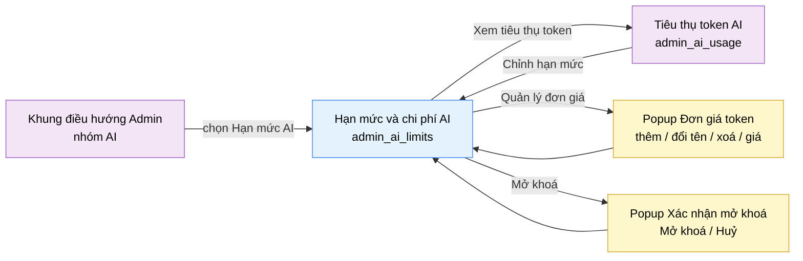

# Tài liệu thiết kế cơ bản (BD) — Hạn mức và chi phí AI (`ADM0303`)

## Phương châm tài liệu [Nội bộ — không cần khách duyệt]

- Viết theo **mẫu 9 sheet**. Bộ thẻ đóng, quy ước ID, ký hiệu chuẩn và checklist kiểm toán nằm ở
  `02-bd/_rules/bd-template-9sheet.md` — file này không chép lại.
- Phần gắn nhãn `[Nội bộ]` phục vụ sinh mã và tự kiểm toán, không phải yêu cầu của khách hàng.
- Mã màn `ADM0303`, slug `admin_ai_limits`. **Màn mới tách từ `ADM0301`** ngày 2026-10-10
  (`DEC-2026-1010-split-ai-admin-screens`): nhận các khu vực "Giới hạn tần suất", "Ngân sách và đơn giá", "Sinh
  testcase tự động" của `ADM0301` V0.9 và nhận thêm hạn mức token tháng cùng nút mở khoá ngân sách, vốn trước
  đó bị `ADM0301` và `ADM0302` đẩy qua lại cho nhau mà không màn nào sở hữu.
- **Nguyên tắc của màn: mọi thao tác ghi ngay, không có "Lưu và phát hành"** (khác `ADM0301`, nơi prompt có vòng
  đời nháp, phát hành). Đó là lý do hai nhóm việc được tách thành hai màn.
- Màn không có màn con, chỉ có 2 popup: Đơn giá token theo mô hình, Xác nhận mở khoá.

> Đọc cùng `01-rd/screens/admin/ADM0303_ai_limits.md` (hành vi ở mức yêu cầu, không lặp lại ở đây) và ba file BD
> module: `02-bd/architecture/F5_ai-review.md`, `02-bd/database/F5_ai-review.md`, `02-bd/security/F5_ai-review.md`.
>
> **Không thiết kế** gói đăng ký trả phí (subscription) tăng hạn mức cho người dùng — chủ dự án nêu như hướng cải
> tiến tương lai 2026-10-10, ngoài phạm vi đợt này; xem Câu hỏi mở Q6.

---

## Sheet 1. Bìa

| Mục | Giá trị |
| :--- | :--- |
| Hệ thống | AlgoPrep |
| Phân hệ | `ai-review` (F5) |
| Công đoạn | BD — Thiết kế cơ bản |
| Phân loại | Màn hình |
| Tên màn | Hạn mức và chi phí AI |
| Mã màn hình | `ADM0303` |
| Tên vật lý (slug) | `admin_ai_limits` |
| Trục tài liệu | Màn hình (`02-bd/screens/`) |
| Actor | A3 (`ADMIN`) |
| Phiên bản | V0.9 |
| Người tạo | Nhóm phát triển AlgoPrep |
| Ngày tạo | 2026/10/10 |
| Người cập nhật | Nhóm phát triển AlgoPrep |
| Ngày cập nhật | 2026/10/23 |

---

## Sheet 2. Lịch sử sửa đổi

| Ver | Sheet bị sửa | Nội dung sửa | Ngày | Người sửa |
| :--- | :--- | :--- | :--- | :--- |
| V0.1 | Toàn bộ | Tạo mới theo `DEC-2026-1010-split-ai-admin-screens`. Chuyển từ `ADM0301` V0.9 các khu vực D, G, H và các EVT, DTO, endpoint, kiểm nhập liệu đi kèm (đã đổi số thứ tự theo màn này). Thêm Khu vực B "Hạn mức token tháng" và nút "Mở khoá" (đóng M-01 của báo cáo `06-plan/reports/261009-1449-ai-admin-userflow-va-mau-thuan/`). Giới hạn tần suất đổi sang theo giờ (chủ dự án chốt 2026-10-10, khớp `02-bd/database/F5_ai-review.md` mục 6). Chưa dựng prototype | 2026/10/10 | AI |
| V0.2 | Sheet 4, 5, 6 | Dựng prototype (`views/admin/ai-limits`, route `/admin/ai-limits`, 2026-10-10). Ghi nhận khác biệt: chưa chia quyền `AI_TOKEN_BUDGET` và `AI_CONFIG`; trần bộ chỉnh giới hạn tần suất 999 là suy luận của prototype; ô hạn mức nhập số thô; "Mở khoá" chỉ hiện khi đang khoá, bấm khi hạn mức chưa vượt số đã dùng thì toast "Tăng hạn mức trước khi mở khoá."; lưu hạn mức bằng hoặc dưới số đã dùng thì mock tự chuyển sang "Đã khoá tự động" (máy chủ thật khoá ở lần gọi kế tiếp) | 2026/10/10 | AI |
| V0.3 | Sheet 5, 6, 9 | Chủ dự án muốn chỉnh số linh động hơn nút giảm, tăng (2026-10-10): các bộ chỉnh số của giới hạn tần suất, ngưỡng cảnh báo và số lần sinh testcase cho **nhập tay**. Nhập tay được: ô chỉ chứa con số và chọn hết khi bấm vào, đơn vị (lượt/giờ, %, lần) đứng ngoài ô nên không bị gõ đè; gõ số rồi Enter hoặc rời ô thì ghi, Esc bỏ, mũi tên lên xuống đổi một bước; số ngoài khoảng thì đưa về cận gần nhất, chữ không phải số nguyên thì giữ giá trị cũ (không báo lỗi). Sheet 9: lỗi nhập liệu của các ô này nay là "đưa về cận", không còn toast; hạn mức token giữ cách cũ (nhập rồi bấm Lưu, báo lỗi bằng toast) vì sai một chữ số đổi hạn mức gấp nhiều lần | 2026/10/10 | AI |
| V0.4 | Sheet 5, Câu hỏi mở | Đóng Q1 theo `DEC-2026-1010-ai-rate-limit-fixed-window` (2026-10-10): giới hạn theo giờ đếm bằng **cửa sổ cố định mỗi giờ** trên Redis, thời gian chờ là khoá riêng; chỉ áp cho phân tích bài giải và phỏng vấn giả lập. Không đổi giao diện | 2026/10/10 | AI |
| V0.5 | Sheet 5 | Làm rõ phạm vi giới hạn tần suất theo `DEC-2026-1011-ai-practice-feedback-in-shared-budget` (2026-10-11): chỉ Phân tích và Phỏng vấn; chữ trên màn đổi từ "mọi tính năng AI". Hạn mức token tháng và khoá thì phủ cả F6-08. Sửa nguồn trỏ tới prototype cũ. | 2026-10-11 | Claude |
| V0.6 | Sheet 5 | Sửa lỗi Minor review UX khu Admin F8 (`06-plan/reports/261014-1054-admin-ux-review/`), **chưa duyệt hình**: ô số của bộ chỉnh cao 26px bằng nút giảm, tăng; bộ chỉnh có thêm prop tuỳ chọn `unitWidth` để cố định bề rộng phần đơn vị, màn này truyền `9ch` nên nút của ba dòng giới hạn tần suất thẳng cột (Khu vực C mục 4) | 2026-10-14 | Claude |
| V0.7 | Sheet 4.3, 5, 7, Câu hỏi mở | Sửa 2026-10-22 đồng bộ DB, `DEC-2026-1022-ai-judge-schema-sync`. (1) Đóng Q3: ngưỡng cảnh báo và ba giới hạn tần suất là **cột** của singleton `ai.ai_token_budget_configs` (`warn_percent`, `review_per_hour`, `interview_per_hour`, `cooldown_seconds`), đơn giá nằm ở bảng mới `ai.ai_model_prices`; Redis chỉ giữ **bộ đếm**. Gỡ câu mục 4.3 "không dùng bảng PostgreSQL", gỡ nhãn "Chưa có bảng". (2) Khoá bộ đếm đủ `ai:ratelimit:<userId>:<featureCode>:<epochHour>` (trước thiếu `<epochHour>`). (3) Giới hạn 20 lượt/giờ của F6-08 là hằng số do `interview-bank` sở hữu (`interview_bank:ratelimit:<userId>`), không nằm ở màn này. (4) Ghi job đầu tháng đặt lại `period_start` và xoá `locked_at` (nhãn "Đã khoá tự động" tự về "Đang mở"). (5) Sửa số dòng trích `02-bd/database/F5_ai-review.md`. | 2026/10/22 | Nhóm phát triển AlgoPrep |
| V0.8 | Sheet 9, Câu hỏi mở | Sửa 2026-10-23 (`DEC-2026-1023-db-actor-review-decisions`). Đóng Q4: giữ hành vi prototype (đơn giá âm tự về 0, không báo lỗi), xoá mô hình không bị chặn, đổi tên làm dòng cũ mất khớp đơn giá. Sửa Sheet 9 NO 7 cho khớp. Không đổi giao diện | 2026/10/23 | Nhóm phát triển AlgoPrep |
| V0.9 | Sheet 7 (7.3 NO 1, 4 đến 7) | Đồng bộ chéo giai đoạn 3 sau `03-dd/api/F5_ai-review.md` mục 1.1 (D11, D12): (1) `GetAiTokenBudget` đã gộp với `GetAiTokenBudgetStatus` thành `GET /admin/token-budget` (mục 18); (2) `GetRateLimitConfig` và `GetAiBudgetSettings` gộp thành `GET /admin/limits-config` (mục 21), `UpdateRateLimitConfig` và `UpdateAiBudgetSettings` gộp thành `PATCH /admin/limits-config` (mục 22); (3) khoá Redis đã có `<epochHour>` từ V0.7, không cần sửa thêm (D12 đã đóng). Dời dòng V0.8 từ Sheet 1 về đúng Sheet 2. Không đổi giao diện | 2026/10/23 | Nhóm phát triển AlgoPrep |

---

## Sheet 3. Sơ đồ chuyển màn

> [Nội bộ] Quy ước vẽ: bố trí từ trái sang phải. Màn gọi tới tô tím, màn hiện tại tô xanh nhạt, popup tô vàng.

### 3.1 Danh sách chuyển màn

#### Khung điều hướng Admin → Hạn mức và chi phí AI

[Điều kiện mở] Chọn mục con "Hạn mức AI" trong nhóm "AI" ở thanh điều hướng bên trái.

[Chế độ mở] Không có.

[Thông tin truyền] Không có.

[Giá trị trả về] Không có.

[Khi thành công] Tải hạn mức token tháng, giới hạn tần suất, ngưỡng cảnh báo, đơn giá và trần sinh testcase; hiển thị 4 khối nội dung.

[Khi huỷ] Không có.

#### Tiêu thụ token AI → Hạn mức và chi phí AI

[Điều kiện mở] Bấm liên kết "Chỉnh hạn mức" trong khối "Cảnh báo" hoặc liên kết ở khối "Hạn mức tháng" của màn `admin_ai_usage` [Nguồn: 02-bd/screens/admin/ADM0302_ai_usage.md, EVT-6].

[Chế độ mở] Không có.

[Thông tin truyền] Không có.

[Giá trị trả về] Không có.

[Khi thành công] Mở màn này ở trạng thái khởi tạo.

[Khi huỷ] Không có.

#### Hạn mức và chi phí AI → Popup Đơn giá token theo mô hình

[Điều kiện mở] Bấm nút "Quản lý" ở dòng "Đơn giá token theo mô hình" trong khối "Ngân sách và đơn giá".

[Chế độ mở] Chế độ sửa danh mục: thêm, đổi tên, xoá mô hình và đặt đơn giá, không giới hạn số mô hình.

[Thông tin truyền] Danh sách mô hình kèm đơn giá hiện hành.

[Giá trị trả về] Không có; mọi thay đổi ghi ngay khi thao tác trong popup.

[Khi thành công] Popup hiển thị danh sách mô hình, mỗi dòng có tên, đơn giá và nút xoá.

[Khi huỷ] Đóng popup bằng nút "Đóng", khối giữ giá trị hiện hành.

#### Hạn mức và chi phí AI → Popup Xác nhận mở khoá

[Điều kiện mở] Bấm nút "Mở khoá" ở khối "Hạn mức token tháng" khi ngân sách đang ở trạng thái "Đã khoá tự động".

[Chế độ mở] Không có.

[Thông tin truyền] Hạn mức hiện hành và số token đã dùng trong chu kỳ.

[Giá trị trả về] Kết quả chọn "Mở khoá" hoặc "Huỷ".

[Khi thành công] Hiển thị cảnh báo rằng học viên và giảng viên sẽ gọi được AI trở lại ngay.

[Khi huỷ] Đóng popup, ngân sách vẫn khoá.

#### Hạn mức và chi phí AI → Tiêu thụ token AI

[Điều kiện mở] Bấm liên kết "Xem tiêu thụ token" ở thanh tiêu đề.

[Chế độ mở] Không có.

[Thông tin truyền] Không có.

[Giá trị trả về] Không có.

[Khi thành công] Điều hướng sang màn `admin_ai_usage`. Không có thay đổi chưa lưu nào để mất vì mọi thao tác trên màn này ghi ngay, nên **không hỏi xác nhận rời màn** (đóng câu hỏi Q8 cũ của `ADM0301` cho phần này).

[Khi huỷ] Không có.

### 3.2 Sơ đồ

[Nguồn: 02-bd/screens/admin/ADM0302_ai_usage.md (EVT-6); 02-bd/screens/admin/ADM0301_ai_config.md V0.9, Sheet 3]

---

## Sheet 4. Bố cục màn hình

### 4.1 Tổng quan màn

[Mục đích màn] Cho quản trị viên đặt **giới hạn và chi phí** của AI: hạn mức token tháng và mở khoá ngân sách, giới hạn tần suất gọi AI theo giờ, ngưỡng cảnh báo ngân sách, đơn giá token theo mô hình và số lần sinh testcase tự động mỗi bài [Nguồn: 01-rd/req/F5_ai-review.md — F5-19, F5-25; DEC-2026-1001-admin-configurable-settings; DEC-2026-1003-ai-testcase-generation-quota].

[Luồng nghiệp vụ chính]

1. **Hiển thị ban đầu**: vào màn, hệ thống tải song song các nhóm cấu hình. Mỗi khối hiển thị khung chờ riêng.
2. **Đặt hạn mức token tháng**: quản trị viên nhập hạn mức mới, bấm "Lưu hạn mức". Hạn mức là ràng buộc cứng: vượt thì hệ thống khoá AI cho `STUDENT` và `INSTRUCTOR` (F5-25).
3. **Mở khoá**: khi ngân sách đang khoá, quản trị viên bấm "Mở khoá" và xác nhận. Hệ thống xoá dấu khoá. Nếu số đã dùng vẫn lớn hơn hạn mức thì nút không kích hoạt: phải tăng hạn mức trước, nếu không hệ thống khoá lại ngay `[SoT: Suy luận]`.
4. **Đặt giới hạn tần suất**: chỉnh số lượt mỗi giờ của Phân tích bài giải, số phiên mỗi giờ của Phỏng vấn giả lập và giây chờ giữa hai yêu cầu. Ghi ngay.
5. **Đặt ngưỡng cảnh báo và đơn giá**: chỉnh ngưỡng bằng nút giảm, tăng, hoặc mở popup để thêm, đổi tên, xoá mô hình và đặt đơn giá. Ghi ngay.
6. **Đặt số lần sinh testcase tối đa mỗi bài**: nút giảm, tăng. Ghi ngay.

[Người dùng] Quản trị viên đã đăng nhập. Khối B (hạn mức token, mở khoá) cần Function `AI_TOKEN_BUDGET`; các khối C, D, E cần Function `AI_CONFIG`. Có `AI_CONFIG` mà không có `AI_TOKEN_BUDGET` thì khối B hiển thị chỉ đọc; ngược lại các khối C, D, E chỉ đọc [Nguồn: 02-bd/security/F5_ai-review.md:79-85; ADM0301 Q10].

[Tệp liên quan] Không có.

[Phạm vi]
- Không có prompt, rubric, nguyên tắc trả lời, model — thuộc `ADM0301`.
- Không có biểu đồ, bảng xếp hạng, cảnh báo bất thường — thuộc `ADM0302` (job hằng giờ chỉ ghi thêm một dòng `OPEN` khi người dùng đó chưa có dòng `OPEN` nào, `02-bd/database/F5_ai-review.md:240`).
- Không thiết kế gói đăng ký trả phí (Q6).
- Giới hạn sandbox của script sinh dữ liệu — thuộc `ADM0501` Khu vực F.

[Quyền sử dụng]
- Xem: được, khi có `AI_CONFIG` hoặc `AI_TOKEN_BUDGET` (theo từng khối).
- Thêm: được ở popup đơn giá (thêm mô hình).
- Sửa: được, theo quyền từng khối.
- Xoá: chỉ xoá mô hình khỏi bảng đơn giá.

[Số bản ghi tối đa] Giới hạn tần suất: 3 dòng. Hạn mức token: đúng 1 giá trị. Ngưỡng cảnh báo: đúng 1 giá trị. Đơn giá token: không giới hạn số mô hình. Trần sinh testcase: đúng 1 giá trị. Không phân trang.

[Nguồn: 02-bd/screens/admin/ADM0301_ai_config.md V0.9, Khu vực D, G, H; 02-bd/database/F5_ai-review.md:196-212 (mục 1.8), 214-225 (mục 1.8a)]

### 4.2 DTO liên quan

- `AiTokenBudgetDto` (mới)
- `RateLimitConfigDto`
- `AiBudgetSettingsDto`
- `ModelPriceDto`
- `AiTestcaseGenerationSettingsDto`

`[Suy luận]` — tên DTO do BD này đề xuất, `03-dd/api/F5_ai-review.md` chốt lại.

### 4.3 Bảng dữ liệu liên quan

| NO | Bảng | Ghi chú |
| --: | :--- | :--- |
| 1 | `ai.ai_token_budget_configs` | Singleton (`id = 1`). `limit_tokens`, `period_start`, `locked_at`, `updated_by`; từ 2026-10-22 thêm `warn_percent` (mặc định 70), `review_per_hour` (10), `interview_per_hour` (3), `cooldown_seconds` (20), mỗi cột `CHECK` 1-100 hoặc 1-999 [Nguồn: 02-bd/database/F5_ai-review.md:196-209] |
| 2 | `ai.ai_model_prices` | Đơn giá theo mô hình: `model_name` VARCHAR(100), `usd_per_million_tokens` NUMERIC(10,4) không âm, unique `lower(model_name)`; không FK từ `token_usage` [Nguồn: 02-bd/database/F5_ai-review.md:214-225] |
| 3 | `problem_bank_settings` | Singleton của `problem-bank`, cột `max_ai_generations_per_problem` [Nguồn: 02-bd/database/F2_problem-bank.md mục 1.10] |

Ba giới hạn tần suất và ngưỡng cảnh báo ngân sách là **cột trong PostgreSQL** (`ai_token_budget_configs`), lưu ở DB để cấu hình admin đã đặt không mất khi Redis khởi động lại [Nguồn: 02-bd/database/F5_ai-review.md:205-208]. Redis chỉ giữ **bộ đếm**: `ai:ratelimit:<userId>:<featureCode>:<epochHour>` (chỉ `SOLUTION_REVIEW`, `MOCK_INTERVIEW`, cửa sổ cố định theo giờ, hết hạn sau 1 giờ) và `ai:cooldown:<userId>` (TTL = `cooldown_seconds`) [Nguồn: 02-bd/database/F5_ai-review.md:282-283]. Đơn giá token ở `ai_model_prices`. **Sửa 2026-10-22:** câu cũ "không dùng bảng PostgreSQL ... chưa có bảng, xem Q3" đã lỗi thời (Q3 đã chốt).

### 4.4 Vùng bố cục

Màn dựng mới, **chưa có mockup trong `09-layoutBase`** (`[SoT: Suy luận]`); bố cục lấy theo quy ước các màn Admin khác (thẻ kính, một cột nội dung chính). Prototype đã dựng đúng thứ tự B, C, D, E (`05-coding/frontend/src/views/admin/ai-limits/ui/admin-ai-limits-view.tsx`).

| Vùng | Nội dung |
| :--- | :--- |
| Thanh điều hướng bên trái, chân trang | Khung chung Admin, mục "Hạn mức AI" đang chọn |
| Thanh tiêu đề | Tiêu đề, mô tả phụ, liên kết "Xem tiêu thụ token" |
| Khối B — Hạn mức token tháng | Trạng thái (Đang mở / Đã khoá tự động), ô hạn mức, "Lưu hạn mức", số đã dùng, nút "Mở khoá" |
| Khối C — Giới hạn tần suất | 3 dòng giới hạn theo giờ, mỗi dòng nhãn và bộ chỉnh số |
| Khối D — Ngân sách và đơn giá | Ngưỡng cảnh báo (bộ chỉnh số), dòng "Đơn giá token theo mô hình" kèm nút "Quản lý" |
| Khối E — Sinh testcase tự động | Bộ chỉnh "Số lần sinh tối đa mỗi bài" (1 đến 10) |

### 4.5 Cấu trúc slice FSD [Nội bộ]

| Khối | Slice dự kiến | Căn cứ |
| :--- | :--- | :--- |
| Trang | `views/admin/ai-limits` | `DEC-2026-0929-fsd-views-grouped-entities-domain-only` |
| Khung Admin | Dùng lại `widgets/admin-shell` | `02-bd/screens/admin/_shell.md` |
| Kho ngưỡng, đơn giá, trần sinh testcase | `entities/ai-budget`, `entities/problem` (`aiGenerationSettings`) — giữ nguyên chỗ, chỉ đổi màn dùng | Mã prototype hiện có ở `views/admin/ai-config` |
| Dialog đơn giá | `shared/ui/managed-list-dialog` | Mã prototype hiện có |

`[Suy luận]` — ánh xạ slice do BD đề xuất, DD màn hình chốt lại.

---

## Sheet 5. Danh sách item màn hình

> Quy ước ID, bộ thẻ và giá trị chuẩn: `02-bd/_rules/bd-template-9sheet.md` mục 2, 3, 4.

### Khu vực A — Thanh tiêu đề

| Khu vực | NO | Tên item | ID item | Bảng DB | Cột DB | Loại UI | Kiểu | Độ dài | Bắt buộc | I/O | Giá trị mặc định | Định dạng | Ghi chú |
| :--- | --: | :--- | :--- | :--- | :--- | :--- | :--- | :--- | :-: | :-: | :--- | :--- | :--- |
| Thanh tiêu đề | | | | | | | | | | | | | |
| | 1 | Tiêu đề màn | `adminAiLimits.header.title` | - | - | Label | String | - | - | O | Hạn mức và chi phí AI | - | Nhãn tĩnh i18n [EVT liên quan] - |
| | 2 | Mô tả phụ | `adminAiLimits.header.subtitle` | - | - | Label | String | - | - | O | Hạn mức token, giới hạn tần suất và đơn giá | - | Nhãn tĩnh i18n [EVT liên quan] - |
| | 3 | Xem tiêu thụ token | `adminAiLimits.header.linkUsage` | - | - | Link | - | - | - | I | - | - | Điều hướng sang màn `admin_ai_usage` [EVT liên quan] EVT-7 |

### Khu vực B — Hạn mức token tháng

| Khu vực | NO | Tên item | ID item | Bảng DB | Cột DB | Loại UI | Kiểu | Độ dài | Bắt buộc | I/O | Giá trị mặc định | Định dạng | Ghi chú |
| :--- | --: | :--- | :--- | :--- | :--- | :--- | :--- | :--- | :-: | :-: | :--- | :--- | :--- |
| Hạn mức token tháng | | | | | | | | | | | | | |
| | 1 | Trạng thái ngân sách | `adminAiLimits.budget.statusBadge` | `ai.ai_token_budget_configs` | `locked_at` | Badge | Enum | - | - | O | Đang mở | Nhãn tiếng Việt | `locked_at` rỗng thành "Đang mở"; có giá trị thành "Đã khoá tự động". Đầu mỗi tháng một job `@Scheduled` đặt `period_start` về ngày 1 và xoá `locked_at`, nên khoá tự động tự mở ở chu kỳ mới (`DEC-2026-1022-ai-judge-schema-sync` mục 4) [Nguồn: 02-bd/database/F5_ai-review.md:212] [EVT liên quan] EVT-1 |
| | 2 | Hạn mức token tháng | `adminAiLimits.budget.limitTokens` | `ai.ai_token_budget_configs` | `limit_tokens` | NumberBox | Number | 12 | Có | I/O | Giá trị đang lưu | Số nguyên dương, tách nghìn | Hạn mức token của chu kỳ tháng hiện hành. Nhập số rồi bấm "Lưu hạn mức"; **không ghi khi gõ** vì sai một chữ số là đổi hạn mức gấp nhiều lần [EVT liên quan] EVT-2 |
| | 3 | Lưu hạn mức | `adminAiLimits.budget.btnSaveLimit` | - | - | Button | - | - | - | I | - | - | Ghi hạn mức mới [EVT liên quan] EVT-2 |
| | 4 | Đã dùng trong chu kỳ | `adminAiLimits.budget.usedTokens` | `ai.token_usage` | `total_tokens` | Label | Number | - | - | O | - | `{số} / {hạn mức}` | Tổng token đã dùng từ `period_start`, tổng hợp từ `token_usage` [Nguồn: 02-bd/architecture/F5_ai-review.md:266-269]. Sang chu kỳ mới `period_start` đổi nên số này tự về 0, không có thao tác xoá `token_usage` [Nguồn: 02-bd/database/F5_ai-review.md:212] [EVT liên quan] EVT-1 |
| | 5 | Mở khoá | `adminAiLimits.budget.btnUnlock` | `ai.ai_token_budget_configs` | `locked_at` | Button | - | - | - | I | - | - | Xoá dấu khoá để `STUDENT`, `INSTRUCTOR` gọi AI lại [EVT liên quan] EVT-3 |

### Khu vực C — Giới hạn tần suất (theo giờ)

| Khu vực | NO | Tên item | ID item | Bảng DB | Cột DB | Loại UI | Kiểu | Độ dài | Bắt buộc | I/O | Giá trị mặc định | Định dạng | Ghi chú |
| :--- | --: | :--- | :--- | :--- | :--- | :--- | :--- | :--- | :-: | :-: | :--- | :--- | :--- |
| Giới hạn tần suất | | | | | | | | | | | | | |
| | 1 | Danh sách giới hạn | `adminAiLimits.rateLimit.list` | - | - | List | List | - | - | I/O | 3 dòng | - | 3 giới hạn chống lạm dụng và giữ chi phí (F5-19): Phân tích mỗi giờ, Phỏng vấn mỗi giờ, Chờ giữa hai yêu cầu (ba giới hạn chỉ áp cho Phân tích bài giải và Phỏng vấn giả lập; Chế độ luyện F6-08 giữ hằng số riêng 20 lượt mỗi giờ do `interview-bank` sở hữu, bộ đếm ở khoá `interview_bank:ratelimit:<userId>`, không chỉnh ở đây [Nguồn: 02-bd/database/F6_interview-bank.md:236, 252]) [Nguồn giá trị] Ba cột `review_per_hour`, `interview_per_hour`, `cooldown_seconds` của `ai.ai_token_budget_configs`; Redis chỉ giữ bộ đếm [Nguồn: 02-bd/database/F5_ai-review.md:206-208, 282] [EVT liên quan] EVT-1 |
| | 2 | Tên giới hạn | `adminAiLimits.rateLimit.col.label` | - | - | ListColumn | String | - | - | O | - | - | Nhãn tĩnh i18n map từ mã giới hạn [EVT liên quan] - |
| | 3 | Đơn vị | `adminAiLimits.rateLimit.col.meta` | - | - | ListColumn | String | - | - | O | - | - | Câu giải thích cách tính, ví dụ "Theo từng tài khoản người học, mỗi giờ" [EVT liên quan] - |
| | 4 | Giá trị giới hạn | `adminAiLimits.rateLimit.col.value` | `ai.ai_token_budget_configs` | `review_per_hour`, `interview_per_hour`, `cooldown_seconds` | NumberBox | Number | 4 | Có | I/O | 10 lượt/giờ (Phân tích), 3 phiên/giờ (Phỏng vấn), 20 giây (chờ) | Số nguyên kèm đơn vị | Ngưỡng áp dụng cho mỗi người dùng. **Theo giờ** (chủ dự án chốt 2026-10-10), khớp `02-bd/database/F5_ai-review.md` mục 6; giây chờ 20 lấy từ prototype `[SoT: Suy luận]`. Dùng bộ chỉnh bước 1 và **nhập tay được** (V0.3); khoảng 1 đến 999 là `[SoT: Suy luận]` và đã thành `CHECK BETWEEN 1 AND 999` ở DB (mặc định 10 / 3 / 20) [Nguồn: 02-bd/database/F5_ai-review.md:206-208]. Sửa 2026-10-14 (review UX F8, chưa duyệt hình): ô số cao 26px bằng nút giảm, tăng; phần đơn vị có bề rộng tối thiểu `9ch` nên nút của ba dòng thẳng cột dù đơn vị dài ngắn khác nhau ("lượt/giờ", "phiên/giờ", "giây") [Nguồn: 05-coding/frontend/src/shared/ui/primitives/number-stepper.tsx:54,103,124] [Nguồn: 05-coding/frontend/src/views/admin/ai-limits/ui/admin-ai-limits-view.tsx:193] [EVT liên quan] EVT-4 |

### Khu vực D — Ngân sách và đơn giá

| Khu vực | NO | Tên item | ID item | Bảng DB | Cột DB | Loại UI | Kiểu | Độ dài | Bắt buộc | I/O | Giá trị mặc định | Định dạng | Ghi chú |
| :--- | --: | :--- | :--- | :--- | :--- | :--- | :--- | :--- | :-: | :-: | :--- | :--- | :--- |
| Ngân sách và đơn giá | | | | | | | | | | | | | |
| | 1 | Tiêu đề khối | `adminAiLimits.cost.title` | - | - | Label | String | - | - | O | Ngân sách và đơn giá | - | Kèm mô tả phụ "Quản trị viên tự đặt, không giới hạn" [EVT liên quan] - |
| | 2 | Giảm ngưỡng | `adminAiLimits.cost.btnWarnDecrease` | - | - | Button | - | - | - | I | - | `−` | Trừ 5, không xuống dưới 1 [EVT liên quan] EVT-5 |
| | 3 | Ngưỡng cảnh báo ngân sách | `adminAiLimits.cost.warnPercent` | `ai.ai_token_budget_configs` | `warn_percent` | NumberBox | Number | 3 | Có | I/O | 70 | `{số}%` | Ngưỡng phần trăm mức dùng so với hạn mức token mà tại đó thanh ngân sách ở `admin_ai_usage` đổi sang màu cảnh báo. Số nguyên 1 đến 100, bước 5 (`CHECK warn_percent BETWEEN 1 AND 100`). Mặc định 70 [Nguồn: 01-rd/screens/admin/ADM0302_ai_usage.md:50-52; 02-bd/database/F5_ai-review.md:205] [EVT liên quan] EVT-5 |
| | 4 | Tăng ngưỡng | `adminAiLimits.cost.btnWarnIncrease` | - | - | Button | - | - | - | I | - | `+` | Cộng 5, không vượt quá 100 [EVT liên quan] EVT-5 |
| | 5 | Quản lý đơn giá | `adminAiLimits.cost.btnManagePrices` | - | - | Button | - | - | - | I | - | - | Mở popup quản lý đơn giá token theo mô hình, kèm mô tả "Mô hình chưa có đơn giá thì cột Chi phí hiện dấu -" [EVT liên quan] EVT-6 |

### Khu vực E — Sinh testcase tự động

| Khu vực | NO | Tên item | ID item | Bảng DB | Cột DB | Loại UI | Kiểu | Độ dài | Bắt buộc | I/O | Giá trị mặc định | Định dạng | Ghi chú |
| :--- | --: | :--- | :--- | :--- | :--- | :--- | :--- | :--- | :-: | :-: | :--- | :--- | :--- |
| Sinh testcase tự động | | | | | | | | | | | | | |
| | 1 | Giảm số lần | `adminAiLimits.testcaseGen.btnDecrease` | - | - | Button | - | - | - | I | - | `−` | Trừ 1, không xuống dưới 1 [EVT liên quan] EVT-10 |
| | 2 | Số lần sinh tối đa mỗi bài | `adminAiLimits.testcaseGen.maxPerProblem` | `problem_bank_settings` | `max_ai_generations_per_problem` | NumberBox | Number | 2 | Có | I/O | 2 | `{số} lần` | Áp dụng cho mọi bài. Chỉ lần sinh **thành công** mới tính; lần lỗi không tính; duyệt hoặc loại nháp không hoàn lại lượt. Đổi giá trị **không** xoá bộ đếm đã dùng [Nguồn: DEC-2026-1003-ai-testcase-generation-quota]. Khoảng 1 đến 10 là `[SoT: Suy luận]` [EVT liên quan] EVT-10 |
| | 3 | Tăng số lần | `adminAiLimits.testcaseGen.btnIncrease` | - | - | Button | - | - | - | I | - | `+` | Cộng 1, không vượt quá 10 [EVT liên quan] EVT-10 |

### Popup

| Khu vực | NO | Tên item | ID item | Bảng DB | Cột DB | Loại UI | Kiểu | Độ dài | Bắt buộc | I/O | Giá trị mặc định | Định dạng | Ghi chú |
| :--- | --: | :--- | :--- | :--- | :--- | :--- | :--- | :--- | :-: | :-: | :--- | :--- | :--- |
| Popup | | | | | | | | | | | | | |
| | 1 | Đơn giá token theo mô hình | `adminAiLimits.popup.modelPrices` | `ai.ai_model_prices` | - | Popup | - | - | - | I/O | - | - | Popup quản lý danh sách mô hình và đơn giá. Dòng hướng dẫn: "Nhập đơn giá (USD cho mỗi 1 triệu token) của từng mô hình. Không giới hạn số mô hình." [EVT liên quan] EVT-6 đến 9 |
| | 2 | Danh sách mô hình | `adminAiLimits.popup.modelPrices.list` | `ai.ai_model_prices` | - | List | List | - | - | I/O | 1 dòng mẫu "Mô hình mặc định", 3 USD (dữ liệu mẫu prototype) | - | Mỗi dòng gồm tên mô hình, ô đơn giá, nút lưu tên, nút xoá. Không giới hạn số dòng [EVT liên quan] EVT-6 |
| | 3 | Tên mô hình | `adminAiLimits.popup.modelPrices.name` | `ai.ai_model_prices` | `model_name` (khớp `ai.token_usage.model_name`) | TextBox | String | 100 | Có | I/O | - | Văn bản tự do, cắt khoảng trắng hai đầu | Là chuỗi dữ liệu, không phải khoá i18n. Sửa xong bấm nút lưu tên hoặc Enter mới ghi [EVT liên quan] EVT-7 |
| | 4 | Đơn giá | `adminAiLimits.popup.modelPrices.usdPerMillion` | `ai.ai_model_prices` | `usd_per_million_tokens` (NUMERIC(10,4), `CHECK >= 0`) | NumberBox | Number | - | Có | I/O | 0 (mô hình mới) | `{số}` USD mỗi 1 triệu token, bước 0.1 | Không âm. Ghi ngay khi đổi [EVT liên quan] EVT-8 |
| | 5 | Xoá mô hình | `adminAiLimits.popup.modelPrices.btnDelete` | `ai.ai_model_prices` | - | Button | - | - | - | I | - | - | Xoá mô hình khỏi bảng đơn giá, không kiểm "đang được tham chiếu"; cột Chi phí của dòng dùng mô hình đó hiện `-` [EVT liên quan] EVT-9 |
| | 6 | Tên mô hình mới | `adminAiLimits.popup.modelPrices.newName` | - | - | TextBox | String | - | Có | I | rỗng | Văn bản tự do | Gợi ý "Ví dụ: claude-sonnet" [EVT liên quan] EVT-7 |
| | 7 | Thêm | `adminAiLimits.popup.modelPrices.btnAdd` | - | - | Button | - | - | - | I | - | - | Thêm mô hình mới với đơn giá 0 [EVT liên quan] EVT-7 |
| | 8 | Đóng | `adminAiLimits.popup.modelPrices.btnClose` | - | - | Button | - | - | - | I | - | - | Đóng popup |
| | 9 | Xác nhận mở khoá | `adminAiLimits.popup.unlockConfirm` | - | - | Popup | - | - | - | I | - | Mở khoá / Huỷ | Hiển thị hạn mức, số đã dùng và cảnh báo hậu quả [EVT liên quan] EVT-3, EVT-11 |

[Nguồn: 02-bd/screens/admin/ADM0301_ai_config.md V0.9 (Khu vực D, G, H, Popup); 05-coding/frontend/src/views/admin/ai-config/ui/admin-ai-config-view.tsx (prototype đã chuyển sang `views/admin/ai-limits`)]

---

## Sheet 6. Đặc tả điều khiển item

> Ký hiệu cột `Hiển thị`: `02-bd/_rules/bd-template-9sheet.md` mục 2, 3. Dùng đúng NO, tên item và thứ tự của Sheet 5.

### Khu vực A — Thanh tiêu đề

| Khu vực | NO | Tên item | Hiển thị | Ghi chú |
| :--- | --: | :--- | :-: | :--- |
| Thanh tiêu đề | | | | |
| | 1 | Tiêu đề màn | Có | - |
| | 2 | Mô tả phụ | Có | - |
| | 3 | Xem tiêu thụ token | Có | - |

### Khu vực B — Hạn mức token tháng

| Khu vực | NO | Tên item | Hiển thị | Ghi chú |
| :--- | --: | :--- | :-: | :--- |
| Hạn mức token tháng | | | | |
| | 1 | Trạng thái ngân sách | Có | [Tự động đặt] Cập nhật theo `locked_at` mỗi lần tải; "Đã khoá tự động" tô màu cảnh báo. |
| | 2 | Hạn mức token tháng | Có | [Điều kiện kích hoạt] Kích hoạt khi người dùng có `AI_TOKEN_BUDGET:UPDATE`, ngược lại chỉ đọc. |
| | 3 | Lưu hạn mức | Có | [Điều kiện kích hoạt] Kích hoạt khi giá trị nhập khác giá trị đang lưu, hợp lệ (Sheet 9 NO 2) và có `AI_TOKEN_BUDGET:UPDATE`. |
| | 4 | Đã dùng trong chu kỳ | Có | [Tự động đặt] Tính lại mỗi lần tải và mỗi chu kỳ làm mới; thanh hiển thị đổi màu khi đạt ngưỡng cảnh báo (Khu vực D NO 3). |
| | 5 | Mở khoá | Điều kiện | [Điều kiện hiển thị] Chỉ hiển thị khi trạng thái là "Đã khoá tự động". [Điều kiện kích hoạt] Kích hoạt khi hạn mức hiện hành lớn hơn số đã dùng và người dùng có `AI_TOKEN_BUDGET:UPDATE`; ngược lại không kích hoạt, kèm dòng "Tăng hạn mức trước khi mở khoá" `[SoT: Suy luận]`. |

### Khu vực C — Giới hạn tần suất

| Khu vực | NO | Tên item | Hiển thị | Ghi chú |
| :--- | --: | :--- | :-: | :--- |
| Giới hạn tần suất | | | | |
| | 1 | Danh sách giới hạn | Có | [Điều kiện hiển thị] Trong lúc tải hiển thị khung chờ đúng 3 dòng. |
| | 2 | Tên giới hạn | Có | - |
| | 3 | Đơn vị | Có | - |
| | 4 | Giá trị giới hạn | Có | [Điều kiện kích hoạt] Kích hoạt sau khi tải xong khi có `AI_CONFIG:UPDATE`; nút giảm không kích hoạt ở 1. [Tự động đặt] Ghi ngay sau mỗi lần đổi. |

### Khu vực D — Ngân sách và đơn giá

| Khu vực | NO | Tên item | Hiển thị | Ghi chú |
| :--- | --: | :--- | :-: | :--- |
| Ngân sách và đơn giá | | | | |
| | 1 | Tiêu đề khối | Có | - |
| | 2 | Giảm ngưỡng | Có | [Điều kiện kích hoạt] Không kích hoạt khi ngưỡng bằng 1. |
| | 3 | Ngưỡng cảnh báo ngân sách | Có | [Tự động đặt] Cập nhật ngay khi bấm nút giảm hoặc tăng, kèm ký hiệu `%`. |
| | 4 | Tăng ngưỡng | Có | [Điều kiện kích hoạt] Không kích hoạt khi ngưỡng bằng 100. |
| | 5 | Quản lý đơn giá | Có | [Điều kiện kích hoạt] Luôn kích hoạt về mặt giao diện khi có `AI_CONFIG:UPDATE`. |

### Khu vực E — Sinh testcase tự động

| Khu vực | NO | Tên item | Hiển thị | Ghi chú |
| :--- | --: | :--- | :-: | :--- |
| Sinh testcase tự động | | | | |
| | 1 | Giảm số lần | Có | [Điều kiện kích hoạt] Không kích hoạt khi bằng 1. |
| | 2 | Số lần sinh tối đa mỗi bài | Có | [Tự động đặt] Cập nhật ngay, kèm chữ "lần". |
| | 3 | Tăng số lần | Có | [Điều kiện kích hoạt] Không kích hoạt khi bằng 10. |

### Popup

| Khu vực | NO | Tên item | Hiển thị | Ghi chú |
| :--- | --: | :--- | :-: | :--- |
| Popup | | | | |
| | 1 | Đơn giá token theo mô hình | Điều kiện | [Điều kiện hiển thị] Chỉ sau khi bấm "Quản lý". Các khối khác không bị khoá khi popup mở. |
| | 2 | Danh sách mô hình | Có | [Điều kiện hiển thị] Không có dòng nào thì danh sách trống, vẫn hiển thị ô thêm mô hình mới. |
| | 3 | Tên mô hình | Có | [Điều kiện kích hoạt] Nút lưu tên chỉ hiện khi tên đã sửa. |
| | 4 | Đơn giá | Có | [Tự động đặt] Ghi ngay; giá trị âm hoặc không phải số bị đưa về 0 (hành vi của prototype, xem Sheet 9 NO 7). |
| | 5 | Xoá mô hình | Có | [Điều kiện kích hoạt] Luôn kích hoạt: không đếm bản ghi tham chiếu. |
| | 6 | Tên mô hình mới | Có | - |
| | 7 | Thêm | Có | [Điều kiện kích hoạt] Luôn kích hoạt; ô rỗng hoặc trùng tên thì ô đổi viền đỏ và hiện toast lỗi, không thêm. |
| | 8 | Đóng | Có | - |
| | 9 | Xác nhận mở khoá | Điều kiện | [Điều kiện hiển thị] Chỉ sau khi bấm "Mở khoá" và nút đó đang kích hoạt. |

[Nguồn: 02-bd/screens/admin/ADM0301_ai_config.md V0.9, Sheet 6]

---

## Sheet 7. Danh sách truyền dữ liệu

### 7.1 Trường DTO

| NO | DTO | Trường DTO | Kiểu | Bảng DB | Cột DB | Item màn | Hiển thị | Ghi chú |
| --: | :--- | :--- | :--- | :--- | :--- | :--- | :-: | :--- |
| 1 | `AiTokenBudgetDto` | `limitTokens` | Number | `ai.ai_token_budget_configs` | `limit_tokens` | Hạn mức "Hạn mức token tháng" | Có | [Nguồn] Phản hồi của `GetAiTokenBudget`; giá trị người dùng nhập [Đích] Tham số của `UpdateAiTokenBudgetLimit` |
| 2 | `AiTokenBudgetDto` | `usedTokens` | Number | `ai.token_usage` | tổng `total_tokens` | Hạn mức "Đã dùng trong chu kỳ" | Có | [Nguồn] Tổng hợp từ `token_usage` từ `period_start`. Không có đường ghi ngược |
| 3 | `AiTokenBudgetDto` | `lockedAt` | Timestamp | `ai.ai_token_budget_configs` | `locked_at` | Hạn mức "Trạng thái ngân sách", "Mở khoá" | Có | [Chuyển đổi] Rỗng thành "Đang mở", có giá trị thành "Đã khoá tự động". Xoá bằng `UnlockAiTokenBudget` |
| 4 | `RateLimitConfigDto` | `limitCode` | String | `ai.ai_token_budget_configs` | `review_per_hour` / `interview_per_hour` / `cooldown_seconds` | Giới hạn "Tên giới hạn", "Đơn vị" | Có | [Nguồn] Ánh xạ mã giới hạn sang tên cột của singleton; khoá tra nhãn tĩnh i18n |
| 5 | `RateLimitConfigDto` | `value` | Number | `ai.ai_token_budget_configs` | `review_per_hour` / `interview_per_hour` / `cooldown_seconds` | Giới hạn "Giá trị giới hạn" | Có | [Nguồn] Giá trị người dùng nhập [Đích] Tham số của `UpdateRateLimitConfig`, ghi vào cột tương ứng của `ai_token_budget_configs` (bộ đếm Redis không đổi). Đơn vị cố định là theo giờ (trừ giây chờ) |
| 6 | `AiBudgetSettingsDto` | `warnPercent` | Number | `ai.ai_token_budget_configs` | `warn_percent` | Ngân sách "Ngưỡng cảnh báo ngân sách" | Có | [Nguồn] Phản hồi của `GetAiBudgetSettings` [Đích] Tham số của `UpdateAiBudgetSettings` [Chuyển đổi] Số nguyên 1 đến 100. **Đọc lại ở `admin_ai_usage`** để quyết định màu thanh ngân sách [Nguồn: 02-bd/screens/admin/ADM0302_ai_usage.md:388] |
| 7 | `ModelPriceDto` | `id`, `modelName` | UUID, String | `ai.ai_model_prices` | `id`, `model_name` | Popup đơn giá "Tên mô hình" | Có (`modelName`) | [Nguồn] Phản hồi của `ListModelPrices`; giá trị người dùng nhập [Đích] `CreateModelPrice`, `UpdateModelPrice`, `DeleteModelPrice` [Chuyển đổi] `modelName` là khoá nối với `ai.token_usage.model_name` khi tính cột Chi phí; so khớp không phân biệt hoa thường, cắt khoảng trắng hai đầu. Đổi tên làm bản ghi `token_usage` cũ không còn khớp, xem Q4 |
| 8 | `ModelPriceDto` | `usdPerMillionTokens` | Number | `ai.ai_model_prices` | `usd_per_million_tokens` | Popup đơn giá "Đơn giá" | Có | [Chuyển đổi] Không âm. **Đọc lại ở `admin_ai_usage`** (cột Chi phí) [Nguồn: 02-bd/screens/admin/ADM0302_ai_usage.md:330]. Không có đơn giá nào thì cột Chi phí hiện `-` |
| 9 | `AiTestcaseGenerationSettingsDto` | `maxPerProblem` | Number | `problem_bank_settings` | `max_ai_generations_per_problem` | Sinh testcase "Số lần sinh tối đa mỗi bài" | Có | [Nguồn] Phản hồi của `GetAiTestcaseGenerationSettings` [Đích] `UpdateAiTestcaseGenerationSettings`. Màn soạn bài (`SHR0202`) không đọc con số này, chỉ nhận "đã dùng / tối đa" của từng bài |

### 7.2 Truy cập bảng dữ liệu (3)

| NO | Tên logic | Bảng | Repository | CRUD | Mục đích | Ghi chú |
| --: | :--- | :--- | :--- | :-: | :--- | :--- |
| 1 | Cấu hình ngân sách token | `ai.ai_token_budget_configs` | `AiTokenBudgetConfigRepository` | R, U | Đọc và cập nhật hạn mức, `warn_percent`, ba giới hạn tần suất; xoá `locked_at` khi mở khoá | `GetAiTokenBudget`: R `UpdateAiTokenBudgetLimit`: U `UnlockAiTokenBudget`: U `GetAiBudgetSettings`, `UpdateAiBudgetSettings`, `UpdateRateLimitConfig`: R, U |
| 2 | Đơn giá mô hình | `ai.ai_model_prices` | `AiModelPriceRepository` | C, R, U, D | Danh mục đơn giá USD mỗi 1 triệu token | `ListModelPrices`: R `CreateModelPrice`: C `UpdateModelPrice`: U `DeleteModelPrice`: D |
| 3 | Cài đặt sinh testcase | `problem_bank_settings` | `ProblemBankSettingsRepository` | R, U | Đọc và cập nhật trần sinh testcase | Thuộc `problem-bank` |

Giới hạn tần suất và ngưỡng cảnh báo đọc/ghi qua `AiTokenBudgetConfigRepository` (cột DB). Redis chỉ giữ bộ đếm của người dùng, màn này không đọc bộ đếm.

`[Suy luận]` — tên repository do BD này đề xuất, DD chốt lại.

### 7.3 Danh sách endpoint [Nội bộ]

> Chỉ tên nghiệp vụ và BC sở hữu. Hợp đồng chi tiết thuộc `03-dd/api/F5_ai-review.md`.

| NO | Endpoint (tên nghiệp vụ) | Mục đích | BC sở hữu |
| --: | :--- | :--- | :--- |
| 1 | `GetAiTokenBudget` | Tải hạn mức, số đã dùng, trạng thái khoá. **Đã gộp 2026-10-23** với `GetAiTokenBudgetStatus` của `ADM0302` thành một endpoint `GET /admin/token-budget` (`03-dd/api/F5_ai-review.md` mục 18) | `ai-review` |
| 2 | `UpdateAiTokenBudgetLimit` | Cập nhật hạn mức, backend kiểm số nguyên dương, quyền `AI_TOKEN_BUDGET:UPDATE` | `ai-review` |
| 3 | `UnlockAiTokenBudget` | Xoá `locked_at`, backend từ chối khi số đã dùng chưa nhỏ hơn hạn mức, ghi audit | `ai-review` |
| 4 | `GetRateLimitConfig` | Tải giới hạn tần suất hiện hành. **Gộp 2026-10-23** với NO 6 thành một endpoint `GET /admin/limits-config` (`03-dd/api/F5_ai-review.md` mục 21) | `ai-review` |
| 5 | `UpdateRateLimitConfig` | Cập nhật giới hạn tần suất. **Gộp 2026-10-23** với NO 7 thành một endpoint `PATCH /admin/limits-config` (mục 22) | `ai-review` |
| 6 | `GetAiBudgetSettings` | Tải ngưỡng cảnh báo ngân sách (nguồn mà `admin_ai_usage` đọc). Đã gộp vào `GET /admin/limits-config` cùng NO 4 | `ai-review` |
| 7 | `UpdateAiBudgetSettings` | Cập nhật ngưỡng, backend kiểm số nguyên 1 đến 100. Đã gộp vào `PATCH /admin/limits-config` cùng NO 5 | `ai-review` |
| 8 | `ListModelPrices` | Tải danh sách mô hình kèm đơn giá | `ai-review` |
| 9 | `CreateModelPrice` | Thêm mô hình với đơn giá khởi tạo 0 | `ai-review` |
| 10 | `UpdateModelPrice` | Đổi tên và/hoặc đơn giá | `ai-review` |
| 11 | `DeleteModelPrice` | Xoá mô hình khỏi danh sách đơn giá | `ai-review` |
| 12 | `GetAiTestcaseGenerationSettings` | Tải trần sinh testcase (F2-14) | `problem-bank` |
| 13 | `UpdateAiTestcaseGenerationSettings` | Cập nhật trần, backend kiểm 1 đến 10 | `problem-bank` |

`[Suy luận]` — tên endpoint do BD này đề xuất; tên và quyền thật do `03-dd/api/F5_ai-review.md` chốt.

[Nguồn: 02-bd/database/F5_ai-review.md:196-225; 02-bd/screens/admin/ADM0301_ai_config.md V0.9, Sheet 7]

---

## Sheet 8. Danh sách sự kiện

> Bộ thẻ và quy ước cột `Chuyển màn`: `02-bd/_rules/bd-template-9sheet.md` mục 2, 3.

### Màn chính: Hạn mức và chi phí AI

| NO | Loại | Sự kiện | Chi tiết | Chuyển màn | Gọi API | Tên xử lý | Ghi chú |
| --: | :--- | :--- | :--- | :-: | :-: | :--- | :--- |
| 1 | Màn hình | Khởi tạo màn | Vào màn thì tải toàn bộ cấu hình hiện hành. | Không | Có | `GetAiTokenBudget`, `GetRateLimitConfig`, `GetAiBudgetSettings`, `ListModelPrices`, `GetAiTestcaseGenerationSettings` | [Các bước] 1. Kiểm tra quyền `AI_CONFIG` hoặc `AI_TOKEN_BUDGET`; không có cả hai thì chặn. 2. Hiển thị khung chờ riêng cho từng khối. 3. Tải song song các nhóm dữ liệu. [Khi thành công] Hiển thị 4 khối ở trạng thái đang lưu. [Khi lỗi] Toast lỗi tại đúng khối tải thất bại; các khối tải được vẫn hiển thị, không rời màn. |
| 2 | Nút | Lưu hạn mức token | Bấm "Lưu hạn mức". | Không | Có | `UpdateAiTokenBudgetLimit` | [Các bước] 1. Kiểm giá trị là số nguyên dương. 2. Gửi hạn mức lên máy chủ. [Khi thành công] Hạn mức và dòng "Đã dùng" cập nhật; nếu hạn mức mới lớn hơn số đã dùng, nút "Mở khoá" (nếu đang hiện) trở nên kích hoạt. Toast "Đã lưu hạn mức." [Khi lỗi] Giữ giá trị cũ, toast lỗi. |
| 3 | Nút | Mở khoá ngân sách | Bấm "Mở khoá", rồi "Mở khoá" trong popup xác nhận (EVT-11). | Không | Có | `UnlockAiTokenBudget` | [Các bước] 1. Mở popup xác nhận (EVT-11). 2. Xác nhận thì gửi yêu cầu. [Khi thành công] Trạng thái về "Đang mở", nút "Mở khoá" ẩn, toast "Đã mở khoá AI." Ghi một dòng vào nhật ký hệ thống. [Khi lỗi] Máy chủ từ chối vì số đã dùng chưa nhỏ hơn hạn mức thì giữ trạng thái khoá và toast nêu lý do. |
| 4 | Nút | Đổi giới hạn tần suất | Bấm giảm hoặc tăng ở một dòng giới hạn. | Không | Có | `UpdateRateLimitConfig` | [Các bước] 1. Tăng hoặc giảm 1, không dưới 1. 2. Ghi giá trị mới. [Khi thành công] Giá trị hiển thị ngay; áp dụng cho lần gọi AI kế tiếp của mọi người dùng. [Khi lỗi] Giữ giá trị cũ, toast lỗi. |
| 5 | Nút | Đổi ngưỡng cảnh báo ngân sách | Bấm giảm hoặc tăng ở "Ngưỡng cảnh báo ngân sách". | Không | Có | `GetAiBudgetSettings` (khi vào màn), `UpdateAiBudgetSettings` | [Các bước] 1. Tăng hoặc giảm 5, giữ trong khoảng 1 đến 100. 2. Ghi giá trị mới. [Khi thành công] Ngưỡng hiển thị giá trị mới ngay. Thanh ngân sách ở `admin_ai_usage` dùng ngưỡng mới ở lần mở sau (hoặc ngay nếu chung kho trạng thái). [Khi lỗi] Giữ giá trị cũ, toast lỗi. |
| 6 | Nút | Mở popup đơn giá token | Bấm "Quản lý" ở dòng "Đơn giá token theo mô hình". | Không | Có | `ListModelPrices` | [Các bước] 1. Tải danh sách mô hình kèm đơn giá. 2. Mở popup. [Khi thành công] Popup hiển thị danh sách và ô thêm mô hình mới. [Khi lỗi] Không mở popup, toast lỗi. |
| 7 | Nút | Thêm mô hình, đổi tên mô hình | Bấm "Thêm" (hoặc Enter ở ô tên mới); sửa tên rồi bấm nút lưu tên hoặc Enter. | Không | Có | `CreateModelPrice`, `UpdateModelPrice` | [Các bước] 1. Cắt khoảng trắng hai đầu của tên. 2. Tên rỗng thì ô đổi viền đỏ, toast lỗi, dừng. 3. Tên trùng mô hình khác (không phân biệt hoa thường) thì ô đổi viền đỏ, toast lỗi, dừng. 4. Thêm mới với đơn giá 0, hoặc đổi tên giữ nguyên đơn giá. [Khi thành công] Dòng mới xuất hiện cuối danh sách, ô tên mới xoá; hoặc tên mới thay tên cũ; một toast báo kết quả [Nguồn: 05-coding/frontend/src/shared/ui/overlay/managed-list-dialog.tsx:68-80]. [Khi lỗi] Toast lỗi, popup mở nguyên. |
| 8 | Nhập liệu | Đổi đơn giá mô hình | Sửa ô đơn giá của một dòng. | Không | Có | `UpdateModelPrice` | [Các bước] 1. Chuyển giá trị nhập thành số; không phải số hoặc âm thì đưa về 0. 2. Ghi đơn giá. [Khi thành công] Đơn giá đổi ngay; cột Chi phí ở `admin_ai_usage` dùng đơn giá mới. [Khi lỗi] Giữ giá trị cũ, toast lỗi. |
| 9 | Nút | Xoá mô hình khỏi bảng đơn giá | Bấm nút xoá trên một dòng. | Không | Có | `DeleteModelPrice` | [Các bước] 1. Xoá dòng khỏi danh sách (không xin xác nhận, không đếm bản ghi tham chiếu). [Khi thành công] Dòng biến mất; mô hình không còn đơn giá. Danh sách rỗng thì cột Chi phí ở `admin_ai_usage` hiện `-`. [Khi lỗi] Giữ nguyên danh sách, toast lỗi. |
| 10 | Nút | Đổi số lần sinh testcase tối đa mỗi bài | Bấm giảm hoặc tăng ở "Số lần sinh tối đa mỗi bài". | Không | Có | `GetAiTestcaseGenerationSettings` (khi vào màn), `UpdateAiTestcaseGenerationSettings` | [Các bước] 1. Tăng hoặc giảm 1, giữ trong khoảng 1 đến 10. 2. Ghi giá trị mới. [Khi thành công] Giá trị hiển thị ngay, không toast; màn soạn bài dùng giá trị mới ở lần tải sau. Không đụng bộ đếm đã dùng của từng bài. [Khi lỗi] Giữ giá trị cũ, toast lỗi. |
| 11 | Popup | Xác nhận mở khoá — "Mở khoá" / "Huỷ" | Bấm "Mở khoá" hoặc "Huỷ" trong popup. | Không | Không | - | [Các bước] 1. "Huỷ" thì đóng popup, ngân sách vẫn khoá. 2. "Mở khoá" thì thực hiện EVT-3 bước 2. |
| 12 | Liên kết | Xem tiêu thụ token | Bấm "Xem tiêu thụ token" ở thanh tiêu đề. | Có | Không | - | [Các bước] 1. Điều hướng sang màn `admin_ai_usage`. [Khi thành công] Mở màn `admin_ai_usage`. Không hỏi xác nhận rời màn vì màn này không giữ thay đổi chưa lưu nào. |

[Nguồn: 02-bd/screens/admin/ADM0301_ai_config.md V0.9, Sheet 8 EVT-9, 16 đến 21]

---

## Sheet 9. Đặc tả kiểm tra

> Bộ thẻ và quy ước mã thông báo: `02-bd/_rules/bd-template-9sheet.md` mục 2, 4. Tiêu chí nghiệm thu `AC-nn` thuộc `04-tdd/screens/admin/ADM0303_ai_limits.md`, không lặp lại ở đây.

| NO | Loại | Tóm tắt kiểm | Chi tiết | Mức | Mã thông báo | Ghi chú | EVT gọi | Thứ tự |
| --: | :--- | :--- | :--- | :--- | :--- | :--- | :--- | :-: |
| 1 | Kiểm quyền | Quyền truy cập màn và từng khối | [Nội dung kiểm] Không có `AI_CONFIG` lẫn `AI_TOKEN_BUDGET` thì không vào được màn. Có một trong hai thì khối của Function kia hiển thị chỉ đọc. [Nơi thực thi] Cả tầng định tuyến giao diện và tầng phân quyền máy chủ, không chỉ ẩn giao diện. | Lỗi | Chưa có mã thông báo | Nội dung "Bạn không có quyền truy cập chức năng này." | EVT-1 | 1 |
| 2 | Kiểm nhập liệu | Hạn mức token | [Nội dung kiểm] Hạn mức không phải số nguyên dương thì không lưu. [Nơi thực thi] Màn hình và máy chủ. [Tiêu điểm] Viền ô hạn mức + toast. | Lỗi | Chưa có mã thông báo | Nội dung "Hạn mức phải là số nguyên lớn hơn 0." `[SoT: Suy luận]` | EVT-2 | 1 |
| 3 | Kiểm nghiệp vụ | Mở khoá khi còn vượt hạn mức | [Nội dung kiểm] Số đã dùng lớn hơn hoặc bằng hạn mức thì không mở khoá. [Nơi thực thi] Máy chủ (giao diện đã khoá nút). [Tiêu điểm] Toast. | Lỗi | Mã lỗi trong phản hồi | Nội dung "Tăng hạn mức trước khi mở khoá." `[SoT: Suy luận]` | EVT-3 | 1 |
| 4 | Kiểm nhập liệu | Giá trị giới hạn tần suất | [Nội dung kiểm] Giá trị không phải số nguyên dương thì không ghi; khoảng 1 đến 999 là `[SoT: Suy luận]`. [Nơi thực thi] Màn hình: ô số gõ tay đưa số ngoài khoảng về cận gần nhất và giữ giá trị cũ khi không phải số nguyên, không báo lỗi (V0.3, `ADM0301` V1.4). Máy chủ: vẫn kiểm lại, từ chối thì hiện toast lỗi và giữ giá trị cũ. [Tiêu điểm] Toast khi máy chủ từ chối. | Lỗi | Chưa có mã thông báo | Nội dung "Giá trị phải là số nguyên lớn hơn 0." | EVT-4 | 1 |
| 5 | Kiểm nhập liệu | Khoảng giá trị ngưỡng cảnh báo ngân sách | [Nội dung kiểm] Ngưỡng không phải số nguyên từ 1 đến 100 thì không đặt. [Nơi thực thi] Màn hình: ô số gõ tay đưa số ngoài khoảng về cận gần nhất và giữ giá trị cũ khi không phải số nguyên, không báo lỗi (V0.3, `ADM0301` V1.4). Máy chủ: vẫn kiểm lại, từ chối thì hiện toast lỗi và giữ giá trị cũ. [Tiêu điểm] Toast khi máy chủ từ chối. | Lỗi | Chưa có mã thông báo | Nội dung "Ngưỡng phải là số nguyên từ 1 đến 100." `[SoT: Suy luận]` | EVT-5 | 1 |
| 6 | Kiểm nhập liệu | Tên mô hình không rỗng, không trùng | [Nội dung kiểm] Tên rỗng (sau khi cắt khoảng trắng) hoặc trùng mô hình khác (không phân biệt hoa thường theo locale `vi`) thì không thêm, không đổi tên. [Nơi thực thi] Màn hình và máy chủ. [Tiêu điểm] Viền ô tên + toast. | Lỗi | Chưa có mã thông báo | Nội dung "Tên mô hình không được để trống" và "Đã có mô hình trùng tên" (đúng chữ prototype). | EVT-7 | 1 |
| 7 | Kiểm nhập liệu | Đơn giá không âm | [Nội dung kiểm] Đơn giá nhỏ hơn 0 hoặc không phải số thì không lưu. [Nơi thực thi] Màn hình và máy chủ. Prototype tự đưa giá trị về 0 thay vì báo lỗi (`Math.max(0, Number(...) \|\| 0)`). [Tiêu điểm] Viền ô đơn giá + toast. | Lỗi | Chưa có mã thông báo | Prototype ép giá trị về 0 thay vì báo lỗi; **đã chốt 2026-10-23 giữ nguyên hành vi này** (Q4), không có thông báo lỗi. | EVT-8 | 1 |
| 8 | Kiểm nhập liệu | Khoảng giá trị số lần sinh testcase tối đa | [Nội dung kiểm] Số lần không phải số nguyên từ 1 đến 10 thì không đặt. [Nơi thực thi] Màn hình: ô số gõ tay đưa số ngoài khoảng về cận gần nhất và giữ giá trị cũ khi không phải số nguyên, không báo lỗi (V0.3, `ADM0301` V1.4). Máy chủ: vẫn kiểm lại, từ chối thì hiện toast lỗi và giữ giá trị cũ. [Tiêu điểm] Toast khi máy chủ từ chối. | Lỗi | Chưa có mã thông báo | Nội dung "Số lần phải là số nguyên từ 1 đến 10." `[SoT: Suy luận]` | EVT-10 | 1 |
| 9 | Kiểm nghiệp vụ | Lỗi hệ thống hoặc lỗi gọi máy chủ | [Nội dung kiểm] Gọi máy chủ thất bại hoặc trả lỗi nghiệp vụ thì dừng thao tác, giữ nguyên dữ liệu đang hiển thị. [Nơi thực thi] Màn hình. | Lỗi | Mã lỗi trong phản hồi | Mã lỗi đã đăng ký thì hiển thị nội dung tương ứng; chưa đăng ký thì "Không kết nối được máy chủ." | EVT-1, 2, 3, 4 | 2 |

Cột `Thứ tự` là thứ tự kiểm trong cùng một sự kiện.

[Nguồn: 02-bd/screens/admin/ADM0301_ai_config.md V0.9, Sheet 9 NO 4, 8 đến 12; 02-bd/security/F5_ai-review.md:79-85]

---

## Câu hỏi mở

| # | Câu hỏi | Vì sao chưa trả lời được | Chủ sở hữu |
| :-: | :--- | :--- | :--- |
| Q1 | ~~Giới hạn tần suất theo giờ: cửa sổ trượt hay cố định?~~ **ĐÃ CHỐT 2026-10-10 (chủ dự án chấp nhận đề xuất, tiêu chí ponytail bậc 5):** cửa sổ cố định mỗi giờ, INCR và hết hạn sau 1 giờ trên Redis; thời gian chờ là khoá `ai:cooldown:<userId>`. Trần: có thể dồn gấp đôi lượt quanh ranh giới giờ, nâng lên cửa sổ trượt nếu bị lạm dụng. Con số mặc định (10 lượt, 3 phiên, 20 giây) vẫn là `[SoT: Suy luận]`, do `AI_CONFIG` chỉnh | - | Đã đóng |
| Q2 | **Đã chốt owner 2026-10-25:** các thay đổi hạn mức do ADMIN ghi nhật ký hệ thống | F5 ghi mở khoá và đổi ngân sách theo F5 Q9; F2 đổi trần sinh testcase ghi `AI_TESTCASE_GENERATION_LIMIT_CHANGED` trong cùng giao dịch, vẫn lưu `updated_by` (`DEC-2026-1025-dd-ai-testcase-limit-audit`) | Đã đóng |
| Q3 | ~~Bảng lưu ngưỡng cảnh báo (một dòng) và đơn giá theo mô hình (nhiều dòng, tên duy nhất) đặt ở đâu trong schema `ai`?~~ **ĐÃ CHỐT 2026-10-22 (đồng bộ DB phase 1, `02-bd/database/F5_ai-review.md:196-225`):** ngưỡng cảnh báo gộp vào singleton `ai.ai_token_budget_configs` (cột `warn_percent`, cùng ba cột giới hạn tần suất); đơn giá ở bảng riêng `ai.ai_model_prices` (unique `lower(model_name)`). Chuyển từ `ADM0301` Q11 | Đã đóng | Đã đóng |
| Q4 | ~~Ba chi tiết do prototype tự chọn: (a) đơn giá âm hoặc không phải số tự đưa về 0 thay vì báo lỗi; (b) xoá mô hình không bị chặn dù còn bản ghi `token_usage` mang tên đó; (c) đổi tên mô hình làm bản ghi cũ mất khớp đơn giá vì khoá nối là tên. Nếu cổng nhà cung cấp (ví dụ OpenRouter) tự trả chi phí từng lần gọi thì bảng đơn giá có thể bỏ hoặc chỉ làm giá dự phòng (`ADM0301` Q14). Chuyển từ `ADM0301` Q9. Phần (b), (c) khớp DB: `ai_model_prices` không FK từ `token_usage` và đổi tên làm `token_usage` cũ mất khớp, DB ghi "chưa quyết" [Nguồn: 02-bd/database/F5_ai-review.md:225]~~ **ĐÃ CHỐT 2026-10-23 (`DEC-2026-1023-db-actor-review-decisions`, mặc định ponytail bậc 5, đảo được):** (a) giữ hành vi của prototype, đơn giá âm hoặc không phải số tự về 0, không báo lỗi (ô chỉ nhận số, nên không cần thêm thông báo; sửa dòng Sheet 9 NO 7 cho khớp); (b) xoá mô hình không bị chặn dù còn `token_usage` mang tên đó; (c) đổi tên mô hình làm dòng cũ mất khớp đơn giá, cột Chi phí hiện `-`, đúng ghi chú ở `02-bd/database/F5_ai-review.md` mục 1.8a. Bảng đơn giá giữ nguyên (chưa có cổng nhà cung cấp tự trả chi phí) | Đã đóng | Đã đóng |
| Q5 | Điều kiện nút "Mở khoá": BD đề xuất chỉ kích hoạt khi hạn mức lớn hơn số đã dùng (vì nếu không, hệ thống khoá lại ngay ở lần gọi tiếp theo). Có cho mở khoá "một lần" bất chấp hạn mức không? `[SoT: Suy luận]` | RD F5-25 chỉ nói ADMIN mở lại hoặc tăng ngân sách, chưa nói ràng buộc | Chủ dự án |
| Q6 | **Gói đăng ký trả phí** (chủ dự án nêu 2026-10-10): người dùng ngoài đăng ký thêm tiền tháng để có hạn mức AI cao hơn. Ngoài phạm vi đợt này. Nếu làm sẽ cần: bounded context mới cho thanh toán và gói, giới hạn tần suất theo gói thay vì một giá trị chung, ngân sách token theo gói, thay đổi rule F5-25 (hiện khoá mọi `STUDENT`, `INSTRUCTOR` khi vượt ngân sách chung). Khối "Giới hạn tần suất" nên giữ khoá theo `limitCode` để sau này thêm chiều "gói" mà không đập đi làm lại | Chưa có yêu cầu, chưa quyết có làm trong đồ án | Chủ dự án |

