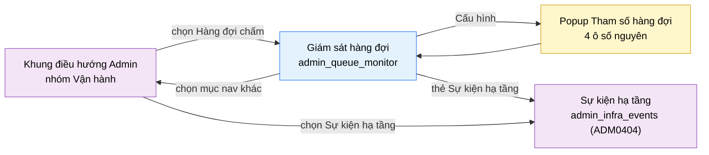

# Tài liệu thiết kế cơ bản (BD) — Giám sát hàng đợi (`ADM0401`)

## Phương châm tài liệu [Nội bộ — không cần khách duyệt]

- Viết theo **mẫu 9 sheet**. Bộ thẻ đóng, quy ước ID, ký hiệu chuẩn, ranh giới với tài liệu khác và
  checklist kiểm toán nằm ở `02-bd/_rules/bd-template-9sheet.md` — file này không chép lại.
- Phần gắn nhãn `[Nội bộ]` phục vụ sinh mã và tự kiểm toán, không phải yêu cầu của khách hàng: mục 4.5, mục
  7.3 và các ghi chú quy ước.
- Mã màn `ADM0401` theo bảng mã ở `02-bd/_rules/bd-template-9sheet.md` mục 8; tên file mang tiền tố mã.
- Màn này **không có màn con** và có **đúng một popup**: "Tham số hàng đợi", mở từ nút "Cấu hình" ở thanh tiêu đề (tên nút là "Tham số" đến V0.7). Từ V1.0 có thêm **hai hộp xác nhận** cho hai công tắc điều khiển. Mọi tương tác còn lại diễn ra tại chỗ trên màn chính. Khối sự kiện hạ tầng **đã chuyển sang màn riêng `ADM0404`** (`DEC-2026-1010-admin-operations-regroup`).

> Đọc cùng `01-rd/screens/admin/ADM0401_queue_monitor.md` (hành vi ở mức yêu cầu, không lặp lại ở đây), hai
> file BD module `02-bd/architecture/judge-orchestration.md` (máy trạng thái, Outbox, sweep) và
> `02-bd/database/judge-orchestration.md` (bảng `submissions`, `outbox_events`), cùng khung chung
> `02-bd/screens/admin/_shell.md` (sidebar, toolbar, nền) — không mô tả lại khung ở đây.

### Phạm vi bị cắt — không thiết kế

- **Chấm lại (rejudge) đã bị loại khỏi phạm vi** theo `DEC-2026-0828-remove-rejudge-scope`
  [Nguồn: 01-rd/screens/admin/ADM0401_queue_monitor.md:64]. Vì vậy **không thiết kế**: mức "Hàng đợi chấm
  lại" trong khối Độ trễ [Nguồn: 09-layoutBase/Admin - Hàng đợi chấm.dc.html:477], giá trị `Chấm lại` của
  cột "Ưu tiên" trong bảng job [Nguồn: 09-layoutBase/Admin - Hàng đợi chấm.dc.html:503,509-510], và mục nav
  "Chấm lại" trong sidebar [Nguồn: 09-layoutBase/Admin - Hàng đợi chấm.dc.html:354]. Không có nút hay liên
  kết nào trên màn này dẫn sang màn `admin_rejudge`.
- **Không thiết kế toggle thứ ba "Ưu tiên cao"** [Nguồn: 09-layoutBase/Admin - Hàng đợi chấm.dc.html:473] —
  "kỳ thi" đã được chốt chỉ là nhãn phân loại ưu tiên, không phải một tính năng
  [Nguồn: 01-rd/screens/admin/ADM0401_queue_monitor.md:94]. Nhãn phân loại vẫn hiển thị ở cột "Ưu tiên" của
  bảng job, nhưng không có công tắc bật/tắt trên màn.
- **Không thiết kế mức ưu tiên của job, mức độ trễ thứ hai "Hàng đợi ưu tiên cao" và cột "Ưu tiên"** (V1.0, 2026-10-10, `DEC-2026-1010-admin-operations-regroup`, **chủ dự án đã xác nhận 2026-10-10**; đóng Q4). Bảng `submissions` không có cờ ưu tiên nào [Nguồn: 02-bd/database/judge-orchestration.md:12-34], nên giá trị hiển thị sẽ là dữ liệu bịa. Cũng **không thiết kế cột "Mã job"** (không có thực thể job riêng, chỉ có `submissions.id`; đóng nửa sau Q5).
- **Không còn khối "Sự kiện hạ tầng gần đây" trên màn này**: chuyển sang `ADM0404` (`02-bd/screens/admin/ADM0404_infra_events.md`). Màn này chỉ giữ một thẻ liên kết kèm số cảnh báo và số lỗi (Khu vực G).
- **Không thiết kế điều hướng từ dòng job sang chi tiết bài nộp của học viên** — RD không mô tả hành vi đó.

---

## Sheet 1. Bìa

| Mục | Giá trị |
| :--- | :--- |
| Hệ thống | AlgoPrep |
| Phân hệ | `judge-orchestration` (F4) |
| Công đoạn | BD — Thiết kế cơ bản |
| Phân loại | Màn hình |
| Tên màn | Giám sát hàng đợi |
| Mã màn hình | `ADM0401` |
| Tên vật lý (slug) | `admin_queue_monitor` |
| Trục tài liệu | Màn hình (`02-bd/screens/`) |
| Actor | A3 (`ADMIN`) |
| Phiên bản | V1.3 |
| Người tạo | Nhóm phát triển AlgoPrep |
| Ngày tạo | 2026/09/15 |
| Người cập nhật | Nhóm phát triển AlgoPrep |
| Ngày cập nhật | 2026/10/14 |

---

## Sheet 2. Lịch sử sửa đổi

| Ver | Sheet bị sửa | Nội dung sửa | Ngày | Người sửa |
| :--- | :--- | :--- | :--- | :--- |
| V0.1 | Toàn bộ | Tạo mới theo cấu trúc 9 mục văn xuôi (mục đích và phạm vi, layout regions, component inventory, screen states, API tiêu thụ, navigation, access rights, việc còn mở, tham chiếu) | 2026/09/15 | Nhóm phát triển AlgoPrep |
| V0.2 | Toàn bộ | Chuyển sang mẫu 9 sheet. Tách từng chỉ số tổng thành item riêng kèm công thức, chỉ rõ nguồn của mọi trường hiển thị và phát hiện bốn nhóm trường **không có nguồn dữ liệu nào trong schema `judge`** (cụm worker, trạng thái hai công tắc, cờ ưu tiên job, sự kiện hạ tầng), bổ sung Sheet 8 danh sách sự kiện và Sheet 9 đặc tả kiểm tra, ghi rõ ba đường làm tươi dữ liệu và chuyển việc chọn cơ chế thành câu hỏi mở | 2026/09/20 | Nhóm phát triển AlgoPrep |
| V0.3 | 3, 4, 5, 6, 7, 8; Câu hỏi mở | Bỏ dải 4 chỉ số tổng (Job đang chờ, Đang chấm, Thông lượng, Job lỗi 24 giờ) khỏi UI theo `DEC-2026-1001-single-overview-page-kpi`: Khu vực B còn ghi chú "đã bỏ" (giữ chữ cái C trở đi), bỏ `QueueSnapshotDto` NO 1-7 (còn `generatedAt`), bỏ chỉ số tổng khỏi `GetQueueSnapshot`, 7 khối nội dung thành 6. Các khối worker, điều khiển, độ trễ, bảng job, sự kiện hạ tầng giữ nguyên. Bốn chỉ số này chưa có chỗ mới. Thêm đề xuất cho Q3, Q6 theo nguyên tắc admin (chờ owner xác nhận) | 2026/10/01 | AI |
| V0.4 | Sheet 5, 6, Câu hỏi mở | Đã chốt 2026-10-01 (owner uỷ quyền cân nhắc), xem `DEC-2026-1001-admin-configurable-settings`: Q3 (phần ngưỡng) và Q6 đổi từ "Đề xuất (chờ owner xác nhận)" sang **đã chốt** — ngưỡng thêm worker, số dòng mỗi trang của bảng job, thời gian giữ job `SYSTEM_ERROR`, ngưỡng trần thanh độ trễ đều là tham số ADMIN đặt, không trần cứng; sửa ba chỗ trong Sheet 5 còn ghi "chưa có nguồn"/"chưa chốt". Phần nơi lưu trạng thái hai công tắc của Q3 vẫn mở | 2026/10/01 | AI |
| V0.5 | Sheet 4, 5, 7, Câu hỏi mở | Đã chốt 2026-10-01 (owner uỷ quyền), xem `DEC-2026-1001-admin-configurable-settings`: Q3 phần nơi lưu đóng. Trạng thái hai công tắc và ngưỡng tự mở rộng lưu ở **PostgreSQL, schema `judge`, một bảng một dòng `cluster_settings`** (`queue_paused`, `autoscale_enabled`, `autoscale_job_threshold`), cùng kho với `language_configs`; **không** dùng khoá Redis vì `judge-orchestration` không dùng Redis. Sửa các câu "không có bảng trong schema `judge`" và "Màn này không ghi vào bảng nào" | 2026/10/01 | AI |
| V0.6 | Phương châm, Sheet 3, 4, 5, 6, 7, 8, 9, Câu hỏi mở | Đồng bộ với prototype dựng 2026-10-01: thanh tiêu đề thêm nút "Tham số" (đứng trước "Làm mới") mở popup "Tham số hàng đợi" gồm bốn ô số nguyên tối thiểu 1, không trần: ngưỡng tự mở rộng worker (job, mặc định 20, lưu `judge.cluster_settings.autoscale_job_threshold` theo `02-bd/database/judge-orchestration.md` mục 1.7), số dòng mỗi trang của bảng job (mặc định 20), thời gian giữ job lỗi hệ thống (giờ, mặc định 24), ngưỡng trần thanh độ trễ (giây, mặc định 10). Ba tham số sau chưa có bảng. Mô tả công tắc tự mở rộng đọc ngưỡng đã lưu. Bỏ các câu "màn cấu hình chưa có", "không có popup", "ô nhập chưa có trong bản dựng". Vị trí popup trên màn này là do prototype tự chọn, thêm Q7 hỏi owner | 2026/10/01 | AI |
| V0.7 | Sheet 6, 8, 9 | Áp `DEC-2026-1003-toast-feedback-channel`: kết quả thao tác và lỗi nhập liệu ghi là toast dùng chung, ô sai chỉ đổi viền đỏ. | 2026/10/03 | AI |
| V1.0 | Toàn bộ | Thiết kế lại cho đỡ dày theo `DEC-2026-1010-admin-operations-regroup`: thêm dải trạng thái một dòng (Khu vực J, không phải thẻ KPI); cụm worker thành bảng gọn; một thẻ "Điều khiển" gồm độ trễ chờ trung bình và hai công tắc, mỗi công tắc có hộp xác nhận (Khu vực K); bảng job thành tab có đếm, 4 cột, phân trang; khối sự kiện hạ tầng chuyển sang `ADM0404` và Khu vực G còn thẻ liên kết; nút "Tham số" đổi thành "Cấu hình". Đóng Q1 (STOMP mỗi 5 giây, REST dự phòng 15 giây), Q2 (Prometheus, không bảng), Q4 (bỏ ưu tiên, **được xác nhận ở V1.1**), Q5, Q7 (ba cột mới của `cluster_settings`). Thêm quy tắc: tạm dừng thì sweep bỏ qua `PENDING` (G1), mọi lệnh ghi vào Nhật ký hệ thống phân loại "Cấu hình" (G2). Thêm Q8 (trần worker), Q9 (cảnh báo giá trị cực đoan) | 2026/10/10 | AI |
| V1.1 | Phạm vi bị cắt, Sheet 5, 6, 7, Câu hỏi mở | Chốt theo tiêu chí ponytail (`.claude/rules/ponytail-criteria.md`), `DEC-2026-1010-admin-operations-regroup`: **xác nhận bỏ ưu tiên job, mức độ trễ thứ hai và cột "Job"** (đóng Q4, bỏ dấu "chờ xác nhận"); đóng Q8 (không thêm trần worker hay ngưỡng thu hẹp, "tối đa 8" là hằng số `application.yml`) và Q9 (không cảnh báo mềm, ô đã có tối thiểu 1); số cảnh báo và số lỗi của thẻ liên kết chỉ lấy từ hai nguồn thật: bản ghi Outbox kẹt (`outbox_events.publish_attempts`, ngưỡng hằng số trong `application.yml`: từ 3 lần thử là `WARN`, từ 5 lần là `ERROR`) và lượt nộp `SYSTEM_ERROR` hoặc lỗi sandbox (từ `judge.submissions` và timeout sweep); ghi hai rủi ro kỹ thuật (kiểm go-judge xuất metric, autoscale trên Docker Compose) | 2026/10/10 | AI |
| V1.2 | Sheet 6 | Theo báo cáo `06-plan/reports/261014-1054-admin-ux-review/` (B3): job lỗi sandbox nay luôn nằm cuối bảng bất kể chiều sắp (F NO 10); trước đây sắp tăng dần đưa job lỗi lên đầu vì mang `waitSeconds = -1`. Không đổi spec | 2026-10-14 | Claude |
| V1.3 | Sheet 5 | Sửa lỗi Minor review UX khu Admin F14 (`06-plan/reports/261014-1054-admin-ux-review/`), **chưa duyệt hình**, chỉ sửa mock: độ trễ chờ trung bình nay tính từ `waitSeconds` của các job trong mock (18,8s), không còn số cố định 1,8s lệch với bảng job (Khu vực E NO 4); worker `go-judge-w4` chuyển sang "Đang chạy" với 1 job thay vì "Nhàn rỗi" cạnh một hàng đợi đang dồn (Khu vực C NO 5). Cụm worker vẫn là mock cho tới khi cài go-judge thật (quyết định của chủ dự án). Không đổi spec | 2026-10-14 | Claude |

---

## Sheet 3. Sơ đồ chuyển màn

> [Nội bộ] Quy ước vẽ: bố trí từ trái sang phải. Màn gọi tới tô tím, màn hiện tại tô xanh nhạt, popup tô
> vàng (một popup "Tham số hàng đợi", thêm V0.6; hai hộp xác nhận điều khiển, thêm V1.0, không vẽ riêng vì chỉ là bước đệm của công tắc). Màu và `[Nguồn:]` dùng để truy vết, không phải yêu cầu của khách.

### 3.1 Danh sách chuyển màn

#### Khung điều hướng Admin → Giám sát hàng đợi

[Điều kiện mở] Chọn mục con "Hàng đợi chấm" trong nhóm "Vận hành" ở thanh điều hướng bên trái
[Nguồn: 09-layoutBase/Admin - Hàng đợi chấm.dc.html:352-353].

[Chế độ mở] Chế độ chỉ xem kèm hai điều khiển vận hành. Không có chế độ biên soạn.

[Thông tin truyền] Không có.

[Giá trị trả về] Không có.

[Khi thành công] Tải ảnh chụp hiện trạng hàng đợi và hiển thị năm khối nội dung (dải trạng thái, cụm worker, điều khiển, bảng job, thẻ liên kết sự kiện hạ tầng); kênh làm tươi dữ liệu bắt
đầu hoạt động.

[Khi huỷ] Không có.

#### Giám sát hàng đợi → Sự kiện hạ tầng (thêm V1.0)

[Điều kiện mở] Bấm thẻ liên kết "Sự kiện hạ tầng" (Khu vực G), hoặc chọn mục "Sự kiện hạ tầng" trong nhóm "Vận hành" ở thanh điều hướng bên trái.

[Chế độ mở] Chế độ chỉ xem.

[Thông tin truyền] Không có. Màn đích mở ở trạng thái mặc định, chưa lọc.

[Giá trị trả về] Không có.

[Khi thành công] Mở `ADM0404`.

[Khi huỷ] Không có.

#### Giám sát hàng đợi → Popup Tham số hàng đợi

[Điều kiện mở] Bấm nút "Cấu hình" ở thanh tiêu đề (đứng trước nút "Làm mới"; tên nút là "Tham số" đến V0.7).

[Chế độ mở] Chế độ sửa, mỗi lần mở bắt đầu từ các giá trị đã lưu (không giữ lại nháp của lần mở trước).

[Thông tin truyền] Bốn giá trị tham số hiện hành.

[Giá trị trả về] Bốn giá trị đã lưu, hoặc không có gì nếu người dùng huỷ.

[Khi thành công] Popup hiển thị bốn ô số nguyên; "Lưu" ghi bốn giá trị và đóng popup, mô tả công tắc "Tự động mở rộng worker" đọc ngưỡng mới.

[Khi huỷ] Đóng popup, bỏ nháp, các giá trị đã lưu không đổi.

[Nguồn: 05-coding/frontend/src/views/admin/queue-monitor/ui/admin-queue-monitor-view.tsx:209,412-450; 05-coding/frontend/src/shared/ui/overlay/params-dialog.tsx:44-121]

#### Giám sát hàng đợi → Khung điều hướng Admin (rời màn)

[Điều kiện mở] Chọn một mục khác trong thanh điều hướng bên trái.

[Chế độ mở] Không có.

[Thông tin truyền] Không có.

[Giá trị trả về] Không có.

[Khi thành công] Đóng kênh làm tươi dữ liệu và huỷ hẹn giờ trước khi rời màn. Màn này **không có thay đổi
chưa lưu** — hai công tắc gửi lệnh ngay khi bấm, nên không có cảnh báo rời màn.

[Khi huỷ] Không có.

### 3.2 Sơ đồ

[Nguồn: 09-layoutBase/Admin - Hàng đợi chấm.dc.html:68-144,352-353; 01-rd/screens/admin/ADM0401_queue_monitor.md:4]

---

## Sheet 4. Bố cục màn hình

### 4.1 Tổng quan màn

[Mục đích màn] Cho quản trị viên giám sát trực tiếp độ dài hàng đợi, tình trạng cụm worker go-judge và các
job đang chờ hoặc đang chấm, để biết hệ thống có đang khoẻ không và xử lý kịp khi có bài nộp treo
[Nguồn: 01-rd/screens/admin/ADM0401_queue_monitor.md:13-15].

[Luồng nghiệp vụ chính]

1. **Hiển thị ban đầu**: vào màn, hệ thống tải một ảnh chụp hiện trạng gồm trạng thái hàng đợi, danh sách worker, độ trễ chờ trung bình, trạng thái hai công tắc, số lượng của ba tab và trang đầu bảng job, số cảnh báo và lỗi hạ tầng gần đây. Trong lúc chờ, mỗi khối hiển thị khung chờ đúng số dòng dự kiến.
2. **Đọc dải trạng thái** (V1.0): một dòng cho biết "Bình thường", "Đang dồn N job", "Đang tạm dừng" hoặc "Worker quá tải", kèm "Cập nhật lúc HH:mm:ss"; không nhận dữ liệu mới quá 60 giây thì thêm nhãn "Dữ liệu cũ". Khi nhiều trạng thái cùng đúng, hiện theo thứ tự Đang tạm dừng, Worker quá tải, Đang dồn, Bình thường `[SoT: Suy luận]`. "Đang dồn" khi số job chờ vượt ngưỡng tự mở rộng `[SoT: Suy luận]`. Dải này **không phải thẻ KPI**: nó chỉ báo tình trạng, không liệt kê chỉ số, nên không trái `DEC-2026-1001-single-overview-page-kpi`.
3. **Làm tươi dữ liệu** (đóng Q1, 2026-10-10): kênh STOMP `/topic/admin/queue` đẩy một lô mỗi 5 giây; khi kênh rớt thì chuyển sang gọi REST mỗi 15 giây và hiện cảnh báo mất kết nối; nút "Làm mới" luôn tải lại thật, độc lập với kênh.
4. **Lọc bảng job**: chọn một trong ba tab Đang chờ / Lỗi / Tất cả (mặc định "Đang chờ"), mỗi tab kèm số lượng; bảng phân trang theo tham số "số dòng mỗi trang". Lọc không ảnh hưởng cụm worker.
5. **Điều khiển cụm**: bật "Tạm dừng tiêu thụ hàng đợi" (có hộp xác nhận) để worker ngừng nhận job mới, job đang chấm vẫn chạy hết, và timeout sweep **bỏ qua job `PENDING`** trong lúc tạm dừng (G1) [Nguồn: 01-rd/screens/admin/ADM0401_queue_monitor.md:48-50]. Bật hoặc tắt "Tự động mở rộng worker" để đổi chính sách mở rộng cụm (tắt thì có hộp xác nhận). Mỗi lệnh thành công được ghi vào Nhật ký hệ thống, phân loại "Cấu hình", kèm giá trị cũ và mới (G2).
6. **Theo dõi sự cố**: thẻ liên kết cho biết số cảnh báo và số lỗi hạ tầng gần đây; bấm để sang `ADM0404`.
7. **Đặt tham số hàng đợi** (V0.6, nút đổi tên V1.0): bấm "Cấu hình", nhập bốn số nguyên (tối thiểu 1, không trần) rồi "Lưu". Ngưỡng tự mở rộng đổi ngay chữ mô tả của công tắc "Tự động mở rộng worker".

[Người dùng] Quản trị viên đã đăng nhập, có Function `JUDGE_QUEUE_MONITOR` để xem [Nguồn: 02-bd/database/identity.md:48]. Hai công tắc và popup "Tham số hàng đợi" là hành động ghi: máy chủ kiểm lại vai trò `ADMIN` ở mỗi lệnh [Nguồn: 02-bd/security/judge-orchestration.md mục 5] (đóng một nửa Q7).

[Tệp liên quan] Không có. Màn này không xuất hay nhập tệp.

[Phạm vi]
- Chỉ đọc, cộng đúng **hai** điều khiển vận hành ghi (tạm dừng tiêu thụ hàng đợi, tự động mở rộng worker) [Nguồn: 01-rd/screens/admin/ADM0401_queue_monitor.md:48-50], và popup "Tham số hàng đợi" (bốn tham số ADMIN đặt, `DEC-2026-1001-admin-configurable-settings`). Popup **giữ trên màn này**, đặt sau nút "Cấu hình" (đóng Q7).
- Không có luồng chấm lại (`DEC-2026-0828-remove-rejudge-scope`).
- Không phải màn quản lý kỳ thi, và từ V1.0 **không còn mức ưu tiên nào** trên màn (chủ dự án đã xác nhận 2026-10-10; xem phần Phạm vi bị cắt).
- Sự kiện hạ tầng là log của máy móc, **không phải hành động quản trị của người**; xem ở `ADM0404`. Hành động của người thuộc màn `admin_system_log`.
- Không cấu hình ngôn ngữ và giới hạn tài nguyên (F4-11) — thuộc màn `admin_language_config`.

[Quyền sử dụng]
- Xem: được, khi có Function `JUDGE_QUEUE_MONITOR`.
- Thêm: không.
- Sửa: hai công tắc điều khiển cụm và bốn tham số hàng đợi (vai trò `ADMIN`).
- Xoá: không.

[Số bản ghi tối đa] Worker: theo số worker thật của cụm (mock minh hoạ 4). Điều khiển: đúng 2 dòng. Độ trễ: đúng 1 giá trị. Bảng job: số dòng mỗi trang là tham số do ADMIN đặt (mặc định gợi ý 20, không trần cứng, đã chốt 2026-10-01, Q6). Thẻ liên kết sự kiện hạ tầng: 1.

[Nguồn: 01-rd/screens/admin/ADM0401_queue_monitor.md:13-15,17-20,39-55,94; 02-bd/architecture/judge-orchestration.md:35; 02-bd/database/identity.md:48]

### 4.2 DTO liên quan

- `QueueSnapshotDto` (`generatedAt`, `status` của dải trạng thái; các trường chỉ số tổng đã bỏ 2026-10-01)
- `WorkerNodeDto`
- `ClusterControlDto`
- `QueueLatencyDto` (một giá trị độ trễ chờ trung bình từ V1.0)
- `QueueJobDto`
- `QueueJobCountsDto` (số lượng của ba tab, thêm V1.0)
- `InfraSummaryDto` (số cảnh báo và số lỗi cho thẻ liên kết, thêm V1.0); `InfraEventDto` chuyển sang `ADM0404`
- `QueueSettingsDto` (thêm V0.6)

`[Suy luận]` — tên DTO do BD này đề xuất, `03-dd/api/judge-orchestration.md` chốt lại.

### 4.3 Bảng dữ liệu liên quan (3)

| NO | Bảng | Ghi chú |
| --: | :--- | :--- |
| 1 | `judge.submissions` | [Nguồn: 02-bd/database/judge-orchestration.md:8-34] |
| 2 | `judge.outbox_events` | [Nguồn: 02-bd/database/judge-orchestration.md:106-120] |
| 3 | `judge.cluster_settings` | Mục 1.7 [Nguồn: 02-bd/database/judge-orchestration.md:122-138]. Từ V1.0 có đủ bốn cột phục vụ popup "Tham số hàng đợi": `autoscale_job_threshold`, `jobs_per_page`, `error_retention_hours`, `latency_cap_seconds` (đóng Q7, `DEC-2026-1010-admin-operations-regroup`) |

Các nhóm dữ liệu còn lại **không có bảng nào trong schema `judge`** và **không được thêm bảng** (đóng Q2 và Q5, V1.0): danh sách worker và số liệu tải của cụm (mã, trạng thái, mức tải, số job, uptime, vCPU, trần mở rộng) đọc từ **Prometheus đã có trong stack** `[SoT: Suy luận]` — chưa kiểm go-judge xuất được metric này, DD xác nhận; số liệu cho thẻ liên kết sự kiện hạ tầng lấy từ hai nguồn thật: bản ghi Outbox kẹt (`outbox_events.publish_attempts`, ngưỡng hằng số trong `application.yml`: từ 3 lần thử là `WARN`, từ 5 lần là `ERROR`) và lượt nộp `SYSTEM_ERROR` hoặc lỗi sandbox (từ `judge.submissions` và timeout sweep) (V1.1, không dùng Prometheus cho phần này). Cờ ưu tiên của job **không còn dùng** (xem phần Phạm vi bị cắt). Đây là phát hiện có chủ đích chứ không phải thiếu sót trình bày — `02-bd/database/judge-orchestration.md` chỉ có `submissions`, `submission_testcase_results`, `judge_run_tokens`, `callback_logs`, `language_configs`, `grading_defaults`, `sandbox_settings`, `outbox_events`, `cluster_settings` và `generator_sandbox_settings`, không bảng nào chứa số liệu cụm. **Không tự thêm cột DB nào ngoài ba cột của `cluster_settings` đã chốt.**

`judge.submission_testcase_results` **không** được màn này đọc: bảng job chỉ hiển thị trạng thái ở mức
submission, không đi xuống từng testcase.

### 4.4 Vùng bố cục

Đối chiếu `09-layoutBase/Admin - Hàng đợi chấm.dc.html` — bằng chứng bố cục ban đầu, chỉ để tham khảo, **không phải** design system cuối cùng. Từ V1.0 bố cục **khác mockup có chủ đích** để đỡ dày (`DEC-2026-1010-admin-operations-regroup`); prototype Next.js 2026-10-10 là sự thật về hình.

| Vùng | Nội dung (V1.0) |
| :--- | :--- |
| Thanh điều hướng bên trái (khung chung Admin) | Nhóm "Vận hành" đang mở, mục con "Hàng đợi chấm" đang chọn — dùng lại khung chung (`_shell.md` mục 2) |
| Thanh tiêu đề dính trên | Tiêu đề, mô tả phụ, nút "Cấu hình" (mở popup tham số) và nút "Làm mới" |
| Dải trạng thái (Khu vực J, mới) | Một dòng: trạng thái hàng đợi, "Cập nhật lúc", nhãn "Dữ liệu cũ" khi quá 60 giây. **Không phải thẻ KPI** |
| Dải 4 chỉ số tổng (đã bỏ 2026-10-01) | Không dựng, xem `DEC-2026-1001-single-overview-page-kpi` |
| Hàng đầu: "Cụm worker go-judge" (trái) và "Điều khiển" (phải) | Trái: bảng worker gọn, mỗi worker một hàng. Phải: một thẻ gồm độ trễ chờ trung bình rồi hai công tắc; hai hộp xác nhận là Khu vực K |
| Bảng "Job trong hàng đợi" | Tab có đếm (Đang chờ, Lỗi, Tất cả), bảng 4 cột, phân trang, cuộn ngang khi hẹp |
| Thẻ liên kết "Sự kiện hạ tầng" (Khu vực G) | Số cảnh báo, số lỗi gần đây, bấm sang `ADM0404` |
| Chân trang (khung chung Admin) | Phiên bản, trạng thái tổng quan dịch vụ, 4 liên kết phụ — dùng lại khung chung |

Bố cục hai cột của hàng đầu dùng mốc 1024 px của khung chung (`_shell.md` mục 2.3); dưới mốc đó xếp một cột. Không quy định màu sắc, khoảng cách hay typography ở BD.

### 4.5 Cấu trúc slice FSD [Nội bộ]

| Khối | Slice dự kiến | Căn cứ |
| :--- | :--- | :--- |
| Trang | `views/admin/queue-monitor` | Quy ước FSD của dự án |
| Khung Admin | Dùng lại `widgets/app-shell` | `02-bd/screens/admin/_shell.md` mục 1 |
| Dải chỉ số tổng (đã bỏ 2026-10-01) | - | Không còn slice `widgets/queue-kpi-strip` |
| Dải trạng thái (V1.0) | `shared/ui` (dải trạng thái dùng chung nếu có từ hai màn trở lên) hoặc `views/admin/queue-monitor/ui` | Khu vực J |
| Cụm worker | `views/admin/queue-monitor/ui` (bảng gọn dựng bằng `DataTable`) + `entities/worker-node` khi có API thật | Khu vực C |
| Điều khiển cụm | `features/queue-ops-control` + `shared/ui/feedback/confirm-dialog` cho hai hộp xác nhận | Khu vực D, K |
| Tham số hàng đợi (thêm V0.6) | `views/admin/queue-monitor/model/settings.ts` (kho bốn tham số) + dialog dùng chung `shared/ui/params-dialog` | Khu vực I |
| Độ trễ chờ trung bình | Trong thẻ Điều khiển, dùng `ProgressBar` | Khu vực E |
| Bảng job | `shared/ui/data/segmented-tabs` (tab có đếm) + `DataTable` + `Pagination` + `entities/queue-job` | Khu vực F |
| Thẻ liên kết sự kiện hạ tầng | `views/admin/queue-monitor/ui` | Khu vực G; danh sách đầy đủ ở `views/admin/infra-events` |
| Kênh làm tươi dữ liệu | `shared/api` (một chỗ duy nhất, mọi khối cùng dùng): STOMP, REST dự phòng | Đóng Q1 |

`[Suy luận]` — ánh xạ slice do BD đề xuất, DD màn hình chốt lại.

> [Nội bộ] Ảnh minh hoạ đặt ở `08-diagram/02-bd/screens/admin/`, chụp bằng Playwright trên ứng dụng Next.js
> thật khi đã có mã chạy được. Chưa có thì tham chiếu prototype, không vẽ tay.

---

## Sheet 5. Danh sách item màn hình

> Quy ước ID, bộ thẻ và giá trị chuẩn: `02-bd/_rules/bd-template-9sheet.md` mục 2, 3, 4.

### Khu vực A — Thanh tiêu đề

| Khu vực | NO | Tên item | ID item | Bảng DB | Cột DB | Loại UI | Kiểu | Độ dài | Bắt buộc | I/O | Giá trị mặc định | Định dạng | Ghi chú |
| :--- | --: | :--- | :--- | :--- | :--- | :--- | :--- | :--- | :-: | :-: | :--- | :--- | :--- |
| Thanh tiêu đề | | | | | | | | | | | | | |
| | 1 | Tiêu đề màn | `adminQueueMonitor.header.title` | - | - | Label | String | - | - | O | Hàng đợi chấm và cụm go-judge | - | Tên màn hiển thị cố định [Nguồn giá trị] Nhãn tĩnh i18n, prototype `:533` [EVT liên quan] - |
| | 2 | Mô tả phụ | `adminQueueMonitor.header.subtitle` | - | - | Label | String | - | - | O | Giám sát trực tiếp | - | Mô tả ngắn phạm vi màn. Chu kỳ làm tươi 5 giây đã chốt (Q1, V1.0) nhưng **không đưa vào nhãn mặc định** vì khi kênh rớt chu kỳ đổi sang 15 giây; thông tin độ tươi hiển thị ở dải trạng thái (Khu vực J) [Nguồn giá trị] Nhãn tĩnh i18n [EVT liên quan] - |
| | 3 | Làm mới | `adminQueueMonitor.header.btnRefresh` | - | - | Button | - | - | - | I | - | - | Tải lại **thật** toàn bộ ảnh chụp hiện trạng ngay lập tức, không chờ chu kỳ tự động; không chỉ hiện toast (sửa V1.0, phát hiện F2 của báo cáo 2026-10-10) [Nguồn giá trị] - [EVT liên quan] EVT-2 |
| | 4 | Cấu hình | `adminQueueMonitor.header.btnParams` | - | - | Button | - | - | - | I | - | - | Mở popup "Tham số hàng đợi". **Đứng trước nút "Làm mới"** trên thanh tiêu đề. Nhãn nút đổi từ "Tham số" thành "Cấu hình" ở V1.0; vị trí popup trên màn này đã chốt, đóng Q7 [Nguồn giá trị] - [EVT liên quan] EVT-10 |

### Khu vực B — Chỉ số tổng (đã bỏ)

Khu vực này **không còn item nào** kể từ 2026-10-01: 4 chỉ số (Job đang chờ, Đang chấm, Thông lượng, Job lỗi 24
giờ) cùng các dòng mô tả đã bị xoá khỏi UI theo `DEC-2026-1001-single-overview-page-kpi` (chỉ trang tổng quan
hiển thị KPI). Bốn chỉ số này **chưa có chỗ mới** trên trang tổng quan Admin. Giữ nguyên chữ cái khu vực C trở
đi để các tham chiếu hiện có không phải đánh số lại.

### Khu vực C — Cụm worker go-judge

| Khu vực | NO | Tên item | ID item | Bảng DB | Cột DB | Loại UI | Kiểu | Độ dài | Bắt buộc | I/O | Giá trị mặc định | Định dạng | Ghi chú |
| :--- | --: | :--- | :--- | :--- | :--- | :--- | :--- | :--- | :-: | :-: | :--- | :--- | :--- |
| Cụm worker go-judge | | | | | | | | | | | | | |
| | 1 | Tiêu đề khối worker | `adminQueueMonitor.worker.blockTitle` | - | - | Label | String | - | - | O | Cụm worker go-judge | - | Tên khối [Nguồn giá trị] Nhãn tĩnh i18n, prototype `:178` [EVT liên quan] - |
| | 2 | Mô tả khối worker | `adminQueueMonitor.worker.blockSubtitle` | - | - | Label | String | - | - | O | - | `{số} worker · tự động mở rộng tối đa {số}` | Quy mô cụm hiện tại và trần mở rộng (prototype `:179`) [Nguồn giá trị] Cấu hình cụm go-judge, **không có bảng trong schema `judge`** — xem Q2; trần mở rộng ("tối đa {số}") là hằng số `application.yml`, không có ô nhập (Q8, V1.1) [EVT liên quan] EVT-1, EVT-3 |
| | 3 | Danh sách worker | `adminQueueMonitor.worker.list` | - | - | List | List | - | - | O | rỗng | - | Từ V1.0 là **bảng gọn, mỗi worker một hàng** (trước là lưới thẻ). Mỗi hàng là một worker của cụm go-judge [Nguồn giá trị] Prometheus đã có trong stack, không thêm bảng (đóng Q2) `[SoT: Suy luận]` — chưa kiểm go-judge xuất được metric này [EVT liên quan] EVT-1, EVT-3 |
| | 4 | Mã worker | `adminQueueMonitor.worker.col.nodeId` | - | - | ListColumn | String | 50 | - | O | - | `go-judge-w{số}` | Định danh worker trong cụm (prototype `:453-456`) [Nguồn giá trị] Trạng thái runtime của cụm go-judge — xem Q2 [EVT liên quan] - |
| | 5 | Trạng thái worker | `adminQueueMonitor.worker.col.status` | - | - | Badge | Enum | - | - | O | - | Nhãn tiếng Việt | Ba giá trị: "Đang chạy", "Nhàn rỗi", "Quá tải" (prototype `:448-450`). Mock 2026-10-14 (review UX F14, chưa duyệt hình): `go-judge-w4` là "Đang chạy" với 1 job, vì một worker nhàn rỗi cạnh hàng đợi đang dồn trông như lỗi; cụm vẫn là mock đến khi có go-judge thật [Nguồn: 05-coding/frontend/src/views/admin/queue-monitor/api/__mock__/judge-queue-mocks.ts:39-46] [Nguồn giá trị] Trạng thái runtime của cụm go-judge — xem Q2 [EVT liên quan] - |
| | 6 | Thanh tải | `adminQueueMonitor.worker.col.loadBar` | - | - | ProgressBar | Number | - | - | O | - | - | Biểu diễn trực quan mức tải của worker [Công thức] Chiều rộng bằng đúng giá trị phần trăm ở NO 7; đổi sang màu cảnh báo khi vượt 85% [Nguồn: 09-layoutBase/Admin - Hàng đợi chấm.dc.html:460] [EVT liên quan] - |
| | 7 | Mức tải | `adminQueueMonitor.worker.col.loadPercent` | - | - | ListColumn | Number | 3 | - | O | - | `Tải {số}%` | Phần trăm tải hiện tại của worker [Nguồn giá trị] Trạng thái runtime của cụm go-judge — xem Q2 [EVT liên quan] - |
| | 8 | Số job của worker | `adminQueueMonitor.worker.col.jobCount` | - | - | ListColumn | Number | 3 | - | O | 0 | `{số} job` | Số job worker đang xử lý (prototype `:190`) [Nguồn giá trị] Trạng thái runtime của cụm go-judge — xem Q2 [EVT liên quan] - |
| | 9 | Thông tin phụ worker | `adminQueueMonitor.worker.col.meta` | - | - | ListColumn | String | - | - | O | - | `Uptime {chuỗi} · vCPU {số}` | Thời gian chạy liên tục và số vCPU. Từ V1.0 là thông tin **thứ yếu** (dòng phụ nhỏ hoặc hiện khi mở rộng hàng), không còn là phần chính của hàng; hình thức do prototype quyết [Nguồn giá trị] Prometheus, xem NO 3 [EVT liên quan] - |

### Khu vực D — Điều khiển cụm

| Khu vực | NO | Tên item | ID item | Bảng DB | Cột DB | Loại UI | Kiểu | Độ dài | Bắt buộc | I/O | Giá trị mặc định | Định dạng | Ghi chú |
| :--- | --: | :--- | :--- | :--- | :--- | :--- | :--- | :--- | :-: | :-: | :--- | :--- | :--- |
| Điều khiển cụm | | | | | | | | | | | | | |
| | 1 | Tiêu đề khối điều khiển | `adminQueueMonitor.control.blockTitle` | - | - | Label | String | - | - | O | Điều khiển | - | Tên khối; đổi từ "Điều khiển cụm" thành "Điều khiển" ở V1.0 vì thẻ gồm cả độ trễ chờ trung bình (Khu vực E) [Nguồn giá trị] Nhãn tĩnh i18n [EVT liên quan] - |
| | 2 | Danh sách điều khiển | `adminQueueMonitor.control.list` | - | - | List | List | - | - | I/O | 2 dòng | - | Đúng 2 điều khiển vận hành thuộc phạm vi F4-10, đặt **dưới** dòng độ trễ chờ trung bình trong cùng thẻ. Dòng thứ ba "Ưu tiên cao" của mockup **không thiết kế**, xem phần Phạm vi bị cắt [Nguồn giá trị] Trạng thái vận hành của cụm, bảng một dòng `judge.cluster_settings` (đã chốt nơi lưu 2026-10-01, Q3) [EVT liên quan] EVT-1, EVT-3 |
| | 3 | Tạm dừng tiêu thụ hàng đợi | `adminQueueMonitor.control.togglePause` | `judge.cluster_settings` | `queue_paused` | Toggle | Boolean | - | - | I/O | Tắt | Bật / Tắt | Bật thì worker ngừng nhận job mới, job đang chấm vẫn chạy hết [Nguồn: 01-rd/screens/admin/ADM0401_queue_monitor.md:48-50], và timeout sweep bỏ qua job `PENDING` (G1). **Bật có hộp xác nhận** (Khu vực K NO 1), tắt thì không. Nhãn và mô tả "Giữ job lại, không giao cho worker" là nhãn tĩnh i18n [Nguồn giá trị] Cột `queue_paused` [EVT liên quan] EVT-7 |
| | 4 | Tự động mở rộng worker | `adminQueueMonitor.control.toggleAutoscale` | `judge.cluster_settings` | `autoscale_enabled` | Toggle | Boolean | - | - | I/O | Bật | Bật / Tắt | Bật thì cụm tự thêm worker khi hàng đợi vượt ngưỡng. Nhãn "Tự động mở rộng worker" là nhãn tĩnh i18n; dòng mô tả đọc **"Thêm worker khi hàng đợi vượt {ngưỡng} job"** với `{ngưỡng}` lấy từ giá trị đã lưu của tham số "Ngưỡng tự mở rộng worker" (mặc định 20, số nguyên tối thiểu 1, không trần; đã chốt 2026-10-01, xem Q3 và `DEC-2026-1001-admin-configurable-settings`). Ngưỡng **đặt trong popup "Tham số hàng đợi"** (Khu vực I NO 2) mở từ nút "Cấu hình" ở thanh tiêu đề, không phải ô nhập trên khối này (đóng Q7). **Tắt có hộp xác nhận** (Khu vực K NO 2), bật thì không [Nguồn giá trị] Cột `judge.cluster_settings.autoscale_enabled` — xem Q3 [EVT liên quan] EVT-8 |

### Khu vực E — Độ trễ chờ trung bình (V1.0: một giá trị, nằm trong thẻ Điều khiển)

| Khu vực | NO | Tên item | ID item | Bảng DB | Cột DB | Loại UI | Kiểu | Độ dài | Bắt buộc | I/O | Giá trị mặc định | Định dạng | Ghi chú |
| :--- | --: | :--- | :--- | :--- | :--- | :--- | :--- | :--- | :-: | :-: | :--- | :--- | :--- |
| Độ trễ chờ trung bình | | | | | | | | | | | | | |
| | 1 | Nhãn độ trễ | `adminQueueMonitor.latency.blockTitle` | - | - | Label | String | - | - | O | Độ trễ chờ trung bình | - | Nhãn của dòng đầu trong thẻ "Điều khiển" (trước V1.0 là tiêu đề của một khối riêng) [Nguồn giá trị] Nhãn tĩnh i18n [EVT liên quan] - |
| | 2 | ~~Danh sách mức hàng đợi~~ | ~~`adminQueueMonitor.latency.list`~~ | - | - | - | - | - | - | - | - | - | **Đã bỏ V1.0** (bỏ ưu tiên, **chủ dự án đã xác nhận 2026-10-10**; đóng Q4): chỉ còn một hàng đợi nên không có danh sách mức. Giữ số thứ tự để các tham chiếu không phải đánh số lại |
| | 3 | ~~Tên mức hàng đợi~~ | ~~`adminQueueMonitor.latency.col.name`~~ | - | - | - | - | - | - | - | - | - | **Đã bỏ V1.0**, cùng lý do NO 2 |
| | 4 | Giá trị độ trễ | `adminQueueMonitor.latency.col.value` | `judge.submissions` | `submitted_at`, `started_grading_at` | Label | Number | 6 | - | O | - | `{số},{số}s` | Thời gian chờ trung bình từ lúc nộp tới lúc worker nhận job, **trên toàn hàng đợi** [Công thức] Trung bình `started_grading_at - submitted_at` trong tập job đã bắt đầu chấm ở một giờ gần nhất `[Suy luận]` — cửa sổ 1 giờ gần nhất, chọn cho đủ mẫu mà vẫn phản ánh tình trạng hiện tại. Không có job nào trong cửa sổ thì hiển thị `-`, không hiển thị `0,0s`. **Hiện trạng bản dựng (2026-10-14, review UX F14, chưa duyệt hình):** mock lấy trung bình `waitSeconds` của các job đang có trong mock, bỏ job lỗi sandbox (`waitSeconds = -1`), ra 18,8s; trước đó là hằng 1,8s không khớp bảng job. Đây là xấp xỉ của mock, không thay công thức trên [Nguồn: 05-coding/frontend/src/views/admin/queue-monitor/api/__mock__/judge-queue-mocks.ts:121-128,135] [EVT liên quan] EVT-1, EVT-3 |
| | 5 | Thanh tỉ lệ độ trễ | `adminQueueMonitor.latency.col.bar` | `judge.cluster_settings` | `latency_cap_seconds` | ProgressBar | Number | - | - | O | - | - | Biểu diễn trực quan độ trễ so với ngưỡng [Công thức] Chiều rộng = giá trị độ trễ (giây) chia `latency_cap_seconds`, tối đa 100%. Đổi màu cảnh báo khi vượt 70% chiều rộng [Nguồn: 09-layoutBase/Admin - Hàng đợi chấm.dc.html:480]. Ngưỡng trần là tham số ADMIN đặt (mặc định gợi ý 10 giây, Q6) và **phải có tác dụng** ở lượt làm tươi kế tiếp sau khi lưu (sửa F3 của báo cáo 2026-10-10) [EVT liên quan] - |

### Khu vực F — Bảng job trong hàng đợi

| Khu vực | NO | Tên item | ID item | Bảng DB | Cột DB | Loại UI | Kiểu | Độ dài | Bắt buộc | I/O | Giá trị mặc định | Định dạng | Ghi chú |
| :--- | --: | :--- | :--- | :--- | :--- | :--- | :--- | :--- | :-: | :-: | :--- | :--- | :--- |
| Bảng job trong hàng đợi | | | | | | | | | | | | | |
| | 1 | Tiêu đề khối bảng job | `adminQueueMonitor.job.blockTitle` | - | - | Label | String | - | - | O | Job trong hàng đợi | - | Tên khối [Nguồn giá trị] Nhãn tĩnh i18n, prototype `:234` [EVT liên quan] - |
| | 2 | Mô tả sắp xếp | `adminQueueMonitor.job.blockSubtitle` | - | - | Label | String | - | - | O | Sắp xếp theo thời gian chờ, lâu nhất trước | - | Quy tắc sắp xếp mặc định của bảng; bỏ chữ "theo mức ưu tiên rồi" ở V1.0 vì không còn mức ưu tiên [Nguồn giá trị] Nhãn tĩnh i18n [EVT liên quan] - |
| | 3 | Tab trạng thái có đếm | `adminQueueMonitor.job.filter` | `judge.submissions` | `status` | Button | Enum | - | - | I | Đang chờ | Đang chờ N / Lỗi N / Tất cả N | Ba tab, chọn một tại một thời điểm, **mỗi tab kèm số lượng** (thay cho bộ lọc phân đoạn của V0.7, sửa F4). Mặc định mở "Đang chờ" [Nguồn giá trị] Nhãn tĩnh i18n; ánh xạ sang `submissions.status`: "Đang chờ" thành `PENDING`, "Lỗi" thành `SYSTEM_ERROR`, "Tất cả" không lọc. Số lượng lấy từ `QueueJobCountsDto` [EVT liên quan] EVT-6 |
| | 4 | Danh sách job | `adminQueueMonitor.job.list` | `judge.submissions` | - | List | List | - | - | O | rỗng | - | Các bài nộp chưa vào trạng thái cuối, cộng các bài vừa rơi vào trạng thái lỗi hệ thống. **Phân trang** theo `jobs_per_page` [Công thức] Lọc `submissions` có `status IN ('PENDING','COMPILING','JUDGING')`, cộng `status = 'SYSTEM_ERROR'` trong cửa sổ hiển thị tạm; thời gian giữ job `SYSTEM_ERROR` và số dòng mỗi trang là tham số do ADMIN đặt (mặc định gợi ý 24 giờ, 20 dòng; đã chốt 2026-10-01, Q6) [EVT liên quan] EVT-1, EVT-3 |
| | 5 | ~~Mã job~~ | ~~`adminQueueMonitor.job.col.jobCode`~~ | - | - | - | - | - | - | - | - | - | **Đã bỏ V1.0** (đóng nửa sau Q5): không có thực thể "job" riêng trong schema `judge`, chỉ có `submissions.id`, và cột này trùng nghĩa với NO 6. Giữ số thứ tự |
| | 6 | Lượt nộp | `adminQueueMonitor.job.col.submissionCode` | `judge.submissions` | `id` | ListColumn | String | 40 | - | O | - | `#SB-{chuỗi}` | Mã bài nộp, hiển thị dạng rút gọn để đọc được. **Cột đầu của bảng 4 cột** [Công thức] Rút gọn `submissions.id` (UUID) theo quy tắc hiển thị; quy tắc rút gọn chốt ở DD [EVT liên quan] - |
| | 7 | Ngôn ngữ | `adminQueueMonitor.job.col.language` | `judge.submissions` | `language` | ListColumn | Enum | - | - | O | - | Nhãn hiển thị | Ngôn ngữ của bài nộp [Nguồn giá trị] `JAVA` thành "Java 21"; `CPP` thành "C++ 17"; `PYTHON` thành "Python 3" — đúng ba ngôn ngữ khoá cứng [Nguồn: 02-bd/database/judge-orchestration.md:18] [EVT liên quan] - |
| | 8 | ~~Ưu tiên~~ | ~~`adminQueueMonitor.job.col.priority`~~ | - | - | - | - | - | - | - | - | - | **Đã bỏ V1.0, đề xuất, chủ dự án đã xác nhận 2026-10-10** (đóng Q4): bảng `submissions` không có cờ ưu tiên nào [Nguồn: 02-bd/database/judge-orchestration.md:12-34]. Giá trị "Chấm lại" của mockup cũng không thiết kế. Giữ số thứ tự |
| | 9 | Trạng thái job | `adminQueueMonitor.job.col.status` | `judge.submissions` | `status` | Badge | Enum | - | - | O | - | Nhãn tiếng Việt | Ánh xạ từ máy trạng thái F4 [Nguồn: 02-bd/architecture/judge-orchestration.md:93-104]: `PENDING` thành "Đang chờ"; `COMPILING` và `JUDGING` thành "Đang chấm"; `SYSTEM_ERROR` thành "Lỗi sandbox". **Không hiển thị** `ACCEPTED`/`WRONG_ANSWER`/`TIME_LIMIT_EXCEEDED`/`RUNTIME_ERROR`/`COMPILE_ERROR` vì job đã rời hàng đợi [Nguồn giá trị] Cột `status` [EVT liên quan] - |
| | 10 | Thời gian chờ | `adminQueueMonitor.job.col.waitTime` | `judge.submissions` | `submitted_at`, `started_grading_at` | ListColumn | Number | 8 | - | O | - | `{số},{số}s` | Thời gian job đã chờ hoặc đã chạy [Công thức] Chưa có `started_grading_at` thì `now() - submitted_at`; đã có thì `now() - started_grading_at`. Job ở trạng thái lỗi hiển thị `-`, và khi sắp xếp tăng dần dòng này phải **xếp cuối**, không xếp đầu như giá trị -1 của mock cũ [EVT liên quan] EVT-3 |
| | 11 | Phân trang | `adminQueueMonitor.job.pagination` | `judge.cluster_settings` | `jobs_per_page` | Pagination | Number | - | - | I | Trang 1 | - | Chuyển trang của danh sách job; số dòng mỗi trang lấy từ tham số "Số dòng mỗi trang của bảng job". Thêm V1.0, sửa F3 (tham số này phải có tác dụng) [Nguồn giá trị] Cột `jobs_per_page` [EVT liên quan] EVT-6 |

### Khu vực G — Thẻ liên kết Sự kiện hạ tầng (V1.0)

> Danh sách sự kiện hạ tầng (giờ, mức độ, nội dung, dịch vụ nguồn) **đã chuyển sang `ADM0404`** (`02-bd/screens/admin/ADM0404_infra_events.md`). Màn này chỉ giữ một thẻ liên kết; các NO 3 đến 7 cũ (danh sách, giờ, mức độ, nội dung, dịch vụ) không còn ở đây.

| Khu vực | NO | Tên item | ID item | Bảng DB | Cột DB | Loại UI | Kiểu | Độ dài | Bắt buộc | I/O | Giá trị mặc định | Định dạng | Ghi chú |
| :--- | --: | :--- | :--- | :--- | :--- | :--- | :--- | :--- | :-: | :-: | :--- | :--- | :--- |
| Thẻ liên kết sự kiện hạ tầng | | | | | | | | | | | | | |
| | 1 | Tiêu đề thẻ | `adminQueueMonitor.infra.blockTitle` | - | - | Label | String | - | - | O | Sự kiện hạ tầng | - | Tên thẻ. Phân định rõ với màn `admin_system_log`: sự kiện hạ tầng là log máy, không phải hành động quản trị của người [Nguồn: 01-rd/screens/admin/ADM0401_queue_monitor.md:17-20] [Nguồn giá trị] Nhãn tĩnh i18n [EVT liên quan] - |
| | 2 | Số cảnh báo | `adminQueueMonitor.infra.warnCount` | `judge.outbox_events` | `publish_attempts` | Label | Number | 4 | - | O | 0 | `{số} cảnh báo` | Số sự kiện mức `WARN` trong 24 giờ gần nhất `[SoT: Suy luận]` — cửa sổ 24 giờ do BD đề xuất. Một phần nguồn đã xác định: cảnh báo bản ghi Outbox kẹt từ `outbox_events.publish_attempts` [Nguồn: 02-bd/database/judge-orchestration.md:106-120]; phần còn lại từ lượt nộp `SYSTEM_ERROR` hoặc lỗi sandbox của `judge.submissions` (đóng Q5, V1.1); ngưỡng 3 lần là `WARN`, 5 lần là `ERROR`, hằng số trong `application.yml` [Nguồn giá trị] `InfraSummaryDto.warnCount` [EVT liên quan] EVT-1, EVT-3 |
| | 3 | Số lỗi | `adminQueueMonitor.infra.errorCount` | - | - | Label | Number | 4 | - | O | 0 | `{số} lỗi` | Số sự kiện mức `ERROR` trong 24 giờ gần nhất, nguồn như NO 2 [Nguồn giá trị] `InfraSummaryDto.errorCount` [EVT liên quan] EVT-1, EVT-3 |
| | 4 | Liên kết sang màn Sự kiện hạ tầng | `adminQueueMonitor.infra.linkAll` | - | - | Link | - | - | - | I | - | - | Mở `ADM0404`. Thẻ đổi sang tông cảnh báo khi số lỗi lớn hơn 0 `[SoT: Suy luận]` [Nguồn giá trị] - [EVT liên quan] EVT-13 |

### Khu vực H — Trạng thái kênh dữ liệu

| Khu vực | NO | Tên item | ID item | Bảng DB | Cột DB | Loại UI | Kiểu | Độ dài | Bắt buộc | I/O | Giá trị mặc định | Định dạng | Ghi chú |
| :--- | --: | :--- | :--- | :--- | :--- | :--- | :--- | :--- | :-: | :-: | :--- | :--- | :--- |
| Trạng thái kênh dữ liệu | | | | | | | | | | | | | |
| | 1 | Băng cảnh báo mất kết nối | `adminQueueMonitor.stream.disconnectBanner` | - | - | Label | String | - | - | O | - | - | Cảnh báo kênh STOMP `/topic/admin/queue` đã rớt; trong lúc đó dữ liệu được làm tươi bằng REST mỗi 15 giây (đóng Q1, V1.0). Nội dung "Mất kết nối thời gian thực — đang thử kết nối lại." [Nguồn giá trị] Nhãn tĩnh i18n; trạng thái kết nối do tầng giao diện tự biết, không cần nguồn dữ liệu [EVT liên quan] EVT-4, EVT-5 |
| | 2 | Thời điểm cập nhật gần nhất | `adminQueueMonitor.stream.lastUpdatedAt` | - | - | Label | Date | 8 | - | O | - | `Cập nhật lúc HH:mm:ss` | Cho biết dữ liệu đang xem cũ bao lâu — bắt buộc trên một màn giám sát, vì không có nó người đọc không phân biệt được "hàng đợi đang trống" với "màn hình đang đứng" `[Suy luận]`. Từ V1.0 giá trị này hiển thị **trong dải trạng thái** (Khu vực J NO 3), không còn là item rời [Nguồn giá trị] Thời điểm tầng giao diện nhận lô dữ liệu gần nhất [EVT liên quan] EVT-2, EVT-3 |

### Khu vực I — Popup Tham số hàng đợi (thêm V0.6, 2026-10-01)

> Bốn ô nhập cùng kiểu số nguyên, tối thiểu 1, **không có giá trị tối đa** (nguyên tắc ADMIN tự cấu hình,
> `DEC-2026-1001-admin-configurable-settings`). Mặc định là gợi ý của BD `[SoT: Suy luận]`. Popup do prototype
> chốt đặt trên màn này, sau nút "Cấu hình" (đóng Q7, 2026-10-10, `DEC-2026-1010-admin-operations-regroup`).

| Khu vực | NO | Tên item | ID item | Bảng DB | Cột DB | Loại UI | Kiểu | Độ dài | Bắt buộc | I/O | Giá trị mặc định | Định dạng | Ghi chú |
| :--- | --: | :--- | :--- | :--- | :--- | :--- | :--- | :--- | :-: | :-: | :--- | :--- | :--- |
| Popup Tham số hàng đợi | | | | | | | | | | | | | |
| | 1 | Popup Tham số hàng đợi | `adminQueueMonitor.popup.params` | `judge.cluster_settings` | - | Popup | - | - | - | I/O | - | - | Form bốn tham số, nút "Lưu" và "Huỷ". Mỗi lần mở bắt đầu từ giá trị đã lưu [Nguồn giá trị] Giá trị đã lưu của bốn tham số [EVT liên quan] EVT-10, EVT-11, EVT-12 |
| | 2 | Ngưỡng tự mở rộng worker | `adminQueueMonitor.popup.params.autoscaleThreshold` | `judge.cluster_settings` | `autoscale_job_threshold` | NumberBox | Number | 6 | Có | I/O | 20 | Số nguyên, đơn vị job | Số job đang chờ mà vượt thì cụm thêm worker, và dải trạng thái hiện "Đang dồn". Gợi ý hiển thị: "Số job đang chờ để cụm thêm worker." Cột `autoscale_job_threshold` [Nguồn: 02-bd/database/judge-orchestration.md:122-138] [Nguồn giá trị] Cột `autoscale_job_threshold` [EVT liên quan] EVT-11 |
| | 3 | Số dòng mỗi trang của bảng job | `adminQueueMonitor.popup.params.jobsPerPage` | `judge.cluster_settings` | `jobs_per_page` | NumberBox | Number | 6 | Có | I/O | 20 | Số nguyên, đơn vị dòng | Số dòng mỗi trang của bảng job (Khu vực F NO 4, NO 11). Có tác dụng ở lượt làm tươi kế tiếp sau khi lưu [Nguồn giá trị] Cột `jobs_per_page` (thêm V1.0, đóng Q7) [EVT liên quan] EVT-11 |
| | 4 | Thời gian giữ job lỗi hệ thống | `adminQueueMonitor.popup.params.errorRetentionHours` | `judge.cluster_settings` | `error_retention_hours` | NumberBox | Number | 6 | Có | I/O | 24 | Số nguyên, đơn vị giờ | Job `SYSTEM_ERROR` còn nằm trong bảng job bao lâu trước khi bị dọn khỏi danh sách (Khu vực F NO 4); chỉ ảnh hưởng danh sách hiển thị, không xoá bài nộp [Nguồn giá trị] Cột `error_retention_hours` (thêm V1.0, đóng Q7) [EVT liên quan] EVT-11 |
| | 5 | Ngưỡng trần thanh độ trễ | `adminQueueMonitor.popup.params.latencyCapSeconds` | `judge.cluster_settings` | `latency_cap_seconds` | NumberBox | Number | 6 | Có | I/O | 10 | Số nguyên, đơn vị giây | Mẫu số tính chiều rộng thanh tỉ lệ độ trễ (Khu vực E NO 5) [Nguồn giá trị] Cột `latency_cap_seconds` (thêm V1.0, đóng Q7) [EVT liên quan] EVT-11 |
| | 6 | Lưu | `adminQueueMonitor.popup.params.btnSave` | - | - | Button | - | - | - | I | - | - | Kiểm bốn ô rồi ghi, đóng popup [Nguồn giá trị] - [EVT liên quan] EVT-11 |
| | 7 | Huỷ | `adminQueueMonitor.popup.params.btnCancel` | - | - | Button | - | - | - | I | - | - | Đóng popup, bỏ nháp [Nguồn giá trị] - [EVT liên quan] EVT-12 |

### Khu vực J — Dải trạng thái (thêm V1.0)

> Một dòng báo tình trạng hàng đợi. **Không phải thẻ KPI** (không có chỉ số riêng, không có số liệu lịch sử), nên không trái `DEC-2026-1001-single-overview-page-kpi`. Thứ tự ưu tiên khi nhiều trạng thái cùng đúng: Đang tạm dừng, Worker quá tải, Đang dồn, Bình thường `[SoT: Suy luận]`.

| Khu vực | NO | Tên item | ID item | Bảng DB | Cột DB | Loại UI | Kiểu | Độ dài | Bắt buộc | I/O | Giá trị mặc định | Định dạng | Ghi chú |
| :--- | --: | :--- | :--- | :--- | :--- | :--- | :--- | :--- | :-: | :-: | :--- | :--- | :--- |
| Dải trạng thái | | | | | | | | | | | | | |
| | 1 | Trạng thái hàng đợi | `adminQueueMonitor.status.state` | `judge.cluster_settings`, `judge.submissions` | `queue_paused`, `status` | Label | Enum | - | - | O | Bình thường | Bình thường / Đang dồn N job / Đang tạm dừng / Worker quá tải | Suy ra từ: cờ `queue_paused` (Đang tạm dừng); có ít nhất một worker mức tải trên 85% (Worker quá tải); số job `PENDING` vượt ngưỡng tự mở rộng (Đang dồn) `[SoT: Suy luận]`; còn lại là Bình thường [Nguồn giá trị] `QueueSnapshotDto.status` [EVT liên quan] EVT-1, EVT-3 |
| | 2 | Số job đang dồn | `adminQueueMonitor.status.pendingCount` | `judge.submissions` | `status` | Label | Number | 6 | - | O | 0 | `{số} job` | `N` trong "Đang dồn N job"; đếm job `PENDING`. **Chỉ là chữ trong dòng trạng thái**, không là chỉ số rời [Nguồn giá trị] Đếm `submissions` theo `status = 'PENDING'` [EVT liên quan] EVT-1, EVT-3 |
| | 3 | Cập nhật lúc | `adminQueueMonitor.status.updatedAt` | - | - | Label | Date | 8 | - | O | - | `Cập nhật lúc HH:mm:ss` | Cùng giá trị với Khu vực H NO 2 [Nguồn giá trị] Thời điểm nhận lô gần nhất [EVT liên quan] EVT-2, EVT-3 |
| | 4 | Nhãn "Dữ liệu cũ" | `adminQueueMonitor.status.stale` | - | - | Badge | String | - | - | O | - | - | Hiện khi quá 60 giây không nhận được lô dữ liệu mới nào (kể cả REST dự phòng); ẩn ngay khi nhận lô mới. Giá trị 60 giây là `[SoT: Suy luận]` chốt 2026-10-10 theo chủ dự án [Nguồn giá trị] Do tầng giao diện tự tính [EVT liên quan] EVT-4 |

### Khu vực K — Hộp xác nhận điều khiển cụm (thêm V1.0)

> Hai hộp xác nhận dùng `ConfirmDialog` dùng chung. Chữ lấy từ Sheet 9 NO 3, NO 4. Trước V1.0 hai chữ này đã có trong BD nhưng prototype chưa dựng (phát hiện F1 của báo cáo 2026-10-10).

| Khu vực | NO | Tên item | ID item | Bảng DB | Cột DB | Loại UI | Kiểu | Độ dài | Bắt buộc | I/O | Giá trị mặc định | Định dạng | Ghi chú |
| :--- | --: | :--- | :--- | :--- | :--- | :--- | :--- | :--- | :-: | :-: | :--- | :--- | :--- |
| Hộp xác nhận điều khiển | | | | | | | | | | | | | |
| | 1 | Hộp xác nhận tạm dừng | `adminQueueMonitor.confirm.pause` | - | - | Popup | - | - | - | I/O | - | - | Hiện khi bật "Tạm dừng tiêu thụ hàng đợi". Nội dung "Tạm dừng tiêu thụ hàng đợi sẽ khiến bài nộp mới nằm chờ. Job đang chấm vẫn chạy hết. Tiếp tục?", có thể kèm số job đang chờ hiện tại `[SoT: Suy luận]` [Nguồn giá trị] Nhãn tĩnh i18n [EVT liên quan] EVT-7 |
| | 2 | Hộp xác nhận tắt tự động mở rộng | `adminQueueMonitor.confirm.autoscaleOff` | - | - | Popup | - | - | - | I/O | - | - | Hiện khi tắt "Tự động mở rộng worker". Nội dung "Tắt tự động mở rộng sẽ khiến cụm không tự thêm worker khi hàng đợi dồn. Tiếp tục?" [Nguồn giá trị] Nhãn tĩnh i18n [EVT liên quan] EVT-8 |
| | 3 | Nút xác nhận | `adminQueueMonitor.confirm.btnOk` | - | - | Button | - | - | - | I | - | - | Gửi lệnh lên máy chủ rồi đóng hộp; công tắc chỉ đổi sau khi máy chủ xác nhận [Nguồn giá trị] - [EVT liên quan] EVT-7, EVT-8 |
| | 4 | Nút huỷ | `adminQueueMonitor.confirm.btnCancel` | - | - | Button | - | - | - | I | - | - | Đóng hộp, công tắc giữ nguyên trạng thái cũ, không gửi lệnh [Nguồn giá trị] - [EVT liên quan] EVT-7, EVT-8 |

[Nguồn: 09-layoutBase/Admin - Hàng đợi chấm.dc.html:148-158,162-174,177-195,198-227,231-268,270-291,440-445,452-462,470-474,476-481,483-493,505-516,518-530,533-535; 02-bd/database/judge-orchestration.md:12-34,106-120; 02-bd/architecture/judge-orchestration.md:93-104; Khu vực A NO 4 và Khu vực I: 05-coding/frontend/src/views/admin/queue-monitor/ui/admin-queue-monitor-view.tsx:162-179,256-281, 05-coding/frontend/src/views/admin/queue-monitor/model/settings.ts:8-13, 05-coding/frontend/messages/vi.json:625-640]

---

## Sheet 6. Đặc tả điều khiển item

> Ký hiệu cột `Hiển thị` và thứ tự thẻ: `02-bd/_rules/bd-template-9sheet.md` mục 2, 3. Dùng đúng NO, tên
> item và thứ tự của Sheet 5. Lỗi nhập liệu ghi ở Sheet 9, xử lý nghiệp vụ ghi ở Sheet 8.

**Nguyên tắc làm tươi dữ liệu áp cho toàn bộ Khu vực C, E, F, G.** Màn này hiển thị dữ liệu thay đổi
liên tục nên mọi ô số đều phải tự làm mới. Có ba đường:

1. **Bấm nút "Làm mới"** (EVT-2) — chắc chắn có, prototype `:535`.
2. **Hẹn giờ theo chu kỳ** — prototype ghi "làm mới mỗi 5 giây" ở mô tả phụ (`:534`).
3. **Đẩy qua kênh thời gian thực** — bản BD V0.1 đề xuất một topic STOMP tổng hợp cấp admin, tách khỏi
   topic theo `submissionId` của F4-08 [Nguồn: 02-bd/architecture/judge-orchestration.md:33].

**Đường 1 đã chốt. Chọn đường 2 hay đường 3 (hoặc cả hai) còn mở — xem Câu hỏi mở Q1.** Phần chung của cả
hai phương án, áp dụng bất kể chọn gì: dữ liệu về theo lô, thay tại chỗ, **không dựng lại khung chờ ở mỗi
lượt làm tươi** (nếu không màn sẽ nhấp nháy liên tục); lượt làm tươi nào thất bại thì giữ nguyên dữ liệu
lô trước và đổi item `Thời điểm cập nhật gần nhất` sang trạng thái cũ, không xoá trắng màn.

### Khu vực A — Thanh tiêu đề

| Khu vực | NO | Tên item | Hiển thị | Ghi chú |
| :--- | --: | :--- | :-: | :--- |
| Thanh tiêu đề | | | | |
| | 1 | Tiêu đề màn | Có | - |
| | 2 | Mô tả phụ | Có | - |
| | 3 | Làm mới | Có | [Điều kiện kích hoạt] Không kích hoạt trong lúc một lượt tải đang chạy, kích hoạt lại khi lượt đó kết thúc dù thành công hay thất bại. |
| | 4 | Cấu hình | Có | [Điều kiện kích hoạt] Luôn kích hoạt, kể cả trong lúc một lượt làm tươi đang chạy. Nhãn đổi từ "Tham số" ở V1.0. |

### Khu vực B — Chỉ số tổng (đã bỏ)

Không còn item nào kể từ 2026-10-01, xem Sheet 5 Khu vực B.

### Khu vực C — Cụm worker go-judge

| Khu vực | NO | Tên item | Hiển thị | Ghi chú |
| :--- | --: | :--- | :-: | :--- |
| Cụm worker go-judge | | | | |
| | 1 | Tiêu đề khối worker | Có | - |
| | 2 | Mô tả khối worker | Có | [Tự động đặt] Cập nhật ở mỗi lượt làm tươi khi số worker của cụm đổi. |
| | 3 | Danh sách worker | Có | [Điều kiện hiển thị] Trong lúc tải lần đầu hiển thị khung chờ đúng 4 hàng. Tải xong mà không đọc được cụm thì hiển thị "Không đọc được trạng thái cụm worker" thay cho bảng, các khối khác vẫn hiển thị bình thường. [Tự động đặt] Cập nhật ở mỗi lượt làm tươi; worker mới xuất hiện hoặc biến mất thì thêm hoặc bỏ hàng tương ứng. |
| | 4 | Mã worker | Có | - |
| | 5 | Trạng thái worker | Có | [Tự động đặt] Chuyển sang "Quá tải" khi mức tải vượt 85% [Nguồn: 09-layoutBase/Admin - Hàng đợi chấm.dc.html:460]. |
| | 6 | Thanh tải | Có | [Tự động đặt] Chiều rộng và màu cập nhật cùng lúc với mức tải ở NO 7. |
| | 7 | Mức tải | Có | [Tự động đặt] Cập nhật ở mỗi lượt làm tươi. |
| | 8 | Số job của worker | Có | [Tự động đặt] Cập nhật ở mỗi lượt làm tươi. |
| | 9 | Thông tin phụ worker | Điều kiện | [Điều kiện hiển thị] Thông tin thứ yếu: dòng phụ nhỏ hoặc hiện khi mở rộng hàng (V1.0). [Tự động đặt] Uptime tăng dần theo mỗi lượt làm tươi. |

### Khu vực D — Điều khiển cụm

| Khu vực | NO | Tên item | Hiển thị | Ghi chú |
| :--- | --: | :--- | :-: | :--- |
| Điều khiển cụm | | | | |
| | 1 | Tiêu đề khối điều khiển | Có | - |
| | 2 | Danh sách điều khiển | Có | [Điều kiện hiển thị] Trong lúc tải lần đầu hiển thị khung chờ đúng 2 dòng. |
| | 3 | Tạm dừng tiêu thụ hàng đợi | Có | [Điều kiện kích hoạt] Kích hoạt sau khi tải xong dữ liệu; không kích hoạt trong lúc lệnh trước đó chưa có phản hồi. [Tự động đặt] **Bật** thì mở hộp xác nhận (Khu vực K NO 1) trước, chỉ gửi lệnh khi người dùng xác nhận; tắt thì gửi ngay. Công tắc **không** đổi trạng thái hiển thị ngay khi bấm — chỉ đổi sau khi máy chủ xác nhận, tránh hiển thị sai trạng thái cụm nếu lệnh thất bại. Lượt làm tươi kế tiếp lấy trạng thái thật từ máy chủ ghi đè trạng thái đang hiển thị. |
| | 4 | Tự động mở rộng worker | Có | [Điều kiện kích hoạt] Kích hoạt sau khi tải xong dữ liệu; không kích hoạt trong lúc lệnh trước đó chưa có phản hồi. [Tự động đặt] **Tắt** thì mở hộp xác nhận (Khu vực K NO 2); bật thì gửi ngay. Giống NO 3 — chỉ đổi sau khi máy chủ xác nhận. |

### Khu vực E — Độ trễ chờ trung bình

| Khu vực | NO | Tên item | Hiển thị | Ghi chú |
| :--- | --: | :--- | :-: | :--- |
| Độ trễ chờ trung bình | | | | |
| | 1 | Nhãn độ trễ | Có | - |
| | 2 | ~~Danh sách mức hàng đợi~~ | Không | Đã bỏ V1.0, xem Sheet 5 Khu vực E NO 2. |
| | 3 | ~~Tên mức hàng đợi~~ | Không | Đã bỏ V1.0. |
| | 4 | Giá trị độ trễ | Điều kiện | [Điều kiện hiển thị] Không có job nào trong cửa sổ tính thì hiển thị `-` thay cho số, **không** hiển thị `0,0s` — hai thứ này khác nghĩa. Trong lúc tải lần đầu hiển thị khung chờ. [Tự động đặt] Cập nhật ở mỗi lượt làm tươi. |
| | 5 | Thanh tỉ lệ độ trễ | Có | [Tự động đặt] Chiều rộng và màu cập nhật cùng lúc với giá trị độ trễ; mẫu số là `latency_cap_seconds` đã lưu, nên đổi tham số này đổi chiều rộng thanh ở lượt làm tươi kế tiếp. |

### Khu vực F — Bảng job trong hàng đợi

| Khu vực | NO | Tên item | Hiển thị | Ghi chú |
| :--- | --: | :--- | :-: | :--- |
| Bảng job trong hàng đợi | | | | |
| | 1 | Tiêu đề khối bảng job | Có | - |
| | 2 | Mô tả sắp xếp | Có | - |
| | 3 | Tab trạng thái có đếm | Có | [Điều kiện kích hoạt] Kích hoạt sau khi tải xong dữ liệu. Tab đang chọn vẫn kích hoạt nhưng bấm lại không làm gì. [Tự động đặt] Lựa chọn tab **giữ nguyên** qua mọi lượt làm tươi, không tự về "Đang chờ". Số lượng trên mỗi tab cập nhật ở mỗi lượt làm tươi. |
| | 4 | Danh sách job | Có | [Điều kiện hiển thị] Trong lúc tải lần đầu hiển thị khung chờ đúng 6 dòng. Sau khi lọc mà không còn dòng nào thì hiển thị "Không có job nào đang chờ" thay cho thân bảng, giữ nguyên hàng tiêu đề và tab. [Tự động đặt] Cập nhật ở mỗi lượt làm tươi; job vào trạng thái cuối thành công thì biến mất khỏi bảng ở lượt kế tiếp. |
| | 5 | ~~Mã job~~ | Không | Đã bỏ V1.0, xem Sheet 5 Khu vực F NO 5. |
| | 6 | Lượt nộp | Có | - |
| | 7 | Ngôn ngữ | Có | - |
| | 8 | ~~Ưu tiên~~ | Không | Đã bỏ V1.0, **chủ dự án đã xác nhận 2026-10-10**, xem Sheet 5 Khu vực F NO 8. |
| | 9 | Trạng thái job | Có | [Tự động đặt] Cập nhật ở mỗi lượt làm tươi theo `submissions.status`. |
| | 10 | Thời gian chờ | Có | [Tự động đặt] Tăng dần theo mỗi lượt làm tươi chừng nào job còn trong bảng. |
| | 11 | Phân trang | Điều kiện | [Điều kiện hiển thị] Chỉ hiện khi số dòng sau lọc vượt `jobs_per_page`. Đổi tab thì về trang 1. |

### Khu vực G — Thẻ liên kết Sự kiện hạ tầng (V1.0)

| Khu vực | NO | Tên item | Hiển thị | Ghi chú |
| :--- | --: | :--- | :-: | :--- |
| Thẻ liên kết sự kiện hạ tầng | | | | |
| | 1 | Tiêu đề thẻ | Có | - |
| | 2 | Số cảnh báo | Có | [Điều kiện hiển thị] Trong lúc tải lần đầu hiển thị khung chờ. [Tự động đặt] Cập nhật ở mỗi lượt làm tươi. |
| | 3 | Số lỗi | Có | [Tự động đặt] Như NO 2. Không đọc được thì hiển thị `-`, không hiển thị `0`. |
| | 4 | Liên kết sang màn Sự kiện hạ tầng | Có | [Điều kiện kích hoạt] Luôn kích hoạt. |

### Khu vực H — Trạng thái kênh dữ liệu

| Khu vực | NO | Tên item | Hiển thị | Ghi chú |
| :--- | --: | :--- | :-: | :--- |
| Trạng thái kênh dữ liệu | | | | |
| | 1 | Băng cảnh báo mất kết nối | Điều kiện | [Điều kiện hiển thị] Chỉ hiển thị khi kênh STOMP đang rớt. Kết nối lại được thì ẩn ngay. Trong lúc rớt, dữ liệu vẫn làm tươi bằng REST mỗi 15 giây. |
| | 2 | Thời điểm cập nhật gần nhất | Có | [Tự động đặt] Đặt lại sau mỗi lô dữ liệu nhận thành công. Lô thất bại **không** cập nhật giá trị này — đó chính là cách người đọc biết dữ liệu đang cũ. Hiển thị trong dải trạng thái (Khu vực J NO 3). |

### Khu vực I — Popup Tham số hàng đợi (thêm V0.6)

| Khu vực | NO | Tên item | Hiển thị | Ghi chú |
| :--- | --: | :--- | :-: | :--- |
| Popup Tham số hàng đợi | | | | |
| | 1 | Popup Tham số hàng đợi | Điều kiện | [Điều kiện hiển thị] Chỉ hiển thị sau khi bấm "Cấu hình". Popup đóng thì nháp bị bỏ, mở lại bắt đầu từ giá trị đã lưu. |
| | 2 | Ngưỡng tự mở rộng worker | Có | [Tự động đặt] Điền sẵn giá trị đã lưu khi mở popup. |
| | 3 | Số dòng mỗi trang của bảng job | Có | [Tự động đặt] Điền sẵn giá trị đã lưu khi mở popup. |
| | 4 | Thời gian giữ job lỗi hệ thống | Có | [Tự động đặt] Điền sẵn giá trị đã lưu khi mở popup. |
| | 5 | Ngưỡng trần thanh độ trễ | Có | [Tự động đặt] Điền sẵn giá trị đã lưu khi mở popup. |
| | 6 | Lưu | Có | [Điều kiện kích hoạt] Luôn kích hoạt; bấm khi còn ô không hợp lệ thì các ô vi phạm đổi viền đỏ, hiện một toast mang lỗi đầu tiên và không đóng popup. |
| | 7 | Huỷ | Có | - |

### Khu vực J — Dải trạng thái (thêm V1.0)

| Khu vực | NO | Tên item | Hiển thị | Ghi chú |
| :--- | --: | :--- | :-: | :--- |
| Dải trạng thái | | | | |
| | 1 | Trạng thái hàng đợi | Có | [Tự động đặt] Tính lại ở mỗi lượt làm tươi theo thứ tự Đang tạm dừng, Worker quá tải, Đang dồn, Bình thường. |
| | 2 | Số job đang dồn | Điều kiện | [Điều kiện hiển thị] Chỉ hiện khi trạng thái là "Đang dồn". |
| | 3 | Cập nhật lúc | Có | [Tự động đặt] Như Khu vực H NO 2. |
| | 4 | Nhãn "Dữ liệu cũ" | Điều kiện | [Điều kiện hiển thị] Chỉ hiện khi quá 60 giây không nhận lô mới; ẩn ngay khi nhận lô mới. |

### Khu vực K — Hộp xác nhận điều khiển cụm (thêm V1.0)

| Khu vực | NO | Tên item | Hiển thị | Ghi chú |
| :--- | --: | :--- | :-: | :--- |
| Hộp xác nhận điều khiển | | | | |
| | 1 | Hộp xác nhận tạm dừng | Điều kiện | [Điều kiện hiển thị] Chỉ hiện khi bật "Tạm dừng tiêu thụ hàng đợi". |
| | 2 | Hộp xác nhận tắt tự động mở rộng | Điều kiện | [Điều kiện hiển thị] Chỉ hiện khi tắt "Tự động mở rộng worker". |
| | 3 | Nút xác nhận | Có | [Điều kiện kích hoạt] Khoá trong lúc lệnh đang gửi, tránh gửi hai lần. |
| | 4 | Nút huỷ | Có | - |

[Nguồn: 09-layoutBase/Admin - Hàng đợi chấm.dc.html:460,480,534-535; 02-bd/architecture/judge-orchestration.md:33; Khu vực A NO 4 và Khu vực I: 05-coding/frontend/src/shared/ui/overlay/params-dialog.tsx:44-112]

---

## Sheet 7. Danh sách truyền dữ liệu

### 7.1 Trường DTO

| NO | DTO | Trường DTO | Kiểu | Bảng DB | Cột DB | Item màn | Hiển thị | Ghi chú |
| --: | :--- | :--- | :--- | :--- | :--- | :--- | :-: | :--- |
| 1 | ~~`QueueSnapshotDto`~~ | ~~`pendingCount`~~ | - | - | - | (đã bỏ 2026-10-01) | Không | [Nguồn] Chỉ số tổng đã bỏ khỏi UI, xem `DEC-2026-1001-single-overview-page-kpi`. Giữ số thứ tự để DTO NO 8 trở đi không đổi. |
| 2 | ~~`QueueSnapshotDto`~~ | ~~`longestWaitSeconds`~~ | - | - | - | (đã bỏ 2026-10-01) | Không | [Nguồn] Chỉ số tổng đã bỏ khỏi UI, xem `DEC-2026-1001-single-overview-page-kpi`. Giữ số thứ tự để DTO NO 8 trở đi không đổi. |
| 3 | ~~`QueueSnapshotDto`~~ | ~~`runningCount`~~ | - | - | - | (đã bỏ 2026-10-01) | Không | [Nguồn] Chỉ số tổng đã bỏ khỏi UI, xem `DEC-2026-1001-single-overview-page-kpi`. Giữ số thứ tự để DTO NO 8 trở đi không đổi. |
| 4 | ~~`QueueSnapshotDto`~~ | ~~`busyWorkerCount`~~ | - | - | - | (đã bỏ 2026-10-01) | Không | [Nguồn] Chỉ số tổng đã bỏ khỏi UI, xem `DEC-2026-1001-single-overview-page-kpi`. Giữ số thứ tự để DTO NO 8 trở đi không đổi. |
| 5 | ~~`QueueSnapshotDto`~~ | ~~`throughputPerMinute`~~ | - | - | - | (đã bỏ 2026-10-01) | Không | [Nguồn] Chỉ số tổng đã bỏ khỏi UI, xem `DEC-2026-1001-single-overview-page-kpi`. Giữ số thứ tự để DTO NO 8 trở đi không đổi. |
| 6 | ~~`QueueSnapshotDto`~~ | ~~`failed24hCount`~~ | - | - | - | (đã bỏ 2026-10-01) | Không | [Nguồn] Chỉ số tổng đã bỏ khỏi UI, xem `DEC-2026-1001-single-overview-page-kpi`. Giữ số thứ tự để DTO NO 8 trở đi không đổi. |
| 7 | ~~`QueueSnapshotDto`~~ | ~~`failureBreakdown`~~ | - | - | - | (đã bỏ 2026-10-01) | Không | [Nguồn] Chỉ số tổng đã bỏ khỏi UI, xem `DEC-2026-1001-single-overview-page-kpi`. Giữ số thứ tự để DTO NO 8 trở đi không đổi. |
| 8 | `QueueSnapshotDto` | `generatedAt` | Date | - | - | "Thời điểm cập nhật gần nhất" | Có | [Nguồn] Thời điểm máy chủ dựng ảnh chụp; client hiển thị theo múi giờ người dùng. |
| 9 | `WorkerNodeDto` | `nodeId` | String | - | - | Worker "Mã worker" | Có | [Nguồn] Trạng thái runtime cụm go-judge — xem Q2. |
| 10 | `WorkerNodeDto` | `status` | Enum | - | - | Worker "Trạng thái worker" | Có | [Chuyển đổi] Mã enum đổi sang nhãn tiếng Việt khi hiển thị. |
| 11 | `WorkerNodeDto` | `loadPercent` | Number | - | - | Worker "Mức tải", "Thanh tải" | Có | [Chuyển đổi] Một giá trị nuôi cả hai item: con số và chiều rộng thanh. |
| 12 | `WorkerNodeDto` | `runningJobCount` | Number | - | - | Worker "Số job của worker" | Có | [Nguồn] Trạng thái runtime cụm go-judge — xem Q2. |
| 13 | `WorkerNodeDto` | `uptimeSeconds`, `vcpuCount` | Number, Number | - | - | Worker "Thông tin phụ worker" | Có | [Chuyển đổi] Máy chủ trả số giây và số vCPU; client ghép chuỗi `Uptime ... · vCPU ...`. |
| 14 | `ClusterControlDto` | `queueConsumptionPaused` | Boolean | - | - | Điều khiển "Tạm dừng tiêu thụ hàng đợi" | Có | [Nguồn] Trạng thái vận hành của cụm — xem Q3 [Đích] Tham số của `SetQueueConsumptionPaused`. |
| 15 | `ClusterControlDto` | `autoscaleEnabled` | Boolean | - | - | Điều khiển "Tự động mở rộng worker" | Có | [Nguồn] Trạng thái vận hành của cụm — xem Q3 [Đích] Tham số của `SetWorkerAutoscaleEnabled`. |
| 16 | ~~`QueueLatencyDto`~~ | ~~`queueCode`~~ | - | - | - | (đã bỏ V1.0) | Không | [Nguồn] Chỉ còn một hàng đợi nên không có mã mức (bỏ ưu tiên, đã xác nhận 2026-10-10; đóng Q4). Giữ số thứ tự. |
| 17 | `QueueLatencyDto` | `avgWaitMillis` | Number | `judge.submissions` | `submitted_at`, `started_grading_at` | Điều khiển "Giá trị độ trễ", "Thanh tỉ lệ độ trễ" | Có | [Chuyển đổi] Một giá trị cho toàn hàng đợi từ V1.0. Máy chủ trả mili giây, client đổi sang giây một chữ số thập phân; chiều rộng thanh = giá trị chia `latencyCapSeconds` (tối đa 100%). |
| 18 | `QueueJobDto` | `submissionId` | UUID | `judge.submissions` | `id` | Bảng job "Lượt nộp" | Có | [Chuyển đổi] Rút gọn khi hiển thị, giữ nguyên giá trị đầy đủ trong dữ liệu. |
| 19 | `QueueJobDto` | `language` | Enum | `judge.submissions` | `language` | Bảng job "Ngôn ngữ" | Có | [Chuyển đổi] `JAVA` / `CPP` / `PYTHON` đổi sang nhãn hiển thị. |
| 20 | ~~`QueueJobDto`~~ | ~~`priority`~~ | - | - | - | (đã bỏ V1.0) | Không | [Nguồn] Bảng `submissions` không có cờ ưu tiên (bỏ, chủ dự án đã xác nhận 2026-10-10; đóng Q4). Giữ số thứ tự. |
| 21 | `QueueJobDto` | `status` | Enum | `judge.submissions` | `status` | Bảng job "Trạng thái job" | Có | [Chuyển đổi] Gộp `COMPILING` và `JUDGING` thành một nhãn "Đang chấm". |
| 22 | `QueueJobDto` | `waitingMillis` | Number | `judge.submissions` | `submitted_at`, `started_grading_at` | Bảng job "Thời gian chờ" | Có | [Chuyển đổi] Máy chủ tính sẵn theo công thức ở Sheet 5 Khu vực F NO 10. |
| 23 | ~~`InfraEventDto`~~ | ~~`occurredAt`~~ | - | - | - | (đã chuyển) | Không | [Nguồn] Danh sách sự kiện hạ tầng chuyển sang `ADM0404` (`02-bd/screens/admin/ADM0404_infra_events.md`) ở V1.0. Giữ số thứ tự. |
| 24 | ~~`InfraEventDto`~~ | ~~`level`~~ | - | - | - | (đã chuyển) | Không | [Nguồn] Danh sách sự kiện hạ tầng chuyển sang `ADM0404` (`02-bd/screens/admin/ADM0404_infra_events.md`) ở V1.0. Giữ số thứ tự. |
| 25 | ~~`InfraEventDto`~~ | ~~`message`~~ | - | - | - | (đã chuyển) | Không | [Nguồn] Danh sách sự kiện hạ tầng chuyển sang `ADM0404` (`02-bd/screens/admin/ADM0404_infra_events.md`) ở V1.0. Giữ số thứ tự. |
| 26 | ~~`InfraEventDto`~~ | ~~`service`~~ | - | - | - | (đã chuyển) | Không | [Nguồn] Danh sách sự kiện hạ tầng chuyển sang `ADM0404` (`02-bd/screens/admin/ADM0404_infra_events.md`) ở V1.0. Giữ số thứ tự. |
| 27 | `QueueSettingsDto` | `autoscaleJobThreshold` | Number | `judge.cluster_settings` | `autoscale_job_threshold` | Popup "Ngưỡng tự mở rộng worker"; điều khiển "Tự động mở rộng worker" (mô tả) | Có | [Nguồn] Phản hồi của `GetQueueSettings`; giá trị người dùng nhập [Đích] Tham số của `UpdateQueueSettings` [Chuyển đổi] Số nguyên tối thiểu 1. Cũng nuôi chữ "Thêm worker khi hàng đợi vượt {ngưỡng} job" của công tắc tự mở rộng. |
| 28 | `QueueSettingsDto` | `jobsPerPage` | Number | `judge.cluster_settings` | `jobs_per_page` | Popup "Số dòng mỗi trang của bảng job"; bảng job | Có | [Nguồn] Phản hồi của `GetQueueSettings`; giá trị người dùng nhập [Đích] Tham số của `UpdateQueueSettings`; làm `size` của `ListQueueJobs` [Chuyển đổi] Số nguyên tối thiểu 1. Cột thêm V1.0 (đóng Q7). |
| 29 | `QueueSettingsDto` | `errorRetentionHours` | Number | `judge.cluster_settings` | `error_retention_hours` | Popup "Thời gian giữ job lỗi hệ thống"; bảng job | Có | [Nguồn] Phản hồi của `GetQueueSettings`; giá trị người dùng nhập [Đích] Tham số của `UpdateQueueSettings`; cửa sổ lọc `SYSTEM_ERROR` của `ListQueueJobs` [Chuyển đổi] Số nguyên tối thiểu 1, đơn vị giờ. Cột thêm V1.0 (đóng Q7). |
| 30 | `QueueSettingsDto` | `latencyCapSeconds` | Number | `judge.cluster_settings` | `latency_cap_seconds` | Popup "Ngưỡng trần thanh độ trễ"; khối độ trễ | Có | [Nguồn] Phản hồi của `GetQueueSettings`; giá trị người dùng nhập [Đích] Tham số của `UpdateQueueSettings` [Chuyển đổi] Số nguyên tối thiểu 1, đơn vị giây; chiều rộng thanh = `avgWaitMillis` chia ngưỡng trần. Cột thêm V1.0 (đóng Q7). |
| 31 | `QueueSnapshotDto` | `status` | Enum | `judge.cluster_settings`, `judge.submissions` | `queue_paused`, `status` | Dải trạng thái "Trạng thái hàng đợi", "Số job đang dồn" | Có | [Nguồn] Máy chủ suy ra: `PAUSED`, `WORKER_OVERLOADED`, `BACKLOGGED` (kèm số job `PENDING`), `NORMAL` [Chuyển đổi] Mã enum đổi sang nhãn tiếng Việt; thêm V1.0. |
| 32 | `QueueJobCountsDto` | `waiting`, `failed`, `all` | Number, Number, Number | `judge.submissions` | `status` | Bảng job "Tab trạng thái có đếm" | Có | [Nguồn] Đếm `submissions` theo `PENDING`, `SYSTEM_ERROR` (trong cửa sổ giữ job lỗi) và tổng; thêm V1.0. |
| 33 | `InfraSummaryDto` | `warnCount`, `errorCount` | Number, Number | `judge.outbox_events` | `publish_attempts` | Thẻ liên kết sự kiện hạ tầng "Số cảnh báo", "Số lỗi" | Có | [Nguồn] Đếm sự kiện mức `WARN` và `ERROR` trong 24 giờ gần nhất `[SoT: Suy luận]` từ bản ghi Outbox kẹt và lượt nộp `SYSTEM_ERROR` hoặc lỗi sandbox (đóng Q5, chỉnh V1.1); thêm V1.0. |

### 7.2 Truy cập bảng dữ liệu (2)

| NO | Tên logic | Bảng | Repository | CRUD | Mục đích | Ghi chú |
| --: | :--- | :--- | :--- | :-: | :--- | :--- |
| 1 | Bài nộp | `judge.submissions` | `SubmissionRepository` | R | Tính độ trễ theo mức hàng đợi, liệt kê job đang chờ và đang chấm | `GetQueueSnapshot`: R `ListQueueJobs`: R |
| 2 | Hàng đợi sự kiện Outbox | `judge.outbox_events` | `OutboxEventRepository` | R | Đọc `publish_attempts` để dựng cảnh báo "bản ghi Outbox kẹt" tính vào số cảnh báo của thẻ liên kết sự kiện hạ tầng | `GetInfraSummary`: R |

Màn này ghi duy nhất vào bảng một dòng `judge.cluster_settings` (mục 1.7 [Nguồn: 02-bd/database/judge-orchestration.md:122-138]): hai công tắc và bốn tham số hàng đợi (`autoscale_job_threshold`, `jobs_per_page`, `error_retention_hours`, `latency_cap_seconds`) được lưu ở đó để còn nguyên sau khi khởi động lại; ba cột sau thêm V1.0 (`DEC-2026-1010-admin-operations-regroup`, đóng Q7). Mỗi lần ghi còn tạo một dòng Nhật ký hệ thống phân loại "Cấu hình" ở module `identity` (EVT-14), không phải bảng của module này. Truy vấn đếm ở NO 1 dùng index `submissions(status, updated_at)` đã có [Nguồn: 02-bd/database/judge-orchestration.md mục 2].

`[Suy luận]` — tên repository do BD này đề xuất, DD module `judge-orchestration` chốt lại.

### 7.3 Danh sách endpoint [Nội bộ]

> Chỉ tên nghiệp vụ và BC sở hữu. Hợp đồng chi tiết thuộc `03-dd/api/judge-orchestration.md`.

| NO | Endpoint (tên nghiệp vụ) | Mục đích | BC sở hữu |
| --: | :--- | :--- | :--- |
| 1 | `GetQueueSnapshot` | Tải ảnh chụp hiện trạng: trạng thái hàng đợi cho dải trạng thái, danh sách worker, trạng thái hai công tắc, độ trễ chờ trung bình | `judge-orchestration` |
| 2 | `ListQueueJobs` | Tải một trang danh sách job theo tab trạng thái, kèm `QueueJobCountsDto` | `judge-orchestration` |
| 3 | `GetInfraSummary` | Tải số cảnh báo và số lỗi hạ tầng gần đây cho thẻ liên kết. `ListInfraEvents` (danh sách đầy đủ) chuyển sang `ADM0404` | `judge-orchestration` |
| 4 | `SetQueueConsumptionPaused` | Bật hoặc tắt tạm dừng tiêu thụ hàng đợi | `judge-orchestration` |
| 5 | `SetWorkerAutoscaleEnabled` | Bật hoặc tắt tự động mở rộng worker | `judge-orchestration` |
| 6 | `SubscribeQueueMonitorStream` | Kênh STOMP `/topic/admin/queue` đẩy một lô cập nhật tổng hợp mỗi 5 giây cho màn giám sát (đóng Q1, V1.0: **không còn là điều kiện**) | `judge-orchestration` |
| 7 | `GetQueueSettings` | Tải bốn tham số hàng đợi (có thể gộp vào `GetQueueSnapshot`) | `judge-orchestration` |
| 8 | `UpdateQueueSettings` | Cập nhật bốn tham số hàng đợi, backend kiểm mỗi giá trị là số nguyên tối thiểu 1 và ghi Nhật ký hệ thống | `judge-orchestration` |

`[Suy luận]` — endpoint 7 và 8 do BD này đề xuất (V0.6); tên và quyền thật do `03-dd/api/judge-orchestration.md` chốt.

Không có endpoint của `problem-bank`, `ai-review` hay `identity` nào được màn này gọi trực tiếp — đúng ranh
giới Bounded Context, vì toàn bộ dữ liệu hàng đợi và cụm worker thuộc sở hữu `judge-orchestration`
[Nguồn: 02-bd/architecture/judge-orchestration.md:10-19].

[Nguồn: 02-bd/database/judge-orchestration.md:12-34,106-120,184-192; 02-bd/architecture/judge-orchestration.md:10-19]

---

## Sheet 8. Danh sách sự kiện

> Bộ thẻ và quy ước cột `Chuyển màn`: `02-bd/_rules/bd-template-9sheet.md` mục 2, 3.
>
> Sidebar, toolbar và chân trang thuộc khung chung `_shell.md`; sự kiện của chúng không lặp lại ở đây. Màn
> này có đúng một popup ("Tham số hàng đợi", V0.6); sự kiện của popup (EVT-11, EVT-12) cũng ghi trong bảng
> màn chính bên dưới, theo cách `ADM0301` ghi sự kiện popup.

### Màn chính: Giám sát hàng đợi

| NO | Loại | Sự kiện | Chi tiết | Chuyển màn | Gọi API | Tên xử lý | Ghi chú |
| --: | :--- | :--- | :--- | :-: | :-: | :--- | :--- |
| 1 | Màn hình | Khởi tạo màn | Vào màn thì tải ảnh chụp hiện trạng và mở kênh làm tươi dữ liệu. | Không | Có | `GetQueueSnapshot`, `ListQueueJobs`, `GetInfraSummary` | [Các bước] 1. Kiểm tra quyền `JUDGE_QUEUE_MONITOR`. 2. Hiển thị khung chờ cho các khối dữ liệu. 3. Tải song song 3 nhóm dữ liệu. 4. Mở kênh STOMP `/topic/admin/queue` (đóng Q1). [Khi thành công] Hiển thị đủ năm khối (dải trạng thái, cụm worker, điều khiển, bảng job, thẻ liên kết), đặt "Cập nhật lúc". [Khi lỗi] Hiển thị thông báo lỗi tại đúng khối tải thất bại; các khối tải được vẫn hiển thị bình thường, không rời màn và **không** hiển thị dữ liệu cũ giả định. |
| 2 | Nút | Làm mới thủ công | Bấm "Làm mới" trên thanh tiêu đề. | Không | Có | `GetQueueSnapshot`, `ListQueueJobs`, `GetInfraSummary` | [Các bước] 1. Khoá nút "Làm mới". 2. **Tải lại thật** cả ba nhóm dữ liệu, giữ nguyên tab đang chọn và trang hiện tại. 3. Thay dữ liệu tại chỗ, không dựng lại khung chờ. 4. Mở khoá nút. [Khi thành công] Mọi ô số đổi sang giá trị mới, "Cập nhật lúc" đặt lại, nhãn "Dữ liệu cũ" ẩn. [Khi lỗi] Giữ nguyên dữ liệu lô trước, không đặt lại "Cập nhật lúc", hiện toast lỗi (tự tắt). [Thông báo hoàn tất] Toast "Đã làm mới dữ liệu hàng đợi" chỉ hiện **sau khi** tải xong thành công, không hiện trước khi tải (sửa F2 của báo cáo 2026-10-10) [Nguồn: 05-coding/frontend/src/views/admin/queue-monitor/ui/admin-queue-monitor-view.tsx]. |
| 3 | Màn hình | Làm tươi dữ liệu tự động | Nhận một lô đẩy từ kênh STOMP (mỗi 5 giây), hoặc đến chu kỳ REST dự phòng (mỗi 15 giây) khi kênh đang rớt. | Không | Có | `SubscribeQueueMonitorStream`, hoặc `GetQueueSnapshot`, `ListQueueJobs`, `GetInfraSummary` | [Các bước] 1. Nhận lô dữ liệu mới. 2. Thay giá trị tại chỗ ở Khu vực C, D, E, F, G, J. 3. Đặt lại "Cập nhật lúc". [Khi thành công] Màn cập nhật không nhấp nháy, không mất vị trí cuộn, không mất tab đang chọn. [Khi lỗi] Bỏ qua lô hỏng, giữ nguyên dữ liệu đang hiển thị, thử lại ở lượt sau. Cơ chế đã chốt, xem Q1 (đóng 2026-10-10). |
| 4 | Màn hình | Mất kết nối kênh làm tươi | Kênh STOMP rớt, hoặc quá 60 giây không nhận được lô nào. | Không | Không | - | [Các bước] 1. Hiển thị băng cảnh báo mất kết nối và nhãn "Dữ liệu cũ" ở dải trạng thái. 2. Chuyển sang gọi REST mỗi 15 giây trong lúc thử nối lại kênh STOMP theo chu kỳ giãn dần. 3. Đóng băng dữ liệu ở lô cuối nhận được, không xoá trắng. [Khi thành công] Băng cảnh báo hiển thị, nút "Làm mới" vẫn kích hoạt để người dùng tự tải lại. |
| 5 | Màn hình | Khôi phục kết nối kênh làm tươi | Kênh nối lại được sau khi rớt. | Không | Có | `GetQueueSnapshot`, `ListQueueJobs`, `GetInfraSummary` | [Các bước] 1. Ẩn băng cảnh báo và nhãn "Dữ liệu cũ", dừng REST dự phòng. 2. Tải lại một lô đầy đủ thay vì chờ lô đẩy kế tiếp — dữ liệu trong lúc mất kết nối đã lệch, không vá từng phần được. [Khi thành công] Toàn bộ khối dữ liệu đồng bộ lại, "Cập nhật lúc" đặt lại. |
| 6 | Nút | Đổi tab hoặc trang của bảng job | Bấm một trong ba tab "Đang chờ" / "Lỗi" / "Tất cả", hoặc bấm chuyển trang. | Không | Có | `ListQueueJobs` | [Các bước] 1. Đặt tab được bấm thành tab đang chọn (đổi tab thì về trang 1). 2. Tải lại trang danh sách job theo tab và trang mới. [Khi thành công] Bảng chỉ còn job thuộc tab đã chọn; cụm worker và thẻ liên kết **không đổi**. [Khi lỗi] Giữ nguyên tab cũ và danh sách cũ, hiện toast lỗi. |
| 7 | Công tắc | Bật hoặc tắt "Tạm dừng tiêu thụ hàng đợi" | Bấm công tắc trên dòng thứ nhất khối Điều khiển. | Không | Có | `SetQueueConsumptionPaused` | [Các bước] 1. Khi **bật**: mở hộp xác nhận (Khu vực K NO 1); huỷ thì dừng, công tắc giữ nguyên. Khi **tắt**: không hỏi. 2. Khoá công tắc, hiển thị chỉ báo đang xử lý, gửi lệnh lên máy chủ. 3. Nhận xác nhận rồi mới đổi trạng thái hiển thị. [Khi thành công] Công tắc sang trạng thái mới, dải trạng thái đổi sang "Đang tạm dừng" (hoặc về trạng thái thường). Worker ngừng nhận job mới nhưng job đang chấm vẫn chạy hết [Nguồn: 01-rd/screens/admin/ADM0401_queue_monitor.md:48-50]; timeout sweep bỏ qua job `PENDING` trong lúc tạm dừng (G1, `02-bd/architecture/judge-orchestration.md` mục 5.3). Một dòng Nhật ký hệ thống được ghi (EVT-14). [Khi lỗi] Công tắc trở về đúng trạng thái trước khi bấm, hiện toast lỗi. [Thông báo hoàn tất] Toast "Đã tạm dừng tiêu thụ hàng đợi." hoặc "Đã tiếp tục tiêu thụ hàng đợi." [Nguồn: 05-coding/frontend/src/views/admin/queue-monitor/ui/admin-queue-monitor-view.tsx]. |
| 8 | Công tắc | Bật hoặc tắt "Tự động mở rộng worker" | Bấm công tắc trên dòng thứ hai khối Điều khiển. | Không | Có | `SetWorkerAutoscaleEnabled` | [Các bước] 1. Khi **tắt**: mở hộp xác nhận (Khu vực K NO 2), vì cụm sẽ không tự thêm worker khi hàng đợi dồn; huỷ thì dừng. Khi bật: không hỏi. 2. Khoá công tắc, hiển thị chỉ báo đang xử lý, gửi lệnh lên máy chủ. 3. Nhận xác nhận rồi mới đổi trạng thái hiển thị. [Khi thành công] Công tắc sang trạng thái mới; mô tả khối worker cập nhật trần mở rộng ở lượt làm tươi kế tiếp. Một dòng Nhật ký hệ thống được ghi (EVT-14). [Khi lỗi] Công tắc trở về đúng trạng thái trước khi bấm, hiện toast lỗi. [Thông báo hoàn tất] Toast "Đã bật tự động mở rộng worker." hoặc "Đã tắt tự động mở rộng worker." [Nguồn: 05-coding/frontend/src/views/admin/queue-monitor/ui/admin-queue-monitor-view.tsx]. |
| 9 | Màn hình | Rời màn | Chọn một mục khác trong thanh điều hướng, hoặc đóng tab. | Có | Không | - | [Các bước] 1. Huỷ mọi hẹn giờ REST và đóng kênh STOMP. 2. Huỷ mọi lượt tải đang chạy dở. [Khi thành công] Rời màn ngay, **không hỏi xác nhận** — màn này không có thay đổi chưa lưu, hai công tắc đã gửi lệnh ngay tại thời điểm bấm (sau hộp xác nhận). |
| 10 | Nút | Mở popup tham số | Bấm "Cấu hình" trên thanh tiêu đề. | Không | Có | `GetQueueSettings` | [Các bước] 1. Tải bốn tham số hiện hành. 2. Mở popup, điền sẵn giá trị đã lưu. [Khi thành công] Popup hiển thị bốn ô số nguyên. [Khi lỗi] Không mở popup, hiện toast lỗi. |
| 11 | Nút | Lưu tham số | Bấm "Lưu" trong popup. | Không | Có | `UpdateQueueSettings` | [Các bước] 1. Kiểm cả bốn ô là số nguyên không nhỏ hơn 1. 2. Còn ô vi phạm thì ô đó đổi viền đỏ, hiện một toast mang lỗi đầu tiên và dừng, popup mở nguyên [Nguồn: 05-coding/frontend/src/shared/ui/overlay/params-dialog.tsx]. 3. Ghi bốn giá trị, đóng popup. [Khi thành công] Mô tả của công tắc "Tự động mở rộng worker" hiển thị ngưỡng mới ngay. Số dòng mỗi trang, thời gian giữ job lỗi, ngưỡng trần thanh độ trễ **phải có hiệu lực** ở bảng job và thanh độ trễ ở lượt làm tươi kế tiếp (V1.0; hiện trạng prototype xem `06-plan/PROTOTYPE_DEBT.md` mục 32). Một dòng Nhật ký hệ thống được ghi (EVT-14). [Khi lỗi] Giữ popup, giữ nội dung đã nhập, hiện toast lỗi. [Thông báo hoàn tất] Toast "Đã lưu cài đặt hàng đợi" [Nguồn: 05-coding/frontend/src/shared/ui/overlay/params-dialog.tsx]. |
| 12 | Nút | Huỷ tham số | Bấm "Huỷ" hoặc đóng popup. | Không | Không | - | [Các bước] 1. Đóng popup, bỏ nháp. [Khi thành công] Giá trị đã lưu không đổi; mở lại popup bắt đầu từ giá trị đã lưu. |
| 13 | Liên kết | Mở màn Sự kiện hạ tầng | Bấm thẻ liên kết "Sự kiện hạ tầng". | Có | Không | - | [Các bước] 1. Điều hướng sang `/admin/infra-events`. [Khi thành công] Mở `ADM0404` ở trạng thái mặc định. Không hỏi xác nhận (màn này không có thay đổi chưa lưu). |
| 14 | Màn hình | Ghi Nhật ký hệ thống cho lệnh vận hành (G2) | Mỗi lệnh ghi thành công: bật/tắt tạm dừng, bật/tắt tự động mở rộng, lưu tham số hàng đợi. | Không | Có | Ghi `identity.system_audit_logs` (cổng ghi nhật ký của `identity`) | [Các bước] 1. Sau khi lệnh được máy chủ xác nhận, ghi một dòng phân loại "Cấu hình" kèm người thực hiện, giá trị cũ và mới (`after_json`). [Khi thành công] Dòng xuất hiện ở `ADM0403`. Không có thông báo riêng trên màn này. [Khi lỗi] Lỗi ghi nhật ký **không** được làm hỏng lệnh đã xác nhận, nhưng phải ghi lỗi vào log ứng dụng để truy vết `[SoT: Suy luận]`; DD chốt thứ tự giao dịch. Căn cứ: F1-14 "mọi thao tác quản trị" (`01-rd/req/identity.md`), `DEC-2026-1010-admin-operations-regroup`. |

[Nguồn: 09-layoutBase/Admin - Hàng đợi chấm.dc.html:471-472,483-488,535; 01-rd/screens/admin/ADM0401_queue_monitor.md:48-50]

---

## Sheet 9. Đặc tả kiểm tra

> Bộ thẻ và quy ước mã thông báo: `02-bd/_rules/bd-template-9sheet.md` mục 2, 4. Sheet này ghi **điều kiện
> kiểm và thông báo**; tiêu chí nghiệm thu `AC-nn` thuộc `04-tdd/admin_queue_monitor.md`, không lặp lại ở
> đây.

| NO | Loại | Tóm tắt kiểm | Chi tiết | Mức | Mã thông báo | Ghi chú | EVT gọi | Thứ tự |
| --: | :--- | :--- | :--- | :--- | :--- | :--- | :--- | :-: |
| 1 | Kiểm quyền | Quyền truy cập màn | [Nội dung kiểm] Người dùng không có Function `JUDGE_QUEUE_MONITOR` thì không được vào màn. [Nơi thực thi] Chặn ở cả tầng định tuyến phía giao diện và tầng phân quyền phía máy chủ, không chỉ ẩn giao diện. | Lỗi | Chưa có mã thông báo | Nội dung "Bạn không có quyền truy cập chức năng này." Function lấy từ danh sách đã chốt [Nguồn: 02-bd/database/identity.md:48]. | EVT-1 | 1 |
| 2 | Kiểm quyền | Quyền thực hiện lệnh điều khiển cụm | [Nội dung kiểm] Hai công tắc là hành động **ghi** có tác dụng phụ thật lên cụm, nên máy chủ kiểm lại vai trò `ADMIN` ở mỗi lệnh, không tin vào việc giao diện đã ẩn nút. [Nơi thực thi] Máy chủ. | Lỗi | Chưa có mã thông báo | Nội dung "Bạn không có quyền thực hiện thao tác này." | EVT-7, EVT-8 | 1 |
| 3 | Kiểm nghiệp vụ | Xác nhận trước khi dừng tiêu thụ hàng đợi | [Nội dung kiểm] Bật "Tạm dừng tiêu thụ hàng đợi" thì phải xác nhận trước khi gửi lệnh. [Nơi thực thi] Màn hình. [Tiêu điểm] Công tắc dòng thứ nhất khối Điều khiển cụm. | Cảnh báo | Chưa có mã thông báo | Nội dung "Tạm dừng tiêu thụ hàng đợi sẽ khiến bài nộp mới nằm chờ. Job đang chấm vẫn chạy hết. Tiếp tục?" | EVT-7 | 2 |
| 4 | Kiểm nghiệp vụ | Xác nhận trước khi tắt tự động mở rộng | [Nội dung kiểm] Tắt "Tự động mở rộng worker" thì phải xác nhận trước khi gửi lệnh. [Nơi thực thi] Màn hình. [Tiêu điểm] Công tắc dòng thứ hai khối Điều khiển cụm. | Cảnh báo | Chưa có mã thông báo | Nội dung "Tắt tự động mở rộng sẽ khiến cụm không tự thêm worker khi hàng đợi dồn. Tiếp tục?" | EVT-8 | 2 |
| 5 | Kiểm nghiệp vụ | Lệnh điều khiển bị từ chối vì trạng thái cụm đã đổi | [Nội dung kiểm] Trạng thái công tắc trên màn đã cũ so với trạng thái thật của cụm (người khác vừa đổi) thì máy chủ từ chối lệnh thay vì ghi đè. [Nơi thực thi] Máy chủ. | Lỗi | Mã lỗi trong phản hồi | Nội dung "Trạng thái cụm đã được thay đổi. Màn hình sẽ tải lại." Sau thông báo, giao diện tải lại một lô đầy đủ. | EVT-7, EVT-8 | 3 |
| 6 | Kiểm nghiệp vụ | Dữ liệu trên màn đã cũ | [Nội dung kiểm] Không nhận được lô dữ liệu mới nào quá **60 giây** thì phải báo cho người đọc biết, không để màn đứng im mà trông như bình thường. [Nơi thực thi] Màn hình. [Tiêu điểm] Nhãn "Dữ liệu cũ" của dải trạng thái, băng cảnh báo mất kết nối và item "Cập nhật lúc". | Cảnh báo | Chưa có mã thông báo | Nội dung "Mất kết nối thời gian thực — đang thử kết nối lại." Ngưỡng 60 giây chốt 2026-10-10 (đóng Q1). | EVT-4 | 1 |
| 7 | Kiểm nghiệp vụ | Lỗi hệ thống hoặc lỗi gọi máy chủ | [Nội dung kiểm] Gọi máy chủ thất bại hoặc trả lỗi nghiệp vụ thì dừng thao tác, giữ nguyên dữ liệu đang hiển thị. [Nơi thực thi] Màn hình. | Lỗi | Mã lỗi trong phản hồi | Phản hồi có mã lỗi đã đăng ký thì hiển thị nội dung tương ứng; chưa đăng ký thì hiển thị "Không kết nối được máy chủ." | EVT-1, EVT-2, EVT-3, EVT-5, EVT-6, EVT-7, EVT-8, EVT-10, EVT-11, EVT-13 | 1 |
| 8 | Kiểm nhập liệu | Tham số hàng đợi là số nguyên tối thiểu 1 | [Nội dung kiểm] Mỗi trong bốn ô (ngưỡng tự mở rộng worker, số dòng mỗi trang, thời gian giữ job lỗi, ngưỡng trần thanh độ trễ) phải là số nguyên và không nhỏ hơn 1. **Không kiểm giá trị tối đa.** [Nơi thực thi] Màn hình (kiểm khi bấm "Lưu", lỗi hiện sau lần bấm đầu tiên) và máy chủ. [Tiêu điểm] Viền ô vi phạm + toast. | Lỗi | Chưa có mã thông báo | Nội dung "Nhập số nguyên từ 1 trở lên" (đúng chữ prototype). Số thập phân, ô rỗng, chữ và số nhỏ hơn 1 đều bị từ chối. | EVT-11 | 1 |
| 9 | Kiểm quyền | Quyền ghi tham số hàng đợi | [Nội dung kiểm] Ghi tham số là hành động ghi cấu hình thật, máy chủ kiểm lại vai trò `ADMIN` như hai công tắc, không tin vào việc giao diện đã ẩn nút. [Nơi thực thi] Máy chủ. | Lỗi | Chưa có mã thông báo | Nội dung "Bạn không có quyền thực hiện thao tác này." Chốt 2026-10-10 (đóng Q7): xem bằng `JUDGE_QUEUE_MONITOR`, ghi bằng vai trò `ADMIN`, không thêm Function riêng. | EVT-11 | 1 |
| 10 | Kiểm nghiệp vụ | Ghi Nhật ký hệ thống cho mọi lệnh vận hành | [Nội dung kiểm] Mỗi lệnh ghi thành công (tạm dừng/tiếp tục, bật/tắt tự động mở rộng, lưu tham số hàng đợi) phải tạo một dòng Nhật ký hệ thống phân loại "Cấu hình" kèm giá trị cũ và mới. [Nơi thực thi] Máy chủ. | Lỗi | Chưa có mã thông báo | Không có thông báo cho người dùng. Căn cứ F1-14 và `DEC-2026-1010-admin-operations-regroup` (G2). | EVT-7, EVT-8, EVT-11, EVT-14 | 4 |
| 11 | Kiểm nghiệp vụ | Sweep bỏ qua job `PENDING` khi hàng đợi đang tạm dừng | [Nội dung kiểm] Khi `cluster_settings.queue_paused = true`, timeout sweep (F4-07) không được đẩy job `PENDING` sang `SYSTEM_ERROR`. [Nơi thực thi] Máy chủ (job sweep). | Lỗi | Chưa có mã thông báo | Không có thông báo cho người dùng; hậu quả nếu vi phạm là bài nộp đang chờ bị báo lỗi hệ thống sau 5 phút tạm dừng. Căn cứ `02-bd/architecture/judge-orchestration.md` mục 5.3 (G1). | EVT-7 | 5 |

Cột `Thứ tự` là thứ tự kiểm trong cùng một sự kiện.

[Nguồn: 02-bd/database/identity.md:48; 01-rd/screens/admin/ADM0401_queue_monitor.md:48-50]

---

## Câu hỏi mở

| # | Câu hỏi | Vì sao chưa trả lời được | Chủ sở hữu |
| :-: | :--- | :--- | :--- |
| Q1 | ~~Dữ liệu trên màn được làm tươi bằng cách nào — hẹn giờ gọi lại REST theo chu kỳ, hay một topic STOMP tổng hợp cấp admin dạng `/topic/admin/queue`, hay cả hai? Nếu chọn hẹn giờ thì chu kỳ là bao nhiêu?~~ **ĐÃ CHỐT 2026-10-10 (owner "ok, triển khai", `DEC-2026-1010-admin-operations-regroup`):** kênh STOMP `/topic/admin/queue` đẩy một lô mỗi 5 giây; khi kênh rớt thì chuyển sang gọi REST mỗi 15 giây và hiện băng cảnh báo; giữ nút "Làm mới" thủ công (tải lại thật). Quá 60 giây không có lô mới thì hiện nhãn "Dữ liệu cũ". Mô tả phụ không ghi chu kỳ. | Đã đóng | Đã đóng |
| Q2 | ~~Số liệu cụm worker go-judge (mã worker, trạng thái, mức tải, số job, uptime, vCPU, trần mở rộng) đọc từ đâu — API quản trị của chính go-judge, hay Prometheus đã có trong stack, hay một bảng mới trong schema `judge`?~~ **ĐÃ CHỐT 2026-10-10 (`DEC-2026-1010-admin-operations-regroup`):** backend đọc số liệu cụm từ **Prometheus đã có trong stack**, không thêm bảng. `[SoT: Suy luận]` — chưa kiểm go-judge xuất được các metric này (mã worker, tải, số job, uptime, vCPU, trần mở rộng); **việc phải làm trước DD:** kiểm go-judge có xuất metric này không. Nếu không xuất được thì theo tiêu chí ponytail bậc 2 khối worker không có nguồn thật và phải bỏ hoặc định nghĩa lại (xem R1 bên dưới). | Đã đóng | Đã đóng |
| Q3 | Trạng thái hai công tắc "Tạm dừng tiêu thụ hàng đợi" và "Tự động mở rộng worker" lưu ở đâu để còn nguyên sau khi khởi động lại ứng dụng — bảng mới trong schema `judge`, hay cấu hình runtime của cụm go-judge? **PHẦN NƠI LƯU ĐÃ CHỐT 2026-10-01 (owner uỷ quyền), xem `DEC-2026-1001-admin-configurable-settings`:** lưu ở PostgreSQL schema `judge`, bảng một dòng `cluster_settings(id` cố định 1, `queue_paused` BOOLEAN mặc định `false`, `autoscale_enabled` BOOLEAN mặc định `true`, `autoscale_job_threshold` INT mặc định 20 và phải > 0, `updated_by`, `updated_at)`; worker đọc cờ `queue_paused` trước khi nhận job (cache trong tiến trình vài giây). Không dùng khoá Redis dưới tiền tố `judge:` hay tiền tố cấu hình nào khác. `[SoT: Suy luận]` — lý do: kho trạng thái vận hành sẵn có của module là PostgreSQL (`language_configs`, `02-bd/database/judge-orchestration.md:90`), còn `judge-orchestration` chủ ý không dùng Redis (`02-bd/database/judge-orchestration.md:137`); cờ pause phải còn sau khi khởi động lại và nhất quán giữa các worker, điều Redis (bộ đếm mất khi restart) không bảo đảm. Việc thêm bảng vào `02-bd/database/judge-orchestration.md` và migration thuộc DD. **(Phần này đã đóng.)** ~~Và ngưỡng "20 job" trong mô tả tự động mở rộng [Nguồn: 09-layoutBase/Admin - Hàng đợi chấm.dc.html:472] lấy từ đâu, có sửa được không?~~ **PHẦN NGƯỠNG ĐÃ CHỐT 2026-10-01 (owner uỷ quyền cân nhắc), xem `DEC-2026-1001-admin-configurable-settings`:** ngưỡng là tham số ADMIN tự sửa (mặc định 20 job; V0.6: trong popup "Tham số hàng đợi" mở từ thanh tiêu đề, không phải ô nhập trên khối Điều khiển cụm), không khoá cứng trong mã, chỉ yêu cầu số nguyên dương; giá trị này nên lưu cùng nơi với trạng thái hai công tắc (cột `autoscale_job_threshold`). | `DEC-2026-0831-judge-orchestration-ops-details` chốt hai điều khiển này **thuộc phạm vi** F4-10 [Nguồn: 02-bd/architecture/judge-orchestration.md:35] nhưng không chốt nơi lưu trạng thái. `judge-orchestration` không dùng Redis [Nguồn: 02-bd/database/judge-orchestration.md:133] nên không mượn được đường rẻ như `ai-review` đã làm với giới hạn tần suất | DD `judge-orchestration` |
| Q4 | ~~Cờ ưu tiên của một job (cột "Ưu tiên", mức độ trễ thứ hai) lấy từ đâu?~~ **ĐÃ CHỐT 2026-10-10 (chủ dự án đã xác nhận 2026-10-10, tiêu chí ponytail bậc 1 và 2, `DEC-2026-1010-admin-operations-regroup`):** bỏ khái niệm ưu tiên khỏi màn: cột "Ưu tiên", mức độ trễ thứ hai và cột "Job"; độ trễ chỉ còn một con số cho toàn hàng đợi. Lý do: `submissions` không có cờ ưu tiên nào, nên hiển thị nó là bịa dữ liệu. Nếu sau này cần thì thêm lại dạng chip kèm nguồn dữ liệu thật. | Đã đóng | Đã đóng |
| Q5 | ~~Danh sách "Sự kiện hạ tầng gần đây" lấy từ đâu — đọc log ứng dụng, đọc cảnh báo Prometheus, hay một bảng sự kiện mới? Và cột "Mã job" `#J-...` trong bảng job có tương ứng thực thể nào không, hay chỉ là số hiệu trang trí của prototype?~~ **ĐÃ CHỐT 2026-10-10 (`DEC-2026-1010-admin-operations-regroup`):** sự kiện hạ tầng lấy từ hai nguồn thật: bản ghi Outbox kẹt (`outbox_events.publish_attempts`, ngưỡng hằng số trong `application.yml`: từ 3 lần thử là `WARN`, từ 5 lần là `ERROR`) và lượt nộp `SYSTEM_ERROR` hoặc lỗi sandbox (từ `judge.submissions` và timeout sweep) (chỉnh 2026-10-10, `DEC-2026-1010-admin-operations-regroup`); **bỏ cột "Mã job"**; danh sách sự kiện chuyển sang `ADM0404`, màn này chỉ giữ thẻ liên kết kèm số cảnh báo và số lỗi. Ngưỡng Outbox kẹt đã chốt là hằng số 3 lần (`WARN`) và 5 lần (`ERROR`) trong `application.yml`; thời hạn lưu sự kiện dùng chung 90 ngày với Nhật ký hệ thống (Q3 của `ADM0404`). | Đã đóng | Đã đóng |
| Q6 | ~~Bảng job hiển thị tối đa bao nhiêu dòng và có phân trang không? Job ở trạng thái `SYSTEM_ERROR` còn nằm lại trong bảng bao lâu trước khi bị dọn khỏi danh sách? Thanh tỉ lệ ở khối độ trễ lấy ngưỡng trần nào để tính chiều rộng?~~ **ĐÃ CHỐT 2026-10-01 (owner uỷ quyền cân nhắc), xem `DEC-2026-1001-admin-configurable-settings`:** cả ba giá trị (số dòng mỗi trang của bảng job, thời gian giữ job `SYSTEM_ERROR` trước khi dọn, ngưỡng trần thanh độ trễ) là tham số cấu hình do ADMIN đặt, không bị giới hạn cứng; mặc định gợi ý 20 dòng mỗi trang, giữ 24 giờ, trần 10 giây. Ba số mặc định này là suy luận của BD `[SoT: Suy luận]`, chưa có nguồn. Từ V0.6 ba tham số này nhập trong popup "Tham số hàng đợi" của màn này (Sheet 5 Khu vực I); bảng lưu chúng chưa có, xem Q7. | Đã đóng | Đã đóng |
| Q7 | ~~Popup "Tham số hàng đợi" có giữ trên màn `ADM0401` (nút "Tham số" ở thanh tiêu đề) hay chuyển sang một màn cấu hình riêng của khu Admin? Nếu giữ: bốn tham số có do Function `JUDGE_QUEUE_MONITOR` gác không, và ba tham số chưa có bảng (số dòng mỗi trang, thời gian giữ job lỗi, ngưỡng trần thanh độ trễ) thêm cột vào `judge.cluster_settings` hay bảng riêng?~~ **ĐÃ CHỐT 2026-10-10 (`DEC-2026-1010-admin-operations-regroup`):** popup **giữ trên màn này**, đặt sau nút "Cấu hình"; xem bằng Function `JUDGE_QUEUE_MONITOR`, ghi bằng vai trò `ADMIN`, không thêm Function riêng; ba tham số chưa có bảng thành **ba cột mới của `judge.cluster_settings`**: `jobs_per_page`, `error_retention_hours`, `latency_cap_seconds` (`02-bd/database/judge-orchestration.md` mục 1.7). | Đã đóng | Đã đóng |
| Q8 | ~~Admin có cần trần số worker và ngưỡng thu hẹp cho tự động mở rộng không?~~ **ĐÃ CHỐT 2026-10-10 (chủ dự án đã xác nhận 2026-10-10, tiêu chí ponytail bậc 3 và 5, `DEC-2026-1010-admin-operations-regroup`):** **không** thêm hai tham số này. "Tối đa 8" là hằng số trong `application.yml`, không có ô nhập và không thêm cột vào `cluster_settings`. Rủi ro còn lại ghi ở mục "Rủi ro kỹ thuật" bên dưới (R2). | Đã đóng | Đã đóng |
| Q9 | ~~Giá trị cực đoan của bốn tham số hàng đợi có cần cảnh báo mềm không?~~ **ĐÃ CHỐT 2026-10-10 (chủ dự án đã xác nhận 2026-10-10, tiêu chí ponytail bậc 3, `DEC-2026-1010-admin-operations-regroup`):** **không** có cảnh báo mềm; ô nhập giữ tối thiểu 1 là đủ cho buổi demo. Không trái `DEC-2026-1001-admin-configurable-settings` vì không thêm trần cứng mới. | Đã đóng | Đã đóng |

### Rủi ro kỹ thuật còn lại (không phải câu hỏi mở cho chủ dự án)

| # | Rủi ro | Việc phải làm | Khi nào |
| :-: | :--- | :--- | :--- |
| R1 | Số liệu cụm worker (mã, trạng thái, mức tải, số job, uptime, vCPU) đọc từ Prometheus là `[SoT: Suy luận]`, chưa kiểm go-judge xuất được metric này | Kiểm go-judge có endpoint metric hay không. Không có thì theo tiêu chí ponytail bậc 2 (không có nguồn thật) khối worker phải bỏ hoặc định nghĩa lại | Trước khi viết DD `judge-orchestration` |
| R2 | Tự động mở rộng worker thật trên Docker Compose rất khó làm; công tắc có thể chỉ ghi cờ `autoscale_enabled` và được demo bằng dữ liệu mock | Quyết lại cách hiện thực (cờ thuần, mock, hay mở rộng thật) | Khi viết DD |
