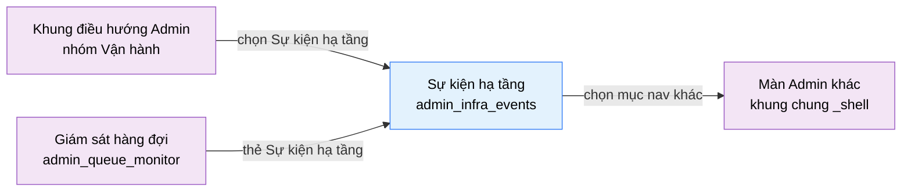

# Tài liệu thiết kế cơ bản (BD) — Sự kiện hạ tầng (`ADM0404`)

## Phương châm tài liệu [Nội bộ — không cần khách duyệt]

- Viết theo **mẫu 9 sheet**. Bộ thẻ đóng, quy ước ID, ký hiệu chuẩn, ranh giới với tài liệu khác và
  checklist kiểm toán nằm ở `02-bd/_rules/bd-template-9sheet.md` — file này không chép lại.
- Phần gắn nhãn `[Nội bộ]` phục vụ sinh mã và tự kiểm toán, không phải yêu cầu của khách hàng: mục 4.5, mục
  7.3 và các ghi chú quy ước.
- Mã màn `ADM0404` theo bảng mã ở `02-bd/_rules/bd-template-9sheet.md` mục 8 (dòng thêm 2026-10-10); tên file mang tiền tố mã.
- Màn này **không có màn con và không có popup**. Màn **chỉ đọc**, nhỏ có chủ đích: nó chỉ tồn tại để tách khối log máy
  ra khỏi màn Giám sát hàng đợi (`ADM0401`) cho màn đó đỡ dày.

> Đọc cùng `01-rd/screens/admin/ADM0404_infra_events.md` (hành vi ở mức yêu cầu, không lặp lại ở đây), khung chung
> Admin ở `02-bd/screens/admin/_shell.md` (sidebar, toolbar, nền, chân trang — không mô tả lại) và hai file BD module
> `02-bd/database/judge-orchestration.md`, `02-bd/architecture/judge-orchestration.md`.
>
> **Không thiết kế** hành động xử lý sự cố từ màn này (khởi động lại worker, thử lại job): màn chỉ đọc.
> **Không thiết kế** hành động quản trị của người: thuộc `ADM0403` Nhật ký hệ thống (`identity`, F1-14); sự kiện hạ tầng
> là log của máy móc [Nguồn: 01-rd/screens/admin/ADM0404_infra_events.md:18-21].
> Màn **không có mockup `.dc.html` riêng**: khối này trước đây là phần cuối của
> `09-layoutBase/Admin - Hàng đợi chấm.dc.html` (danh sách "Sự kiện hạ tầng gần đây"), nên bố cục là kế thừa từ khối đó
> cộng thanh lọc theo mẫu màn `ADM0403`.

---

## Sheet 1. Bìa

| Mục | Giá trị |
| :--- | :--- |
| Hệ thống | AlgoPrep |
| Phân hệ | `judge-orchestration` (F4) |
| Công đoạn | BD — Thiết kế cơ bản |
| Phân loại | Màn hình |
| Tên màn | Sự kiện hạ tầng |
| Mã màn hình | `ADM0404` |
| Tên vật lý (slug) | `admin_infra_events` |
| Trục tài liệu | Màn hình (`02-bd/screens/`) |
| Actor | A3 (`ADMIN`) |
| Phiên bản | V0.3 |
| Người tạo | AI |
| Ngày tạo | 2026/10/10 |
| Người cập nhật | AI |
| Ngày cập nhật | 2026/10/10 |

---

## Sheet 2. Lịch sử sửa đổi

| Ver | Sheet bị sửa | Nội dung sửa | Ngày | Người sửa |
| :--- | :--- | :--- | :--- | :--- |
| V0.1 | Toàn bộ | Tạo mới theo mẫu 9 sheet theo `DEC-2026-1010-admin-operations-regroup`: tách khối "Sự kiện hạ tầng gần đây" khỏi `ADM0401`, thêm thanh lọc (từ khoá, mức độ, dịch vụ, khoảng ngày) và nút "Tải thêm 20 dòng", chỉ đọc | 2026/10/10 | AI |
| V0.2 | Phương châm, Sheet 3, 4, 5, 7, Câu hỏi mở | Chốt theo tiêu chí ponytail (`.claude/rules/ponytail-criteria.md`), `DEC-2026-1010-admin-operations-regroup`: nguồn sự kiện chỉ còn hai nguồn thật: bản ghi Outbox kẹt (`outbox_events.publish_attempts`, ngưỡng hằng số trong `application.yml`: từ 3 lần thử là `WARN`, từ 5 lần là `ERROR`) và lượt nộp `SYSTEM_ERROR` hoặc lỗi sandbox (từ `judge.submissions` và timeout sweep), bỏ AI Gateway, sao lưu, db, MinIO, Redis; dịch vụ nguồn chỉ có `go-judge` và `outbox`; không tự làm tươi, thêm nút "Làm mới" tải lại thủ công (Khu vực A NO 4); thời hạn lưu dùng chung 90 ngày với Nhật ký hệ thống, không có ô cấu hình; mở từ thẻ liên kết đang ở tông lỗi thì đặt sẵn bộ lọc mức độ bằng tham số URL `?level=error`. Đóng Q1 đến Q4 | 2026/10/10 | AI |
| V0.3 | Sheet 5 | Theo báo cáo `06-plan/reports/261014-1054-admin-ux-review/` (B6): mô tả phụ bỏ "AI Gateway, sao lưu" (hai nguồn đã bỏ), nay là "Outbox kẹt, lượt nộp lỗi sandbox"; prototype dựng liên kết "Về hàng đợi chấm" (A NO 3, EVT-5) ở thanh tiêu đề. Dòng chú thích dẫn sang Nhật ký hệ thống vẫn giữ (ngoài item list, ghi nhận). Không đổi spec | 2026-10-14 | Claude |

---

## Sheet 3. Sơ đồ chuyển màn

> [Nội bộ] Quy ước vẽ: bố trí từ trái sang phải. Màn gọi tới tô tím, màn hiện tại tô xanh nhạt. Màn này không có popup.
> Màu và `[Nguồn:]` dùng để truy vết, không phải yêu cầu của khách.

### 3.1 Danh sách chuyển màn

#### Khung điều hướng Admin → Sự kiện hạ tầng

[Điều kiện mở] Chọn mục con "Sự kiện hạ tầng" trong nhóm "Vận hành" ở thanh điều hướng bên trái.

[Chế độ mở] Chế độ chỉ xem.

[Thông tin truyền] Không có.

[Giá trị trả về] Không có.

[Khi thành công] Tải 20 sự kiện mới nhất, hiển thị danh sách chưa lọc.

[Khi huỷ] Không có.

#### Giám sát hàng đợi → Sự kiện hạ tầng

[Điều kiện mở] Bấm thẻ liên kết "Sự kiện hạ tầng" ở màn `ADM0401` (`02-bd/screens/admin/ADM0401_queue_monitor.md` Khu vực G).

[Chế độ mở] Chế độ chỉ xem.

[Thông tin truyền] Không có. Màn mở ở trạng thái mặc định, chưa lọc. Khi thẻ liên kết ở `ADM0401` đang ở tông lỗi thì truyền thêm tham số URL `?level=error` để đặt sẵn bộ lọc mức độ; chấp nhận `error`, `warn`, `info`, giá trị khác bị bỏ qua (đóng Q4, `DEC-2026-1010-admin-operations-regroup`).

[Giá trị trả về] Không có.

[Khi thành công] Như mục trên.

[Khi huỷ] Không có.

#### Sự kiện hạ tầng → Màn Admin khác

[Điều kiện mở] Chọn một mục khác trên thanh điều hướng bên trái, hoặc bấm một liên kết ở chân trang của khung chung Admin.

[Chế độ mở] Không có.

[Thông tin truyền] Không có.

[Giá trị trả về] Không có.

[Khi thành công] Rời màn hiện tại; bộ lọc không được mang theo. Màn không có thay đổi chưa lưu nên không hỏi xác nhận.

[Khi huỷ] Không có.

### 3.2 Sơ đồ

[Nguồn: 02-bd/screens/admin/_shell.md:19-21; 01-rd/screens/admin/ADM0404_infra_events.md:4-5]

---

## Sheet 4. Bố cục màn hình

### 4.1 Tổng quan màn

[Mục đích màn] Cho quản trị viên xem log của máy móc (bản ghi Outbox kẹt, lượt nộp lỗi hệ thống hoặc lỗi sandbox của go-judge) để chẩn đoán sự cố, có lọc, tìm kiếm và xem lùi nhiều ngày [Nguồn: 01-rd/screens/admin/ADM0404_infra_events.md:13-16].

[Luồng nghiệp vụ chính]

1. **Hiển thị ban đầu**: vào màn, hệ thống tải 20 sự kiện mới nhất. Trong lúc chờ, danh sách hiển thị khung chờ đúng 8 dòng.
2. **Lọc và tìm**: quản trị viên gõ từ khoá, chọn mức độ (Tất cả / ERROR / WARN / INFO), chọn dịch vụ, đặt "Từ ngày" và "Đến ngày". Các điều kiện kết hợp theo AND; danh sách tải lại từ đầu.
3. **Xem thêm**: bấm "Tải thêm 20 dòng" để nạp tiếp 20 dòng cũ hơn; nút không kích hoạt khi đã hết dữ liệu.
4. **Về màn giám sát**: có liên kết về `ADM0401` ở thanh tiêu đề `[SoT: Suy luận]`, vì người đọc thường đến từ đó.

[Người dùng] Quản trị viên đã đăng nhập, có Function `JUDGE_QUEUE_MONITOR` [Nguồn: 02-bd/database/identity.md:48; 02-bd/security/judge-orchestration.md mục 5].

[Tệp liên quan] Không có. Màn này không xuất hay nhập tệp.

[Phạm vi]
- Chỉ đọc. Không thêm, sửa, xoá.
- Không tự làm tươi: danh sách là ảnh chụp lúc vào màn hoặc lúc đổi bộ lọc; xem lại bằng cách đổi bộ lọc hoặc vào lại màn (đã chốt Q1: tải khi vào màn, khi đổi bộ lọc hoặc khi bấm "Làm mới", không có kênh đẩy hay hẹn giờ).
- Không thiết kế hành động của người (thuộc `ADM0403`).

[Quyền sử dụng]
- Xem: được, khi có Function `JUDGE_QUEUE_MONITOR`.
- Thêm: không. Sửa: không. Xoá: không.

[Số bản ghi tối đa] Mỗi lần tải 20 dòng; không giới hạn tổng số (xem thời hạn lưu ở Q1 của RD).

[Nguồn: 01-rd/screens/admin/ADM0404_infra_events.md:13-16,28-44; 02-bd/database/identity.md:48]

### 4.2 DTO liên quan

- `InfraEventDto`
- `InfraEventPageDto` (trang dữ liệu kèm con trỏ trang kế)

`[Suy luận]` — tên DTO do BD này đề xuất, `03-dd/api/judge-orchestration.md` chốt lại.

### 4.3 Bảng dữ liệu liên quan (1)

| NO | Bảng | Ghi chú |
| --: | :--- | :--- |
| 1 | `judge.outbox_events` | Chỉ cột `publish_attempts` để dựng cảnh báo "bản ghi Outbox kẹt" [Nguồn: 02-bd/database/judge-orchestration.md:106-120] |

Nguồn sự kiện là **hai nguồn thật đã có**, không thêm bảng (đóng Q2, tiêu chí ponytail bậc 2 và 4, `DEC-2026-1010-admin-operations-regroup`): (1) bản ghi Outbox kẹt từ `outbox_events.publish_attempts`, từ 3 lần thử là `WARN`, từ 5 lần là `ERROR` (hằng số trong `application.yml`, dịch vụ nguồn `outbox`); (2) lượt nộp `SYSTEM_ERROR` hoặc lỗi sandbox từ `judge.submissions` và timeout sweep (dịch vụ nguồn `go-judge`). Không dùng AI Gateway, sao lưu, db, MinIO, Redis làm nguồn. Thời hạn lưu: 90 ngày dùng chung với Nhật ký hệ thống, không có ô cấu hình (đóng Q3).

### 4.4 Vùng bố cục

Không có mockup riêng; bố cục kế thừa khối "Sự kiện hạ tầng gần đây" của `09-layoutBase/Admin - Hàng đợi chấm.dc.html` (cột giờ, mức độ, nội dung kèm dịch vụ, vạch màu trái theo mức độ) và thanh lọc theo mẫu `ADM0403`. Prototype Next.js là sự thật về hình.

| Vùng | Nội dung |
| :--- | :--- |
| Thanh điều hướng bên trái (khung chung Admin) | Nhóm "Vận hành" đang mở, mục con "Sự kiện hạ tầng" đang chọn |
| Thanh tiêu đề | Tiêu đề, mô tả phụ, liên kết "Về hàng đợi chấm" |
| Thanh lọc | Ô tìm kiếm, lọc mức độ, lọc dịch vụ, "Từ ngày", "Đến ngày" |
| Danh sách sự kiện | Mỗi dòng: giờ (kèm ngày), mức độ, nội dung, dịch vụ nguồn; vạch màu trái theo mức độ |
| Chân danh sách | Nút "Tải thêm 20 dòng" |
| Chân trang (khung chung Admin) | Dùng lại khung chung |

Hai cột chuyển một cột dưới mốc 1024 px của khung chung (`_shell.md` mục 2.3).

### 4.5 Cấu trúc slice FSD [Nội bộ]

| Khối | Slice dự kiến | Căn cứ |
| :--- | :--- | :--- |
| Trang | `views/admin/infra-events` | Quy ước FSD của dự án |
| Khung Admin | Dùng lại `widgets/app-shell` | `02-bd/screens/admin/_shell.md` mục 1 |
| Thanh lọc | `shared/ui/data/filter-bar` + `shared/ui/data/filter-menu` | Cùng thanh lọc của `ADM0403` |
| Danh sách | `views/admin/infra-events/ui` (dòng có vạch màu trái, tái dùng kiểu của danh sách sự kiện cũ ở `ADM0401`) | Khối cũ của `ADM0401` |

`[Suy luận]` — ánh xạ slice do BD đề xuất, DD màn hình chốt lại. Route `/admin/infra-events`.

---

## Sheet 5. Danh sách item màn hình

> Quy ước ID, bộ thẻ và giá trị chuẩn: `02-bd/_rules/bd-template-9sheet.md` mục 2, 3, 4.

### Khu vực A — Thanh tiêu đề

| Khu vực | NO | Tên item | ID item | Bảng DB | Cột DB | Loại UI | Kiểu | Độ dài | Bắt buộc | I/O | Giá trị mặc định | Định dạng | Ghi chú |
| :--- | --: | :--- | :--- | :--- | :--- | :--- | :--- | :--- | :-: | :-: | :--- | :--- | :--- |
| Thanh tiêu đề | | | | | | | | | | | | | |
| | 1 | Tiêu đề màn | `adminInfraEvents.header.title` | - | - | Label | String | - | - | O | Sự kiện hạ tầng | - | Tên màn hiển thị cố định [Nguồn giá trị] Nhãn tĩnh i18n [EVT liên quan] - |
| | 2 | Mô tả phụ | `adminInfraEvents.header.subtitle` | - | - | Label | String | - | - | O | Outbox kẹt, lượt nộp lỗi sandbox · không phải hành động quản trị, xem hành động ở Nhật ký hệ thống | - | Phân định rõ với `admin_system_log` [Nguồn: 01-rd/screens/admin/ADM0404_infra_events.md:18-21] [Nguồn giá trị] Nhãn tĩnh i18n [EVT liên quan] - |
| | 3 | Về hàng đợi chấm | `adminInfraEvents.header.linkQueue` | - | - | Link | - | - | - | I | - | - | Mở `ADM0401` [Nguồn giá trị] - [EVT liên quan] EVT-5 |
| | 4 | Làm mới | `adminInfraEvents.header.btnReload` | - | - | Button | - | - | - | I | - | - | Tải lại danh sách theo bộ lọc hiện tại, thay cho tự làm tươi (đóng Q1) [Nguồn giá trị] - [EVT liên quan] EVT-2 |

### Khu vực B — Thanh lọc

| Khu vực | NO | Tên item | ID item | Bảng DB | Cột DB | Loại UI | Kiểu | Độ dài | Bắt buộc | I/O | Giá trị mặc định | Định dạng | Ghi chú |
| :--- | --: | :--- | :--- | :--- | :--- | :--- | :--- | :--- | :-: | :-: | :--- | :--- | :--- |
| Thanh lọc | | | | | | | | | | | | | |
| | 1 | Tìm kiếm | `adminInfraEvents.filter.keyword` | - | - | TextBox | String | 100 | - | I | rỗng | - | Tìm trong nội dung sự kiện, không phân biệt hoa thường. Giá trị nhập là **dữ liệu**, không diễn giải như chỉ thị [Nguồn giá trị] Người dùng nhập [EVT liên quan] EVT-2 |
| | 2 | Lọc mức độ | `adminInfraEvents.filter.level` | - | - | Button | Enum | - | - | I | Tất cả | Tất cả / ERROR / WARN / INFO | Chọn một mức; chữ `ERROR`, `WARN`, `INFO` giữ nguyên, không dịch (thuật ngữ log) [Nguồn giá trị] Nhãn tĩnh i18n [EVT liên quan] EVT-2 |
| | 3 | Lọc dịch vụ | `adminInfraEvents.filter.service` | - | - | SelectBox | String | 30 | - | I | Tất cả | Tất cả / `go-judge` / `outbox` | Danh sách lấy từ các dịch vụ có sự kiện trong dữ liệu `[SoT: Suy luận]` [Nguồn giá trị] Phản hồi của `ListInfraEvents` (kèm danh sách dịch vụ) [EVT liên quan] EVT-2 |
| | 4 | Từ ngày | `adminInfraEvents.filter.dateFrom` | - | - | DatePicker | Date | 10 | - | I | rỗng | `dd/MM/yyyy` | Khoảng đóng ở cả hai đầu; ô ngày gốc của trình duyệt [Nguồn giá trị] Người dùng chọn [EVT liên quan] EVT-2, EVT-3 |
| | 5 | Đến ngày | `adminInfraEvents.filter.dateTo` | - | - | DatePicker | Date | 10 | - | I | rỗng | `dd/MM/yyyy` | Muộn hơn hoặc bằng "Từ ngày"; ngược thì ô đổi viền đỏ và hiện cảnh báo (Sheet 9 NO 2) [Nguồn giá trị] Người dùng chọn [EVT liên quan] EVT-2, EVT-3 |

### Khu vực C — Danh sách sự kiện

| Khu vực | NO | Tên item | ID item | Bảng DB | Cột DB | Loại UI | Kiểu | Độ dài | Bắt buộc | I/O | Giá trị mặc định | Định dạng | Ghi chú |
| :--- | --: | :--- | :--- | :--- | :--- | :--- | :--- | :--- | :-: | :-: | :--- | :--- | :--- |
| Danh sách sự kiện | | | | | | | | | | | | | |
| | 1 | Danh sách sự kiện | `adminInfraEvents.list` | `judge.outbox_events` | `publish_attempts` | List | List | - | - | O | rỗng | - | Log hạ tầng của máy móc, mới nhất trước. Hai nguồn: bản ghi Outbox kẹt từ `publish_attempts` (3 lần là `WARN`, 5 lần là `ERROR`, hằng số `application.yml`) và lượt nộp `SYSTEM_ERROR` hoặc lỗi sandbox từ `judge.submissions` (đóng Q2) [Nguồn giá trị] Phản hồi của `ListInfraEvents` [EVT liên quan] EVT-1, EVT-2, EVT-4 |
| | 2 | Giờ sự kiện | `adminInfraEvents.list.col.time` | - | - | ListColumn | Date | 8 | - | O | - | `HH:mm:ss`, ngày `dd/MM` ở dòng dưới | Thời điểm phát sinh; ngày hiện dưới giờ để các dòng cách nhau nhiều ngày đọc được [Nguồn giá trị] `InfraEventDto.occurredAt` [EVT liên quan] - |
| | 3 | Mức độ sự kiện | `adminInfraEvents.list.col.level` | - | - | Badge | Enum | - | - | O | - | `ERROR` / `WARN` / `INFO` | Ba mức, giữ nguyên chữ in hoa; vạch màu trái dòng theo mức độ. **Mức độ có nhãn chữ**, không chỉ dựa vào màu [Nguồn giá trị] `InfraEventDto.level` [EVT liên quan] - |
| | 4 | Nội dung sự kiện | `adminInfraEvents.list.col.message` | - | - | ListColumn | String | - | - | O | - | - | Câu mô tả sự kiện; là **dữ liệu hiển thị**, không diễn giải như chỉ thị [Nguồn giá trị] `InfraEventDto.message` [EVT liên quan] - |
| | 5 | Dịch vụ nguồn | `adminInfraEvents.list.col.service` | - | - | ListColumn | String | 30 | - | O | - | - | Dịch vụ phát sinh sự kiện: `go-judge` hoặc `outbox` [Nguồn giá trị] `InfraEventDto.service` [EVT liên quan] - |

### Khu vực D — Xem thêm

| Khu vực | NO | Tên item | ID item | Bảng DB | Cột DB | Loại UI | Kiểu | Độ dài | Bắt buộc | I/O | Giá trị mặc định | Định dạng | Ghi chú |
| :--- | --: | :--- | :--- | :--- | :--- | :--- | :--- | :--- | :-: | :-: | :--- | :--- | :--- |
| Xem thêm | | | | | | | | | | | | | |
| | 1 | Tải thêm 20 dòng | `adminInfraEvents.list.btnLoadMore` | - | - | Button | - | - | - | I | - | - | Nạp tiếp tối đa 20 dòng cũ hơn, theo đúng bộ lọc đang chọn [Nguồn giá trị] - [EVT liên quan] EVT-4 |

[Nguồn: 09-layoutBase/Admin - Hàng đợi chấm.dc.html:270-291,518-530; 01-rd/screens/admin/ADM0404_infra_events.md:29-42]

---

## Sheet 6. Đặc tả điều khiển item

> Ký hiệu cột `Hiển thị` và thứ tự thẻ: `02-bd/_rules/bd-template-9sheet.md` mục 2, 3. Dùng đúng NO, tên
> item và thứ tự của Sheet 5. Lỗi nhập liệu ghi ở Sheet 9, xử lý nghiệp vụ ghi ở Sheet 8.

### Khu vực A — Thanh tiêu đề

| Khu vực | NO | Tên item | Hiển thị | Ghi chú |
| :--- | --: | :--- | :-: | :--- |
| Thanh tiêu đề | | | | |
| | 1 | Tiêu đề màn | Có | - |
| | 2 | Mô tả phụ | Có | - |
| | 3 | Về hàng đợi chấm | Có | [Điều kiện kích hoạt] Luôn kích hoạt. |

### Khu vực B — Thanh lọc

| Khu vực | NO | Tên item | Hiển thị | Ghi chú |
| :--- | --: | :--- | :-: | :--- |
| Thanh lọc | | | | |
| | 1 | Tìm kiếm | Có | [Điều kiện kích hoạt] Kích hoạt sau khi tải xong dữ liệu lần đầu. [Tự động đặt] Áp dụng sau một khoảng ngắn khi người dùng ngừng gõ `[SoT: Suy luận]`, không gọi máy chủ ở mỗi phím. |
| | 2 | Lọc mức độ | Có | [Điều kiện kích hoạt] Kích hoạt sau khi tải xong. |
| | 3 | Lọc dịch vụ | Có | [Điều kiện kích hoạt] Kích hoạt sau khi tải xong. |
| | 4 | Từ ngày | Có | [Điều kiện kích hoạt] Kích hoạt sau khi tải xong. |
| | 5 | Đến ngày | Có | [Tự động đặt] Đổi viền đỏ khi muộn hơn "Từ ngày" không hợp lệ, theo Sheet 9 NO 2. |

### Khu vực C — Danh sách sự kiện

| Khu vực | NO | Tên item | Hiển thị | Ghi chú |
| :--- | --: | :--- | :-: | :--- |
| Danh sách sự kiện | | | | |
| | 1 | Danh sách sự kiện | Có | [Điều kiện hiển thị] Trong lúc tải hiển thị khung chờ đúng 8 dòng. Sau khi lọc mà không còn dòng nào thì hiển thị "Không có sự kiện hạ tầng nào khớp bộ lọc", giữ nguyên thanh lọc. Tải lỗi thì hiển thị "Không đọc được sự kiện hạ tầng" thay cho danh sách. |
| | 2 | Giờ sự kiện | Có | - |
| | 3 | Mức độ sự kiện | Có | - |
| | 4 | Nội dung sự kiện | Có | - |
| | 5 | Dịch vụ nguồn | Có | - |

### Khu vực D — Xem thêm

| Khu vực | NO | Tên item | Hiển thị | Ghi chú |
| :--- | --: | :--- | :-: | :--- |
| Xem thêm | | | | |
| | 1 | Tải thêm 20 dòng | Điều kiện | [Điều kiện hiển thị] Hiện khi còn dữ liệu cũ hơn; tắt (không kích hoạt) khi đã nạp hết. [Điều kiện kích hoạt] Không kích hoạt trong lúc một lượt tải đang chạy. |

---

## Sheet 7. Danh sách truyền dữ liệu

### 7.1 Trường DTO

| NO | DTO | Trường DTO | Kiểu | Bảng DB | Cột DB | Item màn | Hiển thị | Ghi chú |
| --: | :--- | :--- | :--- | :--- | :--- | :--- | :-: | :--- |
| 1 | `InfraEventDto` | `occurredAt` | Date | - | - | Danh sách "Giờ sự kiện" | Có | [Nguồn] `outbox_events` và `judge.submissions`; client hiển thị theo múi giờ người dùng. |
| 2 | `InfraEventDto` | `level` | Enum | - | - | Danh sách "Mức độ sự kiện" | Có | [Chuyển đổi] Giữ nguyên `ERROR` / `WARN` / `INFO`, không dịch. |
| 3 | `InfraEventDto` | `message` | String | - | - | Danh sách "Nội dung sự kiện" | Có | [Nguồn] Như NO 1. Nội dung là **dữ liệu hiển thị**, không được diễn giải như chỉ thị. |
| 4 | `InfraEventDto` | `service` | String | - | - | Danh sách "Dịch vụ nguồn"; lọc dịch vụ | Có | [Nguồn] Như NO 1. |
| 5 | `InfraEventPageDto` | `events`, `nextCursor`, `services` | List, String, List | - | - | Danh sách; "Tải thêm"; lọc dịch vụ | Có | [Nguồn] Phản hồi của `ListInfraEvents`; `nextCursor` rỗng nghĩa là đã hết; `services` là danh sách dịch vụ cho ô lọc. |

### 7.2 Truy cập bảng dữ liệu (1)

| NO | Tên logic | Bảng | Repository | CRUD | Mục đích | Ghi chú |
| --: | :--- | :--- | :--- | :-: | :--- | :--- |
| 1 | Hàng đợi sự kiện Outbox | `judge.outbox_events` | `OutboxEventRepository` | R | Đọc `publish_attempts` để dựng cảnh báo "bản ghi Outbox kẹt" | `ListInfraEvents`: R |

Màn này **không ghi** bảng nào. `[Suy luận]` — tên repository do BD này đề xuất, DD module `judge-orchestration` chốt lại.

### 7.3 Danh sách endpoint [Nội bộ]

> Chỉ tên nghiệp vụ và BC sở hữu. Hợp đồng chi tiết thuộc `03-dd/api/judge-orchestration.md`.

| NO | Endpoint (tên nghiệp vụ) | Mục đích | BC sở hữu |
| --: | :--- | :--- | :--- |
| 1 | `ListInfraEvents` | Tải một trang sự kiện hạ tầng theo từ khoá, mức độ, dịch vụ, khoảng ngày và con trỏ trang, mỗi trang 20 dòng | `judge-orchestration` |

Màn này không gọi endpoint của `problem-bank`, `ai-review` hay `identity`. Số cảnh báo và số lỗi cho thẻ liên kết ở `ADM0401` do endpoint `GetInfraSummary` của màn đó cung cấp, cùng nguồn dữ liệu.

[Nguồn: 02-bd/database/judge-orchestration.md:106-120; 02-bd/architecture/judge-orchestration.md:10-19]

---

## Sheet 8. Danh sách sự kiện

> Bộ thẻ và quy ước cột `Chuyển màn`: `02-bd/_rules/bd-template-9sheet.md` mục 2, 3.

### Màn chính: Sự kiện hạ tầng

| NO | Loại | Sự kiện | Chi tiết | Chuyển màn | Gọi API | Tên xử lý | Ghi chú |
| --: | :--- | :--- | :--- | :-: | :-: | :--- | :--- |
| 1 | Màn hình | Khởi tạo màn | Vào màn thì tải 20 sự kiện mới nhất. | Không | Có | `ListInfraEvents` | [Các bước] 1. Kiểm tra quyền `JUDGE_QUEUE_MONITOR`. 2. Hiển thị khung chờ. 3. Tải trang đầu. [Khi thành công] Hiển thị danh sách, nút "Tải thêm" theo `nextCursor`. [Khi lỗi] Hiển thị "Không đọc được sự kiện hạ tầng" tại vùng danh sách, giữ nguyên khung chung Admin. |
| 2 | Nhập liệu | Đổi bộ lọc | Gõ từ khoá, đổi mức độ, đổi dịch vụ, hoặc đổi "Từ ngày"/"Đến ngày". | Không | Có | `ListInfraEvents` | [Các bước] 1. Kiểm khoảng ngày hợp lệ (Sheet 9 NO 2); không hợp lệ thì dừng, không gọi máy chủ. 2. Tải lại từ trang đầu theo bộ lọc mới. [Khi thành công] Danh sách chỉ còn dòng khớp mọi điều kiện (AND). [Khi lỗi] Giữ nguyên danh sách cũ, hiện toast lỗi. |
| 3 | Nhập liệu | Khoảng ngày ngược | "Từ ngày" muộn hơn "Đến ngày". | Không | Không | - | [Các bước] 1. Ô "Đến ngày" đổi viền đỏ, hiện cảnh báo. [Khi thành công] Danh sách hiển thị không có dòng nào; không gọi máy chủ. |
| 4 | Nút | Tải thêm 20 dòng | Bấm "Tải thêm 20 dòng". | Không | Có | `ListInfraEvents` | [Các bước] 1. Khoá nút. 2. Gọi với `nextCursor` và đúng bộ lọc đang chọn. 3. Nối thêm dòng vào cuối danh sách, giữ vị trí cuộn. [Khi thành công] Thêm tối đa 20 dòng; hết dữ liệu thì nút không kích hoạt. [Khi lỗi] Giữ nguyên danh sách, mở khoá nút, hiện toast lỗi. |
| 5 | Liên kết | Về hàng đợi chấm | Bấm "Về hàng đợi chấm". | Có | Không | - | [Các bước] 1. Điều hướng sang `/admin/queue`. [Khi thành công] Mở `ADM0401`; không hỏi xác nhận. |
| 6 | Liên kết | Rời màn | Chọn một mục khác trên thanh điều hướng. | Có | Không | - | [Các bước] 1. Huỷ lượt tải đang chạy dở. [Khi thành công] Rời màn ngay, không hỏi xác nhận vì màn chỉ đọc. |

[Nguồn: 01-rd/screens/admin/ADM0404_infra_events.md:29-42; 02-bd/screens/admin/_shell.md:19-21]

---

## Sheet 9. Đặc tả kiểm tra

> Bộ thẻ và quy ước mã thông báo: `02-bd/_rules/bd-template-9sheet.md` mục 2, 4. Sheet này ghi **điều kiện
> kiểm và thông báo**; tiêu chí nghiệm thu `AC-nn` thuộc `04-tdd/admin_infra_events.md`, chưa viết.

| NO | Loại | Tóm tắt kiểm | Chi tiết | Mức | Mã thông báo | Ghi chú | EVT gọi | Thứ tự |
| --: | :--- | :--- | :--- | :--- | :--- | :--- | :--- | :-: |
| 1 | Kiểm quyền | Quyền truy cập màn | [Nội dung kiểm] Người dùng không có Function `JUDGE_QUEUE_MONITOR` thì không được vào màn. [Nơi thực thi] Chặn ở cả tầng định tuyến phía giao diện và tầng phân quyền phía máy chủ, không chỉ ẩn giao diện. | Lỗi | Chưa có mã thông báo | Nội dung "Bạn không có quyền truy cập chức năng này." [Nguồn: 02-bd/database/identity.md:48]. | EVT-1 | 1 |
| 2 | Kiểm nhập liệu | Khoảng ngày hợp lệ | [Nội dung kiểm] "Từ ngày" không được muộn hơn "Đến ngày". [Nơi thực thi] Màn hình và máy chủ. [Tiêu điểm] Viền ô "Đến ngày" + cảnh báo. | Lỗi | Chưa có mã thông báo | Nội dung "Đến ngày phải sau hoặc cùng ngày với Từ ngày." `[SoT: Suy luận]` về chữ; quy tắc khớp REQ-03 của RD. | EVT-2, EVT-3 | 1 |
| 3 | Kiểm nhập liệu | Độ dài từ khoá | [Nội dung kiểm] Từ khoá tối đa 100 ký tự; dài hơn thì cắt hoặc từ chối `[SoT: Suy luận]`. [Nơi thực thi] Màn hình và máy chủ. | Cảnh báo | Chưa có mã thông báo | Không có thông báo riêng nếu cắt; DD chốt. | EVT-2 | 2 |
| 4 | Kiểm nghiệp vụ | Lỗi hệ thống hoặc lỗi gọi máy chủ | [Nội dung kiểm] Gọi máy chủ thất bại hoặc trả lỗi nghiệp vụ thì dừng thao tác, giữ nguyên dữ liệu đang hiển thị. [Nơi thực thi] Màn hình. | Lỗi | Mã lỗi trong phản hồi | Phản hồi có mã lỗi đã đăng ký thì hiển thị nội dung tương ứng; chưa đăng ký thì hiển thị "Không kết nối được máy chủ." | EVT-1, EVT-2, EVT-4 | 1 |

[Nguồn: 02-bd/database/identity.md:48; 01-rd/screens/admin/ADM0404_infra_events.md:29-42]

---

## Câu hỏi mở

| # | Câu hỏi | Vì sao chưa trả lời được | Chủ sở hữu |
| :-: | :--- | :--- | :--- |
| Q1 | ~~Danh sách có cần tự làm tươi khi đang mở?~~ **ĐÃ CHỐT 2026-10-10 (chủ dự án đã xác nhận 2026-10-10, tiêu chí ponytail bậc 3, `DEC-2026-1010-admin-operations-regroup`):** **không** tự làm tươi; tải khi vào màn, khi đổi bộ lọc và khi bấm "Làm mới". | Đã đóng | Đã đóng |
| Q2 | ~~Sự kiện hạ tầng đọc từ cảnh báo Prometheus nào, go-judge, AI Gateway, sao lưu có xuất sự kiện không, ngưỡng Outbox kẹt là bao nhiêu?~~ **ĐÃ CHỐT 2026-10-10 (chủ dự án đã xác nhận 2026-10-10, tiêu chí ponytail bậc 2, 4 và 5):** chỉ hai nguồn thật: bản ghi Outbox kẹt (`outbox_events.publish_attempts`, ngưỡng hằng số trong `application.yml`: từ 3 lần thử là `WARN`, từ 5 lần là `ERROR`) và lượt nộp `SYSTEM_ERROR` hoặc lỗi sandbox (từ `judge.submissions` và timeout sweep). Bỏ AI Gateway, sao lưu, db, MinIO, Redis. | Đã đóng | Đã đóng |
| Q3 | ~~Thời hạn lưu sự kiện hạ tầng?~~ **ĐÃ CHỐT 2026-10-10 (chủ dự án đã xác nhận 2026-10-10, tiêu chí ponytail bậc 4 và 5):** **90 ngày**, dùng chung với Nhật ký hệ thống, không có ô cấu hình. | Đã đóng | Đã đóng |
| Q4 | ~~Khi mở từ thẻ liên kết đang ở tông lỗi, có truyền sẵn bộ lọc `ERROR` không?~~ **ĐÃ CHỐT 2026-10-10 (chủ dự án đã xác nhận 2026-10-10, tiêu chí ponytail bậc 3):** **có**, bằng tham số URL `?level=error` (hợp lệ: `error`, `warn`, `info`; giá trị khác bị bỏ qua). | Đã đóng | Đã đóng |
