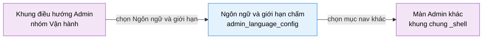

# Tài liệu thiết kế cơ bản (BD) — Ngôn ngữ và giới hạn chấm (`ADM0501`)

## Phương châm tài liệu [Nội bộ — không cần khách duyệt]

- Viết theo **mẫu 9 sheet**. Bộ thẻ đóng, quy ước ID, ký hiệu chuẩn, ranh giới với tài liệu khác và
  checklist kiểm toán nằm ở `02-bd/_rules/bd-template-9sheet.md` — file này không chép lại.
- Phần gắn nhãn `[Nội bộ]` phục vụ sinh mã và tự kiểm toán, không phải yêu cầu của khách hàng: mục 4.5, mục
  7.3 và các ghi chú quy ước.
- Mã màn `ADM0501` theo bảng mã ở `02-bd/_rules/bd-template-9sheet.md` mục 8; tên file mang tiền tố mã.
- Màn này **không có màn con**, có **hai tab** ("Ngôn ngữ và giới hạn", "Sandbox và sinh testcase"), **một thanh lưu dính đáy** dùng chung cho cả hai tab và **một hộp xác nhận lúc Lưu** (chỉ khi có ngôn ngữ chuyển từ bật sang tắt). Hộp xác nhận khi rời màn lúc còn thay đổi chưa lưu là hành vi dùng chung của form Admin, xem Sheet 8 NO 6 (V1.0 đóng Q5 và Q6).

> Đọc cùng `01-rd/screens/admin/ADM0501_language_config.md` (hành vi ở mức yêu cầu, không lặp lại ở đây), khung
> chung Admin ở `02-bd/screens/admin/_shell.md` (sidebar, toolbar, nền — không mô tả lại), và ba file BD
> module: `02-bd/database/F4_judge-orchestration.md`, `02-bd/security/F4_judge-orchestration.md`,
> `02-bd/architecture/F3_harness.md`.
>
> **Không thiết kế** chức năng "Thêm ngôn ngữ": hệ thống khoá cứng đúng ba ngôn ngữ Java, C++, Python
> [Nguồn: 02-bd/architecture/F3_harness.md:13-16].
> **Không thiết kế** liên kết "chấm lại" trong thẻ "Lưu ý khi đổi giới hạn" của prototype — tính năng chấm
> lại đã bị loại khỏi phạm vi theo `DEC-2026-0828-remove-rejudge-scope`
> [Nguồn: 01-rd/screens/admin/ADM0501_language_config.md:50-55].

> **Không thiết kế** (V1.0, 2026-10-10, `DEC-2026-1010-admin-operations-regroup`): cột "Mã môi trường chấm" (`go-judge #71`...) vì chỉ là chuỗi trang trí của bản mẫu, không có nguồn dữ liệu (đóng Q3); thẻ riêng "Lưu ý khi đổi giới hạn" (thay bằng một dòng ghi chú ở thanh lưu).

---

## Sheet 1. Bìa

| Mục | Giá trị |
| :--- | :--- |
| Hệ thống | AlgoPrep |
| Phân hệ | `judge-orchestration` (F4) + `problem-bank` (F2) |
| Công đoạn | BD — Thiết kế cơ bản |
| Phân loại | Màn hình |
| Tên màn | Ngôn ngữ và giới hạn chấm |
| Mã màn hình | `ADM0501` |
| Tên vật lý (slug) | `admin_language_config` |
| Trục tài liệu | Màn hình (`02-bd/screens/`) |
| Actor | A3 (`ADMIN`) |
| Phiên bản | V1.3 |
| Người tạo | Nhóm phát triển AlgoPrep |
| Ngày tạo | 2026/09/15 |
| Người cập nhật | Nhóm phát triển AlgoPrep |
| Ngày cập nhật | 2026/10/22 |

---

## Sheet 2. Lịch sử sửa đổi

| Ver | Sheet bị sửa | Nội dung sửa | Ngày | Người sửa |
| :--- | :--- | :--- | :--- | :--- |
| V0.1 | Toàn bộ | Tạo mới theo cấu trúc 8 mục văn xuôi (bối cảnh, layout regions, component inventory, screen states, API tiêu thụ, navigation và access rights, câu hỏi mở, tham chiếu) | 2026/09/15 | Nhóm phát triển AlgoPrep |
| V0.2 | Toàn bộ | Chuyển sang mẫu 9 sheet. Chốt công thức của hai cột dẫn xuất "Giới hạn TG" và "Bộ nhớ", chốt nguồn của các nhãn tĩnh, hạ 4 giá trị "Giới hạn mặc định" về hiển thị chỉ đọc đọc từ `application.yml` ở đợt này, bổ sung Sheet 8 danh sách sự kiện và Sheet 9 đặc tả kiểm tra, giữ nguyên toàn bộ câu hỏi mở của V0.1 và phát sinh thêm câu hỏi về hệ số bộ nhớ | 2026/09/20 | Nhóm phát triển AlgoPrep |
| V0.3 | Sheet 8, 9 | Áp `DEC-2026-1003-toast-feedback-channel`: kết quả thao tác và lỗi nhập liệu ghi là toast dùng chung, ô sai chỉ đổi viền đỏ. | 2026/10/03 | AI |
| V0.4 | Sheet 4, 5, 6, 7, 8, 9, Câu hỏi mở | Chủ dự án chốt 2026-10-03: giới hạn sandbox cho script sinh dữ liệu testcase (F2-14) cấu hình ở thẻ riêng; script chạy bằng Python. Thêm Khu vực F (thời gian chạy tối đa, kích thước output tối đa), DTO `GeneratorSandboxDto`, EVT-7, kiểm nhập liệu 9. Đóng Q9, thêm Q10 (nơi lưu, giá trị mặc định). Prototype chưa dựng thẻ | 2026/10/03 | AI |
| V0.5 | Sheet 5, 7, Câu hỏi mở | Dựng thẻ "Script sinh dữ liệu testcase" ở prototype và chốt nơi lưu (2026-10-03): bảng singleton `judge.generator_sandbox_settings`, mặc định 30 giây và 100 MB; đóng Q10 | 2026/10/03 | AI |
| V0.6 | Sheet 4 (4.5) | Ghi hiện trạng prototype: dữ liệu màn đi qua `queries.ts` + `withMockData`, có trạng thái đang tải, lỗi tải và toast lỗi khi lưu thất bại. Không đổi hành vi BD | 2026/10/03 | AI |
| V1.0 | Toàn bộ | Thiết kế lại cho đỡ dày theo `DEC-2026-1010-admin-operations-regroup`: chia hai tab (Ngôn ngữ và giới hạn / Sandbox và sinh testcase); bảng ngôn ngữ còn 4 cột, bỏ cột "Mã môi trường chấm" (đóng Q3); bốn giới hạn mặc định thành hàng nhập gọn trên bảng, **sửa được**, lưu ở bảng mới `judge.grading_defaults` (đóng Q2); hệ số bộ nhớ sửa được, Java seed 2,00 (đóng Q7); sandbox **toàn cục** ở bảng mới `judge.sandbox_settings`, giới hạn tiến trình con là công tắc kèm ô số (đóng Q4); thêm cột `language_configs.enabled` (đóng Q1); bỏ thẻ "Lưu ý", thêm thanh lưu dính đáy với "Hoàn tác" (Khu vực G) và một hộp xác nhận lúc Lưu khi tắt ngôn ngữ (Khu vực H, đóng Q5); rời màn lúc còn thay đổi chưa lưu dùng cơ chế dùng chung (đóng Q6); dùng mốc 1024 px của khung chung (đóng Q8). Thêm quy tắc: áp từ lúc bắt đầu chấm (G3), tắt ngôn ngữ không huỷ job đang chờ (G4), mọi lần Lưu ghi Nhật ký hệ thống phân loại "Cấu hình" (G2). Thêm kiểm hệ số RAM và kiểm ngôn ngữ cuối cùng trên máy chủ | 2026/10/10 | AI |
| V1.1 | Sheet 5, 6, 7 | Theo `DEC-2026-1014-sandbox-child-process-cap-constant` (chủ dự án 2026-10-14, báo cáo `06-plan/reports/261014-1054-admin-ux-review/` B7): bỏ ô số "Số tiến trình con tối đa" (NO5) và trường DTO `maxChildProcesses`; giới hạn giữ hằng số 60 ở `application.yml`, màn chỉ còn công tắc. Tiêu chí ponytail bậc 5. Prototype không đổi | 2026-10-14 | Claude |
| V1.2 | Sheet 4.3, 5, 7 (trích) | Sửa 2026-10-22 đồng bộ DB, `DEC-2026-1022-ai-judge-schema-sync` (JD-04, JD-08). Đối chiếu `02-bd/database/F4_judge-orchestration.md` mục 1.10: không còn cột `max_child_processes`, chỉ còn `child_process_limit_enabled`, trần 60 là hằng số `application.yml`; khớp V1.1 nên **không đổi nội dung**, chỉ ghi rõ cột đã bỏ ở DB (NO 5, DTO NO 12 vốn đã gạch). Ghi thêm: `judge.submissions` không lưu giới hạn hiệu dụng hay snapshot cấu hình, nên đổi giá trị ở màn này chỉ ảnh hưởng job **bắt đầu chấm sau đó** và không truy vết ngược được (mục 1.1, 1.10). Sửa số dòng trích `02-bd/database/F4_judge-orchestration.md` sang bản 2026-10-22. Không đổi prototype | 2026/10/22 | Nhóm phát triển AlgoPrep |
| V1.3 | Sheet 4.1 (Quyền sử dụng), Sheet 9 NO 1 | Owner 2026/10/23: `LANGUAGE_CONFIG` là Function thứ 11 của ma trận (F4-11). Ghi rõ `READ` mở màn, `UPDATE` cho phép Lưu, `CREATE` và `DELETE` không có tác dụng; ghi chú prototype chưa tách quyền theo vai trò. Không đổi mã. | 2026/10/23 | Claude |

---

## Sheet 3. Sơ đồ chuyển màn

> [Nội bộ] Quy ước vẽ: bố trí từ trái sang phải. Màn gọi tới tô tím, màn hiện tại tô xanh nhạt. Hộp xác nhận lúc Lưu (V1.0) chỉ là bước đệm của nút
> "Lưu" nên không vẽ thành màn riêng. Màu và `[Nguồn:]` dùng để truy vết, không phải yêu cầu của khách.

### 3.1 Danh sách chuyển màn

#### Khung điều hướng Admin → Ngôn ngữ và giới hạn chấm

[Điều kiện mở] Chọn mục con "Ngôn ngữ và giới hạn" trong nhóm "Vận hành" ở thanh điều hướng bên trái.

[Chế độ mở] Chế độ xem và sửa. Không có chế độ chỉ xem riêng — người dùng không có Function
`LANGUAGE_CONFIG` thì bị chặn ngay ở bước vào màn, xem Sheet 9 NO 1.

[Thông tin truyền] Không có.

[Giá trị trả về] Không có.

[Khi thành công] Tải cấu hình của đúng ba ngôn ngữ, bộ giới hạn mặc định, ba tham số sandbox và hai giới hạn script sinh testcase, hiển thị ở tab "Ngôn ngữ và giới hạn", trạng thái chưa có thay đổi; thanh lưu dính đáy chưa kích hoạt nút "Lưu".

[Khi huỷ] Không có.

#### Ngôn ngữ và giới hạn chấm → Màn Admin khác

[Điều kiện mở] Chọn một mục khác trên thanh điều hướng bên trái, hoặc bấm một liên kết ở chân trang của
khung chung Admin.

[Chế độ mở] Không có.

[Thông tin truyền] Không có.

[Giá trị trả về] Không có.

[Khi thành công] Rời màn hiện tại. Còn thay đổi chưa lưu thì hiện hộp xác nhận rời màn dùng chung của form Admin (`shared/ui/feedback/unsaved-changes-dialog`), xem Sheet 8 NO 6 (đóng Q6). Các thay đổi chưa lưu **không** được mang theo nếu người dùng chọn rời màn.

[Khi huỷ] Không có.

### 3.2 Sơ đồ

[Nguồn: 09-layoutBase/Admin - Ngôn ngữ và giới hạn.dc.html:310; 02-bd/screens/admin/_shell.md:19-21;
01-rd/screens/admin/ADM0501_language_config.md:13-14]

---

## Sheet 4. Bố cục màn hình

### 4.1 Tổng quan màn

[Mục đích màn] Cho quản trị viên cấu hình ba ngôn ngữ nộp bài đã khoá cứng — hệ số thời gian và bộ nhớ theo ngôn ngữ (F2-10), bật hoặc tắt từng ngôn ngữ, bốn giới hạn mặc định, ba tham số sandbox của go-judge (F4-11) và giới hạn script sinh testcase (F2-14) — để hệ thống chấm đúng năng lực hạ tầng thật [Nguồn: 01-rd/screens/admin/ADM0501_language_config.md:13-14].

[Luồng nghiệp vụ chính]

1. **Hiển thị ban đầu**: vào màn, hệ thống tải cấu hình của ba ngôn ngữ, bốn giới hạn mặc định, ba tham số sandbox và hai giới hạn script sinh testcase. Màn mở ở tab "Ngôn ngữ và giới hạn". Trong lúc chờ, mỗi khối hiển thị khung chờ đúng số dòng dự kiến. Thanh lưu dính đáy chưa kích hoạt nút "Lưu" khi chưa có thay đổi.
2. **Sửa hệ số và giới hạn mặc định**: quản trị viên nhập hệ số thời gian và hệ số bộ nhớ của một ngôn ngữ, hoặc một trong bốn giới hạn mặc định ở hàng gọn trên bảng. Cột "Giới hạn hiệu dụng" (một ô "x ms · y MB") tính lại ngay tại chỗ vì là giá trị dẫn xuất, không phải trường nhập riêng.
3. **Bật hoặc tắt một ngôn ngữ**: bấm công tắc trên dòng ngôn ngữ đó. **Thay đổi chưa có hiệu lực cho tới khi Lưu**; không hỏi ngay lúc bấm. Ngôn ngữ đã tắt không còn chọn được ở màn `problem_detail` cho lượt nộp **mới**; job đang chờ của ngôn ngữ đó vẫn chạy nốt và lượt nộp cũ giữ nguyên kết quả [Nguồn: 01-rd/screens/admin/ADM0501_language_config.md:50-58]. Luôn còn ít nhất một ngôn ngữ bật.
4. **Sandbox và sinh testcase**: chuyển sang tab thứ hai, bật hoặc tắt ba tham số sandbox (toàn cục, không theo ngôn ngữ), sửa hai giới hạn script sinh testcase. Hai tab dùng chung một trạng thái biên soạn và một thanh lưu.
5. **Lưu**: thanh dính đáy hiện số thay đổi chưa lưu, nút "Hoàn tác" (bỏ mọi thay đổi chưa lưu) và nút "Lưu". Bấm "Lưu": nếu có ngôn ngữ chuyển từ bật sang tắt thì hiện **một** hộp xác nhận liệt kê hậu quả; xác nhận xong hệ thống ghi toàn bộ thay đổi trong một lần và ghi một dòng Nhật ký hệ thống phân loại "Cấu hình" kèm giá trị cũ và mới (G2). Cấu hình mới áp cho job từ lúc **worker bắt đầu chấm** nó, không phải lúc nộp (G3); không có luồng chấm lại để đồng bộ lượt nộp cũ [Nguồn: 01-rd/screens/admin/ADM0501_language_config.md:50-55]. Một dòng ghi chú cạnh nút Lưu nhắc điều này, thay cho thẻ "Lưu ý" cũ.

[Người dùng] Quản trị viên đã đăng nhập, có Function `LANGUAGE_CONFIG` [Nguồn: 02-bd/security/F4_judge-orchestration.md mục 5].

[Tệp liên quan] Không có. Màn này không xuất hay nhập tệp.

[Phạm vi]
- **Đúng ba ngôn ngữ nộp bài: Java, C++, Python** — khoá ở `CLAUDE.md` mục "Locked stack". Màn này **không thêm và không xoá ngôn ngữ**, chỉ sửa giá trị của ba dòng đã seed sẵn [Nguồn: 02-bd/database/F4_judge-orchestration.md:102-103]. Chức năng "Thêm ngôn ngữ" đã bị loại khỏi giao diện Admin từ 2026-08-24 [Nguồn: 02-bd/architecture/F3_harness.md:13-16].
- **Phân biệt hai nơi đặt giới hạn thời gian và bộ nhớ**, tránh trùng với màn quản lý bài tập:
  - **Theo từng bài** (`problem-bank`, F2): `problems.time_limit_ms`, `problems.memory_limit_mb`, `problems.max_output_size_kb` — do A2 khai khi biên soạn bài, thuộc màn `SHR0202_problem_authoring`, **không sửa ở màn này** [Nguồn: 02-bd/database/F2_problem-bank.md:21-23].
  - **Mặc định toàn hệ thống** (F4-11): dùng khi một bài toán không khai riêng, thuộc màn này [Nguồn: DEC-2026-0831-problem-authoring-round2 — `DEC-2026-0831-problem-authoring-round2`, Q7(e)]. **Từ V1.0 bốn giá trị này sửa được** (theo `DEC-2026-1001-admin-configurable-settings`), lưu ở bảng một dòng `judge.grading_defaults`.
  - **Theo từng ngôn ngữ** (F4-11): hệ số nhân `time_limit_multiplier` và `memory_limit_multiplier` áp lên giá trị của bài, thuộc màn này [Nguồn: 02-bd/database/F4_judge-orchestration.md:101-114]; cả hai **sửa được** từ V1.0.
- Không thiết kế lại sidebar, toolbar và chân trang — dùng lại khung chung [Nguồn: 02-bd/screens/admin/_shell.md:19-21].

[Quyền sử dụng]
- Function `LANGUAGE_CONFIG` là Function thứ 11 của ma trận phân quyền (F4-11, owner 2026-10-23), canh cổng màn này và bốn bảng `language_configs`, `grading_defaults`, `sandbox_settings`, `generator_sandbox_settings`. Seed: `ADMIN` đủ bốn Action; `INSTRUCTOR`, `STUDENT` và vai trò tuỳ biến đều `false`.
- Xem (`READ`): được mở màn khi có `READ` trên `LANGUAGE_CONFIG`.
- Sửa (`UPDATE`): cần `UPDATE` để nút "Lưu" kích hoạt và để lưu được; chỉ có `READ` thì màn mở ở chế độ chỉ đọc (máy chủ vẫn chặn ghi).
- Thêm (`CREATE`): không có tác dụng ở màn này. Ba dòng ngôn ngữ seed sẵn, các bảng cài đặt là dòng đơn (singleton), không tạo dòng mới.
- Xoá (`DELETE`): không có tác dụng ở màn này, không có thao tác xoá.
- Prototype chưa tách quyền theo vai trò: màn dựng không đọc quyền `LANGUAGE_CONFIG` nào, ai vào được `/admin/*` cũng sửa và lưu được. Việc tách `READ` và `UPDATE` làm ở bước nối API (ponytail bậc 3: demo chỉ có một vai trò `ADMIN` đủ quyền), không đổi mã ở đợt này.

[Số bản ghi tối đa] Bảng ngôn ngữ: đúng 3 dòng. Giới hạn mặc định: 4 ô. Sandbox: 3 công tắc và 1 ô số. Script sinh testcase: 2 ô. Không phân trang.

[Nguồn: 01-rd/screens/admin/ADM0501_language_config.md:13-14,28-45,50-58;
02-bd/database/F4_judge-orchestration.md:101-114,163-190; 02-bd/security/F4_judge-orchestration.md:68-80]

### 4.2 DTO liên quan

- `LanguageConfigDto`
- `GradingDefaultsDto` (sửa được từ V1.0)
- `SandboxConfigDto` (toàn cục từ V1.0)
- `GeneratorSandboxDto`

`[Suy luận]` — tên DTO do BD này đề xuất, `03-dd/api/F4_judge-orchestration.md` chốt lại.

### 4.3 Bảng dữ liệu liên quan (4)

| NO | Bảng | Ghi chú |
| --: | :--- | :--- |
| 1 | `judge.language_configs` | [Nguồn: 02-bd/database/F4_judge-orchestration.md:101-114]. Thêm cột `enabled` (đóng Q1); ba cột sandbox rời bảng này |
| 2 | `judge.grading_defaults` | Bảng một dòng mới, mục 1.9 [Nguồn: 02-bd/database/F4_judge-orchestration.md:163-177] (đóng Q2) |
| 3 | `judge.sandbox_settings` | Bảng một dòng mới, mục 1.10 [Nguồn: 02-bd/database/F4_judge-orchestration.md:179-190] (đóng Q4) |
| 4 | `judge.generator_sandbox_settings` | Bảng một dòng, mục 1.8 [Nguồn: 02-bd/database/F4_judge-orchestration.md:151-161] (Khu vực F) |

Bốn giá trị "Giới hạn mặc định" **không còn đọc từ `application.yml`** (V0.2 đến V0.6 ghi chỉ đọc): từ V1.0 là dữ liệu do ADMIN đặt (`DEC-2026-1001-admin-configurable-settings`, `DEC-2026-1010-admin-operations-regroup`). Hệ số bộ nhớ seed Java 2,00, C++ và Python 1,00.

### 4.4 Vùng bố cục

Đối chiếu `09-layoutBase/Admin - Ngôn ngữ và giới hạn.dc.html` — bằng chứng bố cục ban đầu, chỉ để tham khảo, **không phải** design system cuối cùng. Từ V1.0 bố cục **khác mockup có chủ đích** để đỡ dày (`DEC-2026-1010-admin-operations-regroup`); prototype Next.js 2026-10-10 là sự thật về hình.

| Vùng | Nội dung (V1.0) |
| :--- | :--- |
| Thanh điều hướng bên trái (khung chung Admin) | Nhóm "Vận hành" đang mở, mục con "Ngôn ngữ và giới hạn" đang chọn — dùng lại khung chung |
| Thanh tiêu đề dính trên | Tiêu đề "Ngôn ngữ và giới hạn chấm" và mô tả phụ; **nút "Lưu thay đổi" không còn ở đây**, chuyển xuống thanh lưu dính đáy |
| Thanh tab | Hai tab: "Ngôn ngữ và giới hạn", "Sandbox và sinh testcase" |
| Tab 1 — hàng "Giới hạn mặc định" | Một hàng gọn gồm 4 ô nhập (thời gian, bộ nhớ, output, thời gian biên dịch) ngay trên bảng |
| Tab 1 — "Ngôn ngữ được hỗ trợ" | Bảng 4 cột, đúng 3 dòng: Ngôn ngữ (kèm trình biên dịch), Hệ số (thời gian và RAM), Giới hạn hiệu dụng, Bật |
| Tab 2 — "Sandbox" và "Script sinh dữ liệu testcase" | Hai thẻ: ba tham số sandbox (và ô số tiến trình con), hai giới hạn của script |
| Thanh lưu dính đáy (Khu vực G) | Số thay đổi chưa lưu, "Hoàn tác", "Lưu", một dòng ghi chú "Áp dụng cho lượt chấm bắt đầu từ lúc lưu" |
| Chân trang (khung chung Admin) | Phiên bản, trạng thái dịch vụ, liên kết phụ — dùng lại khung chung |

Bố cục dùng mốc **1024 px** của khung chung (`02-bd/screens/admin/_shell.md` mục 2.3) cho mọi chuyển cột/hàng, **không đặt mốc riêng** (đóng Q8); bảng ngôn ngữ tràn ngang khi hẹp. Không quy định màu sắc, khoảng cách hay typography ở BD.

### 4.5 Cấu trúc slice FSD [Nội bộ]

| Khối | Slice dự kiến | Căn cứ |
| :--- | :--- | :--- |
| Trang | `views/admin/language-config` | Quy ước FSD của dự án |
| Khung Admin | Dùng lại `widgets/app-shell` | `02-bd/screens/admin/_shell.md:19-21` |
| Bảng ngôn ngữ | `views/admin/language-config` (UI ở `ui/`, dữ liệu ở `api/` + `model/` của view; chỉ tách widget khi màn thứ hai cần) | Khu vực B |
| Hai tab | `shared/ui/data/segmented-tabs` | Khu vực A NO 3 |
| Giới hạn mặc định | `views/admin/language-config/ui` (hàng nhập gọn) | Khu vực C |
| Sandbox, script sinh testcase | `views/admin/language-config/ui` (tab 2) | Khu vực D, F |
| Thanh lưu dính đáy | `shared/ui` (dùng chung nếu có từ hai màn Admin trở lên) | Khu vực G |
| Hộp xác nhận lúc Lưu | `shared/ui/feedback/confirm-dialog` | Khu vực H |

`[Suy luận]` — ánh xạ slice do BD đề xuất, DD màn hình chốt lại.

**Hiện trạng prototype (2026-10-03):** dữ liệu đi qua `views/admin/language-config/api/queries.ts` (`useLanguageConfigPage` cho `GetLanguageConfigs`, `useSaveLanguageConfigPage` cho `UpdateLanguageConfigs`, dùng `withMockData(mock, fetchReal)` như các màn khác). Màn có trạng thái đang tải (khung chờ) và lỗi tải; lưu thất bại hiện toast lỗi, giữ nguyên bản đang sửa. Chưa tách widget hay feature như bảng trên, mọi khối còn nằm trong `ui/admin-language-config-view.tsx`.

> [Nội bộ] Ảnh minh hoạ đặt ở `08-diagram/02-bd/screens/admin/`, chụp bằng Playwright trên ứng dụng Next.js
> thật khi đã có mã chạy được. Chưa có thì tham chiếu prototype, không vẽ tay.

---

## Sheet 5. Danh sách item màn hình

> Quy ước ID, bộ thẻ và giá trị chuẩn: `02-bd/_rules/bd-template-9sheet.md` mục 2, 3, 4.

### Khu vực A — Thanh tiêu đề và tab

| Khu vực | NO | Tên item | ID item | Bảng DB | Cột DB | Loại UI | Kiểu | Độ dài | Bắt buộc | I/O | Giá trị mặc định | Định dạng | Ghi chú |
| :--- | --: | :--- | :--- | :--- | :--- | :--- | :--- | :--- | :-: | :-: | :--- | :--- | :--- |
| Thanh tiêu đề và tab | | | | | | | | | | | | | |
| | 1 | Tiêu đề màn | `adminLanguageConfig.header.title` | - | - | Label | String | - | - | O | Ngôn ngữ và giới hạn chấm | - | Tên màn hiển thị cố định [Nguồn giá trị] Nhãn tĩnh i18n [EVT liên quan] - |
| | 2 | Mô tả phụ | `adminLanguageConfig.header.subtitle` | - | - | Label | String | - | - | O | Hệ số thời gian theo ngôn ngữ áp dụng cho mọi bài toán | - | Mô tả ngắn phạm vi màn [Nguồn giá trị] Nhãn tĩnh i18n [EVT liên quan] - |
| | 3 | Tab điều hướng | `adminLanguageConfig.tabs` | - | - | Button | Enum | - | - | I | Ngôn ngữ và giới hạn | Ngôn ngữ và giới hạn / Sandbox và sinh testcase | Hai tab, chọn một tại một thời điểm (thêm V1.0). Đổi tab **không mất** thay đổi chưa lưu: hai tab dùng chung một trạng thái biên soạn. Tab có thay đổi chưa lưu hiện chấm nhỏ `[SoT: Suy luận]` [Nguồn giá trị] Nhãn tĩnh i18n [EVT liên quan] EVT-8 |
| | 4 | ~~Lưu thay đổi~~ | ~~`adminLanguageConfig.header.btnSave`~~ | - | - | - | - | - | - | - | - | - | **Đã chuyển V1.0** sang thanh lưu dính đáy (Khu vực G NO 3). Giữ số thứ tự để tham chiếu cũ không lệch |

### Khu vực B — Ngôn ngữ được hỗ trợ (tab 1)

| Khu vực | NO | Tên item | ID item | Bảng DB | Cột DB | Loại UI | Kiểu | Độ dài | Bắt buộc | I/O | Giá trị mặc định | Định dạng | Ghi chú |
| :--- | --: | :--- | :--- | :--- | :--- | :--- | :--- | :--- | :-: | :-: | :--- | :--- | :--- |
| Ngôn ngữ được hỗ trợ | | | | | | | | | | | | | |
| | 1 | Danh sách ngôn ngữ | `adminLanguageConfig.language.list` | `judge.language_configs` | - | List | List | - | - | I/O | 3 dòng | - | Đúng 3 dòng cố định: Python 3, C++ 17, Java 21. Không thêm, không xoá dòng. **Bảng 4 cột** từ V1.0: Ngôn ngữ, Hệ số, Giới hạn hiệu dụng, Bật [Nguồn giá trị] Kết quả gọi `GetLanguageConfigs`, mỗi dòng một giá trị `language` [EVT liên quan] EVT-1 |
| | 2 | Tên ngôn ngữ | `adminLanguageConfig.language.col.name` | `judge.language_configs` | `language` | ListColumn | Enum | - | - | O | - | Nhãn tiếng Việt kèm chip 2 ký tự | Tên ngôn ngữ kèm chip viết tắt; **trình biên dịch hiển thị ở dòng phụ ngay dưới** (NO 4) [Nguồn giá trị] `PYTHON` thành "Python 3" và chip "PY"; `CPP` thành "C++ 17" và chip "C+"; `JAVA` thành "Java 21" và chip "JV" — nhãn tĩnh i18n map từ enum `language` [EVT liên quan] - |
| | 3 | ~~Mã môi trường chấm~~ | ~~`adminLanguageConfig.language.col.judgeEnvId`~~ | - | - | - | - | - | - | - | - | - | **Đã bỏ V1.0** (đóng Q3): `go-judge #71`... chỉ là chuỗi trang trí của bản mẫu, không có cột trong `judge.language_configs` và không có yêu cầu nào trong RD nhắc tới. Giữ số thứ tự |
| | 4 | Trình biên dịch | `adminLanguageConfig.language.col.compiler` | - | - | ListColumn | String | 50 | - | O | - | - | Tên và phiên bản trình biên dịch hoặc trình thông dịch, **dòng phụ dưới tên ngôn ngữ** (không còn cột riêng) [Nguồn giá trị] **`application.yml` phía backend**, hiển thị chỉ đọc. Prototype ghi CPython 3.11.6, GCC 13.2, OpenJDK 21.0.2. Không thêm cột DB [EVT liên quan] - |
| | 5 | Hệ số thời gian | `adminLanguageConfig.language.col.timeMultiplier` | `judge.language_configs` | `time_limit_multiplier` | NumberBox | Number | 4 | Có | I/O | Giá trị đang lưu | `x{số},{số}` | Hệ số nhân với giới hạn thời gian của bài (F2-10); nằm **cùng ô "Hệ số"** với hệ số bộ nhớ (NO 9). Khoảng 0,10 đến 9,99, tối đa 2 chữ số thập phân [Nguồn giá trị] Cột `time_limit_multiplier`, kiểu `DECIMAL(3,2)` [EVT liên quan] EVT-2 |
| | 6 | Giới hạn thời gian | `adminLanguageConfig.language.col.timeLimit` | - | - | ListColumn | Number | 8 | - | O | - | `{số} ms` | Giới hạn thời gian hiệu dụng, chỉ đọc; **hiển thị chung một ô với NO 7** dạng "x ms · y MB" (cột "Giới hạn hiệu dụng") [Công thức] Giới hạn thời gian mặc định toàn hệ thống (`grading_defaults.time_limit_ms`) nhân `time_limit_multiplier`. Với mặc định 1.000 ms: 3.000 ms cho Python (hệ số 3,0), 1.000 ms cho C++ (1,0), 2.000 ms cho Java (2,0) [EVT liên quan] EVT-2, EVT-10 |
| | 7 | Giới hạn bộ nhớ | `adminLanguageConfig.language.col.memoryLimit` | - | - | ListColumn | Number | 8 | - | O | - | `{số} MB` | Giới hạn bộ nhớ hiệu dụng, chỉ đọc, chung ô với NO 6 [Công thức] Giới hạn bộ nhớ mặc định (`grading_defaults.memory_limit_mb`) nhân `memory_limit_multiplier`. Seed: Python 256 MB và C++ 256 MB (hệ số 1,00), Java 512 MB (hệ số 2,00) — đóng Q7 [EVT liên quan] EVT-2, EVT-10 |
| | 8 | Công tắc bật ngôn ngữ | `adminLanguageConfig.language.col.enabled` | `judge.language_configs` | `enabled` | Toggle | Boolean | - | - | I/O | Bật | Bật / Tắt | Ngôn ngữ có được chọn ở màn giải bài cho lượt nộp **mới** hay không. Có cột `enabled` từ V1.0 (đóng Q1). Đổi công tắc chỉ cập nhật trạng thái biên soạn, **không hỏi ngay**; hộp xác nhận (nếu tắt) hiện lúc Lưu, Khu vực H [Nguồn giá trị] Cột `enabled` [EVT liên quan] EVT-3 |
| | 9 | Hệ số bộ nhớ | `adminLanguageConfig.language.col.memoryMultiplier` | `judge.language_configs` | `memory_limit_multiplier` | NumberBox | Number | 4 | Có | I/O | Giá trị đang lưu | `x{số},{số}` | Hệ số nhân với giới hạn bộ nhớ của bài; nằm cùng ô "Hệ số" với NO 5 (thêm V1.0, đóng Q7). Cùng khoảng 0,10 đến 9,99 [Nguồn giá trị] Cột `memory_limit_multiplier`, kiểu `DECIMAL(3,2)` [EVT liên quan] EVT-2 |

### Khu vực C — Giới hạn mặc định (tab 1, hàng nhập gọn trên bảng)

> Từ V1.0 là **một hàng bốn ô nhập** đặt ngay trên bảng ngôn ngữ vì chúng là đầu vào của cột "Giới hạn hiệu dụng"; không còn là thẻ riêng chỉ đọc (đóng Q2).

| Khu vực | NO | Tên item | ID item | Bảng DB | Cột DB | Loại UI | Kiểu | Độ dài | Bắt buộc | I/O | Giá trị mặc định | Định dạng | Ghi chú |
| :--- | --: | :--- | :--- | :--- | :--- | :--- | :--- | :--- | :-: | :-: | :--- | :--- | :--- |
| Giới hạn mặc định | | | | | | | | | | | | | |
| | 1 | Hàng giới hạn mặc định | `adminLanguageConfig.defaults.list` | `judge.grading_defaults` (mục 1.9) | - | List | List | - | - | I/O | 4 ô | - | 4 giới hạn áp dụng khi bài toán không khai báo riêng: giới hạn thời gian, giới hạn bộ nhớ, kích thước output, thời gian biên dịch [Nguồn giá trị] Bảng một dòng `judge.grading_defaults`, trả kèm trong phản hồi của `GetLanguageConfigs` [EVT liên quan] EVT-1 |
| | 2 | Tên giới hạn | `adminLanguageConfig.defaults.col.label` | - | - | Label | String | - | - | O | - | - | Tên giới hạn hiển thị cho người dùng [Nguồn giá trị] Nhãn tĩnh i18n map từ mã giới hạn [EVT liên quan] - |
| | 3 | Mô tả giới hạn | `adminLanguageConfig.defaults.col.meta` | - | - | Label | String | - | - | O | - | - | Câu giải thích cách áp dụng, hiện dạng gợi ý nhỏ cạnh ô. Prototype ghi "Nhân với hệ số ngôn ngữ", "Áp dụng cho mọi ngôn ngữ", "Vượt quá sẽ báo Output limit", "Không tính vào giới hạn chạy" [Nguồn giá trị] Nhãn tĩnh i18n map từ mã giới hạn [EVT liên quan] - |
| | 4 | Giá trị giới hạn | `adminLanguageConfig.defaults.col.value` | `judge.grading_defaults` (mục 1.9) | `time_limit_ms`, `memory_limit_mb`, `output_limit_kb`, `compile_timeout_sec` | NumberBox | Number | 8 | Có | I/O | 1.000 ms, 256 MB, 64 KB, 10 s | Số nguyên kèm đơn vị | Giá trị mặc định toàn hệ thống, **sửa được từ V1.0**. Số nguyên tối thiểu 1; giới hạn hiệu dụng sau khi nhân hệ số phải nằm trong khoảng ở Sheet 9 NO 4, NO 5 [Nguồn giá trị] Các cột của `grading_defaults` [EVT liên quan] EVT-10 |

### Khu vực D — Sandbox (tab 2)

| Khu vực | NO | Tên item | ID item | Bảng DB | Cột DB | Loại UI | Kiểu | Độ dài | Bắt buộc | I/O | Giá trị mặc định | Định dạng | Ghi chú |
| :--- | --: | :--- | :--- | :--- | :--- | :--- | :--- | :--- | :-: | :-: | :--- | :--- | :--- |
| Sandbox | | | | | | | | | | | | | |
| | 1 | Danh sách tham số sandbox | `adminLanguageConfig.sandbox.list` | `judge.sandbox_settings` (mục 1.10) | - | List | List | - | - | I/O | 3 dòng | - | Đúng 3 tham số sandbox go-judge theo F4-11: truy cập mạng, giới hạn tiến trình con, trả stderr cho người học. **Toàn cục**, không theo ngôn ngữ (đóng Q4) [Nguồn giá trị] Bảng một dòng `judge.sandbox_settings` [EVT liên quan] EVT-1 |
| | 2 | Tên tham số | `adminLanguageConfig.sandbox.col.title` | - | - | ListColumn | String | - | - | O | - | - | Tên tham số hiển thị cho người dùng [Nguồn giá trị] Nhãn tĩnh i18n map từ mã tham số [EVT liên quan] - |
| | 3 | Mô tả tham số | `adminLanguageConfig.sandbox.col.meta` | - | - | ListColumn | String | - | - | O | - | - | Câu giải thích tác dụng. Prototype ghi "Luôn tắt trong sandbox chấm bài", "Tối đa 60 tiến trình", "Cắt còn 2 KB đầu"; ghi chú "Tắt trong mọi kỳ thi" của bản mẫu cũ đã bỏ vì không có khái niệm kỳ thi [Nguồn: 01-rd/req/F4_judge-orchestration.md:67-70]. "Tối đa N tiến trình" lấy từ ô số NO 5, không còn là chữ cứng [Nguồn giá trị] Nhãn tĩnh i18n map từ mã tham số [EVT liên quan] - |
| | 4 | Công tắc tham số | `adminLanguageConfig.sandbox.col.toggle` | `judge.sandbox_settings` (mục 1.10) | `network_access_enabled`, `child_process_limit_enabled`, `return_stderr_to_student` | Toggle | Boolean | - | - | I/O | Tắt / Bật / Bật | Trạng thái áp dụng của tham số | Ba công tắc, mỗi dòng một công tắc [Nguồn giá trị] Ba cột BOOLEAN nêu trên (đóng Q4) [EVT liên quan] EVT-4 |
| | 5 | ~~Số tiến trình con tối đa~~ (đã bỏ V1.1, `DEC-2026-1014-sandbox-child-process-cap-constant`) | `adminLanguageConfig.sandbox.maxChildProcesses` | ~~`judge.sandbox_settings`~~ (cột đã bỏ ở DB) | ~~`max_child_processes`~~ | NumberBox | Number | 4 | Có | I/O | 60 | Số nguyên, đơn vị tiến trình | Ô số chỉ hiện khi công tắc "Giới hạn tiến trình con" bật; tối thiểu 1. Mặc định 60 là số prototype `[SoT: Suy luận]` [Nguồn giá trị] ~~Cột `max_child_processes`~~ — **không còn cột**: trần là hằng số 60 ở `application.yml`, DB chỉ có `child_process_limit_enabled` [Nguồn: 02-bd/database/F4_judge-orchestration.md:187] [EVT liên quan] EVT-4 |

### Khu vực E — Lưu ý khi đổi giới hạn (đã bỏ V1.0)

| Khu vực | NO | Tên item | ID item | Bảng DB | Cột DB | Loại UI | Kiểu | Độ dài | Bắt buộc | I/O | Giá trị mặc định | Định dạng | Ghi chú |
| :--- | --: | :--- | :--- | :--- | :--- | :--- | :--- | :--- | :-: | :-: | :--- | :--- | :--- |
| Lưu ý khi đổi giới hạn | | | | | | | | | | | | | |
| | 1 | ~~Nội dung lưu ý~~ | ~~`adminLanguageConfig.notice.body`~~ | - | - | - | - | - | - | - | - | - | **Đã bỏ thẻ V1.0**, thay bằng một dòng ghi chú ở thanh lưu (Khu vực G NO 4) vì một đoạn văn tĩnh chiếm một thẻ cả cột phải. **Vẫn không có liên kết "chấm lại"** (`DEC-2026-0828-remove-rejudge-scope`). Giữ số thứ tự |

### Khu vực F — Script sinh dữ liệu testcase (tab 2, thêm 2026-10-03)

> Thẻ riêng ở tab "Sandbox và sinh testcase" (từ V1.0; trước đó ở cột phải sau "Sandbox"). Chủ dự án chốt 2026-10-03: tách thẻ vì giới hạn này phục vụ chức năng "Sinh tự động" F2-14 mà cả A2 và A3 đều dùng, và là hai ô số chứ không phải công tắc như Khu vực D. Hai giá trị áp dụng toàn hệ thống cho mọi bài; chỉ ADMIN có Function `LANGUAGE_CONFIG` sửa. Script do AI viết, chạy bằng **Python** (chủ dự án chốt 2026-10-03).

| Khu vực | NO | Tên item | ID item | Bảng DB | Cột DB | Loại UI | Kiểu | Độ dài | Bắt buộc | I/O | Giá trị mặc định | Định dạng | Ghi chú |
| :--- | --: | :--- | :--- | :--- | :--- | :--- | :--- | :--- | :-: | :-: | :--- | :--- | :--- |
| Script sinh dữ liệu | | | | | | | | | | | | | |
| | 1 | Tiêu đề thẻ | `adminLanguageConfig.generator.title` | - | - | Label | String | - | - | O | Script sinh dữ liệu testcase | - | Tiêu đề thẻ, kèm mô tả phụ "Giới hạn khi hệ thống chạy script AI viết ra để sinh input (F2-14); riêng, không dùng chung với bài nộp" [Nguồn giá trị] Nhãn tĩnh i18n [EVT liên quan] - |
| | 2 | Ngôn ngữ script | `adminLanguageConfig.generator.language` | - | - | Label | String | - | - | O | Python | - | Cố định Python, không sửa [Nguồn giá trị] Nhãn tĩnh i18n (`DEC-2026-1003-ai-testcase-generation-quota`) [EVT liên quan] - |
| | 3 | Thời gian chạy tối đa | `adminLanguageConfig.generator.maxRuntimeSeconds` | `judge.generator_sandbox_settings` (`02-bd/database/F4_judge-orchestration.md` mục 1.8) | `max_runtime_seconds` | NumberBox | Number | 3 | Có | I/O | 30 | `{số} giây` | Script chạy quá thời gian này thì loại cả script và báo lý do (RD F2-14 bước 4). Giá trị mặc định và khoảng 1 đến 300 là `[SoT: Suy luận]` [Nguồn giá trị] Phản hồi của `GetLanguageConfigs` [EVT liên quan] EVT-7 |
| | 4 | Kích thước output tối đa | `adminLanguageConfig.generator.maxOutputMb` | `judge.generator_sandbox_settings` (`02-bd/database/F4_judge-orchestration.md` mục 1.8) | `max_output_mb` | NumberBox | Number | 4 | Có | I/O | 100 | `{số} MB` | Tổng output của script vượt mức này thì loại cả script và báo lý do. Ràng buộc MỚI, không dùng chung kích thước output của bài nộp (RD `F2_problem-bank.md:88-91`). Giá trị mặc định và khoảng 1 đến 1024 là `[SoT: Suy luận]` [Nguồn giá trị] Phản hồi của `GetLanguageConfigs` [EVT liên quan] EVT-7 |

### Khu vực G — Thanh lưu dính đáy (thêm V1.0)

| Khu vực | NO | Tên item | ID item | Bảng DB | Cột DB | Loại UI | Kiểu | Độ dài | Bắt buộc | I/O | Giá trị mặc định | Định dạng | Ghi chú |
| :--- | --: | :--- | :--- | :--- | :--- | :--- | :--- | :--- | :-: | :-: | :--- | :--- | :--- |
| Thanh lưu dính đáy | | | | | | | | | | | | | |
| | 1 | Số thay đổi chưa lưu | `adminLanguageConfig.saveBar.count` | - | - | Label | Number | 3 | - | O | 0 | `{số} thay đổi chưa lưu` | Số ô và công tắc khác với giá trị đã lưu, tính trên cả hai tab. Thanh chỉ hiện khi số này lớn hơn 0 `[SoT: Suy luận]` [Nguồn giá trị] Do tầng giao diện tự tính (so trạng thái biên soạn với bản đã lưu) [EVT liên quan] EVT-2, EVT-3, EVT-4, EVT-7, EVT-10 |
| | 2 | Hoàn tác | `adminLanguageConfig.saveBar.btnUndo` | - | - | Button | - | - | - | I | - | - | Bỏ mọi thay đổi chưa lưu, trả mọi ô về giá trị đã lưu [Nguồn giá trị] - [EVT liên quan] EVT-9 |
| | 3 | Lưu | `adminLanguageConfig.saveBar.btnSave` | - | - | Button | - | - | - | I | - | - | Ghi toàn bộ thay đổi đang biên soạn xuống máy chủ (trước V1.0 là "Lưu thay đổi" ở thanh tiêu đề) [Nguồn giá trị] - [EVT liên quan] EVT-5 |
| | 4 | Ghi chú áp dụng | `adminLanguageConfig.saveBar.note` | - | - | Label | String | - | - | O | Áp dụng cho lượt chấm bắt đầu từ lúc lưu | - | Một dòng thay thế thẻ "Lưu ý khi đổi giới hạn". Lượt nộp đã chấm giữ nguyên kết quả; không có chấm lại (`DEC-2026-0828-remove-rejudge-scope`) [Nguồn giá trị] Nhãn tĩnh i18n [EVT liên quan] - |

### Khu vực H — Hộp xác nhận lúc Lưu (thêm V1.0)

| Khu vực | NO | Tên item | ID item | Bảng DB | Cột DB | Loại UI | Kiểu | Độ dài | Bắt buộc | I/O | Giá trị mặc định | Định dạng | Ghi chú |
| :--- | --: | :--- | :--- | :--- | :--- | :--- | :--- | :--- | :-: | :-: | :--- | :--- | :--- |
| Hộp xác nhận lúc Lưu | | | | | | | | | | | | | |
| | 1 | Hộp xác nhận tắt ngôn ngữ | `adminLanguageConfig.confirm.disable` | - | - | Popup | - | - | - | I/O | - | - | Hiện **một lần** khi bấm "Lưu" mà có ít nhất một ngôn ngữ chuyển từ bật sang tắt (đóng Q5). Nêu hậu quả: người học không chọn được ngôn ngữ đó cho bài nộp mới; job đang chờ của ngôn ngữ đó vẫn chạy nốt. Có thể kèm số job đang chờ của ngôn ngữ đó `[SoT: Suy luận]` [Nguồn giá trị] Nhãn tĩnh i18n; số job lấy từ `GetLanguageConfigs` [EVT liên quan] EVT-5 |
| | 2 | Nút xác nhận | `adminLanguageConfig.confirm.btnOk` | - | - | Button | - | - | - | I | - | - | Tiếp tục gửi `UpdateLanguageConfigs`; khoá trong lúc đang gửi [Nguồn giá trị] - [EVT liên quan] EVT-5 |
| | 3 | Nút huỷ | `adminLanguageConfig.confirm.btnCancel` | - | - | Button | - | - | - | I | - | - | Đóng hộp, không gửi gì, giữ nguyên mọi thay đổi chưa lưu [Nguồn giá trị] - [EVT liên quan] EVT-5 |

[Nguồn: 09-layoutBase/Admin - Ngôn ngữ và giới hạn.dc.html:150-151,158,166-167,190-198,392-395,402-405,
416-421,424-428; 02-bd/database/F4_judge-orchestration.md:101-114,163-190;
01-rd/screens/admin/ADM0501_language_config.md:28-45,50-58]

---

## Sheet 6. Đặc tả điều khiển item

> Ký hiệu cột `Hiển thị` và thứ tự thẻ: `02-bd/_rules/bd-template-9sheet.md` mục 2, 3. Dùng đúng NO, tên
> item và thứ tự của Sheet 5. Lỗi nhập liệu ghi ở Sheet 9, xử lý nghiệp vụ ghi ở Sheet 8.

### Khu vực A — Thanh tiêu đề và tab

| Khu vực | NO | Tên item | Hiển thị | Ghi chú |
| :--- | --: | :--- | :-: | :--- |
| Thanh tiêu đề và tab | | | | |
| | 1 | Tiêu đề màn | Có | - |
| | 2 | Mô tả phụ | Có | - |
| | 3 | Tab điều hướng | Có | [Điều kiện kích hoạt] Kích hoạt sau khi tải xong dữ liệu; không kích hoạt trong lúc đang lưu. [Tự động đặt] Đổi tab giữ nguyên trạng thái biên soạn; tab có thay đổi chưa lưu hiện chấm nhỏ. |
| | 4 | ~~Lưu thay đổi~~ | Không | Đã chuyển sang thanh lưu dính đáy (Khu vực G NO 3). |

### Khu vực B — Ngôn ngữ được hỗ trợ (tab 1)

| Khu vực | NO | Tên item | Hiển thị | Ghi chú |
| :--- | --: | :--- | :-: | :--- |
| Ngôn ngữ được hỗ trợ | | | | |
| | 1 | Danh sách ngôn ngữ | Có | [Điều kiện hiển thị] Trong lúc tải hiển thị khung chờ đúng 3 dòng. Danh sách luôn có đúng 3 dòng nên không có trạng thái rỗng. |
| | 2 | Tên ngôn ngữ | Có | - |
| | 3 | ~~Mã môi trường chấm~~ | Không | Đã bỏ V1.0, xem Sheet 5 Khu vực B NO 3. |
| | 4 | Trình biên dịch | Có | Dòng phụ dưới tên ngôn ngữ. |
| | 5 | Hệ số thời gian | Có | [Điều kiện kích hoạt] Kích hoạt sau khi tải xong dữ liệu; không kích hoạt trong lúc đang lưu. [Tự động đặt] Sau khi sửa, dòng được đánh dấu là thay đổi chưa lưu và số thay đổi ở thanh lưu tăng. |
| | 6 | Giới hạn thời gian | Có | [Tự động đặt] Tính lại ngay sau mỗi lần hệ số thời gian của dòng đó hoặc giới hạn thời gian mặc định thay đổi; hiện chung ô với NO 7. |
| | 7 | Giới hạn bộ nhớ | Có | [Tự động đặt] Tính lại khi giới hạn bộ nhớ mặc định hoặc hệ số bộ nhớ thay đổi (cả hai sửa được từ V1.0). |
| | 8 | Công tắc bật ngôn ngữ | Có | [Điều kiện kích hoạt] Kích hoạt sau khi tải xong dữ liệu. Không kích hoạt ở trạng thái "Tắt" khi đây là ngôn ngữ duy nhất còn bật, theo kiểm nghiệp vụ Sheet 9 NO 6. [Tự động đặt] Sau khi đổi, dòng được đánh dấu là thay đổi chưa lưu. **Không hỏi xác nhận ngay**; hộp xác nhận hiện lúc Lưu (Khu vực H). |
| | 9 | Hệ số bộ nhớ | Có | [Điều kiện kích hoạt] Như NO 5. |

### Khu vực C — Giới hạn mặc định (tab 1)

| Khu vực | NO | Tên item | Hiển thị | Ghi chú |
| :--- | --: | :--- | :-: | :--- |
| Giới hạn mặc định | | | | |
| | 1 | Hàng giới hạn mặc định | Có | [Điều kiện hiển thị] Trong lúc tải hiển thị khung chờ đúng 4 ô. |
| | 2 | Tên giới hạn | Có | - |
| | 3 | Mô tả giới hạn | Có | - |
| | 4 | Giá trị giới hạn | Có | [Điều kiện kích hoạt] Kích hoạt sau khi tải xong dữ liệu; không kích hoạt trong lúc đang lưu. Áp kiểm Sheet 9 NO 4, NO 5, NO 13. [Tự động đặt] Sau khi đổi, cột "Giới hạn hiệu dụng" của cả ba dòng tính lại ngay. |

### Khu vực D — Sandbox (tab 2)

| Khu vực | NO | Tên item | Hiển thị | Ghi chú |
| :--- | --: | :--- | :-: | :--- |
| Sandbox | | | | |
| | 1 | Danh sách tham số sandbox | Có | [Điều kiện hiển thị] Trong lúc tải hiển thị khung chờ đúng 3 dòng. |
| | 2 | Tên tham số | Có | - |
| | 3 | Mô tả tham số | Có | - |
| | 4 | Công tắc tham số | Có | [Điều kiện kích hoạt] Kích hoạt sau khi tải xong dữ liệu; không kích hoạt trong lúc đang lưu. [Tự động đặt] Sau khi đổi, dòng được đánh dấu là thay đổi chưa lưu. |
| | 5 | ~~Số tiến trình con tối đa~~ (đã bỏ V1.1, `DEC-2026-1014-sandbox-child-process-cap-constant`) | Điều kiện | [Điều kiện hiển thị] Chỉ hiện khi công tắc "Giới hạn tiến trình con" bật. [Điều kiện kích hoạt] Như NO 4. |

### Khu vực E — Lưu ý khi đổi giới hạn (đã bỏ V1.0)

| Khu vực | NO | Tên item | Hiển thị | Ghi chú |
| :--- | --: | :--- | :-: | :--- |
| Lưu ý khi đổi giới hạn | | | | |
| | 1 | ~~Nội dung lưu ý~~ | Không | Đã bỏ V1.0, xem Khu vực G NO 4. |

### Khu vực F — Script sinh dữ liệu testcase (tab 2, thêm 2026-10-03)

| Khu vực | NO | Tên item | Hiển thị | Ghi chú |
| :--- | --: | :--- | :-: | :--- |
| Script sinh dữ liệu | | | | |
| | 1 | Tiêu đề thẻ | Có | - |
| | 2 | Ngôn ngữ script | Có | - |
| | 3 | Thời gian chạy tối đa | Có | [Điều kiện kích hoạt] Kích hoạt sau khi tải xong dữ liệu; không kích hoạt trong lúc đang lưu. [Tự động đặt] Sau khi đổi, thẻ được đánh dấu "chưa lưu" cùng cơ chế với Khu vực B và D. |
| | 4 | Kích thước output tối đa | Có | [Điều kiện kích hoạt] Như mục 3. |

### Khu vực G — Thanh lưu dính đáy (thêm V1.0)

| Khu vực | NO | Tên item | Hiển thị | Ghi chú |
| :--- | --: | :--- | :-: | :--- |
| Thanh lưu dính đáy | | | | |
| | 1 | Số thay đổi chưa lưu | Điều kiện | [Điều kiện hiển thị] Chỉ hiện khi có ít nhất một thay đổi chưa lưu. |
| | 2 | Hoàn tác | Điều kiện | [Điều kiện kích hoạt] Kích hoạt khi có thay đổi chưa lưu; không kích hoạt trong lúc đang lưu. |
| | 3 | Lưu | Điều kiện | [Điều kiện kích hoạt] Kích hoạt khi có ít nhất một thay đổi chưa lưu **và** mọi ô đều hợp lệ theo Sheet 9; không kích hoạt trong lúc đang lưu. |
| | 4 | Ghi chú áp dụng | Có | - |

### Khu vực H — Hộp xác nhận lúc Lưu (thêm V1.0)

| Khu vực | NO | Tên item | Hiển thị | Ghi chú |
| :--- | --: | :--- | :-: | :--- |
| Hộp xác nhận lúc Lưu | | | | |
| | 1 | Hộp xác nhận tắt ngôn ngữ | Điều kiện | [Điều kiện hiển thị] Chỉ hiện khi bấm "Lưu" và có ít nhất một ngôn ngữ chuyển từ bật sang tắt so với giá trị đã lưu. |
| | 2 | Nút xác nhận | Có | [Điều kiện kích hoạt] Khoá trong lúc đang gửi, tránh gửi hai lần. |
| | 3 | Nút huỷ | Có | - |

[Nguồn: 09-layoutBase/Admin - Ngôn ngữ và giới hạn.dc.html:194-198,216,231-233,268-271;
01-rd/screens/admin/ADM0501_language_config.md:50-55]

---

## Sheet 7. Danh sách truyền dữ liệu

### 7.1 Trường DTO

| NO | DTO | Trường DTO | Kiểu | Bảng DB | Cột DB | Item màn | Hiển thị | Ghi chú |
| --: | :--- | :--- | :--- | :--- | :--- | :--- | :-: | :--- |
| 1 | `LanguageConfigDto` | `language` | Enum | `judge.language_configs` | `language` | Ngôn ngữ "Tên ngôn ngữ" | Có | [Nguồn] Phản hồi của `GetLanguageConfigs` [Đích] Khoá định danh dòng khi gọi `UpdateLanguageConfigs` [Chuyển đổi] `JAVA` / `CPP` / `PYTHON` đổi sang "Java 21" / "C++ 17" / "Python 3"; cũng là khoá tra chip viết tắt và tên trình biên dịch. |
| 2 | `LanguageConfigDto` | `timeLimitMultiplier` | Number | `judge.language_configs` | `time_limit_multiplier` | Ngôn ngữ "Hệ số thời gian" | Có | [Nguồn] Giá trị người dùng nhập [Đích] Tham số của `UpdateLanguageConfigs` [Chuyển đổi] Hiển thị dạng `x3,0` dùng dấu phẩy thập phân; gửi lên dạng số thập phân thuần, không kèm tiền tố `x`. |
| 3 | `LanguageConfigDto` | `memoryLimitMultiplier` | Number | `judge.language_configs` | `memory_limit_multiplier` | Ngôn ngữ "Hệ số bộ nhớ", "Giới hạn bộ nhớ" | Có | [Nguồn] Giá trị người dùng nhập (sửa được từ V1.0, đóng Q7) [Đích] Tham số của `UpdateLanguageConfigs`; cũng dùng để tính cột "Giới hạn hiệu dụng". |
| 4 | `LanguageConfigDto` | `enabled` | Boolean | `judge.language_configs` | `enabled` | Ngôn ngữ "Công tắc bật ngôn ngữ" | Có | [Nguồn] Trạng thái công tắc người dùng đặt [Đích] Tham số của `UpdateLanguageConfigs`. Cột DB `enabled` thêm V1.0 (đóng Q1). |
| 5 | `LanguageConfigDto` | `updatedAt` | Date | `judge.language_configs` | `updated_at` | - | Không | [Nguồn] Phản hồi của `GetLanguageConfigs` [Đích] Gửi lại khi lưu để máy chủ phát hiện xung đột phiên bản, xem Sheet 9 NO 7. |
| 6 | `GradingDefaultsDto` | `defaultTimeLimitMs` | Number | `judge.grading_defaults` | `time_limit_ms` | Giới hạn mặc định "Giá trị giới hạn" ô 1 | Có | [Nguồn] Phản hồi của `GetLanguageConfigs`; giá trị người dùng nhập [Đích] Tham số của `UpdateLanguageConfigs`; làm thừa số cho cột "Giới hạn hiệu dụng". |
| 7 | `GradingDefaultsDto` | `defaultMemoryLimitMb` | Number | `judge.grading_defaults` | `memory_limit_mb` | Giới hạn mặc định "Giá trị giới hạn" ô 2 | Có | [Nguồn] Như NO 6 [Đích] Như NO 6, làm thừa số cho phần bộ nhớ của cột "Giới hạn hiệu dụng". |
| 8 | `GradingDefaultsDto` | `defaultMaxOutputSizeKb` | Number | `judge.grading_defaults` | `output_limit_kb` | Giới hạn mặc định "Giá trị giới hạn" ô 3 | Có | [Nguồn] Như NO 6 [Đích] Tham số của `UpdateLanguageConfigs`. Khác `problems.max_output_size_kb` khai theo từng bài [Nguồn: 02-bd/database/F2_problem-bank.md:23]. |
| 9 | `GradingDefaultsDto` | `compileTimeoutSeconds` | Number | `judge.grading_defaults` | `compile_timeout_sec` | Giới hạn mặc định "Giá trị giới hạn" ô 4 | Có | [Nguồn] Như NO 6 [Đích] Tham số của `UpdateLanguageConfigs`. Không tính vào giới hạn chạy. |
| 10 | `SandboxConfigDto` | `networkAccessEnabled` | Boolean | `judge.sandbox_settings` | `network_access_enabled` | Sandbox "Công tắc tham số" dòng 1 | Có | [Nguồn] Trạng thái công tắc người dùng đặt [Đích] Tham số của `UpdateLanguageConfigs`. Mặc định `false` ở tầng DB. |
| 11 | `SandboxConfigDto` | `childProcessLimitEnabled` | Boolean | `judge.sandbox_settings` | `child_process_limit_enabled` | Sandbox "Công tắc tham số" dòng 2 | Có | [Nguồn] Trạng thái công tắc người dùng đặt [Đích] Tham số của `UpdateLanguageConfigs`. Tắt thì không giới hạn tiến trình con (đóng Q4). |
| 12 | `SandboxConfigDto` | ~~`maxChildProcesses`~~ (đã bỏ V1.1) | Number | ~~`judge.sandbox_settings`~~ | ~~`max_child_processes`~~ (cột đã bỏ ở DB) | Sandbox "Số tiến trình con tối đa" | Có | [Nguồn] Giá trị người dùng nhập khi công tắc bật [Đích] Tham số của `UpdateLanguageConfigs`; số nguyên tối thiểu 1. |
| 13 | `SandboxConfigDto` | `returnStderrToStudent` | Boolean | `judge.sandbox_settings` | `return_stderr_to_student` | Sandbox "Công tắc tham số" dòng 3 | Có | [Nguồn] Trạng thái công tắc người dùng đặt [Đích] Tham số của `UpdateLanguageConfigs`. Quyết định có ghi `submission_testcase_results.stderr_snippet` hay không [Nguồn: 02-bd/database/F4_judge-orchestration.md:55]. |
| 14 | `GeneratorSandboxDto` | `maxRuntimeSeconds` | Number | `judge.generator_sandbox_settings` (`02-bd/database/F4_judge-orchestration.md` mục 1.8) | `max_runtime_seconds` | Script sinh dữ liệu "Thời gian chạy tối đa" | Có | [Nguồn] Phản hồi của `GetLanguageConfigs`; giá trị người dùng nhập [Đích] Tham số của `UpdateLanguageConfigs` |
| 15 | `GeneratorSandboxDto` | `maxOutputMb` | Number | `judge.generator_sandbox_settings` (`02-bd/database/F4_judge-orchestration.md` mục 1.8) | `max_output_mb` | Script sinh dữ liệu "Kích thước output tối đa" | Có | [Nguồn] Phản hồi của `GetLanguageConfigs`; giá trị người dùng nhập [Đích] Tham số của `UpdateLanguageConfigs`. `problem-bank` đọc hai giá trị này khi chạy `GenerateTestcasesWithAi` (qua cổng đọc của `judge-orchestration`) |

### 7.2 Truy cập bảng dữ liệu (4)

| NO | Tên logic | Bảng | Repository | CRUD | Mục đích | Ghi chú |
| --: | :--- | :--- | :--- | :-: | :--- | :--- |
| 1 | Cấu hình ngôn ngữ chấm | `judge.language_configs` | `LanguageConfigRepository` | R, U | Đọc và cập nhật hệ số thời gian, hệ số bộ nhớ, trạng thái bật của ba ngôn ngữ | `GetLanguageConfigs`: R `UpdateLanguageConfigs`: U |
| 2 | Giới hạn chấm mặc định | `judge.grading_defaults` | `GradingDefaultsRepository` | R, U | Đọc và cập nhật bốn giới hạn mặc định (bảng một dòng, mục 1.9) | `GetLanguageConfigs`: R `UpdateLanguageConfigs`: U |
| 3 | Sandbox chấm bài | `judge.sandbox_settings` | `SandboxSettingsRepository` | R, U | Đọc và cập nhật ba tham số sandbox (bảng một dòng, mục 1.10) | `GetLanguageConfigs`: R `UpdateLanguageConfigs`: U |
| 4 | Sandbox script sinh testcase | `judge.generator_sandbox_settings` | `GeneratorSandboxRepository` | R, U | Đọc và cập nhật hai giới hạn của script (bảng một dòng, mục 1.8) | `GetLanguageConfigs`: R `UpdateLanguageConfigs`: U |

Không có thao tác thêm (`C`) và xoá (`D`) trên màn này: ba dòng ngôn ngữ seed sẵn, A3 chỉ sửa giá trị [Nguồn: 02-bd/database/F4_judge-orchestration.md:102-103]. Bốn giá trị "Giới hạn mặc định" từ V1.0 nằm ở bảng `grading_defaults`, không còn đọc từ `application.yml`.

`[Suy luận]` — tên repository do BD này đề xuất, DD module `judge-orchestration` chốt lại.

### 7.3 Danh sách endpoint [Nội bộ]

> Chỉ tên nghiệp vụ và BC sở hữu. Hợp đồng chi tiết thuộc `03-dd/api/F4_judge-orchestration.md`.

| NO | Endpoint (tên nghiệp vụ) | Mục đích | BC sở hữu |
| --: | :--- | :--- | :--- |
| 1 | `GetLanguageConfigs` | Tải cấu hình ba ngôn ngữ (gồm `enabled`, hai hệ số), bộ giới hạn mặc định, ba tham số sandbox và hai giới hạn của script sinh dữ liệu (`GeneratorSandboxDto`); kèm số job đang chờ theo ngôn ngữ cho hộp xác nhận `[SoT: Suy luận]` | `judge-orchestration` |
| 2 | `UpdateLanguageConfigs` | Ghi toàn bộ thay đổi hệ số, trạng thái bật, giới hạn mặc định, tham số sandbox và giới hạn script sinh dữ liệu trong một lần; máy chủ kiểm lại quyền, khoảng giá trị, ngôn ngữ cuối cùng, xung đột phiên bản và ghi Nhật ký hệ thống | `judge-orchestration` |

Từ V1.0 `UpdateLanguageConfigs` mang cả bốn giá trị "Giới hạn mặc định" (đóng Q2) và ghi một dòng Nhật ký hệ thống phân loại "Cấu hình" kèm giá trị cũ và mới (G2, EVT-11). Màn
này không gọi endpoint nào của `problem-bank`: giới hạn theo từng bài thuộc màn `SHR0202_problem_authoring`.

[Nguồn: 02-bd/database/F4_judge-orchestration.md:101-114,163-190; 02-bd/security/F4_judge-orchestration.md:68-80]

---

## Sheet 8. Danh sách sự kiện

> Bộ thẻ và quy ước cột `Chuyển màn`: `02-bd/_rules/bd-template-9sheet.md` mục 2, 3.

### Màn chính: Ngôn ngữ và giới hạn chấm

| NO | Loại | Sự kiện | Chi tiết | Chuyển màn | Gọi API | Tên xử lý | Ghi chú |
| --: | :--- | :--- | :--- | :-: | :-: | :--- | :--- |
| 1 | Màn hình | Khởi tạo màn | Vào màn thì tải toàn bộ cấu hình hiện hành. | Không | Có | `GetLanguageConfigs` | [Các bước] 1. Kiểm tra quyền `LANGUAGE_CONFIG`. 2. Hiển thị khung chờ cho bảng ngôn ngữ và hàng giới hạn mặc định. 3. Tải cấu hình ba ngôn ngữ, giới hạn mặc định, tham số sandbox và giới hạn script sinh testcase trong một lần gọi. [Khi thành công] Hiển thị tab "Ngôn ngữ và giới hạn" với đủ 3 dòng ngôn ngữ và 4 ô giới hạn mặc định; tab thứ hai có 3 công tắc sandbox, 1 ô số tiến trình con (khi bật) và 2 ô script; thanh lưu chưa kích hoạt vì chưa có thay đổi. [Khi lỗi] Hiển thị thông báo lỗi tại vùng nội dung chính, giữ nguyên khung chung Admin, không rời màn. |
| 2 | Nhập liệu | Đổi hệ số thời gian hoặc hệ số bộ nhớ | Sửa ô "Hệ số" của một dòng ngôn ngữ. | Không | Không | - | [Các bước] 1. Ghi nhận giá trị mới vào trạng thái biên soạn. 2. Tính lại ô "Giới hạn hiệu dụng" của dòng đó. [Khi thành công] Số thay đổi chưa lưu ở thanh lưu tăng. [Khi lỗi] Giá trị không hợp lệ theo Sheet 9 NO 2, NO 3, NO 10 thì ô đó đổi viền đỏ (từ lần bấm "Lưu" đầu tiên), hiện một toast lỗi và không lưu [Nguồn: 05-coding/frontend/src/views/admin/language-config/ui/admin-language-config-view.tsx]. |
| 3 | Công tắc | Bật hoặc tắt một ngôn ngữ | Bấm công tắc ở cột "Bật" của một dòng ngôn ngữ. | Không | Không | - | [Các bước] 1. Kiểm tra sau thao tác vẫn còn ít nhất một ngôn ngữ đang bật. 2. Đảo trạng thái công tắc trong trạng thái biên soạn. [Khi xác nhận] **Không hỏi ngay lúc bấm** (đóng Q5): nếu có ngôn ngữ chuyển từ bật sang tắt, hộp xác nhận hiện **một lần lúc bấm "Lưu"** (EVT-5). [Khi thành công] Số thay đổi chưa lưu tăng. Thay đổi **chưa** có hiệu lực cho tới khi lưu. [Khi lỗi] Đây là ngôn ngữ duy nhất còn bật thì chặn thao tác và hiện toast lỗi theo Sheet 9 NO 6. |
| 4 | Công tắc | Bật hoặc tắt một tham số sandbox, hoặc sửa số tiến trình con | Bấm công tắc trên một trong ba dòng sandbox, hoặc sửa ô "Số tiến trình con tối đa". | Không | Không | - | [Các bước] 1. Đảo trạng thái công tắc hoặc ghi giá trị mới vào trạng thái biên soạn. 2. Công tắc "Giới hạn tiến trình con" bật thì hiện ô số; tắt thì ẩn ô số. [Khi thành công] Số thay đổi chưa lưu tăng. [Khi lỗi] Ô số không phải số nguyên tối thiểu 1 thì đổi viền đỏ và hiện toast lỗi, không cho lưu. |
| 5 | Nút | Lưu | Bấm "Lưu" ở thanh lưu dính đáy. | Không | Có | `UpdateLanguageConfigs` | [Các bước] 1. Kiểm lại toàn bộ ô theo Sheet 9 NO 2 đến NO 10 và NO 13. 2. Kiểm còn ít nhất một ngôn ngữ đang bật theo Sheet 9 NO 6. 3. Có ngôn ngữ chuyển từ bật sang tắt thì mở hộp xác nhận (Khu vực H); huỷ thì dừng, giữ nguyên mọi thay đổi chưa lưu. 4. Gửi toàn bộ thay đổi lên máy chủ, khoá mọi input trong lúc gửi. 5. Tải lại cấu hình từ phản hồi. [Khi thành công] Trạng thái biên soạn được xoá, thanh lưu ẩn đi, cột "Giới hạn hiệu dụng" hiển thị theo giá trị mới. Cấu hình mới áp cho job **bắt đầu chấm** từ lúc này (G3). Một dòng Nhật ký hệ thống được ghi (EVT-11). [Khi lỗi] Giữ nguyên toàn bộ giá trị người dùng đã nhập, **không** hoàn tác ngầm, mở khoá input và hiện toast lỗi, **không** hiện toast thành công; ô gây lỗi đổi viền đỏ (sửa F10 của báo cáo 2026-10-10). [Thông báo hoàn tất] Toast "Đã lưu cấu hình ngôn ngữ và giới hạn" chỉ hiện sau khi máy chủ xác nhận [Nguồn: 05-coding/frontend/src/views/admin/language-config/ui/admin-language-config-view.tsx]. |
| 6 | Liên kết | Rời màn khi còn thay đổi chưa lưu | Chọn một mục khác trên thanh điều hướng bên trái, hoặc bấm một liên kết ở chân trang của khung chung Admin. | Có | Không | - | [Các bước] 1. Kiểm tra còn thay đổi chưa lưu hay không. 2. Còn thì hiện hộp xác nhận rời màn dùng chung cho mọi form Admin (`shared/ui/feedback/unsaved-changes-dialog`), với lựa chọn ở lại hoặc rời đi (đóng Q6, 2026-10-10: chốt chung cho khu Admin, không riêng màn này). Hiện trạng nối vào từng màn theo prototype, xem `06-plan/PROTOTYPE_DEBT.md` mục 32. 3. Rời đi thì điều hướng sang đích đã chọn. [Khi thành công] Mở màn đích. Mọi thay đổi chưa lưu bị bỏ, cấu hình trên máy chủ không đổi. |
| 7 | Nhập liệu | Đổi giới hạn script sinh dữ liệu | Sửa ô "Thời gian chạy tối đa" hoặc "Kích thước output tối đa". | Không | Không | - | [Các bước] 1. Ghi nhận giá trị mới vào trạng thái biên soạn. [Khi thành công] Đánh dấu thẻ "chưa lưu"; giá trị chỉ ghi khi bấm "Lưu" (EVT-5, `UpdateLanguageConfigs` mang thêm `GeneratorSandboxDto`). [Khi lỗi] Giá trị không hợp lệ (Sheet 9 NO 9) thì ô đổi viền đỏ và hiện toast lỗi, không cho lưu. |
| 8 | Nút | Chuyển tab | Bấm một trong hai tab "Ngôn ngữ và giới hạn" / "Sandbox và sinh testcase". | Không | Không | - | [Các bước] 1. Đổi tab đang chọn. [Khi thành công] Hiện nội dung tab mới; **mọi thay đổi chưa lưu giữ nguyên** vì hai tab dùng chung trạng thái biên soạn; không gọi máy chủ. |
| 9 | Nút | Hoàn tác | Bấm "Hoàn tác" ở thanh lưu. | Không | Không | - | [Các bước] 1. Trả mọi ô và công tắc về giá trị đã lưu (cả hai tab). [Khi thành công] Số thay đổi chưa lưu về 0, thanh lưu ẩn đi. Không hỏi xác nhận (chỉ bỏ nháp chưa gửi). |
| 10 | Nhập liệu | Đổi giới hạn mặc định | Sửa một trong bốn ô ở hàng "Giới hạn mặc định". | Không | Không | - | [Các bước] 1. Ghi nhận giá trị mới vào trạng thái biên soạn. 2. Tính lại cột "Giới hạn hiệu dụng" của cả ba dòng. [Khi thành công] Số thay đổi chưa lưu tăng. [Khi lỗi] Giá trị không phải số nguyên tối thiểu 1 (Sheet 9 NO 13), hoặc làm giới hạn hiệu dụng của một dòng nằm ngoài khoảng (Sheet 9 NO 4, NO 5) thì ô đổi viền đỏ và hiện toast lỗi, không cho lưu. |
| 11 | Màn hình | Ghi Nhật ký hệ thống cho lần Lưu (G2) | Mỗi lần `UpdateLanguageConfigs` thành công. | Không | Có | Ghi `identity.system_audit_logs` (cổng ghi nhật ký của `identity`) | [Các bước] 1. Sau khi máy chủ xác nhận, ghi một dòng phân loại "Cấu hình" kèm người thực hiện, giá trị cũ và mới (`after_json`) của mọi trường đã đổi. [Khi thành công] Dòng xuất hiện ở `ADM0403`. Không có thông báo riêng trên màn này. [Khi lỗi] Lỗi ghi nhật ký **không** được làm hỏng lần lưu đã xác nhận nhưng phải ghi vào log ứng dụng `[SoT: Suy luận]`; DD chốt thứ tự giao dịch. Căn cứ F1-14 (`01-rd/req/F1_identity.md`), `DEC-2026-1010-admin-operations-regroup`. |

[Nguồn: 09-layoutBase/Admin - Ngôn ngữ và giới hạn.dc.html:158,191,194-198,231-233,268-271,292-294;
01-rd/screens/admin/ADM0501_language_config.md:50-58; 02-bd/screens/admin/_shell.md:19-21]

---

## Sheet 9. Đặc tả kiểm tra

> Bộ thẻ và quy ước mã thông báo: `02-bd/_rules/bd-template-9sheet.md` mục 2, 4. Sheet này ghi **điều kiện
> kiểm và thông báo**; tiêu chí nghiệm thu `AC-nn` thuộc `04-tdd/admin_language_config.md`, không lặp lại ở
> đây.

| NO | Loại | Tóm tắt kiểm | Chi tiết | Mức | Mã thông báo | Ghi chú | EVT gọi | Thứ tự |
| --: | :--- | :--- | :--- | :--- | :--- | :--- | :--- | :-: |
| 1 | Kiểm quyền | Quyền truy cập màn | [Nội dung kiểm] Người dùng không có `READ` trên Function `LANGUAGE_CONFIG` thì không được vào màn; không có `UPDATE` thì nút "Lưu" không kích hoạt và máy chủ từ chối lưu. `CREATE` và `DELETE` không có tác dụng ở màn này (3 dòng ngôn ngữ seed, các bảng cài đặt là dòng đơn). [Nơi thực thi] Chặn ở cả tầng định tuyến phía giao diện (`ROLE_BY_AREA` cho prefix `/admin/*`) và tầng phân quyền phía máy chủ, không chỉ ẩn giao diện. | Lỗi | Chưa có mã thông báo | Nội dung "Bạn không có quyền truy cập chức năng này." Chỉ vai trò `ADMIN` [Nguồn: 02-bd/security/F4_judge-orchestration.md:75-79]. | EVT-1, EVT-5 | 1 |
| 2 | Kiểm nhập liệu | Hệ số thời gian là số dương | [Nội dung kiểm] Hệ số thời gian phải là số lớn hơn 0, tối đa 2 chữ số thập phân. Bỏ trống, chữ, số âm hoặc 0 đều không hợp lệ. [Nơi thực thi] Màn hình và máy chủ. [Tiêu điểm] Viền ô hệ số của dòng vi phạm + toast. | Lỗi | Chưa có mã thông báo | Nội dung "Hệ số thời gian phải là số lớn hơn 0, tối đa 2 chữ số thập phân." | EVT-2, EVT-5 | 1 |
| 3 | Kiểm nhập liệu | Khoảng giá trị hệ số thời gian | [Nội dung kiểm] Hệ số thời gian nằm ngoài khoảng 0,10 đến 9,99 thì không cho lưu. [Nơi thực thi] Màn hình và máy chủ. [Tiêu điểm] Viền ô hệ số của dòng vi phạm + toast. | Lỗi | Chưa có mã thông báo | Nội dung "Hệ số thời gian phải nằm trong khoảng 0,10 đến 9,99." Cận trên đến từ kiểu cột `DECIMAL(3,2)` [Nguồn: 02-bd/database/F4_judge-orchestration.md:101-114]; cận dưới `[Suy luận]` — dưới 0,10 thì giới hạn hiệu dụng của mọi bài đều rơi xuống dưới 100 ms, không bài nào chấm nổi. **Prototype cũ chỉ kiểm lớn hơn 0 và để lọt hệ số 50** (phát hiện F6 của báo cáo 2026-10-10). | EVT-2, EVT-5 | 2 |
| 4 | Kiểm nhập liệu | Khoảng giới hạn thời gian hiệu dụng | [Nội dung kiểm] Giới hạn thời gian hiệu dụng (giới hạn thời gian mặc định nhân hệ số) phải là số nguyên dương trong khoảng 100 đến 30.000 ms. [Nơi thực thi] Màn hình và máy chủ. [Tiêu điểm] Viền ô hệ số hoặc ô giới hạn thời gian mặc định làm vượt khoảng + toast. | Lỗi | Chưa có mã thông báo | Nội dung "Giới hạn thời gian sau khi nhân hệ số phải nằm trong khoảng 100 đến 30.000 ms." Kiểm cả ở máy chủ vì giới hạn mặc định đổi độc lập với hệ số. Khoảng cụ thể `[Suy luận]` — chưa có nguồn nào chốt trần thời gian chạy một testcase; DD `judge-orchestration` chốt lại. | EVT-5, EVT-10 | 3 |
| 5 | Kiểm nhập liệu | Khoảng giới hạn bộ nhớ hiệu dụng | [Nội dung kiểm] Giới hạn bộ nhớ hiệu dụng (giới hạn bộ nhớ mặc định nhân hệ số bộ nhớ) phải là số nguyên dương trong khoảng 64 đến 1.024 MB. [Nơi thực thi] Màn hình và máy chủ. [Tiêu điểm] Viền ô hệ số bộ nhớ hoặc ô giới hạn bộ nhớ mặc định làm vượt khoảng + toast. | Lỗi | Chưa có mã thông báo | Nội dung "Giới hạn bộ nhớ sau khi nhân hệ số phải nằm trong khoảng 64 đến 1.024 MB." Từ V1.0 cả hai thừa số đều sửa được nên kiểm này kích hoạt được từ giao diện. Khoảng cụ thể `[Suy luận]`, đối chiếu giá trị 256 MB và 512 MB của mock. | EVT-5, EVT-10 | 4 |
| 6 | Kiểm nghiệp vụ | Còn ít nhất một ngôn ngữ đang bật | [Nội dung kiểm] Không cho tắt ngôn ngữ cuối cùng — tắt hết ba ngôn ngữ thì không ai nộp được bài nào. [Nơi thực thi] Màn hình và máy chủ. [Tiêu điểm] Công tắc của dòng vi phạm + toast. | Lỗi | Chưa có mã thông báo | Nội dung "Phải giữ ít nhất một ngôn ngữ đang bật." `[Suy luận]` — RD không nêu ràng buộc này, nhưng hệ quả đã ghi ở RD (ngôn ngữ tắt không còn chọn được ở `problem_detail`) áp cho cả ba thì màn giải bài không còn lựa chọn nào [Nguồn: 01-rd/screens/admin/ADM0501_language_config.md:50-58]. | EVT-3, EVT-5 | 1 |
| 7 | Kiểm nghiệp vụ | Xung đột phiên bản khi lưu | [Nội dung kiểm] `updated_at` của một dòng đã đổi kể từ lúc tải màn thì dừng lưu, không ghi đè. [Nơi thực thi] Máy chủ. | Lỗi | Mã lỗi trong phản hồi | Nội dung "Cấu hình đã được người khác cập nhật. Vui lòng tải lại màn hình." Cột `updated_at` / `updated_by` có sẵn trên bảng [Nguồn: 02-bd/database/F4_judge-orchestration.md:103]. | EVT-5 | 5 |
| 8 | Kiểm nghiệp vụ | Lỗi hệ thống hoặc lỗi gọi máy chủ | [Nội dung kiểm] Gọi máy chủ thất bại hoặc trả lỗi nghiệp vụ thì dừng thao tác, giữ nguyên dữ liệu đang hiển thị và giá trị người dùng đã nhập, **và không hiện thông báo thành công** (sửa F10: prototype cũ hiện toast thành công ngay cả khi lưu lỗi). [Nơi thực thi] Màn hình. | Lỗi | Mã lỗi trong phản hồi | Phản hồi có mã lỗi đã đăng ký thì hiển thị nội dung tương ứng; chưa đăng ký thì hiển thị "Không kết nối được máy chủ." | EVT-1, EVT-5 | 6 |
| 9 | Kiểm nhập liệu | Khoảng giá trị giới hạn script sinh dữ liệu | [Nội dung kiểm] Thời gian chạy tối đa phải là số nguyên từ 1 đến 300 giây, kích thước output tối đa phải là số nguyên từ 1 đến 1024 MB. Bỏ trống, chữ, số âm hoặc ngoài khoảng thì không cho lưu. [Nơi thực thi] Màn hình và máy chủ. [Tiêu điểm] Viền ô sai + toast. | Lỗi | Chưa có mã thông báo | Nội dung "Thời gian chạy phải từ 1 đến 300 giây." và "Kích thước output phải từ 1 đến 1024 MB." `[SoT: Suy luận]` — nội dung và khoảng do BD đặt. | EVT-5, EVT-7 | 1 |
| 10 | Kiểm nhập liệu | Khoảng giá trị hệ số bộ nhớ | [Nội dung kiểm] Hệ số bộ nhớ nằm ngoài khoảng 0,10 đến 9,99 hoặc quá 2 chữ số thập phân thì không cho lưu (cùng quy tắc hệ số thời gian). [Nơi thực thi] Màn hình và máy chủ. [Tiêu điểm] Viền ô hệ số bộ nhớ của dòng vi phạm + toast. | Lỗi | Chưa có mã thông báo | Nội dung "Hệ số bộ nhớ phải nằm trong khoảng 0,10 đến 9,99." Thêm V1.0 (đóng Q7). | EVT-2, EVT-5 | 2 |
| 11 | Kiểm nghiệp vụ | Xác nhận khi tắt một ngôn ngữ | [Nội dung kiểm] Bấm "Lưu" mà có ngôn ngữ chuyển từ bật sang tắt thì phải xác nhận một lần trước khi gửi lệnh. Bật ngôn ngữ và đổi giá trị khác không cần hỏi. [Nơi thực thi] Màn hình. [Tiêu điểm] Hộp xác nhận lúc Lưu (Khu vực H). | Cảnh báo | Chưa có mã thông báo | Nội dung nêu hậu quả: "Người học sẽ không chọn được {ngôn ngữ} cho bài nộp mới. Job đang chờ của ngôn ngữ này vẫn chạy nốt. Tiếp tục?" `[SoT: Suy luận]` về chữ. | EVT-5 | 5 |
| 12 | Kiểm nghiệp vụ | Ghi Nhật ký hệ thống cho mọi lần Lưu | [Nội dung kiểm] Mỗi lần lưu thành công phải tạo một dòng Nhật ký hệ thống phân loại "Cấu hình" kèm giá trị cũ và mới. [Nơi thực thi] Máy chủ. | Lỗi | Chưa có mã thông báo | Không có thông báo cho người dùng. Căn cứ F1-14 và `DEC-2026-1010-admin-operations-regroup` (G2). | EVT-5, EVT-11 | 7 |
| 13 | Kiểm nhập liệu | Giới hạn mặc định là số nguyên tối thiểu 1 | [Nội dung kiểm] Mỗi trong bốn ô giới hạn mặc định (thời gian, bộ nhớ, output, thời gian biên dịch) phải là số nguyên và không nhỏ hơn 1; ô rỗng, chữ, số thập phân đều bị từ chối. [Nơi thực thi] Màn hình và máy chủ. [Tiêu điểm] Viền ô vi phạm + toast. | Lỗi | Chưa có mã thông báo | Nội dung "Nhập số nguyên từ 1 trở lên" `[SoT: Suy luận]`, cùng chữ với màn `ADM0401`. | EVT-5, EVT-10 | 1 |
| 14 | Kiểm nghiệp vụ | Tắt ngôn ngữ không huỷ job đang chờ (G4) | [Nội dung kiểm] Khi một ngôn ngữ chuyển sang tắt, job đã vào hàng đợi của ngôn ngữ đó vẫn được chạy tới cùng; chỉ lượt nộp **mới** của ngôn ngữ đó bị từ chối. Máy chủ không được tự đổi trạng thái job đang chờ. [Nơi thực thi] Máy chủ. | Lỗi | Chưa có mã thông báo | Không có thông báo cho người dùng; hậu quả nếu vi phạm là bài nộp bị mất. Căn cứ `DEC-2026-1010-admin-operations-regroup`. | EVT-5 | 6 |

Cột `Thứ tự` là thứ tự kiểm trong cùng một sự kiện.

[Nguồn: 02-bd/security/F4_judge-orchestration.md:75-79; 02-bd/database/F4_judge-orchestration.md:108-109;
01-rd/screens/admin/ADM0501_language_config.md:50-58]

---

## Câu hỏi mở

| # | Câu hỏi | Vì sao chưa trả lời được | Chủ sở hữu |
| :-: | :--- | :--- | :--- |
| Q1 | ~~Công tắc "Bật" của mỗi ngôn ngữ lưu ở đâu? `judge.language_configs` hiện **không có cột nào** cho trạng thái bật hoặc tắt [Nguồn: 02-bd/database/F4_judge-orchestration.md:95-103], trong khi RD đã có Given-When-Then cho hành vi tắt một ngôn ngữ [Nguồn: 01-rd/screens/admin/ADM0501_language_config.md:50-58]. Đề xuất thêm cột `enabled` BOOLEAN default `true`.~~ **ĐÃ CHỐT 2026-10-10 (owner "ok, triển khai", `DEC-2026-1010-admin-operations-regroup`):** thêm cột `enabled BOOLEAN DEFAULT true` vào `judge.language_configs` (`02-bd/database/F4_judge-orchestration.md` mục 1.5). Luôn còn ít nhất một dòng `enabled = true`; tắt không huỷ job đang chờ. | Đã đóng | Đã đóng |
| Q2 | ~~Bốn giá trị "Giới hạn mặc định" (thời gian, bộ nhớ, kích thước output, thời gian biên dịch) có cần sửa được qua giao diện không, và nếu có thì lưu ở bảng nào? `DEC-2026-0831-problem-authoring-round2` gọi chúng là "system-wide defaults configured in `admin_language_config`/F4-11" [Nguồn: DEC-2026-0831-problem-authoring-round2], nhưng prototype chỉ vẽ nhãn chỉ đọc, không có control sửa [Nguồn: 09-layoutBase/Admin - Ngôn ngữ và giới hạn.dc.html:216]. BD này tạm chốt **chỉ đọc, đọc từ `application.yml`** theo nguyên tắc nguồn rẻ nhất. Nếu cần sửa thì đề xuất một bảng đơn dòng, ví dụ `judge.grading_defaults`.~~ **ĐÃ CHỐT 2026-10-10 (owner "ok, triển khai", `DEC-2026-1010-admin-operations-regroup`):** bốn giá trị "Giới hạn mặc định" **sửa được** (theo `DEC-2026-1001-admin-configurable-settings`), lưu ở bảng một dòng mới `judge.grading_defaults` (mục 1.9), tách khỏi `cluster_settings`. Không còn đọc từ `application.yml`. | Đã đóng | Đã đóng |
| Q3 | ~~Cột "Mã môi trường chấm" hiển thị `go-judge #71` / `#54` / `#62` [Nguồn: 09-layoutBase/Admin - Ngôn ngữ và giới hạn.dc.html:403-405] — đây là ID ảnh sandbox thật theo ngôn ngữ hay chỉ chuỗi trang trí của bản mẫu? BD này tạm coi là nhãn tĩnh. Nếu là ID thật thì cần một cột kiểu `sandbox_image_ref` trên `language_configs`; nếu không, cân nhắc thay bằng `updated_at` để cột có ích hơn.~~ **ĐÃ CHỐT 2026-10-10 (owner "ok, triển khai", `DEC-2026-1010-admin-operations-regroup`):** **bỏ cột "Mã môi trường chấm"** (chỉ là chuỗi trang trí của bản mẫu, không có cột DB, không có yêu cầu RD). | Đã đóng | Đã đóng |
| Q4 | ~~Ba tham số sandbox là **per-language** (đã chốt ở `02-bd/database/F4_judge-orchestration.md:100-102`, ba cột nằm trên từng dòng `language_configs`) hay **toàn cục dùng chung** (bằng chứng UI: một bộ ba công tắc phẳng, không có bộ chọn ngôn ngữ, `state.sb` không khoá theo `language` [Nguồn: 09-layoutBase/Admin - Ngôn ngữ và giới hạn.dc.html:271])? Kèm theo: "Giới hạn tiến trình con" ánh xạ cột `max_child_processes` kiểu INT nhưng UI chỉ có công tắc bật hoặc tắt, không có ô nhập số. BD này giữ nguyên đề xuất của V0.1: nghiêng về **toàn cục**, vì cgroup và namespace mà go-sandbox dựng cho một lần gọi `JudgeExecutionPort.run()` không đọc `language` để quyết định chặn mạng hay giới hạn tiến trình con — ba tham số này là thuộc tính của **lệnh chạy**, không phải của **ngôn ngữ** `[Suy luận]`.~~ **ĐÃ CHỐT 2026-10-10 (owner "ok, triển khai", `DEC-2026-1010-admin-operations-regroup`):** ba tham số sandbox là **toàn cục** (thuộc tính của lệnh chạy, không của ngôn ngữ). Ba cột rời `language_configs` sang bảng một dòng `judge.sandbox_settings` (mục 1.10); "Giới hạn tiến trình con" là công tắc kèm ô số khi bật (`child_process_limit_enabled`, `max_child_processes`, mặc định 60). Cập nhật `02-bd/security/F4_judge-orchestration.md` mục 5. | Đã đóng | Đã đóng |
| Q5 | ~~Tắt một ngôn ngữ có cần hộp xác nhận không, hay chỉ đổi công tắc rồi chờ bấm "Lưu thay đổi"?~~ **ĐÃ CHỐT 2026-10-10 (owner "ok, triển khai", `DEC-2026-1010-admin-operations-regroup`):** không hỏi ở từng công tắc; **một hộp xác nhận lúc Lưu**, chỉ khi có ngôn ngữ chuyển từ bật sang tắt, nêu hậu quả (Khu vực H, Sheet 9 NO 11). | Đã đóng | Đã đóng |
| Q6 | ~~Rời màn khi còn thay đổi chưa lưu (chọn mục nav khác, bấm liên kết chân trang) thì có hỏi xác nhận không?~~ **ĐÃ CHỐT 2026-10-10 (owner "ok, triển khai", `DEC-2026-1010-admin-operations-regroup`):** có cảnh báo khi rời màn lúc còn thay đổi chưa lưu, dùng **một cơ chế dùng chung** cho mọi form Admin (`shared/ui/feedback/unsaved-changes-dialog`), chốt chung cho khu Admin. Nối vào từng màn theo hiện trạng prototype, xem `06-plan/PROTOTYPE_DEBT.md` mục 32. | Đã đóng | Đã đóng |
| Q7 | ~~Hệ số bộ nhớ `memory_limit_multiplier` lấy số nào, và có cần ô sửa trên giao diện không? Prototype hiển thị Java 512 MB trên nền mặc định 256 MB, tức hệ số 2,0 [Nguồn: 09-layoutBase/Admin - Ngôn ngữ và giới hạn.dc.html:405,418], trong khi BD database đề xuất mặc định `1.00` cho cả ba ngôn ngữ [Nguồn: 02-bd/database/F4_judge-orchestration.md:109]. Bảng trong prototype không có cột nào cho hệ số bộ nhớ.~~ **ĐÃ CHỐT 2026-10-10 (owner "ok, triển khai", `DEC-2026-1010-admin-operations-regroup`):** giữ hệ số bộ nhớ và **cho sửa** (nằm cùng ô "Hệ số" với hệ số thời gian, không thêm cột riêng); seed Java `2.00`, C++ và Python `1.00`; sửa BD database (trước đó `1.00` cho cả ba). Cùng khoảng hợp lệ 0,10 đến 9,99. | Đã đóng | Đã đóng |
| Q8 | ~~Ngưỡng breakpoint cho bố cục hai cột — số cụ thể.~~ **ĐÃ CHỐT 2026-10-10 (owner "ok, triển khai", `DEC-2026-1010-admin-operations-regroup`):** dùng mốc **1024 px** của khung chung Admin (`02-bd/screens/admin/_shell.md` mục 2.3), không đặt mốc riêng. | Đã đóng | Đã đóng |
| Q9 | ~~Giới hạn sandbox cho script sinh dữ liệu testcase (F2-14) có đặt ở màn này không?~~ **ĐÃ CHỐT 2026-10-03 (chủ dự án):** có, thêm **một thẻ riêng** (Khu vực F) vì giới hạn này phục vụ chức năng "Sinh tự động" mà cả A2 và A3 đều dùng, và là hai ô số chứ không phải công tắc như Khu vực D. Script do AI viết chạy bằng Python. Số lần sinh mỗi bài thuộc `ADM0301` Khu vực H | Giá trị mặc định và nơi lưu còn mở ở Q10 | Đã đóng (Q10 mở) |
| Q10 | ~~Hai giới hạn của script sinh dữ liệu lưu ở đâu và mặc định là bao nhiêu?~~ **ĐÃ CHỐT 2026-10-03 (chủ dự án đồng ý đề xuất):** bảng singleton riêng `judge.generator_sandbox_settings` (`02-bd/database/F4_judge-orchestration.md` mục 1.8), cùng khuôn `cluster_settings`, không thêm cột vào `language_configs` vì đó là bảng theo từng ngôn ngữ; mặc định **30 giây** và **100 MB**, khoảng 1 đến 300 giây và 1 đến 1024 MB (số do BD đề xuất, chủ dự án đồng ý, vẫn có thể đổi bằng giao diện) | - | Đã đóng |
