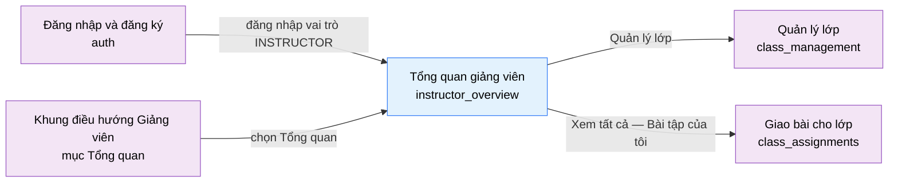

# Tài liệu thiết kế cơ bản (BD) — Tổng quan giảng viên (`INS0101`)

## Phương châm tài liệu [Nội bộ — không cần khách duyệt]

- Viết theo **mẫu 9 sheet**. Bộ thẻ đóng, quy ước ID, ký hiệu chuẩn, ranh giới với tài liệu khác và
  checklist kiểm toán nằm ở `02-bd/_rules/bd-template-9sheet.md` — file này không chép lại.
- Phần gắn nhãn `[Nội bộ]` phục vụ sinh mã và tự kiểm toán, không phải yêu cầu của khách hàng: mục 4.5,
  mục 7.3 và các ghi chú quy ước.
- Mã màn `INS0101` theo bảng mã ở `02-bd/_rules/bd-template-9sheet.md` mục 8; tên file mang tiền tố mã.
- Màn này **không có popup nào** và không có màn con của riêng nó — mọi tương tác đi tiếp đều là chuyển
  sang một màn khác của khu Giảng viên.

> Đọc cùng `01-rd/screens/teacher/INS0101_instructor_overview.md` (hành vi ở mức yêu cầu, không lặp lại ở
> đây), `02-bd/screens/teacher/_shell.md` (khung điều hướng dùng chung khu Giảng viên) và ba file BD module:
> `02-bd/database/F1_identity.md`, `02-bd/database/F2_problem-bank.md`, `02-bd/database/F5_ai-review.md`.
>
> **Không mô tả lại sidebar, nút thu gọn, công tắc theme và khối danh tính ở đáy sidebar** — thuộc
> `02-bd/screens/teacher/_shell.md` mục 3. Ngược lại, **hàng công cụ đầu màn (ô tìm kiếm + nút "Tạo lớp
> mới" + avatar) là item của chính màn này**, vì khu Giảng viên không có toolbar dùng chung
> [Nguồn: 02-bd/screens/teacher/_shell.md:113-114].
>
> **Không thiết kế** bất cứ đường dẫn nào liên quan tới "học viên yêu cầu review" — đã loại khỏi phạm vi
> theo `DEC-2026-0830-remove-student-review-request`, dù prototype còn chữ này ở ba chỗ
> [Nguồn: 09-layoutBase/Giáo viên - Tổng quan.dc.html:146,317,325]. Xem Câu hỏi mở Q1.
>
> **Không thiết kế** bất cứ hành động chấm lại nào — `DEC-2026-0828-remove-rejudge-scope`.
>
> **Đã bỏ 2026/10/13** (`DEC-2026-1013-remove-instructor-manual-grading`): khối và thẻ "Cần chấm tay", liên kết sang `INS0301`, endpoint `ListPendingManualGradingTop`. Prototype `.dc.html` vẫn còn các phần này (tệp tĩnh, không sửa lại), nên số dòng `09-layoutBase` trích ở các Sheet bên dưới giữ nguyên.
>
> **Đã bỏ 2026/10/14** (`DEC-2026-1014-instructor-overview-trim-and-nav-label`): thẻ "Điểm TB lớp" (giá trị và delta) và toàn bộ widget "Tiến độ học viên" (biểu đồ đường điểm AI trung bình theo tuần), kèm trường DTO `avgAiScore`/`avgAiScoreDelta`, `ClassScoreTrendDto`, endpoint `GetClassScoreTrend`, liên kết "Xem tất cả" sang `class_progress` và EVT tương ứng. Màn còn **2 thẻ thống kê** ("Lớp phụ trách", "Tổng học viên") và **3 widget** ("Hoạt động gần đây", "Lớp của tôi", "Bài tập của tôi"), tức 4 khối dữ liệu. Cách đánh số: **đánh số lại** khu vực (F thành E), NO DTO, NO bảng, NO endpoint và EVT (EVT-7, EVT-8 cũ thành EVT-6, EVT-7); không gạch bỏ vì các tham chiếu tới số bị xoá đã được sửa ngay trong tệp này.
>
> **Đổi cách trình bày 2026/10/14 (V0.9, chưa duyệt hình, RD không đổi)**: bản dựng Next.js gộp hai thẻ "Lớp phụ trách" và "Tổng học viên" vào một thẻ biểu đồ "Học viên" (nửa vòng tròn), và đổi "Lớp của tôi", "Bài tập của tôi" thành danh sách thanh xếp hạng. Dữ liệu và 4 khối không đổi, chỉ đổi hình thức. Cách đánh số lần này: **gạch bỏ và thêm item mới nối đuôi, không đánh số lại** (khu vực B, D, E; item mới lấy NO tiếp theo), để các tham chiếu NO ở Sheet 6, 7, 8 không lệch. Xem "Hiện trạng bản dựng" ở 4.5 và Q15.
>
> **Chốt 2026/10/14 (V0.11, `DEC-2026-1014-instructor-batch1-counting-rules`, tiêu chí ponytail bậc 2, 3, 4, 5)**: (1) "Tổng học viên" (số ở giữa biểu đồ) đếm **theo người**, `DISTINCT student_id`, đóng Q5; (2) số lượt nộp của bài giao tính **trong các lớp của chính giảng viên**, không dùng `problem_stats.submission_count`, đóng Q9; (3) bỏ `newStudentCount30d` và delta; (4) bỏ endpoint `GetInstructorOverviewStats` và `InstructorOverviewStatsDto`, màn đọc danh sách lớp `ListMyClassesSummary` (Q15a, Q15c); (5) `activity_type` của "Hoạt động gần đây" chỉ giữ sự kiện tức thời, đóng Q7. Cách đánh số lần này: **gạch bỏ, không đánh số lại**, theo đúng quy ước V0.9. Bản dựng còn tổng `studentCount` theo từng lớp, là khoảng cách đã biết với thiết kế (xem "Hiện trạng bản dựng" ở 4.5).
>
> **Chốt 2026/10/14 (V0.12, `DEC-2026-1014-instructor-batch3-4-contracts-and-removal` và `DEC-2026-1014-instructor-batch5-6-nav-pagination-rubric`, tiêu chí ponytail bậc 4, 3, 2, 5)**: (1) ba endpoint của màn thuộc module sở hữu dữ liệu: 2 `identity` (`ListMyClassesSummary`, `ListInstructorRecentActivity`) và 1 `problem-bank` (`ListMyAssignedProblems`), đóng Q12; (2) màn **giữ tĩnh**, không thêm liên kết khoan sâu ở thẻ lớp hay dòng bài, đóng Q11; (3) khối "Bài giao cho lớp" hiện **5 bài có nhiều lượt nộp nhất** trong các lớp của giảng viên, đóng Q15; (4) Q1 đóng vì lỗi thời (khối "Cần chấm tay" đã bỏ); (5) Q13: BD này đã dùng đúng dòng 94, ghi nhận đã sửa, RD do phía RD sửa; (6) Q8 **giữ mở** vì màn còn hiển thị "Hoàn thành TB" (xem Q8). **Cập nhật V0.13: Q8 đã đóng** (`DEC-2026-1014-batch7-remaining-open-questions`). Cách đánh số: không đổi NO.

---

## Sheet 1. Bìa

| Mục | Giá trị |
| :--- | :--- |
| Hệ thống | AlgoPrep |
| Phân hệ | `identity` (F1) — màn tổng hợp, đọc thêm số liệu của `problem-bank` (F2), `judge-orchestration` (F4), `ai-review` (F5) |
| Công đoạn | BD — Thiết kế cơ bản |
| Phân loại | Màn hình |
| Tên màn | Tổng quan giảng viên |
| Mã màn hình | `INS0101` |
| Tên vật lý (slug) | `instructor_overview` |
| Trục tài liệu | Màn hình (`02-bd/screens/`) |
| Actor | A2 (`INSTRUCTOR`) |
| Phiên bản | V0.15 |
| Người tạo | Nhóm phát triển AlgoPrep |
| Ngày tạo | 2026/09/21 |
| Người cập nhật | Claude |
| Ngày cập nhật | 2026/10/22 |

---

## Sheet 2. Lịch sử sửa đổi

| Ver | Sheet bị sửa | Nội dung sửa | Ngày | Người sửa |
| :--- | :--- | :--- | :--- | :--- |
| V0.1 | Toàn bộ | Tạo mới theo mẫu 9 sheet. Màn BD đầu tiên của khu Giảng viên. Chốt nguồn dữ liệu cho mọi trường hiển thị của 5 khối dashboard, phát hiện 3 khoảng trống nguồn dữ liệu thật (phạm vi feed hoạt động, chỉ số "Hoàn thành TB" theo lớp, "lượt dùng" của bài tập) và 4 điểm prototype lạc hậu so với quyết định ACTIVE | 2026/09/21 | Nhóm phát triển AlgoPrep |
| V0.2 | Sheet 4, 5, 7 | Đồng bộ `DEC-2026-1001-admin-configurable-settings` mục (7): độ khó bài tập là danh mục do ADMIN quản lý (bảng riêng `problem_levels`), không còn enum cố định. Dòng meta khối "Bài tập của tôi" đọc `display_name` của mức qua `problems.level_id`; `AssignedProblemSummaryDto.difficulty` thành `levelCode`/`levelDisplayName`; thêm `problem.problem_levels` vào bảng liên quan và Truy cập bảng. Màn chỉ hiển thị nhãn, không lọc và không gọi `ListProblemLevels` (nhãn nằm sẵn trong phản hồi); độ khó không gắn logic nào | 2026/10/03 | AI |
| V0.3 | Sheet 4, 5, 8, 9, Câu hỏi mở | Chủ dự án duyệt 2026-10-11: đóng Q4 (feed chỉ gồm sự kiện của học viên thuộc lớp phụ trách, lọc theo `class_id`) và Q6 (10 mục gần nhất) theo `DEC-2026-1011-teacher-screens-open-questions-closed`; bỏ phần làm mới badge nav và kiểm nghiệp vụ "thẻ khớp badge" theo `DEC-2026-1011-teacher-nav-badge-dropped` | 2026/10/11 | AI |
| V0.4 | Sheet 4, 5, 6, 8, Câu hỏi mở (Q2, Q3), đích đến | Chủ dự án chỉ đạo 2026-10-11 (**chưa duyệt hình**): bỏ khỏi màn tổng quan hàng "ô tìm kiếm + nút Tạo lớp mới". Lý do: ô tìm kiếm không có hành vi ở mọi lần dựng (Q3 chưa có màn kết quả), tạo lớp đã có ở màn `class_management` (ponytail bậc 3, bậc 4). Avatar chuyển sang menu người dùng ở thanh công cụ chung của khu (`_shell` V1.2). Các dòng liên quan gạch bỏ, giữ để không đánh số lại; Q2, Q3 đóng. Mã: `views/teacher/overview/ui/instructor-overview-view.tsx`, khoá `instructorOverview.toolbar.*` xoá khỏi `messages` | 2026/10/11 | AI |
| V0.5 | Sheet 5, 8, Câu hỏi mở | Chủ dự án chốt 2026-10-13: đóng Q10, avatar là menu popup như Admin theo `DEC-2026-1013-instructor-avatar-menu-and-read-source`; sửa dòng NO 3 (Sheet 5) và NO 4 (Sheet 8) cho khớp bản dựng | 2026-10-13 | AI |
| V0.6 | Sheet 5, 7.3 | Áp `DEC-2026-1013-grading-queue-all-accepted`: khối "Cần chấm tay" lấy mọi bài `Accepted` chưa chấm của lớp phụ trách, bỏ điều kiện điểm AI dưới 6/10; cột "Điểm AI" có thể là "Chưa có"; số đếm lấy từ `judge.submissions` và `ai.manual_grades`. **Prototype chưa dựng** (mock chỉ có điểm AI dưới 6) | 2026-10-13 | AI |
| V0.7 | Toàn bộ (Sheet 3, 4, 5, 6, 7, 8, 9, Câu hỏi mở) | Áp `DEC-2026-1013-remove-instructor-manual-grading`: bỏ khối "Cần chấm tay" (khu vực C cũ), thẻ "Cần chấm tay" (2 item), liên kết và EVT sang `instructor_grading`, `PendingGradingItemDto` và 2 trường `pendingGradingCount`/`pendingOver24hCount`, endpoint `ListPendingManualGradingTop`. Đánh số lại khu vực (D-G thành C-F), NO thẻ thống kê, EVT, NO DTO và endpoint; 6 khối thành 5, 4 thẻ thành 3. Thêm Q14 (điểm AI vẫn hiện ở thẻ Điểm TB lớp và biểu đồ). Prototype (`views/teacher/overview`, widget `pending-grading-list`, mock) vẫn còn các phần bị bỏ, chưa gỡ | 2026/10/13 | AI |
| V0.8 | Toàn bộ (Sheet 3, 4, 5, 6, 7, 8, 9, Câu hỏi mở Q11, Q12, Q14) | Áp `DEC-2026-1014-instructor-overview-trim-and-nav-label`: bỏ thẻ "Điểm TB lớp" (NO 5, 6 khu vực B) và widget "Tiến độ học viên" (khu vực E) cùng `avgAiScore`, `avgAiScoreDelta`, `ClassScoreTrendDto`, endpoint `GetClassScoreTrend`, bảng truy cập `ai.solution_reviews`, EVT "Xem tất cả — Tiến độ học viên", cạnh Mermaid sang `class_progress`; khu vực F thành E; 5 khối thành 4, 5 endpoint thành 4, 8 bảng thành 7. **Prototype Next.js đã gỡ thẻ và biểu đồ** (`05-coding/frontend/src/views/teacher/overview/ui/instructor-overview-view.tsx`, xem "Hiện trạng bản dựng" ở 4.4). Q14 sửa lại: phần thẻ và biểu đồ đã chốt, cột `ai_score_10` còn mở (RD `ai-review` OQ-F5-A) | 2026/10/14 | AI |
| V0.9 | Sheet 4 (4.1, 4.4, 4.5), 5, 6, 7 (7.1, 7.3), Câu hỏi mở Q15 | Đổi bố cục prototype, **chưa duyệt hình, không đổi RD** (chỉ trình bày): hai thẻ "Lớp phụ trách", "Tổng học viên" gộp vào thẻ biểu đồ "Học viên" (nửa vòng tròn hai phần "Có hoạt động", "Vắng bài", tổng học viên ở giữa, số lớp ở phụ đề); "Lớp của tôi" thành danh sách thanh xếp hạng theo `completionPct`; "Bài tập của tôi" thành 5 bài có `submissionCount` cao nhất dạng thanh xếp hạng; hàng một gồm 3 thẻ cao bằng nhau, hàng hai là "Hoạt động gần đây" 2 cột từ 768px. Cách đánh số: **gạch bỏ, không đánh số lại; item mới lấy NO tiếp theo** (B: gạch NO 1-4, thêm NO 5-9, đặt trên các dòng gạch; D: gạch NO 5, thêm NO 8, sửa ghi chú NO 3, 4, 6, 7; E: gạch NO 5, thêm NO 7-8, sửa ghi chú NO 3, 6). Nguồn dữ liệu không đổi (`ClassSummary.studentCount`/`absentCount`/`completionPct`, `submissionCount` của bài giao). Thêm trường `absentCount` vào `ClassSummaryDto` (7.1 NO 16) | 2026/10/14 | AI |
| V0.10 | Câu hỏi mở (Q14), ghi chú lịch sử | Áp `DEC-2026-1014-drop-ai-score-10` (tiêu chí ponytail bậc 3, bậc 2): đóng nốt phần còn mở của Q14, cột điểm AI quy đổi thang 10 đã bỏ khỏi cơ sở dữ liệu. **Ghi chú cho hàng V0.6 đến V0.8 phía trên:** các hàng đó có nhắc điểm AI và tên cột đó, được giữ nguyên làm lịch sử, không sửa lại. Cách đánh số giữ nguyên (Q14 giữ số, chỉ đổi nội dung thành đã đóng). Sheet 3 đến 9 không đổi | 2026/10/14 | AI |
| V0.11 | Sheet 4 (4.2, 4.5), 5 (B, C, E), 6 (B), 7 (7.1, 7.2, 7.3), 8 (EVT-1, EVT-7), 9 (NO 5), Câu hỏi mở Q5, Q7, Q9, Q15 | Áp `DEC-2026-1014-instructor-batch1-counting-rules`: (1) "Tổng học viên" đếm `DISTINCT student_id` (đóng Q5), bản dựng vẫn cộng `studentCount` từng lớp, ghi là khoảng cách prototype đã biết ở 4.5; (2) lượt nộp bài giao tính trong các lớp của giảng viên, cần một tổng hợp theo lớp trên `judge.submissions` ở DD `judge-orchestration` (đóng Q9); (3) bỏ `newStudentCount30d` và delta (Q15a); (4) bỏ endpoint `GetInstructorOverviewStats` và `InstructorOverviewStatsDto`, màn đọc `ListMyClassesSummary` (Q15c), số endpoint 4 thành 3; (5) `activity_type` chỉ giữ sự kiện tức thời (nộp bài, xuất bản bài, đạt chuỗi ngày, vào lớp), bỏ loại dựa trên job quét và chữ "kèm điểm AI" (đóng Q7). Cách đánh số: gạch bỏ, không đánh số lại | 2026/10/14 | AI |
| V0.12 | Phương châm, Sheet 3 (Q13), 4.1 (phạm vi), 5 (E NO 3), 7.1 (NO 15), 7.3, Câu hỏi mở Q1, Q8, Q11, Q12, Q13, Q15 | Áp `DEC-2026-1014-instructor-batch3-4-contracts-and-removal` và `DEC-2026-1014-instructor-batch5-6-nav-pagination-rubric`: (1) Q12 đóng, endpoint thuộc module sở hữu dữ liệu (2 `identity`, 1 `problem-bank`); (2) Q11 đóng, màn giữ tĩnh, không thêm liên kết khoan sâu; (3) Q15 đóng hẳn, khối "Bài giao cho lớp" hiện 5 bài có nhiều lượt nộp nhất trong các lớp của giảng viên, máy chủ trả sẵn 5 dòng đã xếp (E NO 3); (4) Q1 đóng vì lỗi thời; (5) Q13 ghi nhận đã sửa phía BD (dùng dòng 94), file RD do phía RD sửa; (6) Q8 **giữ mở**: đã kiểm tra, màn còn hiển thị "Hoàn thành TB" ở "Lớp của tôi" (D NO 7; mã `instructor-overview-view.tsx:118-120`). Cách đánh số: không đổi NO | 2026/10/14 | AI |
| V0.13 | Sheet 5 (D NO 7, DTO NO 10), Câu hỏi mở Q8 | Áp `DEC-2026-1014-batch7-remaining-open-questions` (ponytail bậc 5): Q8 đóng, "Lớp của tôi" giữ `completionPct` do `identity` tính; bỏ câu đề xuất read model `class_completion_stats`. Cách đánh số: không đổi NO | 2026/10/14 | AI |
| V0.14 | Hiện trạng bản dựng (4.5) | Áp `DEC-2026-1018-instructor-overview-richer`: bản dựng dựng lại 8 khối có biểu đồ, thêm hai thẻ số liệu, lịch dạy trong tuần, biểu đồ lượt nộp 7 ngày, bài nộp gần đây. Thiết kế dữ liệu và endpoint không đổi. Chưa duyệt hình | 2026/10/18 | AI |
| V0.15 | Sheet 5 (khu vực D NO 7), Sheet 7 (7.1 NO 10), các dòng `[Nguồn]`, Câu hỏi mở Q8 | Sửa 2026-10-22 đồng bộ DB, `DEC-2026-1022-identity-schema-sync` mục 4 (ID-05): `completionPct` do `identity` **tính khi đọc** (công thức V0.13 giữ nguyên, thêm điều kiện học viên còn ghi danh `left_at IS NULL`), không có bảng read model `class_completion_stats` (đã bỏ ở DB, `02-bd/database/F1_identity.md:122`); nội dung V0.13 đã đúng nên không đổi quyết định. Đọc lại số dòng mọi trích dẫn `02-bd/database/{F1_identity,F2_problem-bank,F5_ai-review}.md` (đã dịch dòng; ví dụ `identity_recent_activity` từ `:115-116` thành `:194-195`, `class_assignments` từ `:116-128` thành `:175-187`) và sửa trích dẫn `.nexa/control/decision-registry.md:3865` thành `:1796`. Không đổi RD, không đổi code | 2026/10/22 | Claude |

---

## Sheet 3. Sơ đồ chuyển màn

> [Nội bộ] Quy ước vẽ: bố trí từ trái sang phải. Màn gọi tới tô tím, màn hiện tại tô xanh nhạt, màn đi tiếp
> tô tím. Màu và `[Nguồn:]` dùng để truy vết, không phải yêu cầu của khách hàng. Màn này không có popup.

### 3.1 Danh sách chuyển màn

#### Đăng nhập và đăng ký → Tổng quan giảng viên

[Điều kiện mở] Đăng nhập thành công với tài khoản có vai trò `INSTRUCTOR`. Đây là trang đích mặc định của
vai trò này [Nguồn: 01-rd/screens/shared/SHR0101_auth.md:94]. Lưu ý: RD của màn trích dòng 90 cho cùng ý
này [Nguồn: 01-rd/screens/teacher/INS0101_instructor_overview.md:17-18], nhưng dòng 90 là Q1 (lỗi đăng nhập
inline) — nội dung điều hướng theo vai trò nằm ở dòng 94. BD này đã dùng dòng 94; phần sửa RD thuộc phía RD (Q13 đóng phía BD).

[Chế độ mở] Không có.

[Thông tin truyền] Không có. Danh tính lấy từ phiên đăng nhập, **không nhận `instructor_id` từ phía giao
diện** (xem Sheet 9 NO 2).

[Giá trị trả về] Không có.

[Khi thành công] Hiển thị 4 khối dashboard, mỗi khối tự tải dữ liệu và tự có trạng thái riêng.

[Khi huỷ] Không có.

#### Khung điều hướng Giảng viên → Tổng quan giảng viên

[Điều kiện mở] Chọn mục "Tổng quan" trong danh sách điều hướng bên trái
[Nguồn: 02-bd/screens/teacher/_shell.md:72].

[Chế độ mở] Không có.

[Thông tin truyền] Không có.

[Giá trị trả về] Không có.

[Khi thành công] Tải lại toàn bộ 4 khối — quyết định đã chốt là làm mới khi chuyển màn hoặc tải lại
trang, không mở kênh WebSocket riêng (nav không còn badge, `DEC-2026-1011-teacher-nav-badge-dropped`)
[Nguồn: 01-rd/req/F1_identity.md:177-178].

[Khi huỷ] Không có.

#### Tổng quan giảng viên → Quản lý lớp

[Điều kiện mở] Bấm liên kết "Quản lý lớp" ở đầu khối "Lớp của tôi".

[Chế độ mở] Chế độ danh sách, không chọn sẵn lớp nào.

[Thông tin truyền] Không có.

[Giá trị trả về] Không có.

[Khi thành công] Điều hướng sang màn `class_management`.

[Khi huỷ] Không có.

#### Tổng quan giảng viên → Quản lý lớp (chế độ tạo lớp mới)

[Đã bỏ 2026-10-11] Nút "Tạo lớp mới" không còn trên màn tổng quan; đường tạo lớp là nút của `class_management`. Đoạn mô tả dưới đây giữ làm lịch sử.

[Chế độ mở] Chế độ tạo mới. Đích đến này là **đề xuất của BD**, prototype để nút trống không gắn `href`
[Nguồn: 09-layoutBase/Giáo viên - Tổng quan.dc.html:121] — xem Câu hỏi mở Q2.

[Thông tin truyền] Cờ yêu cầu mở ngay biểu mẫu tạo lớp trên màn `class_management`.

[Giá trị trả về] Không có. Màn tổng quan không chờ kết quả — người dùng ở lại `class_management` sau khi tạo.

[Khi thành công] Điều hướng sang màn `class_management` với biểu mẫu tạo lớp đã mở.

[Khi huỷ] Không có.

#### Tổng quan giảng viên → Giao bài cho lớp

[Điều kiện mở] Bấm liên kết "Xem tất cả" ở đầu khối "Bài tập của tôi".

[Chế độ mở] Không có.

[Thông tin truyền] Không có.

[Giá trị trả về] Không có.

[Khi thành công] Điều hướng sang màn `class_assignments`. Prototype trỏ sang tệp
`Giáo viên - Bài tập của tôi.dc.html` [Nguồn: 09-layoutBase/Giáo viên - Tổng quan.dc.html:218]; RD khi viết
còn xếp tệp này vào `class_management` [Nguồn: 01-rd/screens/teacher/INS0101_instructor_overview.md:100-103],
nhưng `DEC-2026-0828-split-class-management-assignments` đã tách thành hai màn và nội dung "bài tập đã giao"
thuộc `class_assignments`.

[Khi huỷ] Không có.

### 3.2 Sơ đồ

[Nguồn: 09-layoutBase/Giáo viên - Tổng quan.dc.html:121,180,218; 01-rd/screens/shared/SHR0101_auth.md:94]

---

## Sheet 4. Bố cục màn hình

### 4.1 Tổng quan màn

[Mục đích màn] Cho giảng viên một cái nhìn tổng hợp về khối lượng công việc và tình hình các lớp mình phụ
trách ngay khi đăng nhập, để không phải mở lần lượt từng màn con: số lớp, số học viên,
hoạt động gần đây, tóm tắt lớp và bài tập
[Nguồn: 01-rd/req/F1_identity.md:170-174].

[Luồng nghiệp vụ chính]

1. **Hiển thị ban đầu**: vào màn, hệ thống xác định giảng viên từ phiên đăng nhập, rồi tải song song 4 khối
   dữ liệu. Mỗi khối có trạng thái `loading` / `empty` / `error` **riêng**, một khối hỏng không làm hỏng
   khối khác [Nguồn: 01-rd/req/F1_identity.md:185-186].
2. **Đọc số liệu**: giảng viên đọc 4 khối: thẻ biểu đồ "Học viên" (thay 2 thẻ thống kê cũ, V0.9) và 3 widget. Màn này **không có bất kỳ thao tác ghi dữ
   liệu nào** — toàn bộ là chỉ đọc.
3. **Đi tiếp**: mỗi widget có một lối đi tiếp sang màn con tương ứng; hàng công cụ đầu màn có nút tạo lớp mới.
4. **Làm mới**: quay lại màn hoặc tải lại trang thì tải lại toàn bộ;
   không có cơ chế đẩy thời gian thực [Nguồn: 01-rd/req/F1_identity.md:177-178].

[Người dùng] Người dùng đã đăng nhập, vai trò `INSTRUCTOR`. **Không gác bởi một `FUNCTION` riêng** — mọi
`INSTRUCTOR` đều thấy trang này vì đây là trang đích mặc định sau đăng nhập
[Nguồn: 01-rd/req/F1_identity.md:172-174].

[Tệp liên quan] Không có. Màn này không xuất hay nhập tệp.

[Phạm vi]
- Chỉ đọc. Không tạo, sửa hay xoá bất cứ dữ liệu nào ngay trên màn.
- Phạm vi dữ liệu giới hạn ở các lớp mà chính người dùng phụ trách (`classes.instructor_id`), theo Function
  `CLASS_MANAGEMENT` [Nguồn: 01-rd/screens/teacher/INS0101_instructor_overview.md:42].
- **Không** có widget về bộ câu hỏi phỏng vấn riêng theo lớp (F6-11 đã loại khỏi phạm vi,
  `DEC-2026-0828-remove-per-class-interview-set`).
- **Không** có bất cứ lối vào nào cho luồng "học viên yêu cầu review"
  (`DEC-2026-0830-remove-student-review-request`).
- Ô tìm kiếm ở hàng công cụ: đã bỏ khỏi màn từ 2026-10-11 (Q3 đóng).
- Màn **tĩnh**: ngoài liên kết "Quản lý lớp" và "Xem tất cả" ở đầu khối, thẻ lớp và dòng bài **không** là liên kết khoan sâu (chốt 2026/10/14, `DEC-2026-1014-instructor-batch5-6-nav-pagination-rubric`, Q11 đóng).
- Chân trang: khu Giảng viên không dựng chân trang [Nguồn: 02-bd/screens/teacher/_shell.md:31].

[Quyền sử dụng]
- Xem: được, khi vai trò là `INSTRUCTOR` và dữ liệu thuộc lớp mình phụ trách.
- Thêm: không (màn tổng quan không có nút tạo lớp; hành vi tạo thuộc `class_management`).
- Sửa: không.
- Xoá: không.

[Số bản ghi tối đa] Thẻ biểu đồ "Học viên": đúng 2 phần (V0.9). "Hoạt động gần đây": 10 mục gần nhất
[Nguồn: 02-bd/database/F1_identity.md:194-195]. "Lớp của tôi": toàn bộ lớp phụ trách, không phân trang.
"Bài tập của tôi" (nay "Bài giao cho lớp"): 5 bài có `submissionCount` cao nhất (V0.9; trước đó là 5 bài giao gần nhất). Không khối nào có
phân trang — muốn xem đầy đủ thì đi tiếp sang màn con.

### 4.2 DTO liên quan

- ~~`InstructorOverviewStatsDto`~~ (bỏ 2026/10/14, `DEC-2026-1014-instructor-batch1-counting-rules`; số lớp và số học viên suy ra từ `ClassSummaryDto`)
- `InstructorActivityItemDto`
- `ClassSummaryDto`
- `AssignedProblemSummaryDto`

`[Suy luận]` — tên DTO do BD này đề xuất, `03-dd/api/F1_identity.md` chốt lại.

### 4.3 Bảng dữ liệu liên quan (7)

| NO | Bảng | Ghi chú |
| --: | :--- | :--- |
| 1 | `identity.classes` | [Nguồn: 02-bd/database/F1_identity.md:107-111] |
| 2 | `identity.class_enrollments` | [Nguồn: 02-bd/database/F1_identity.md:118-140] |
| 3 | `identity.identity_recent_activity` | [Nguồn: 02-bd/database/F1_identity.md:194-195] — read model của F1-30, phạm vi truy vấn còn mở, xem Q4 |
| 4 | `judge.submissions` | [Nguồn: 02-bd/database/F4_judge-orchestration.md:12-35] — chỉ dùng điều kiện `status = ACCEPTED` (tính tỉ lệ hoàn thành, lượt dùng) |
| 5 | `problem.class_assignments` | [Nguồn: 02-bd/database/F2_problem-bank.md:175-187] |
| 6 | `problem.problems` | [Nguồn: 02-bd/database/F2_problem-bank.md:8-37] — lấy `title`, `level_id` (khoá của độ khó) cho khối "Bài tập của tôi" |
| 7 | `problem.problem_levels` | Danh mục độ khó do ADMIN quản lý — nguồn nhãn độ khó ở dòng meta khối "Bài tập của tôi", đọc qua join `problems.level_id` [Nguồn: 02-bd/database/F2_problem-bank.md mục `problem_levels`] |

Cả 7 bảng đều **chỉ đọc** với màn này. Bốn bảng cuối thuộc module khác nên `identity` không truy cập trực
tiếp: dữ liệu về `identity` qua read model dựng từ domain event, hoặc màn gọi thẳng endpoint của module sở
hữu (xem 7.3). Không bảng nào có thao tác `C`, `U` hay `D` từ màn này.

### 4.4 Vùng bố cục

Đối chiếu `09-layoutBase/Giáo viên - Tổng quan.dc.html` — bằng chứng bố cục chỉ-đọc, **không phải** design
system cuối cùng.

| Vùng | Vị trí trong prototype | Nội dung |
| :--- | :--- | :--- |
| Thanh điều hướng bên trái (khung chung Giảng viên) | `:62-110` | Thương hiệu, nút thu gọn, 4 mục nav (đã bỏ "Chấm bài"), nhóm KHÁC, chuyển theme, khối danh tính — **thuộc `_shell`, không phải item của màn này** |
| Vùng nội dung | `:112-113` | Container `max-width: 1320px` căn giữa, các khối xếp dọc cách nhau đều |
| Hàng công cụ đầu màn (riêng của màn) | `:115-125` | Ô tìm kiếm `:116-119`, nút "+ Tạo lớp mới" `:121`, avatar `:122-124` |
| Lưới thẻ thống kê (còn 2 thẻ sau khi bỏ "Cần chấm tay" và "Điểm TB lớp"; prototype `.dc.html` vẽ 4) | `:127-138` | `repeat(auto-fit, minmax(220px, 1fr))`; mỗi thẻ có nhãn `:130`, giá trị `:132`, delta `:133`, dòng meta `:135` |
| Hàng hai cột trên (prototype) | `:140` | Tỉ lệ `1.4fr 1fr`, căn theo mép trên. Thiết kế mới: bỏ cột trái "Cần chấm tay", "Hoạt động gần đây" chiếm cả hàng (bản dựng Next.js đã xếp đúng như vậy); cách xếp chốt khi dựng (`[SoT: Suy luận]`) |
| Widget "Hoạt động gần đây" (cột phải) | `:160-174` | Tiêu đề `:161`, mô tả phụ `:162`, feed `:164-172` với chấm màu theo loại sự kiện `:166` |
| Widget "Lớp của tôi" (một cột đầy) | `:177-196` | Tiêu đề `:179`, liên kết "Quản lý lớp" `:180`, lưới thẻ lớp `:182-195` kèm thanh tiến độ `:189-191` |
| Hàng hai cột dưới (prototype `.dc.html`) | `:198` | Tỉ lệ `1fr 1fr`. Thiết kế mới: bỏ cột trái "Tiến độ học viên", "Bài tập của tôi" chiếm cả hàng |
| Widget "Bài tập của tôi" | `:215-232` | Tiêu đề `:217`, liên kết "Xem tất cả" `:218`, danh sách `:220-230` |
| Chân trang | không có | Cả 5 file `Giáo viên - *.dc.html` đều có 0 thẻ `<footer>` [Nguồn: 02-bd/screens/teacher/_shell.md:31] |

**Bố cục bản dựng Next.js từ 2026/10/14 (chưa duyệt hình, V0.9)**: hàng một là 3 thẻ cao bằng nhau (lưới `lg:grid-cols-3`, dưới 1024px xếp dọc) gồm "Học viên" (nửa vòng tròn), "Lớp của tôi" (thanh xếp hạng), "Bài giao cho lớp" (thanh xếp hạng); hàng hai là thẻ "Hoạt động gần đây", 4 mục chia 2 cột từ 768px (`md:grid-cols-2`) [Nguồn: 05-coding/frontend/src/views/teacher/overview/ui/instructor-overview-view.tsx:72,153-154]. Các dòng bảng trên mô tả bố cục `.dc.html` (thẻ thống kê, hai hàng hai cột) nay **không còn khớp bản dựng**; `.dc.html` không sửa lại.

Dữ liệu mẫu trong prototype nằm ở `:308-313` (thẻ thống kê), `:322-328` (hoạt
động), `:330-334` (lớp), `:339-344` (bài tập). Đây là **mảng tĩnh**, không phải giá
trị mặc định của hệ thống. Giữ nguyên thứ tự và tỉ lệ cột khi dựng Next.js; không quy định màu sắc, khoảng
cách hay typography ở BD.

### 4.5 Cấu trúc slice FSD [Nội bộ]

| Khối | Slice dự kiến | Căn cứ |
| :--- | :--- | :--- |
| Trang | `views/teacher/overview` | Quy ước FSD của dự án; slice hiện là stub `pendingDesign` [Nguồn: 02-bd/screens/teacher/_shell.md:13-15] |
| Khung Giảng viên | Dùng lại `widgets/app-shell` + `instructor-sidebar` | `02-bd/screens/teacher/_shell.md` mục 1 |
| Hàng công cụ đầu màn | `widgets/instructor-overview-toolbar` | Prototype `:115-125`; **không** đẩy lên `_shell` vì các màn khác của khu này có hàng đầu khác hẳn [Nguồn: 02-bd/screens/teacher/_shell.md:30] |
| ~~2 thẻ thống kê~~ thẻ biểu đồ "Học viên" | Trong `views/teacher/overview`, dùng `shared/ui` `HalfDonutGauge` [Nguồn: 05-coding/frontend/src/views/teacher/overview/ui/instructor-overview-view.tsx:16,79] | Bản dựng không còn `StatCard`; slice `widgets/instructor-stat-cards` dự kiến ban đầu không cần `[SoT: Suy luận]` |
| Hoạt động gần đây | `widgets/instructor-activity-feed` | Prototype `:160-174` |
| Lớp của tôi | `widgets/my-classes-summary` + `entities/class` | Prototype `:177-196` |
| Bài tập của tôi | `widgets/my-assigned-problems` + `entities/problem` | Prototype `:215-232` |

`[Suy luận]` — ánh xạ slice do BD đề xuất, DD màn hình chốt lại. Các `entities/*` ở trên dùng chung với các
màn `class_management`, `class_assignments`, nên đặt ở tầng `entities` ngay từ đầu
thay vì để trong `widgets` rồi phải nâng lên sau.

#### Hiện trạng bản dựng (2026-10-18, thay thế bảng 2026-10-14 bên dưới ở các dòng bố cục)

Bảng 4.0: Các khối của bản dựng sau `DEC-2026-1018-instructor-overview-richer`, tất cả chưa duyệt hình. Mã nằm ở `05-coding/frontend/src/views/teacher/overview/ui/instructor-overview-view.tsx`; số dòng chưa chốt vì tệp còn chỉnh, đối chiếu theo tên khối.

| Khối | Dữ liệu | Ghi chú |
| :--- | :--- | :--- |
| Hai thẻ số liệu "Lớp phụ trách", "Tổng học viên" (có icon) | `useInstructorClasses` | Khôi phục, thay quyết định gỡ ngày 2026-10-14; thẻ "Điểm TB lớp" vẫn đã gỡ |
| Thẻ "Học viên": nửa vòng tròn + thanh "Vắng bài theo lớp" | `studentCount`, `absentCount` | Thêm thanh vắng theo từng lớp |
| "Lớp của tôi", "Bài giao cho lớp" | `completionPct`, `submissionCount` | Nhãn lớp kèm số học viên |
| "Lịch dạy trong tuần" | `class.schedule` | Khối mới, ngày hôm nay được tô |
| "Lượt nộp theo ngày" (cột chồng 7 ngày) | bài nộp của học viên các lớp | Mốc 7 ngày lấy theo bài nộp mới nhất của mock; chủ dự án chốt 2026-10-18 giữ mock, chỉ kiểm lại khi có API thật |
| "Bài nộp gần đây" | `buildSubmissionRows`, 5 dòng mới nhất | Liên kết sang trang kết quả giảng viên với `from=submissions` |
| "Hoạt động gần đây" | `ACTIVITY_FEED` cục bộ | Không đổi |

Khối "Học viên cần chú ý" chủ dự án không chọn nên không dựng. Các dòng bảng 4.1 nói "đã gỡ hai thẻ" và "hàng một 3 thẻ" lỗi thời theo bảng trên.

#### Hiện trạng bản dựng (2026-10-14)

Bảng 4.1: Đối chiếu bản dựng Next.js với thiết kế sau `DEC-2026-1014-instructor-overview-trim-and-nav-label`. Số dòng lấy từ tệp mã đã đọc ngày 2026-10-14.

| Phần | Trạng thái bản dựng | Mã |
| :--- | :--- | :--- |
| ~~Thẻ "Lớp phụ trách" và thẻ "Tổng học viên"~~ | **Đã gỡ 2026-10-14**, gộp vào thẻ biểu đồ "Học viên"; chưa duyệt hình | cùng tệp, không còn `StatCard` (import chỉ có `Card, HalfDonutGauge, RankedProgressList` `:16`) |
| Thẻ biểu đồ "Học viên": nửa vòng tròn hai phần "Có hoạt động" (`totalStudents - absentStudents`) và "Vắng bài" (`absentStudents`), số ở giữa là tổng học viên, phụ đề "{classes} lớp phụ trách" | Đã dựng, chưa duyệt hình | `05-coding/frontend/src/views/teacher/overview/ui/instructor-overview-view.tsx:57-58,73-102` (phụ đề `:76`, hai phần `:80-91`, số giữa `:93-100`) |
| Delta học viên mới 30 ngày (B NO 4) và dòng meta sĩ số (B NO 2) | **Bản dựng không hiển thị, khớp thiết kế**: delta đã bỏ hẳn theo `DEC-2026-1014-instructor-batch1-counting-rules` (Q15a); dòng meta sĩ số đã gỡ | cùng tệp, không có chỗ dựng chúng trong `:73-102` |
| Thẻ "Điểm TB lớp" | **Đã gỡ** khỏi bản dựng, khớp thiết kế | cùng tệp, không còn `StatCard` |
| Widget "Tiến độ học viên" (biểu đồ đường) | **Đã gỡ** khỏi bản dựng, khớp thiết kế | cùng tệp, hàng một chỉ có 3 thẻ `:72-151` |
| "Lớp của tôi": thanh xếp hạng, nhãn = `name`, thanh và giá trị bên phải = `completionPct`; liên kết "Quản lý lớp" giữ nguyên | Đã dựng, chưa duyệt hình. Thẻ lớp nhỏ kèm "{n} HV" **đã gỡ** | cùng tệp `:104-123` (liên kết `:109`, danh sách `:114-122`) |
| "Bài giao cho lớp" (Bài tập của tôi): 5 bài có `submissionCount` cao nhất, nhãn = `title`, thanh và giá trị = `submissionCount`; dòng phụ độ khó/chủ đề **đã gỡ** | Đã dựng, chưa duyệt hình | cùng tệp `:60-66` (sắp xếp và cắt 5), `:125-150` (thẻ và danh sách) |
| "Hoạt động gần đây": thẻ hàng hai, 4 mục (dữ liệu cục bộ `ACTIVITY_FEED`, chưa gọi API), 2 cột từ 768px | Đã dựng, chưa duyệt hình | cùng tệp `:21-46,153-175` |
| Bố cục tổng: hàng một 3 thẻ cao bằng nhau (`h-full`), dưới 1024px xếp dọc | Đã dựng, chưa duyệt hình | cùng tệp `:72,74,105,126` |
| **Khoảng cách prototype đã biết (2026-10-14):** số ở giữa biểu đồ "Học viên" là tổng `studentCount` theo từng lớp, trong khi thiết kế chốt đếm `DISTINCT student_id` (người) theo `DEC-2026-1014-instructor-batch1-counting-rules` | Chưa khớp thiết kế nhưng chủ dự án chốt 2026-10-18 giữ mock, đếm theo người khi có API thật. Dữ liệu mock không có học viên nằm ở hai lớp nên hai cách ra cùng số; ghi vào `06-plan/PROTOTYPE_DEBT.md` do tài liệu khác phụ trách | `05-coding/frontend/src/views/teacher/overview/ui/instructor-overview-view.tsx:57-58` |
| Nguồn dữ liệu của bản dựng: `useInstructorClasses` (`studentCount`, `absentCount`, `completionPct`) và `useClassAssignments` (`submissionCount`, `title`) | Dữ liệu mock/entity, tên trường khớp | `05-coding/frontend/src/views/teacher/overview/ui/instructor-overview-view.tsx:54-58`; `05-coding/frontend/src/entities/class/model/types.ts:38-41`; `05-coding/frontend/src/entities/class-assignment/model/types.ts:16` |

Toàn bộ các dòng "chưa duyệt hình" ở trên là thay đổi trình bày của prototype ngày 2026-10-14, chủ dự án chưa duyệt; RD không đổi.

> [Nội bộ] Ảnh minh hoạ đặt ở `08-diagram/02-bd/screens/teacher/`, chụp bằng Playwright trên ứng dụng
> Next.js thật khi đã có mã chạy được. Chưa có thì tham chiếu prototype, không vẽ tay.

---

## Sheet 5. Danh sách item màn hình

> Quy ước ID, bộ thẻ và giá trị chuẩn: `02-bd/_rules/bd-template-9sheet.md` mục 2, 3, 4.
> Mọi nhãn tĩnh đều đi qua lớp i18n VI/EN theo `DEC-2026-0831-i18n-scope-expansion`.

### Khu vực A — Hàng công cụ đầu màn

| Khu vực | NO | Tên item | ID item | Bảng DB | Cột DB | Loại UI | Kiểu | Độ dài | Bắt buộc | I/O | Giá trị mặc định | Định dạng | Ghi chú |
| :--- | --: | :--- | :--- | :--- | :--- | :--- | :--- | :--- | :-: | :-: | :--- | :--- | :--- |
| Hàng công cụ đầu màn | | | | | | | | | | | | | |
| | 1 | ~~Ô tìm kiếm~~ (đã bỏ 2026-10-11) | `instructorOverview.toolbar.searchBox` | - | - | TextBox | String | 100 | - | I | rỗng | - | Ô nhập từ khoá, gợi ý "Tìm lớp, học viên, bài tập…". Prototype chưa lập trình hành vi [Nguồn giá trị] Người dùng nhập; phạm vi tìm kiếm và màn kết quả chưa chốt, xem Q3 [EVT liên quan] EVT-2 |
| | 2 | ~~Tạo lớp mới~~ (đã bỏ 2026-10-11) | `instructorOverview.toolbar.btnCreateClass` | - | - | Button | - | - | - | I | - | `+ Tạo lớp mới` | Nút hành động chính của màn, điều hướng sang `class_management` ở chế độ tạo mới [Nguồn giá trị] Nhãn tĩnh i18n [EVT liên quan] EVT-3 |
| | 3 | Avatar giảng viên (nay ở thanh công cụ chung của khu, `_shell`) | `instructorOverview.toolbar.avatar` | `identity.users` | `display_name` | Label | String | 2 | - | O | - | Hai ký tự đầu của họ và tên | Hiển thị chữ cái viết tắt của người đang đăng nhập; **không có menu thả xuống ở đợt này**, thông tin danh tính đầy đủ đã có ở đáy sidebar [Công thức] Ghép ký tự đầu của hai từ cuối trong `display_name`, viết hoa [EVT liên quan] EVT-4 |

### Khu vực B — Thẻ biểu đồ "Học viên" (trước V0.9: Thẻ thống kê)

> V0.9 (2026/10/14, chưa duyệt hình, RD không đổi): NO 1-4 gạch bỏ vì hai thẻ thống kê không còn trên bản dựng; NO 5-9 là item của thẻ biểu đồ thay thế. ID item NO 1-4 giữ nguyên làm lịch sử.

| Khu vực | NO | Tên item | ID item | Bảng DB | Cột DB | Loại UI | Kiểu | Độ dài | Bắt buộc | I/O | Giá trị mặc định | Định dạng | Ghi chú |
| :--- | --: | :--- | :--- | :--- | :--- | :--- | :--- | :--- | :-: | :-: | :--- | :--- | :--- |
| Thẻ biểu đồ "Học viên" | | | | | | | | | | | | | |
| | 5 | Tiêu đề thẻ | `instructorOverview.students.title` | - | - | Label | String | - | - | O | Học viên | - | Tên thẻ [Nguồn giá trị] Nhãn tĩnh i18n [EVT liên quan] - |
| | 6 | Phụ đề — số lớp phụ trách | `instructorOverview.students.subtitle` | `identity.classes` | `instructor_id` | Label | Number | 4 | - | O | 0 | `{số} lớp phụ trách` | Thay cho thẻ "Lớp phụ trách" cũ (NO 1) [Công thức] Số phần tử của danh sách lớp phụ trách (cùng nguồn "Lớp của tôi") [Nguồn: 05-coding/frontend/src/views/teacher/overview/ui/instructor-overview-view.tsx:76] [EVT liên quan] EVT-1 |
| | 7 | Biểu đồ nửa vòng tròn | `instructorOverview.students.gauge` | - | - | Chart | List | - | - | O | 0 phần | 2 phần | Dùng `shared/ui` `HalfDonutGauge`; hai phần ở NO 8, 9 [Nguồn: 05-coding/frontend/src/views/teacher/overview/ui/instructor-overview-view.tsx:79-91] [EVT liên quan] EVT-1 |
| | 8 | Phần "Có hoạt động" | `instructorOverview.students.active` | `identity.class_enrollments` | `class_id`, `student_id` | ChartSlice | Number | 5 | - | O | 0 | Số nguyên | Số học viên không vắng bài [Công thức] Tổng `studentCount` trừ tổng `absentCount` trên danh sách lớp phụ trách (cùng read model của danh sách lớp `INS0201`) [Nguồn: 05-coding/frontend/src/views/teacher/overview/ui/instructor-overview-view.tsx:57-58,83]. Cách tính này của bản dựng cộng theo lượt ghi danh từng lớp nên một học viên học hai lớp bị cộng hai lần; **thiết kế chốt đếm theo người** (`DISTINCT student_id`, Q5 đã đóng): số học viên "Có hoạt động" = số người phân biệt trừ số người vắng bài. Khoảng cách prototype đã biết, xem Hiện trạng bản dựng ở 4.5 [EVT liên quan] EVT-1 |
| | 9 | Phần "Vắng bài" và số tổng ở giữa | `instructorOverview.students.absent`, `instructorOverview.students.total` | `identity.class_enrollments` | `class_id`, `student_id` | ChartSlice, Label | Number | 5 | - | O | 0 | Số nguyên | Phần "Vắng bài" = tổng `absentCount` của các lớp; số ở giữa = tổng số **người** phân biệt (`DISTINCT student_id`) của các lớp phụ trách, thay thẻ "Tổng học viên" cũ NO 3 (Q5 đóng 2026/10/14, `DEC-2026-1014-instructor-batch1-counting-rules`); bản dựng hiện cộng `studentCount` từng lớp [Nguồn: 05-coding/frontend/src/views/teacher/overview/ui/instructor-overview-view.tsx:57-58,88,95], khoảng cách prototype đã biết. "Vắng bài" theo ngưỡng 7 ngày của `INS0201` [Nguồn: 02-bd/screens/teacher/INS0201_class_management.md:365] [EVT liên quan] EVT-1 |
| | 1 | ~~Lớp phụ trách — giá trị~~ (đã gỡ khỏi bản dựng 2026-10-14, nay là phụ đề NO 6) | `instructorOverview.stat.classCount` | `identity.classes` | `instructor_id` | Label | Number | 4 | - | O | 0 | Số nguyên | Số lớp giảng viên đang phụ trách [Công thức] Đếm dòng `classes` có `instructor_id` bằng người đang đăng nhập (xoá lớp là hard delete nên không cần lọc thêm) [EVT liên quan] EVT-1 |
| | 2 | ~~Lớp phụ trách — dòng meta~~ (đã gỡ khỏi bản dựng 2026-10-14) | `instructorOverview.stat.classCountMeta` | `identity.class_enrollments` | - | Label | String | - | - | O | - | `{số} học viên` | Tổng sĩ số của toàn bộ lớp phụ trách [Công thức] Bằng đúng giá trị của thẻ "Tổng học viên" [EVT liên quan] EVT-1 |
| | 3 | ~~Tổng học viên — giá trị~~ (đã gỡ khỏi bản dựng 2026-10-14, nay là số ở giữa biểu đồ, NO 9) | `instructorOverview.stat.studentCount` | `identity.class_enrollments` | `class_id`, `student_id` | Label | Number | 5 | - | O | 0 | Số nguyên | Số học viên đang thuộc các lớp phụ trách [Công thức] Đếm `DISTINCT student_id` của `class_enrollments` với `class_id` thuộc các lớp phụ trách — **đếm theo người**, một học viên học hai lớp chỉ tính một lần (chốt 2026/10/14, Q5 đóng) [EVT liên quan] EVT-1 |
| | 4 | ~~Tổng học viên — delta~~ (**bỏ hẳn 2026/10/14**, `DEC-2026-1014-instructor-batch1-counting-rules`, Q15a; tiêu chí ponytail bậc 3, không dùng khi demo và cần thêm truy vấn) | `instructorOverview.stat.studentCountDelta` | - | - | - | - | - | - | - | - | - | ~~Số học viên mới vào lớp trong 30 ngày gần nhất~~ Đã bỏ, không dựng, không có trường DTO [EVT liên quan] - |

### Khu vực C — Hoạt động gần đây

| Khu vực | NO | Tên item | ID item | Bảng DB | Cột DB | Loại UI | Kiểu | Độ dài | Bắt buộc | I/O | Giá trị mặc định | Định dạng | Ghi chú |
| :--- | --: | :--- | :--- | :--- | :--- | :--- | :--- | :--- | :-: | :-: | :--- | :--- | :--- |
| Hoạt động gần đây | | | | | | | | | | | | | |
| | 1 | Tiêu đề khối | `instructorOverview.activity.title` | - | - | Label | String | - | - | O | Hoạt động gần đây | - | Tên khối [Nguồn giá trị] Nhãn tĩnh i18n [EVT liên quan] - |
| | 2 | Mô tả phụ | `instructorOverview.activity.subtitle` | - | - | Label | String | - | - | O | 10 mục gần nhất | - | Prototype ghi "Trong 24 giờ qua" nhưng BD module chốt hiển thị 10 mục gần nhất, giữ 90 ngày [Nguồn: 02-bd/database/F1_identity.md:194-195] — BD theo BD module, xem Q6 [Nguồn giá trị] Nhãn tĩnh i18n [EVT liên quan] - |
| | 3 | Feed hoạt động | `instructorOverview.activity.list` | `identity.identity_recent_activity` | - | List | List | - | - | O | rỗng | Tối đa 10 dòng | Sự kiện liên quan tới lớp phụ trách, mới nhất lên trước. **Không tái dùng `system_audit_logs` (F1-14)** — khác actor và khác mục đích [Nguồn: 01-rd/req/F1_identity.md:179-182]. Phạm vi truy vấn còn mở, xem Q4 [Nguồn giá trị] Kết quả gọi `ListInstructorRecentActivity` [EVT liên quan] EVT-1 |
| | 4 | Nội dung sự kiện | `instructorOverview.activity.col.text` | `identity.identity_recent_activity` | `activity_type`, `ref_type`, `ref_id` | ListColumn | String | - | - | O | - | Câu tiếng Việt dựng từ mẫu câu | Mô tả sự kiện đã xảy ra [Công thức] Chọn mẫu câu i18n theo `activity_type`, điền tên học viên / tên bài / tên lớp tra từ `ref_type` + `ref_id`. **Không lưu sẵn câu hoàn chỉnh trong DB** để còn dịch được sang tiếng Anh. Từ 2026/10/14 `activity_type` chỉ gồm **sự kiện tức thời**: nộp bài, xuất bản bài cho lớp, học viên đạt chuỗi ngày, học viên vào lớp; mẫu câu **không** có chữ "kèm điểm AI" (`DEC-2026-1014-instructor-batch1-counting-rules`, Q7 đóng) [EVT liên quan] - |
| | 5 | Thời điểm | `instructorOverview.activity.col.time` | `identity.identity_recent_activity` | `occurred_at` | ListColumn | String | - | - | O | - | Khoảng thời gian tương đối | Thời điểm xảy ra sự kiện [Công thức] Khoảng cách giữa `occurred_at` và hiện tại; quá 24 giờ thì hiển thị "Hôm qua", quá 48 giờ thì hiển thị ngày dạng `DD/MM` [EVT liên quan] - |
| | 6 | Chấm phân loại | `instructorOverview.activity.col.typeDot` | `identity.identity_recent_activity` | `activity_type` | Badge | Enum | - | - | O | - | Chấm tròn | Phân loại sự kiện thành hai nhóm: bình thường và cần chú ý [Nguồn giá trị] Ánh xạ từ `activity_type`; tập hợp lệ gồm 4 loại tức thời (nộp bài, xuất bản bài, đạt chuỗi ngày, vào lớp), chốt 2026/10/14 (Q7 đóng); loại dựa trên job quét ("vắng 9 ngày", "cần hỗ trợ") đã bỏ nên không còn nhóm "cần chú ý" sinh từ job. Danh sách giá trị chính thức do `02-bd/database/F1_identity.md` liệt kê, tài liệu này không sửa [EVT liên quan] - |

### Khu vực D — Lớp của tôi

| Khu vực | NO | Tên item | ID item | Bảng DB | Cột DB | Loại UI | Kiểu | Độ dài | Bắt buộc | I/O | Giá trị mặc định | Định dạng | Ghi chú |
| :--- | --: | :--- | :--- | :--- | :--- | :--- | :--- | :--- | :-: | :-: | :--- | :--- | :--- |
| Lớp của tôi | | | | | | | | | | | | | |
| | 1 | Tiêu đề khối | `instructorOverview.classes.title` | - | - | Label | String | - | - | O | Lớp của tôi | - | Tên khối [Nguồn giá trị] Nhãn tĩnh i18n [EVT liên quan] - |
| | 2 | Quản lý lớp | `instructorOverview.classes.linkManage` | - | - | Link | - | - | - | I | - | Quản lý lớp | Điều hướng sang màn `class_management` [Nguồn giá trị] Nhãn tĩnh i18n [EVT liên quan] EVT-5 |
| | 3 | Danh sách lớp | `instructorOverview.classes.list` | `identity.classes` | - | List | List | - | - | O | rỗng | ~~Lưới thẻ~~ Danh sách thanh xếp hạng (V0.9) | Toàn bộ lớp có `instructor_id` bằng người đang đăng nhập, sắp xếp theo `created_at` giảm dần. Bản dựng 2026-10-14 vẽ bằng `shared/ui` `RankedProgressList`, không đánh số thứ hạng, chưa duyệt hình [Nguồn: 05-coding/frontend/src/views/teacher/overview/ui/instructor-overview-view.tsx:114-122]; thứ tự bản dựng theo thứ tự mảng trả về `[SoT: Suy luận]` [Nguồn giá trị] Kết quả gọi `ListMyClassesSummary` [EVT liên quan] EVT-1 |
| | 4 | Tên lớp | `instructorOverview.classes.col.name` | `identity.classes` | `name` | ListColumn | String | - | - | O | - | - | Tên lớp, nay là nhãn của thanh xếp hạng [Nguồn: 05-coding/frontend/src/views/teacher/overview/ui/instructor-overview-view.tsx:118] [Nguồn giá trị] Cột `name` [EVT liên quan] - |
| | 5 | ~~Sĩ số~~ (đã gỡ khỏi bản dựng 2026-10-14: thẻ lớp nhỏ kèm `{n} HV` không còn; sĩ số nay chỉ góp vào số tổng ở thẻ "Học viên", B NO 9) | `instructorOverview.classes.col.studentCount` | `identity.class_enrollments` | `class_id` | ListColumn | Number | 4 | - | O | 0 | `{số} HV` | Số học viên đang thuộc lớp [Công thức] Đếm dòng `class_enrollments` theo `class_id` [EVT liên quan] - |
| | 6 | Thanh hoàn thành | `instructorOverview.classes.col.progressBar` | - | - | ProgressBar | Number | - | - | O | 0 | Chiều rộng theo phần trăm | Biểu diễn trực quan tỉ lệ hoàn thành trung bình; từ V0.9 là thanh của `RankedProgressList` [Nguồn: 05-coding/frontend/src/views/teacher/overview/ui/instructor-overview-view.tsx:119] [Công thức] Chiều rộng bằng đúng giá trị của item NO 7 [EVT liên quan] - |
| | 7 | Hoàn thành TB | `instructorOverview.classes.col.completionPct` | - | - | ListColumn | Number | 3 | - | O | - | `{số}%` | Tỉ lệ hoàn thành trung bình của lớp [Công thức] Trung bình trên các học viên **còn ghi danh** của lớp (`class_enrollments.left_at IS NULL`), mỗi học viên tính bằng (số bài đã giao cho lớp mà học viên có ít nhất một lượt nộp `ACCEPTED`) chia (số bài đang giao cho lớp, tức `class_assignments` có `removed_at IS NULL`). `identity` **tính khi đọc** từ `user_problem_best_score` và danh sách bài giao do `problem-bank` trả qua `ListClassAssignments`; **không có bảng read model** `class_completion_stats` (đã bỏ hẳn ở DB, ID-05, `DEC-2026-1022-identity-schema-sync` mục 4; `02-bd/database/F1_identity.md:122`) [Nguồn: .nexa/control/decision-registry.md:1796, `DEC-2026-0921-class-completion-owned-by-identity`]; Q8 đã đóng [Ghi chú V0.9] Giá trị bên phải thanh xếp hạng, hiển thị `{completionPct}%` [Nguồn: 05-coding/frontend/src/views/teacher/overview/ui/instructor-overview-view.tsx:119-120] [EVT liên quan] - |
| | 8 | Thẻ "Lớp của tôi" cao bằng thẻ cùng hàng | `instructorOverview.classes.card` | - | - | Card | - | - | - | O | - | - | V0.9: thẻ nằm ở hàng một cùng "Học viên" và "Bài giao cho lớp", cao bằng nhau (`h-full`), dưới 1024px xếp dọc, chưa duyệt hình [Nguồn: 05-coding/frontend/src/views/teacher/overview/ui/instructor-overview-view.tsx:72,105] [EVT liên quan] - |

### Khu vực E — Bài tập của tôi

| Khu vực | NO | Tên item | ID item | Bảng DB | Cột DB | Loại UI | Kiểu | Độ dài | Bắt buộc | I/O | Giá trị mặc định | Định dạng | Ghi chú |
| :--- | --: | :--- | :--- | :--- | :--- | :--- | :--- | :--- | :-: | :-: | :--- | :--- | :--- |
| Bài tập của tôi | | | | | | | | | | | | | |
| | 1 | Tiêu đề khối | `instructorOverview.problems.title` | - | - | Label | String | - | - | O | Bài tập của tôi | - | Tên khối [Nguồn giá trị] Nhãn tĩnh i18n [EVT liên quan] - |
| | 2 | Xem tất cả | `instructorOverview.problems.linkViewAll` | - | - | Link | - | - | - | I | - | Xem tất cả | Điều hướng sang màn `class_assignments` [Nguồn giá trị] Nhãn tĩnh i18n [EVT liên quan] EVT-6 |
| | 3 | Danh sách bài tập | `instructorOverview.problems.list` | `problem.class_assignments` | - | List | List | - | - | O | rỗng | Tối đa 5 dòng, danh sách thanh xếp hạng (V0.9) | ~~5 bài được giao gần nhất~~ **V0.9, chưa duyệt hình: 5 bài có `submissionCount` cao nhất** trong các bài giao cho lớp phụ trách, sắp xếp `submissionCount` giảm dần rồi cắt 5 [Nguồn: 05-coding/frontend/src/views/teacher/overview/ui/instructor-overview-view.tsx:60-66]; chỉ lấy dòng `removed_at IS NULL` [Nguồn: 02-bd/database/F2_problem-bank.md:184]. **Chốt 2026/10/14 (`DEC-2026-1014-instructor-batch5-6-nav-pagination-rubric`, Q15 đóng, ponytail bậc 3):** khối "Bài giao cho lớp" hiện **5 bài có số lượt nộp nhiều nhất** (tính trong các lớp của giảng viên, xem E NO 6), thay cho 5 bài giao gần nhất. Việc xếp và cắt 5 là của `ListMyAssignedProblems` (`problem-bank`): máy chủ trả sẵn 5 dòng đã xếp `submissionCount` giảm dần, giao diện không tự cắt. Đây là đề xuất của BD cho DD `[SoT: Suy luận]`; bản dựng hiện tự xếp và cắt ở phía máy khách trên toàn bộ danh sách mock [Nguồn giá trị] Kết quả gọi `ListMyAssignedProblems` [EVT liên quan] EVT-1 |
| | 4 | Tên bài | `instructorOverview.problems.col.title` | `problem.problems` | `title` | ListColumn | String | - | - | O | - | - | Tên bài toán [Nguồn giá trị] Cột `title` [EVT liên quan] - |
| | 5 | ~~Dòng meta~~ (đã gỡ khỏi bản dựng 2026-10-14: dòng phụ độ khó và chủ đề không còn) | `instructorOverview.problems.col.meta` | `problem.problem_levels` | `display_name` | ListColumn | String | - | - | O | - | `{mức độ} · {chủ đề}` | Mức độ khó và chủ đề chính của bài [Nguồn giá trị] `problem_levels.display_name` (qua `problems.level_id`, **đọc từ dữ liệu** do ADMIN quản lý, không còn ánh xạ cứng enum sang "Dễ/Trung bình/Khó") ghép với chủ đề đầu tiên trong `problem_topics` [Nguồn: 02-bd/database/F2_problem-bank.md:57-76] `DEC-2026-1001-admin-configurable-settings` mục (7) [Nguồn: 02-bd/database/F2_problem-bank.md mục `problem_levels`] [EVT liên quan] - |
| | 6 | Lượt dùng | `instructorOverview.problems.col.useCount` | - | - | ListColumn | Number | 6 | - | O | 0 | `{số} lượt` | Số lượt học viên đã nộp bài này [Công thức] **Chốt 2026/10/14 (Q9 đóng, `DEC-2026-1014-instructor-batch1-counting-rules`): đếm trong phạm vi các lớp của chính giảng viên**: số bài nộp trên `judge.submissions` của bài đó, do học viên thuộc lớp phụ trách (có dòng `class_enrollments` ở lớp đang giao bài) nộp. **Không** dùng `problem_stats.submission_count` vì cột đó là tổng toàn hệ thống [Nguồn: 02-bd/database/F2_problem-bank.md:202]. Cần một tổng hợp theo lớp trên `judge.submissions` ở module `judge-orchestration`, ghi nhận cho pha DD, BD màn không thiết kế [Ghi chú V0.9] Từ V0.9 là độ dài thanh và giá trị bên phải của thanh xếp hạng (`row.submissionCount`, định dạng `vi-VN`, không còn hậu tố `lượt`) [Nguồn: 05-coding/frontend/src/views/teacher/overview/ui/instructor-overview-view.tsx:143-147] [EVT liên quan] - |
| | 7 | Tên bài làm nhãn thanh xếp hạng | `instructorOverview.assignments.title`, `instructorOverview.assignments.subtitle` | `problem.problems` | `title` | Label | String | - | - | O | - | - | V0.9: tên thẻ "Bài giao cho lớp" (khoá `assignments.title`) thay tên "Bài tập của tôi"; nhãn mỗi thanh là `title` [Nguồn: 05-coding/frontend/src/views/teacher/overview/ui/instructor-overview-view.tsx:127-128,144]; khoá i18n bản dựng dùng nhóm `assignments`, chưa đổi ID cũ `problems.*` ở tài liệu `[SoT: Suy luận]` [EVT liên quan] - |
| | 8 | Trạng thái rỗng | `instructorOverview.empty` | - | - | Label | String | - | - | O | - | - | V0.9: không có bài giao nào thì hiển thị câu rỗng thay danh sách [Nguồn: 05-coding/frontend/src/views/teacher/overview/ui/instructor-overview-view.tsx:135-138] [EVT liên quan] - |

[Nguồn: 09-layoutBase/Giáo viên - Tổng quan.dc.html:115-125,127-138,141-158,160-174,177-196,199-213,215-232;
02-bd/database/F1_identity.md:107-140,194-195; 02-bd/database/F5_ai-review.md:35-49; 02-bd/database/F2_problem-bank.md:8-37,175-187;
01-rd/req/F1_identity.md:170-186]

---

## Sheet 6. Đặc tả điều khiển item

> Ký hiệu cột `Hiển thị` và thứ tự thẻ: `02-bd/_rules/bd-template-9sheet.md` mục 2, 3. Dùng đúng NO, tên
> item và thứ tự của Sheet 5. Lỗi nhập liệu ghi ở Sheet 9, xử lý nghiệp vụ ghi ở Sheet 8.
>
> **Nguyên tắc chung cho cả 4 khối dữ liệu**: mỗi khối có ba trạng thái riêng
> [Nguồn: 01-rd/req/F1_identity.md:185-186]. `loading` hiển thị khung chờ đúng số dòng dự kiến của khối đó;
> `empty` hiển thị câu trạng thái rỗng thay cho danh sách; `error` hiển thị câu lỗi ngay trong khối và
> **không** kéo theo khối khác. **Không thiết kế nút "Thử lại" riêng cho từng khối** ở đợt này — người dùng
> tải lại trang; thêm nút khi có bằng chứng lỗi tải xảy ra đủ thường xuyên `[SoT: Suy luận]`.

### Khu vực A — Hàng công cụ đầu màn

| Khu vực | NO | Tên item | Hiển thị | Ghi chú |
| :--- | --: | :--- | :-: | :--- |
| Hàng công cụ đầu màn | | | | |
| | 1 | ~~Ô tìm kiếm~~ (đã bỏ 2026-10-11) | Có | [Điều kiện kích hoạt] Luôn kích hoạt. Hành vi tìm kiếm chưa chốt (Q3) nên ở đợt này ô chỉ nhận ký tự, không phát yêu cầu nào. |
| | 2 | ~~Tạo lớp mới~~ (đã bỏ 2026-10-11) | Có | [Điều kiện kích hoạt] Luôn kích hoạt. Không phụ thuộc trạng thái tải của các khối dữ liệu. |
| | 3 | Avatar giảng viên (nay ở thanh công cụ chung của khu, `_shell`) | Có | [Điều kiện kích hoạt] Luôn kích hoạt — bấm mở menu người dùng (Cài đặt, Trang cá nhân, Thoát), Q10 đã chốt 2026-10-13. Menu thuộc khung vỏ, không phải việc của màn này. |

### Khu vực B — Thẻ biểu đồ "Học viên" (trước V0.9: Thẻ thống kê)

| Khu vực | NO | Tên item | Hiển thị | Ghi chú |
| :--- | --: | :--- | :-: | :--- |
| Thẻ biểu đồ "Học viên" | | | | |
| | 1 | ~~Lớp phụ trách — giá trị~~ | Không | Đã gỡ khỏi bản dựng 2026-10-14, thay bằng NO 6. |
| | 2 | ~~Lớp phụ trách — dòng meta~~ | Không | Đã gỡ khỏi bản dựng 2026-10-14. |
| | 3 | ~~Tổng học viên — giá trị~~ | Không | Đã gỡ khỏi bản dựng 2026-10-14, thay bằng số ở giữa biểu đồ (NO 9). |
| | 4 | ~~Tổng học viên — delta~~ | Không | Bỏ hẳn 2026/10/14 (`DEC-2026-1014-instructor-batch1-counting-rules`, Q15a). |
| | 5 | Tiêu đề thẻ | Có | - |
| | 6 | Phụ đề — số lớp phụ trách | Có | [Điều kiện hiển thị] Trong lúc tải hiển thị khung chờ. Chưa có lớp nào thì hiển thị "0 lớp phụ trách". |
| | 7 | Biểu đồ nửa vòng tròn | Có | [Điều kiện hiển thị] Trong lúc tải hiển thị khung chờ. Tổng học viên bằng 0 thì biểu đồ không có phần nào `[SoT: Suy luận]`, hành vi vẽ của `HalfDonutGauge` khi cả hai phần bằng 0 chưa được kiểm chứng. |
| | 8 | Phần "Có hoạt động" | Có | [Tự động đặt] Giá trị bằng tổng `studentCount` trừ tổng `absentCount`, tính lại mỗi lần tải lớp. |
| | 9 | Phần "Vắng bài" và số tổng ở giữa | Có | [Tự động đặt] Số ở giữa bằng tổng `studentCount`; hai phần cộng lại luôn bằng số ở giữa. |

### Khu vực C — Hoạt động gần đây

| Khu vực | NO | Tên item | Hiển thị | Ghi chú |
| :--- | --: | :--- | :-: | :--- |
| Hoạt động gần đây | | | | |
| | 1 | Tiêu đề khối | Có | - |
| | 2 | Mô tả phụ | Có | - |
| | 3 | Feed hoạt động | Có | [Điều kiện hiển thị] Trong lúc tải hiển thị khung chờ 5 dòng. Không có sự kiện nào thì hiển thị "Chưa có hoạt động nào". |
| | 4 | Nội dung sự kiện | Có | - |
| | 5 | Thời điểm | Có | [Tự động đặt] Chuỗi thời gian tương đối tính lại mỗi lần vào màn, không cần đồng hồ đếm trực tiếp. |
| | 6 | Chấm phân loại | Có | [Điều kiện hiển thị] Luôn hiển thị; `activity_type` chưa có trong bảng ánh xạ thì dùng nhóm bình thường. |

### Khu vực D — Lớp của tôi

| Khu vực | NO | Tên item | Hiển thị | Ghi chú |
| :--- | --: | :--- | :-: | :--- |
| Lớp của tôi | | | | |
| | 1 | Tiêu đề khối | Có | - |
| | 2 | Quản lý lớp | Có | [Điều kiện kích hoạt] Luôn kích hoạt, kể cả khi chưa có lớp nào — đó là đường để giảng viên đi tạo lớp. |
| | 3 | Danh sách lớp | Có | [Điều kiện hiển thị] Trong lúc tải hiển thị khung chờ 3 thẻ. Chưa có lớp nào thì hiển thị "Bạn chưa phụ trách lớp nào — Tạo lớp mới". |
| | 4 | Tên lớp | Có | - |
| | 5 | ~~Sĩ số~~ | Không | Đã gỡ khỏi bản dựng 2026-10-14 (V0.9). |
| | 6 | Thanh hoàn thành | Điều kiện | [Điều kiện hiển thị] Chỉ hiển thị khi lớp đã được giao ít nhất một bài; chưa giao bài nào thì mẫu số bằng 0 nên ẩn thanh và hiển thị "Chưa giao bài". |
| | 7 | Hoàn thành TB | Điều kiện | [Điều kiện hiển thị] Cùng điều kiện với NO 6. [Tự động đặt] Làm tròn tới số nguyên phần trăm. |
| | 8 | Thẻ "Lớp của tôi" cao bằng thẻ cùng hàng | Có | [Điều kiện hiển thị] Dưới 1024px xếp dọc cùng hai thẻ kia (V0.9). |

### Khu vực E — Bài tập của tôi

| Khu vực | NO | Tên item | Hiển thị | Ghi chú |
| :--- | --: | :--- | :-: | :--- |
| Bài tập của tôi | | | | |
| | 1 | Tiêu đề khối | Có | - |
| | 2 | Xem tất cả | Có | [Điều kiện kích hoạt] Luôn kích hoạt. |
| | 3 | Danh sách bài tập | Có | [Điều kiện hiển thị] Trong lúc tải hiển thị khung chờ 4 dòng. Chưa giao bài nào thì hiển thị "Bạn chưa giao bài nào cho lớp". |
| | 4 | Tên bài | Có | - |
| | 5 | ~~Dòng meta~~ | Không | Đã gỡ khỏi bản dựng 2026-10-14 (V0.9). |
| | 6 | Lượt dùng | Có | V0.9: là thanh và giá trị bên phải của thanh xếp hạng. |
| | 7 | Tên bài làm nhãn thanh xếp hạng | Có | - |
| | 8 | Trạng thái rỗng | Điều kiện | [Điều kiện hiển thị] Chỉ hiển thị khi không có bài giao nào. |

[Nguồn: 09-layoutBase/Giáo viên - Tổng quan.dc.html:128,148,164,183,221; 01-rd/req/F1_identity.md:185-186]

---

## Sheet 7. Danh sách truyền dữ liệu

### 7.1 Trường DTO

| NO | DTO | Trường DTO | Kiểu | Bảng DB | Cột DB | Item màn | Hiển thị | Ghi chú |
| --: | :--- | :--- | :--- | :--- | :--- | :--- | :-: | :--- |
| 1 | ~~`InstructorOverviewStatsDto`~~ | ~~`classCount`~~ | Number | `identity.classes` | `instructor_id` | Phụ đề thẻ "Học viên" (B NO 6) | Không | Bỏ 2026/10/14 cùng DTO và endpoint `GetInstructorOverviewStats` (`DEC-2026-1014-instructor-batch1-counting-rules`, Q15c). Số lớp lấy từ độ dài danh sách `ClassSummaryDto` [Nguồn: 05-coding/frontend/src/views/teacher/overview/ui/instructor-overview-view.tsx:76] |
| 2 | ~~`InstructorOverviewStatsDto`~~ | ~~`studentCount`~~ | Number | `identity.class_enrollments` | `student_id` | Số tổng ở giữa biểu đồ "Học viên" (B NO 9) | Không | Bỏ 2026/10/14. Số tổng nay tính từ danh sách lớp `ListMyClassesSummary`; thiết kế đếm `DISTINCT student_id` (Q5 đóng), cần `ListMyClassesSummary` hoặc DD `identity` cung cấp số người phân biệt vì tổng `ClassSummaryDto.studentCount` cộng trùng người học hai lớp. Bản dựng đang cộng `studentCount` [Nguồn: 05-coding/frontend/src/views/teacher/overview/ui/instructor-overview-view.tsx:57] |
| 3 | ~~`InstructorOverviewStatsDto`~~ | ~~`newStudentCount30d`~~ | Number | - | - | ~~Thẻ "Tổng học viên — delta"~~ | Không | Bỏ hẳn 2026/10/14 (Q15a, ponytail bậc 3). Không còn cột `joined_at` được đọc cho màn này |
| 4 | `InstructorActivityItemDto` | `activityType` | Enum | `identity.identity_recent_activity` | `activity_type` | "Nội dung sự kiện", "Chấm phân loại" | Có | [Chuyển đổi] Là khoá tra mẫu câu i18n và khoá tra nhóm màu. Tập giá trị chỉ gồm sự kiện tức thời (nộp bài, xuất bản bài, đạt chuỗi ngày, vào lớp), chốt 2026/10/14, Q7 đóng. |
| 5 | `InstructorActivityItemDto` | `refType`, `refId` | Enum, UUID | `identity.identity_recent_activity` | `ref_type`, `ref_id` | "Nội dung sự kiện" | Có | [Chuyển đổi] Dùng để điền tên học viên / tên bài / tên lớp vào mẫu câu. Bản thân hai trường này không hiển thị trực tiếp. |
| 6 | `InstructorActivityItemDto` | `occurredAt` | Date | `identity.identity_recent_activity` | `occurred_at` | "Thời điểm" | Có | [Chuyển đổi] Đổi sang khoảng thời gian tương đối ở phía giao diện. |
| 7 | `ClassSummaryDto` | `classId` | UUID | `identity.classes` | `id` | - | Không | [Đích] Khoá điều hướng nếu về sau thẻ lớp thành liên kết (Q11). Không hiển thị. |
| 8 | `ClassSummaryDto` | `name` | String | `identity.classes` | `name` | "Tên lớp" | Có | [Nguồn] Phản hồi của `ListMyClassesSummary` |
| 9 | `ClassSummaryDto` | `studentCount` | Number | `identity.class_enrollments` | `class_id` | ~~"Sĩ số"~~ (gỡ khỏi bản dựng); nay góp vào B NO 8, 9 | Có | [Chuyển đổi] Hậu tố `HV` không còn hiển thị. V0.9: tổng `studentCount` các lớp là số ở giữa biểu đồ "Học viên" và là cơ sở của hai phần của biểu đồ. |
| 10 | `ClassSummaryDto` | `completionPercent` | Number | - | - | "Hoàn thành TB", "Thanh hoàn thành" | Có | [Nguồn] `identity` tính khi trả `ListMyClassesSummary`, không có bảng read model `class_completion_stats` (`DEC-2026-0921-class-completion-owned-by-identity`, Q8 đã đóng 2026/10/14; ID-05, `DEC-2026-1022-identity-schema-sync` mục 4, `02-bd/database/F1_identity.md:122`) [Chuyển đổi] Một giá trị dùng cho cả con số và chiều rộng thanh. Bản dựng đọc tên `completionPct` [Nguồn: 05-coding/frontend/src/entities/class/model/types.ts:39], DTO của BD là `completionPercent`; DD chốt một tên. |
| 11 | `AssignedProblemSummaryDto` | `problemId` | UUID | `problem.problems` | `id` | - | Không | [Đích] Khoá điều hướng nếu về sau dòng thành liên kết (Q11). Không hiển thị. |
| 12 | `AssignedProblemSummaryDto` | `title` | String | `problem.problems` | `title` | "Tên bài" | Có | [Nguồn] Phản hồi của `ListMyAssignedProblems` |
| 13 | `AssignedProblemSummaryDto` | `levelCode`, `levelDisplayName` | String, String | `problem.problem_levels` | `code`, `display_name` | ~~"Dòng meta"~~ (gỡ khỏi bản dựng 2026-10-14) | Không | [Nguồn] Join qua `problems.level_id` (thay trường `difficulty` kiểu Enum cũ, theo `DEC-2026-1001-admin-configurable-settings` mục (7)) [Chuyển đổi] Đọc `display_name` từ dữ liệu, bỏ ánh xạ cứng. |
| 14 | `AssignedProblemSummaryDto` | `primaryTopic` | String | `problem.problem_topics` | - | ~~"Dòng meta"~~ (gỡ khỏi bản dựng 2026-10-14) | Không | [Chuyển đổi] Chủ đề đầu tiên của bài; không có thì giao diện bỏ luôn dấu phân cách. |
| 15 | `AssignedProblemSummaryDto` | `useCount` | Number | `judge.submissions` | `problem_id` | "Lượt dùng" (thanh và giá trị xếp hạng, E NO 6) | Có | [Nguồn] Phạm vi đếm **theo lớp của giảng viên**, chốt 2026/10/14 (Q9 đóng; `DEC-2026-1014-instructor-batch1-counting-rules`); cần tổng hợp theo lớp ở `judge-orchestration`, thuộc DD. Bản dựng đọc tên `submissionCount` [Nguồn: 05-coding/frontend/src/entities/class-assignment/model/types.ts:16] [Chuyển đổi] V0.9: không còn hậu tố `lượt`; dùng làm khoá chọn 5 bài cao nhất (E NO 3, Q15 đóng 2026/10/14). |
| 16 | `ClassSummaryDto` | `absentCount` | Number | - | - | Phần "Vắng bài" của biểu đồ "Học viên" (B NO 8, 9) | Có | [Nguồn] V0.9, **trường mới** thêm vào DTO: cùng read model với `ClassCardDto.absentCount` của `INS0201` [Nguồn: 02-bd/screens/teacher/INS0201_class_management.md:494]; bản dựng đọc `absentCount` [Nguồn: 05-coding/frontend/src/entities/class/model/types.ts:41] [Chuyển đổi] Cộng qua các lớp. `[SoT: Suy luận]` rằng `ListMyClassesSummary` trả được trường này; DD `identity` chốt. |

### 7.2 Truy cập bảng dữ liệu (7)

| NO | Tên logic | Bảng | Repository | CRUD | Mục đích | Ghi chú |
| --: | :--- | :--- | :--- | :-: | :--- | :--- |
| 1 | Lớp học | `identity.classes` | `ClassRepository` | R | Đếm lớp phụ trách và dựng danh sách "Lớp của tôi" | `ListMyClassesSummary`: R |
| 2 | Ghi danh lớp | `identity.class_enrollments` | `ClassEnrollmentRepository` | R | Đếm tổng học viên theo người (`DISTINCT student_id`), sĩ số từng lớp, và xác định phạm vi học viên của giảng viên (không còn đếm "học viên mới 30 ngày") | `ListMyClassesSummary`: R |
| 3 | Hoạt động gần đây | `identity.identity_recent_activity` | `RecentActivityRepository` | R | Đọc 10 mục gần nhất liên quan tới lớp phụ trách | `ListInstructorRecentActivity`: R |
| 4 | Bài nộp | `judge.submissions` | `SubmissionRepository` | R | Lọc `status = ACCEPTED` khi tính tỉ lệ hoàn thành; đếm lượt nộp của bài giao **trong các lớp của giảng viên** (tổng hợp theo lớp, DD `judge-orchestration`) | `ListMyClassesSummary`: R `ListMyAssignedProblems`: R |
| 5 | Bài giao cho lớp | `problem.class_assignments` | `ClassAssignmentRepository` | R | Dựng danh sách "Bài tập của tôi" và mẫu số của tỉ lệ hoàn thành | `ListMyAssignedProblems`: R `ListMyClassesSummary`: R |
| 6 | Bài toán | `problem.problems` | `ProblemRepository` | R | Lấy tên bài và mức độ khó cho khối "Bài tập của tôi" | `ListMyAssignedProblems`: R |
| 7 | Danh mục độ khó | `problem.problem_levels` | `ProblemLevelRepository` | R | Lấy nhãn độ khó của bài cho khối "Bài tập của tôi" qua join `level_id` | `ListMyAssignedProblems`: R, qua join. Màn này không ghi; ADMIN quản lý độ khó ở `SHR0201`, INSTRUCTOR chỉ chọn [Nguồn: 02-bd/database/F2_problem-bank.md mục `problem_levels`] |

**Toàn bộ là `R`.** Màn này không có bất kỳ thao tác `C`, `U`, `D` nào — đây là màn chỉ đọc.

`[Suy luận]` — tên repository do BD này đề xuất, DD của từng module chốt lại. Các bảng số 4, 5, 6, 7 nằm ở
schema khác `identity`; `identity` **không** đọc trực tiếp chúng, xem ghi chú ở 7.3.

### 7.3 Danh sách endpoint [Nội bộ]

> Chỉ tên nghiệp vụ và BC sở hữu. Hợp đồng chi tiết thuộc `03-dd/api/<module>.md`.

| NO | Endpoint (tên nghiệp vụ) | Mục đích | BC sở hữu |
| --: | :--- | :--- | :--- |
| 1 | ~~`GetInstructorOverviewStats`~~ | Đã bỏ 2026/10/14 (`DEC-2026-1014-instructor-batch1-counting-rules`, Q15c, ponytail bậc 4): thẻ biểu đồ "Học viên" đọc `ListMyClassesSummary`; delta học viên mới đã bỏ | `identity` |
| 2 | `ListInstructorRecentActivity` | Mười mục hoạt động gần nhất liên quan tới lớp phụ trách | `identity` |
| 3 | `ListMyClassesSummary` | Danh sách lớp phụ trách kèm sĩ số (`studentCount`), số vắng bài (`absentCount`) và tỉ lệ hoàn thành trung bình (`completionPct`); nguồn chung của thẻ "Học viên" và thẻ "Lớp của tôi" | `identity` |
| 4 | `ListMyAssignedProblems` | Năm bài giao kèm lượt nộp tính trong các lớp của giảng viên (cần tổng hợp theo lớp ở `judge-orchestration`, DD) | `problem-bank` |

Còn **3 endpoint hoạt động** (NO 1 đã bỏ, gạch giữ số). **Chốt ở BD: giữ các endpoint riêng, không gộp thành một payload tổng hợp** — cùng lý do đã áp cho
`admin_overview`: yêu cầu ba trạng thái theo từng khối [Nguồn: 01-rd/req/F1_identity.md:185-186] sẽ mất nghĩa
nếu một nguồn số liệu hỏng làm hỏng phản hồi của cả 4 khối. Ngoại lệ có chủ đích sau 2026/10/14: thẻ "Học viên" và thẻ "Lớp của tôi" dùng chung `ListMyClassesSummary` nên cùng vào trạng thái lỗi khi endpoint đó hỏng (ponytail bậc 4, tái dùng thay vì dựng endpoint trùng).

**Khác `admin_overview` ở một điểm, có chủ đích**: ở đó cả 9 endpoint đều thuộc `identity`, còn ở đây
endpoint số 4 thuộc module sở hữu dữ liệu. Lý do: danh sách bài giao đã có sẵn ở `problem-bank`; dựng lại
read model đó bên trong `identity` là chép logic hai lần. **Đã chốt 2026/10/14 (`DEC-2026-1014-instructor-batch3-4-contracts-and-removal`, Q12 đóng, ponytail bậc 4):** 2 endpoint thuộc `identity` (`ListMyClassesSummary`, `ListInstructorRecentActivity`), 1 thuộc `problem-bank` (`ListMyAssignedProblems`), không gộp vào `identity`. Endpoint điểm AI theo tuần của `ai-review` đã bỏ theo `DEC-2026-1014-instructor-overview-trim-and-nav-label`.

Thanh điều hướng không còn badge "Chấm bài" (chủ dự án duyệt 2026-10-11,
`DEC-2026-1011-teacher-nav-badge-dropped`), nên không cần endpoint tóm tắt cho khung.

Không có endpoint nào cho ô tìm kiếm ở đợt này (Q3).

[Nguồn: 02-bd/database/F1_identity.md:107-140; 02-bd/database/F2_problem-bank.md:175-187]

---

## Sheet 8. Danh sách sự kiện

> Bộ thẻ và quy ước cột `Chuyển màn`: `02-bd/_rules/bd-template-9sheet.md` mục 2, 3.
> Màn này **không có thay đổi chưa lưu** vì là màn chỉ đọc, nên không sự kiện nào cần hỏi xác nhận rời màn.

### Màn chính: Tổng quan giảng viên

| NO | Loại | Sự kiện | Chi tiết | Chuyển màn | Gọi API | Tên xử lý | Ghi chú |
| --: | :--- | :--- | :--- | :-: | :-: | :--- | :--- |
| 1 | Màn hình | Khởi tạo màn | Vào màn thì tải 4 khối dữ liệu. | Không | Có | `ListInstructorRecentActivity`, `ListMyClassesSummary`, `ListMyAssignedProblems` | [Các bước] 1. Xác định giảng viên từ phiên đăng nhập, kiểm tra vai trò `INSTRUCTOR`. 2. Hiển thị khung chờ cho cả 4 khối. 3. Gọi song song 3 endpoint (`GetInstructorOverviewStats` đã bỏ 2026/10/14; thẻ "Học viên" dùng kết quả `ListMyClassesSummary`); máy chủ tự giới hạn phạm vi theo lớp phụ trách. [Khi thành công] Từng khối hiển thị ngay khi có dữ liệu của nó, không chờ khối chậm nhất. [Khi lỗi] Khối nào lỗi thì hiển thị câu lỗi trong đúng khối đó, các khối còn lại vẫn hiển thị bình thường; **không rời màn, không hiển thị màn lỗi toàn trang**. |
| 2 | Nhập liệu | ~~Nhập từ khoá tìm kiếm~~ (đã bỏ 2026-10-11) | Gõ vào ô tìm kiếm ở hàng công cụ. | Không | Không | - | [Các bước] 1. Ghi nhận từ khoá vào trạng thái cục bộ của màn. [Khi thành công] Không có hành vi nào tiếp theo ở đợt này — phạm vi tìm kiếm và màn kết quả chưa chốt (Q3). Dựng ô nhập nhưng **không** gọi máy chủ, để không cam kết một hợp đồng chưa được duyệt. |
| 3 | Nút | ~~Tạo lớp mới~~ (đã bỏ 2026-10-11) | Bấm "+ Tạo lớp mới". | Có | Không | - | [Các bước] 1. Điều hướng sang màn `class_management` kèm cờ mở biểu mẫu tạo lớp. [Khi thành công] Mở màn `class_management` ở chế độ tạo mới. Không có thay đổi chưa lưu nào để cảnh báo. Đích đến là đề xuất của BD, xem Q2. |
| 4 | Nhấn | Bấm avatar giảng viên | Bấm vào ô chữ cái viết tắt ở hàng công cụ. | Không | Không | - | [Các bước] 1. Mở menu người dùng của khung vỏ (Cài đặt, Trang cá nhân, Thoát). [Khi thành công] Menu popup hiện ra dưới avatar, đóng bằng Esc hoặc bấm ra ngoài. Chốt 2026-10-13 (Q10, `DEC-2026-1013-instructor-avatar-menu-and-read-source`); khối danh tính ở đáy sidebar đã bỏ [Nguồn: 02-bd/screens/teacher/_shell.md]. |
| 5 | Liên kết | Quản lý lớp | Bấm "Quản lý lớp" ở khối "Lớp của tôi". | Có | Không | - | [Các bước] 1. Điều hướng sang màn `class_management` ở chế độ danh sách. [Khi thành công] Mở màn quản lý lớp, không chọn sẵn lớp nào. |
| 6 | Liên kết | Xem tất cả — Bài tập của tôi | Bấm "Xem tất cả" ở khối "Bài tập của tôi". | Có | Không | - | [Các bước] 1. Điều hướng sang màn `class_assignments`. [Khi thành công] Mở màn giao bài cho lớp. |
| 7 | Màn hình | Quay lại màn và làm mới | Quay lại màn này từ một màn khác của khu Giảng viên, hoặc tải lại trang. | Không | Có | Ba endpoint như EVT-1 | [Các bước] 1. Chạy lại đúng luồng của EVT-1. [Khi thành công] Số liệu phản ánh trạng thái mới nhất. **Không** mở kênh WebSocket riêng cho dashboard [Nguồn: 01-rd/req/F1_identity.md:177-178]. |

[Nguồn: 09-layoutBase/Giáo viên - Tổng quan.dc.html:118,121,122-124,180,218; 01-rd/req/F1_identity.md:177-186]

---

## Sheet 9. Đặc tả kiểm tra

> Bộ thẻ và quy ước mã thông báo: `02-bd/_rules/bd-template-9sheet.md` mục 2, 4. Sheet này ghi **điều kiện
> kiểm và thông báo**; tiêu chí nghiệm thu `AC-nn` thuộc `04-tdd/instructor_overview.md`, không lặp lại ở đây.

| NO | Loại | Tóm tắt kiểm | Chi tiết | Mức | Mã thông báo | Ghi chú | EVT gọi | Thứ tự |
| --: | :--- | :--- | :--- | :--- | :--- | :--- | :--- | :-: |
| 1 | Kiểm quyền | Vai trò truy cập màn | [Nội dung kiểm] Người dùng không có vai trò `INSTRUCTOR` thì không được vào màn. [Nơi thực thi] Chặn ở cả tầng định tuyến phía giao diện và tầng phân quyền phía máy chủ, không chỉ ẩn giao diện. | Lỗi | Chưa có mã thông báo | Nội dung "Bạn không có quyền truy cập chức năng này." Màn **không** gác bởi một `FUNCTION` riêng — mọi `INSTRUCTOR` đều thấy [Nguồn: 01-rd/req/F1_identity.md:172-174]. | EVT-1, EVT-7 | 1 |
| 2 | Kiểm quyền | Phạm vi dữ liệu theo lớp phụ trách | [Nội dung kiểm] Mọi số liệu và mọi dòng danh sách phải giới hạn trong các lớp có `classes.instructor_id` bằng người đang đăng nhập. [Nơi thực thi] Máy chủ. Định danh giảng viên lấy từ phiên đăng nhập, **tuyệt đối không nhận từ tham số phía giao diện**. [Tiêu điểm] Không có — lỗi này không hiển thị cho người dùng cuối. | Lỗi | Chưa có mã thông báo | Nội dung "Bạn không có quyền xem dữ liệu của lớp này." Nếu tham số phạm vi bị sửa thủ công thì máy chủ trả rỗng hoặc từ chối, không trả dữ liệu lớp của người khác. Function `CLASS_MANAGEMENT` gác quyền theo lớp [Nguồn: 01-rd/screens/teacher/INS0101_instructor_overview.md:42]. | EVT-1, EVT-7 | 2 |
| 3 | Kiểm nhập liệu | Độ dài từ khoá tìm kiếm | [Nội dung kiểm] Từ khoá vượt quá 100 ký tự thì cắt hoặc chặn nhập thêm. [Nơi thực thi] Màn hình. [Tiêu điểm] Ô tìm kiếm. | Cảnh báo | Chưa có mã thông báo | Nội dung "Từ khoá tìm kiếm tối đa 100 ký tự." Giới hạn này là `[SoT: Suy luận]` vì hành vi tìm kiếm chưa chốt (Q3); đặt trần ngay để về sau không phải sửa cả ô nhập lẫn hợp đồng API. | EVT-2 | 1 |
| 4 | Kiểm nghiệp vụ | Khối không có dữ liệu | [Nội dung kiểm] Khối tải xong mà không có dòng nào thì hiển thị trạng thái rỗng của chính khối đó. [Nơi thực thi] Màn hình. [Tiêu điểm] Khối rỗng. | Cảnh báo | Chưa có mã thông báo | Nội dung theo từng khối, đã ghi ở Sheet 6. **Không hiển thị số 0 giả** cho những chỉ số không có dữ liệu nền (ví dụ lớp chưa giao bài thì hiển thị "Chưa giao bài" thay vì 0%). | EVT-1, EVT-7 | 1 |
| 5 | Kiểm nghiệp vụ | Cô lập lỗi giữa các khối | [Nội dung kiểm] Một khối tải lỗi thì chỉ khối đó vào trạng thái lỗi; ba khối còn lại vẫn hiển thị dữ liệu của chúng. [Nơi thực thi] Màn hình. | Lỗi | Mã lỗi trong phản hồi | Phản hồi có mã lỗi đã đăng ký thì hiển thị nội dung tương ứng; chưa đăng ký thì hiển thị "Không tải được dữ liệu khối này." Đây là lý do các endpoint tách rời chứ không gộp một payload (thẻ "Học viên" và "Lớp của tôi" chung `ListMyClassesSummary` nên chung số phận, xem 7.3) [Nguồn: 01-rd/req/F1_identity.md:185-186]. | EVT-1, EVT-7 | 2 |
| 6 | Kiểm nghiệp vụ | ~~Nhất quán giữa thẻ và badge~~ (bỏ 2026-10-11) | [Nội dung kiểm] Đã bỏ: nav không còn badge "Chấm bài" (`DEC-2026-1011-teacher-nav-badge-dropped`), không còn hai nơi hiển thị cùng một con số. [Nơi thực thi] Không có. | Cảnh báo | Chưa có mã thông báo | Không hiển thị thông báo cho người dùng; dòng giữ lại để khỏi đánh số lại các dòng sau. | EVT-1, EVT-7 | 3 |
| 7 | Kiểm nghiệp vụ | Mẫu số bằng 0 khi tính tỉ lệ | [Nội dung kiểm] Lớp chưa được giao bài nào thì không tính "Hoàn thành TB" mà hiển thị "Chưa giao bài". [Nơi thực thi] Máy chủ. [Tiêu điểm] Thẻ lớp tương ứng. | Cảnh báo | Chưa có mã thông báo | Nội dung "Chưa giao bài". Chặn chia cho 0 ngay ở nguồn tính thay vì để giao diện nhận `NaN`. | EVT-1 | 1 |

Cột `Thứ tự` là thứ tự kiểm trong cùng một sự kiện.

[Nguồn: 01-rd/req/F1_identity.md:172-186; 01-rd/screens/teacher/INS0101_instructor_overview.md:42]

---

## Câu hỏi mở

| # | Câu hỏi | Vì sao chưa trả lời được | Chủ sở hữu |
| :-: | :--- | :--- | :--- |
| Q1 | **ĐÃ ĐÓNG 2026-10-14 vì lỗi thời (`DEC-2026-1014-instructor-batch5-6-nav-pagination-rubric`): khối "Cần chấm tay" đã bỏ hoàn toàn (`DEC-2026-1013-remove-instructor-manual-grading`) và "học viên yêu cầu review" đã loại khỏi phạm vi; BD không thiết kế theo các dấu vết trong mockup, nên không còn gì để quyết.** Nội dung gốc: **Một phần không còn áp dụng từ 2026/10/13** (khối "Cần chấm tay" bị bỏ hẳn theo `DEC-2026-1013-remove-instructor-manual-grading`; còn lại vết ở feed hoạt động). Prototype còn ba dấu vết của tính năng "học viên yêu cầu review" đã bị loại: mô tả phụ khối "Cần chấm tay" [Nguồn: 09-layoutBase/Giáo viên - Tổng quan.dc.html:146], một dòng dữ liệu mẫu [Nguồn: 09-layoutBase/Giáo viên - Tổng quan.dc.html:317] và một mục trong feed hoạt động [Nguồn: 09-layoutBase/Giáo viên - Tổng quan.dc.html:325]. BD **không** thiết kế theo chúng, theo `DEC-2026-0830-remove-student-review-request`. Có cập nhật lại prototype để tránh người sau đọc nhầm không? | Prototype là bằng chứng chỉ-đọc, BD không sửa được. Nguy cơ thật: người dựng Next.js đọc prototype trước khi đọc BD | Đã đóng |
| Q2 | **ĐÃ ĐÓNG 2026-10-11 (không còn áp dụng: chủ dự án bỏ ô tìm kiếm và nút "Tạo lớp mới" khỏi màn tổng quan; tạo lớp nằm ở `class_management`; tiêu chí ponytail bậc 3 và bậc 4).** Nút "Tạo lớp mới" đi tới đâu? BD đề xuất `class_management` ở chế độ mở sẵn biểu mẫu tạo lớp. | Prototype để nút trống, không gắn `href` lẫn handler [Nguồn: 09-layoutBase/Giáo viên - Tổng quan.dc.html:121]; RD cũng chỉ ghi "khả năng cao thuộc `class_management`" [Nguồn: 01-rd/screens/teacher/INS0101_instructor_overview.md:76-78]. Cần BD của `class_management` xác nhận màn đó có nhận được cờ mở biểu mẫu hay không | BD `class_management` (INS0201) |
| Q3 | **ĐÃ ĐÓNG 2026-10-11 (không còn áp dụng: chủ dự án bỏ ô tìm kiếm và nút "Tạo lớp mới" khỏi màn tổng quan; tạo lớp nằm ở `class_management`; tiêu chí ponytail bậc 3 và bậc 4).** Ô tìm kiếm "Tìm lớp, học viên, bài tập…" tìm trong phạm vi nào và trả kết quả ra màn nào? Không có màn kết quả tìm kiếm nào trong bảng mã 32 màn. Đề xuất: đợt này chỉ dựng ô nhập không hành vi, hoặc bỏ hẳn khỏi giao diện cho tới khi có màn kết quả. | Prototype không lập trình hành vi [Nguồn: 09-layoutBase/Giáo viên - Tổng quan.dc.html:116-119]; RD ghi nhận đúng điều đó nhưng không đề xuất hướng giải | Chủ dự án |
| Q4 | ~~**Phạm vi truy vấn của feed hoạt động.**~~ **ĐÃ CHỐT 2026-10-11 (chủ dự án duyệt) theo `DEC-2026-1011-teacher-screens-open-questions-closed`:** feed chỉ gồm sự kiện của **học viên thuộc các lớp giảng viên phụ trách**, lọc theo `class_id` (giảng viên chỉ thấy lớp mình, F1-10 `CLASS_MANAGEMENT`; tránh lộ dữ liệu lớp khác). Cột hoặc chỉ mục thực hiện việc lọc (đề xuất gốc `scope_class_id` bên dưới) do BD `database/F1_identity.md` chốt khi viết DD. Nội dung câu hỏi gốc, giữ làm lịch sử: Bảng `identity_recent_activity` có cột `actor_user_id` và index `(actor_user_id, occurred_at DESC)` [Nguồn: 02-bd/database/F1_identity.md:194-195,208], tức thiết kế để trả lời "tôi đã làm gì". Nhưng 4 trên 5 mục mẫu của giảng viên là hành động của **học viên trong lớp mình**, không phải của chính mình [Nguồn: 09-layoutBase/Giáo viên - Tổng quan.dc.html:322-328]. Đề xuất: thêm cột `scope_class_id` nullable và index `(scope_class_id, occurred_at DESC)`, feed của giảng viên là hợp của các dòng có `scope_class_id` thuộc lớp phụ trách và các dòng có `actor_user_id` bằng chính giảng viên. | Đây là thay đổi schema, vượt quyền của một BD trục màn hình | Đã đóng (phạm vi); schema: BD `identity` (`02-bd/database/F1_identity.md`) |
| Q5 | ~~"Tổng học viên" đếm theo người hay theo lượt ghi danh?~~ **ĐÃ ĐÓNG 2026/10/14 theo `DEC-2026-1014-instructor-batch1-counting-rules` (tiêu chí ponytail bậc 5):** đếm **theo người** (`DISTINCT student_id`); một học viên học hai lớp của cùng giảng viên tính 1. Bản dựng còn cộng `studentCount` từng lớp (mock không có học viên trùng lớp), ghi là khoảng cách prototype ở 4.5. | Quyết định của chủ dự án | Đã đóng |
| Q6 | ~~Khối "Hoạt động gần đây" là "trong 24 giờ qua" hay "10 mục gần nhất"?~~ **ĐÃ CHỐT 2026-10-11 (chủ dự án duyệt) theo `DEC-2026-1011-teacher-screens-open-questions-closed`:** lấy **10 mục gần nhất**, sửa chữ phụ trên giao diện thành "10 mục gần nhất" (số mục là hằng số, tiêu chí ponytail bậc 5). Nội dung câu hỏi gốc, giữ làm lịch sử: Prototype ghi 24 giờ [Nguồn: 09-layoutBase/Giáo viên - Tổng quan.dc.html:162], BD module chốt 10 mục gần nhất, giữ 90 ngày [Nguồn: 02-bd/database/F1_identity.md:194-195]. BD này theo BD module và đổi nhãn phụ thành "10 mục gần nhất". | Hai nguồn nói hai kiểu; cửa sổ 24 giờ sẽ cho khối rỗng vào đầu tuần hoặc kỳ nghỉ, đó là lý do BD chọn "N mục gần nhất" | Đã đóng |
| Q7 | ~~Tập giá trị hợp lệ của `activity_type` là gì?~~ **ĐÃ ĐÓNG 2026/10/14 theo `DEC-2026-1014-instructor-batch1-counting-rules` (tiêu chí ponytail bậc 3):** chỉ giữ sự kiện tức thời (nộp bài, xuất bản bài cho lớp, đạt chuỗi ngày, học viên vào lớp); bỏ loại dựa trên job quét ("vắng 9 ngày", "cần hỗ trợ", "lớp có học viên chưa nộp bài tuần") và chữ "kèm điểm AI". Việc liệt kê giá trị vào `02-bd/database/F1_identity.md` thuộc tài liệu đó, ngoài phạm vi sửa lần này. | Quyết định của chủ dự án | Đã đóng (liệt kê giá trị ở BD `identity`) |
| ~~Q8~~ | **ĐÃ CHỐT 2026-10-14 (DEC-2026-1014-batch7-remaining-open-questions, tiêu chí ponytail bậc 5):** khối "Lớp của tôi" **giữ** `completionPct` từng lớp (bản dựng đọc `klass.completionPct` làm giá trị thanh và nhãn `{n}%` [Nguồn: 05-coding/frontend/src/views/teacher/overview/ui/instructor-overview-view.tsx:119-120]); `identity` tính theo `DEC-2026-0921-class-completion-owned-by-identity`. **Không** thêm read model `class_completion_stats` như đề xuất cũ. ~~Nội dung gốc và đề xuất read model~~ bị thay thế. | Đã đóng | BD `identity` + BD `class_progress` (INS0203) dùng chung công thức |
| Q9 | ~~"Lượt dùng" của một bài tập đếm trong phạm vi nào?~~ **ĐÃ ĐÓNG 2026/10/14 theo `DEC-2026-1014-instructor-batch1-counting-rules` (tiêu chí ponytail bậc 4, 5):** tính **trong các lớp của chính giảng viên**, không dùng `problem_stats.submission_count` (tổng toàn hệ thống) [Nguồn: 02-bd/database/F2_problem-bank.md:202]. Nhu cầu cho DD: một tổng hợp theo lớp trên `judge.submissions` ở `judge-orchestration` (ghi nhận, chưa thiết kế). | Quyết định của chủ dự án | Đã đóng (thiết kế tổng hợp thuộc DD) |
| Q10 | ~~Avatar ở hàng công cụ có menu thả xuống không?~~ **ĐÃ CHỐT 2026-10-13 (chủ dự án) theo `DEC-2026-1013-instructor-avatar-menu-and-read-source`:** **có** — avatar mở menu popup (Cài đặt, Trang cá nhân, Thoát), hàng công cụ giống Admin; khối danh tính ở đáy sidebar đã bỏ. Đề xuất cũ của BD ("không có menu"), giữ làm lịch sử: khối danh tính đầy đủ nằm ở đáy sidebar [Nguồn: 02-bd/screens/teacher/_shell.md:66]. | Prototype vẽ avatar không gắn hành vi [Nguồn: 09-layoutBase/Giáo viên - Tổng quan.dc.html:122-124]. Nếu chủ dự án muốn bỏ avatar này đi thì càng gọn | Chủ dự án |
| Q11 | **ĐÃ CHỐT 2026-10-14 (`DEC-2026-1014-instructor-batch5-6-nav-pagination-rubric`, tiêu chí ponytail bậc 5): màn giữ tĩnh, không thêm liên kết khoan sâu ở thẻ lớp hay dòng bài; chỉ giữ liên kết "Quản lý lớp" và "Xem tất cả" ở đầu khối.** Nội dung gốc: Thẻ lớp trong "Lớp của tôi" và dòng trong "Bài tập của tôi" có phải liên kết khoan sâu không? Prototype để chúng là khối tĩnh, chỉ có liên kết "Xem tất cả" ở đầu khối. BD đề xuất giữ nguyên ở đợt một (ý về dòng "Cần chấm tay" đã bỏ cùng khối; liên kết khoan sâu từ biểu đồ tiến độ cũng không còn vì khối đã bỏ 2026/10/14). | Không có yêu cầu nào trong RD; thêm liên kết khoan sâu kéo theo tham số điều hướng cho hai màn đích, nên cần chốt trước khi dựng | Đã đóng |
| Q12 | **ĐÃ CHỐT 2026-10-14 (`DEC-2026-1014-instructor-batch3-4-contracts-and-removal`, tiêu chí ponytail bậc 4): endpoint thuộc module sở hữu dữ liệu, 2 `identity` + 1 `problem-bank`; không gộp vào `identity`.** Nội dung gốc: Bốn endpoint của màn này nên thuộc BC nào? BD chia theo module sở hữu dữ liệu (2 `identity`, 1 `problem-bank` sau 2026/10/14; `GetInstructorOverviewStats` và endpoint `ai-review` đã bỏ), khác `admin_overview` nơi cả 9 endpoint đều thuộc `identity`. Lý do đã ghi ở mục 7.3. | Hai màn dashboard đang theo hai nguyên tắc khác nhau — chấp nhận được nếu có chủ đích, nhưng nên chốt một lần để DD ba module không cãi nhau | Đã đóng |
| Q13 | **ĐÃ SỬA PHÍA BD 2026-10-14 (`DEC-2026-1014-instructor-batch5-6-nav-pagination-rubric`): BD này dùng dòng 94 [Nguồn: 01-rd/screens/shared/SHR0101_auth.md:94]; việc sửa chỗ trích dòng 90 thành 94 trong file RD của màn do phía RD thực hiện.** Nội dung gốc: RD của màn trích `01-rd/screens/shared/SHR0101_auth.md:90` cho quyết định "INSTRUCTOR vào thẳng `instructor_overview`" [Nguồn: 01-rd/screens/teacher/INS0101_instructor_overview.md:17-18,44,190], nhưng dòng 90 là Q1 (lỗi đăng nhập inline); nội dung đúng nằm ở dòng 94. BD này dùng dòng 94. Có sửa lại 3 chỗ trích trong RD không? | BD không được sửa `01-rd/`. Số dòng lệch 4 là do file `auth` được chèn thêm nội dung sau khi RD màn này trích dẫn — cùng kiểu lỗi sẽ còn lặp ở các file khác trích chéo theo số dòng | Đã đóng phía BD |
| Q14 | **ĐÓNG MỘT PHẦN 2026/10/14 theo `DEC-2026-1014-instructor-overview-trim-and-nav-label` (tiêu chí ponytail bậc 3, bậc 4): thẻ "Điểm TB lớp" và widget "Tiến độ học viên" đã bỏ khỏi màn này, nên `INS0101` không còn đọc điểm AI nào.** Phần còn lại **ĐÃ ĐÓNG 2026/10/14 theo `DEC-2026-1014-drop-ai-score-10` (tiêu chí ponytail bậc 3, bậc 2)**: chủ dự án bỏ hẳn cột dẫn xuất điểm AI quy đổi thang 10 khỏi cơ sở dữ liệu (RD `ai-review` OQ-F5-A đóng); `INS0201`, `INS0202`, `INS0203` đều không hiển thị điểm AI, học viên không thấy nó. Báo cáo F5.1, `readability_score` và điểm từng tiêu chí rubric vẫn giữ. | Quyết định của chủ dự án; không còn gì mở ở màn này | Đã đóng |
| Q15 | **ĐÃ ĐÓNG HẲN 2026/10/14 (V0.12, `DEC-2026-1014-instructor-batch5-6-nav-pagination-rubric`, tiêu chí ponytail bậc 3): "Bài giao cho lớp" hiện 5 bài có `submissionCount` cao nhất trong các lớp của giảng viên; các phần a, b, c khác đã đóng từ V0.11.** Lịch sử V0.11: Đóng một phần 2026/10/14 (V0.11, `DEC-2026-1014-instructor-batch1-counting-rules`): (a) ĐÃ ĐÓNG, bỏ hẳn delta 30 ngày, dòng meta sĩ số và `newStudentCount30d`; (b) ĐÃ ĐÓNG, đếm theo người (Q5); (c) nửa sau ĐÃ ĐÓNG, bỏ `GetInstructorOverviewStats`, màn đọc `ListMyClassesSummary`. Còn mở duy nhất (nay đã đóng): "Bài giao cho lớp" chọn 5 bài theo `submissionCount` cao nhất thay vì 5 bài giao gần nhất.** Nội dung gốc (V0.9, chưa quyết): Ba điểm sau khi bản dựng đổi sang thẻ biểu đồ và thanh xếp hạng: (a) delta "học viên mới 30 ngày" và dòng meta sĩ số không còn trên bản dựng, bỏ hẳn (kéo theo bỏ `newStudentCount30d`) hay dựng lại? (b) "Học viên" của biểu đồ tính bằng tổng `studentCount` các lớp, khác `DISTINCT student_id` ở B NO 3 (học viên học hai lớp bị đếm hai lần), chọn cách nào, xem Q5; (c) "Bài giao cho lớp" chọn 5 bài theo `submissionCount` cao nhất thay vì 5 bài giao gần nhất, có chốt đổi không, và `GetInstructorOverviewStats` còn cần hay thay bằng danh sách lớp | RD không đổi và chưa có quyết định nào cho thay đổi trình bày này; bản dựng chạy bằng dữ liệu mock của `useInstructorClasses` và `useClassAssignments` [Nguồn: 05-coding/frontend/src/views/teacher/overview/ui/instructor-overview-view.tsx:54-55] | Đã đóng |
