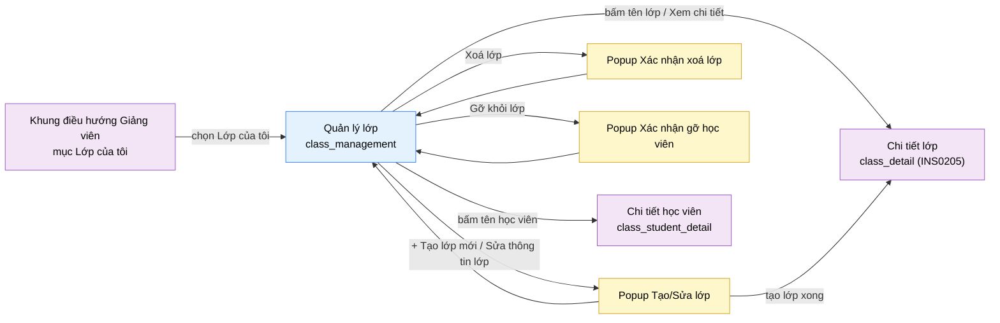

# Tài liệu thiết kế cơ bản (BD) — Quản lý lớp (`INS0201`)

> Cập nhật DD 2026-10-25 (`DEC-2026-1025-dd-class-assignment-time-window`): tử số hoàn thành lớp lấy từ F4 P1 `assignmentResults[]` của lần giao đang hiệu lực, chỉ tính `ACCEPTED` sau khi giao. Các chỗ cũ ghi `user_problem_best_score` trong Sheet 5–9 và Q2 là nguồn đã bị thay; F1 vẫn tính tỉ lệ khi đọc.
> Điểm TB lấy tỉ lệ AC của các lượt trạng thái cuối trong khoảng giao bài, loại `SYSTEM_ERROR` khỏi mẫu số (`DEC-2026-1025-dd-system-error-ac-denominator`).

## Phương châm tài liệu [Nội bộ — không cần khách duyệt]

- Viết theo **mẫu 9 sheet**. Bộ thẻ đóng, quy ước ID, ký hiệu chuẩn, ranh giới với tài liệu khác và
  checklist kiểm toán nằm ở `02-bd/_rules/bd-template-9sheet.md` — file này không chép lại.
- Phần gắn nhãn `[Nội bộ]` phục vụ sinh mã và tự kiểm toán, không phải yêu cầu của khách hàng: mục 4.5,
  mục 7.3 và các ghi chú quy ước.
- Mã màn `INS0201` theo bảng mã ở `02-bd/_rules/bd-template-9sheet.md` mục 8 dòng 151; tên file mang tiền
  tố mã.
- Màn này có **một màn con**: `INS0205` `class_detail` (từ V0.6, `DEC-2026-1011-class-detail-page`), nơi quản lý mã
  mời, xem lịch học và danh sách học viên của một lớp. Popup còn lại ở màn này: Tạo/Sửa lớp và Xác nhận xoá
  lớp (dùng chung với `INS0205`). Popup Mã mời đã bỏ khỏi màn này; popup Xác nhận gỡ học viên chỉ còn khi
  bảng học viên có mặt ở màn này (xem Sheet 5 Khu vực D) và luôn có ở `INS0205`.
- Khung điều hướng bên trái **không mô tả lại ở đây** — dùng chung `02-bd/screens/teacher/_shell.md`.
  Khu Giảng viên **không có toolbar dùng chung**, nên hàng đầu tiên trong `<main>` là item của chính màn
  này và được mô tả ở Khu vực A [Nguồn: 02-bd/screens/teacher/_shell.md:30,113-114].

> Đọc cùng `01-rd/screens/teacher/INS0201_class_management.md` (hành vi ở mức yêu cầu, không lặp lại ở
> đây) và `02-bd/database/F1_identity.md` mục 1.8 tới 1.10 (bảng `classes`, `class_invite_codes`,
> `class_enrollments`).
>
> **Không thiết kế** phần giao/gán bài toán cho lớp — đã tách sang màn `class_assignments` (`INS0202`)
> [Nguồn: DEC-2026-0828-split-class-management-assignments].
> **Không thiết kế** bất kỳ giao diện chấm lại nào — tính năng đã loại hoàn toàn khỏi phạm vi
> [Nguồn: DEC-2026-0828-remove-rejudge-scope].
> **Không thiết kế** bộ câu hỏi phỏng vấn riêng theo lớp — đã loại khỏi phạm vi
> [Nguồn: DEC-2026-0828-remove-per-class-interview-set].

> **Quy ước đặt tên khối cho cụm màn lớp** [Nội bộ]. Màn này là gốc của cụm (`class_assignments`,
> `class_progress`, `class_student_detail` treo vào cùng khái niệm lớp), nên các tên khối dưới đây là
> chuẩn cho cả cụm: `header` (hàng đầu `<main>`), `stats` (dải thẻ số liệu), `classList` (lưới thẻ lớp),
> `studentList` (bảng danh sách học viên, kèm tab lọc), `popup`. Cột trong danh sách thêm đoạn `col`.

---

## Sheet 1. Bìa

| Mục | Giá trị |
| :--- | :--- |
| Hệ thống | AlgoPrep |
| Phân hệ | `identity` (F1) |
| Công đoạn | BD — Thiết kế cơ bản |
| Phân loại | Màn hình |
| Tên màn | Quản lý lớp ("Lớp của tôi") |
| Mã màn hình | `INS0201` |
| Tên vật lý (slug) | `class_management` |
| Trục tài liệu | Màn hình (`02-bd/screens/`) |
| Actor | A2 (`INSTRUCTOR`) |
| Phiên bản | V0.13 |
| Người tạo | Nhóm phát triển AlgoPrep |
| Ngày tạo | 2026/09/21 |
| Người cập nhật | Nhóm phát triển AlgoPrep |
| Ngày cập nhật | 2026/10/18 |

---

## Sheet 2. Lịch sử sửa đổi

| Ver | Sheet bị sửa | Nội dung sửa | Ngày | Người sửa |
| :--- | :--- | :--- | :--- | :--- |
| V0.1 | Toàn bộ | Tạo mới theo mẫu 9 sheet. Chốt nguồn dữ liệu của mọi trường hiển thị, ánh xạ về `identity.classes` / `class_invite_codes` / `class_enrollments`. Thiết kế bổ sung 4 popup và các thao tác F1-24 tới F1-27 mà prototype chưa dựng. Phát sinh 10 câu hỏi mở | 2026/09/21 | Nhóm phát triển AlgoPrep |
| V0.2 | 5, 7.1, 7.2, 4.3, Câu hỏi mở | Áp `DEC-2026-0921-teacher-screens-conflict-resolutions` và `DEC-2026-0921-class-completion-owned-by-identity`: bộ nhãn trạng thái học viên đổi sang bộ 5 giá trị dùng chung cụm lớp (điều kiện "hoàn thành dưới 50%" nay là "Theo dõi" chứ không phải "Cần hỗ trợ"); Điểm TB đổi nguồn sang `judge.submissions` tính theo phạm vi lớp; bỏ `GetClassAssignmentCompletion`, thay bằng `ListClassAssignments` và `identity` tự tính. Đóng Q2, Q4, Q7 | 2026-09-21 | AI |
| V0.3 | 1, 8, 9 | Áp `DEC-2026-1003-toast-feedback-channel`: kết quả thao tác và lỗi nhập liệu ghi là toast; Sheet 9 `[Tiêu điểm]` ghi "viền ô + toast"; bỏ cụm "lỗi trong popup", "lỗi trên màn chính", "xác nhận ngắn tại chỗ" | 2026-10-03 | AI |
| V0.4 | Sheet 4, 5, 8 (mô tả khu vực danh sách) | Chủ dự án chỉ đạo 2026-10-11 (**chưa duyệt hình**): lưới thẻ lớp đổi thành **danh sách** (bảng trong thẻ, hàng tìm theo tên lớp, nút thao tác dạng icon: Xem học viên, Sửa, Mã mời, Xoá). Các chữ "thẻ lớp", "lưới thẻ lớp", "menu thao tác của một thẻ lớp" trong file này đọc là "dòng lớp", "danh sách lớp", "nút thao tác của một dòng". Cột: Lớp (kèm lịch học), Học viên, Tỉ lệ hoàn thành, Điểm TB, Cần chấm, Vắng bài; tìm theo tên lớp là thêm mới, chạy phía máy khách trên 3 lớp mẫu. Không đổi hành vi nghiệp vụ, NO hay EVT. Giữ quyết định không có trang chi tiết lớp (RD `INS0201` Q3, 2026-08-28). Mã: `views/teacher/class-management/ui/class-management-view.tsx` | 2026/10/11 | AI |
| V0.5 | Sheet 4, 6, 7, 8, 9 (popup Tạo/Sửa lớp) | Chủ dự án chỉ ra form sửa lớp chưa đầy đủ (2026-10-11, **chưa duyệt hình**). Đối chiếu với chính BD này, bản dựng thiếu: (1) trường **Mô tả** (Sheet 5 NO `classForm`, cột `description`) và `ClassSummary.description`; (2) kiểm độ dài 120 / 500 / 200 ký tự và toast "Nội dung vượt quá độ dài cho phép." (Sheet 9 mục 4); (3) toast tên rỗng đúng chữ "Tên lớp không được để trống." (Sheet 9 mục 3); (4) chế độ tạo **hiện mã mời đầu tiên** ngay sau khi lưu (EVT lưu lớp, bước 3). Ngoài ra sửa lỗi: form sửa mở ra **trống** thay vì nạp sẵn giá trị của lớp (state khởi tạo một lần lúc dialog còn đóng), nay dựng lại theo `key` mỗi lần mở. Mã: `class-management-view.tsx`, `entities/class` (thêm `description`), `messages` khoá `popup.descriptionLabel`, `popup.inviteJustCreated`, `validation.tooLong`. Giới hạn 120 / 500 / 200 vẫn là đề xuất của BD, chưa có chủ dự án chốt | 2026/10/11 | AI |
| V0.6 | Sheet 3, 4, 5, 6, 7, 8, 9, Câu hỏi mở (hai quyết định cùng ngày, **chưa duyệt hình**) | (1) `DEC-2026-1011-class-detail-page`: chủ dự án đảo câu trả lời 2026-08-28 ở RD `INS0201` Q3 ("không cần trang con"), lý do "3 nút với popup không cung cấp đủ thông tin". Thêm màn con **`INS0205` `class_detail`** (`/instructor/classes/[classId]`). Ở danh sách này: **bỏ popup Mã mời** và **bỏ icon "Xem học viên"**, chỉ còn icon Xem chi tiết, Sửa, Xoá; bấm tên lớp cũng sang `INS0205`; tạo lớp xong thì chuyển thẳng sang `INS0205` thay cho popup hiện mã mời đầu tiên. Popup Tạo/Sửa lớp và Xác nhận xoá lớp giữ nguyên, dùng chung. Các endpoint mã mời (`ListClassInviteCodes`, `CreateClassInviteCode`) nay do `INS0205` gọi, không thêm endpoint mới. (2) `DEC-2026-1011-class-schedule-structured`: cột `classes.schedule_note` (text) đổi thành `classes.schedule` (jsonb có cấu trúc), nên "Lịch học" ở danh sách hiển thị một dòng ghép từ các phần, popup Tạo/Sửa lớp có các ô lịch riêng, Sheet 9 mục 4 đổi giới hạn và thêm mục 11 (quy tắc kiểm lịch). Các EVT 7, 8, 9, 10 giữ số cũ, đánh dấu đã chuyển sang `INS0205`, để không đánh số lại | 2026/10/11 | AI |
| V0.7 | Sheet 4, 5, 6, 7, 8, 9, Câu hỏi mở | Áp `DEC-2026-1013-remove-instructor-manual-grading`: bỏ thẻ số liệu "Cần chấm tay" (Sheet 5 khu vực B NO 4) và cột "Cần chấm của lớp" (khu vực C NO 8), bỏ `pendingGradingCount` ở `InstructorClassSummaryDto` và `ClassCardDto`, bỏ endpoint `CountPendingManualGrading` (NO 11), bỏ kiểm Sheet 9 NO 9 (phân hệ AI không khả dụng, nay không còn gọi `ai-review`); dải thẻ còn 3, thẻ lớp còn 2 số ở chân (Điểm TB, Vắng bài). Dòng bị bỏ gạch ngang và giữ số để không đánh số lại các dòng sau (cùng cách `INS0101` V0.4); DTO đánh số lại. Q3 đóng. Prototype (`views/teacher/class-management`, mock) vẫn còn các phần bị bỏ, chưa gỡ | 2026/10/13 | AI |
| V0.8 | Sheet 5 (B NO 3), 6 (B NO 3), 7.1 (NO 4), Câu hỏi mở Q1 | Áp `DEC-2026-1014-instructor-batch1-counting-rules` (tiêu chí ponytail bậc 2: chỉ có bộ đếm cộng dồn, không có ảnh chụp theo tuần): bỏ hẳn chênh lệch "+5% so với tuần trước" của thẻ "Hoàn thành trung bình", gồm item B NO 3 (`avgCompletionDelta`) và trường DTO `avgCompletionDeltaPercent`; đóng Q1 (không còn đề xuất read model ảnh chụp tuần và job định kỳ cho màn này). Cách đánh số: gạch bỏ và giữ số, không đánh số lại (cùng cách V0.7 với dòng item). Một kiểm tra trên mã: `grep` chuỗi `avgCompletionDelta`, `completionDelta`, `weeklySubmission`, `+5%` trong `05-coding/frontend/src` không còn kết quả, nên bản dựng không còn trường này | 2026/10/14 | AI |
| V0.9 | Sheet 5 (B NO 5), 6 (B NO 5), 7.1 (NO 5), Câu hỏi mở Q8 | Áp `DEC-2026-1014-instructor-batch2-weekly-rules`: đóng Q8. Thẻ "Học viên vắng bài" giữ **cửa sổ trượt 7 ngày** và dòng phụ đổi thành "Chưa nộp 7 ngày qua" (prototype `Giáo viên - Lớp của tôi.dc.html:257` còn ghi "Chưa nộp tuần này", lệch BD, chưa sửa). Ghi dòng phụ vào item B NO 5 vì trước đây chưa có; tìm trong file không còn chỗ nào khác ghi "Chưa nộp tuần này" ngoài trích dẫn lịch sử ở Q8 | 2026/10/14 | AI |
| V0.10 | Sheet 3 (popup gỡ học viên), 4.1, 5 (D NO 3, 10, mới NO 11), 6 (D NO 10, 11), 7.1 (mới NO 9a, NO 17), 7.3, 8 (EVT-14, 17, mới EVT-20), Câu hỏi mở Q5, Q6, Q9, Q10 | Áp `DEC-2026-1014-instructor-batch3-4-contracts-and-removal` và `DEC-2026-1014-instructor-batch5-6-nav-pagination-rubric`: (1) Q5 đóng, mã mời hạn cố định 7 ngày, không có ô nhập hạn; (2) Q6 đóng, icon "Gỡ khỏi lớp" ở cuối mỗi dòng học viên, luôn hiện, có xác nhận; (3) Q9 đóng, bảng học viên gộp phân trang 20 dòng mỗi trang, thêm item D NO 11 và EVT-20, `ListClassStudents` nhận `page`/`size`; bảng học viên trong một lớp (`INS0205`) không phân trang; (4) Q10 đóng, bấm lại thẻ lớp đang chọn thì bỏ chọn và về "Tất cả"; (5) thêm `description` vào `ClassCardDto` (NO 9a) để `INS0205` dùng lại danh sách lớp lọc theo `id`, không có `GetClassDetail`. Cách đánh số: thêm item nối đuôi (NO 11, EVT-20, NO 9a), không đánh số lại. Chưa đối chiếu prototype với các quy tắc này (xem `06-plan/PROTOTYPE_DEBT.md`, do tài liệu khác phụ trách) | 2026/10/14 | AI |

| V0.11 | Sheet 3 (popup gỡ học viên), 4 (quyền Xoá), 5 (A NO 2, C NO 4, D NO 3, Popup NO 5), 7.1 (NO 17, 18), 7.2 (NO 3 và ghi chú), 9 (NO 6) | Áp `DEC-2026-1014-keep-learning-history-on-leave` (tiêu chí ponytail bậc 6): gỡ học viên **chỉ đánh dấu đã rời lớp** (`class_enrollments.left_at`), **giữ** lịch sử làm bài, giảng viên vẫn đọc được bài nộp làm lúc còn trong lớp (`INS0206`). Câu cảnh báo cũ "xoá luôn lịch sử làm bài" thay bằng câu nêu học viên chỉ rời lớp, lịch sử được giữ. Số học viên ở dòng tóm tắt, thẻ lớp, tab lọc và bảng chỉ đếm ghi danh còn hiệu lực (`left_at IS NULL`). Giữ nguyên các điều đã chốt: icon cuối dòng luôn hiện, toast "Đã gỡ học viên khỏi lớp." Xoá lớp (F1-24) vẫn là xoá thật, không đổi. Chưa đối chiếu prototype (xem `06-plan/PROTOTYPE_DEBT.md`, tài liệu khác phụ trách) | 2026/10/14 | AI |
| V0.12 | Sheet 7.1 (NO 6), 7.2 (ghi chú gỡ học viên) | Áp `DEC-2026-1014-class-leave-details` (tiêu chí ponytail bậc 5): câu xác nhận của popup gỡ học viên đã được chủ dự án duyệt nguyên văn (bỏ `[SoT: Suy luận]`); endpoint gỡ ở DD `identity` đổi từ DELETE sang `POST .../leave` (ngữ nghĩa vẫn là đặt `left_at`); học viên vào lại bằng mã mời thì dòng ghi danh cũ được dùng lại (`left_at` = NULL) nên được đếm lại ở các số đếm của màn. Không đổi item, EVT | 2026/10/14 | AI |
| V0.13 | Sheet 4 (4.4, mục Hiện trạng bản dựng mới) | Dựng prototype Phase 4-5 (bài giao theo lớp, phân trang 20, from=). Chỉ ghi hiện trạng: quy tắc "bấm lại thẻ lớp đang chọn thì bỏ chọn" (V0.10) chưa áp dụng được vì bản dựng không có chọn thẻ lớp; sau khi tạo lớp bản dựng chuyển sang trang chi tiết lớp, nút Quay lại về danh sách lớp (đúng Q2 của `INS0205`). Không đổi yêu cầu hay quyết định thiết kế. **Chưa duyệt hình** | 2026/10/18 | AI |

---

## Sheet 3. Sơ đồ chuyển màn

> [Nội bộ] Quy ước vẽ: bố trí từ trái sang phải. Màn gọi tới tô tím, màn hiện tại tô xanh nhạt, popup tô
> vàng. Màu và `[Nguồn:]` dùng để truy vết, không phải yêu cầu của khách hàng.

### 3.1 Danh sách chuyển màn

#### Khung điều hướng Giảng viên → Quản lý lớp

[Điều kiện mở] Chọn mục "Lớp của tôi" (mục nav thứ 2) trên thanh điều hướng bên trái của khu Giảng viên
[Nguồn: 02-bd/screens/teacher/_shell.md:73].

[Chế độ mở] Không có.

[Thông tin truyền] Không có.

[Giá trị trả về] Không có.

[Khi thành công] Tải danh sách lớp mà giảng viên đang đăng nhập phụ trách, 3 thẻ số liệu tổng và bảng
danh sách học viên ở bộ lọc mặc định "Tất cả".

[Khi huỷ] Không có.

#### Quản lý lớp → Popup Tạo/Sửa lớp

[Điều kiện mở] Bấm nút "+ Tạo lớp mới" ở hàng đầu (chế độ tạo), hoặc chọn "Sửa thông tin lớp" trong menu
thao tác của một thẻ lớp (chế độ sửa).

[Chế độ mở] Hai chế độ dùng chung một form: **tạo mới** (mọi trường rỗng) và **sửa** (nạp sẵn giá trị
hiện tại của lớp). Sửa lớp dùng chung luồng với tạo lớp [Nguồn: 01-rd/req/F1_identity.md:88-89].

[Thông tin truyền] Chế độ tạo: không có. Chế độ sửa: `id` của lớp được chọn.

[Giá trị trả về] Lớp vừa tạo hoặc vừa sửa; không có gì nếu người dùng huỷ.

[Khi thành công] Chế độ sửa: đóng popup, tải lại danh sách lớp và 3 thẻ số liệu. Chế độ tạo (từ V0.6):
đóng popup rồi **chuyển thẳng sang `INS0205`** của lớp vừa tạo, nơi mã mời đầu tiên đã hiện sẵn trong thẻ
Mã mời — thay cho việc hiện mã trong popup [Nguồn: 01-rd/req/F1_identity.md:79-81; `DEC-2026-1011-class-detail-page`].

[Khi huỷ] Đóng popup, không tạo và không sửa gì; lưới thẻ lớp giữ nguyên.

#### Quản lý lớp → Chi tiết lớp (`INS0205`, thêm V0.6)

[Điều kiện mở] Bấm tên một lớp trong danh sách, hoặc bấm icon "Xem chi tiết" ở cột thao tác; hoặc tự động
sau khi lưu thành công ở chế độ **tạo** của popup Tạo/Sửa lớp.

[Chế độ mở] Không có.

[Thông tin truyền] `id` của lớp (đi theo đường dẫn `/instructor/classes/[classId]`).

[Giá trị trả về] Không có. Quay lại từ `INS0205` thì danh sách lớp tải lại, vì lớp có thể đã bị sửa hoặc xoá
ở màn con.

[Khi thành công] Mở `INS0205` với đủ lịch học, mã mời và danh sách học viên của lớp. Màn này không có thay
đổi chưa lưu ngoài popup nên không hỏi xác nhận trước khi rời.

[Khi huỷ] Không có.

Popup **Mã mời đã bỏ khỏi màn này** (V0.6): xem, tạo mới và sao chép mã mời nay là việc của thẻ Mã mời ở
`INS0205` [Nguồn: 02-bd/screens/teacher/INS0205_class_detail.md]. Icon "Xem học viên" cũng bỏ; xem học viên
của một lớp là bảng "Học viên của lớp" ở `INS0205`, còn xem toàn bộ học viên là trang `/instructor/students`
(`class_progress`).

#### Quản lý lớp → Popup Xác nhận xoá lớp

[Điều kiện mở] Chọn "Xoá lớp" trong menu thao tác của một thẻ lớp.

[Chế độ mở] Không có.

[Thông tin truyền] `id` và tên lớp được chọn, kèm số học viên đang thuộc lớp.

[Giá trị trả về] Kết quả chọn "Xoá lớp" hoặc "Huỷ".

[Khi thành công] Hiển thị cảnh báo đây là **xoá thật, không khôi phục được** [Nguồn: 01-rd/req/F1_identity.md:86-88].

[Khi huỷ] Đóng popup, lớp giữ nguyên.

#### Quản lý lớp → Popup Xác nhận gỡ học viên

[Điều kiện mở] Bấm icon "Gỡ khỏi lớp" ở **cuối dòng** của bảng danh sách học viên; icon luôn hiện, không cần rê chuột, dùng được trên màn cảm ứng (V0.10, `DEC-2026-1014-instructor-batch3-4-contracts-and-removal`).

[Chế độ mở] Không có.

[Thông tin truyền] `id` học viên, `id` lớp và tên hiển thị của cả hai.

[Giá trị trả về] Kết quả chọn "Gỡ học viên" hoặc "Huỷ".

[Khi thành công] Hiển thị thông báo gỡ học viên chỉ **đánh dấu học viên đã rời lớp**; lịch sử làm bài của học
viên trong lớp này **được giữ**, giảng viên vẫn xem được [Nguồn: DEC-2026-1014-keep-learning-history-on-leave].
~~Cảnh báo cũ: xoá luôn lịch sử làm bài của học viên đó trong phạm vi lớp này~~ (ĐÃ ĐỔI 2026-10-14,
`DEC-2026-1014-keep-learning-history-on-leave`; RD `01-rd/req/F1_identity.md:98-103` còn câu cũ, chưa cập nhật).

[Khi huỷ] Đóng popup, học viên vẫn thuộc lớp.

#### Quản lý lớp → Chi tiết học viên

[Điều kiện mở] Bấm vào tên một học viên trong bảng danh sách học viên.

[Chế độ mở] Không có.

[Thông tin truyền] `id` học viên và `id` lớp đang xét — phạm vi hiển thị của màn đích giới hạn trong lớp
này [Nguồn: 01-rd/req/F1_identity.md:104-108].

[Giá trị trả về] Không có.

[Khi thành công] Điều hướng sang màn `class_student_detail` (`INS0204`). Màn này không có thay đổi chưa
lưu ngoài popup nên không cần hỏi xác nhận trước khi rời.

[Khi huỷ] Không có.

### 3.2 Sơ đồ

[Nguồn: 09-layoutBase/Giáo viên - Lớp của tôi.dc.html:115-121,136-157,159-188; 01-rd/screens/teacher/INS0201_class_management.md:70-85]

---

## Sheet 4. Bố cục màn hình

### 4.1 Tổng quan màn

[Mục đích màn] Cho giảng viên xem tổng quan các lớp mình phụ trách, quản lý vòng đời lớp (tạo, sửa, xoá,
mã mời) và quản lý danh sách học viên trong lớp (xem, lọc, gỡ, mở hồ sơ chi tiết)
[Nguồn: 01-rd/screens/teacher/INS0201_class_management.md:15-18; 01-rd/req/F1_identity.md:79-111].

[Luồng nghiệp vụ chính]

1. **Hiển thị ban đầu**: vào màn, hệ thống tải song song ba nhóm dữ liệu — 3 thẻ số liệu tổng, lưới thẻ
   lớp, bảng danh sách học viên của bộ lọc "Tất cả". Trong lúc chờ, mỗi khối hiển thị khung chờ đúng số
   dòng dự kiến.
2. **Tạo lớp**: bấm "+ Tạo lớp mới", nhập tên lớp (bắt buộc), mô tả và lịch học có cấu trúc (tuỳ chọn:
   ngày trong tuần, giờ, phòng, từ ngày đến ngày, ghi chú), lưu. Hệ thống sinh ngay một mã mời đầu tiên kèm
   hạn dùng, rồi **chuyển thẳng sang `INS0205`** của lớp vừa tạo, nơi giảng viên thấy mã để chia sẻ cho học
   viên [Nguồn: 01-rd/req/F1_identity.md:79-85; `DEC-2026-1011-class-detail-page`].
3. **Quản lý mã mời** (V0.6): không còn ở màn này. Xem các mã còn hiệu lực và tạo thêm mã mới là việc của
   thẻ Mã mời ở `INS0205`. Nhiều mã cùng hiệu lực song song là hợp lệ, không thu hồi mã cũ
   [Nguồn: 01-rd/req/F1_identity.md:93-97].
4. **Sửa hoặc xoá lớp**: sửa dùng chung form với tạo; xoá là **xoá thật**, có popup xác nhận.
5. **Lọc danh sách học viên**: chọn tab lớp hoặc bấm vào một thẻ lớp — cả hai cùng đặt một trạng thái lọc
   duy nhất [Nguồn: 01-rd/screens/teacher/INS0201_class_management.md:123]. Bấm lại đúng thẻ lớp đang chọn thì bỏ chọn và trở về "Tất cả" (V0.10, `DEC-2026-1014-instructor-batch3-4-contracts-and-removal`).
6. **Gỡ học viên**: bấm icon "Gỡ khỏi lớp" ở cuối dòng (luôn hiện), xác nhận trong popup. Thao tác kéo theo xoá lịch sử
   làm bài của học viên trong phạm vi lớp.
7. **Xem hồ sơ học viên**: bấm tên học viên để sang màn `class_student_detail`.

[Người dùng] Giảng viên đã đăng nhập, có Function `CLASS_MANAGEMENT` [Nguồn: 01-rd/req/F1_identity.md:57].

[Tệp liên quan] Không có. Màn này không xuất hay nhập tệp.

[Phạm vi]
- Chỉ các lớp có `instructor_id` bằng người đang đăng nhập. Không có chế độ xem toàn hệ thống ở màn này.
- **Không** giao/gỡ bài toán cho lớp — thuộc `class_assignments` [Nguồn: DEC-2026-0828-split-class-management-assignments].
- **Không** có giao diện chấm lại [Nguồn: DEC-2026-0828-remove-rejudge-scope].
- **Không** có bộ câu hỏi phỏng vấn riêng theo lớp [Nguồn: DEC-2026-0828-remove-per-class-interview-set].
- **Không** thêm học viên thủ công — học viên tự tham gia bằng mã mời [Nguồn: 01-rd/req/F1_identity.md:81-83].
- ~~Không có trang con `/class/:id`; tổng quan cộng bảng học viên lọc theo tab đã đủ~~ **ĐẢO NGƯỢC 2026-10-11**
  (`DEC-2026-1011-class-detail-page`): có trang con `INS0205` `class_detail`, route
  `/instructor/classes/[classId]`, vì "3 nút với popup không cung cấp đủ thông tin"
  [Nguồn: 01-rd/screens/teacher/INS0201_class_management.md — Q3].

[Quyền sử dụng]
- Xem: được, khi có `CLASS_MANAGEMENT:READ`.
- Thêm: được — tạo lớp, tạo mã mời (`CLASS_MANAGEMENT:CREATE`).
- Sửa: được — sửa thông tin lớp (`CLASS_MANAGEMENT:UPDATE`).
- Xoá: được — xoá lớp (xoá thật) và gỡ học viên (`CLASS_MANAGEMENT:DELETE`); gỡ học viên **không xoá dữ liệu**, chỉ đánh dấu đã rời lớp (ĐÃ ĐỔI 2026-10-14, `DEC-2026-1014-keep-learning-history-on-leave`; trước đây ghi cả hai đều là xoá thật).

[Số bản ghi tối đa] Thẻ số liệu: đúng 3 thẻ. Lưới thẻ lớp: theo số lớp giảng viên phụ trách, không phân
trang (prototype 3 lớp). Tab lọc: 1 + số lớp. Bảng học viên: **20 dòng mỗi trang** (V0.10, `DEC-2026-1014-instructor-batch5-6-nav-pagination-rubric`), vì bảng gộp học viên của nhiều lớp; quy ước chung cho bảng gộp nhiều dòng, xem Sheet 5 Khu vực D NO 11. Danh sách mã
mời: không còn ở màn này, xem `INS0205`.

[Nguồn: 01-rd/screens/teacher/INS0201_class_management.md:62-90; 02-bd/database/F1_identity.md:85-101]

### 4.2 DTO liên quan

- `InstructorClassSummaryDto` — 3 thẻ số liệu tổng.
- `ClassCardDto` — một thẻ lớp trong lưới.
- `ClassFormDto` — dữ liệu tạo và sửa lớp.
- `ClassInviteCodeDto` — một mã mời (từ V0.6 do `INS0205` dùng, màn này chỉ giữ tên DTO để khỏi lệch).
- `ClassScheduleDto` — lịch học có cấu trúc, xem Sheet 7.1 (`DEC-2026-1011-class-schedule-structured`).
- `ClassStudentRowDto` — một dòng của bảng danh sách học viên.

`[Suy luận]` — tên DTO do BD này đề xuất, `03-dd/api/F1_identity.md` chốt lại.

### 4.3 Bảng dữ liệu liên quan (6)

| NO | Bảng | Ghi chú |
| --: | :--- | :--- |
| 1 | `identity.classes` | [Nguồn: 02-bd/database/F1_identity.md:85-88] |
| 2 | `identity.class_invite_codes` | [Nguồn: 02-bd/database/F1_identity.md:90-93] |
| 3 | `identity.class_enrollments` | [Nguồn: 02-bd/database/F1_identity.md:95-101] |
| 4 | `identity.users` | Tên hiển thị học viên — cột `display_name` [Nguồn: 02-bd/database/F1_identity.md:16] |
| 5 | `judge.submissions` | Nguồn tính Điểm TB **theo phạm vi lớp**, đọc qua `GetClassStudentSubmissionMetrics` của `judge-orchestration`, không truy vấn chéo schema. Thay cho `identity.user_submission_stats` (read model toàn cục, không có chiều `class_id`) từ 2026-09-21 theo `DEC-2026-0921-teacher-screens-conflict-resolutions` |
| 6 | `identity.identity_recent_activity` | Cột "Hoạt động" của bảng học viên [Nguồn: 02-bd/database/F1_identity.md:115-116] |

Số liệu còn lại **không đọc từ bảng của `identity`**: tỉ lệ "Hoàn thành" cần dữ liệu bài đã giao cho
lớp (F2-12, thuộc `problem-bank`), lấy qua endpoint của module sở hữu, không truy vấn chéo schema — xem Câu hỏi mở Q2. (Số "Cần chấm tay" từng là số liệu thứ hai, đã bỏ 2026/10/13.)

### 4.4 Vùng bố cục

Đối chiếu `09-layoutBase/Giáo viên - Lớp của tôi.dc.html` — bằng chứng bố cục chỉ-đọc, **không phải**
design system cuối cùng.

| Vùng | Vị trí trong prototype | Nội dung |
| :--- | :--- | :--- |
| Thanh điều hướng bên trái (khung chung Giảng viên) | `:62-110` | Mục "Lớp của tôi" đang chọn, badge `3` — dùng lại khung chung, không mô tả lại ở đây |
| Container nội dung | `:112-113` | `max-width: 1320px` căn giữa, các khối xếp dọc, khoảng cách đều |
| Hàng đầu — tiêu đề và nút chính | `:115-121` | Tiêu đề "Lớp của tôi", dòng phụ "3 lớp · 82 học viên", nút "+ Tạo lớp mới". **Không phải toolbar dùng chung** — khu Giảng viên không có toolbar [Nguồn: 02-bd/screens/teacher/_shell.md:30] |
| Dải thẻ số liệu | `:123-134`, dữ liệu `:253-258` | Lưới `auto-fit minmax(200px, 1fr)`; prototype vẽ 4 thẻ (Tổng số lớp, Hoàn thành TB, Cần chấm tay, Học viên vắng bài), thiết kế từ 2026/10/13 còn 3 (bỏ Cần chấm tay) |
| Lưới thẻ lớp | `:136-157`, dữ liệu `:260-265` | Lưới `auto-fit minmax(300px, 1fr)`; mỗi thẻ có tên lớp, lịch học, huy hiệu số học viên, thanh tiến độ, và 3 số ở chân thẻ trong prototype: Điểm TB, Cần chấm, Vắng bài; thiết kế từ 2026/10/13 còn 2 (bỏ Cần chấm) |
| Khối "Danh sách học viên" — hàng tiêu đề | `:160-167`, dữ liệu tab `:267-272` | Tiêu đề khối bên trái, cụm tab lọc theo lớp bên phải (Tất cả + tên từng lớp) |
| Khối "Danh sách học viên" — bảng | `:169-187`, dữ liệu `:274-284` | Lưới 6 cột `minmax(160px,1.4fr) 120px 90px 90px 120px 110px`, `min-width: 700px`, cuộn ngang khi hẹp |
| Chân trang | không có | Cả 5 prototype khu Giảng viên đều không có `<footer>` [Nguồn: 02-bd/screens/teacher/_shell.md:31] |

**Hiện trạng bản dựng (2026/10/18, Phase 4-5, chưa duyệt hình).** Bảng 4.4a ghi hai điểm của bản dựng Next.js liên quan tới quy tắc chọn thẻ lớp và điều hướng sau khi tạo lớp.

Bảng 4.4a: Hiện trạng bản dựng của INS0201.

| Quy tắc | Hiện trạng bản dựng | Nguồn mã | Trạng thái |
| :--- | :--- | :--- | :--- |
| Bấm lại thẻ lớp đang chọn thì bỏ chọn, trở về "Tất cả" (V0.10) | **Chưa áp dụng được: bản dựng không có chọn thẻ lớp.** Danh sách lớp là một bảng thường trong thẻ (mỗi dòng có liên kết tên lớp sang chi tiết lớp); khối "Danh sách học viên" đã chuyển sang `INS0203`, và liên kết mở danh sách học viên theo lớp (`/instructor/students?classId=`) nằm ở trang chi tiết lớp | `views/teacher/class-management/ui/class-management-view.tsx:1-12,78-83`; `views/teacher/class-detail/ui/class-detail-view.tsx:246` | Chưa áp dụng được |
| Sau khi tạo lớp, về đâu (Q2 của `INS0205`) | Tạo lớp thành công thì toast rồi `router.push` sang `/instructor/classes/{id}` (chi tiết lớp); nút mũi tên Quay lại ở chi tiết lớp là `IconAction` với `href="/instructor/classes"` nên về danh sách lớp | `class-management-view.tsx:234-239`; `views/teacher/class-detail/ui/class-detail-view.tsx:73-77` | Dựng, chưa duyệt hình |

Bốn nhóm điều khiển dưới đây **không có trong prototype** và do BD này thiết kế bổ sung, vì yêu cầu F1-24
tới F1-27 đã chốt mà prototype vẽ trước thời điểm đó [Nguồn: 01-rd/screens/teacher/INS0201_class_management.md:70-74]:
menu thao tác trên thẻ lớp (Sửa / Mã mời / Xoá), hành vi bấm thẻ lớp để lọc, nút "Gỡ khỏi lớp" trên dòng
học viên, và liên kết tên học viên sang `class_student_detail`. Vị trí cụ thể xem Câu hỏi mở Q6.

### 4.5 Cấu trúc slice FSD [Nội bộ]

| Khối | Slice dự kiến | Căn cứ |
| :--- | :--- | :--- |
| Trang | `views/teacher/class-management` | Quy ước FSD của dự án; slice đã được tạo sẵn dạng stub [Nguồn: 02-bd/screens/teacher/_shell.md:13-14] |
| Khung Giảng viên | Dùng lại `widgets/app-shell` (biến thể `instructor-sidebar`) | `02-bd/screens/teacher/_shell.md` mục 1 |
| Dải thẻ số liệu | `widgets/class-summary-stats` | Prototype `:123-134` |
| Lưới thẻ lớp | `widgets/class-card-grid` + `entities/class` | Prototype `:136-157` |
| Bảng học viên | `widgets/class-student-table` + `entities/class-student` | Prototype `:159-188` |
| Popup | `features/class-create-edit`, `features/class-invite-code`, `features/class-delete`, `features/class-student-remove` | BD này thiết kế bổ sung |

`[Suy luận]` — ánh xạ slice do BD đề xuất, DD màn hình chốt lại. Ba màn còn lại của cụm lớp
(`class_assignments`, `class_progress`, `class_student_detail`) dùng lại `entities/class` và
`entities/class-student`, không tự định nghĩa lại.

> [Nội bộ] Ảnh minh hoạ đặt ở `08-diagram/02-bd/screens/teacher/`, chụp bằng Playwright trên ứng dụng
> Next.js thật khi đã có mã chạy được. Chưa có thì tham chiếu prototype, không vẽ tay.

---

## Sheet 5. Danh sách item màn hình

> Quy ước ID, bộ thẻ và giá trị chuẩn: `02-bd/_rules/bd-template-9sheet.md` mục 2, 3, 4.

### Khu vực A — Hàng đầu

| Khu vực | NO | Tên item | ID item | Bảng DB | Cột DB | Loại UI | Kiểu | Độ dài | Bắt buộc | I/O | Giá trị mặc định | Định dạng | Ghi chú |
| :--- | --: | :--- | :--- | :--- | :--- | :--- | :--- | :--- | :-: | :-: | :--- | :--- | :--- |
| Hàng đầu | | | | | | | | | | | | | |
| | 1 | Tiêu đề màn | `classManagement.header.title` | - | - | Label | String | - | - | O | Lớp của tôi | - | Tên màn hiển thị cố định [Nguồn giá trị] Nhãn tĩnh i18n [EVT liên quan] - |
| | 2 | Dòng tóm tắt | `classManagement.header.summary` | `identity.classes`, `identity.class_enrollments` | - | Label | String | - | - | O | - | `{số} lớp · {số} học viên` | Tổng quy mô giảng dạy của người đang đăng nhập [Công thức] Số lớp = đếm `classes` có `instructor_id` bằng người đăng nhập; số học viên = đếm `class_enrollments` của các lớp đó **có `left_at IS NULL`** (học viên đã rời lớp không tính; V0.11, `DEC-2026-1014-keep-learning-history-on-leave`) [EVT liên quan] EVT-1 |
| | 3 | Tạo lớp mới | `classManagement.header.btnCreateClass` | - | - | Button | - | - | - | I | - | `+ Tạo lớp mới` | Mở popup tạo lớp (F1-23) [Nguồn giá trị] - [EVT liên quan] EVT-2 |

### Khu vực B — Thẻ số liệu

| Khu vực | NO | Tên item | ID item | Bảng DB | Cột DB | Loại UI | Kiểu | Độ dài | Bắt buộc | I/O | Giá trị mặc định | Định dạng | Ghi chú |
| :--- | --: | :--- | :--- | :--- | :--- | :--- | :--- | :--- | :-: | :-: | :--- | :--- | :--- |
| Thẻ số liệu | | | | | | | | | | | | | |
| | 1 | Tổng số lớp | `classManagement.stats.classCount` | `identity.classes` | `id` | Label | Number | 4 | - | O | - | Số nguyên | Số lớp đang phụ trách; dòng phụ hiển thị tổng số học viên [Công thức] Đếm `classes` có `instructor_id` bằng người đăng nhập [EVT liên quan] EVT-1 |
| | 2 | Hoàn thành trung bình | `classManagement.stats.avgCompletion` | - | - | Label | Number | 3 | - | O | - | `{số}%` | Tỉ lệ hoàn thành trung bình của toàn bộ học viên trong các lớp phụ trách [Công thức] Trung bình cộng tỉ lệ "Hoàn thành" của từng học viên; tỉ lệ một học viên = số bài đã giao mà học viên Accepted ít nhất một lần chia tổng số bài đã giao [Nguồn: DEC-2026-0830-class-progress-dashboard]. Dữ liệu bài đã giao thuộc `problem-bank`, xem Q2 [EVT liên quan] EVT-1 |
| | 3 | ~~Chênh lệch so với tuần trước~~ (đã bỏ 2026/10/14, `DEC-2026-1014-instructor-batch1-counting-rules`, Q1 đóng) | `classManagement.stats.avgCompletionDelta` | - | - | - | - | - | - | - | - | - | Đã bỏ vì không có nguồn: `02-bd/database/F1_identity.md` mục 1.12 không có bảng ảnh chụp theo tuần; dòng giữ để không đánh số lại [EVT liên quan] - |
| | 4 | ~~Cần chấm tay~~ (đã bỏ 2026/10/13, `DEC-2026-1013-remove-instructor-manual-grading`) | `classManagement.stats.pendingGrading` | - | - | - | - | - | - | - | - | - | Đã bỏ cùng chấm tay của giảng viên; dòng giữ để không đánh số lại [EVT liên quan] - |
| | 5 | Học viên vắng bài | `classManagement.stats.absentStudents` | - | - | Label | Number | 4 | - | O | - | Số nguyên | Số học viên không nộp bài trong 7 ngày gần nhất; dòng phụ của thẻ ghi "Chưa nộp 7 ngày qua" (nhãn tĩnh i18n, không còn "Chưa nộp tuần này", `DEC-2026-1014-instructor-batch2-weekly-rules`) [Công thức] Đếm học viên thuộc các lớp phụ trách có trạng thái "Vắng bài" theo ngưỡng ở Khu vực D NO 7: cửa sổ trượt 7 ngày tính tới thời điểm truy vấn, không theo tuần lịch [EVT liên quan] EVT-1 |

### Khu vực C — Lưới thẻ lớp

| Khu vực | NO | Tên item | ID item | Bảng DB | Cột DB | Loại UI | Kiểu | Độ dài | Bắt buộc | I/O | Giá trị mặc định | Định dạng | Ghi chú |
| :--- | --: | :--- | :--- | :--- | :--- | :--- | :--- | :--- | :-: | :-: | :--- | :--- | :--- |
| Lưới thẻ lớp | | | | | | | | | | | | | |
| | 1 | Danh sách lớp | `classManagement.classList.grid` | `identity.classes` | - | List | List | - | - | O | rỗng | - | Mỗi thẻ là một lớp giảng viên phụ trách, sắp xếp theo `created_at` giảm dần [Nguồn giá trị] Kết quả gọi `ListInstructorClasses` [EVT liên quan] EVT-1 |
| | 2 | Tên lớp | `classManagement.classList.col.name` | `identity.classes` | `name` | ListColumn | String | 120 | - | O | - | - | Tên lớp do giảng viên đặt; từ V0.6 là **liên kết** mở `INS0205` của lớp đó [Nguồn giá trị] Cột `name` [EVT liên quan] EVT-7 |
| | 3 | Lịch học | `classManagement.classList.col.schedule` | `identity.classes` | `schedule` | ListColumn | String | - | - | O | - | `T2 · T4 · T6 — 19:00–21:00 · Phòng B203 · 17/08–20/12 · ghi chú` | Lịch học ghép thành **một dòng** từ các phần của cột jsonb `schedule` (V0.6, `DEC-2026-1011-class-schedule-structured`) [Công thức] Ngày: `days` đổi 1..7 thành T2..T7, CN, nối bằng " · "; giờ: `startTime–endTime`; phòng: "Phòng " + `room`; thời gian: `startDate–endDate` dạng dd/MM; cuối cùng `note`. Chỉ ghép phần có giá trị, phần nào thiếu thì bỏ cả dấu ngăn kèm theo. Nối nhóm "ngày — giờ" bằng " — ", các nhóm còn lại bằng " · " [Nguồn giá trị] Cột `schedule`; không có phần nào thì ẩn dòng [EVT liên quan] - |
| | 4 | Số học viên | `classManagement.classList.col.studentCount` | `identity.class_enrollments` | `id` | Badge | Number | 4 | - | O | 0 | `{số} HV` | Số học viên đang thuộc lớp [Công thức] Đếm `class_enrollments` theo `class_id` **có `left_at IS NULL`** (V0.11, `DEC-2026-1014-keep-learning-history-on-leave`) [EVT liên quan] - |
| | 5 | Thanh hoàn thành | `classManagement.classList.col.completionBar` | - | - | ProgressBar | Number | - | - | O | 0 | - | Biểu diễn trực quan tỉ lệ hoàn thành trung bình của lớp [Công thức] Chiều rộng bằng đúng giá trị của NO 6 [EVT liên quan] - |
| | 6 | Hoàn thành TB của lớp | `classManagement.classList.col.completionPct` | - | - | ListColumn | Number | 3 | - | O | 0 | `{số}%` | Tỉ lệ hoàn thành trung bình của học viên trong lớp [Công thức] Trung bình cộng tỉ lệ "Hoàn thành" của các học viên trong lớp, cùng công thức với Khu vực B NO 2 [Nguồn: DEC-2026-0830-class-progress-dashboard]. Xem Q2 [EVT liên quan] - |
| | 7 | Điểm TB của lớp | `classManagement.classList.col.avgScore` | `judge.submissions` | `status`, `problem_id`, `user_id` | ListColumn | Number | 4 | - | O | - | Một chữ số thập phân, thang 10 | Điểm trung bình của học viên trong lớp [Công thức] Trung bình cộng Điểm TB từng học viên; Điểm TB một học viên = `accepted_count` chia `total_submissions` rồi nhân 10 [Nguồn: DEC-2026-0830-class-progress-dashboard]. Read model hiện toàn cục theo người dùng, xem Q4 [EVT liên quan] - |
| | 8 | ~~Cần chấm của lớp~~ (đã bỏ 2026/10/13, `DEC-2026-1013-remove-instructor-manual-grading`) | `classManagement.classList.col.pendingGrading` | - | - | - | - | - | - | - | - | - | Đã bỏ cùng chấm tay của giảng viên; dòng giữ để không đánh số lại [EVT liên quan] - |
| | 9 | Vắng bài của lớp | `classManagement.classList.col.absentCount` | - | - | ListColumn | Number | 4 | - | O | 0 | Số nguyên | Số học viên của lớp không nộp bài trong 7 ngày gần nhất [Công thức] Đếm học viên trong lớp có trạng thái "Vắng bài" theo ngưỡng ở Khu vực D NO 7 [EVT liên quan] - |
| | 10 | Nhóm nút thao tác lớp | `classManagement.classList.col.btnActions` | - | - | Button | - | - | - | I | - | - | Nhóm **ba icon** ở cuối dòng: Xem chi tiết, Sửa, Xoá (V0.6; trước đó là bốn icon gồm Xem học viên và Mã mời). Bấm tên lớp có cùng tác dụng với icon Xem chi tiết. **Không có trong prototype**, BD thiết kế bổ sung cho F1-24 và F1-25 — xem Q6 [Nguồn giá trị] - [EVT liên quan] EVT-5 |
| | 11 | Sửa thông tin lớp | `classManagement.classList.col.menuEdit` | `identity.classes` | `name`, `description`, `schedule` | Link | - | - | - | I | - | - | Icon Sửa mở popup Tạo/Sửa lớp ở chế độ sửa (F1-24 dòng "sửa dùng chung luồng với F1-23") [Nguồn giá trị] - [EVT liên quan] EVT-6 |
| | 12 | ~~Mã mời~~ Xem chi tiết | `classManagement.classList.col.menuInvite` | - | - | Link | - | - | - | I | - | - | **Đổi ở V0.6.** Trước: mở popup Mã mời. Nay: icon "Xem chi tiết" mở `INS0205` của lớp (giữ ID item cũ để khỏi đánh số lại, DD đổi tên khi chốt). Mã mời quản lý ở `INS0205` [Nguồn giá trị] - [EVT liên quan] EVT-7 |
| | 13 | Xoá lớp | `classManagement.classList.col.menuDelete` | `identity.classes` | `id` | Link | - | - | - | I | - | - | Mục menu mở popup xác nhận xoá lớp (F1-24, xoá thật) [Nguồn giá trị] - [EVT liên quan] EVT-11 |

### Khu vực D — Danh sách học viên

| Khu vực | NO | Tên item | ID item | Bảng DB | Cột DB | Loại UI | Kiểu | Độ dài | Bắt buộc | I/O | Giá trị mặc định | Định dạng | Ghi chú |
| :--- | --: | :--- | :--- | :--- | :--- | :--- | :--- | :--- | :-: | :-: | :--- | :--- | :--- |
| Danh sách học viên | | | | | | | | | | | | | |
| | 1 | Tiêu đề khối | `classManagement.studentList.title` | - | - | Label | String | - | - | O | Danh sách học viên | - | Tiêu đề khối bảng học viên [Nguồn giá trị] Nhãn tĩnh i18n [EVT liên quan] - |
| | 2 | Tab lọc theo lớp | `classManagement.studentList.classTabs` | `identity.classes` | `id`, `name` | Button | List | - | - | I/O | Tất cả | - | Cụm tab: mục "Tất cả" cố định cộng một mục cho mỗi lớp phụ trách [Nguồn giá trị] Mục "Tất cả" là nhãn tĩnh i18n; các mục còn lại lấy `classes.name` [EVT liên quan] EVT-15 |
| | 3 | Bảng học viên | `classManagement.studentList.table` | `identity.class_enrollments` | - | List | List | - | - | O | rỗng | - | Học viên **còn trong lớp** (`left_at IS NULL`, V0.11) thuộc các lớp phụ trách, lọc theo tab đang chọn; phân trang 20 dòng mỗi trang (V0.10, NO 11) [Nguồn giá trị] Kết quả gọi `ListClassStudents` [EVT liên quan] EVT-1, EVT-14, EVT-15, EVT-20 |
| | 4 | Học viên | `classManagement.studentList.col.studentName` | `identity.users` | `display_name` | Link | String | 100 | - | O | - | Chữ cái đầu + tên | Tên hiển thị kèm ô chữ cái đầu; bấm vào mở màn `class_student_detail` (F1-27) [Công thức] Ô chữ cái đầu ghép từ hai ký tự đầu của hai từ cuối trong `display_name`; ảnh đại diện thật chưa có nguồn nên dùng chữ cái đầu `[Suy luận]` [EVT liên quan] EVT-16 |
| | 5 | Lớp | `classManagement.studentList.col.className` | `identity.classes` | `name` | ListColumn | String | 120 | - | O | - | - | Lớp mà dòng này thuộc về [Nguồn giá trị] Cột `name` của lớp gắn với dòng `class_enrollments` [EVT liên quan] - |
| | 6 | Điểm TB | `classManagement.studentList.col.avgScore` | `judge.submissions` | `status`, `problem_id`, `user_id` | ListColumn | Number | 4 | - | O | - | Một chữ số thập phân, thang 10 | Điểm trung bình của học viên [Công thức] `accepted_count` chia `total_submissions` rồi nhân 10 [Nguồn: DEC-2026-0830-class-progress-dashboard]. Chưa có bài nộp nào thì hiển thị `-`. Read model toàn cục, xem Q4 [EVT liên quan] - |
| | 7 | Hoàn thành | `classManagement.studentList.col.completion` | - | - | ListColumn | Number | 3 | - | O | - | `{số}%` | Tỉ lệ bài đã giao mà học viên đã Accepted [Công thức] Số bài đã giao cho lớp mà học viên Accepted ít nhất một lần chia tổng số bài đã giao [Nguồn: DEC-2026-0830-class-progress-dashboard]. Xem Q2 [EVT liên quan] - |
| | 8 | Trạng thái | `classManagement.studentList.col.status` | - | - | Badge | Enum | - | - | O | - | Nhãn tiếng Việt kèm chấm màu | Năm nhãn thống nhất cho cả cụm lớp: "Chưa đủ dữ liệu", "Vắng bài", "Cần hỗ trợ", "Theo dõi", "Đang tốt" [Công thức] Xét theo thứ tự nghiêm trọng, dừng ở điều kiện đầu tiên khớp: chưa có lượt nộp nào trong lớp thì "Chưa đủ dữ liệu"; không nộp trong 7 ngày gần nhất thì "Vắng bài"; Điểm TB giảm từ 2 mốc tuần liên tiếp thì "Cần hỗ trợ"; Hoàn thành dưới 50% thì "Theo dõi"; còn lại "Đang tốt". Bộ nhãn và thứ tự chốt bởi `DEC-2026-0921-teacher-screens-conflict-resolutions`, ngưỡng gốc từ `DEC-2026-0830-class-progress-dashboard` [EVT liên quan] - |
| | 9 | Hoạt động | `classManagement.studentList.col.lastActive` | `identity.identity_recent_activity` | `occurred_at` | ListColumn | String | 20 | - | O | - | Khoảng thời gian tương đối | Thời điểm hoạt động gần nhất của học viên [Công thức] `occurred_at` lớn nhất của học viên, hiển thị dạng tương đối ("12 phút trước", "Hôm qua"); chưa có hoạt động nào thì hiển thị `-` [EVT liên quan] - |
| | 10 | Gỡ khỏi lớp | `classManagement.studentList.col.btnRemove` | `identity.class_enrollments` | `id` | Button | - | - | - | I | - | - | Icon "Gỡ khỏi lớp" đặt ở **cuối mỗi dòng học viên**, luôn hiện (không phụ thuộc rê chuột, dùng được trên cảm ứng); bấm mở popup xác nhận gỡ học viên khỏi lớp (F1-26). **Không có trong prototype**, BD thiết kế bổ sung. Vị trí chốt 2026/10/14 (Q6 đóng, `DEC-2026-1014-instructor-batch3-4-contracts-and-removal`) [Nguồn giá trị] - [EVT liên quan] EVT-17 |
| | 11 | Phân trang bảng học viên | `classManagement.studentList.pagination` | - | - | Pager | Number | - | - | I/O | Trang 1 | `{trang} / {tổng trang}` | **Thêm V0.10** (`DEC-2026-1014-instructor-batch5-6-nav-pagination-rubric`, Q9 đóng): bảng gộp học viên của nhiều lớp phân trang **20 dòng mỗi trang**; đổi tab lọc thì về trang 1. Đây là quy ước chung: bảng gộp nhiều dòng của cụm lớp (bảng bài giao ở `INS0202`, danh sách bài nộp sau này) dùng cùng cỡ trang 20; riêng bảng học viên trong một lớp ở `INS0205` **không** phân trang. Cỡ trang là hằng số, không có ô chọn (ponytail bậc 5) [Nguồn giá trị] Tham số `page` (từ 0) và `size` = 20 của `ListClassStudents`; tổng số dòng do máy chủ trả [EVT liên quan] EVT-20 |

### Popup

| Khu vực | NO | Tên item | ID item | Bảng DB | Cột DB | Loại UI | Kiểu | Độ dài | Bắt buộc | I/O | Giá trị mặc định | Định dạng | Ghi chú |
| :--- | --: | :--- | :--- | :--- | :--- | :--- | :--- | :--- | :-: | :-: | :--- | :--- | :--- |
| Popup | | | | | | | | | | | | | |
| | 1 | Tạo/Sửa lớp | `classManagement.popup.classForm` | `identity.classes` | `name`, `description`, `schedule` | Popup | - | - | - | I/O | - | - | Form: Tên lớp (bắt buộc), Mô tả (tuỳ chọn) và nhóm **Lịch học có cấu trúc** (tuỳ chọn, V0.6): ô chọn ngày trong tuần (T2 tới CN, nhiều ngày), giờ bắt đầu, giờ kết thúc, phòng, từ ngày, đến ngày, ghi chú. Mọi phần của lịch đều tuỳ chọn. Danh sách trường lấy đúng cột có thật của bảng `classes` [Nguồn: 02-bd/database/F1_identity.md mục 1.8 và 1.14] [Nguồn giá trị] Chế độ tạo: rỗng. Chế độ sửa: dòng `classes` được chọn [EVT liên quan] EVT-2, EVT-3, EVT-4, EVT-6 |
| | 2 | ~~Mã mời đầu tiên~~ | `classManagement.popup.firstInviteCode` | - | - | - | - | - | - | - | - | - | **Bỏ ở V0.6.** Trước: mã mời đầu tiên hiện trong popup tạo lớp. Nay: tạo lớp xong chuyển thẳng sang `INS0205`, mã hiện ở thẻ Mã mời (F1-23 không đổi: lớp vừa tạo vẫn có sẵn một mã) [EVT liên quan] EVT-3 |
| | 3 | ~~Mã mời~~ | `classManagement.popup.inviteCodes` | - | - | - | - | - | - | - | - | - | **Bỏ ở V0.6.** Popup Mã mời chuyển nguyên chức năng sang thẻ Mã mời của `INS0205` (xem, tạo mã mới, sao chép; vẫn không có nút thu hồi vì `class_invite_codes` không có cột trạng thái [Nguồn: 02-bd/database/F1_identity.md:112-113]) [EVT liên quan] EVT-7, EVT-8, EVT-9, EVT-10 (đã chuyển) |
| | 4 | Xác nhận xoá lớp | `classManagement.popup.deleteClassConfirm` | `identity.classes` | `id`, `name` | Popup | - | - | - | I | - | Xoá lớp / Huỷ | Xác nhận trước khi xoá thật một lớp; nêu rõ số học viên sẽ mất quyền truy cập và thao tác không khôi phục được (F1-24) [Nguồn giá trị] Tên lớp và số học viên của thẻ được chọn [EVT liên quan] EVT-11, EVT-12, EVT-13 |
| | 5 | Xác nhận gỡ học viên | `classManagement.popup.removeStudentConfirm` | `identity.class_enrollments` | `id` | Popup | - | - | - | I | - | Gỡ học viên / Huỷ | Xác nhận trước khi gỡ học viên; nêu rõ học viên chỉ rời lớp, **lịch sử làm bài được giữ** (F1-26; ~~lịch sử làm bài sẽ bị xoá theo~~, ĐÃ ĐỔI 2026-10-14, `DEC-2026-1014-keep-learning-history-on-leave`) [Nguồn giá trị] Tên học viên và tên lớp của dòng được chọn [EVT liên quan] EVT-17, EVT-18, EVT-19 |

[Nguồn: 09-layoutBase/Giáo viên - Lớp của tôi.dc.html:115-121,123-134,136-157,159-188,253-258,260-265,267-272,274-284; 02-bd/database/F1_identity.md:16,85-101,113-116; 01-rd/req/F1_identity.md:79-111]

---

## Sheet 6. Đặc tả điều khiển item

> Ký hiệu cột `Hiển thị` và thứ tự thẻ: `02-bd/_rules/bd-template-9sheet.md` mục 2, 3. Dùng đúng NO, tên
> item và thứ tự của Sheet 5. Lỗi nhập liệu ghi ở Sheet 9, xử lý nghiệp vụ ghi ở Sheet 8.

### Khu vực A — Hàng đầu

| Khu vực | NO | Tên item | Hiển thị | Ghi chú |
| :--- | --: | :--- | :-: | :--- |
| Hàng đầu | | | | |
| | 1 | Tiêu đề màn | Có | - |
| | 2 | Dòng tóm tắt | Có | [Tự động đặt] Tính lại sau mỗi lần tạo lớp, xoá lớp hoặc gỡ học viên thành công. Trong lúc tải hiển thị khung chờ một dòng. |
| | 3 | Tạo lớp mới | Có | [Điều kiện kích hoạt] Không kích hoạt trong lúc đang tải danh sách lớp; kích hoạt sau khi tải xong. Người dùng không có `CLASS_MANAGEMENT:CREATE` thì không hiển thị nút. |

### Khu vực B — Thẻ số liệu

| Khu vực | NO | Tên item | Hiển thị | Ghi chú |
| :--- | --: | :--- | :-: | :--- |
| Thẻ số liệu | | | | |
| | 1 | Tổng số lớp | Có | [Điều kiện hiển thị] Trong lúc tải hiển thị khung chờ đúng 3 thẻ. |
| | 2 | Hoàn thành trung bình | Có | [Điều kiện hiển thị] Chưa có lớp nào hoặc chưa có bài nào được giao thì hiển thị `-` thay vì `0%`, tránh hiểu nhầm là học viên không làm bài. |
| | 3 | ~~Chênh lệch so với tuần trước~~ (đã bỏ 2026/10/14) | - | Không còn hiển thị; dòng giữ để không đánh số lại. Thẻ "Hoàn thành trung bình" chỉ còn giá trị hiện tại. |
| | 4 | ~~Cần chấm tay~~ (đã bỏ 2026/10/13) | - | Không còn hiển thị; dòng giữ để không đánh số lại. |
| | 5 | Học viên vắng bài | Có | [Điều kiện hiển thị] Chưa có học viên nào thì hiển thị `0`. |

### Khu vực C — Lưới thẻ lớp

| Khu vực | NO | Tên item | Hiển thị | Ghi chú |
| :--- | --: | :--- | :-: | :--- |
| Lưới thẻ lớp | | | | |
| | 1 | Danh sách lớp | Có | [Điều kiện hiển thị] Trong lúc tải hiển thị khung chờ 3 thẻ. Tải xong mà không có lớp nào thì thay lưới bằng trạng thái rỗng "Chưa có lớp nào — Tạo lớp mới". |
| | 2 | Tên lớp | Có | - |
| | 3 | Lịch học | Điều kiện | [Điều kiện hiển thị] Chỉ hiển thị khi `schedule` có ít nhất một phần khác rỗng; lớp không có lịch thì bỏ hẳn dòng, không để khoảng trắng. Dòng quá dài thì cắt bằng dấu "..." và đầy đủ ở `INS0205`. |
| | 4 | Số học viên | Có | - |
| | 5 | Thanh hoàn thành | Có | [Tự động đặt] Chiều rộng cập nhật cùng lúc với giá trị NO 6. |
| | 6 | Hoàn thành TB của lớp | Có | [Điều kiện hiển thị] Lớp chưa được giao bài nào thì hiển thị `-`. |
| | 7 | Điểm TB của lớp | Có | [Điều kiện hiển thị] Lớp chưa có lượt nộp nào thì hiển thị `-`. |
| | 8 | ~~Cần chấm của lớp~~ (đã bỏ 2026/10/13) | - | Không còn hiển thị; dòng giữ để không đánh số lại. |
| | 9 | Vắng bài của lớp | Có | - |
| | 10 | Nhóm nút thao tác lớp | Có | [Điều kiện kích hoạt] Không kích hoạt khi đang có một popup mở. Từng icon có điều kiện hiển thị riêng ở NO 11 tới 13. |
| | 11 | Sửa thông tin lớp | Điều kiện | [Điều kiện hiển thị] Chỉ hiển thị khi có `CLASS_MANAGEMENT:UPDATE`. |
| | 12 | Xem chi tiết (trước V0.6: Mã mời) | Có | [Điều kiện hiển thị] Luôn hiển thị khi đã vào được màn (`CLASS_MANAGEMENT:READ`). Việc tạo mã mời (`CLASS_MANAGEMENT:CREATE`) nay kiểm ở `INS0205`. |
| | 13 | Xoá lớp | Điều kiện | [Điều kiện hiển thị] Chỉ hiển thị khi có `CLASS_MANAGEMENT:DELETE`. |

### Khu vực D — Danh sách học viên

| Khu vực | NO | Tên item | Hiển thị | Ghi chú |
| :--- | --: | :--- | :-: | :--- |
| Danh sách học viên | | | | |
| | 1 | Tiêu đề khối | Có | - |
| | 2 | Tab lọc theo lớp | Có | [Điều kiện hiển thị] Chỉ hiển thị khi có từ 1 lớp trở lên; không có lớp nào thì ẩn cả khối bảng học viên. [Tự động đặt] Tab đang chọn đồng bộ với thẻ lớp đang được chọn ở Khu vực C — hai thao tác đặt cùng một trạng thái lọc, xem Q10. |
| | 3 | Bảng học viên | Có | [Điều kiện hiển thị] Trong lúc tải hiển thị khung chờ 8 dòng. Lọc xong không còn dòng nào thì hiển thị "Lớp này chưa có học viên nào — chia sẻ mã mời để học viên tham gia". |
| | 4 | Học viên | Có | [Điều kiện kích hoạt] Luôn kích hoạt sau khi tải xong; liên kết mở màn `class_student_detail`. |
| | 5 | Lớp | Điều kiện | [Điều kiện hiển thị] Chỉ hiển thị khi tab đang chọn là "Tất cả"; đang lọc theo một lớp cụ thể thì cột này thừa, ẩn đi để trả chỗ cho các cột số. |
| | 6 | Điểm TB | Có | - |
| | 7 | Hoàn thành | Có | - |
| | 8 | Trạng thái | Có | [Tự động đặt] Nhãn và màu chấm tính lại theo đúng công thức ở Sheet 5 mỗi lần tải lại bảng; không phải giá trị lưu sẵn. |
| | 9 | Hoạt động | Có | - |
| | 10 | Gỡ khỏi lớp | Điều kiện | [Điều kiện hiển thị] Luôn hiện ở cuối dòng, không phụ thuộc rê chuột (V0.10, `DEC-2026-1014-instructor-batch3-4-contracts-and-removal`); chỉ ẩn khi thiếu `CLASS_MANAGEMENT:DELETE` hoặc lớp của dòng đó không do chính người đang đăng nhập phụ trách. [Điều kiện kích hoạt] Không kích hoạt khi đang có một popup mở. |
| | 11 | Phân trang bảng học viên | Điều kiện | [Điều kiện hiển thị] Chỉ hiện khi tổng số dòng sau lọc vượt 20; từ 20 dòng trở xuống thì ẩn điều khiển. [Tự động đặt] Đổi tab lọc thì về trang 1; gỡ học viên xong thì tải lại trang hiện tại. |

### Popup

| Khu vực | NO | Tên item | Hiển thị | Ghi chú |
| :--- | --: | :--- | :-: | :--- |
| Popup | | | | |
| | 1 | Tạo/Sửa lớp | Điều kiện | [Điều kiện hiển thị] Chỉ hiển thị sau khi bấm "+ Tạo lớp mới" (chế độ tạo) hoặc bấm icon Sửa (chế độ sửa). Popup **dùng chung** với `INS0205` (nút Sửa ở đầu trang chi tiết mở đúng popup này). [Điều kiện kích hoạt] Nút "Lưu" chỉ kích hoạt khi Tên lớp khác rỗng. |
| | 2 | ~~Mã mời đầu tiên~~ | Không | Bỏ ở V0.6, xem Sheet 5 Popup NO 2. |
| | 3 | ~~Mã mời~~ | Không | Bỏ ở V0.6, chuyển sang `INS0205`. Quy tắc cũ "mã quá `expires_at` hiển thị nhãn Hết hạn và không cho sao chép" áp nguyên cho thẻ Mã mời ở đó. |
| | 4 | Xác nhận xoá lớp | Điều kiện | [Điều kiện hiển thị] Chỉ hiển thị sau khi chọn "Xoá lớp". |
| | 5 | Xác nhận gỡ học viên | Điều kiện | [Điều kiện hiển thị] Chỉ hiển thị sau khi bấm "Gỡ khỏi lớp" trên một dòng học viên. |

[Nguồn: 09-layoutBase/Giáo viên - Lớp của tôi.dc.html:142,179,198,284; 02-bd/database/F1_identity.md:92-93; 01-rd/req/F1_identity.md:79-103]

---

## Sheet 7. Danh sách truyền dữ liệu

### 7.1 Trường DTO

| NO | DTO | Trường DTO | Kiểu | Bảng DB | Cột DB | Item màn | Hiển thị | Ghi chú |
| --: | :--- | :--- | :--- | :--- | :--- | :--- | :-: | :--- |
| 1 | `InstructorClassSummaryDto` | `classCount` | Number | `identity.classes` | `id` | Thẻ "Tổng số lớp" | Có | [Nguồn] Phản hồi của `GetInstructorClassSummary` |
| 2 | `InstructorClassSummaryDto` | `studentCount` | Number | `identity.class_enrollments` | `id` | Hàng đầu "Dòng tóm tắt", dòng phụ thẻ "Tổng số lớp" | Có | [Chuyển đổi] Ghép với `classCount` thành chuỗi `{số} lớp · {số} học viên`. |
| 3 | `InstructorClassSummaryDto` | `avgCompletionPercent` | Number | - | - | Thẻ "Hoàn thành trung bình" | Có | [Nguồn] Tổng hợp từ dữ liệu bài đã giao của `problem-bank`, xem Q2. |
| 4 | ~~`InstructorClassSummaryDto`~~ | ~~`avgCompletionDeltaPercent`~~ | Number | - | - | ~~Thẻ "Chênh lệch so với tuần trước"~~ | Không | Bỏ 2026/10/14 (`DEC-2026-1014-instructor-batch1-counting-rules`, Q1 đóng); dòng giữ để không đánh số lại, các tham chiếu NO ở bảng này không lệch. |
| 5 | `InstructorClassSummaryDto` | `absentStudentCount` | Number | - | - | Thẻ "Học viên vắng bài" | Có | [Chuyển đổi] Đếm học viên có trạng thái "Vắng bài" theo ngưỡng 7 ngày (cửa sổ trượt). Giao diện ghép dòng phụ tĩnh "Chưa nộp 7 ngày qua" (`DEC-2026-1014-instructor-batch2-weekly-rules`). |
| 6 | `ClassCardDto` | `id` | UUID | `identity.classes` | `id` | - | Không | [Đích] Tham số của `UpdateClass`, `DeleteClass`, `ListClassInviteCodes`, `ListClassStudents`. |
| 7 | `ClassCardDto` | `name` | String | `identity.classes` | `name` | Thẻ lớp "Tên lớp", tab lọc | Có | - |
| 8 | `ClassCardDto` | `schedule` | `ClassScheduleDto` hoặc null | `identity.classes` | `schedule` | Thẻ lớp "Lịch học" | Có | [Chuyển đổi] Giao diện ghép thành một dòng (Sheet 5 Khu vực C NO 3). Null hoặc mọi phần rỗng thì bỏ hẳn dòng. Thay `scheduleNote` (V0.6). |
| 9 | `ClassCardDto` | `studentCount` | Number | `identity.class_enrollments` | `id` | Thẻ lớp "Số học viên" | Có | [Chuyển đổi] Hiển thị dạng `{số} HV`. |
| 9a | `ClassCardDto` | `description` | String hoặc null | `identity.classes` | `description` | Không hiển thị ở danh sách này; dùng ở khối thông tin của `INS0205` | Không | **Thêm V0.10** (`DEC-2026-1014-instructor-batch3-4-contracts-and-removal`): `INS0205` không có `GetClassDetail`, mà dùng lại `ListInstructorClasses` lọc theo `id` ở phía máy khách, nên mô tả lớp phải nằm sẵn trong `ClassCardDto`. DD `identity` bổ sung trường này vào DTO thẻ lớp. |
| 10 | `ClassCardDto` | `completionPercent` | Number | - | - | Thẻ lớp "Hoàn thành TB", "Thanh hoàn thành" | Có | [Nguồn] Cùng nguồn với NO 3, chia theo lớp. |
| 11 | `ClassCardDto` | `avgScore` | Number | `judge.submissions` | `status`, `problem_id`, `user_id` | Thẻ lớp "Điểm TB" | Có | [Chuyển đổi] Làm tròn một chữ số thập phân, thang 10. |
| 12 | `ClassCardDto` | `absentCount` | Number | - | - | Thẻ lớp "Vắng bài" | Có | - |
| 13 | `ClassFormDto` | `name` | String | `identity.classes` | `name` | Popup "Tạo/Sửa lớp" | Có | [Nguồn] Giá trị người dùng nhập [Đích] Tham số của `CreateClass` và `UpdateClass`. |
| 14 | `ClassFormDto` | `description` | String | `identity.classes` | `description` | Popup "Tạo/Sửa lớp" | Có | [Nguồn] Giá trị người dùng nhập, tuỳ chọn. |
| 15 | `ClassFormDto` | `schedule` | `ClassScheduleDto` hoặc null | `identity.classes` | `schedule` | Popup "Tạo/Sửa lớp" | Có | [Nguồn] Giá trị người dùng nhập, tuỳ chọn. Lịch **có cấu trúc** (V0.6, `DEC-2026-1011-class-schedule-structured`); thay `scheduleNote` chuỗi tự do. |
| 17a | `ClassScheduleDto` | `days` | Number[] | `identity.classes` | `schedule->days` | Popup, thẻ Lịch học | Có | Thứ trong tuần theo ISO: 1 = Thứ 2 tới 7 = Chủ nhật; không trùng, sắp tăng dần. |
| 17b | `ClassScheduleDto` | `startTime`, `endTime` | String (HH:mm) | `identity.classes` | `schedule->startTime`, `schedule->endTime` | Popup, thẻ Lịch học | Có | Đi cùng nhau; kết thúc sau bắt đầu; có giờ thì phải có ít nhất một ngày. |
| 17c | `ClassScheduleDto` | `room` | String | `identity.classes` | `schedule->room` | Popup, thẻ Lịch học | Có | Tối đa 100 ký tự (đề xuất, chưa chốt). |
| 17d | `ClassScheduleDto` | `startDate`, `endDate` | String (yyyy-MM-dd) | `identity.classes` | `schedule->startDate`, `schedule->endDate` | Popup, thẻ Lịch học | Có | Ngày kết thúc không trước ngày bắt đầu. |
| 17e | `ClassScheduleDto` | `note` | String | `identity.classes` | `schedule->note` | Popup, thẻ Lịch học | Có | Ghi chú tự do còn lại, tối đa 200 ký tự (đề xuất, chưa chốt). |
| 16 | `ClassInviteCodeDto` | `code` | String | `identity.class_invite_codes` | `code` | Popup "Mã mời", "Mã mời đầu tiên" | Có | [Nguồn] Máy chủ sinh, giao diện chỉ hiển thị và sao chép. |
| 17 | `ClassInviteCodeDto` | `expiresAt` | Date | `identity.class_invite_codes` | `expires_at` | Popup "Mã mời" | Có | [Chuyển đổi] Hiển thị "Hết hạn {ngày}"; đã quá hạn thì hiển thị nhãn "Hết hạn". Hạn dùng **cố định 7 ngày** kể từ lúc tạo, máy chủ tự đặt, không có ô nhập hạn (V0.10, `DEC-2026-1014-instructor-batch3-4-contracts-and-removal`, Q5 đóng). |
| 18 | `ClassInviteCodeDto` | `createdAt` | Date | `identity.class_invite_codes` | `created_at` | Popup "Mã mời" | Có | [Chuyển đổi] Dùng để sắp xếp giảm dần. |
| 19 | `ClassStudentRowDto` | `studentId` | UUID | `identity.class_enrollments` | `student_id` | - | Không | [Đích] Tham số của `RemoveStudentFromClass` và của điều hướng sang `class_student_detail`. |
| 20 | `ClassStudentRowDto` | `displayName` | String | `identity.users` | `display_name` | Bảng "Học viên" | Có | [Chuyển đổi] Sinh thêm ô chữ cái đầu ở phía giao diện, không lưu trong DB. |
| 21 | `ClassStudentRowDto` | `classId`, `className` | UUID, String | `identity.classes` | `id`, `name` | Bảng "Lớp" | Có | [Chuyển đổi] Cột ẩn khi đang lọc theo một lớp cụ thể. |
| 22 | `ClassStudentRowDto` | `avgScore` | Number | `judge.submissions` | `status`, `problem_id`, `user_id` | Bảng "Điểm TB" | Có | [Chuyển đổi] Chưa có lượt nộp nào thì trả rỗng, giao diện hiển thị `-`. |
| 23 | `ClassStudentRowDto` | `completionPercent` | Number | - | - | Bảng "Hoàn thành" | Có | [Nguồn] Cùng nguồn với NO 3, tính theo cặp học viên và lớp. |
| 24 | `ClassStudentRowDto` | `status` | Enum | - | - | Bảng "Trạng thái" | Có | [Chuyển đổi] Máy chủ trả mã `INSUFFICIENT_DATA` / `ABSENT` / `NEEDS_SUPPORT` / `WATCH` / `ON_TRACK`; giao diện đổi sang "Chưa đủ dữ liệu" / "Vắng bài" / "Cần hỗ trợ" / "Theo dõi" / "Đang tốt". Bộ mã chốt bởi `DEC-2026-0921-teacher-screens-conflict-resolutions`, dùng chung cho cả 4 màn cụm lớp. |
| 25 | `ClassStudentRowDto` | `lastActiveAt` | Date | `identity.identity_recent_activity` | `occurred_at` | Bảng "Hoạt động" | Có | [Chuyển đổi] Giao diện đổi sang khoảng thời gian tương đối. |

### 7.2 Truy cập bảng dữ liệu (6)

| NO | Tên logic | Bảng | Repository | CRUD | Mục đích | Ghi chú |
| --: | :--- | :--- | :--- | :-: | :--- | :--- |
| 1 | Lớp học | `identity.classes` | `ClassRepository` | C, R, U, D | Liệt kê lớp phụ trách, tạo lớp, sửa thông tin lớp, xoá thật một lớp | `ListInstructorClasses`: R `CreateClass`: C `UpdateClass`: U `DeleteClass`: D |
| 2 | Mã mời lớp | `identity.class_invite_codes` | `ClassInviteCodeRepository` | C, R | Liệt kê mã mời của lớp, tạo mã mới; không thu hồi và không sửa mã cũ | `ListClassInviteCodes`: R `CreateClassInviteCode`: C `CreateClass`: C (mã đầu tiên) |
| 3 | Ghi danh lớp | `identity.class_enrollments` | `ClassEnrollmentRepository` | R, U | Đọc danh sách học viên còn trong lớp (`left_at IS NULL`), đặt `left_at` khi gỡ học viên (không xoá dòng; ~~D~~ đổi thành U 2026-10-14, `DEC-2026-1014-keep-learning-history-on-leave`) | `ListClassStudents`: R `RemoveStudentFromClass`: U |
| 4 | Người dùng | `identity.users` | `UserRepository` | R | Lấy tên hiển thị của học viên trong bảng | `ListClassStudents`: R |
| 5 | Lượt nộp bài | `judge.submissions` | qua cổng ra `ClassStudentMetricsPort` | R | Tính Điểm TB trong phạm vi lớp (giới hạn theo tập bài đã giao cho lớp) | `GetClassStudentSubmissionMetrics`: R |
| 6 | Hoạt động gần đây | `identity.identity_recent_activity` | `IdentityRecentActivityRepository` | R | Lấy mốc hoạt động gần nhất cho cột "Hoạt động" và cho phân loại "Vắng bài" | `ListClassStudents`: R |

Màn này có **một thao tác xoá thật**: xoá lớp (F1-24). Gỡ học viên (F1-26) **không xoá**: `identity` chỉ đặt
`class_enrollments.left_at` và phát sự kiện miền `StudentRemovedFromClass`; dữ liệu làm bài ở module khác không bị
xoá hay ẩn (ĐÃ ĐỔI 2026-10-14, `DEC-2026-1014-keep-learning-history-on-leave`; trước đây ghi hai thao tác xoá thật
kèm cascade) [Nguồn: 02-bd/database/F1_identity.md mục 1.10].

`[Suy luận]` — tên repository do BD này đề xuất, DD module `identity` chốt lại.

### 7.3 Danh sách endpoint [Nội bộ]

> Chỉ tên nghiệp vụ và BC sở hữu. Hợp đồng chi tiết thuộc `03-dd/api/F1_identity.md`.

| NO | Endpoint (tên nghiệp vụ) | Mục đích | BC sở hữu |
| --: | :--- | :--- | :--- |
| 1 | `GetInstructorClassSummary` | Tải 3 thẻ số liệu tổng của giảng viên | `identity` |
| 2 | `ListInstructorClasses` | Tải danh sách lớp phụ trách kèm số liệu từng lớp | `identity` |
| 3 | `CreateClass` | Tạo lớp mới và sinh mã mời đầu tiên | `identity` |
| 4 | `UpdateClass` | Sửa tên, mô tả, lịch học của một lớp | `identity` |
| 5 | `DeleteClass` | Xoá thật một lớp | `identity` |
| 6 | `ListClassInviteCodes` | Tải danh sách mã mời của một lớp (từ V0.6 do `INS0205` gọi) | `identity` |
| 7 | `CreateClassInviteCode` | Tạo thêm một mã mời cho lớp (từ V0.6 do `INS0205` gọi); hạn dùng cố định 7 ngày, không nhận tham số hạn (V0.10) | `identity` |
| 8 | `ListClassStudents` | Tải danh sách học viên theo lớp hoặc theo toàn bộ lớp phụ trách; có tham số phân trang `page`, `size` (mặc định 20) cho chế độ gộp nhiều lớp (V0.10, `DEC-2026-1014-instructor-batch5-6-nav-pagination-rubric`) | `identity` |
| 9 | `RemoveStudentFromClass` | Gỡ một học viên khỏi lớp | `identity` |
| 10 | `ListClassAssignments` | Cung cấp danh sách bài đã giao cho lớp; `identity` tự tính tỉ lệ Hoàn thành từ danh sách này kết hợp `user_problem_best_score`. Thay cho `GetClassAssignmentCompletion` (đã bỏ, `DEC-2026-0921-class-completion-owned-by-identity`) | `problem-bank` |

Endpoint 10 thuộc module khác; nó chưa được thiết kế ở BD của module sở hữu — xem Câu hỏi mở Q2.

[Nguồn: 02-bd/database/F1_identity.md:85-101,113-116]

---

## Sheet 8. Danh sách sự kiện

> Bộ thẻ và quy ước cột `Chuyển màn`: `02-bd/_rules/bd-template-9sheet.md` mục 2, 3.

### Màn chính: Quản lý lớp

| NO | Loại | Sự kiện | Chi tiết | Chuyển màn | Gọi API | Tên xử lý | Ghi chú |
| --: | :--- | :--- | :--- | :-: | :-: | :--- | :--- |
| 1 | Màn hình | Khởi tạo màn | Vào màn thì tải số liệu tổng, danh sách lớp và danh sách học viên. | Không | Có | `GetInstructorClassSummary`, `ListInstructorClasses`, `ListClassStudents` | [Các bước] 1. Kiểm tra quyền `CLASS_MANAGEMENT:READ`. 2. Hiển thị khung chờ cho ba khối. 3. Tải song song ba nhóm dữ liệu, bộ lọc mặc định "Tất cả". [Khi thành công] Hiển thị đủ hàng đầu, 3 thẻ số liệu, lưới thẻ lớp và bảng học viên. [Khi lỗi] Hiển thị lỗi tại đúng khối tải thất bại kèm nút "Thử lại"; các khối tải được vẫn hiển thị bình thường, không rời màn. |
| 2 | Nút | Mở popup tạo lớp | Bấm "+ Tạo lớp mới". | Không | Không | - | [Các bước] 1. Mở popup Tạo/Sửa lớp ở chế độ tạo, mọi trường rỗng, con trỏ đặt ở ô Tên lớp. [Khi thành công] Popup hiển thị, nền màn chính không thao tác được. |
| 3 | Nút | Lưu lớp | Bấm "Lưu" trong popup Tạo/Sửa lớp. | Không | Có | `CreateClass` hoặc `UpdateClass` | [Các bước] 1. Kiểm tra Tên lớp không rỗng và không vượt độ dài. 2. Gửi dữ liệu lên máy chủ. 3. Chế độ tạo (V0.6): đóng popup và chuyển thẳng sang `INS0205` của lớp vừa tạo (mã mời đầu tiên hiện ở đó). Chế độ sửa: đóng popup ngay. 4. Chế độ sửa: tải lại danh sách lớp, thẻ số liệu và tab lọc. [Khi thành công] Chế độ tạo: mở `INS0205`; khi quay lại danh sách, lớp mới nằm ở đầu. Chế độ sửa: dòng tương ứng đổi nội dung tại chỗ. [Khi lỗi] Giữ popup mở, giữ nguyên nội dung người dùng đã nhập, hiện toast lỗi. [Thông báo hoàn tất] Toast "Đã tạo lớp." hoặc "Đã lưu thay đổi." |
| 4 | Nút | Huỷ popup Tạo/Sửa lớp | Bấm "Huỷ", bấm ra ngoài hoặc nhấn phím thoát. | Không | Không | - | [Các bước] 1. Đóng popup. [Khi xác nhận] Đã sửa nội dung mà chưa lưu thì hỏi xác nhận trước khi bỏ thay đổi. [Khi thành công] Popup đóng, lưới thẻ lớp giữ nguyên. |
| 5 | Nút | Nhóm icon thao tác lớp | Nhóm ba icon trên một dòng lớp (V0.6, thay menu ba mục). | Không | Không | - | [Các bước] 1. Không có menu cần mở; ba icon Xem chi tiết, Sửa, Xoá hiện sẵn ở cuối dòng, chỉ các icon người dùng có quyền mới xuất hiện (Sheet 6 Khu vực C NO 11 tới 13). |
| 6 | Liên kết | Mở popup sửa lớp | Bấm icon "Sửa". | Không | Không | - | [Các bước] 1. Nạp tên, mô tả, lịch học có cấu trúc hiện tại của lớp vào form. 2. Mở popup ở chế độ sửa. [Khi thành công] Popup hiển thị với giá trị hiện tại, nút "Lưu" chưa kích hoạt cho tới khi có thay đổi. |
| 7 | Liên kết | Mở chi tiết lớp | Bấm tên lớp hoặc icon "Xem chi tiết" (V0.6; trước đó là "Mở popup mã mời"). | Có | Không | - | [Các bước] 1. Điều hướng sang `INS0205` kèm `id` lớp. [Khi thành công] Mở `/instructor/classes/[classId]`. Màn hiện tại không có thay đổi chưa lưu nên không hỏi xác nhận. Dữ liệu của `INS0205` tự tải ở màn đó. |
| 8 | ~~Nút~~ | ~~Tạo mã mời mới~~ | Đã chuyển sang `INS0205` (V0.6) | - | - | - | Giữ số EVT để khỏi lệch tham chiếu ở Sheet 9. Hành vi (`CreateClassInviteCode`, toast "Đã tạo mã mời mới.") mô tả ở `02-bd/screens/teacher/INS0205_class_detail.md` Sheet 8. |
| 9 | ~~Nút~~ | ~~Sao chép mã mời~~ | Đã chuyển sang `INS0205` (V0.6) | - | - | - | Như EVT-8. |
| 10 | ~~Nút~~ | ~~Đóng popup mã mời~~ | Bỏ cùng popup Mã mời (V0.6) | - | - | - | Không còn popup để đóng. |
| 11 | Liên kết | Mở xác nhận xoá lớp | Bấm icon "Xoá". | Không | Không | - | [Các bước] 1. Mở popup xác nhận kèm tên lớp và số học viên sẽ mất quyền truy cập. [Khi thành công] Popup hiển thị cảnh báo thao tác không khôi phục được. |
| 12 | Nút | Xác nhận xoá lớp | Bấm "Xoá lớp" trong popup xác nhận. | Không | Có | `DeleteClass` | [Các bước] 1. Gửi yêu cầu xoá. 2. Đóng popup, gỡ thẻ lớp khỏi lưới, gỡ tab lọc tương ứng. 3. Tải lại thẻ số liệu và bảng học viên. [Khi xác nhận] Popup này chính là bước xác nhận; không xoá khi chưa qua bước này. [Khi thành công] Lớp biến mất khỏi lưới; bộ lọc đang chọn chính là lớp vừa xoá thì tự chuyển về "Tất cả". [Khi lỗi] Giữ nguyên lớp, đóng popup và hiện toast lỗi. [Thông báo hoàn tất] Toast "Đã xoá lớp." |
| 13 | Nút | Huỷ xoá lớp | Bấm "Huỷ" trong popup xác nhận xoá lớp. | Không | Không | - | [Các bước] 1. Đóng popup. [Khi thành công] Lớp giữ nguyên, lưới không đổi. |
| 14 | Thẻ | Chọn lớp từ lưới thẻ (V0.4: danh sách; **V0.6: hành vi bấm dòng lớp để lọc bị thay bằng bấm tên lớp sang `INS0205`, xem EVT-7**; việc lọc học viên theo lớp còn ở tab lọc, EVT-15, và ở trang `/instructor/students`) | Bấm vào một thẻ lớp (ngoài vùng nút menu). | Không | Có | `ListClassStudents` | [Các bước] 1. Đặt trạng thái lọc bằng lớp của thẻ đó. 2. Đồng bộ tab lọc ở khối bảng học viên. 3. Tải lại bảng học viên theo lớp. [Khi thành công] Thẻ được đánh dấu đang chọn, bảng bên dưới chỉ còn học viên của lớp đó, cột "Lớp" ẩn đi. Bấm lại đúng thẻ đang chọn thì bỏ chọn và trở về "Tất cả" (chốt V0.10, `DEC-2026-1014-instructor-batch3-4-contracts-and-removal`, Q10 đóng). |
| 15 | Nút | Chọn tab lọc lớp | Bấm một tab trong cụm tab của khối "Danh sách học viên". | Không | Có | `ListClassStudents` | [Các bước] 1. Đặt trạng thái lọc bằng tab được chọn. 2. Đồng bộ thẻ lớp đang chọn ở lưới. 3. Tải lại bảng học viên. [Khi thành công] Bảng hiển thị đúng phạm vi tab; chọn "Tất cả" thì hiện lại cột "Lớp". |
| 16 | Liên kết | Mở hồ sơ học viên | Bấm tên một học viên. | Có | Không | - | [Các bước] 1. Điều hướng sang màn `class_student_detail` kèm `id` học viên và `id` lớp. [Khi thành công] Mở màn chi tiết học viên trong phạm vi lớp đang xét (F1-27). Màn hiện tại không có thay đổi chưa lưu nên không hỏi xác nhận. |
| 17 | Nút | Mở xác nhận gỡ học viên | Bấm icon "Gỡ khỏi lớp" ở cuối dòng (luôn hiện). | Không | Không | - | [Các bước] 1. Mở popup xác nhận kèm tên học viên và tên lớp. [Khi thành công] Popup nêu học viên chỉ rời lớp, lịch sử làm bài trong lớp này được giữ (~~cảnh báo lịch sử sẽ bị xoá theo~~, ĐÃ ĐỔI 2026-10-14, `DEC-2026-1014-keep-learning-history-on-leave`). |
| 18 | Nút | Xác nhận gỡ học viên | Bấm "Gỡ học viên" trong popup xác nhận. | Không | Có | `RemoveStudentFromClass` | [Các bước] 1. Gửi yêu cầu gỡ. 2. Đóng popup, gỡ dòng khỏi bảng. 3. Tải lại thẻ số liệu và thẻ lớp tương ứng. [Khi xác nhận] Popup này chính là bước xác nhận; không có nút hoàn tác trên màn này (dữ liệu không bị xoá, chỉ đánh dấu đã rời lớp; ~~kéo theo xoá dữ liệu ở module khác~~ đã bỏ 2026-10-14, `DEC-2026-1014-keep-learning-history-on-leave`). [Khi thành công] Dòng biến mất khỏi bảng, số học viên trên thẻ lớp và dòng tóm tắt giảm 1 (học viên đã rời không tính). [Khi lỗi] Giữ nguyên dòng, đóng popup và hiện toast lỗi. [Thông báo hoàn tất] Toast "Đã gỡ học viên khỏi lớp." |
| 19 | Nút | Huỷ gỡ học viên | Bấm "Huỷ" trong popup xác nhận gỡ học viên. | Không | Không | - | [Các bước] 1. Đóng popup. [Khi thành công] Học viên vẫn thuộc lớp, bảng không đổi. |
| 20 | Nút | Chuyển trang bảng học viên | Bấm số trang hoặc nút trước/sau ở điều khiển phân trang (V0.10). | Không | Có | `ListClassStudents` | [Các bước] 1. Đặt `page` theo lựa chọn, `size` = 20, giữ nguyên bộ lọc tab. 2. Tải lại bảng học viên. [Khi thành công] Bảng hiển thị đúng trang; đổi tab lọc thì quay về trang 1. |

[Nguồn: 09-layoutBase/Giáo viên - Lớp của tôi.dc.html:120,164,269,284; 01-rd/req/F1_identity.md:79-111; 01-rd/screens/teacher/INS0201_class_management.md:70-85,123]

---

## Sheet 9. Đặc tả kiểm tra

> Bộ thẻ và quy ước mã thông báo: `02-bd/_rules/bd-template-9sheet.md` mục 2, 4. Sheet này ghi **điều kiện
> kiểm và thông báo**; tiêu chí nghiệm thu `AC-nn` thuộc `04-tdd/screens/teacher/INS0201_class_management.md`, không lặp lại ở đây.

| NO | Loại | Tóm tắt kiểm | Chi tiết | Mức | Mã thông báo | Ghi chú | EVT gọi | Thứ tự |
| --: | :--- | :--- | :--- | :--- | :--- | :--- | :--- | :-: |
| 1 | Kiểm quyền | Quyền truy cập màn | [Nội dung kiểm] Người dùng không có Function `CLASS_MANAGEMENT` thì không được vào màn. [Nơi thực thi] Chặn ở cả tầng định tuyến phía giao diện và tầng phân quyền phía máy chủ, không chỉ ẩn giao diện. | Lỗi | Chưa có mã thông báo | Nội dung "Bạn không có quyền truy cập chức năng này." [Nguồn: 01-rd/req/F1_identity.md:57] | EVT-1 | 1 |
| 2 | Kiểm quyền | Phạm vi lớp phụ trách | [Nội dung kiểm] Mọi thao tác đọc và ghi chỉ áp dụng cho lớp có `instructor_id` bằng người đang đăng nhập. [Nơi thực thi] Máy chủ, trên từng yêu cầu — không dựa vào việc giao diện chỉ hiển thị lớp của mình. | Lỗi | Chưa có mã thông báo | Nội dung "Bạn không phụ trách lớp này." Áp cho cả `UpdateClass`, `DeleteClass`, `ListClassStudents`, `RemoveStudentFromClass`, `CreateClassInviteCode`. | EVT-3, EVT-7, EVT-8, EVT-12, EVT-15, EVT-18 | 1 |
| 3 | Kiểm nhập liệu | Tên lớp bắt buộc | [Nội dung kiểm] Tên lớp rỗng hoặc chỉ gồm khoảng trắng thì không cho lưu. [Nơi thực thi] Popup và máy chủ. [Tiêu điểm] Viền ô Tên lớp + toast. | Lỗi | Chưa có mã thông báo | Nội dung toast "Tên lớp không được để trống." Ô chỉ đổi viền đỏ, không có chữ lỗi cạnh ô [Nguồn: DEC-2026-1003-toast-feedback-channel]. | EVT-3 | 1 |
| 4 | Kiểm nhập liệu | Độ dài các trường lớp | [Nội dung kiểm] Tên lớp quá 120 ký tự, mô tả quá 500 ký tự, phòng học quá 100 ký tự hoặc ghi chú lịch quá 200 ký tự thì báo lỗi. (V0.6: giới hạn "lịch học 200 ký tự" của chuỗi `schedule_note` cũ nay tách thành `room` 100 và `note` 200.) [Nơi thực thi] Popup và máy chủ. [Tiêu điểm] Viền ô vi phạm + toast. | Lỗi | Chưa có mã thông báo | Nội dung toast "Nội dung vượt quá độ dài cho phép." Bốn giới hạn là đề xuất của BD `[SoT: Suy luận]`, **chưa chốt** — `02-bd/database/F1_identity.md` mục 1.8 chỉ ghi tên cột, không ghi độ dài; DD chốt lại. | EVT-3 | 2 |
| 5 | Kiểm nghiệp vụ | Xác nhận xoá lớp | [Nội dung kiểm] Không được gọi xoá lớp khi chưa qua popup xác nhận; popup phải nêu rõ đây là xoá thật. [Nơi thực thi] Màn hình. | Cảnh báo | Chưa có mã thông báo | Nội dung "Xoá lớp sẽ gỡ toàn bộ {số} học viên khỏi lớp và không khôi phục được." [Nguồn: 01-rd/req/F1_identity.md:86-88] | EVT-11, EVT-12 | 1 |
| 6 | Kiểm nghiệp vụ | Xác nhận gỡ học viên | [Nội dung kiểm] Không được gọi gỡ học viên khi chưa qua popup xác nhận; popup phải nêu rõ học viên chỉ rời lớp và lịch sử làm bài được giữ (ĐÃ ĐỔI 2026-10-14, `DEC-2026-1014-keep-learning-history-on-leave`; ~~hệ quả xoá lịch sử làm bài~~). [Nơi thực thi] Màn hình. | Cảnh báo | Chưa có mã thông báo | Nội dung "Học viên sẽ rời khỏi lớp. Lịch sử làm bài của học viên trong lớp này vẫn được giữ." ĐÃ CHỐT 2026-10-14 (`DEC-2026-1014-class-leave-details`; ~~`[SoT: Suy luận]` — câu chữ chưa có chủ dự án duyệt~~); câu cũ "Gỡ học viên sẽ xoá toàn bộ lịch sử làm bài..." đã bỏ [Nguồn: DEC-2026-1014-keep-learning-history-on-leave] | EVT-17, EVT-18 | 1 |
| 7 | Kiểm nghiệp vụ | Mã mời hết hạn | [Nội dung kiểm] Mã đã quá `expires_at` thì không cho sao chép và phải hiển thị nhãn "Hết hạn". [Nơi thực thi] Màn hình; máy chủ kiểm lại khi học viên nhập mã (thuộc luồng của màn khác). [Tiêu điểm] Dòng mã vi phạm. | Cảnh báo | Chưa có mã thông báo | Nội dung "Mã này đã hết hạn. Hãy tạo mã mới." [Nguồn: 02-bd/database/F1_identity.md:92] | EVT-7, EVT-9 | 1 |
| 8 | Kiểm nghiệp vụ | Lớp đã bị xoá bởi phiên khác | [Nội dung kiểm] Thao tác trên một lớp không còn tồn tại thì dừng và yêu cầu tải lại. [Nơi thực thi] Máy chủ. | Lỗi | Mã lỗi trong phản hồi | Nội dung "Lớp này không còn tồn tại. Vui lòng tải lại màn hình." Cần vì xoá lớp là hard delete, không có bản ghi mềm để phát hiện [Nguồn: 02-bd/database/F1_identity.md:87-88]. | EVT-3, EVT-7, EVT-8, EVT-12, EVT-18 | 2 |
| 9 | Kiểm nghiệp vụ | ~~Phân hệ AI không khả dụng~~ (bỏ 2026/10/13) | [Nội dung kiểm] Đã bỏ: màn không còn gọi `ai-review` (số "Cần chấm tay" đã bỏ, `DEC-2026-1013-remove-instructor-manual-grading`). Dòng giữ để không đánh số lại. | - | - | - | - | - |
| 10 | Kiểm nghiệp vụ | Lỗi hệ thống hoặc lỗi gọi máy chủ | [Nội dung kiểm] Gọi máy chủ thất bại hoặc trả lỗi nghiệp vụ thì dừng thao tác, giữ nguyên dữ liệu đang hiển thị. [Nơi thực thi] Màn hình. | Lỗi | Mã lỗi trong phản hồi | Phản hồi có mã lỗi đã đăng ký thì hiển thị nội dung tương ứng; chưa đăng ký thì hiển thị "Không kết nối được máy chủ." Cả hai đều hiện bằng toast. | EVT-1, EVT-3, EVT-7, EVT-8, EVT-12, EVT-14, EVT-15, EVT-18 | 1 |
| 11 | Kiểm nhập liệu | Quy tắc lịch học có cấu trúc (V0.6) | [Nội dung kiểm] Mọi phần của lịch đều tuỳ chọn. Khi có phần nào thì: (a) có giờ thì phải có ít nhất một ngày trong tuần; (b) giờ bắt đầu và giờ kết thúc đi cùng nhau, giờ kết thúc phải sau giờ bắt đầu (định dạng HH:mm); (c) ngày kết thúc không được trước ngày bắt đầu (định dạng yyyy-MM-dd); (d) `days` chỉ nhận số nguyên 1 tới 7, không trùng. [Nơi thực thi] Popup và máy chủ (`schedule` là jsonb, DB không tự kiểm). [Tiêu điểm] Viền ô vi phạm + toast. | Lỗi | Chưa có mã thông báo | Toast đề xuất: "Lịch học có giờ thì phải chọn ít nhất một ngày trong tuần." / "Giờ bắt đầu và giờ kết thúc phải đi cùng nhau." / "Giờ kết thúc phải sau giờ bắt đầu." / "Ngày kết thúc không được trước ngày bắt đầu." Toàn bộ quy tắc theo `DEC-2026-1011-class-schedule-structured`; câu chữ toast là `[SoT: Suy luận]` | EVT-3 | 3 |

Cột `Thứ tự` là thứ tự kiểm trong cùng một sự kiện.

[Nguồn: 01-rd/req/F1_identity.md:57,79-111; 02-bd/database/F1_identity.md:87-101]

---

## Câu hỏi mở

| # | Câu hỏi | Vì sao chưa trả lời được | Chủ sở hữu |
| :-: | :--- | :--- | :--- |
| Q1 | ~~Thẻ "Hoàn thành TB" hiển thị chênh lệch "+5% so với tuần trước", nhưng không có bảng ảnh chụp theo tuần nào để so.~~ **ĐÃ ĐÓNG 2026/10/14 theo `DEC-2026-1014-instructor-batch1-counting-rules` (tiêu chí ponytail bậc 2):** bỏ phần chênh lệch ở màn này, giữ số hiện tại; không thêm read model ảnh chụp tuần hay job định kỳ. Nội dung gốc giữ làm lịch sử: prototype vẽ số cứng `'+5%'` [Nguồn: 09-layoutBase/Giáo viên - Lớp của tôi.dc.html:255]. | Quyết định của chủ dự án | Đã đóng |
| Q2 | ~~"Hoàn thành %" lấy dữ liệu bài đã giao của `problem-bank` bằng đường nào?~~ **ĐÃ CHỐT 2026-09-21** bởi `DEC-2026-0921-class-completion-owned-by-identity`: **bỏ hẳn** `GetClassAssignmentCompletion`. `problem-bank` chỉ cung cấp danh sách bài đã giao qua `ListClassAssignments` (endpoint đã tồn tại sẵn, không phải viết mới), `identity` tự tính tỉ lệ từ danh sách đó kết hợp read model `user_problem_best_score` mà chính nó đã sở hữu. Ba lý do: (1) không đẻ endpoint liên module mới; (2) `identity` đằng nào cũng phải lấy danh sách bài đã giao để tính Điểm TB theo lớp (`DEC-2026-0921-teacher-screens-conflict-resolutions` mục 3), nên tính thêm Hoàn thành từ cùng danh sách là miễn phí; (3) đúng chủ sở hữu nghiệp vụ — tiến độ học viên là việc của `identity` (F1-06, F1-28), `problem-bank` chỉ sở hữu "lớp này được giao bài nào"; phương án cũ bắt `problem-bank` đọc ngược hai bảng của `identity`. | Đã đóng | Đã đóng |
| Q3 | ~~"Cần chấm tay" đếm theo lớp bằng endpoint nào?~~ **Đã đóng: màn bị bỏ (2026/10/13, `DEC-2026-1013-remove-instructor-manual-grading`).** Không còn thẻ, cột hay endpoint `CountPendingManualGrading`. | - | Đã đóng |
| Q4 | ~~Điểm TB là điểm toàn hệ thống hay điểm trong phạm vi lớp?~~ **ĐÃ CHỐT 2026-09-21** bởi `DEC-2026-0921-teacher-screens-conflict-resolutions`: Điểm TB tính **đúng theo phạm vi lớp**, theo đúng câu chữ của F1-28 — RD đứng bậc P2 trên thang SoT, cao hơn BD (P3), nên khi hai bên lệch thì BD phải theo RD chứ không phải ngược lại. Cách tính: giới hạn tập lượt nộp theo danh sách bài đã giao cho lớp rồi đếm qua `GetClassStudentSubmissionMetrics` của `judge-orchestration`. **Không** thêm chiều `class_id` vào `user_submission_stats`: danh sách bài đã giao thay đổi theo thời gian nên read model sẽ sai ngay khi giảng viên gỡ một bài. `user_submission_stats` vẫn giữ nguyên cho mục đích toàn cục của nó (F1-07), chỉ là không còn là nguồn của màn này. Mục 4.3, Sheet 5, Sheet 7.1 và 7.2 đã cập nhật. | Đã đóng | Đã đóng |
| Q5 | ~~Thời hạn mặc định của mã mời là bao lâu? RD để BD quyết [Nguồn: 01-rd/req/F1_identity.md:90-92]. Đề xuất: **7 ngày** kể từ lúc tạo, và cho phép giảng viên tạo mã mới bất cứ lúc nào (đã chốt ở F1-25) nên hạn ngắn không gây phiền.~~ **ĐÃ CHỐT 2026-10-14 (`DEC-2026-1014-instructor-batch3-4-contracts-and-removal`, tiêu chí ponytail bậc 5):** hạn dùng **cố định 7 ngày**, khớp `03-dd/api/F1_identity.md`, không có ô nhập hạn; giảng viên tạo mã mới bất cứ lúc nào. | Quyết định của chủ dự án | Đã đóng |
| Q6 | Prototype **không có** menu thao tác trên thẻ lớp, **không có** nút gỡ học viên, **không có** giao diện mã mời — nhưng F1-24 tới F1-27 đã chốt là phải có. BD này đề xuất: menu ba chấm ở góc trên phải mỗi thẻ lớp (Sửa / Mã mời / Xoá), và nút gỡ ở cuối mỗi dòng học viên (hiện khi rê chuột). Cần chủ dự án xác nhận vị trí trước khi dựng. **Cập nhật V0.6:** menu đã thành nhóm ba icon (Xem chi tiết, Sửa, Xoá) và mã mời chuyển sang `INS0205`; **ĐÃ CHỐT 2026-10-14 (`DEC-2026-1014-instructor-batch3-4-contracts-and-removal`, tiêu chí ponytail bậc 6):** nút "Gỡ khỏi lớp" nằm **cuối mỗi dòng học viên, luôn hiện** (không chờ rê chuột, dùng được trên cảm ứng), có popup xác nhận. | Prototype vẽ trước 2026-08-28 [Nguồn: 01-rd/screens/teacher/INS0201_class_management.md:70-74] | Đã đóng |
| Q7 | ~~Ngưỡng phân loại ở màn này có dùng lại đúng ngưỡng của `class_progress` không?~~ **ĐÃ CHỐT 2026-09-21** bởi `DEC-2026-0921-teacher-screens-conflict-resolutions`: một bộ **năm** nhãn dùng chung cho cả 4 màn cụm lớp — `INSUFFICIENT_DATA` "Chưa đủ dữ liệu" · `ABSENT` "Vắng bài" · `NEEDS_SUPPORT` "Cần hỗ trợ" · `WATCH` "Theo dõi" · `ON_TRACK` "Đang tốt", xét theo đúng thứ tự đó. Điểm sửa quan trọng: điều kiện "Hoàn thành dưới 50%" trước đây bị màn này gán nhãn "Cần hỗ trợ", nay đúng là **"Theo dõi"**; "Cần hỗ trợ" chỉ dành cho trường hợp điểm giảm từ 2 mốc tuần. Sheet 5 NO 8 và Sheet 7.1 dòng 26 đã cập nhật. | Đã đóng | Đã đóng |
| Q8 | ~~Thẻ "Học viên vắng bài" ghi dòng phụ "Chưa nộp tuần này" nhưng ngưỡng đã chốt là "không nộp trong 7 ngày gần nhất".~~ **ĐÃ CHỐT 2026-10-14** bởi `DEC-2026-1014-instructor-batch2-weekly-rules`: giữ **cửa sổ trượt 7 ngày**, dòng phụ là "Chưa nộp 7 ngày qua" (prototype `09-layoutBase/Giáo viên - Lớp của tôi.dc.html:257` còn chữ cũ, chỉ để tham khảo, không sửa). Sheet 5 B NO 5, Sheet 6 và Sheet 7.1 đã cập nhật. | Đã đóng | Đã đóng |
| Q9 | Bảng danh sách học viên có phân trang không? Prototype hiển thị 8 dòng cố định, không có điều khiển phân trang [Nguồn: 09-layoutBase/Giáo viên - Lớp của tôi.dc.html:173]. `class_progress` đã chốt phân trang [Nguồn: DEC-2026-0830-class-progress-dashboard]. Đề xuất: phân trang cùng kiểu, 20 dòng mỗi trang — một giảng viên 82 học viên mà cuộn một mạch là không dùng được. **ĐÃ CHỐT 2026-10-14 (`DEC-2026-1014-instructor-batch5-6-nav-pagination-rubric`, tiêu chí ponytail bậc 5, bậc 4):** bảng gộp nhiều dòng (bảng học viên của màn này, bảng bài giao ở `INS0202`) phân trang **20 dòng mỗi trang**; bảng học viên trong một lớp (`INS0205`) không phân trang; danh sách bài nộp sau này dùng cùng quy ước. | Quyết định của chủ dự án | Đã đóng |
| Q10 | Bấm thẻ lớp và bấm tab lọc cùng đặt một trạng thái lọc duy nhất (thiết kế của BD này). Nhưng bấm lại đúng thẻ đang chọn thì trở về "Tất cả" — hành vi này chưa có nguồn nào xác nhận, chỉ là `[Suy luận]` để người dùng có đường thoát bộ lọc mà không phải tìm tab. **ĐÃ CHỐT 2026-10-14 (`DEC-2026-1014-instructor-batch3-4-contracts-and-removal`, tiêu chí ponytail bậc 5):** bấm lại thẻ lớp đang chọn thì bỏ chọn và trở về "Tất cả". | Quyết định của chủ dự án; prototype chỉ nối `onClick` cho tab, không nối cho thẻ lớp [Nguồn: 09-layoutBase/Giáo viên - Lớp của tôi.dc.html:164,269] | Đã đóng |
