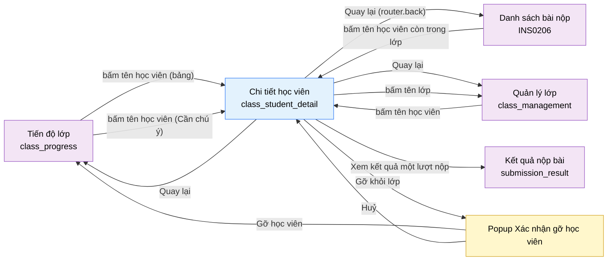

# Tài liệu thiết kế cơ bản (BD) — Chi tiết học viên (`INS0204`)

> Cập nhật DD 2026-10-25 (`DEC-2026-1025-dd-class-assignment-time-window`): bảng bài giao và tử số hoàn thành của lớp đọc F4 P1 `assignmentResults[]` trong lần giao đang hiệu lực; `user_problem_best_score` toàn cục ở các dòng cũ của Sheet 5–9 và Q3 không còn là nguồn cho lớp.

## Phương châm tài liệu [Nội bộ — không cần khách duyệt]

- Viết theo **mẫu 9 sheet**. Bộ thẻ đóng, quy ước ID, ký hiệu chuẩn, ranh giới với tài liệu khác và
  checklist kiểm toán nằm ở `02-bd/_rules/bd-template-9sheet.md` — file này không chép lại.
- Phần gắn nhãn `[Nội bộ]` phục vụ sinh mã và tự kiểm toán, không phải yêu cầu của khách hàng: mục 4.5,
  mục 7.3 và các ghi chú quy ước.
- Mã màn `INS0204` theo bảng mã ở `02-bd/_rules/bd-template-9sheet.md` mục 8 dòng 154; tên file mang tiền
  tố mã.
- **Màn này KHÔNG CÓ PROTOTYPE.** Không tồn tại file `09-layoutBase/*.dc.html` nào cho nó, và chính RD ghi
  nhận điều đó kèm hai marker `[Đợi nextjs]`
  [Nguồn: 01-rd/screens/teacher/INS0204_class_student_detail.md:14-18,50,73-74]. Hệ quả cho tài liệu này:
  **không có một dòng prototype nào để trích**, nên toàn bộ bố cục là suy diễn và được đánh dấu tại chỗ
  bằng `[SoT: Suy luận]`. Cách làm bám đúng tiền lệ `02-bd/screens/shared/SHR0302_interview_question_authoring.md`
  — màn duy nhất khác cũng không có prototype [Nguồn: 02-bd/screens/shared/SHR0302_interview_question_authoring.md:12-16].
  Khác một điểm: `SHR0302` còn có bản dựng UI thật để đối chiếu, màn này **không có cả bản dựng** — 6 slice
  khu Giảng viên đều còn là stub [Nguồn: 02-bd/screens/teacher/_shell.md:13-15]. Vì vậy nguồn duy nhất là
  RD và quy ước 5 màn anh em cùng cụm.
- Khung điều hướng bên trái **không mô tả lại ở đây** — dùng chung `02-bd/screens/teacher/_shell.md`. Khu
  Giảng viên **không có toolbar dùng chung**, nên hàng đầu tiên trong `<main>` là item của chính màn này và
  được mô tả ở Khu vực A [Nguồn: 02-bd/screens/teacher/_shell.md:30,113-114].
- Màn này **không có mục nav riêng** — đúng thiết kế, chỉ vào được bằng khoan sâu
  [Nguồn: 02-bd/screens/teacher/_shell.md:78-79]. Khi đang ở màn này, sidebar **sáng mục của màn gọi tới** (vào từ `class_progress` thì sáng "Danh sách học viên", vào từ `class_management` hoặc `INS0205` thì sáng "Lớp của tôi"), chốt 2026/10/14 (`DEC-2026-1014-instructor-batch5-6-nav-pagination-rubric`, Q7 đóng); quy tắc chung cho màn khoan sâu ở `_shell` mục 3.2.
- Màn này có **đúng một popup**: Xác nhận gỡ học viên khỏi lớp.

> Đọc cùng `01-rd/screens/teacher/INS0204_class_student_detail.md` (hành vi ở mức yêu cầu, không lặp lại ở
> đây), `01-rd/req/F1_identity.md:104-111` (F1-27 — mã yêu cầu trực tiếp của màn), `01-rd/req/F1_identity.md:112-138`
> (F1-28 — nguồn của mọi công thức số liệu màn này dùng lại) và `02-bd/database/F1_identity.md` mục 1.8 tới 1.12.
>
> **Không thiết kế lại** vòng đời lớp (tạo/sửa/xoá lớp, mã mời) — thuộc `class_management` (`INS0201`)
> [Nguồn: 02-bd/screens/teacher/INS0201_class_management.md:195-197].
> **Không thiết kế lại** hành vi gỡ học viên ở mức nghiệp vụ — F1-26 đã chốt một hành vi duy nhất, màn này
> chỉ là **điểm vào thứ hai** của cùng hành vi đó
> [Nguồn: 01-rd/screens/teacher/INS0204_class_student_detail.md:93].
> **Không thiết kế** phần giao/gỡ bài toán cho lớp — thuộc `class_assignments` (`INS0202`)
> (`DEC-2026-0828-split-class-management-assignments`).
> **Không hiển thị** điểm do AI chấm hay phân tích — RD chốt 2026-09-01 là không hiện ở đây
> [Nguồn: 01-rd/screens/teacher/INS0204_class_student_detail.md:65-67,94]. RD khi đó thay bằng một liên kết
> sang `instructor_grading`; liên kết và cả màn đó **đã bỏ 2026/10/13** (`DEC-2026-1013-remove-instructor-manual-grading`), nên màn này không còn
> đường nào sang chấm bài.
> **Không thiết kế** giao diện chấm lại (`DEC-2026-0828-remove-rejudge-scope`) và **không** có luồng "Yêu
> cầu review" của học viên (`DEC-2026-0830-remove-student-review-request`).

> **Quy ước đặt tên khối** [Nội bộ]. Kế thừa chuẩn đặt tên của cụm lớp do `class_management` chốt
> [Nguồn: 02-bd/screens/teacher/INS0201_class_management.md:27-30]: `header` (hàng đầu `<main>`), `popup`
> (mọi popup); màn này **không** dùng `stats` từ V0.9 và thêm khối `info` (thẻ Liên hệ, Học tập). Màn này bổ sung **ba khối riêng** đặt theo nội dung thật:
> `topicProgress` (số bài đã giải theo chủ đề), `assignmentProgress` (bài đã giao kèm điểm tốt nhất), và
> `submissionHistory` (lịch sử nộp bài trong phạm vi lớp). Ba khối này ánh xạ một-một với ba nhóm dữ liệu
> mà F1-27 cho phép [Nguồn: 01-rd/req/F1_identity.md:104-105].

---

## Sheet 1. Bìa

| Mục | Giá trị |
| :--- | :--- |
| Hệ thống | AlgoPrep |
| Phân hệ | `identity` (F1) — có phụ thuộc đọc sang `problem-bank` (F2) và `judge-orchestration` (F4) |
| Công đoạn | BD — Thiết kế cơ bản |
| Phân loại | Màn hình |
| Tên màn | Chi tiết học viên |
| Mã màn hình | `INS0204` |
| Tên vật lý (slug) | `class_student_detail` |
| Trục tài liệu | Màn hình (`02-bd/screens/`) |
| Actor | A2 (`INSTRUCTOR`) |
| Phiên bản | V0.21 |
| Người tạo | Nhóm phát triển AlgoPrep |
| Ngày tạo | 2026/09/21 |
| Người cập nhật | Nhóm phát triển AlgoPrep |
| Ngày cập nhật | 2026/10/22 |

---

## Sheet 2. Lịch sử sửa đổi

| Ver | Sheet bị sửa | Nội dung sửa | Ngày | Người sửa |
| :--- | :--- | :--- | :--- | :--- |
| V0.1 | Toàn bộ | Tạo mới theo mẫu 9 sheet. Màn không có prototype nên toàn bộ bố cục là suy diễn có đánh dấu, bám phạm vi dữ liệu F1-27 và quy ước 5 màn anh em cùng cụm. Chốt hợp đồng ba đường vào (cùng cặp `studentId` + `classId`). Đề xuất tính "Hoàn thành %" và "Số bài đã giải" tại chỗ từ `user_problem_best_score` thay vì gọi `GetClassAssignmentCompletion`, tránh chờ một endpoint chưa tồn tại. Phát sinh 10 câu hỏi mở | 2026/09/21 | Nhóm phát triển AlgoPrep |
| V0.2 | 4.3, 5, 7.1, 7.2, Câu hỏi mở | Áp `DEC-2026-0921-teacher-screens-conflict-resolutions` và `DEC-2026-0921-class-completion-owned-by-identity`: Điểm TB đổi nguồn sang `judge.submissions` theo phạm vi lớp; bộ nhãn trạng thái thêm mã `INSUFFICIENT_DATA` tường minh thay vì trả rỗng; cách tính Hoàn thành của màn này nay áp cho cả cụm và `GetClassAssignmentCompletion` bị bỏ. Đóng Q1, Q3 | 2026-09-21 | AI |
| V0.3 | 1, 8, 9 | Áp `DEC-2026-1003-toast-feedback-channel`: kết quả và lỗi của thao tác gỡ học viên ghi là toast; giữ nguyên vùng lỗi tải theo khối | 2026-10-03 | AI |
| V0.4 | Câu hỏi mở | Chủ dự án duyệt 2026-10-11: đóng Q4 theo bản dựng (`instructor-grading-view.tsx:46-47` đọc `?studentId=&classId=`); đóng Q5 theo `DEC-2026-1011-teacher-screens-open-questions-closed` (A2 xem chỉ đọc bài nộp của học viên thuộc lớp mình, ngoài lớp 404) | 2026-10-11 | AI |
| V0.5 | Câu hỏi mở, Sheet 3 | Chủ dự án chốt 2026-10-13: A2 đọc được mã nguồn bài nộp của học viên trong lớp mình, chỉ đọc, qua `submission_result` (đóng phần mã nguồn của Q5, Q-J) theo `DEC-2026-1013-instructor-avatar-menu-and-read-source`; màn này vẫn không hiện mã nguồn | 2026-10-13 | AI |
| V0.6 | Câu hỏi mở | Chủ dự án chốt 2026-10-13: đóng Q6, Quay lại giữ bộ lọc của màn cha theo `DEC-2026-1013-teacher-open-questions-closed-round2`; bản dựng đã làm | 2026-10-13 | AI |
| V0.7 | Sheet 8 (hiện trạng bản dựng) | Nút "Xem kết quả" của bảng lịch sử nay mở `/instructor/submissions/{id}` (chỉ đọc, có mã nguồn, ngoài lớp 404) thay cho route học viên `/submissions/{id}`. Id lượt nộp trong bản dựng là dữ liệu mẫu lấy từ bộ `SB-90xxx`. **Chưa duyệt hình** | 2026-10-13 | AI |
| V0.7 | Ghi chú bản dựng (chưa sửa Sheet 4, 5, 7) | Chủ dự án yêu cầu 2026-10-13: bỏ dải 4 thẻ số liệu (Điểm TB, Hoàn thành, Chuỗi ngày, Hoạt động), thay bằng thẻ "Thông tin học viên" (họ tên, lớp có liên kết, trạng thái, hoạt động gần nhất) tại `class-student-detail-view.tsx` (khối `info.title`). Mọi chỗ của BD này còn nói "dải thẻ số liệu" (Sheet 4.4 hàng hai, Sheet 5 Khu vực B, Sheet 7 dòng `avgScore`) là **chưa cập nhật, không còn khớp bản dựng**; sẽ viết lại một lượt khi chốt hình. Chưa duyệt hình. Áp quy tắc prototype "không dựng dải số liệu nhỏ" | 2026-10-13 | AI |
| V0.8 | Sheet 4, 5, 8 (hiện trạng bản dựng) | Bảng "Lịch sử nộp bài": trạng thái hiện nhãn tiếng Việt như màn kết quả (`Đã chấp nhận`, `Sai kết quả`, `Lỗi biên dịch`, `Đang chấm...`) thay mã thô; ngôn ngữ là huy hiệu; tỉ lệ testcase dạng `đạt/tổng` ("-" khi lỗi biên dịch); thời điểm là ngày giờ thật; nút "Xem kết quả" là icon (tooltip, tên truy cập có tên bài) kèm `?studentId=&classId=`; thêm bộ lọc "Lọc theo kết quả" (Tất cả, Đã chấp nhận, Chưa đạt = đã chấm và không đạt, bài đang chấm chỉ có ở Tất cả) và đếm số lượt nộp. Hàng lấy từ 4 bài nộp mẫu của `entities/submission`, trùng với bài mở ra. Trang bài nộp của giảng viên `/instructor/submissions/{id}`: thanh ngữ cảnh (học viên, lớp, tên bài, huy hiệu Chỉ đọc, nút "Chấm bài này"), breadcrumb Lớp của tôi / lớp / học viên / lượt nộp, mã nguồn đứng trước bảng testcase, số liệu chạy là một dòng chữ thay dải thẻ (quy tắc chủ dự án 2026-10-13). **Chưa duyệt hình** | 2026-10-13 | AI |
| V0.8 | Ghi chú bản dựng (chưa sửa Sheet 4, 5, 7) | Chủ dự án yêu cầu 2026-10-13: thay thẻ "Thông tin học viên" bằng hai thẻ cạnh nhau (từ 1024px): "Liên hệ" (họ tên, email `mailto:`, số điện thoại `tel:`) để giảng viên liên lạc trao đổi, và "Học tập" (lớp, trạng thái dạng badge, chủ đề đã giao gộp từ khối "Theo chủ đề" cũ). Bỏ "Hoạt động gần nhất". Bỏ avatar chữ cái cạnh nút Quay lại; Quay lại thành nút mũi tên ở đầu tiêu đề (`PageHeader leading`, cùng kiểu `INS0205`), nút "Xem chấm bài của học viên này" lên hàng thao tác của tiêu đề. Thêm trường `email`, `phone` (tuỳ chọn) vào `ClassStudent`; **câu hỏi mới cho DD `identity`**: A2 được đọc email và số điện thoại của học viên trong lớp mình, nguồn là hồ sơ `identity` (chưa có decision). Chưa duyệt hình | 2026-10-13 | AI |
| V0.9 | 4.1, 4.2, 4.3, 4.4, 5, 6, 7.1, 7.2 | Chủ dự án duyệt 2026-10-13 (`DEC-2026-1013-a2-reads-student-contact`): viết lại Sheet 4 đến 7 theo bản dựng V0.8. Khu vực A nay là hàng tiêu đề (Quay lại, tên, lớp, Xem chấm bài, Gỡ khỏi lớp); Khu vực B "Dải thẻ số liệu" bỏ hẳn, thay bằng hai thẻ "Liên hệ" (họ tên, email, số điện thoại) và "Học tập" (lớp, trạng thái, chủ đề đã giao); khối "Theo chủ đề" gộp vào thẻ "Học tập". DTO bỏ `avgScore`, `completionPercent`, `streakDays`, `lastActiveAt`, thêm `phone` (cột mới `identity.users.phone`). "Ngày tham gia lớp" không hiện trong bản dựng, giữ trong DTO cho DD quyết. Đóng câu hỏi mới của V0.8 | 2026-10-13 | AI |
| V0.10 | Phương châm, Sheet 3, 4, 5, 6, 8, 9, Câu hỏi mở | Áp `DEC-2026-1013-remove-instructor-manual-grading`: bỏ liên kết "Xem chấm bài của học viên này" (Sheet 5 khu vực A NO 4, đánh số lại NO 5 thành NO 4), bỏ EVT-7 và chuyển màn sang `instructor_grading` ở Sheet 3, đánh số lại EVT 8-10 thành 7-9 cùng mọi tham chiếu, sửa các câu nhắc F5-27 và `manual_score`. Q4 đóng (màn đích bị bỏ). Thêm Q11 (lối vào trang bài nộp chỉ-đọc, chưa quyết). Số phiên bản ở Sheet 1 từng ghi V0.4 trong khi lịch sử đã tới V0.9, nay đồng bộ lên V0.10. Bản dựng (`class-student-detail-view.tsx`, khoá `classStudentDetail.linkViewGrading`) vẫn còn liên kết này, chưa gỡ | 2026/10/13 | AI |
| V0.11 | Câu hỏi mở (Q11) | Chủ dự án chốt 2026/10/14 theo `DEC-2026-1014-instructor-overview-trim-and-nav-label` (tiêu chí ponytail bậc 3, bậc 4): đóng Q11. Nút "Xem kết quả" ở bảng "Lịch sử nộp bài" (EVT-9) và mục nav "Bài nộp" giữ nguyên làm lối vào trang chỉ-đọc `/instructor/submissions/{id}`; **không thêm lối vào mới**. Nội dung Sheet 3 đến 9 không đổi | 2026/10/14 | AI |
| V0.12 | Sheet 4, 7 (kiểm quyền), Phương châm | Áp `DEC-2026-1014-drop-ai-score-10` (tiêu chí ponytail bậc 3, bậc 2): cột điểm AI quy đổi thang 10 đã bỏ khỏi cơ sở dữ liệu, nên ba câu "không hiển thị điểm AI" được viết lại để không gọi tên cột đã bỏ; ý nghĩa không đổi. Hàng kiểm quyền NO 5 đổi nội dung kiểm sang "không có điểm hay nhận xét do AI sinh ra". Cách đánh số giữ nguyên, không thêm không bớt NO. Câu hỏi gốc của Q11 là lịch sử, không sửa | 2026/10/14 | AI |
| V0.13 | Sheet 5 (E NO 2, 3), 6 (E NO 3), 9 (NO 9), Câu hỏi mở Q9 | Áp `DEC-2026-1014-instructor-batch2-weekly-rules` (tiêu chí ponytail bậc 6: không ẩn lịch sử nộp của học viên): đóng Q9. Bảng "Lịch sử nộp bài" **giữ** lượt nộp của bài đã bị gỡ mềm khỏi lớp (`removed_at` khác rỗng) và đánh dấu dòng đó bằng ghi chú "Bài đã gỡ khỏi lớp"; bảng "Bài đã giao" và tỉ lệ "Hoàn thành" vẫn chỉ tính bài còn hiệu lực. Hàng kiểm Sheet 9 NO 9 nới từ "bài đang nằm trong danh sách giao" thành "bài đã được giao cho đúng lớp, kể cả bài đã gỡ"; vẫn loại bài tự luyện ngoài lớp. Không thêm NO | 2026/10/14 | AI |
| V0.14 | Phương châm, Sheet 3 (popup gỡ), 4.4, 8 (EVT-5), Câu hỏi mở Q7, Q8, Q10 | Áp `DEC-2026-1014-instructor-batch3-4-contracts-and-removal` và `DEC-2026-1014-instructor-batch5-6-nav-pagination-rubric`: (1) Q7 đóng, sidebar sáng mục của màn gọi tới ("Danh sách học viên" khi vào từ `class_progress`, "Lớp của tôi" khi vào từ `class_management` hoặc `INS0205`; tiêu chí ponytail bậc 5), quy tắc chung ghi ở `_shell` mục 3.2; (2) Q10 đóng, sau khi gỡ học viên màn rời bằng `router.back()` về màn gọi tới và màn đó tải lại danh sách (ponytail bậc 6); (3) Q8 đóng vì lỗi thời, bộ năm nhãn trạng thái đã chung cả cụm (`INS0201` Q7, `INS0203` Q4). Không thêm hay đổi NO, EVT | 2026/10/14 | AI |
| V0.15 | Sheet 3 (popup gỡ), 4 (quyền Xoá), 5 (popup NO 1), 7.1 (NO 5), 7.2 (NO 2 và ghi chú), 9 (NO 10, 11), mục 4.4 (hình thức popup) | Áp `DEC-2026-1014-keep-learning-history-on-leave` (tiêu chí ponytail bậc 6): gỡ học viên chỉ đánh dấu đã rời lớp (`class_enrollments.left_at`), giữ lịch sử làm bài; bỏ câu cảnh báo "xoá thật kèm cascade, không hoàn tác"; hàng kiểm "học viên bị gỡ ở phiên khác" nay phát hiện bằng `left_at`. Giữ nguyên `router.back()` sau khi gỡ (V0.14). Không thêm hay đổi NO, EVT | 2026/10/14 | AI |
| V0.16 | Sheet 3 (popup gỡ), 4.4, 7.2 (NO 2), 9 (NO 11) | Áp `DEC-2026-1014-class-leave-details` (tiêu chí ponytail bậc 5): câu xác nhận của popup gỡ học viên đã được chủ dự án duyệt nguyên văn, bỏ `[SoT: Suy luận]`; endpoint gỡ ở DD `identity` đổi từ DELETE sang `POST .../leave` (vẫn là đặt `left_at`, vẫn `router.back()` sau khi gỡ). Không thêm hay đổi NO, EVT | 2026/10/14 | AI |
| V0.17 | Sheet 3 (đường vào từ `INS0206`, Quay lại, Xem kết quả, sơ đồ), 6 (Khu vực E NO 8), 8 (EVT-9) | Áp `DEC-2026-1014-instructor-submissions-list-details` (ponytail bậc 4, 5): (1) ghi đường vào thứ tư từ `INS0206` (tên học viên trong danh sách bài nộp, chỉ học viên còn trong lớp), Quay lại bằng `router.back()` về danh sách giữ bộ lọc; (2) liên kết sang trang kết quả mang `from=student` (cùng `studentId`, `classId`) để breadcrumb và sidebar về `INS0204`; (3) Sheet 6 Khu vực E NO 8 đổi từ "ẩn liên kết khi lượt nộp đang chạy" sang "luôn hiện", thống nhất với `INS0206` Sheet 6 Khu vực C NO 10, vì trang kết quả vùng giảng viên tải một lần và hiện trạng thái hiện tại; chọn theo hành vi của `INS0206` `[SoT: Suy luận]`. Không thêm hay đổi NO, EVT | 2026/10/14 | AI |
| V0.18 | Sheet 4.4 (hiện trạng bản dựng) | Dựng prototype gỡ học viên (giữ lịch sử, đánh dấu đã rời): thêm hàng hiện trạng cho hành vi sau khi gỡ (`router.back()`, mock chỉ đặt `leftAt`). Không đổi yêu cầu, item, EVT hay quyết định thiết kế. **Chưa duyệt hình** | 2026/10/14 | AI |
| V0.19 | Sheet 4.4 (hiện trạng bản dựng, hàng "Lịch sử nộp bài") | Dựng prototype trang kết quả của giảng viên (`from=`, breadcrumb, sidebar): nút "Xem kết quả" ở bảng lịch sử nay mang `from=student`. Không đổi yêu cầu, item, EVT hay quyết định thiết kế. **Chưa duyệt hình** | 2026/10/14 | AI |
| V0.20 | Sheet 4.4 (hàng "Thanh điều hướng bên trái") | Dựng prototype Phase 4-5 (bài giao theo lớp, phân trang 20, from=). Ghi hiện trạng: sidebar sáng mục của màn gọi tới đã dựng qua query `from=` (`from=students` sáng "Danh sách học viên", `from=submissions` sáng "Bài nộp", không có `from` hoặc giá trị lạ thì "Lớp của tôi" theo khớp tiền tố). Hai màn gọi tới (`INS0203`, `INS0206`) đã gắn `from=` vào liên kết tên học viên. Không đổi yêu cầu hay quyết định thiết kế. **Chưa duyệt hình** | 2026/10/18 | AI |
| V0.21 | Sheet 5 (Khu vực lịch sử nộp bài, cột Kết quả), Câu hỏi mở | Sửa 2026-10-22 (đồng bộ DB vòng 3, DEC-2026-1022-problem-bank-schema-sync): "Bảy trạng thái cuối" sửa thành "Sáu" theo DB (`status` có chín giá trị, ba chưa cuối). Không đổi hành vi màn. Không phát sinh câu hỏi mở mới; các Q còn mở giữ nguyên | 2026/10/22 | Claude |

---

## Sheet 3. Sơ đồ chuyển màn

> [Nội bộ] Quy ước vẽ: bố trí từ trái sang phải. Màn gọi tới tô tím, màn hiện tại tô xanh nhạt, popup tô
> vàng. Màu và `[Nguồn:]` dùng để truy vết, không phải yêu cầu của khách hàng.

### 3.1 Danh sách chuyển màn

#### Tiến độ lớp → Chi tiết học viên (từ bảng danh sách học viên)

[Điều kiện mở] Bấm vào tên một học viên trong bảng danh sách học viên của `class_progress`
[Nguồn: 02-bd/screens/teacher/INS0203_class_progress.md:89-98,469].

[Chế độ mở] Chế độ chỉ đọc. Màn không có chế độ sửa nào.

[Thông tin truyền] Cặp `id` học viên và `id` lớp của chính dòng đó. Đây là hợp đồng **đã chốt ở màn cha**,
màn này dùng nguyên, không đặt lại tham số [Nguồn: 02-bd/screens/teacher/INS0203_class_progress.md:95-98].

[Giá trị trả về] Có — khi hành vi gỡ học viên (F1-26) được thực hiện thành công, màn này trả về tín hiệu
"học viên đã bị gỡ khỏi lớp" để màn gọi tới tải lại danh sách, thay vì để lại một dòng ma.

[Khi thành công] Tải các khối của màn: hàng tiêu đề, thẻ "Liên hệ", thẻ "Học tập" (kèm chủ đề), bảng bài đã giao
và trang đầu của lịch sử nộp bài — toàn bộ giới hạn trong đúng lớp được truyền vào.

[Khi huỷ] Không có.

#### Tiến độ lớp → Chi tiết học viên (từ khối "Cần chú ý")

[Điều kiện mở] Bấm vào tên một học viên trong khối "Cần chú ý" của `class_progress`
[Nguồn: 02-bd/screens/teacher/INS0203_class_progress.md:107-118,470].

[Chế độ mở] Chế độ chỉ đọc.

[Thông tin truyền] Cặp `id` học viên và `id` lớp của mục đó — **giống hệt** đường vào từ bảng. Màn cha đã
ràng buộc rõ hai đường vào không được cho ra hai màn khác nhau
[Nguồn: 02-bd/screens/teacher/INS0203_class_progress.md:117-118].

[Giá trị trả về] Giống đường vào từ bảng.

[Khi thành công] Mở đúng cùng một màn với cùng bộ tham số; không có biến thể giao diện nào theo đường vào.

[Khi huỷ] Không có.

#### Quản lý lớp → Chi tiết học viên (đường vào thứ ba, chờ xác nhận vị trí)

[Điều kiện mở] Bấm vào tên một học viên trong bảng danh sách học viên của `class_management`
[Nguồn: 02-bd/screens/teacher/INS0201_class_management.md:358,555].

[Chế độ mở] Chế độ chỉ đọc.

[Thông tin truyền] Cặp `id` học viên và `id` lớp — cùng hợp đồng với hai đường trên
[Nguồn: 02-bd/screens/teacher/INS0201_class_management.md:482].

[Giá trị trả về] Giống hai đường trên.

[Khi thành công] Mở màn với cùng bộ tham số.

[Khi huỷ] Không có.

Ghi chú: bản thân việc tên học viên ở bảng của `class_management` là một liên kết **vẫn đang chờ chủ dự án
xác nhận vị trí**, vì prototype của màn đó vẽ tên học viên là chữ thường
[Nguồn: 02-bd/screens/teacher/INS0201_class_management.md:285 — Câu hỏi mở Q6 của màn đó]. Hợp đồng tham số
thì không phụ thuộc vào việc xác nhận đó, nên đường vào này ghi nhận có điều kiện.

#### Danh sách bài nộp (`INS0206`) → Chi tiết học viên (đường vào thứ tư)

[Điều kiện mở] Bấm tên một học viên **còn trong lớp** trong bảng của `INS0206`; học viên đã rời lớp thì tên không bấm được nên không có đường vào này
[Nguồn: 02-bd/screens/teacher/INS0206_submission_management.md — Sheet 3, mục "Danh sách bài nộp → Chi tiết học viên"].

[Chế độ mở] Chế độ chỉ đọc.

[Thông tin truyền] Cặp `id` học viên và `id` lớp **của chính dòng đó** (lớp của dòng là lớp có lần giao mới nhất không sau `submitted_at`) — cùng hợp đồng với ba đường trên.

[Giá trị trả về] Giống ba đường trên.

[Khi thành công] Mở màn với cùng bộ tham số. Sidebar sáng mục "Bài nộp" (mục của màn gọi tới). "Quay lại" dùng `router.back()` nên về danh sách `INS0206` kèm `?classId=&result=&q=&page=` như lúc rời. (ĐÃ CHỐT 2026-10-14 (DEC-2026-1014-instructor-submissions-list-details): ghi nhận đường vào này; trước V0.17 file này chưa liệt kê.)

[Khi huỷ] Không có.

#### Chi tiết học viên → màn gọi tới (Quay lại)

[Điều kiện mở] Bấm liên kết "Quay lại" ở khối hồ sơ đầu trang.

[Chế độ mở] Không có.

[Thông tin truyền] Không có.

[Giá trị trả về] Không có.

[Khi thành công] Quay về **đúng màn đã gọi tới** (`class_progress`, `class_management` hoặc danh sách bài nộp `INS0206`). Màn này chỉ
đọc, không có thay đổi chưa lưu, nên không hỏi xác nhận trước khi rời. Bộ lọc của màn cha (tab lớp, từ
khoá, số trang) chỉ được khôi phục nếu màn cha ghi ba trạng thái đó vào query string — điều này chưa chốt,
xem Câu hỏi mở Q6 và `02-bd/screens/teacher/INS0203_class_progress.md:509`.

[Khi huỷ] Không có.

#### Chi tiết học viên → Quản lý lớp (bấm tên lớp)

[Điều kiện mở] Bấm tên lớp ở khối hồ sơ đầu trang
[Nguồn: 01-rd/screens/teacher/INS0204_class_student_detail.md:58-59].

[Chế độ mở] Không có.

[Thông tin truyền] `id` lớp đang xem.

[Giá trị trả về] Không có.

[Khi thành công] Mở `class_management` với lớp đó đang được chọn.

[Khi huỷ] Không có.

#### Chi tiết học viên → Kết quả nộp bài

[Điều kiện mở] Bấm "Xem kết quả" trên một dòng của bảng lịch sử nộp bài
[Nguồn: 01-rd/screens/teacher/INS0204_class_student_detail.md:68-70].

[Chế độ mở] Không có.

[Thông tin truyền] `id` lượt nộp của chính dòng đó (đường dẫn), cùng `studentId`, `classId` của màn này và `from=student` (query). ĐÃ CHỐT 2026-10-14 (DEC-2026-1014-instructor-submissions-list-details): `from=student` chỉ để trang kết quả dựng breadcrumb về `INS0204` và sáng đúng mục sidebar; máy chủ vẫn lấy học viên và lớp từ lượt nộp, bỏ qua `studentId`, `classId` trên URL (xem BD `USR0201` mục "Vùng giảng viên (A2)").

[Giá trị trả về] Không có.

[Khi thành công] Mở `submission_result` của đúng lượt nộp đó, chỉ đọc.

[Khi huỷ] Không có.

Ghi chú: `submission_result` là màn của A1 và chưa có BD. Q5 đã chốt: A2 mở **chỉ đọc** lượt nộp của học viên trong lớp mình (ngoài lớp 404) và **đọc được mã nguồn** (chủ dự án, 2026-10-13, `DEC-2026-1013-instructor-avatar-menu-and-read-source`). Mã nguồn đọc qua `submission_result`, không qua màn này.

#### Chi tiết học viên → Popup Xác nhận gỡ học viên

[Điều kiện mở] Bấm nút "Gỡ khỏi lớp" ở khối hồ sơ đầu trang
[Nguồn: 01-rd/screens/teacher/INS0204_class_student_detail.md:58-59,93].

[Chế độ mở] Không có.

[Thông tin truyền] `id` học viên, `id` lớp, tên học viên và tên lớp để dựng câu cảnh báo.

[Giá trị trả về] Kết quả chọn "Gỡ học viên" hoặc "Huỷ".

[Khi thành công] Hiển thị thông báo gỡ chỉ **đánh dấu học viên đã rời lớp**, lịch sử làm bài trong phạm vi lớp
**được giữ** [Nguồn: DEC-2026-1014-keep-learning-history-on-leave; 02-bd/database/F1_identity.md mục 1.10].
~~Cảnh báo cũ: xoá thật kèm cascade dữ liệu lịch sử làm bài~~ (ĐÃ ĐỔI 2026-10-14; RD `01-rd/req/F1_identity.md:98-103` còn câu cũ, chưa cập nhật).

[Khi huỷ] Đóng popup, giữ nguyên màn.

#### Popup Xác nhận gỡ học viên → màn gọi tới

[Điều kiện mở] Bấm "Gỡ học viên" trong popup.

[Chế độ mở] Không có.

[Thông tin truyền] Không có.

[Giá trị trả về] Tín hiệu "học viên đã bị gỡ khỏi lớp".

[Khi thành công] Đóng popup và **rời màn** — sau khi gỡ thì màn này không còn đối tượng để hiển thị, giữ
lại chỉ cho ra một trang toàn `-`. Quay về đúng màn gọi tới bằng `router.back()` kèm thông báo hoàn tất; màn gọi tới **tải lại** danh sách học viên khi quay về (chốt 2026/10/14, `DEC-2026-1014-instructor-batch3-4-contracts-and-removal`, Q10 đóng).

[Khi huỷ] Đóng popup, giữ nguyên màn chi tiết.

### 3.2 Sơ đồ

[Nguồn: 01-rd/screens/teacher/INS0204_class_student_detail.md:58-70,93-95;
02-bd/screens/teacher/INS0203_class_progress.md:89-121,469-470;
02-bd/screens/teacher/INS0201_class_management.md:155-158,555]

---

## Sheet 4. Bố cục màn hình

### 4.1 Tổng quan màn

[Mục đích màn] Cho giảng viên xem hồ sơ chi tiết của **một học viên cụ thể trong một lớp cụ thể** — thông
tin cơ bản, tiến độ, lịch sử nộp bài — thay vì chỉ nhìn một dòng tóm tắt ở bảng danh sách học viên
[Nguồn: 01-rd/screens/teacher/INS0204_class_student_detail.md:23-30; 01-rd/req/F1_identity.md:104-105].

[Luồng nghiệp vụ chính]

1. **Hiển thị ban đầu**: vào màn từ một trong ba đường khoan sâu, hệ thống tải song song bốn nhóm dữ liệu —
   hồ sơ cơ bản kèm thông tin liên hệ và nhãn trạng thái, danh sách bài đã giao cho lớp kèm điểm tốt nhất của học viên, số bài
   đã giải theo chủ đề (dẫn xuất từ nhóm trước, không gọi riêng), và trang đầu của lịch sử nộp bài. Trong
   lúc chờ, mỗi khối hiển thị khung chờ riêng `[SoT: Suy luận]` — quy ước ba trạng thái mỗi khối (rỗng,
   đang tải, lỗi) mà RD yêu cầu áp dụng lại từ `admin_overview`/F1-29 và `instructor_overview`/F1-30
   [Nguồn: 01-rd/screens/teacher/INS0204_class_student_detail.md:71-72].
2. **Liên lạc và đọc tiến độ**: xem thẻ "Liên hệ" (email, số điện thoại) để trao đổi với học viên; xem thẻ
   "Học tập" (lớp, trạng thái, chủ đề đã giao) rồi xem chi tiết từng bài đã giao. Màn **không** có dải thẻ số
   liệu: Điểm TB, Hoàn thành, Chuỗi ngày, Hoạt động đã có ở bảng `class_progress`, không lặp lại (`DEC-2026-1013-a2-reads-student-contact`).
3. **Xem một lượt nộp cụ thể**: bấm "Xem kết quả" trên một dòng lịch sử để sang `submission_result`.
4. **Gỡ học viên khỏi lớp**: bấm "Gỡ khỏi lớp", xác nhận trong popup, rồi màn tự rời về màn gọi tới.

[Người dùng] Giảng viên đã đăng nhập, có Function `CLASS_MANAGEMENT`, và **phải là người phụ trách đúng lớp
được truyền vào** [Nguồn: 01-rd/req/F1_identity.md:104-105; 01-rd/screens/teacher/INS0204_class_student_detail.md:106].

[Tệp liên quan] Không có. Màn này không xuất hay nhập tệp.

[Phạm vi]
- Chỉ một cặp (học viên, lớp). Không có chế độ xem học viên ngoài lớp phụ trách, không có chế độ so sánh
  nhiều học viên.
- **Chỉ đọc, trừ đúng một thao tác ghi**: gỡ học viên khỏi lớp (F1-26). Đây là điểm khác lớn nhất so với
  `class_progress`, vốn hoàn toàn chỉ đọc [Nguồn: 02-bd/screens/teacher/INS0203_class_progress.md:171-172].
- **Chỉ tính bài toán đã giao qua `class_assignments` (F2-12) của đúng lớp đang xem** — không tính bài tự
  luyện ngoài phạm vi lớp. Ràng buộc này áp cho **cả** bảng bài đã giao, khối chủ đề, bảng lịch sử nộp bài
  và nhãn trạng thái [Nguồn: 01-rd/screens/teacher/INS0204_class_student_detail.md:68-70,95].
- **Không** hiển thị điểm do AI chấm hay phân tích (kể cả điểm từng tiêu chí rubric)
  [Nguồn: 01-rd/screens/teacher/INS0204_class_student_detail.md:65-67,94].
- **Không** hiển thị (trên màn này; A2 đọc mã nguồn qua `submission_result`, xem Q5) mã nguồn bài nộp, nội dung testcase ẩn, hay kết quả so khớp từng testcase ở bất kỳ
  trạng thái nào. Bảng lịch sử chỉ có tên bài, ngôn ngữ, trạng thái, tỉ lệ testcase và mốc thời gian.
- **Thông tin liên hệ** (email, số điện thoại) chỉ đọc, chỉ của học viên thuộc lớp người xem phụ trách;
  học viên ngoài lớp trả 404 như toàn màn (`DEC-2026-1013-a2-reads-student-contact`).
- **Không** phụ thuộc phân hệ AI: màn này không gọi `ai-review`, nên F5/F6 chết thì màn vẫn chạy đủ.

[Quyền sử dụng]
- Xem: được, khi có `CLASS_MANAGEMENT:READ` **và** phụ trách lớp được truyền vào.
- Thêm: không có.
- Sửa: không có.
- Xoá: được đúng một thao tác — gỡ học viên khỏi lớp (`CLASS_MANAGEMENT:DELETE`), **không xoá dữ liệu**: chỉ đánh dấu đã rời lớp, giữ lịch sử làm bài (ĐÃ ĐỔI 2026-10-14,
  `DEC-2026-1014-keep-learning-history-on-leave`; ~~xoá thật kèm cascade~~).

[Số bản ghi tối đa] Khối chủ đề: bằng số chủ đề xuất hiện trong tập bài đã giao, không phân trang. Bảng bài
đã giao: toàn bộ bài đã giao cho lớp, **không phân trang** `[SoT: Suy luận]` — một lớp thường được giao vài
chục bài, thấp hơn nhiều so với 82 học viên mà `class_progress` phải phân trang; thêm phân trang ở đây là
thêm trạng thái mà không giải quyết vấn đề nào. Bảng lịch sử nộp bài: 20 dòng mỗi trang, cùng con số đã
dùng cho bảng học viên của `class_progress` [Nguồn: 02-bd/screens/teacher/INS0203_class_progress.md:190].

[Nguồn: 01-rd/screens/teacher/INS0204_class_student_detail.md:23-30,54-74,93-96,104-108; 01-rd/req/F1_identity.md:98-111]

### 4.2 DTO liên quan

- `ClassStudentProfileDto` — hồ sơ cơ bản của một học viên trong một lớp: tên, email, số điện thoại, lớp và
  nhãn trạng thái.
- `ClassAssignmentProgressRowDto` — một dòng của bảng bài đã giao: bài toán, chủ đề, điểm tốt nhất của học
  viên trên bài đó.
- `StudentSubmissionRowDto` — một dòng của bảng lịch sử nộp bài.
- `ClassCardDto` — **dùng lại** của `class_management`, chỉ lấy `id` và `name` để hiển thị tên lớp
  [Nguồn: 02-bd/screens/teacher/INS0201_class_management.md:468].

`[SoT: Suy luận]` — tên DTO do BD này đề xuất, `03-dd/api/F1_identity.md` chốt lại. Khối chủ đề **không có DTO
riêng**: nó được gom từ chính `ClassAssignmentProgressRowDto` ở phía giao diện, xem mục 4.3.

### 4.3 Bảng dữ liệu liên quan (6)

| NO | Bảng | Ghi chú |
| --: | :--- | :--- |
| 1 | `identity.classes` | Tên lớp ở khối hồ sơ và kiểm tra `instructor_id` khi gác quyền [Nguồn: 02-bd/database/F1_identity.md:85-88] |
| 2 | `identity.class_enrollments` | Xác nhận học viên thuộc đúng lớp, lấy `joined_at` cho "Ngày tham gia lớp", và là bảng bị đặt `left_at` khi gỡ học viên (không xoá dòng; ~~bị xoá khi gỡ~~, ĐÃ ĐỔI 2026-10-14, `DEC-2026-1014-keep-learning-history-on-leave`); học viên có `left_at` khác rỗng coi như không còn thuộc lớp [Nguồn: 02-bd/database/F1_identity.md mục 1.10] |
| 3 | `identity.users` | Tên hiển thị, email và số điện thoại học viên — cột `display_name`, `email`, `phone` [Nguồn: 02-bd/database/F1_identity.md:14,16,20] |
| 4 | `judge.submissions` | Từ V0.9 chỉ dùng nội bộ để tính nhãn trạng thái, không còn hiện Điểm TB. Ghi chép cũ: nguồn tính Điểm TB **theo phạm vi lớp**, đọc qua `GetClassStudentSubmissionMetrics` của `judge-orchestration`, không truy vấn chéo schema. Thay cho `identity.user_submission_stats` (read model toàn cục, không có chiều `class_id`) từ 2026-09-21 theo `DEC-2026-0921-teacher-screens-conflict-resolutions` |
| 5 | `identity.user_problem_best_score` | Điểm tốt nhất mỗi bài (F4-13 best-attempt) và cờ đã giải, cho bảng bài đã giao, mục chủ đề, và tính nội bộ Hoàn thành cho nhãn trạng thái [Nguồn: 02-bd/database/F1_identity.md:111-112] |
| 6 | `identity.identity_recent_activity` | Không còn đọc từ V0.9: thẻ "Hoạt động" đã bỏ |

Hai nhóm dữ liệu còn lại **không đọc từ bảng của `identity`**, nên không tính vào bảng trên và không truy
vấn chéo schema:

| Số liệu | Nguồn thật | Cách lấy |
| :--- | :--- | :--- |
| Danh sách bài đã giao cho lớp, tên bài, chủ đề của bài | `problem.class_assignments`, `problem.problems`, `problem.topics`/`problem_topics` [Nguồn: 02-bd/database/F2_problem-bank.md:116-128,8-15,35-39] | Endpoint `ListClassAssignments` của `problem-bank` — tên nghiệp vụ đã có ở `class_assignments`, dùng lại [Nguồn: 02-bd/screens/teacher/INS0202_class_assignments.md:464] |
| Lịch sử nộp bài | `judge.submissions` [Nguồn: 02-bd/database/F4_judge-orchestration.md:8-34] | Endpoint `ListStudentClassSubmissions` (mới) và `GetClassStudentSubmissionMetrics` (đã được `class_progress` đề xuất, dùng lại) của `judge-orchestration`, xem Câu hỏi mở Q2 |

**Cách tính Hoàn thành, nay áp cho cả cụm lớp.** Mẫu số là danh sách bài đã giao, lấy qua
`ListClassAssignments` (endpoint đã tồn tại sẵn); tử số là số bài trong danh sách đó mà
`user_problem_best_score.best_verdict = ACCEPTED` — `identity` tự tính được, không phải chờ module khác.
Đây vốn là đề xuất riêng của màn này, đi lệch so với hai màn anh em; **chốt 2026-09-21** bởi
`DEC-2026-0921-class-completion-owned-by-identity` là cách duy nhất cho cả bốn màn, và
`GetClassAssignmentCompletion` bị bỏ hẳn.

### 4.4 Vùng bố cục

**Không có prototype để bám.** Khác mọi màn khác của khu Giảng viên, `09-layoutBase/` không có file
`.dc.html` nào cho `class_student_detail`, và RD ghi nhận điều đó hai lần kèm marker `[Đợi nextjs]`
[Nguồn: 01-rd/screens/teacher/INS0204_class_student_detail.md:50,73-74]. Cũng **không có bản dựng UI thật**
để đối chiếu — slice khu Giảng viên còn là stub [Nguồn: 02-bd/screens/teacher/_shell.md:13-15]. Bảng dưới
đây vì vậy **không phải mô tả bằng chứng bố cục** mà là **đề xuất bố cục của BD**, toàn bộ là suy diễn.

Căn cứ suy diễn, theo đúng thứ tự ưu tiên đã dùng:

1. **Phạm vi dữ liệu mà RD cho phép** — bốn nhóm: thông tin cơ bản, tiến độ, lịch sử nộp bài, thao tác quản
   lý [Nguồn: 01-rd/screens/teacher/INS0204_class_student_detail.md:27-29,54-70]. Không thêm khối nào ngoài
   bốn nhóm này.
2. **Quy ước 5 màn anh em cùng khu** — container `max-width: 1320px` căn giữa, các khối xếp dọc, hàng đầu
   trong `<main>` là của chính màn, không có chân trang
   [Nguồn: 02-bd/screens/teacher/_shell.md:30-31,110-114].
3. **Tiền lệ màn không có prototype** — `SHR0302` đã xử lý bằng cách nêu rõ bố cục một cột dọc và không quy
   định màu sắc, khoảng cách, typography ở BD
   [Nguồn: 02-bd/screens/shared/SHR0302_interview_question_authoring.md:306-308].

| Vùng | Vị trí | Nội dung |
| :--- | :--- | :--- |
| Thanh điều hướng bên trái (khung chung Giảng viên) | Khung chung | Màn này không có mục nav riêng [Nguồn: 02-bd/screens/teacher/_shell.md:78-79], nên sidebar **sáng mục của màn gọi tới**: vào từ `class_progress` thì "Danh sách học viên", vào từ `class_management` hoặc `INS0205` thì "Lớp của tôi" (chốt 2026/10/14, `DEC-2026-1014-instructor-batch5-6-nav-pagination-rubric`, Q7 đóng) **Bản dựng (2026/10/18, chưa duyệt hình):** `instructorActiveHrefOverride` xử lý route `/instructor/classes/{id}/students/{id}`: `from=students` sáng "Danh sách học viên", `from=submissions` sáng "Bài nộp", còn lại "Lớp của tôi" nhờ khớp tiền tố; liên kết tên học viên ở `INS0203` mang `?from=students`, ở `INS0206` mang `?from=submissions` [Nguồn: 05-coding/frontend/src/widgets/app-shell/ui/instructor-sidebar.tsx:46-64; 05-coding/frontend/src/views/teacher/class-progress/ui/class-progress-view.tsx:134; 05-coding/frontend/src/views/teacher/submission-management/ui/submission-management-view.tsx:107; test: 05-coding/frontend/src/widgets/app-shell/ui/instructor-sidebar.test.ts:21-32] |
| Container nội dung | Khung chung | `max-width: 1320px` căn giữa, các khối xếp dọc [Nguồn: 02-bd/screens/teacher/_shell.md:110-111] |
| Hàng đầu — tiêu đề | Bản dựng | Nút mũi tên Quay lại ở đầu tiêu đề, tên học viên, tên lớp (liên kết sang `class_detail`); mép phải: nút "Gỡ khỏi lớp" (nút "Xem chấm bài của học viên này" đã bỏ cả ở thiết kế lẫn bản dựng, `DEC-2026-1013-remove-instructor-manual-grading`). Không có avatar chữ cái. Cùng kiểu tiêu đề của `INS0205` [Nguồn: 05-coding/frontend/src/views/teacher/class-student-detail/ui/class-student-detail-view.tsx, `PageHeader leading`] |
| Hàng hai — hai thẻ cạnh nhau | Bản dựng | Từ 1024px chia hai cột, hẹp hơn xếp chồng. Thẻ trái "Liên hệ": Họ tên, Email (liên kết `mailto:`), Số điện thoại (liên kết `tel:`). Thẻ phải "Học tập": Lớp (liên kết), Trạng thái (badge màu), Chủ đề đã giao (badge "{chủ đề}: {n} bài"). Mỗi dòng có icon. Thay cho dải 4 thẻ số liệu và khối "Theo chủ đề" riêng (`DEC-2026-1013-a2-reads-student-contact`) |
| Hàng ba — bảng "Bài đã giao" | Bản dựng | Cột hiện tại: Bài tập, Chủ đề, AC. Không phân trang. Cột Điểm tốt nhất, Trạng thái theo Sheet 5 Khu vực D chưa dựng |
| Hàng bốn — bảng "Lịch sử nộp bài" | Bản dựng | Cột: Bài tập, Ngôn ngữ, Trạng thái, Tỉ lệ testcase, Nộp lúc, Xem kết quả. Dữ liệu mock sinh trong view. Từ 2026/10/14 nút "Xem kết quả" mở `/instructor/submissions/{id}?studentId=&classId=&from=student` (khớp Sheet 3 và EVT-9), trang đích dựng breadcrumb `Lớp của tôi / {lớp} / {học viên} / Lượt nộp` và sidebar sáng "Danh sách học viên"; **chưa duyệt hình** [Nguồn: 05-coding/frontend/src/views/teacher/class-student-detail/ui/class-student-detail-view.tsx:218-226] |
| Popup Xác nhận gỡ học viên | Đề xuất BD | Nội dung "Học viên sẽ rời khỏi lớp. Lịch sử làm bài của học viên trong lớp này vẫn được giữ." (ĐÃ CHỐT 2026-10-14, `DEC-2026-1014-class-leave-details`) (~~cảnh báo xoá thật kèm cascade~~, ĐÃ ĐỔI 2026-10-14, `DEC-2026-1014-keep-learning-history-on-leave`), nút "Gỡ học viên", nút "Huỷ". `[SoT: Suy luận]` — cùng hình thức popup xác nhận mà `class_management` đã dùng cho chính hành vi này [Nguồn: 02-bd/screens/teacher/INS0201_class_management.md:557] |
| Hành vi sau khi gỡ (cập nhật 2026/10/14, chưa duyệt hình) | Bản dựng | Xác nhận gỡ thành công thì hiện toast rồi gọi `router.back()` về màn gọi tới (khớp Q10). Mock `removeStudent` chỉ đặt `leftAt` (không xoá dòng), giảm `studentCount` của lớp và `absentCount` nếu học viên đang vắng; `getClassStudent` chỉ trả học viên đang ở lớp, nên mở lại trang của học viên đã gỡ không còn dữ liệu. Nội dung popup trong bản dựng là câu đã chốt ở `DEC-2026-1014-class-leave-details` (khoá i18n `popup.removeBody`). Popup chưa cho chọn lớp, không cần vì trang gắn một cặp học viên và lớp. [Nguồn: 05-coding/frontend/src/views/teacher/class-student-detail/ui/class-student-detail-view.tsx:409-424], [Nguồn: 05-coding/frontend/src/entities/class/api/__mock__/class-mocks.ts:272-290,351-364], [Nguồn: 05-coding/frontend/messages/vi.json:2387] |
| Chân trang | Không có | Cả 5 prototype khu Giảng viên đều không có `<footer>` [Nguồn: 02-bd/screens/teacher/_shell.md:31] |

**Từ V0.9 bố cục theo bản dựng**, không còn là đề xuất thuần. Còn suy diễn: tập cột cuối cùng của bảng bài
đã giao, và việc bảng đó không phân trang. Mục nav sáng khi ở màn này đã chốt 2026/10/14 (Q7 đóng). Chưa duyệt hình.

### 4.5 Cấu trúc slice FSD [Nội bộ]

| Khối | Slice dự kiến | Căn cứ |
| :--- | :--- | :--- |
| Trang | `views/teacher/class-student-detail` | Quy ước FSD của dự án; slice khu Giảng viên hiện là stub [Nguồn: 02-bd/screens/teacher/_shell.md:13-14] |
| Khung Giảng viên | Dùng lại `widgets/app-shell` (biến thể `instructor-sidebar`) | `02-bd/screens/teacher/_shell.md` mục 1 |
| Khối hồ sơ đầu trang | `widgets/class-student-profile-header` | Đề xuất BD |
| Bảng bài đã giao và khối chủ đề | `widgets/class-student-assignment-progress` | Đề xuất BD — hai khối cùng một nguồn dữ liệu nên nằm chung một widget, không tách hai |
| Bảng lịch sử nộp bài | `widgets/class-student-submission-history` | Đề xuất BD |
| Popup gỡ học viên | Dùng lại `features/class-student-remove` của `class_management` | Cùng một hành vi F1-26, hai điểm vào [Nguồn: 01-rd/screens/teacher/INS0204_class_student_detail.md:93] — **không** dựng popup thứ hai |
| Thực thể dùng chung | Dùng lại `entities/class` và `entities/class-student` | Đã khai ở `class_management`, **không định nghĩa lại** [Nguồn: 02-bd/screens/teacher/INS0201_class_management.md:298-300] |

`[SoT: Suy luận]` — ánh xạ slice do BD đề xuất, DD màn hình chốt lại.

> [Nội bộ] Ảnh minh hoạ đặt ở `08-diagram/02-bd/screens/teacher/`, chụp bằng Playwright trên ứng dụng
> Next.js thật khi đã có mã chạy được. Màn này **không có prototype để tham chiếu tạm**, nên trước khi có mã
> chạy thì không có ảnh nào — không vẽ tay thay thế.

---

## Sheet 5. Danh sách item màn hình

> Quy ước ID, bộ thẻ và giá trị chuẩn: `02-bd/_rules/bd-template-9sheet.md` mục 2, 3, 4.

### Khu vực A — Hàng tiêu đề

| Khu vực | NO | Tên item | ID item | Bảng DB | Cột DB | Loại UI | Kiểu | Độ dài | Bắt buộc | I/O | Giá trị mặc định | Định dạng | Ghi chú |
| :--- | --: | :--- | :--- | :--- | :--- | :--- | :--- | :--- | :-: | :-: | :--- | :--- | :--- |
| Hàng tiêu đề | | | | | | | | | | | | | |
| | 1 | Quay lại | `classStudentDetail.backLink` | - | - | Icon button | - | - | - | I | - | Mũi tên trái, tooltip "Quay lại" | Trở về màn đã gọi tới, giữ bộ lọc (`router.back()`, Q6) [Nguồn giá trị] Nhãn tĩnh i18n [EVT liên quan] EVT-2 |
| | 2 | Tên học viên | `classStudentDetail.header.studentName` | `identity.users` | `display_name` | Label | String | 100 | - | O | - | - | Tiêu đề trang [Nguồn giá trị] Cột `display_name` [Nguồn: 02-bd/database/F1_identity.md:16] [EVT liên quan] EVT-1 |
| | 3 | Tên lớp | `classStudentDetail.header.className` | `identity.classes` | `name` | Link | String | 120 | - | O | - | - | Dòng phụ dưới tiêu đề; bấm mở `class_detail` của lớp [Nguồn giá trị] Cột `name` [Nguồn: 02-bd/database/F1_identity.md:85-88] [EVT liên quan] EVT-3 |
| | 4 | Gỡ khỏi lớp | `classStudentDetail.btnRemoveFromClass` | `identity.class_enrollments` | - | Button | - | - | - | I | - | Chữ màu đỏ | Mở popup xác nhận; hành vi F1-26, cùng hành vi với nút ở `class_management` [Nguồn: 01-rd/screens/teacher/INS0204_class_student_detail.md:93] [Nguồn giá trị] Nhãn tĩnh i18n [EVT liên quan] EVT-4 |

### Khu vực B — Thẻ "Liên hệ"

| Khu vực | NO | Tên item | ID item | Bảng DB | Cột DB | Loại UI | Kiểu | Độ dài | Bắt buộc | I/O | Giá trị mặc định | Định dạng | Ghi chú |
| :--- | --: | :--- | :--- | :--- | :--- | :--- | :--- | :--- | :-: | :-: | :--- | :--- | :--- |
| Liên hệ | | | | | | | | | | | | | |
| | 1 | Tiêu đề thẻ | `classStudentDetail.info.contactTitle` | - | - | Label | String | - | - | O | Liên hệ | - | [Nguồn giá trị] Nhãn tĩnh i18n [EVT liên quan] - |
| | 2 | Họ tên | `classStudentDetail.info.name` | `identity.users` | `display_name` | Label | String | 100 | - | O | - | - | [Nguồn giá trị] Cột `display_name` [Nguồn: 02-bd/database/F1_identity.md:16] [EVT liên quan] EVT-1 |
| | 3 | Email | `classStudentDetail.info.email` | `identity.users` | `email` | Link | String | 255 | - | O | - | `mailto:` | Bấm mở trình gửi thư; tài khoản đã ẩn danh hoá hiện địa chỉ vô danh [Nguồn: 02-bd/database/F1_identity.md:28-31] [Nguồn giá trị] Cột `email` [Nguồn: 02-bd/database/F1_identity.md:14] [EVT liên quan] EVT-1 |
| | 4 | Số điện thoại | `classStudentDetail.info.phone` | `identity.users` | `phone` | Link | String | 20 | - | O | `-` | `tel:` | Bấm để gọi; học viên chưa khai thì hiện `-` [Nguồn giá trị] Cột `phone`, nullable, học viên tự khai ở `USR0502` [Nguồn: 02-bd/database/F1_identity.md:20] (`DEC-2026-1013-a2-reads-student-contact`) [EVT liên quan] EVT-1 |

### Khu vực C — Thẻ "Học tập"

| Khu vực | NO | Tên item | ID item | Bảng DB | Cột DB | Loại UI | Kiểu | Độ dài | Bắt buộc | I/O | Giá trị mặc định | Định dạng | Ghi chú |
| :--- | --: | :--- | :--- | :--- | :--- | :--- | :--- | :--- | :-: | :-: | :--- | :--- | :--- |
| Học tập | | | | | | | | | | | | | |
| | 1 | Tiêu đề thẻ | `classStudentDetail.info.studyTitle` | - | - | Label | String | - | - | O | Học tập | - | [Nguồn giá trị] Nhãn tĩnh i18n [EVT liên quan] - |
| | 2 | Lớp | `classStudentDetail.info.class` | `identity.classes` | `name` | Link | String | 120 | - | O | - | - | Bấm mở `class_detail` [Nguồn giá trị] Cột `name` [EVT liên quan] EVT-3 |
| | 3 | Trạng thái | `classStudentDetail.info.status` | - | - | Badge | Enum | - | - | O | - | Nhãn tiếng Việt, màu theo trạng thái | Năm nhãn: "Chưa đủ dữ liệu", "Vắng bài", "Cần hỗ trợ", "Theo dõi", "Đúng tiến độ"; màu dùng chung `STUDENT_STATUS_VARIANT` với `class_progress`, `class_detail` [Công thức] Bộ ngưỡng của `DEC-2026-0830-class-progress-dashboard` như `class_progress` [Nguồn: 01-rd/req/F1_identity.md:129-133]; khớp nhiều ngưỡng thì lấy nhãn nghiêm trọng nhất `[SoT: Suy luận]`. Xem Câu hỏi mở Q8 [EVT liên quan] EVT-1 |
| | 4 | Chủ đề đã giao | `classStudentDetail.topicProgress.item` | - | - | Badge list | List | - | - | O | `-` | `{chủ đề}: {n} bài` | Mỗi badge là một chủ đề trong tập bài đã giao cho lớp, kèm số bài [Công thức] Gom nhóm các dòng của bảng "Bài đã giao" (Khu vực D) theo tên chủ đề; **không gọi endpoint riêng** [Nguồn: 02-bd/database/F2_problem-bank.md:35-39]. Tỉ lệ đã giải theo chủ đề (RD `INS0204` dòng 60-61) chưa dựng, ghi nợ [EVT liên quan] EVT-1 |

### Khu vực D — Bài đã giao

| Khu vực | NO | Tên item | ID item | Bảng DB | Cột DB | Loại UI | Kiểu | Độ dài | Bắt buộc | I/O | Giá trị mặc định | Định dạng | Ghi chú |
| :--- | --: | :--- | :--- | :--- | :--- | :--- | :--- | :--- | :-: | :-: | :--- | :--- | :--- |
| Bài đã giao | | | | | | | | | | | | | |
| | 1 | Tiêu đề khối | `classStudentDetail.assignmentProgress.title` | - | - | Label | String | - | - | O | Bài đã giao cho lớp | - | Tiêu đề khối [Nguồn giá trị] Nhãn tĩnh i18n [EVT liên quan] - |
| | 2 | Bảng bài đã giao | `classStudentDetail.assignmentProgress.table` | `identity.user_problem_best_score` | - | List | List | - | - | O | rỗng | Không phân trang | Mỗi dòng là một bài còn hiệu lực trong danh sách giao cho lớp; bài đã gỡ mềm (`removed_at` khác NULL) không hiển thị [Nguồn: 02-bd/database/F2_problem-bank.md:125] [Nguồn giá trị] Ghép `ListClassAssignments` (danh sách bài) với `user_problem_best_score` (điểm của học viên) [EVT liên quan] EVT-1 |
| | 3 | Bài tập | `classStudentDetail.assignmentProgress.col.problemTitle` | `problem.problems` | `title` | ListColumn | String | 200 | - | O | - | - | Tên bài tập được giao [Nguồn giá trị] `problem.problems.title` qua `ListClassAssignments` [Nguồn: 02-bd/database/F2_problem-bank.md:15] [EVT liên quan] - |
| | 4 | Chủ đề | `classStudentDetail.assignmentProgress.col.topics` | - | - | ListColumn | List | 120 | - | O | - | Danh sách tên, ngăn bằng dấu phẩy | Các chủ đề gắn với bài; một bài có thể có nhiều chủ đề [Nguồn giá trị] `problem.topics.name` qua `problem_topics` [Nguồn: 02-bd/database/F2_problem-bank.md:35-39] [EVT liên quan] - |
| | 5 | Điểm tốt nhất | `classStudentDetail.assignmentProgress.col.bestRatio` | `identity.user_problem_best_score` | `best_ratio` | ListColumn | Number | 4 | - | O | - | `{số}%` | Tỉ lệ testcase tốt nhất mà học viên đạt được trên bài đó (F4-13, best-attempt) [Nguồn giá trị] Cột `best_ratio` [Nguồn: 02-bd/database/F1_identity.md:111-112]. Chưa nộp lần nào thì hiển thị `-`, không hiển thị `0%` — hai chuyện khác nhau [EVT liên quan] - |
| | 6 | Trạng thái | `classStudentDetail.assignmentProgress.col.bestVerdict` | `identity.user_problem_best_score` | `best_verdict` | Badge | Enum | - | - | O | - | Nhãn tiếng Việt | Ba giá trị hiển thị: "Đã giải" (`best_verdict = ACCEPTED`), "Chưa đạt" (có nộp nhưng chưa Accepted), "Chưa nộp" (không có dòng read model nào) [Nguồn giá trị] Cột `best_verdict` [Nguồn: 02-bd/database/F1_identity.md:111-112] [EVT liên quan] - |
| | 7 | Thử lại | `classStudentDetail.assignmentProgress.btnRetry` | - | - | Button | - | - | - | I | - | Thử lại | Tải lại khối "Bài đã giao" và khối "Theo chủ đề" khi lỗi — hai khối cùng một nguồn nên cùng một nút [Nguồn giá trị] Nhãn tĩnh i18n [EVT liên quan] EVT-8 |

### Khu vực E — Lịch sử nộp bài

| Khu vực | NO | Tên item | ID item | Bảng DB | Cột DB | Loại UI | Kiểu | Độ dài | Bắt buộc | I/O | Giá trị mặc định | Định dạng | Ghi chú |
| :--- | --: | :--- | :--- | :--- | :--- | :--- | :--- | :--- | :-: | :-: | :--- | :--- | :--- |
| Lịch sử nộp bài | | | | | | | | | | | | | |
| | 1 | Tiêu đề khối | `classStudentDetail.submissionHistory.title` | - | - | Label | String | - | - | O | Lịch sử nộp bài trong lớp | - | Tiêu đề khối; chữ "trong lớp" là bắt buộc vì đây không phải toàn bộ lịch sử của học viên [Nguồn: 01-rd/screens/teacher/INS0204_class_student_detail.md:68-70] [Nguồn giá trị] Nhãn tĩnh i18n [EVT liên quan] - |
| | 2 | Bảng lịch sử | `classStudentDetail.submissionHistory.table` | - | - | List | List | - | - | O | rỗng | 20 dòng mỗi trang | Các lượt nộp của học viên này cho **các bài đã giao cho đúng lớp đang xem**, kể cả bài đã bị gỡ mềm khỏi lớp, sắp xếp theo `submitted_at` giảm dần (`DEC-2026-1014-instructor-batch2-weekly-rules`, Q9) [Nguồn giá trị] Kết quả gọi `ListStudentClassSubmissions` (`judge-orchestration`) [Nguồn: 02-bd/database/F4_judge-orchestration.md:8-34] [EVT liên quan] EVT-1, EVT-7 |
| | 3 | Bài tập | `classStudentDetail.submissionHistory.col.problemTitle` | `problem.problems` | `title` | ListColumn | String | 200 | - | O | - | - | Tên bài tập của lượt nộp; bài đã bị gỡ mềm khỏi lớp thì kèm ghi chú nhỏ "Bài đã gỡ khỏi lớp" ngay dưới tên (nhãn tĩnh i18n, `DEC-2026-1014-instructor-batch2-weekly-rules`) [Nguồn giá trị] `problem.problems.title`, tra theo `judge.submissions.problem_id` [Nguồn: 02-bd/database/F2_problem-bank.md:15; 02-bd/database/F4_judge-orchestration.md:16]. Ghi chú suy từ `problem.class_assignments.removed_at` khác rỗng của đúng cặp lớp và bài [Nguồn: 02-bd/database/F2_problem-bank.md:124] [EVT liên quan] - |
| | 4 | Ngôn ngữ | `classStudentDetail.submissionHistory.col.language` | `judge.submissions` | `language` | ListColumn | Enum | - | - | O | - | `Java` / `C++` / `Python` | Ngôn ngữ của lượt nộp — đúng ba giá trị [Nguồn giá trị] Cột `language` [Nguồn: 02-bd/database/F4_judge-orchestration.md:18] [EVT liên quan] - |
| | 5 | Kết quả | `classStudentDetail.submissionHistory.col.status` | `judge.submissions` | `status` | Badge | Enum | - | - | O | - | Nhãn tiếng Việt | Sáu trạng thái cuối của state machine (Sửa 2026-10-22 (đồng bộ DB vòng 3, DEC-2026-1022-problem-bank-schema-sync): trước ghi "bảy"; chín giá trị `status` trừ ba trạng thái chưa cuối `PENDING`, `COMPILING`, `JUDGING`, khớp `02-bd/database/F4_judge-orchestration.md:22,33`) (`DEC-2026-0912-judge-callback-contract`); lượt nộp chưa xong thì hiển thị trạng thái đang chạy [Nguồn giá trị] Cột `status` [Nguồn: 02-bd/database/F4_judge-orchestration.md:22] [EVT liên quan] - |
| | 6 | Điểm tỉ lệ | `classStudentDetail.submissionHistory.col.scoreRatio` | `judge.submissions` | `score_ratio` | ListColumn | Number | 4 | - | O | - | `{số}%` | Tỉ lệ testcase đạt của lượt nộp đó (F4-13) [Nguồn giá trị] Cột `score_ratio`; `NULL` với `COMPILE_ERROR`/`SYSTEM_ERROR` thì hiển thị `-`, **không** hiển thị `0%` [Nguồn: 02-bd/database/F4_judge-orchestration.md:27] [EVT liên quan] - |
| | 7 | Nộp lúc | `classStudentDetail.submissionHistory.col.submittedAt` | `judge.submissions` | `submitted_at` | ListColumn | Date | - | - | O | - | Thời gian tương đối | Thời điểm nộp bài, hiển thị dạng tương đối [Nguồn giá trị] Cột `submitted_at` [Nguồn: 02-bd/database/F4_judge-orchestration.md:31] [EVT liên quan] - |
| | 8 | Xem kết quả | `classStudentDetail.submissionHistory.col.btnViewResult` | - | - | Link | - | - | - | I | - | Xem kết quả | Mở `submission_result` của đúng lượt nộp đó [Nguồn: 01-rd/screens/teacher/INS0204_class_student_detail.md:68-70] [Nguồn giá trị] Nhãn tĩnh i18n [EVT liên quan] EVT-9 |
| | 9 | Phân trang | `classStudentDetail.submissionHistory.pagination` | - | - | Button | Number | 4 | - | I/O | 1 | `Trang {n} / {tổng}` | Điều khiển chuyển trang bảng lịch sử, cùng kiểu `problem_list` (F2-11) như `class_progress` đã chốt [Nguồn: 02-bd/screens/teacher/INS0203_class_progress.md:323] [Nguồn giá trị] Tổng số trang do máy chủ trả về cùng kết quả `ListStudentClassSubmissions` [EVT liên quan] EVT-7 |
| | 10 | Thử lại | `classStudentDetail.submissionHistory.btnRetry` | - | - | Button | - | - | - | I | - | Thử lại | Tải lại khối lịch sử khi lỗi [Nguồn giá trị] Nhãn tĩnh i18n [EVT liên quan] EVT-8 |

### Popup Xác nhận gỡ học viên

| Khu vực | NO | Tên item | ID item | Bảng DB | Cột DB | Loại UI | Kiểu | Độ dài | Bắt buộc | I/O | Giá trị mặc định | Định dạng | Ghi chú |
| :--- | --: | :--- | :--- | :--- | :--- | :--- | :--- | :--- | :-: | :-: | :--- | :--- | :--- |
| Popup gỡ học viên | | | | | | | | | | | | | |
| | 1 | Nội dung cảnh báo | `classStudentDetail.popup.removeBody` | - | - | Label | String | - | - | O | - | - | Nêu rõ gỡ chỉ **đánh dấu học viên đã rời lớp** và **lịch sử làm bài trong lớp được giữ**; kèm tên học viên và tên lớp. Không được ghi rằng lịch sử bị xoá (ĐÃ ĐỔI 2026-10-14, `DEC-2026-1014-keep-learning-history-on-leave`; ~~xoá thật kèm cascade, không hoàn tác~~) [Nguồn giá trị] Nhãn tĩnh i18n ghép tên học viên và tên lớp [Nguồn: DEC-2026-1014-keep-learning-history-on-leave] [EVT liên quan] EVT-4 |
| | 2 | Gỡ học viên | `classStudentDetail.popup.removeConfirm` | `identity.class_enrollments` | - | Button | - | - | - | I | - | Gỡ học viên | Xác nhận gỡ; gọi `RemoveStudentFromClass` [Nguồn giá trị] Nhãn tĩnh i18n, dùng lại nhãn của `class_management` [Nguồn: 02-bd/screens/teacher/INS0201_class_management.md:557] [EVT liên quan] EVT-5 |
| | 3 | Huỷ | `classStudentDetail.popup.removeCancel` | - | - | Button | - | - | - | I | - | Huỷ | Đóng popup, không ghi gì [Nguồn giá trị] Nhãn tĩnh i18n [EVT liên quan] EVT-6 |

[Nguồn: 01-rd/screens/teacher/INS0204_class_student_detail.md:54-74,93-95; 01-rd/req/F1_identity.md:98-133;
02-bd/database/F1_identity.md:14,16,20,85-101,111-112; 02-bd/database/F2_problem-bank.md:15,35-39,116-128;
02-bd/database/F4_judge-orchestration.md:8-34]

---

## Sheet 6. Đặc tả điều khiển item

> Ký hiệu cột `Hiển thị` và thứ tự thẻ: `02-bd/_rules/bd-template-9sheet.md` mục 2, 3. Dùng đúng NO, tên
> item và thứ tự của Sheet 5. Lỗi nhập liệu ghi ở Sheet 9, xử lý nghiệp vụ ghi ở Sheet 8.

### Khu vực A — Hàng tiêu đề

| Khu vực | NO | Tên item | Hiển thị | Ghi chú |
| :--- | --: | :--- | :-: | :--- |
| Hàng tiêu đề | | | | |
| | 1 | Quay lại | Có | [Điều kiện kích hoạt] Luôn kích hoạt, kể cả khi các khối đang tải hoặc lỗi. Có lịch sử trình duyệt thì quay lại trang trước, không có thì về `/instructor/students?classId=`. |
| | 2 | Tên học viên | Điều kiện | [Điều kiện hiển thị] Trong lúc tải hiện "Đang tải". Không tìm thấy cặp (học viên, lớp) thì cả màn hiện "Không tìm thấy học viên trong lớp này" kèm liên kết Quay lại, các khối khác không tải. |
| | 3 | Tên lớp | Có | [Điều kiện kích hoạt] Luôn kích hoạt sau khi tải xong. |
| | 4 | Gỡ khỏi lớp | Điều kiện | [Điều kiện hiển thị] Chỉ hiện khi có `CLASS_MANAGEMENT:DELETE`. [Điều kiện kích hoạt] Không kích hoạt trong lúc yêu cầu gỡ đang chạy. |

### Khu vực B — Thẻ "Liên hệ"

| Khu vực | NO | Tên item | Hiển thị | Ghi chú |
| :--- | --: | :--- | :-: | :--- |
| Liên hệ | | | | |
| | 1 | Tiêu đề thẻ | Có | - |
| | 2 | Họ tên | Có | - |
| | 3 | Email | Có | [Điều kiện hiển thị] Rỗng thì hiện `-` không có liên kết (không xảy ra với tài khoản hợp lệ, email là cột bắt buộc). |
| | 4 | Số điện thoại | Có | [Điều kiện hiển thị] Học viên chưa khai (NULL) thì hiện `-` không có liên kết. |

### Khu vực C — Thẻ "Học tập"

| Khu vực | NO | Tên item | Hiển thị | Ghi chú |
| :--- | --: | :--- | :-: | :--- |
| Học tập | | | | |
| | 1 | Tiêu đề thẻ | Có | - |
| | 2 | Lớp | Có | - |
| | 3 | Trạng thái | Có | [Tự động đặt] Tính lại mỗi lần tải hồ sơ; không lưu sẵn trong DB. Lớp chưa giao bài và học viên chưa nộp thì hiện "Chưa đủ dữ liệu". |
| | 4 | Chủ đề đã giao | Có | [Điều kiện hiển thị] Lớp chưa được giao bài nào thì hiện `-`. [Tự động đặt] Tính lại mỗi lần bảng "Bài đã giao" tải xong; không gọi máy chủ riêng. |

### Khu vực D — Bài đã giao

| Khu vực | NO | Tên item | Hiển thị | Ghi chú |
| :--- | --: | :--- | :-: | :--- |
| Bài đã giao | | | | |
| | 1 | Tiêu đề khối | Có | - |
| | 2 | Bảng bài đã giao | Có | [Điều kiện hiển thị] Trong lúc tải hiển thị khung chờ 5 dòng. Lớp chưa được giao bài nào thì hiển thị "Lớp này chưa được giao bài nào — giao bài ở màn Bài tập của tôi"; đây là trạng thái rỗng riêng, không dùng chung câu với trạng thái lỗi. |
| | 3 | Bài tập | Có | - |
| | 4 | Chủ đề | Có | [Điều kiện hiển thị] Bài không gắn chủ đề nào thì hiển thị `-`. |
| | 5 | Điểm tốt nhất | Có | [Điều kiện hiển thị] Không có dòng `user_problem_best_score` cho cặp học viên-bài thì hiển thị `-`. |
| | 6 | Trạng thái | Có | [Tự động đặt] Suy ra từ `best_verdict` mỗi lần tải; không lưu riêng. |
| | 7 | Thử lại | Điều kiện | [Điều kiện hiển thị] Chỉ hiển thị khi khối đang ở trạng thái lỗi. [Điều kiện kích hoạt] Không kích hoạt trong lúc lần tải lại đang chạy. |

### Khu vực E — Lịch sử nộp bài

| Khu vực | NO | Tên item | Hiển thị | Ghi chú |
| :--- | --: | :--- | :-: | :--- |
| Lịch sử nộp bài | | | | |
| | 1 | Tiêu đề khối | Có | - |
| | 2 | Bảng lịch sử | Có | [Điều kiện hiển thị] Trong lúc tải hiển thị khung chờ 8 dòng. Học viên chưa nộp bài nào **cho bài đã giao của lớp này** thì hiển thị "Học viên chưa nộp bài nào trong lớp này" — phải nói rõ "trong lớp này", vì học viên có thể đã nộp rất nhiều bài tự luyện ngoài phạm vi lớp và câu chung chung sẽ gây hiểu sai. |
| | 3 | Bài tập | Có | [Điều kiện hiển thị] Ghi chú "Bài đã gỡ khỏi lớp" chỉ hiện ở dòng của bài đã bị gỡ mềm khỏi lớp; bài còn hiệu lực không có ghi chú. Dòng vẫn mở được "Xem kết quả" bình thường. |
| | 4 | Ngôn ngữ | Có | - |
| | 5 | Kết quả | Có | - |
| | 6 | Điểm tỉ lệ | Có | [Điều kiện hiển thị] `score_ratio` là `NULL` thì hiển thị `-`. |
| | 7 | Nộp lúc | Có | - |
| | 8 | Xem kết quả | Có | [Điều kiện hiển thị] Luôn hiển thị trên mọi dòng, kể cả lượt nộp đang chạy: trang kết quả vùng giảng viên tải một lần và hiện trạng thái hiện tại, không đăng ký kênh realtime. Thống nhất với `INS0206` Sheet 6 Khu vực C NO 10 `[SoT: Suy luận]`. ~~Bản cũ: chỉ hiển thị khi lượt nộp đã ở trạng thái cuối, đang chạy thì ẩn~~ (ĐÃ CHỐT 2026-10-14 (DEC-2026-1014-instructor-submissions-list-details)). |
| | 9 | Phân trang | Điều kiện | [Điều kiện hiển thị] Chỉ hiển thị khi tổng số lượt nộp vượt một trang. |
| | 10 | Thử lại | Điều kiện | [Điều kiện hiển thị] Chỉ hiển thị khi khối đang ở trạng thái lỗi. [Điều kiện kích hoạt] Không kích hoạt trong lúc lần tải lại đang chạy. |

### Popup Xác nhận gỡ học viên

| Khu vực | NO | Tên item | Hiển thị | Ghi chú |
| :--- | --: | :--- | :-: | :--- |
| Popup gỡ học viên | | | | |
| | 1 | Nội dung cảnh báo | Điều kiện | [Điều kiện hiển thị] Chỉ hiển thị sau khi bấm "Gỡ khỏi lớp". |
| | 2 | Gỡ học viên | Điều kiện | [Điều kiện hiển thị] Chỉ hiển thị trong popup. [Điều kiện kích hoạt] Không kích hoạt trong lúc yêu cầu gỡ đang chạy, tránh gửi hai lần. |
| | 3 | Huỷ | Điều kiện | [Điều kiện hiển thị] Chỉ hiển thị trong popup. [Điều kiện kích hoạt] Không kích hoạt trong lúc yêu cầu gỡ đang chạy. |

[Nguồn: 01-rd/screens/teacher/INS0204_class_student_detail.md:71-72; 01-rd/req/F1_identity.md:98-103,129-133;
02-bd/screens/teacher/INS0203_class_progress.md:375-377]

---

## Sheet 7. Danh sách truyền dữ liệu

### 7.1 Trường DTO

| NO | DTO | Trường DTO | Kiểu | Bảng DB | Cột DB | Item màn | Hiển thị | Ghi chú |
| --: | :--- | :--- | :--- | :--- | :--- | :--- | :-: | :--- |
| 1 | `ClassStudentProfileDto` | `studentId` | UUID | `identity.class_enrollments` | `student_id` | - | Không | [Nguồn] Tham số đường vào, giống hệt ba đường khoan sâu. [Đích] Tham số của `RemoveStudentFromClass`, `ListStudentClassSubmissions`, `GetClassStudentSubmissionMetrics`. |
| 2 | `ClassStudentProfileDto` | `classId` | UUID | `identity.classes` | `id` | - | Không | [Nguồn] Tham số đường vào. [Đích] Tham số lọc của mọi lần gọi ở màn này; **mọi** truy vấn đều bị giới hạn bởi trường này. |
| 3 | `ClassStudentProfileDto` | `displayName` | String | `identity.users` | `display_name` | Tiêu đề; thẻ "Liên hệ" "Họ tên" | Có | - |
| 4 | `ClassStudentProfileDto` | `email` | String | `identity.users` | `email` | Thẻ "Liên hệ" "Email" | Có | [Chuyển đổi] Giao diện dựng liên kết `mailto:`. |
| 5 | `ClassStudentProfileDto` | `phone` | String | `identity.users` | `phone` | Thẻ "Liên hệ" "Số điện thoại" | Có | [Chuyển đổi] NULL thì giao diện hiện `-`; có giá trị thì dựng liên kết `tel:`. Chỉ trả khi người xem phụ trách lớp (`DEC-2026-1013-a2-reads-student-contact`). |
| 6 | `ClassStudentProfileDto` | `className` | String | `identity.classes` | `name` | Tiêu đề (dòng phụ); thẻ "Học tập" "Lớp" | Có | [Chuyển đổi] Giao diện dựng liên kết sang `class_detail` từ `classId`. |
| 7 | `ClassStudentProfileDto` | `joinedAt` | Date | `identity.class_enrollments` | `joined_at` | - | Không | Bản dựng không hiện "Ngày tham gia lớp"; giữ trường để DD `identity` quyết trả hay bỏ. |
| 8 | `ClassStudentProfileDto` | `status` | Enum | - | - | Thẻ "Học tập" "Trạng thái" | Có | [Chuyển đổi] Máy chủ trả mã `INSUFFICIENT_DATA` / `ABSENT` / `NEEDS_SUPPORT` / `WATCH` / `ON_TRACK`; giao diện đổi sang "Chưa đủ dữ liệu" / "Vắng bài" / "Cần hỗ trợ" / "Theo dõi" / "Đúng tiến độ". Mã tường minh theo `DEC-2026-0921-teacher-screens-conflict-resolutions`. Xem Câu hỏi mở Q8. |
| - | (bỏ từ V0.9) | `avgScore`, `completionPercent`, `streakDays`, `lastActiveAt` | - | - | - | - | Không | Bỏ cùng dải thẻ số liệu (`DEC-2026-1013-a2-reads-student-contact`); các số này vẫn có ở `class_progress`. Máy chủ vẫn dùng Hoàn thành và lượt nộp nội bộ để tính `status`, không trả ra DTO. |
| 12 | `ClassAssignmentProgressRowDto` | `problemId` | UUID | - | - | - | Không | [Nguồn] `problem.class_assignments.problem_id` qua `ListClassAssignments` [Nguồn: 02-bd/database/F2_problem-bank.md:121]. [Đích] Khoá ghép với `user_problem_best_score`. |
| 13 | `ClassAssignmentProgressRowDto` | `problemTitle` | String | `problem.problems` | `title` | Bảng "Bài tập" | Có | [Nguồn] Phản hồi của `ListClassAssignments`. |
| 14 | `ClassAssignmentProgressRowDto` | `topicNames` | List | - | - | Bảng "Chủ đề"; thẻ "Học tập" "Chủ đề đã giao" | Có | [Nguồn] `problem.topics.name` qua `problem_topics`. [Chuyển đổi] Giao diện gom nhóm chính danh sách này để dựng mục "Chủ đề đã giao"; một bài nhiều chủ đề thì được đếm ở từng chủ đề. |
| 15 | `ClassAssignmentProgressRowDto` | `bestRatio` | Number | `identity.user_problem_best_score` | `best_ratio` | Bảng "Điểm tốt nhất" | Có | [Chuyển đổi] Hiển thị dạng phần trăm; chưa nộp thì trả rỗng, giao diện hiển thị `-`. |
| 16 | `ClassAssignmentProgressRowDto` | `bestVerdict` | Enum | `identity.user_problem_best_score` | `best_verdict` | Bảng "Trạng thái" | Có | [Chuyển đổi] Giao diện đổi sang "Đã giải" / "Chưa đạt" / "Chưa nộp". |
| 17 | `StudentSubmissionRowDto` | `submissionId` | UUID | `judge.submissions` | `id` | - | Không | [Đích] Tham số điều hướng sang `submission_result`. |
| 18 | `StudentSubmissionRowDto` | `problemTitle` | String | `problem.problems` | `title` | Bảng "Bài tập" | Có | [Nguồn] `judge-orchestration` ghép sẵn tên bài trong phản hồi, để màn không phải gọi thêm `problem-bank` cho mỗi dòng. |
| 19 | `StudentSubmissionRowDto` | `language` | Enum | `judge.submissions` | `language` | Bảng "Ngôn ngữ" | Có | [Chuyển đổi] `JAVA`/`CPP`/`PYTHON` sang `Java`/`C++`/`Python`. |
| 20 | `StudentSubmissionRowDto` | `status` | Enum | `judge.submissions` | `status` | Bảng "Kết quả" | Có | [Chuyển đổi] Giao diện đổi sang nhãn tiếng Việt. |
| 21 | `StudentSubmissionRowDto` | `scoreRatio` | Number | `judge.submissions` | `score_ratio` | Bảng "Điểm tỉ lệ" | Có | [Chuyển đổi] `NULL` thì giao diện hiển thị `-`. |
| 22 | `StudentSubmissionRowDto` | `submittedAt` | Date | `judge.submissions` | `submitted_at` | Bảng "Nộp lúc" | Có | [Chuyển đổi] Giao diện đổi sang khoảng thời gian tương đối. |
| 23 | `StudentSubmissionRowDto` | `totalCount`, `pageIndex`, `pageSize` | Number | - | - | "Phân trang" | Có | [Nguồn] Máy chủ trả kèm mỗi trang. |

**Ràng buộc bắt buộc cho mọi DTO ở bảng trên**: không DTO nào được chứa `source_code`, `compile_error_message`,
nội dung testcase, hay bất kỳ dòng nào của `submission_testcase_results`
[Nguồn: 02-bd/database/F4_judge-orchestration.md:20,24,40-62].

### 7.2 Truy cập bảng dữ liệu (6)

| NO | Tên logic | Bảng | Repository | CRUD | Mục đích | Ghi chú |
| --: | :--- | :--- | :--- | :-: | :--- | :--- |
| 1 | Lớp học | `identity.classes` | `ClassRepository` | R | Tên lớp và kiểm `instructor_id` khi gác quyền | `GetClassStudentProfile`: R `RemoveStudentFromClass`: R |
| 2 | Ghi danh lớp | `identity.class_enrollments` | `ClassEnrollmentRepository` | R, U | Xác nhận học viên còn thuộc lớp (`left_at IS NULL`), lấy `joined_at`; đặt `left_at` khi gỡ học viên (không xoá dòng; ~~D~~ đổi thành U 2026-10-14, `DEC-2026-1014-keep-learning-history-on-leave`) | `GetClassStudentProfile`: R `RemoveStudentFromClass`: R, U |
| 3 | Người dùng | `identity.users` | `UserRepository` | R | Tên hiển thị, email và số điện thoại của học viên | `GetClassStudentProfile`: R |
| 4 | Lượt nộp bài | `judge.submissions` | qua cổng ra `ClassStudentMetricsPort` | R | Số liệu nộp bài trong phạm vi lớp để tính nhãn trạng thái ("Vắng bài", "Cần hỗ trợ"); không còn hiện Điểm TB | `GetClassStudentSubmissionMetrics`: R |
| 5 | Điểm tốt nhất theo bài | `identity.user_problem_best_score` | `UserProblemBestScoreRepository` | R | Điểm tốt nhất mỗi bài, cờ đã giải; Hoàn thành tính nội bộ cho nhãn trạng thái | `GetClassStudentProfile`: R |
| 6 | Hoạt động gần đây | `identity.identity_recent_activity` | `IdentityRecentActivityRepository` | R | Không còn dùng từ V0.9 (thẻ "Hoạt động" đã bỏ); DD `identity` gỡ dòng này | - |

Màn này có **đúng một thao tác ghi** — `U` (đặt `left_at`) trên `class_enrollments` ở dòng NO 2. Mọi dòng còn lại
chỉ đọc. Không có dữ liệu nào ở module khác bị xoá hay ẩn khi gỡ; sự kiện miền `StudentRemovedFromClass` vẫn được
phát nhưng không kéo theo xoá (ĐÃ ĐỔI 2026-10-14, `DEC-2026-1014-keep-learning-history-on-leave`; trước đây ghi
việc xoá kéo theo dữ liệu ở module khác) [Nguồn: 02-bd/database/F1_identity.md mục 1.10].

`[SoT: Suy luận]` — tên repository do BD này đề xuất, trùng tên với đề xuất của `class_management` và
`class_progress` cho năm bảng dùng chung [Nguồn: 02-bd/screens/teacher/INS0203_class_progress.md:415-419];
`UserProblemBestScoreRepository` là tên mới, do màn này là màn đầu tiên trong cụm đọc read model đó. DD
module `identity` chốt lại.

### 7.3 Danh sách endpoint [Nội bộ]

> Chỉ tên nghiệp vụ và BC sở hữu. Hợp đồng chi tiết thuộc `03-dd/api/F1_identity.md`.

| NO | Endpoint (tên nghiệp vụ) | Mục đích | BC sở hữu |
| --: | :--- | :--- | :--- |
| 1 | `GetClassStudentProfile` | Tải hồ sơ cơ bản, bốn số liệu tiến độ, nhãn trạng thái và điểm tốt nhất từng bài của một học viên trong một lớp | `identity` |
| 2 | `RemoveStudentFromClass` | Gỡ một học viên khỏi lớp | `identity` |
| 3 | `ListClassAssignments` | Cung cấp danh sách bài đã giao cho lớp kèm tên bài và chủ đề | `problem-bank` |
| 4 | `ListStudentClassSubmissions` | Tải lịch sử nộp bài của một học viên, giới hạn theo tập bài đã giao cho một lớp, có phân trang | `judge-orchestration` |
| 5 | `GetClassStudentSubmissionMetrics` | Cung cấp chuỗi ngày và chuỗi điểm theo tuần của học viên, phục vụ thẻ "Chuỗi ngày" và nhãn "Cần hỗ trợ" | `judge-orchestration` |

Ghi chú ranh giới:

- Endpoint 2 **dùng lại đúng tên nghiệp vụ** mà `class_management` đã đặt
  [Nguồn: 02-bd/screens/teacher/INS0201_class_management.md:521] — cùng một hành vi F1-26 với hai điểm vào,
  **không** tách endpoint riêng cho màn này.
- Endpoint 3 dùng lại tên nghiệp vụ của `class_assignments`
  [Nguồn: 02-bd/screens/teacher/INS0202_class_assignments.md:464]; màn này chỉ cần thêm chủ đề của bài trong
  phản hồi, DD quyết định là trường tuỳ chọn hay biến thể.
- Endpoint 5 dùng lại tên nghiệp vụ mà `class_progress` đã đề xuất
  [Nguồn: 02-bd/screens/teacher/INS0203_class_progress.md:438]; endpoint này **chưa tồn tại** ở BD của
  `judge-orchestration` — đây là lần yêu cầu thứ hai, xem Câu hỏi mở Q2.
- Endpoint 1 và 4 là **mới**, chỉ màn này dùng.
- Không có endpoint `GetClassAssignmentCompletion` — đã bỏ khỏi thiết kế của cả cụm lớp theo `DEC-2026-0921-class-completion-owned-by-identity`; cách tính thay thế ở mục 4.3.
- Màn này **không gọi** `ai-review`, nên không chịu ảnh hưởng khi phân hệ AI hỏng. Đây là ràng buộc bắt
  buộc của dự án, không phải lựa chọn.
- Endpoint 3, 4 và 5 thuộc module khác, gọi qua cổng ra, **không truy vấn chéo schema**.

[Nguồn: 02-bd/database/F1_identity.md:85-116; 02-bd/database/F2_problem-bank.md:15,35-39,116-128;
02-bd/database/F4_judge-orchestration.md:8-34]

---

## Sheet 8. Danh sách sự kiện

> Bộ thẻ và quy ước cột `Chuyển màn`: `02-bd/_rules/bd-template-9sheet.md` mục 2, 3.

### Màn chính: Chi tiết học viên

| NO | Loại | Sự kiện | Chi tiết | Chuyển màn | Gọi API | Tên xử lý | Ghi chú |
| --: | :--- | :--- | :--- | :-: | :-: | :--- | :--- |
| 1 | Màn hình | Khởi tạo màn | Vào màn với cặp `studentId` và `classId`, tải bốn nhóm dữ liệu. | Không | Có | `GetClassStudentProfile`, `ListClassAssignments`, `ListStudentClassSubmissions`, `GetClassStudentSubmissionMetrics` | [Các bước] 1. Kiểm tra quyền `CLASS_MANAGEMENT:READ` và kiểm người đăng nhập có phụ trách `classId` không. 2. Hiển thị khung chờ cho bốn khối nội dung. 3. Tải hồ sơ trước; hồ sơ lỗi thì dừng, không tải các khối còn lại. 4. Hồ sơ xong thì tải song song bảng bài đã giao và trang đầu lịch sử nộp bài; khối "Theo chủ đề" dựng từ kết quả bảng bài đã giao, không gọi thêm. [Khi thành công] Hiển thị đủ năm khối, mọi số liệu giới hạn trong đúng lớp được truyền vào. [Khi lỗi] Hiển thị lỗi **tại đúng khối tải thất bại** kèm nút "Thử lại"; các khối tải được vẫn hiển thị bình thường, không rời màn. Học viên không thuộc lớp hoặc lớp không do người này phụ trách thì hiển thị lỗi cấp màn kèm liên kết quay lại, không hiển thị khối nào. |
| 2 | Liên kết | Quay lại màn gọi tới | Bấm "Quay lại" ở khối hồ sơ. | Có | Không | - | [Các bước] 1. Điều hướng về đúng màn đã gọi tới (`class_progress` hoặc `class_management`). [Khi thành công] Rời màn. Màn này chỉ đọc nên **không** hỏi xác nhận; không có thay đổi chưa lưu nào để mất. Bộ lọc của màn cha chỉ được khôi phục nếu màn cha ghi trạng thái lọc vào query string — xem Câu hỏi mở Q6. |
| 3 | Liên kết | Mở màn Quản lý lớp | Bấm tên lớp ở khối hồ sơ. | Có | Không | - | [Các bước] 1. Điều hướng sang `class_management` kèm `classId`. [Khi thành công] Mở màn quản lý lớp với lớp đó đang được chọn. Không hỏi xác nhận trước khi rời. |
| 4 | Nút | Mở popup gỡ học viên | Bấm "Gỡ khỏi lớp". | Không | Không | - | [Các bước] 1. Mở popup xác nhận, truyền `studentId`, `classId`, tên học viên và tên lớp để dựng câu cảnh báo. [Khi thành công] Popup hiển thị, màn nền không đổi dữ liệu. |
| 5 | Nút | Xác nhận gỡ học viên | Bấm "Gỡ học viên" trong popup. | Có | Có | `RemoveStudentFromClass` | [Các bước] 1. Vô hiệu hai nút trong popup, gửi yêu cầu gỡ. 2. Đóng popup. 3. Rời màn bằng `router.back()` về đúng màn gọi tới; màn đó tải lại danh sách học viên khi quay về (chốt 2026/10/14, `DEC-2026-1014-instructor-batch3-4-contracts-and-removal`, Q10 đóng). [Khi xác nhận] Popup này chính là bước xác nhận; màn này không có nút hoàn tác; dữ liệu không bị xoá, chỉ đánh dấu đã rời lớp (ĐÃ ĐỔI 2026-10-14, `DEC-2026-1014-keep-learning-history-on-leave`; ~~xoá thật kèm cascade~~). [Khi thành công] Học viên biến mất khỏi danh sách của màn gọi tới. [Khi lỗi] Đóng popup, **ở lại màn chi tiết** và hiện toast lỗi; không rời màn khi chưa chắc dữ liệu đã đổi. [Thông báo hoàn tất] Toast "Đã gỡ học viên khỏi lớp." — dùng lại đúng nội dung của `class_management` [Nguồn: 02-bd/screens/teacher/INS0201_class_management.md:557]. |
| 6 | Nút | Huỷ popup gỡ học viên | Bấm "Huỷ" trong popup. | Không | Không | - | [Các bước] 1. Đóng popup. [Khi huỷ] Giữ nguyên màn chi tiết, không gọi máy chủ, không đổi dữ liệu đang hiển thị. |
| 7 | Nút | Chuyển trang lịch sử nộp bài | Bấm số trang hoặc nút trước/sau. | Không | Có | `ListStudentClassSubmissions` | [Các bước] 1. Tải trang được chọn, giữ nguyên `studentId` và `classId`. 2. Cuộn khối lịch sử về đầu bảng. [Khi thành công] Bảng đổi nội dung tại chỗ; bốn khối còn lại không tải lại. [Khi lỗi] Giữ nguyên trang đang hiển thị, hiển thị lỗi kèm nút "Thử lại". |
| 8 | Nút | Thử lại một khối | Bấm "Thử lại" trong khối đang lỗi. | Không | Có | Đúng endpoint của khối đó | [Các bước] 1. Chuyển khối đó về trạng thái khung chờ. 2. Gọi lại đúng endpoint của khối, giữ nguyên số trang hiện tại nếu là khối lịch sử. [Khi thành công] Khối hiển thị dữ liệu, các khối khác không bị tải lại. Khối hồ sơ tải lại thành công sau khi từng lỗi thì kéo theo tải luôn ba khối còn lại, vì chúng đã bị chặn ở bước 3 của EVT-1. [Khi lỗi] Giữ trạng thái lỗi, nút "Thử lại" kích hoạt trở lại. |
| 9 | Liên kết | Mở kết quả một lượt nộp | Bấm "Xem kết quả" trên một dòng lịch sử. | Có | Không | - | [Các bước] 1. Điều hướng sang `submission_result` kèm `id` lượt nộp của dòng đó và `studentId`, `classId`, `from=student`. [Khi thành công] Mở kết quả của đúng lượt nộp. Không hỏi xác nhận trước khi rời. Quyền của A2 trên màn đích chưa được thiết kế — xem Câu hỏi mở Q5. |

[Nguồn: 01-rd/screens/teacher/INS0204_class_student_detail.md:58-70,93; 01-rd/req/F1_identity.md:98-103;
02-bd/screens/teacher/INS0201_class_management.md:521,557]

---

## Sheet 9. Đặc tả kiểm tra

> Bộ thẻ và quy ước mã thông báo: `02-bd/_rules/bd-template-9sheet.md` mục 2, 4. Sheet này ghi **điều kiện
> kiểm và thông báo**; tiêu chí nghiệm thu `AC-nn` thuộc `04-tdd/screens/teacher/INS0204_class_student_detail.md`, không lặp lại ở
> đây.

| NO | Loại | Tóm tắt kiểm | Chi tiết | Mức | Mã thông báo | Ghi chú | EVT gọi | Thứ tự |
| --: | :--- | :--- | :--- | :--- | :--- | :--- | :--- | :-: |
| 1 | Kiểm quyền | Quyền truy cập màn | [Nội dung kiểm] Người dùng không có Function `CLASS_MANAGEMENT` thì không được vào màn. [Nơi thực thi] Chặn ở cả tầng định tuyến phía giao diện và tầng phân quyền phía máy chủ, không chỉ ẩn giao diện. | Lỗi | Chưa có mã thông báo | Nội dung "Bạn không có quyền truy cập chức năng này." [Nguồn: 01-rd/req/F1_identity.md:137-138] | EVT-1 | 1 |
| 2 | Kiểm quyền | Phạm vi lớp phụ trách | [Nội dung kiểm] `classId` truyền vào phải là lớp có `instructor_id` bằng người đang đăng nhập; không phải thì từ chối **trước khi** đọc bất cứ dữ liệu nào của học viên. [Nơi thực thi] Máy chủ, trên từng yêu cầu — không dựa vào việc giao diện chỉ dựng liên kết cho lớp của mình. | Lỗi | Chưa có mã thông báo | Nội dung "Bạn không phụ trách lớp này." Ở màn này đây là kiểm **nặng nhất cụm**: tham số đến thẳng từ URL và mở ra hồ sơ một cá nhân, nên không được dựa vào bất kỳ giả định nào từ màn gọi tới. Áp cho cả 5 endpoint ở mục 7.3. | EVT-1, EVT-5, EVT-7, EVT-8 | 1 |
| 3 | Kiểm quyền | Học viên phải thuộc đúng lớp | [Nội dung kiểm] Cặp (`studentId`, `classId`) phải có một dòng trong `class_enrollments`; không có thì từ chối, không trả hồ sơ rỗng. [Nơi thực thi] Máy chủ. | Lỗi | Chưa có mã thông báo | Nội dung "Học viên này không thuộc lớp đã chọn." Cấm trả về hồ sơ của một học viên hợp lệ nhưng ghép với lớp khác — đó là lỗ rò dữ liệu cá nhân, không phải lỗi hiển thị [Nguồn: 02-bd/database/F1_identity.md:95-97]. | EVT-1, EVT-7 | 2 |
| 4 | Kiểm quyền | Không lộ mã nguồn và dữ liệu chấm chi tiết | [Nội dung kiểm] Phản hồi của màn này **chỉ** chứa số liệu tổng hợp và siêu dữ liệu lượt nộp; không chứa `source_code`, `compile_error_message`, nội dung testcase ẩn, hay dòng nào của `submission_testcase_results`. [Nơi thực thi] Máy chủ, ở tầng dựng DTO. | Lỗi | Mã lỗi trong phản hồi | Ràng buộc **Bắt buộc** của dự án. `ListStudentClassSubmissions` chỉ được trả tên bài, ngôn ngữ, trạng thái, tỉ lệ và mốc thời gian [Nguồn: 02-bd/database/F4_judge-orchestration.md:20,24,40-62]. | EVT-1, EVT-7 | 3 |
| 5 | Kiểm quyền | Không lộ điểm AI | [Nội dung kiểm] Không phản hồi nào của màn này chứa điểm hay nhận xét do AI sinh ra từ `ai.solution_reviews` hoặc `ai.rubric_scores` (cột điểm chấm tay `manual_*` đã bỏ cùng F5-27). [Nơi thực thi] Máy chủ, ở tầng dựng DTO. | Cảnh báo | Chưa có mã thông báo | RD chốt 2026-09-01 là không hiện ở đây [Nguồn: 01-rd/screens/teacher/INS0204_class_student_detail.md:65-67,94]. Các bảng đó không thuộc bất kỳ bảng nào màn này đọc. Kiểm ở máy chủ chứ không chỉ bỏ cột ở giao diện, để một lần đổi UI không vô tình làm lộ. | EVT-1 | 4 |
| 6 | Kiểm nhập liệu | Tham số đường vào hợp lệ | [Nội dung kiểm] `studentId` và `classId` phải là UUID hợp lệ và phải **cùng có mặt**; thiếu một trong hai hoặc sai định dạng thì không gọi máy chủ. [Nơi thực thi] Màn hình và máy chủ. [Tiêu điểm] Tham số đường vào của màn. | Lỗi | Chưa có mã thông báo | Nội dung "Đường dẫn không hợp lệ." Màn này chỉ vào được bằng khoan sâu nhưng URL vẫn gõ tay được, nên phải kiểm chứ không giả định màn gọi tới luôn truyền đúng. | EVT-1 | 1 |
| 7 | Kiểm nhập liệu | Số trang hợp lệ | [Nội dung kiểm] Số trang nhỏ hơn 1 hoặc lớn hơn tổng số trang thì đưa về trang hợp lệ gần nhất, không gọi máy chủ với giá trị sai. [Nơi thực thi] Màn hình và máy chủ. [Tiêu điểm] Điều khiển phân trang của bảng lịch sử. | Cảnh báo | Chưa có mã thông báo | Xảy ra thật khi bộ lọc hoặc dữ liệu đổi (ví dụ bài bị gỡ khỏi lớp ở phiên khác) làm số trang giảm trong lúc giảng viên đang ở trang cuối (ĐÃ ĐỔI 2026-10-14: ~~lượt nộp bị xoá theo cascade khi gỡ học viên~~ không còn xảy ra, `DEC-2026-1014-keep-learning-history-on-leave`). | EVT-7 | 1 |
| 8 | Kiểm nghiệp vụ | Mẫu số bằng 0 | [Nội dung kiểm] Không được chia cho 0 ở ba chỗ: "Điểm TB" khi `total_submissions` bằng 0, "Hoàn thành" khi lớp chưa được giao bài nào, và tỉ lệ từng chủ đề khi chủ đề đó không có bài nào. Cả ba hiển thị `-`. [Nơi thực thi] Máy chủ trả rỗng, màn hình hiển thị `-`. | Cảnh báo | Chưa có mã thông báo | Hiển thị `0.0` hay `0%` trong ba trường hợp này là sai nghiệp vụ — nó khiến giảng viên tưởng học viên làm bài mà không đạt, trong khi thực tế chưa có gì để tính. Cùng nguyên tắc `class_progress` [Nguồn: 02-bd/screens/teacher/INS0203_class_progress.md:488]. | EVT-1, EVT-8 | 1 |
| 9 | Kiểm nghiệp vụ | Phạm vi lịch sử nộp bài | [Nội dung kiểm] Bảng lịch sử **chỉ** chứa lượt nộp cho các bài đã được giao cho đúng lớp đang xem, **kể cả bài đã bị gỡ mềm khỏi lớp** (dòng đó mang ghi chú "Bài đã gỡ khỏi lớp"); không được lẫn bài tự luyện. [Nơi thực thi] Máy chủ, ở tầng dựng truy vấn. | Lỗi | Mã lỗi trong phản hồi | Chốt 2026-09-01 [Nguồn: 01-rd/screens/teacher/INS0204_class_student_detail.md:68-70,95]. Lẫn bài ngoài lớp là lộ hoạt động cá nhân ngoài phạm vi giảng viên được phép xem, không chỉ là hiển thị thừa. Bài đã bị **gỡ mềm** khỏi lớp vẫn được giữ trong lịch sử (đã chốt, Q9, `DEC-2026-1014-instructor-batch2-weekly-rules`). | EVT-1, EVT-7 | 2 |
| 10 | Kiểm nghiệp vụ | Học viên bị gỡ khỏi lớp ở phiên khác | [Nội dung kiểm] Học viên đã bị gỡ khỏi lớp (F1-26, ghi danh có `left_at` khác rỗng) thì màn này báo không tìm thấy thay vì hiển thị hồ sơ rỗng; bài nộp cũ của học viên vẫn đọc được ở `INS0206` với ghi chú "Đã rời lớp". [Nơi thực thi] Máy chủ. | Lỗi | Mã lỗi trong phản hồi | Nội dung "Học viên này không còn thuộc lớp." Phát hiện bằng `left_at` (ĐÃ ĐỔI 2026-10-14, `DEC-2026-1014-keep-learning-history-on-leave`; ~~gỡ là xoá thật, không có bản ghi mềm~~) [Nguồn: 02-bd/database/F1_identity.md mục 1.10]. Cùng tình huống mà `class_progress` đã mô tả ở phía màn gọi tới [Nguồn: 02-bd/screens/teacher/INS0203_class_progress.md:490]. | EVT-1, EVT-7, EVT-8 | 2 |
| 11 | Kiểm nghiệp vụ | Gỡ học viên phải qua xác nhận (ĐÃ ĐỔI 2026-10-14; ~~Gỡ học viên là không hoàn tác~~) | [Nội dung kiểm] Thao tác gỡ chỉ được thực hiện sau khi popup xác nhận đã hiển thị nội dung nêu rõ học viên chỉ rời lớp và lịch sử được giữ; không có đường tắt bỏ qua popup (`DEC-2026-1014-keep-learning-history-on-leave`). [Nơi thực thi] Màn hình và máy chủ. | Cảnh báo | Chưa có mã thông báo | Nội dung "Học viên sẽ rời khỏi lớp. Lịch sử làm bài của học viên trong lớp này vẫn được giữ." ĐÃ CHỐT 2026-10-14 (`DEC-2026-1014-class-leave-details`) (~~`[SoT: Suy luận]`, chưa chủ dự án duyệt câu chữ~~); câu cũ "Gỡ học viên sẽ xoá toàn bộ lịch sử..." đã bỏ | EVT-4, EVT-5 | 1 |
| 12 | Kiểm nghiệp vụ | Một khối lỗi không kéo đổ cả màn | [Nội dung kiểm] Gọi `problem-bank` hoặc `judge-orchestration` thất bại thì chỉ khối hoặc thẻ phụ thuộc nguồn đó hiển thị `-` hoặc trạng thái lỗi riêng; khối hồ sơ và các khối lấy được vẫn hiển thị. [Nơi thực thi] Màn hình. | Cảnh báo | Chưa có mã thông báo | Không hiện hộp lỗi toàn màn. Ngoại lệ duy nhất là khối hồ sơ lỗi — khi đó không có `studentId` hợp lệ để tải phần còn lại, nên dừng cả màn là đúng. | EVT-1, EVT-8 | 3 |
| 13 | Kiểm nghiệp vụ | Lỗi hệ thống hoặc lỗi gọi máy chủ | [Nội dung kiểm] Gọi máy chủ thất bại hoặc trả lỗi nghiệp vụ thì dừng thao tác, giữ nguyên dữ liệu đang hiển thị và hiện nút "Thử lại" ở đúng khối. [Nơi thực thi] Màn hình. | Lỗi | Mã lỗi trong phản hồi | Phản hồi có mã lỗi đã đăng ký thì hiển thị nội dung tương ứng; chưa đăng ký thì hiển thị "Không kết nối được máy chủ." Lỗi của thao tác ghi (gỡ học viên) hiện bằng toast; lỗi tải một khối vẫn nằm ở vùng thay chỗ của khối đó kèm nút "Thử lại" [Nguồn: DEC-2026-1003-toast-feedback-channel]. | EVT-1, EVT-5, EVT-7, EVT-8 | 1 |

Cột `Thứ tự` là thứ tự kiểm trong cùng một sự kiện.

[Nguồn: 01-rd/req/F1_identity.md:98-103,137-138; 01-rd/screens/teacher/INS0204_class_student_detail.md:65-70,94-95;
02-bd/database/F1_identity.md:95-101; 02-bd/database/F4_judge-orchestration.md:20,24,40-62]

---

## Câu hỏi mở

| # | Câu hỏi | Vì sao chưa trả lời được | Chủ sở hữu |
| :-: | :--- | :--- | :--- |
| Q1 | ~~Điểm TB là điểm toàn hệ thống hay điểm trong phạm vi lớp?~~ **ĐÃ CHỐT 2026-09-21** bởi `DEC-2026-0921-teacher-screens-conflict-resolutions`: Điểm TB tính **đúng theo phạm vi lớp**, theo đúng câu chữ của F1-28 — RD đứng bậc P2 trên thang SoT, cao hơn BD (P3), nên khi hai bên lệch thì BD phải theo RD chứ không phải ngược lại. Cách tính: giới hạn tập lượt nộp theo danh sách bài đã giao cho lớp rồi đếm qua `GetClassStudentSubmissionMetrics` của `judge-orchestration`. **Không** thêm chiều `class_id` vào `user_submission_stats`: danh sách bài đã giao thay đổi theo thời gian nên read model sẽ sai ngay khi giảng viên gỡ một bài. `user_submission_stats` vẫn giữ nguyên cho mục đích toàn cục của nó (F1-07), chỉ là không còn là nguồn của màn này. Mục 4.3, Sheet 5, Sheet 7.1 và 7.2 đã cập nhật. | Đã đóng | Đã đóng |
| Q2 | ~~**`GetClassStudentSubmissionMetrics` vẫn chưa tồn tại — lần yêu cầu thứ hai.** `class_progress` đã đề xuất endpoint này [Nguồn: 02-bd/screens/teacher/INS0203_class_progress.md:438,505] nhưng BD `judge-orchestration` chưa có. Màn này cần nó cho thẻ "Chuỗi ngày" và cho việc tính nhãn "Cần hỗ trợ" (điểm giảm qua các mốc tuần). Đề xuất: giữ nguyên tên nghiệp vụ, và bổ sung yêu cầu là endpoint phải nhận **một** `user_id` kèm tập `problem_id` giới hạn theo lớp, chứ không chỉ nhận danh sách người như `class_progress` cần — một endpoint, hai kiểu gọi.~~ | **ĐÃ ĐÓNG 2026-09-27** (`DEC-2026-0927-submission-metrics-two-ports`): cổng nay đã được viết vào `02-bd/architecture/F4_judge-orchestration.md` mục 3.3, và **tách làm hai luồng**. Màn này dùng luồng Giảng viên `GetClassStudentSubmissionMetrics(classId, studentIds[], problemIds[], weekCount)` — đọc dữ liệu người khác theo phạm vi lớp, gom theo tuần. Chữ ký thật và phân trang khi tập học viên lớn còn để mở ở mục 9 của file đó.~~~~ | Đã đóng |
| Q3 | ~~Có nên bỏ hẳn `GetClassAssignmentCompletion` không?~~ **ĐÃ CHỐT 2026-09-21** bởi `DEC-2026-0921-class-completion-owned-by-identity`: **bỏ hẳn** `GetClassAssignmentCompletion`. `problem-bank` chỉ cung cấp danh sách bài đã giao qua `ListClassAssignments` (endpoint đã tồn tại sẵn, không phải viết mới), `identity` tự tính tỉ lệ từ danh sách đó kết hợp read model `user_problem_best_score` mà chính nó đã sở hữu. Ba lý do: (1) không đẻ endpoint liên module mới; (2) `identity` đằng nào cũng phải lấy danh sách bài đã giao để tính Điểm TB theo lớp (`DEC-2026-0921-teacher-screens-conflict-resolutions` mục 3), nên tính thêm Hoàn thành từ cùng danh sách là miễn phí; (3) đúng chủ sở hữu nghiệp vụ — tiến độ học viên là việc của `identity` (F1-06, F1-28), `problem-bank` chỉ sở hữu "lớp này được giao bài nào"; phương án cũ bắt `problem-bank` đọc ngược hai bảng của `identity`. | Đã đóng | Đã đóng |
| Q4 | **Đã đóng: màn bị bỏ (2026/10/13, `DEC-2026-1013-remove-instructor-manual-grading`)** — `INS0301` không còn nên không còn bộ lọc `?studentId=&classId=`. Câu trả lời cũ giữ làm lịch sử: ~~**`instructor_grading` không có bộ lọc theo học viên, nhưng RD bắt màn này liên kết sang đó "lọc theo học viên".**~~ **ĐÃ CHỐT 2026-10-11 (chủ dự án duyệt) theo bản dựng:** `instructor_grading` nhận bộ lọc học viên ẩn qua tham số đường dẫn `?studentId=&classId=`, hiện thành chip "Học viên: {tên}" bỏ được; mã đọc hai tham số này ở `05-coding/frontend/src/views/teacher/grading/ui/instructor-grading-view.tsx:46-47`. BD `INS0301` đã có đường vào này từ V0.2. Nội dung câu hỏi gốc, giữ làm lịch sử: RD chốt 2026-09-01 là thay việc hiển thị điểm AI bằng liên kết "Xem chấm bài của học viên này" [Nguồn: 01-rd/screens/teacher/INS0204_class_student_detail.md:65-67,94], trong khi BD `instructor_grading` chỉ thiết kế hai bộ lọc: tab trạng thái chấm và tab lớp [Nguồn: 02-bd/screens/teacher/INS0301_grading.md:281-285]. Đề xuất: thêm một bộ lọc học viên **ẩn** cho `instructor_grading` — nhận qua tham số đường dẫn, hiển thị thành một chip "Học viên: {tên}" có nút bỏ lọc, chứ không thêm một cụm tab thứ ba (số học viên quá nhiều để làm tab). Việc này phải sửa `02-bd/screens/teacher/INS0301_grading.md`, file đã viết xong, nên ghi ở đây thay vì tự sửa. | Hai tài liệu đã chốt nói ngược nhau: RD của màn này yêu cầu lọc theo học viên, BD của màn đích không có chỗ nhận | Đã đóng |
| Q5 | ~~**A2 mở `submission_result` của học viên khác thì thấy gì, và có được phép không?**~~ **ĐÃ CHỐT 2026-10-11 (chủ dự án duyệt) theo `DEC-2026-1011-teacher-screens-open-questions-closed`:** A2 xem **chỉ đọc** `submission_result` của học viên thuộc lớp mình phụ trách; ngoài lớp trả **404**, cùng mẫu "không lộ sự tồn tại" của `SHR0203` Q8. Máy chủ kiểm phạm vi lớp ở tầng application, không chỉ ẩn nút. Việc A2 đọc mã nguồn: **ĐÃ CHỐT 2026-10-13 (chủ dự án): được đọc**, chỉ đọc, trong phạm vi lớp mình phụ trách (`DEC-2026-1013-instructor-avatar-menu-and-read-source`). Nội dung câu hỏi gốc, giữ làm lịch sử: RD bắt mỗi dòng lịch sử dẫn sang `submission_result` của đúng lượt nộp đó [Nguồn: 01-rd/screens/teacher/INS0204_class_student_detail.md:68-70], nhưng `submission_result` là màn của A1, **chưa có BD** (`02-bd/screens/` chưa có thư mục cho khu người học), và không nguồn nào chốt A2 có quyền mở lượt nộp của người khác hay màn đó hiển thị gì cho A2. Màn hiện tại giữ được ràng buộc "không lộ mã nguồn", nhưng liên kết này đẩy vấn đề sang màn khác chứ không giải quyết nó. Đề xuất: A2 được mở, ở **chế độ chỉ đọc giới hạn** — thấy trạng thái, tỉ lệ testcase, thời gian và bộ nhớ, **không** thấy mã nguồn; vì mục đích của F1-27 là theo dõi tiến độ, không phải đọc bài làm. Nếu chủ dự án muốn A2 đọc được mã nguồn (để hỗ trợ học viên) thì đó là một quyết định riêng về quyền riêng tư, phải ghi thành `DEC-`. | Màn đích chưa có BD; quyền của A2 trên dữ liệu bài nộp của A1 chưa có nguồn nào chốt | Đã đóng |
| Q6 | **ĐÃ CHỐT 2026-10-13 (chủ dự án) theo `DEC-2026-1013-teacher-open-questions-closed-round2`:** Có, nhờ bộ lọc nằm trong URL (`INS0203` Q6); liên kết Quay lại dùng `router.back()` khi có lịch sử, nếu mở thẳng thì về `/instructor/students?classId=`; đã dựng. Câu hỏi gốc, giữ làm lịch sử: **Quay lại có giữ được bộ lọc của màn cha không?** Màn cha `class_progress` có ba trạng thái lọc (tab lớp, từ khoá, số trang) và đã tự đặt câu hỏi này [Nguồn: 02-bd/screens/teacher/INS0203_class_progress.md:509 — Q6]. Từ màn này nhìn lại thì vấn đề rõ hơn: một giảng viên duyệt tới trang 4, mở hồ sơ một học viên, xem xong bấm quay lại mà về trang 1 thì phải cuộn lại từ đầu — và đây là thao tác lặp đi lặp lại, không phải trường hợp hiếm. Đề xuất: giữ nguyên đề xuất của màn cha (đưa ba trạng thái vào query string), và bổ sung rằng nút "Quay lại" của màn này nên là **lùi lịch sử trình duyệt** khi màn được mở bằng khoan sâu, chứ không phải điều hướng cứng tới một slug — như vậy đúng màn gọi tới và đúng trạng thái, không cần truyền thêm tham số. | Chưa có quy ước chung về trạng thái lọc trên URL cho toàn dự án | DD màn hình |
| Q7 | **ĐÃ CHỐT 2026-10-14 (`DEC-2026-1014-instructor-batch5-6-nav-pagination-rubric`, tiêu chí ponytail bậc 5): sidebar sáng mục của màn gọi tới ("Danh sách học viên" khi vào từ `class_progress`, "Lớp của tôi" khi vào từ `class_management` hoặc `INS0205`); quy tắc chung cho mọi màn khoan sâu ghi ở `_shell` mục 3.2.** Nội dung gốc: **Mục nav nào sáng khi đang ở màn này?** Màn không có mục nav riêng [Nguồn: 02-bd/screens/teacher/_shell.md:78-79], nhưng sidebar luôn hiển thị và phải chọn một trạng thái. Để trống thì người dùng mất cảm giác đang ở đâu trong hệ thống. Đề xuất: giữ sáng mục của **màn gọi tới** — vào từ `class_progress` thì sáng "Tiến độ học viên", vào từ `class_management` thì sáng "Lớp của tôi". Cách rẻ hơn là luôn sáng "Lớp của tôi". Cần chốt vì nó ảnh hưởng tới hợp đồng tham số của khung chung. `[SoT: Suy luận]` — không nguồn nào nói về trạng thái nav của màn khoan sâu. | Khung chung chưa định nghĩa trạng thái nav cho màn không có mục nav | Đã đóng |
| Q8 | **ĐÃ ĐÓNG 2026-10-14 vì đã trùng/lỗi thời (`DEC-2026-1014-instructor-batch5-6-nav-pagination-rubric`): bộ năm nhãn ("Chưa đủ dữ liệu", "Vắng bài", "Cần hỗ trợ", "Theo dõi", "Đang tốt") đã chốt chung cho cả cụm lớp ở `DEC-2026-0921-teacher-screens-conflict-resolutions`, `INS0201` Q7 và `INS0203` Q4 đều đã đóng; Sheet 5 Khu vực info NO 3 của màn này đã dùng đúng bộ năm.** Nội dung gốc: **Bộ nhãn trạng thái học viên vẫn chưa thống nhất, và màn này cần đúng bốn giá trị.** `class_progress` dùng ba nhãn "Vắng bài / Theo dõi / Cần hỗ trợ" vì khối "Cần chú ý" chỉ liệt kê người có vấn đề; `class_management` dùng "Đang tốt / Cần hỗ trợ / Vắng bài" với "Cần hỗ trợ" mang nghĩa khác [Nguồn: 02-bd/screens/teacher/INS0201_class_management.md:362,598 — Q7; 02-bd/screens/teacher/INS0203_class_progress.md:507 — Q4]. Màn này là màn chi tiết **một** học viên nên **bắt buộc** phải có giá trị cho trường hợp bình thường — tức là cần đủ bốn. BD này dùng bộ bốn giá trị mà `class_progress` đã đề xuất: `ON_TRACK` "Đang tốt" (mặc định), `WATCH` "Theo dõi" (hoàn thành dưới 50%), `NEEDS_SUPPORT` "Cần hỗ trợ" (điểm giảm từ 2 mốc tuần), `ABSENT` "Vắng bài" (không nộp 7 ngày), thứ tự nghiêm trọng `ABSENT` > `NEEDS_SUPPORT` > `WATCH`. Bổ sung thêm một giá trị thứ năm mà ba màn kia không cần: **"Chưa đủ dữ liệu"**, cho học viên vừa vào lớp chưa có bài nào để xếp loại — gán "Đang tốt" cho người chưa làm gì là nói sai. Cần chốt một lần cho cả bốn màn. | Ba màn cùng cụm đang dùng ba bộ nhãn lệch nhau; màn này còn cần thêm một giá trị nữa | Đã đóng |
| Q9 | ~~Bài đã bị gỡ mềm khỏi lớp thì lịch sử nộp bài của nó còn hiển thị không?~~ **ĐÃ CHỐT 2026-10-14** bởi `DEC-2026-1014-instructor-batch2-weekly-rules`: **giữ lại** trong lịch sử nộp bài, đánh dấu bằng ghi chú "Bài đã gỡ khỏi lớp" (học viên đã thực sự làm bài trong phạm vi lớp; xoá là viết lại quá khứ). Bảng "Bài đã giao" và tử số/mẫu số của "Hoàn thành" **không** tính bài đã gỡ vì là số đo hiện tại. Sheet 5 E NO 2, 3, Sheet 6 và Sheet 9 NO 9 đã cập nhật. | Đã đóng | Đã đóng |
| Q10 | **ĐÃ CHỐT 2026-10-14 (`DEC-2026-1014-instructor-batch3-4-contracts-and-removal`, tiêu chí ponytail bậc 6): sau khi gỡ học viên ở màn này, màn rời đi bằng `router.back()` về màn gọi tới và màn đó tải lại danh sách (phương án "ở lại màn" không dùng).** Nội dung gốc: **Gỡ học viên xong thì về đâu, và màn gọi tới có biết để tải lại không?** BD này thiết kế: rời màn về đúng màn gọi tới kèm tín hiệu tải lại. Nhưng nếu bộ lọc màn cha không nằm trên URL (Q6) thì "về đúng màn gọi tới" chỉ khôi phục được slug, không khôi phục được ngữ cảnh. Còn một phương án nữa: **ở lại màn** và chuyển toàn bộ nội dung sang trạng thái "Học viên đã bị gỡ khỏi lớp này" kèm nút quay lại. Đề xuất: **rời màn**, vì ở lại một trang hồ sơ trống rỗng không cho người dùng thêm thông tin gì. Cần chốt cùng Q6 vì hai câu hỏi dùng chung một cơ chế. | Hành vi sau khi xoá đối tượng đang xem chưa có quy ước chung cho toàn dự án | Đã đóng |
| Q11 | ~~Trang bài nộp chỉ-đọc của giảng viên `/instructor/submissions/{id}` trước đây vào qua popup chấm của `INS0301` (đã bỏ). Hiện `INS0204` còn nút "Xem kết quả" ở bảng "Lịch sử nộp bài" (EVT-9). Đó có phải lối vào duy nhất của A2, hay cần thêm lối vào khác?~~ **ĐÃ CHỐT 2026-10-14 (chủ dự án) theo `DEC-2026-1014-instructor-overview-trim-and-nav-label` (tiêu chí ponytail bậc 3, bậc 4):** các lối vào hiện có giữ nguyên, gồm nút "Xem kết quả" ở bảng "Lịch sử nộp bài" của màn này (EVT-9, bản dựng trỏ `/instructor/submissions/{id}` từ V0.7) và mục nav "Bài nộp"; **không thêm lối vào mới**. | Từng là hệ quả của `DEC-2026-1013-remove-instructor-manual-grading`; nay đã chốt, BD không cần sửa Sheet 3 đến 9 | Đã đóng |
