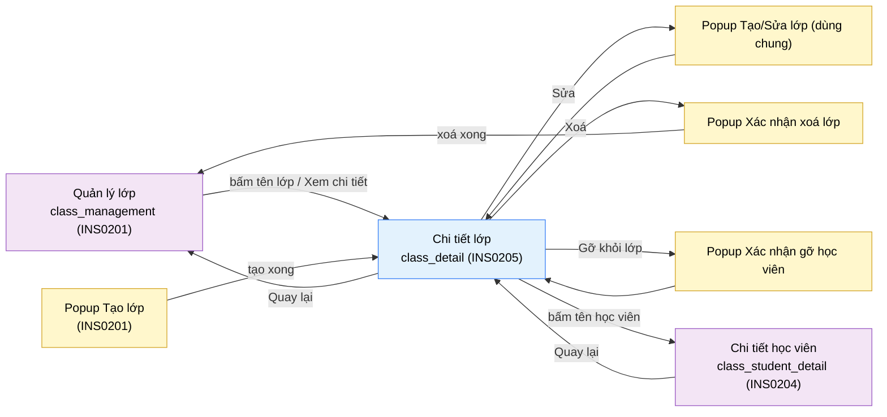

# Tài liệu thiết kế cơ bản (BD) — Chi tiết lớp (`INS0205`)

## Phương châm tài liệu [Nội bộ — không cần khách duyệt]

- Viết theo **mẫu 9 sheet** nhưng **gọn**: đầy đủ Sheet 1 tới 5, 8, 9 và Câu hỏi mở; Sheet 6 và 7 chỉ ghi
  phần khác với `INS0201`. Bộ thẻ đóng, quy ước ID, ký hiệu chuẩn nằm ở
  `02-bd/_rules/bd-template-9sheet.md` — file này không chép lại.
- Mã màn `INS0205` theo bảng mã ở `02-bd/_rules/bd-template-9sheet.md` mục 8 (dòng thêm cùng đợt với file
  này); tên file mang tiền tố mã.
- **Màn này KHÔNG CÓ PROTOTYPE `.dc.html`** và chưa có bản dựng UI. Toàn bộ bố cục là đề xuất của BD, đánh
  dấu `[SoT: Suy luận]`, trừ các nội dung do chủ dự án chỉ đạo trực tiếp ngày 2026-10-11 (các khối và điểm
  vào, ghi ở RD `INS0205`). Danh sách điểm suy diễn nằm ở mục 4.4.
- Khung điều hướng và thanh công cụ chung **không mô tả lại ở đây** — dùng chung
  `02-bd/screens/teacher/_shell.md`. Mục nav sáng là "Lớp của tôi" (màn này là màn con của `INS0201`, không
  có mục nav riêng): chốt 2026/10/14 theo quy tắc chung "màn khoan sâu sáng mục của màn gọi tới" (`DEC-2026-1014-instructor-batch5-6-nav-pagination-rubric`, Q3 đóng; quy tắc ở `_shell` mục 3.2).
- **DD của màn này CHƯA viết.** DD màn hình viết sau prototype (`CLAUDE.md`, mục Process). Màn này **không
  đề xuất endpoint mới**: mọi lệnh gọi là endpoint đã có ở `INS0201` hoặc `INS0204`, xem Sheet 7.3. Hợp
  đồng chi tiết thuộc `03-dd/api/identity.md`, trong đó các dòng 19 tới 28 đã có endpoint tương ứng.

> Đọc cùng `01-rd/screens/teacher/INS0205_class_detail.md` (hành vi ở mức yêu cầu), `02-bd/screens/teacher/INS0201_class_management.md`
> (màn cha, nguồn của công thức số liệu và popup dùng chung) và `02-bd/database/identity.md` mục 1.8 tới 1.10,
> 1.14 (bảng `classes`, `class_invite_codes`, `class_enrollments`, cấu trúc `classes.schedule`).
>
> **Không thiết kế lại** vòng đời lớp: form Tạo/Sửa lớp và popup Xác nhận xoá lớp dùng chung với `INS0201`
> [Nguồn: 02-bd/screens/teacher/INS0201_class_management.md — Sheet 5 Popup NO 1, NO 4].
> **Không thiết kế** giao/gỡ bài toán cho lớp (thuộc `class_assignments`, `INS0202`), hồ sơ một học viên
> (thuộc `class_student_detail`, `INS0204`), giao diện chấm lại (`DEC-2026-0828-remove-rejudge-scope`), bộ
> câu hỏi phỏng vấn riêng theo lớp (`DEC-2026-0828-remove-per-class-interview-set`).

> **Quy ước đặt tên khối** [Nội bộ]. Kế thừa chuẩn của cụm lớp
> [Nguồn: 02-bd/screens/teacher/INS0201_class_management.md — mục "Quy ước đặt tên khối cho cụm màn lớp"]:
> `header`, `stats`, `popup`. Màn này thêm ba khối theo nội dung thật: `schedule` (thẻ Lịch học), `invite`
> (thẻ Mã mời), `studentList` (bảng Học viên của lớp). ID item bắt đầu bằng `classDetail.`.

---

## Sheet 1. Bìa

| Mục | Giá trị |
| :--- | :--- |
| Hệ thống | AlgoPrep |
| Phân hệ | `identity` (F1) — có phụ thuộc đọc sang `problem-bank` (F2), `judge-orchestration` (F4) như `INS0201` (không còn đọc `ai-review` từ 2026/10/13) |
| Công đoạn | BD — Thiết kế cơ bản |
| Phân loại | Màn hình |
| Tên màn | Chi tiết lớp |
| Mã màn hình | `INS0205` |
| Tên vật lý (slug) | `class_detail` |
| Route (prototype Next.js) | `/instructor/classes/[classId]` |
| Trục tài liệu | Màn hình (`02-bd/screens/`) |
| Actor | A2 (`INSTRUCTOR`) |
| Phiên bản | V0.10 |
| Người tạo | Nhóm phát triển AlgoPrep |
| Ngày tạo | 2026/10/11 |
| Người cập nhật | Nhóm phát triển AlgoPrep |
| Ngày cập nhật | 2026/10/18 |

---

## Sheet 2. Lịch sử sửa đổi

| Ver | Sheet bị sửa | Nội dung sửa | Ngày | Người sửa |
| :--- | :--- | :--- | :--- | :--- |
| V0.1 | Toàn bộ | Tạo mới theo `DEC-2026-1011-class-detail-page` và `DEC-2026-1011-class-schedule-structured` (chủ dự án chỉ đạo 2026-10-11, **chưa duyệt hình**, chưa có prototype). Năm khối nội dung và hai điểm vào do chủ dự án chốt; bố cục dọc, tên cột, trạng thái rỗng/lỗi là đề xuất. Không thêm endpoint. DD chưa viết. Phát sinh 6 câu hỏi mở | 2026/10/11 | AI |
| V0.2 | Sheet 4, 5 (Khu vực B), 6, 7, 8, 9 | Chủ dự án chỉ đạo 2026-10-11 (`DEC-2026-1011-class-detail-no-stat-strip`, **chưa duyệt hình**): bỏ khối Dải số liệu (5 thẻ Học viên, Hoàn thành, Điểm TB, Cần chấm, Vắng bài) khỏi trang chi tiết lớp vì năm số đã hiện ở danh sách `INS0201` (ponytail bậc 4). Các mục liên quan gạch bỏ, giữ số NO để không đánh số lại; trang còn bốn khối nội dung (Đầu trang, Lịch học, Mã mời, Bảng học viên). Số liệu từng học viên trong bảng không đổi | 2026/10/11 | AI |
| V0.3 | Câu hỏi mở | Chủ dự án chốt 2026-10-13: đóng Q6, xác nhận giới hạn lịch học và quy tắc kiểm theo `DEC-2026-1013-teacher-open-questions-closed-round2` | 2026-10-13 | AI |
| V0.4 | Sheet 4.3, 7.3 | Áp `DEC-2026-1013-remove-instructor-manual-grading`: gỡ endpoint `CountPendingManualGrading` (nguồn cũ của thẻ "Cần chấm", vốn đã bỏ ở V0.2) khỏi danh sách endpoint `identity` gọi sang và khỏi phụ thuộc `ai-review`; ghi chú dòng NO 4 khu vực B. Màn không có khối, liên kết hay cột chấm tay nào còn lại. Số phiên bản ở Sheet 1 từng ghi V0.2 trong khi lịch sử đã tới V0.3, nay đồng bộ lên V0.4. Prototype không bị ảnh hưởng thêm | 2026/10/13 | AI |
| V0.5 | Phương châm, Sheet 3 (Quay lại, popup gỡ), 4.1, 4.2, 4.4, 5 (invite NO 3, studentList NO 6), 6, 7.1, 7.3, 8 (EVT-2, 8), Câu hỏi mở Q1 đến Q5 | Áp `DEC-2026-1014-instructor-batch3-4-contracts-and-removal` và `DEC-2026-1014-instructor-batch5-6-nav-pagination-rubric`: (1) Q1 đóng, thêm `description` vào `ClassCardDto`, dùng lại `ListInstructorClasses` lọc theo `id` ở máy khách, không có `GetClassDetail` (tiêu chí ponytail bậc 4); (2) Q2 đóng, sau khi tạo lớp "Quay lại" về danh sách lớp; (3) Q3 đóng, sidebar sáng mục của màn gọi tới ("Lớp của tôi"); (4) Q4 đóng, bảng học viên trong một lớp không phân trang; (5) Q5 đóng, mã mời hạn cố định 7 ngày, không ô nhập; (6) icon "Gỡ khỏi lớp" ở cuối mỗi dòng học viên, luôn hiện, có xác nhận (cùng `INS0201` Q6). Không thêm hay đổi NO, EVT | 2026/10/14 | AI |
| V0.6 | Sheet 3 (popup gỡ), 4 (quyền Xoá), 7.2 (NO 3), 7.1 (NO 8), 9 (NO 7) | Áp `DEC-2026-1014-keep-learning-history-on-leave` (tiêu chí ponytail bậc 6): gỡ học viên chỉ đánh dấu đã rời lớp (`class_enrollments.left_at`), giữ lịch sử làm bài; câu cảnh báo "xoá luôn lịch sử làm bài" thay bằng câu nêu lịch sử được giữ; bảng học viên và số học viên chỉ tính ghi danh còn hiệu lực (`left_at IS NULL`). Giữ nguyên điều đã chốt: icon cuối dòng luôn hiện, xác nhận xong dòng biến mất và trang ở lại; trên `INS0204` quay lại bằng `router.back()` (xem tài liệu đó). Xoá lớp vẫn là xoá thật | 2026/10/14 | AI |
| V0.7 | Sheet 7.3 (NO 7) | Áp `DEC-2026-1014-class-leave-details` (tiêu chí ponytail bậc 5): câu xác nhận của popup gỡ học viên đã được chủ dự án duyệt nguyên văn, bỏ `[SoT: Suy luận]`; endpoint gỡ ở DD `identity` đổi từ DELETE sang `POST .../leave`; học viên vào lại bằng mã mời thì dòng ghi danh cũ được dùng lại (`left_at` = NULL) và hiện lại trong bảng. Không đổi item, EVT | 2026/10/14 | AI |
| V0.8 | Sheet 3 (ghi chú `from=class`) | Áp `DEC-2026-1014-instructor-submissions-list-details` mục (5): trang kết quả vùng giảng viên biết màn gọi tới qua query `from=submissions|student|class`. Trang này hiện chưa có liên kết trực tiếp tới một lượt nộp nên chỉ thêm ghi chú: nếu sau này có, phải mở kèm `from=class`. Không thêm hay đổi NO, EVT | 2026/10/14 | AI |
| V0.9 | Sheet 4 (thêm mục "Hiện trạng bản dựng") | Dựng prototype gỡ học viên (giữ lịch sử, đánh dấu đã rời): ghi hiện trạng bản dựng của nút gỡ ở bảng học viên trong lớp và của mock `removeStudent`. Không đổi yêu cầu, item, EVT hay quyết định thiết kế. **Chưa duyệt hình** | 2026/10/14 | AI |
| V0.10 | Sheet 4 (4.6) | Dựng prototype Phase 4-5 (bài giao theo lớp, phân trang 20, from=). Ghi hiện trạng: màn này chỉ vào từ "Lớp của tôi" (sau khi tạo lớp hoặc từ danh sách lớp) nên giữ mục nav đó sáng bằng khớp tiền tố, không cần mã riêng; liên kết tên học viên ở đây không mang `from=`, nên trang chi tiết học viên cũng sáng "Lớp của tôi". Nút Quay lại về danh sách lớp (Q2) đã dựng. Không đổi yêu cầu hay quyết định thiết kế. **Chưa duyệt hình** | 2026/10/18 | AI |

---

## Sheet 3. Sơ đồ chuyển màn

> [Nội bộ] Quy ước vẽ: từ trái sang phải. Màn gọi tới tô tím, màn hiện tại tô xanh nhạt, popup tô vàng.

### 3.1 Danh sách chuyển màn

#### Quản lý lớp → Chi tiết lớp (từ danh sách lớp)

[Điều kiện mở] Bấm tên một lớp, hoặc icon "Xem chi tiết", ở danh sách `INS0201`
[Nguồn: 02-bd/screens/teacher/INS0201_class_management.md — Sheet 5 Khu vực C NO 2, NO 12].

[Chế độ mở] Không có.

[Thông tin truyền] `classId` đi theo đường dẫn.

[Giá trị trả về] Không có.

[Khi thành công] Tải các khối của màn (bốn khối từ V0.2), toàn bộ giới hạn trong lớp `classId` mà giảng viên phụ trách.

[Khi huỷ] Không có.

#### Popup Tạo/Sửa lớp (`INS0201`, chế độ tạo) → Chi tiết lớp

[Điều kiện mở] Lưu thành công ở chế độ tạo.

[Chế độ mở] Không có.

[Thông tin truyền] `id` của lớp vừa tạo.

[Giá trị trả về] Không có.

[Khi thành công] Mở trang chi tiết của lớp mới; thẻ Mã mời đã có sẵn **một mã đầu tiên** do `CreateClass` sinh
(F1-23) [Nguồn: 01-rd/req/identity.md:105-111]. Thay cho việc hiện mã trong popup như trước V0.6 của `INS0201`.

[Khi huỷ] Không có.

#### Chi tiết lớp → Quản lý lớp (Quay lại)

[Điều kiện mở] Bấm "Quay lại" ở đầu trang.

[Chế độ mở] Không có.

[Thông tin truyền] Không có.

[Giá trị trả về] Không có.

[Khi thành công] Về danh sách lớp, tải lại để phản ánh thay đổi đã làm ở màn này (sửa, gỡ học viên, mã mời). Kể cả khi vào màn này ngay sau khi tạo lớp, "Quay lại" về **danh sách lớp** `INS0201`, không về popup tạo lớp (chốt 2026/10/14, `DEC-2026-1014-instructor-batch5-6-nav-pagination-rubric`, Q2 đóng).
Màn này không có thay đổi chưa lưu ngoài popup nên không hỏi xác nhận trước khi rời.

[Khi huỷ] Không có.

#### Chi tiết lớp → Popup Tạo/Sửa lớp (chế độ sửa)

[Điều kiện mở] Bấm "Sửa" ở đầu trang.

[Chế độ mở] Chế độ sửa của popup dùng chung, nạp sẵn giá trị hiện tại của lớp (kể cả các ô lịch có cấu trúc).

[Thông tin truyền] `id` lớp.

[Giá trị trả về] Lớp vừa sửa; không có gì nếu huỷ.

[Khi thành công] Đóng popup, tải lại đầu trang và thẻ Lịch học tại chỗ.

[Khi huỷ] Đóng popup, trang giữ nguyên.

#### Chi tiết lớp → Popup Xác nhận xoá lớp → Quản lý lớp

[Điều kiện mở] Bấm "Xoá" ở đầu trang.

[Chế độ mở] Không có.

[Thông tin truyền] `id`, tên lớp và số học viên đang thuộc lớp.

[Giá trị trả về] Kết quả chọn "Xoá lớp" hoặc "Huỷ".

[Khi thành công] Hiển thị cảnh báo **xoá thật, không khôi phục được**, nêu số học viên sẽ bị gỡ
[Nguồn: 01-rd/req/identity.md:114-117]. Xác nhận thì xoá rồi **về danh sách lớp** (trang này không còn đối tượng).

[Khi huỷ] Đóng popup, giữ nguyên trang.

#### Chi tiết lớp → Chi tiết học viên (`INS0204`)

[Điều kiện mở] Bấm tên một học viên trong bảng Học viên của lớp.

[Chế độ mở] Không có.

[Thông tin truyền] Cặp `studentId` và `classId` — cùng hợp đồng với các đường vào khác của `INS0204`
[Nguồn: 02-bd/screens/teacher/INS0204_class_student_detail.md — Sheet 3, "Thông tin truyền"].

[Giá trị trả về] Không có. `INS0204` ghi nhận đường vào này; khi nó nói "Quay lại đúng màn đã gọi tới" thì về
trang này.

[Khi thành công] Mở `INS0204` trong phạm vi lớp đang xét.

[Khi huỷ] Không có.

Ghi chú `from` (ĐÃ CHỐT 2026-10-14 (DEC-2026-1014-instructor-submissions-list-details)): trang kết quả vùng giảng viên (`USR0201`) nhận query `from=submissions|student|class` để dựng breadcrumb và sáng sidebar. Trang này **không có liên kết trực tiếp tới một lượt nộp** (không có trong Sheet 5), nên hiện không có chuyển màn nào mang `from=class`; đường duy nhất tới lượt nộp từ đây là qua `INS0204`, nơi liên kết mang `from=student`. Khi trang này có liên kết tới lượt nộp thì phải mở với `from=class` (cùng `studentId`, `classId`, chỉ để gợi ý breadcrumb). [Nguồn: .nexa/control/decision-registry.md:3989-3991; 02-bd/screens/users/USR0201_submission_result.md mục "Vùng giảng viên (A2)"]

#### Chi tiết lớp → Popup Xác nhận gỡ học viên

[Điều kiện mở] Bấm icon "Gỡ khỏi lớp" ở cuối dòng của bảng học viên (luôn hiện).

[Chế độ mở] Không có.

[Thông tin truyền] `studentId`, `classId`, tên học viên và tên lớp.

[Giá trị trả về] Kết quả chọn "Gỡ học viên" hoặc "Huỷ".

[Khi thành công] Thông báo gỡ học viên chỉ **đánh dấu học viên đã rời lớp**, lịch sử làm bài của học viên trong
lớp này **được giữ** [Nguồn: DEC-2026-1014-keep-learning-history-on-leave]. ~~Cảnh báo cũ: xoá luôn lịch sử làm bài
của học viên đó trong lớp này~~ (ĐÃ ĐỔI 2026-10-14; RD `01-rd/req/identity.md:126-131` còn câu cũ, chưa cập nhật).
Xác nhận thì dòng biến mất, trang **ở lại** (khác `INS0204`, nơi gỡ xong
phải rời màn).

[Khi huỷ] Đóng popup, học viên vẫn thuộc lớp.

### 3.2 Sơ đồ

[Nguồn: chỉ đạo của chủ dự án 2026-10-11 (`DEC-2026-1011-class-detail-page`); 02-bd/screens/teacher/INS0201_class_management.md — Sheet 3;
02-bd/screens/teacher/INS0204_class_student_detail.md — Sheet 3]

---

## Sheet 4. Bố cục màn hình

### 4.1 Tổng quan màn

[Mục đích màn] Cho giảng viên xem **một lớp trọn vẹn trên một trang**: thông tin và lịch học, các mã mời,
danh sách học viên cùng tiến độ; thay cho ba popup nhỏ ở danh sách lớp, vốn "không cung cấp đủ thông tin"
[Nguồn: `DEC-2026-1011-class-detail-page`; 01-rd/screens/teacher/INS0205_class_detail.md mục 1].

[Luồng nghiệp vụ chính]

1. **Hiển thị ban đầu**: vào từ danh sách lớp hoặc sau khi tạo lớp; tải song song các nhóm dữ liệu (thông tin
   lớp, mã mời, học viên). Mỗi khối có khung chờ riêng `[SoT: Suy luận]`, theo cùng quy ước ba
   trạng thái rỗng/đang tải/lỗi của các màn anh em.
2. **Đọc lịch học**: thẻ Lịch học hiển thị từng phần; phần nào trống thì bỏ dòng đó.
3. **Chia sẻ mã mời**: sao chép một mã hoặc "Tạo mã mới"; nhiều mã song song hợp lệ, không thu hồi
   [Nguồn: 01-rd/req/identity.md:118-125].
4. **Xem và quản lý học viên**: đọc trạng thái, điểm, hoàn thành; bấm tên sang `INS0204`; gỡ khỏi lớp kèm xác nhận.
5. **Sửa hoặc xoá lớp**: Sửa mở popup dùng chung; Xoá là xoá thật có xác nhận rồi về danh sách.

[Người dùng] Giảng viên đã đăng nhập, có Function `CLASS_MANAGEMENT`, **và phụ trách đúng lớp `classId`**
[Nguồn: 01-rd/req/identity.md:57 và F1-12].

[Tệp liên quan] Không có. Nút sao chép mã dùng bộ nhớ tạm của trình duyệt, không có tệp.

[Phạm vi]
- Chỉ một lớp. Không có chế độ so sánh nhiều lớp.
- Ghi dữ liệu qua: sửa lớp, xoá lớp, tạo mã mời, gỡ học viên. Mọi thứ khác chỉ đọc.
- **Không** giao/gỡ bài (thuộc `INS0202`); **không** hiển thị mã nguồn bài nộp hay chi tiết từng lượt nộp
  (thuộc `INS0204`).
- **Không** phụ thuộc phân hệ AI để chạy: từ V0.2 (bỏ dải số liệu, `DEC-2026-1011-class-detail-no-stat-strip`) trang không còn gọi `ai-review`.
- Lớp khác giảng viên: trả "không tồn tại" như `INS0204` đã làm với bài nộp ngoài lớp
  [Nguồn: `DEC-2026-1011-teacher-screens-open-questions-closed`], xem Sheet 9 NO 2.

[Quyền sử dụng]
- Xem: `CLASS_MANAGEMENT:READ` và phụ trách lớp.
- Thêm: tạo mã mời (`CLASS_MANAGEMENT:CREATE`).
- Sửa: sửa lớp (`CLASS_MANAGEMENT:UPDATE`).
- Xoá: xoá lớp (xoá thật) và gỡ học viên (`CLASS_MANAGEMENT:DELETE`); gỡ học viên **không xoá dữ liệu**, chỉ đánh dấu đã rời lớp (ĐÃ ĐỔI 2026-10-14, `DEC-2026-1014-keep-learning-history-on-leave`; trước đây ghi cả hai là xoá thật).

[Số bản ghi tối đa] ~~Dải số liệu: đúng 5 thẻ.~~ (đã bỏ 2026-10-11) Thẻ Lịch học: 5 dòng nhỏ. Mã mời: theo số mã còn hiệu lực của lớp,
không phân trang. Bảng học viên: **không phân trang** (chốt 2026/10/14, `DEC-2026-1014-instructor-batch5-6-nav-pagination-rubric`, Q4 đóng) — đây là bảng của riêng một lớp, khác bảng gộp nhiều lớp của `INS0201` và `INS0202` (20 dòng mỗi trang).

[Nguồn: 01-rd/screens/teacher/INS0205_class_detail.md mục 2.1; 02-bd/screens/teacher/INS0201_class_management.md — Sheet 4.1]

### 4.2 DTO liên quan

Dùng lại của `INS0201`, **không đặt DTO mới** ngoài việc thêm `description` vào `ClassCardDto` (Q1 đóng 2026/10/14, `DEC-2026-1014-instructor-batch3-4-contracts-and-removal`; đã ghi ở `INS0201` Sheet 7.1 NO 9a):

- `ClassCardDto` — tên, mô tả (đã thêm, `INS0201` NO 9a), lịch. Màn này **không dùng** các trường số học viên, hoàn thành, điểm TB, cần chấm, vắng bài của DTO (đã bỏ dải số liệu, 2026-10-11); các trường đó vẫn do danh sách `INS0201` dùng.
- `ClassScheduleDto` — lịch học có cấu trúc (`days`, `startTime`, `endTime`, `room`, `startDate`, `endDate`, `note`).
- `ClassInviteCodeDto` — một mã mời.
- `ClassStudentRowDto` — một dòng bảng học viên.
- `ClassFormDto` — dữ liệu popup Tạo/Sửa lớp.

[Nguồn: 02-bd/screens/teacher/INS0201_class_management.md — Sheet 7.1]

### 4.3 Bảng dữ liệu liên quan (6)

| NO | Bảng | Ghi chú |
| --: | :--- | :--- |
| 1 | `identity.classes` | Tên, mô tả, `schedule` (jsonb), `instructor_id` để gác quyền [Nguồn: 02-bd/database/identity.md mục 1.8, 1.14] |
| 2 | `identity.class_invite_codes` | Mã, `expires_at`, `created_at` của lớp [Nguồn: 02-bd/database/identity.md mục 1.9] |
| 3 | `identity.class_enrollments` | Học viên còn trong lớp (`left_at IS NULL`); khi gỡ học viên chỉ đặt `left_at`, không xoá dòng (ĐÃ ĐỔI 2026-10-14, `DEC-2026-1014-keep-learning-history-on-leave`; trước đây ghi "bị xoá khi gỡ học viên") [Nguồn: 02-bd/database/identity.md mục 1.10] |
| 4 | `identity.users` | `display_name` của học viên |
| 5 | `judge.submissions` | Điểm TB theo phạm vi lớp, qua `GetClassStudentSubmissionMetrics` của `judge-orchestration`; không truy vấn chéo schema |
| 6 | `identity.identity_recent_activity` | Mốc hoạt động gần nhất cho phân loại "Vắng bài" |

~~Hoàn thành % và "Cần chấm" (của dải số liệu) không đọc từ bảng của `identity`; lấy qua~~ Đã bỏ cùng dải số liệu (V0.2). Trước đó các số này lấy qua `ListClassAssignments` (`problem-bank`)
và `CountPendingManualGrading` (`ai-review`, endpoint này đã bị bỏ hẳn 2026/10/13 theo `DEC-2026-1013-remove-instructor-manual-grading`) như `INS0201`
[Nguồn: 02-bd/screens/teacher/INS0201_class_management.md — Sheet 4.3, Sheet 7.3 NO 10].

### 4.4 Vùng bố cục

**Không có prototype để bám.** Bảng dưới là **đề xuất bố cục của BD**; thứ tự dọc các khối (bốn khối từ V0.2) theo thứ tự chủ
dự án nêu, hình thức trình bày là `[SoT: Suy luận]`. Khung chung: container căn giữa, các khối xếp dọc, giống
các màn anh em khu Giảng viên [Nguồn: 02-bd/screens/teacher/_shell.md].

| Vùng | Vị trí | Nội dung |
| :--- | :--- | :--- |
| Khung điều hướng + thanh công cụ + chân trang | Khung chung | Dùng lại `_shell.md`; mục nav "Lớp của tôi" sáng (mục của màn gọi tới, Q3 đóng) |
| Hàng đầu | Đề xuất BD | Nút "Quay lại" (liên kết về `INS0201`); tên lớp làm tiêu đề; mô tả bên dưới tên; nút "Sửa" và "Xoá" ở mép phải. Không phải toolbar dùng chung |
| ~~Dải số liệu~~ | ~~Đề xuất BD~~ | ~~Năm thẻ ngang: Học viên, Hoàn thành, Điểm TB, Cần chấm, Vắng bài~~ Đã bỏ 2026-10-11 (`DEC-2026-1011-class-detail-no-stat-strip`) |
| Hàng hai cột | Đề xuất BD | Thẻ "Lịch học" và thẻ "Mã mời" cạnh nhau (xếp dọc khi hẹp) |
| Bảng "Học viên của lớp" | Đề xuất BD | Cột: Học viên, Trạng thái, Điểm TB, Hoàn thành, Gỡ khỏi lớp |
| Popup | Đề xuất BD | Tạo/Sửa lớp (dùng chung), Xác nhận xoá lớp (dùng chung), Xác nhận gỡ học viên |

**Điểm phải suy diễn** (để chủ dự án xác nhận khi dựng UI): hai thẻ cạnh nhau hay xếp dọc; thẻ Lịch học nằm
trước hay sau thẻ Mã mời; nút Xoá đặt cạnh nút Sửa. (Đã chốt 2026/10/14: bảng học viên không phân trang, mục nav sáng là "Lớp của tôi".)

### 4.5 Cấu trúc slice FSD [Nội bộ]

| Khối | Slice dự kiến | Căn cứ |
| :--- | :--- | :--- |
| Trang | `views/teacher/class-detail` | Quy ước FSD của dự án; route `/instructor/classes/[classId]` |
| Khung Giảng viên | Dùng lại `widgets/app-shell` (biến thể `instructor-sidebar`) | `_shell.md` |
| Thẻ Lịch học (hiển thị và ô nhập lịch) | `entities/class` (hàm ghép dòng lịch dùng chung với `INS0201`) | Không viết hai lần: danh sách lớp ghép một dòng, màn này hiển thị từng phần |
| Thẻ Mã mời | `features/class-invite-code` | Dời từ popup Mã mời của `INS0201`, **không viết lại** |
| Bảng học viên | `widgets/class-student-table` + `entities/class-student` | Dùng chung với `INS0201`, `INS0203` |
| Popup | `features/class-create-edit`, `features/class-delete`, `features/class-student-remove` | Dùng chung với `INS0201` |

`[SoT: Suy luận]` — ánh xạ slice do BD đề xuất, DD màn hình chốt lại. Theo quy tắc "shared first" của dự án
(`CLAUDE.md`), tái dùng component sẵn có trong `shared/` trước khi dựng mới.

### 4.6 Hiện trạng bản dựng (cập nhật 2026/10/18, chưa duyệt hình)

Bảng 4.6 ghi những gì bản dựng Next.js đang làm ở trang chi tiết lớp: thao tác "Gỡ khỏi lớp" ở bảng học viên, nút Quay lại và mục nav sáng. Bảng chỉ ghi hiện trạng, không đổi yêu cầu hay quyết định thiết kế.

**Bảng 4.6: Hiện trạng bản dựng thao tác gỡ học viên của `INS0205`**

| Hạng mục | Bản dựng | Nguồn |
| :--- | :--- | :--- |
| Nút gỡ ở mỗi dòng | Cột cuối, luôn hiện: `IconAction` dùng chung, icon `UserMinus`, tông `danger`, tên truy cập "Gỡ khỏi lớp {tên học viên}"; bấm mở popup xác nhận | [Nguồn: 05-coding/frontend/src/views/teacher/class-detail/ui/class-detail-view.tsx:144-157] |
| Popup xác nhận | Nội dung "Học viên sẽ rời khỏi lớp. Lịch sử làm bài của học viên trong lớp này vẫn được giữ." (khoá i18n `popup.removeStudentBody`), chốt ở `DEC-2026-1014-class-leave-details` | [Nguồn: 05-coding/frontend/src/views/teacher/class-detail/ui/class-detail-view.tsx:324-331], [Nguồn: 05-coding/frontend/messages/vi.json:2140] |
| Hành vi gỡ (mock) | `removeStudent` chỉ đặt `leftAt` cho học viên, **không xoá dòng**; giảm `studentCount` của lớp, và giảm `absentCount` nếu học viên đang ở trạng thái vắng | [Nguồn: 05-coding/frontend/src/entities/class/api/__mock__/class-mocks.ts:351-364], [Nguồn: 05-coding/frontend/src/entities/class/model/types.ts:64] |
| Bảng học viên sau khi gỡ | `listClassStudents` chỉ trả học viên đang ở lớp (hàm `activeStudents` loại dòng có `leftAt`), nên học viên đã gỡ biến mất khỏi bảng | [Nguồn: 05-coding/frontend/src/entities/class/api/__mock__/class-mocks.ts:272-280] |
| Kiểm thử mock | `class-mocks.test.ts` có ca gọi `removeStudent` (kể cả gọi lặp) | [Nguồn: 05-coding/frontend/src/entities/class/api/__mock__/class-mocks.test.ts:19,41-42] |
| Nút Quay lại (Q2) | `IconAction` mũi tên với `href="/instructor/classes"`, về danh sách lớp kể cả khi vào ngay sau khi tạo lớp (`INS0201` chuyển sang trang này bằng `router.push`). Chưa duyệt hình | [Nguồn: 05-coding/frontend/src/views/teacher/class-detail/ui/class-detail-view.tsx:72-77], [Nguồn: 05-coding/frontend/src/views/teacher/class-management/ui/class-management-view.tsx:237] |
| Mục nav sáng (Q3) | Không cần mã riêng: `/instructor/classes/{id}` khớp tiền tố mục "Lớp của tôi" và `instructorActiveHrefOverride` không xử lý route này. Liên kết tên học viên ở bảng không mang `from=`, nên trang chi tiết học viên tiếp tục sáng "Lớp của tôi". Chưa duyệt hình | [Nguồn: 05-coding/frontend/src/widgets/app-shell/ui/instructor-sidebar.tsx:52-64], [Nguồn: 05-coding/frontend/src/views/teacher/class-detail/ui/class-detail-view.tsx:105] |

**Khoảng trống còn mở** (chưa làm, không tính là đã xong):

- Popup gỡ chưa cho chọn lớp. Với màn này không cần vì trang thuộc đúng một lớp.
- Chưa có ảnh chụp Playwright được duyệt cho nút icon gỡ mới.

---

## Sheet 5. Danh sách item màn hình

> Quy ước ID, bộ thẻ và giá trị chuẩn: `02-bd/_rules/bd-template-9sheet.md` mục 2, 3, 4. Cột công thức số
> liệu **tham chiếu `INS0201` Sheet 5**, không chép lại.

### Khu vực A — Hàng đầu

| Khu vực | NO | Tên item | ID item | Bảng DB | Cột DB | Loại UI | Kiểu | Độ dài | Bắt buộc | I/O | Giá trị mặc định | Định dạng | Ghi chú |
| :--- | --: | :--- | :--- | :--- | :--- | :--- | :--- | :--- | :-: | :-: | :--- | :--- | :--- |
| Hàng đầu | | | | | | | | | | | | | |
| | 1 | Quay lại | `classDetail.header.btnBack` | - | - | Link | - | - | - | I | - | `Quay lại` | Về danh sách lớp `INS0201` [EVT liên quan] EVT-2 |
| | 2 | Tên lớp | `classDetail.header.title` | `identity.classes` | `name` | Label | String | 120 | - | O | - | - | Tiêu đề trang [Nguồn giá trị] Cột `name` [EVT liên quan] EVT-1 |
| | 3 | Mô tả | `classDetail.header.description` | `identity.classes` | `description` | Label | String | 500 | - | O | - | - | Mô tả lớp; rỗng thì bỏ dòng [Nguồn giá trị] Cột `description`; `ClassCardDto` hiện chưa có trường này, xem Q1 [EVT liên quan] EVT-1 |
| | 4 | Sửa | `classDetail.header.btnEdit` | `identity.classes` | `name`, `description`, `schedule` | Button | - | - | - | I | - | `Sửa` | Mở popup Tạo/Sửa lớp (chế độ sửa), dùng chung với `INS0201` [EVT liên quan] EVT-3 |
| | 5 | Xoá | `classDetail.header.btnDelete` | `identity.classes` | `id` | Button | - | - | - | I | - | `Xoá` | Mở popup Xác nhận xoá lớp [EVT liên quan] EVT-4 |

### Khu vực B — ~~Dải số liệu~~ (đã bỏ 2026-10-11, `DEC-2026-1011-class-detail-no-stat-strip`; giữ bảng để không đánh số lại)

| Khu vực | NO | Tên item | ID item | Bảng DB | Cột DB | Loại UI | Kiểu | Độ dài | Bắt buộc | I/O | Giá trị mặc định | Định dạng | Ghi chú |
| :--- | --: | :--- | :--- | :--- | :--- | :--- | :--- | :--- | :-: | :-: | :--- | :--- | :--- |
| Dải số liệu | | | | | | | | | | | | | |
| | 1 | ~~Học viên~~ (đã bỏ) | `classDetail.stats.studentCount` | `identity.class_enrollments` | `id` | Label | Number | 4 | - | O | 0 | `{số}` | Số học viên của lớp. Công thức: `INS0201` Sheet 5 Khu vực C NO 4 [EVT liên quan] EVT-1 |
| | 2 | ~~Hoàn thành~~ (đã bỏ) | `classDetail.stats.completionPct` | - | - | Label | Number | 3 | - | O | - | `{số}%` | Hoàn thành TB của lớp. Công thức: `INS0201` Sheet 5 Khu vực C NO 6. Lớp chưa giao bài thì hiển thị `-` [EVT liên quan] EVT-1 |
| | 3 | ~~Điểm TB~~ (đã bỏ) | `classDetail.stats.avgScore` | `judge.submissions` | `status`, `problem_id`, `user_id` | Label | Number | 4 | - | O | - | Một chữ số thập phân, thang 10 | Công thức: `INS0201` Sheet 5 Khu vực C NO 7. Chưa có lượt nộp thì `-` [EVT liên quan] EVT-1 |
| | 4 | ~~Cần chấm~~ (đã bỏ) | `classDetail.stats.pendingGrading` | - | - | Label | Number | 4 | - | O | 0 | Số nguyên | Công thức: `INS0201` Sheet 5 Khu vực C NO 8 (dòng nguồn đó cũng đã bỏ 2026/10/13). `ai-review` lỗi thì `-`, không chặn trang [EVT liên quan] EVT-1 |
| | 5 | ~~Vắng bài~~ (đã bỏ) | `classDetail.stats.absentCount` | - | - | Label | Number | 4 | - | O | 0 | Số nguyên | Công thức: `INS0201` Sheet 5 Khu vực C NO 9 [EVT liên quan] EVT-1 |

### Khu vực C — Thẻ Lịch học

| Khu vực | NO | Tên item | ID item | Bảng DB | Cột DB | Loại UI | Kiểu | Độ dài | Bắt buộc | I/O | Giá trị mặc định | Định dạng | Ghi chú |
| :--- | --: | :--- | :--- | :--- | :--- | :--- | :--- | :--- | :-: | :-: | :--- | :--- | :--- |
| Thẻ Lịch học | | | | | | | | | | | | | |
| | 1 | Ngày học | `classDetail.schedule.days` | `identity.classes` | `schedule->days` | Label | Number[] | - | - | O | - | `T2 · T4 · T6` | Mảng 1..7 đổi thành T2..T7, CN; sắp tăng dần [Nguồn giá trị] `ClassScheduleDto.days` (`02-bd/database/identity.md` mục 1.14) [EVT liên quan] EVT-1 |
| | 2 | Giờ học | `classDetail.schedule.time` | `identity.classes` | `schedule->startTime`, `schedule->endTime` | Label | String | 11 | - | O | - | `19:00–21:00` | Ghép giờ bắt đầu và kết thúc; chỉ hiển thị khi có cả hai [EVT liên quan] EVT-1 |
| | 3 | Phòng | `classDetail.schedule.room` | `identity.classes` | `schedule->room` | Label | String | 100 | - | O | - | `Phòng B203` | Thêm tiền tố "Phòng " [EVT liên quan] EVT-1 |
| | 4 | Thời gian | `classDetail.schedule.range` | `identity.classes` | `schedule->startDate`, `schedule->endDate` | Label | String | 11 | - | O | - | `17/08–20/12` | Dạng dd/MM; chỉ có một đầu thì hiển thị "Từ 17/08" hoặc "Đến 20/12" `[SoT: Suy luận]` [EVT liên quan] EVT-1 |
| | 5 | Ghi chú | `classDetail.schedule.note` | `identity.classes` | `schedule->note` | Label | String | 200 | - | O | - | - | Ghi chú tự do còn lại [EVT liên quan] EVT-1 |

Khi thu gọn (danh sách lớp ở `INS0201`) cả năm phần ghép thành một dòng
`T2 · T4 · T6 — 19:00–21:00 · Phòng B203 · 17/08–20/12 · ghi chú`
[Nguồn: `DEC-2026-1011-class-schedule-structured`; 02-bd/screens/teacher/INS0201_class_management.md — Sheet 5 Khu vực C NO 3].

### Khu vực D — Thẻ Mã mời

| Khu vực | NO | Tên item | ID item | Bảng DB | Cột DB | Loại UI | Kiểu | Độ dài | Bắt buộc | I/O | Giá trị mặc định | Định dạng | Ghi chú |
| :--- | --: | :--- | :--- | :--- | :--- | :--- | :--- | :--- | :-: | :-: | :--- | :--- | :--- |
| Thẻ Mã mời | | | | | | | | | | | | | |
| | 1 | Danh sách mã mời | `classDetail.invite.list` | `identity.class_invite_codes` | `code`, `expires_at`, `created_at` | List | List | - | - | O | rỗng | - | Các mã còn hiệu lực của lớp, mới nhất lên đầu; mỗi dòng có mã và "Hết hạn {ngày}". Nhiều mã song song hợp lệ, **không có nút thu hồi** vì bảng không có cột trạng thái [Nguồn: 02-bd/database/identity.md:112-113] [Nguồn giá trị] Kết quả `ListClassInviteCodes` [EVT liên quan] EVT-1 |
| | 2 | Sao chép mã | `classDetail.invite.btnCopy` | - | - | Button | - | - | - | I | - | - | Chép mã vào bộ nhớ tạm; mã đã quá hạn không cho sao chép (quy tắc đã có ở `INS0201`) [EVT liên quan] EVT-5 |
| | 3 | Tạo mã mới | `classDetail.invite.btnCreate` | `identity.class_invite_codes` | - | Button | - | - | - | I | - | `Tạo mã mới` | Chỉ hiển thị khi có `CLASS_MANAGEMENT:CREATE`. Hạn dùng **cố định 7 ngày** do máy chủ đặt [Nguồn: 03-dd/api/identity.md:64], không có ô nhập hạn; tạo mã mới được bất cứ lúc nào (chốt 2026/10/14, Q5 đóng, `DEC-2026-1014-instructor-batch3-4-contracts-and-removal`) [EVT liên quan] EVT-6 |

### Khu vực E — Bảng Học viên của lớp

| Khu vực | NO | Tên item | ID item | Bảng DB | Cột DB | Loại UI | Kiểu | Độ dài | Bắt buộc | I/O | Giá trị mặc định | Định dạng | Ghi chú |
| :--- | --: | :--- | :--- | :--- | :--- | :--- | :--- | :--- | :-: | :-: | :--- | :--- | :--- |
| Học viên của lớp | | | | | | | | | | | | | |
| | 1 | Bảng học viên | `classDetail.studentList.table` | `identity.class_enrollments` | - | List | List | - | - | O | rỗng | - | Học viên của **đúng lớp này**, không có tab lọc lớp [Nguồn giá trị] `ListClassStudents` với `classId` [EVT liên quan] EVT-1 |
| | 2 | Học viên | `classDetail.studentList.col.studentName` | `identity.users` | `display_name` | Link | String | 100 | - | O | - | - | Bấm sang `INS0204`. Cột chữ cái đầu và tên như `INS0201` Sheet 5 Khu vực D NO 4 [EVT liên quan] EVT-7 |
| | 3 | Trạng thái | `classDetail.studentList.col.status` | - | - | Badge | Enum | - | - | O | - | Nhãn kèm chấm màu | Năm nhãn dùng chung cụm lớp. Công thức: `INS0201` Sheet 5 Khu vực D NO 8 [EVT liên quan] - |
| | 4 | Điểm TB | `classDetail.studentList.col.avgScore` | `judge.submissions` | `status`, `problem_id`, `user_id` | ListColumn | Number | 4 | - | O | - | Một chữ số thập phân | Công thức: `INS0201` Sheet 5 Khu vực D NO 6. Chưa có lượt nộp thì `-` [EVT liên quan] - |
| | 5 | Hoàn thành | `classDetail.studentList.col.completion` | - | - | ListColumn | Number | 3 | - | O | - | `{số}%` | Công thức: `INS0201` Sheet 5 Khu vực D NO 7 [EVT liên quan] - |
| | 6 | Gỡ khỏi lớp | `classDetail.studentList.col.btnRemove` | `identity.class_enrollments` | `id` | Button | - | - | - | I | - | - | Icon ở **cuối mỗi dòng học viên**, luôn hiện, không phụ thuộc rê chuột, dùng được trên cảm ứng (chốt 2026/10/14, `DEC-2026-1014-instructor-batch3-4-contracts-and-removal`, cùng quy tắc `INS0201` Q6). Mở popup xác nhận gỡ (F1-26). Chỉ hiển thị khi có `CLASS_MANAGEMENT:DELETE` [EVT liên quan] EVT-8 |

### Popup

| Khu vực | NO | Tên item | ID item | Bảng DB | Cột DB | Loại UI | Kiểu | Độ dài | Bắt buộc | I/O | Giá trị mặc định | Định dạng | Ghi chú |
| :--- | --: | :--- | :--- | :--- | :--- | :--- | :--- | :--- | :-: | :-: | :--- | :--- | :--- |
| Popup | | | | | | | | | | | | | |
| | 1 | Tạo/Sửa lớp | `classDetail.popup.classForm` | `identity.classes` | `name`, `description`, `schedule` | Popup | - | - | - | I/O | - | - | **Dùng chung** với `INS0201` Sheet 5 Popup NO 1; ở màn này chỉ có chế độ sửa [EVT liên quan] EVT-3 |
| | 2 | Xác nhận xoá lớp | `classDetail.popup.deleteClassConfirm` | `identity.classes` | `id`, `name` | Popup | - | - | - | I | - | Xoá lớp / Huỷ | **Dùng chung** với `INS0201` Sheet 5 Popup NO 4 [EVT liên quan] EVT-4 |
| | 3 | Xác nhận gỡ học viên | `classDetail.popup.removeStudentConfirm` | `identity.class_enrollments` | `id` | Popup | - | - | - | I | - | Gỡ học viên / Huỷ | **Dùng chung** với `INS0201` Sheet 5 Popup NO 5 [EVT liên quan] EVT-8, EVT-9 |

[Nguồn: 02-bd/screens/teacher/INS0201_class_management.md — Sheet 5; 02-bd/database/identity.md mục 1.8 tới 1.10, 1.14; chỉ đạo của chủ dự án 2026-10-11]

---

## Sheet 6. Đặc tả điều khiển item

Chỉ ghi chỗ **khác** `INS0201`; điều kiện còn lại giống `INS0201` Sheet 6.

| Khu vực | NO | Tên item | Hiển thị | Ghi chú |
| :--- | --: | :--- | :-: | :--- |
| Hàng đầu | 4 | Sửa | Điều kiện | Chỉ hiển thị khi có `CLASS_MANAGEMENT:UPDATE`. |
| Hàng đầu | 5 | Xoá | Điều kiện | Chỉ hiển thị khi có `CLASS_MANAGEMENT:DELETE`. |
| ~~Dải số liệu~~ | ~~4~~ | ~~Cần chấm~~ | ~~Điều kiện~~ | ~~`ai-review` lỗi thì `-`, năm thẻ còn lại vẫn hiển thị.~~ Đã bỏ cùng khối (2026-10-11). |
| Thẻ Lịch học | 1 tới 5 | Từng phần của lịch | Điều kiện | Chỉ hiển thị dòng có giá trị. Lớp không có phần nào thì thay cả thẻ bằng trạng thái rỗng "Chưa có lịch học — bấm Sửa để thêm". |
| Thẻ Mã mời | 2 | Sao chép mã | Điều kiện | Mã đã quá `expires_at` hiển thị nhãn "Hết hạn" và không cho sao chép. |
| Thẻ Mã mời | 3 | Tạo mã mới | Điều kiện | Chỉ hiển thị khi có `CLASS_MANAGEMENT:CREATE`; không kích hoạt khi đang gửi yêu cầu. |
| Bảng học viên | 1 | Bảng học viên | Có | Trong lúc tải hiển thị khung chờ; không có học viên thì "Lớp này chưa có học viên nào — chia sẻ mã mời để học viên tham gia". |
| Bảng học viên | 6 | Gỡ khỏi lớp | Điều kiện | Luôn hiện ở cuối dòng, không phụ thuộc rê chuột; chỉ ẩn khi thiếu `CLASS_MANAGEMENT:DELETE`; không kích hoạt khi đang có popup mở. |

---

## Sheet 7. Danh sách truyền dữ liệu

### 7.1 Trường DTO

Dùng lại nguyên các DTO của `INS0201` Sheet 7.1 (`ClassCardDto`, `ClassScheduleDto`, `ClassInviteCodeDto`,
`ClassStudentRowDto`, `ClassFormDto`). Điểm khác duy nhất: `ClassCardDto.description` (String, cột `description`)
đã thêm để hiển thị mô tả ở đầu trang (Q1 đóng): màn dùng lại `ListInstructorClasses` lọc theo `classId` ở phía máy khách, **không** có `GetClassDetail`.

### 7.2 Truy cập bảng dữ liệu (6)

Như `INS0201` Sheet 7.2; không thêm bảng, không thêm thao tác CRUD mới.

### 7.3 Danh sách endpoint [Nội bộ]

> Chỉ tên nghiệp vụ và BC sở hữu. **Không có endpoint mới.** Hợp đồng chi tiết: `03-dd/api/identity.md`.

| NO | Endpoint (tên nghiệp vụ) | Dùng lại từ | Dùng để | BC sở hữu |
| --: | :--- | :--- | :--- | :--- |
| 1 | `ListInstructorClasses` | `INS0201` | Lấy thông tin (tên, mô tả, lịch) của lớp `classId` (lọc phía máy khách theo `id`, giảng viên chỉ có vài lớp; không có `GetClassDetail`, chốt 2026/10/14, Q1 đóng) | `identity` |
| 2 | `ListClassInviteCodes` | `INS0201` (trước đây do popup Mã mời gọi) | Thẻ Mã mời | `identity` |
| 3 | `CreateClassInviteCode` | `INS0201` | Nút "Tạo mã mới" | `identity` |
| 4 | `ListClassStudents` | `INS0201` | Bảng học viên, tham số `classId` | `identity` |
| 5 | `RemoveStudentFromClass` | `INS0201` (cùng hành vi ở `INS0204`) | Gỡ khỏi lớp | `identity` |
| 6 | `UpdateClass` | `INS0201` | Lưu từ popup chế độ sửa | `identity` |
| 7 | `DeleteClass` | `INS0201` | Xoá lớp | `identity` |
| 8 | `ListClassAssignments`, `GetClassStudentSubmissionMetrics` | `INS0201` | Phía `identity` gọi sang để tính Hoàn thành, Điểm TB `[SoT: Suy luận]` chỉ còn phục vụ cột của bảng học viên nếu DD cần | `problem-bank`, `judge-orchestration` |

[Nguồn: 02-bd/screens/teacher/INS0201_class_management.md — Sheet 7.3; 03-dd/api/identity.md:60-68]

---

## Sheet 8. Danh sách sự kiện

### Màn chính: Chi tiết lớp

| NO | Loại | Sự kiện | Chi tiết | Chuyển màn | Gọi API | Tên xử lý | Ghi chú |
| --: | :--- | :--- | :--- | :-: | :-: | :--- | :--- |
| 1 | Màn hình | Khởi tạo màn | Vào màn thì tải thông tin lớp, mã mời và học viên. | Không | Có | `ListInstructorClasses`, `ListClassInviteCodes`, `ListClassStudents` | [Các bước] 1. Kiểm tra `CLASS_MANAGEMENT:READ` và lớp `classId` thuộc giảng viên. 2. Hiển thị khung chờ cho các khối. 3. Tải song song ba nhóm dữ liệu. [Khi thành công] Hiển thị đủ các khối. [Khi lỗi] Lớp không tồn tại hoặc không thuộc giảng viên: hiển thị trạng thái "không tìm thấy" kèm liên kết về danh sách. Khối nào lỗi mạng thì hiển thị lỗi tại khối đó kèm "Thử lại", các khối khác giữ nguyên. |
| 2 | Liên kết | Quay lại | Bấm "Quay lại". | Có | Không | - | [Các bước] 1. Về `INS0201`, kể cả khi vào màn này ngay sau khi tạo lớp (không về popup tạo lớp; Q2 đóng). [Khi thành công] Danh sách lớp tải lại. |
| 3 | Nút | Sửa lớp | Bấm "Sửa" rồi "Lưu" trong popup. | Không | Có | `UpdateClass` | [Các bước] 1. Mở popup chế độ sửa, nạp giá trị hiện tại. 2. Kiểm nhập liệu (Sheet 9 NO 3 tới 5). 3. Gửi lên máy chủ, đóng popup, tải lại đầu trang và thẻ Lịch học. [Khi lỗi] Giữ popup mở, giữ nội dung đã nhập, hiện toast lỗi. [Thông báo hoàn tất] Toast "Đã lưu thay đổi." |
| 4 | Nút | Xoá lớp | Bấm "Xoá" rồi "Xoá lớp" trong popup xác nhận. | Có | Có | `DeleteClass` | [Các bước] 1. Popup xác nhận nêu số học viên sẽ bị gỡ, không khôi phục được. 2. Gửi yêu cầu xoá. 3. Về `INS0201`. [Khi lỗi] Giữ trang, đóng popup, hiện toast lỗi. [Thông báo hoàn tất] Toast "Đã xoá lớp." (hiện ở danh sách sau khi chuyển màn) |
| 5 | Nút | Sao chép mã mời | Bấm nút sao chép bên cạnh một mã. | Không | Không | - | [Các bước] 1. Chép chuỗi mã vào bộ nhớ tạm. [Thông báo hoàn tất] Toast "Đã sao chép mã mời." |
| 6 | Nút | Tạo mã mời mới | Bấm "Tạo mã mới". | Không | Có | `CreateClassInviteCode` | [Các bước] 1. Gửi yêu cầu tạo mã cho lớp. 2. Chèn mã mới lên đầu danh sách. [Khi thành công] Mã mới có hạn dùng riêng; **các mã cũ vẫn còn hiệu lực** [Nguồn: 01-rd/req/identity.md:118-125]. [Khi lỗi] Danh sách không đổi, hiện toast lỗi. [Thông báo hoàn tất] Toast "Đã tạo mã mời mới." |
| 7 | Liên kết | Mở hồ sơ học viên | Bấm tên một học viên. | Có | Không | - | [Các bước] 1. Điều hướng sang `INS0204` kèm `studentId` và `classId`. [Khi thành công] Mở `INS0204`. |
| 8 | Nút | Mở xác nhận gỡ học viên | Bấm icon "Gỡ khỏi lớp" ở cuối dòng (luôn hiện). | Không | Không | - | [Các bước] 1. Mở popup xác nhận kèm tên học viên và tên lớp. [Khi thành công] Popup nêu học viên chỉ rời lớp, lịch sử làm bài trong lớp được giữ (~~cảnh báo xoá luôn lịch sử~~, ĐÃ ĐỔI 2026-10-14, `DEC-2026-1014-keep-learning-history-on-leave`). |
| 9 | Nút | Xác nhận gỡ học viên | Bấm "Gỡ học viên" trong popup. | Không | Có | `RemoveStudentFromClass` | [Các bước] 1. Gửi yêu cầu gỡ. 2. Đóng popup, gỡ dòng khỏi bảng. 3. ~~Tải lại dải số liệu~~ (đã bỏ 2026-10-11); số dòng của bảng học viên tự cập nhật. [Khi xác nhận] Popup này chính là bước xác nhận; không có hoàn tác. [Khi lỗi] Giữ nguyên dòng, hiện toast lỗi. [Thông báo hoàn tất] Toast "Đã gỡ học viên khỏi lớp." |

[Nguồn: 02-bd/screens/teacher/INS0201_class_management.md — Sheet 8 EVT 12, 18; chỉ đạo của chủ dự án 2026-10-11]

---

## Sheet 9. Đặc tả kiểm tra

> Tiêu chí nghiệm thu `AC-nn` thuộc `04-tdd/` (chưa viết cho màn này, viết cùng DD). Sheet này chỉ ghi điều
> kiện kiểm và thông báo. Mã thông báo chưa cấp, chờ DD.

| NO | Loại | Tóm tắt kiểm | Chi tiết | Mức | Mã thông báo | Ghi chú | EVT gọi | Thứ tự |
| --: | :--- | :--- | :--- | :--- | :--- | :--- | :--- | :-: |
| 1 | Kiểm quyền | Quyền truy cập màn | [Nội dung kiểm] Không có Function `CLASS_MANAGEMENT` thì không vào được. [Nơi thực thi] Tầng định tuyến phía giao diện và tầng phân quyền phía máy chủ. | Lỗi | Chưa có mã thông báo | "Bạn không có quyền truy cập chức năng này." | EVT-1 | 1 |
| 2 | Kiểm quyền | Phạm vi lớp phụ trách | [Nội dung kiểm] Mọi đọc và ghi chỉ áp cho lớp có `instructor_id` bằng người đăng nhập. Lớp của giảng viên khác trả "không tồn tại" (không lộ việc lớp có thật) `[SoT: Suy luận — cùng cách `INS0204` đã đóng cho bài nộp ngoài lớp]`. [Nơi thực thi] Máy chủ, từng yêu cầu. | Lỗi | Chưa có mã thông báo | "Không tìm thấy lớp này." | EVT-1, EVT-3, EVT-4, EVT-6, EVT-9 | 1 |
| 3 | Kiểm nhập liệu | Tên lớp bắt buộc | Dùng chung `INS0201` Sheet 9 NO 3. | Lỗi | Chưa có mã thông báo | "Tên lớp không được để trống." | EVT-3 | 1 |
| 4 | Kiểm nhập liệu | Độ dài các trường lớp | Dùng chung `INS0201` Sheet 9 NO 4: tên 120, mô tả 500, phòng 100, ghi chú lịch 200 ký tự. Bốn giới hạn là đề xuất, **chưa chốt**. | Lỗi | Chưa có mã thông báo | "Nội dung vượt quá độ dài cho phép." | EVT-3 | 2 |
| 5 | Kiểm nhập liệu | Quy tắc lịch học | Dùng chung `INS0201` Sheet 9 NO 11: có giờ thì phải có ít nhất một ngày; giờ bắt đầu và kết thúc đi cùng nhau, kết thúc sau bắt đầu; ngày kết thúc không trước ngày bắt đầu. | Lỗi | Chưa có mã thông báo | Toast theo `INS0201` Sheet 9 NO 11 | EVT-3 | 3 |
| 6 | Kiểm nghiệp vụ | Xác nhận xoá lớp | Không gọi xoá khi chưa qua popup; popup nêu rõ xoá thật. | Cảnh báo | Chưa có mã thông báo | "Xoá lớp sẽ gỡ toàn bộ {số} học viên khỏi lớp và không khôi phục được." | EVT-4 | 1 |
| 7 | Kiểm nghiệp vụ | Xác nhận gỡ học viên | Không gọi gỡ khi chưa qua popup; popup nêu học viên chỉ rời lớp và lịch sử làm bài được giữ (ĐÃ ĐỔI 2026-10-14, `DEC-2026-1014-keep-learning-history-on-leave`). | Cảnh báo | Chưa có mã thông báo | Nội dung "Học viên sẽ rời khỏi lớp. Lịch sử làm bài của học viên trong lớp này vẫn được giữ." ĐÃ CHỐT 2026-10-14 (`DEC-2026-1014-class-leave-details`) (~~`[SoT: Suy luận]`~~; câu cũ "Gỡ học viên sẽ xoá toàn bộ lịch sử..." đã bỏ) | EVT-8, EVT-9 | 1 |
| 8 | Kiểm nghiệp vụ | Mã mời hết hạn | Mã quá `expires_at` hiển thị "Hết hạn", không cho sao chép. | Cảnh báo | Chưa có mã thông báo | "Mã này đã hết hạn. Hãy tạo mã mới." | EVT-1, EVT-5 | 1 |
| 9 | Kiểm nghiệp vụ | Lớp đã bị xoá bởi phiên khác | Thao tác trên lớp không còn tồn tại thì dừng và yêu cầu tải lại (xoá lớp là xoá thật, không có bản ghi mềm). | Lỗi | Mã lỗi trong phản hồi | "Lớp này không còn tồn tại. Vui lòng tải lại màn hình." | EVT-3, EVT-6, EVT-9 | 2 |
| 10 | Kiểm nghiệp vụ | ~~Phân hệ AI không khả dụng~~ | ~~Gọi `ai-review` lấy "Cần chấm" thất bại thì vẫn hiển thị đủ phần còn lại, thẻ Cần chấm hiện `-`.~~ Đã bỏ cùng thẻ Cần chấm (2026-10-11); trang không còn gọi `ai-review`. | Cảnh báo | Chưa có mã thông báo | Không hiện hộp lỗi | EVT-1 | 2 |
| 11 | Kiểm nghiệp vụ | Lỗi hệ thống hoặc lỗi gọi máy chủ | Gọi máy chủ thất bại thì dừng thao tác, giữ nguyên dữ liệu đang hiển thị; hiện bằng toast. | Lỗi | Mã lỗi trong phản hồi | Mã lỗi đã đăng ký thì hiển thị nội dung tương ứng; chưa đăng ký thì "Không kết nối được máy chủ." | EVT-1, EVT-3, EVT-4, EVT-6, EVT-9 | 1 |

[Nguồn: 02-bd/screens/teacher/INS0201_class_management.md — Sheet 9; `DEC-2026-1003-toast-feedback-channel`]

---

## Câu hỏi mở

| # | Câu hỏi | Vì sao chưa trả lời được | Chủ sở hữu |
| :-: | :--- | :--- | :--- |
| Q1 | **ĐÃ CHỐT 2026-10-14 (`DEC-2026-1014-instructor-batch3-4-contracts-and-removal`, tiêu chí ponytail bậc 4): thêm `description` vào `ClassCardDto`, màn dùng lại danh sách lớp lọc theo `id` phía máy khách; không có `GetClassDetail`.** Nội dung gốc: Mô tả lớp (`description`) lấy từ đâu? `ClassCardDto` hiện không có `description`, và BD không có endpoint "lấy một lớp". Đề xuất: **thêm `description` vào `ClassCardDto`** và lọc `ListInstructorClasses` theo `classId` ở phía máy khách (giảng viên chỉ có vài lớp). Phương án khác: thêm endpoint `GetClassDetail` — đúng hơn khi số lớp lớn nhưng là endpoint mới. | BD cấm bịa endpoint ngoài những cái `INS0201` đã dùng; chọn phương án là việc của DD | Đã đóng |
| Q2 | **ĐÃ CHỐT 2026-10-14 (`DEC-2026-1014-instructor-batch5-6-nav-pagination-rubric`, tiêu chí ponytail bậc 5): "Quay lại" về danh sách lớp.** Nội dung gốc: Sau khi tạo lớp, chuyển thẳng sang trang này; nếu người dùng bấm Quay lại, về danh sách hay về popup tạo lớp? Đề xuất: về danh sách. | Chỉ đạo nói "chuyển thẳng", chưa nói chiều về | Đã đóng |
| Q3 | **ĐÃ CHỐT 2026-10-14 (`DEC-2026-1014-instructor-batch5-6-nav-pagination-rubric`, tiêu chí ponytail bậc 5):** sidebar sáng mục của màn gọi tới, ở đây là "Lớp của tôi"; quy tắc chung cho màn khoan sâu ghi ở `_shell` mục 3.2. Nội dung gốc: Trạng thái nav: mục "Lớp của tôi" sáng khi ở màn này. Suy diễn, chưa có nguồn. | Màn không có mục nav riêng | Đã đóng |
| Q4 | **ĐÃ CHỐT 2026-10-14 (`DEC-2026-1014-instructor-batch5-6-nav-pagination-rubric`, tiêu chí ponytail bậc 5, bậc 4): bảng học viên trong một lớp KHÔNG phân trang; chỉ bảng gộp nhiều dòng (`INS0201`, `INS0202`) phân trang 20 dòng mỗi trang.** Nội dung gốc: Bảng học viên có phân trang không? Đề xuất bản đầu **không** (một lớp vài chục học viên); `INS0201` Q9 đã đề xuất 20 dòng/trang cho bảng gộp nhiều lớp. | RD không nói, không có prototype | Đã đóng |
| Q5 | **ĐÃ CHỐT 2026-10-14 (`DEC-2026-1014-instructor-batch3-4-contracts-and-removal`, tiêu chí ponytail bậc 5): hạn cố định 7 ngày, không có ô nhập, tạo mã mới bất cứ lúc nào (cùng `INS0201` Q5).** Nội dung gốc: Hạn dùng mặc định của mã mới: `03-dd/api/identity.md` dòng 64 ghi 7 ngày (TTL), nhưng `INS0201` Q5 vẫn mở (chưa chốt). Trang này cho chọn hạn hay dùng hằng số? Đề xuất hằng số 7 ngày, không thêm ô nhập (tiêu chí ponytail bậc 5). | Chưa có chốt của chủ dự án | Đã đóng |
| Q6 | **ĐÃ CHỐT 2026-10-13 (chủ dự án) theo `DEC-2026-1013-teacher-open-questions-closed-round2`:** Xác nhận giới hạn `room` 100, `note` 200 ký tự và các quy tắc kiểm lịch ở Sheet 9 NO 5 (có giờ thì phải có ngày, giờ kết thúc phải sau giờ bắt đầu). Câu hỏi gốc, giữ làm lịch sử: Giới hạn `room` 100 và `note` 200 ký tự (và quy tắc lịch ở Sheet 9 NO 5) là **đề xuất**, chủ dự án nêu "chưa chốt". | Cần chủ dự án xác nhận trước khi DD ghi mã lỗi | Chủ dự án |
