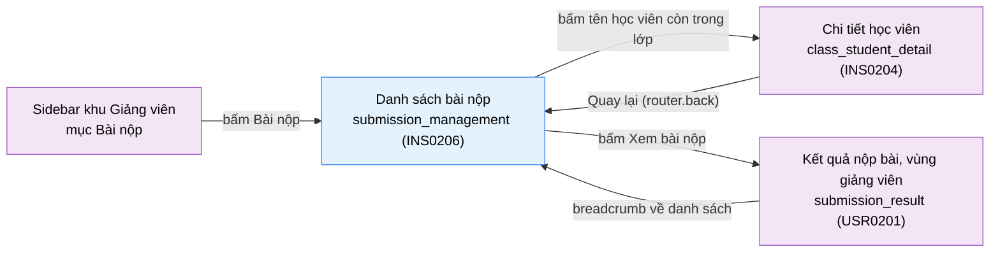

# Tài liệu thiết kế cơ bản (BD) — Danh sách bài nộp (`INS0206`)

## Phương châm tài liệu [Nội bộ — không cần khách duyệt]

- Viết theo **mẫu 9 sheet**. Bộ thẻ đóng, quy ước ID, ký hiệu chuẩn, ranh giới với tài liệu khác và checklist
  kiểm toán nằm ở `02-bd/_rules/bd-template-9sheet.md` — file này không chép lại.
- Phần gắn nhãn `[Nội bộ]` phục vụ sinh mã và tự kiểm toán, không phải yêu cầu của khách hàng: mục 4.5, mục 7.3
  và các ghi chú quy ước.
- Mã màn `INS0206` do `DEC-2026-1013-instructor-submissions-list` đề xuất ("proposed slug `INS0206`
  `submission_management`") [Nguồn: .nexa/control/decision-registry.md:3476-3477] và là mã kế tiếp `INS0205`
  trong khu Giảng viên (`02-bd/_rules/bd-template-9sheet.md` mục 8, quy tắc "màn mới lấy số thứ tự kế tiếp");
  bảng mã ở file quy ước chưa có dòng này, do file khác phụ trách. Tên file mang tiền tố mã.
- **Màn này CÓ prototype dựng bằng Next.js** (`05-coding/frontend/src/views/teacher/submission-management/`) nhưng
  **không có** file `09-layoutBase/*.dc.html`. Bố cục ở mục 4.4 bám bản dựng kèm số dòng; mọi chỗ bản dựng lệch
  yêu cầu nằm ở mục "Hiện trạng bản dựng" (cuối mục 4.4), không bị biến thành câu hỏi mở. Dữ liệu của bản dựng là
  **dữ liệu mẫu** sinh trong view, không có endpoint thật [Nguồn: 05-coding/frontend/src/views/teacher/submission-management/model/rows.ts:3-5].
- Khung điều hướng và chân trang **không mô tả lại ở đây** — dùng chung `02-bd/screens/teacher/_shell.md`. Khu
  Giảng viên không có toolbar dùng chung, nên hàng đầu của `<main>` là item của chính màn này (Khu vực A).
  Mục nav "Bài nộp" **sáng** ở màn này (`_shell.md` mục 3.2, dòng 5 của bảng).
- **Không có dải thẻ số liệu** ở đầu màn (quy tắc chủ dự án 2026-10-13, `01-rd/screens/teacher/INS0206_submission_management.md`
  REQ-09): màn là danh sách, không lặp số đã hiện ở màn khác.
- **DD của màn này CHƯA viết.** DD màn hình viết sau prototype (`CLAUDE.md`, mục Process). Sheet 7 chỉ ghi tên
  nghiệp vụ, trường DTO và BC sở hữu; đường dẫn, request, response, mã lỗi thuộc `03-dd/api/judge-orchestration.md`
  và `03-dd/api/identity.md`.
- **Không thiết kế lại** trang kết quả chỉ đọc `/instructor/submissions/{id}`: thuộc vùng giảng viên của
  `USR0201` (`02-bd/screens/users/USR0201_submission_result.md`, mục "Vùng giảng viên (A2)"; RD chương 10). Màn này
  chỉ liên kết tới. Cũng **không thiết kế** hồ sơ học viên (`INS0204`), giao bài (`INS0202`), chấm tay (đã bỏ,
  `DEC-2026-1013-remove-instructor-manual-grading`), chấm lại (`DEC-2026-0828-remove-rejudge-scope`).
- Màn **không gọi `ai-review`**: F5/F6 hỏng thì danh sách vẫn chạy đủ (ràng buộc bắt buộc của dự án, `CLAUDE.md`).

> Đọc cùng `01-rd/screens/teacher/INS0206_submission_management.md` (V0.2, hành vi ở mức yêu cầu, không lặp lại ở
> đây), `01-rd/screens/users/USR0201_submission_result.md` chương 10, `01-rd/req/judge-orchestration.md` (F4-13),
> `02-bd/database/judge-orchestration.md` mục 1.1, `02-bd/database/identity.md` mục 1.10 và
> `02-bd/database/problem-bank.md` mục 1.7. Quyết định áp dụng (đều ACTIVE):
> `DEC-2026-1013-instructor-submissions-list` [Nguồn: .nexa/control/decision-registry.md:3457-3482],
> `DEC-2026-1014-instructor-submissions-list-rules` [Nguồn: .nexa/control/decision-registry.md:3891-3926],
> `DEC-2026-1014-keep-learning-history-on-leave` [Nguồn: .nexa/control/decision-registry.md:3927-3950],
> `DEC-2026-1014-instructor-batch5-6-nav-pagination-rubric` (mục 2, phân trang 20 dòng, trang kết quả dùng chung quy ước)
> [Nguồn: .nexa/control/decision-registry.md:3755-3766],
> `DEC-2026-1013-teacher-open-questions-closed-round2` (quy ước trạng thái lọc ghi vào URL)
> [Nguồn: .nexa/control/decision-registry.md:3436-3440],
> `DEC-2026-1013-instructor-avatar-menu-and-read-source` (đọc mã nguồn chỉ đọc, ngoài lớp 404)
> [Nguồn: .nexa/control/decision-registry.md:3412-3415].

> **Quy ước đặt tên khối** [Nội bộ]. ID item bắt đầu bằng `submissionManagement.` (slug chính tắc
> `submission_management` viết camelCase, `02-bd/_rules/bd-template-9sheet.md` mục 4). Năm khối: `header` (đầu trang),
> `filter` (thanh lọc), `table` (bảng bài nộp), `pagination` (phân trang), `state` (trạng thái thay chỗ bảng).

---

## Sheet 1. Bìa

| Mục | Giá trị |
| :--- | :--- |
| Hệ thống | AlgoPrep |
| Phân hệ | `judge-orchestration` (F4) — đọc phạm vi lớp từ `identity` (F1) và bài đã giao từ `problem-bank` (F2) |
| Công đoạn | BD — Thiết kế cơ bản |
| Phân loại | Màn hình |
| Tên màn | Danh sách bài nộp |
| Mã màn hình | `INS0206` |
| Tên vật lý (slug) | `submission_management` |
| Route (prototype Next.js) | `/instructor/submissions` |
| Mã chức năng RD | Chưa cấp mã `Fx-nn` (206-Q10, `DEC-2026-1014-instructor-submissions-list-rules` mục 10) |
| Trục tài liệu | Màn hình (`02-bd/screens/`) |
| Actor | A2 (`INSTRUCTOR`) |
| Phiên bản | V0.5 |
| Người tạo | Nhóm phát triển AlgoPrep |
| Ngày tạo | 2026/10/14 |
| Người cập nhật | Nhóm phát triển AlgoPrep |
| Ngày cập nhật | 2026/10/18 |

---

## Sheet 2. Lịch sử sửa đổi

| Ver | Sheet bị sửa | Nội dung sửa | Ngày | Người sửa |
| :--- | :--- | :--- | :--- | :--- |
| V0.1 | Toàn bộ | Tạo mới theo mẫu 9 sheet từ RD `INS0206` V0.2 và các quyết định `DEC-2026-1013-instructor-submissions-list`, `DEC-2026-1014-instructor-submissions-list-rules`, `DEC-2026-1014-keep-learning-history-on-leave`. Bố cục bám bản dựng prototype; ghi "Hiện trạng bản dựng" với ba lệch đã biết (kích thước trang, ghi chú "Đã rời lớp", kiểm phạm vi chỉ 404 ngoài lớp). Một endpoint danh sách do `judge-orchestration` sở hữu, lớp lấy từ `ListInstructorClasses`. Phát sinh 4 câu hỏi mở. Thêm dòng "Bài nộp" vào `_shell.md` bảng 3.2 và mục "Vùng giảng viên (A2)" vào BD `USR0201` cùng đợt | 2026/10/14 | AI |
| V0.2 | Sheet 3, 4.1, 4.3, 4.4 (hiện trạng NO 9), 5 (B NO 3), 6 (C NO 10), 9 (NO 3, 9, 10), Câu hỏi mở | Áp `DEC-2026-1014-instructor-submissions-list-details` (ponytail bậc 5, 4, 6): đóng Q1 đến Q4. Q1: lượt nộp gắn lớp có `assigned_at` mới nhất không sau `submitted_at`, không thêm cột `class_id`. Q2: về danh sách bằng `router.back()` khi mở từ danh sách, khôi phục `?classId=&result=&q=&page=`. Q3: bộ trạng thái theo BD/DB, `SYSTEM_ERROR` chỉ ở "Tất cả"; bản dựng lệch ghi là nợ prototype. Q4: khoảng thời gian đã rời tính là trong lớp, quy tắc cửa sổ viết lại. Liên kết sang trang kết quả mang `from=submissions`. Sửa chỉ mục lệch tên cột ở mục 4.3 vì `02-bd/database/judge-orchestration.md` đã đổi sang `submitted_at`. Làm rõ ghi chú Sheet 6 C NO 10 sau khi `INS0204` thống nhất. Không thêm hay đổi NO, EVT | 2026/10/14 | AI |
| V0.3 | Sheet 4.4 (Hiện trạng bản dựng) | Dựng prototype INS0206 theo DEC-2026-1014-instructor-submissions-list-rules. Thêm cột "Tình trạng" vào bảng Hiện trạng bản dựng. Dòng 1 (kích thước trang 20 cố định), 2 (ghi chú "Đã rời lớp"), 7 (ba thông điệp rỗng, trừ nút Thử lại) và 9 (bộ trạng thái, bộ lọc "Chưa đạt", tỉ lệ `-`, sắp mới nhất trước) đã dựng, **chưa duyệt hình**. Dòng 3, 4, 5, 6, 8, 10 giữ là nợ; dòng 11 ghi rõ tham số `from` và trang kết quả giảng viên thuộc giai đoạn sau; thêm dòng 12 (quy tắc chọn lớp chưa mô hình hoá). Không đổi yêu cầu hay quyết định thiết kế | 2026/10/14 | AI |
| V0.4 | Sheet 4.4 (Hiện trạng bản dựng NO 11) | Dựng prototype trang kết quả của giảng viên (`from=`, breadcrumb, sidebar). Dòng 11: nút Xem bài nộp nay mang `from=submissions`; trang kết quả giảng viên đã có breadcrumb theo `from` và lùi lịch sử bằng `router.back()` khi mở từ danh sách. Các dòng còn nợ giữ nguyên. Không đổi yêu cầu hay quyết định thiết kế. **Chưa duyệt hình** | 2026/10/14 | AI |
| V0.5 | Sheet 4.4 (Hiện trạng bản dựng NO 11) | Dựng prototype Phase 4-5 (bài giao theo lớp, phân trang 20, from=). Dòng 11: liên kết tên học viên còn trong lớp nay mang `?from=submissions`, nên trang chi tiết học viên (`INS0204`) sáng mục "Bài nộp" ở sidebar (khớp Sheet 9 NO 6). Không đổi yêu cầu hay quyết định thiết kế. **Chưa duyệt hình** | 2026/10/18 | AI |

---

## Sheet 3. Sơ đồ chuyển màn

> [Nội bộ] Quy ước vẽ: từ trái sang phải. Màn gọi tới tô tím, màn hiện tại tô xanh nhạt. Màn này không có popup.

### 3.1 Danh sách chuyển màn

#### Sidebar → Danh sách bài nộp

[Điều kiện mở] Bấm mục "Bài nộp" trong nhóm "Quản lý bài tập đã nộp" ở sidebar khu Giảng viên, hoặc mở thẳng URL `/instructor/submissions`
[Nguồn: 05-coding/frontend/src/widgets/app-shell/model/instructor-nav.ts:58-62; 01-rd/screens/teacher/INS0206_submission_management.md:72-74].

[Chế độ mở] Điều hướng URL `/instructor/submissions`, kèm tuỳ chọn `?classId=&result=&q=&page=`.

[Thông tin truyền] Bốn tham số lọc trên URL, đều tuỳ chọn (REQ-07); không có tham số thì là "Tất cả", "Tất cả", rỗng, trang 1.

[Giá trị trả về] Không có.

[Khi thành công] Mở danh sách ở trang đầu (hoặc trang `page`), mục "Bài nộp" ở sidebar sáng
[Nguồn: 05-coding/frontend/e2e/instructor-submission-readonly.spec.ts:64-67].

[Khi huỷ] Không có.

#### Danh sách bài nộp → Chi tiết học viên (`INS0204`)

[Điều kiện mở] Bấm tên một học viên còn trong lớp ở bảng (REQ-17). Học viên đã rời lớp thì tên **không bấm được**, màn này không có đường tới `INS0204` cho dòng đó.

[Chế độ mở] Điều hướng URL; `INS0204` chỉ đọc.

[Thông tin truyền] Cặp `studentId` và `classId` **của chính dòng đó**, đúng hợp đồng ba đường vào đã chốt ở `INS0204`
[Nguồn: 02-bd/screens/teacher/INS0204_class_student_detail.md — Sheet 3, "Thông tin truyền"]. Bản dựng dùng `/instructor/classes/{classId}/students/{studentId}`
[Nguồn: 05-coding/frontend/src/views/teacher/submission-management/ui/submission-management-view.tsx:92-94].

[Giá trị trả về] Không có. "Quay lại" ở `INS0204` dùng `router.back()` nên về đúng danh sách này **kèm bộ lọc trên URL**
(`DEC-2026-1013-teacher-open-questions-closed-round2` mục 1 [Nguồn: .nexa/control/decision-registry.md:3437-3440]).

[Khi thành công] Mở `INS0204` trong phạm vi lớp của dòng. Sidebar **sáng "Bài nộp"** (mục của màn gọi tới, `_shell.md` mục 3.2).
Đường vào thứ tư này đã được ghi ở Sheet 3 của BD `INS0204` (V0.17, 2026/10/14).

[Khi huỷ] Không có.

#### Danh sách bài nộp → Kết quả nộp bài (vùng giảng viên, `USR0201`)

[Điều kiện mở] Bấm icon "Xem bài nộp" ở cuối một dòng, **kể cả dòng của học viên đã rời lớp** (REQ-08, REQ-13, REQ-17: cả dòng vẫn mở trang kết quả).

[Chế độ mở] Điều hướng URL `/instructor/submissions/{submissionId}?studentId=&classId=&from=submissions`, chỉ đọc. Đặc tả trang đích ở
`02-bd/screens/users/USR0201_submission_result.md` mục "Vùng giảng viên (A2)", **không lặp lại ở đây**
[Nguồn: 05-coding/frontend/src/views/teacher/submission-management/ui/submission-management-view.tsx:153].

[Thông tin truyền] `submissionId` (đường dẫn), `studentId` và `classId` của dòng (query, chỉ là gợi ý dựng breadcrumb), và `from=submissions` (query, báo màn gọi tới cho breadcrumb và mục sidebar sáng; vắng `from` thì mặc định cũng là `submissions`). **ĐÃ CHỐT 2026-10-14 (DEC-2026-1014-instructor-submissions-list-details):** máy chủ lấy tên học viên và lớp từ chính lượt nộp, bỏ qua `studentId`, `classId` trên URL; xem BD `USR0201` mục "Vùng giảng viên (A2)").

[Giá trị trả về] Không có.

[Khi thành công] Mở trang kết quả; sidebar giữ sáng "Bài nộp". Học viên đã rời lớp thì trang vẫn mở bình thường (không 404), vì bài nộp làm lúc còn trong lớp
(REQ-13 [Nguồn: 01-rd/screens/teacher/INS0206_submission_management.md:133]).

[Khi huỷ] Không có.

#### Kết quả nộp bài (vùng giảng viên) → Danh sách bài nộp (breadcrumb)

[Điều kiện mở] Trang kết quả được mở từ màn này (query `from=submissions` hoặc vắng `from`), giảng viên bấm mục breadcrumb dẫn về danh sách bài nộp
(REQ-16 của `USR0201` chương 10 [Nguồn: 01-rd/screens/users/USR0201_submission_result.md:227]).

[Chế độ mở] Không có.

[Thông tin truyền] Không có. **ĐÃ CHỐT 2026-10-14 (DEC-2026-1014-instructor-submissions-list-details):** khi trang kết quả được mở từ danh sách này thì mục breadcrumb **lùi lịch sử trình duyệt** (`router.back()`, cùng cách "Quay lại" của `INS0204`), nên khôi phục đúng `?classId=&result=&q=&page=` như lúc rời. Mở thẳng URL trang kết quả (không có lịch sử trước đó của danh sách) thì mục breadcrumb đi tới `/instructor/submissions` không kèm tham số. [Nguồn: .nexa/control/decision-registry.md:3984-3986]

[Giá trị trả về] Không có.

[Khi thành công] Về danh sách bài nộp, giữ nguyên `?classId=&result=&q=&page=` như khi rời (trường hợp mở từ danh sách).

[Khi huỷ] Không có.

### 3.2 Sơ đồ

[Nguồn: 01-rd/screens/teacher/INS0206_submission_management.md:44-52,72-74;
02-bd/screens/teacher/INS0204_class_student_detail.md — Sheet 3;
01-rd/screens/users/USR0201_submission_result.md:210-235]

---

## Sheet 4. Bố cục màn hình

### 4.1 Tổng quan màn

[Mục đích màn] Cho giảng viên một chỗ duy nhất để xem **mọi lượt nộp của học viên trong các lớp mình phụ trách**, lọc theo lớp
và kết quả, tìm theo học viên hoặc bài toán, rồi mở từng lượt nộp ở chế độ chỉ đọc. Trước màn này giảng viên chỉ vào được
bài nộp qua hồ sơ một học viên, nên sidebar không có đường vào cho tính năng đọc bài nộp
[Nguồn: .nexa/control/decision-registry.md:3472-3474; 01-rd/screens/teacher/INS0206_submission_management.md:23-27].

[Luồng nghiệp vụ chính]

1. **Hiển thị ban đầu**: đọc `classId`, `result`, `q`, `page` từ URL, tải song song danh sách lớp của giảng viên (cho bộ lọc Lớp) và trang bài nộp
   tương ứng. Trong lúc chờ, vùng bảng hiện khung chờ (REQ-12).
2. **Lọc và tìm**: đổi lớp, đổi kết quả hoặc gõ từ khoá thì ghi vào URL, về trang 1 và tải lại danh sách (REQ-07).
3. **Đọc bảng**: mỗi dòng một lượt nộp, **mới nhất trước**, cố định, không có điều khiển sắp xếp (REQ-14); cột tỉ lệ testcase đạt, `-` khi chưa chấm xong (REQ-16).
4. **Mở hồ sơ học viên**: bấm tên học viên còn trong lớp sang `INS0204` (REQ-17).
5. **Mở một lượt nộp**: bấm icon "Xem bài nộp" sang trang kết quả chỉ đọc (REQ-08).
6. **Chuyển trang**: 20 dòng mỗi trang (REQ-06).

[Người dùng] Giảng viên đã đăng nhập, có Function `CLASS_MANAGEMENT`, thấy lượt nộp của học viên thuộc **các lớp mình phụ trách**
[Nguồn: 01-rd/screens/teacher/INS0206_submission_management.md:122].

[Tệp liên quan] Không có. Màn này không xuất hay nhập tệp (xuất CSV nằm ngoài phạm vi, RD mục 3).

[Phạm vi]
- **Danh sách chỉ gồm lượt nộp thỏa đủ ba điều kiện** (quy tắc phạm vi, áp ở máy chủ):
  (a) học viên thuộc một lớp có `instructor_id` là giảng viên đang đăng nhập;
  (b) bài toán của lượt nộp **đã giao cho lớp đó** (`problem.class_assignments`, kể cả bài đã gỡ mềm khỏi lớp, cùng quy tắc với `INS0204`
  [Nguồn: 02-bd/screens/teacher/INS0204_class_student_detail.md — Sheet 9 NO 9]), **không** gồm bài tự luyện (REQ-15);
  (c) lượt nộp được làm **trong thời gian học viên thuộc lớp**: `submitted_at >= joined_at` và (`left_at IS NULL` hoặc `submitted_at <= left_at`)
  — hệ quả của REQ-13 và `DEC-2026-1014-keep-learning-history-on-leave`: học viên đã rời lớp vẫn hiện, nhưng chỉ các lượt nộp làm lúc còn trong lớp.
  **ĐÃ CHỐT 2026-10-14 (DEC-2026-1014-instructor-submissions-list-details):** học viên rời rồi vào lại cùng lớp thì dùng lại dòng ghi danh cũ (`joined_at` giữ nguyên, `left_at` về NULL), nên **khoảng thời gian đã rời cũng tính là "trong lớp"**: lượt nộp làm trong khoảng đó thuộc phạm vi. Chấp nhận khoảng hở này, không có bảng lịch sử từng đoạn tham gia [Nguồn: .nexa/control/decision-registry.md:3987-3989].
- **Một dòng mỗi lượt nộp**, gắn với lớp đang giữ bài giao tương ứng (REQ-15, 206-Q7). **ĐÃ CHỐT 2026-10-14 (DEC-2026-1014-instructor-submissions-list-details):** **Quy tắc chọn lớp** khi học viên ở hai lớp của cùng giảng viên và cả hai lớp cùng giao một bài: lượt nộp gắn với lớp có lần giao (`assigned_at`) **mới nhất mà không sau `submitted_at`**; mỗi lượt nộp đúng một dòng; bảng `judge.submissions` không có cột `class_id`, lớp được suy ra lúc truy vấn từ ghi danh và bài giao. Hệ quả: lọc theo lớp B không thấy lượt nộp đã gắn sang lớp A. Cách viết truy vấn thuộc DD [Nguồn: .nexa/control/decision-registry.md:3981-3984].
- Học viên đã rời lớp: dòng **vẫn hiện**, mang ghi chú "Đã rời lớp", tên không là liên kết, cả dòng vẫn mở trang kết quả (REQ-13, REQ-17).
- Chỉ đọc hoàn toàn: **màn này không ghi bất kỳ dữ liệu nào**. Giảng viên không chạy lại, không sửa mã, không gọi AI (REQ-11).
- Không hiển thị mã nguồn, thông báo lỗi biên dịch, nội dung testcase hay dòng `submission_testcase_results` trong danh sách; mã nguồn chỉ đọc qua trang kết quả
  (`DEC-2026-1013-instructor-avatar-menu-and-read-source`).
- Bài đang chờ, đang biên dịch hoặc đang chấm chỉ hiện ở lựa chọn kết quả "Tất cả" (REQ-04).
- Lượt nộp ngoài các lớp phụ trách không hiện; mở thẳng URL trả 404 (xử lý ở trang kết quả, REQ-02).

[Quyền sử dụng]
- Xem: được, khi có `CLASS_MANAGEMENT:READ` **và** chỉ trong phạm vi lớp phụ trách.
- Thêm, sửa, xoá: không có.

[Số bản ghi tối đa] **20 dòng mỗi trang**, cố định, không cho giảng viên đổi (REQ-06; `DEC-2026-1014-instructor-batch5-6-nav-pagination-rubric` mục 2 [Nguồn: .nexa/control/decision-registry.md:3763-3766]).
Không giới hạn tổng số trang. Từ khoá tìm tối đa 100 ký tự `[SoT: Suy luận]`.

[Nguồn: 01-rd/screens/teacher/INS0206_submission_management.md:119-139;
.nexa/control/decision-registry.md:3891-3926]

### 4.2 DTO liên quan

Tên DTO do BD đề xuất, `03-dd/api/judge-orchestration.md` chốt lại `[SoT: Suy luận]`.

- `SubmissionListQuery` — tham số của lần gọi: `classId` (tuỳ chọn), `result` (`all` / `accepted` / `failed`), `q`, `page`. Kích thước trang là hằng số phía máy chủ, không phải tham số.
- `SubmissionListItemDto` — một dòng của bảng: `submissionId`, `studentId`, `studentName`, `classId`, `className`, `problemId`, `problemTitle`, `language`, `status`, `passedCount`, `totalCount`, `submittedAt`, `leftClass`.
- `SubmissionListPageDto` — một trang: `items` (danh sách `SubmissionListItemDto`), `totalCount` (số dòng khớp bộ lọc), `page`, `pageSize`.
- `ClassCardDto` — **dùng lại** của `INS0201`, chỉ lấy `id` và `name` cho bộ lọc Lớp
  [Nguồn: 02-bd/screens/teacher/INS0201_class_management.md — Sheet 7.1 NO 6, 7].

**Ràng buộc bắt buộc:** không DTO nào ở màn này được chứa `source_code`, `compile_error_message`, nội dung testcase, hay dòng nào của
`submission_testcase_results` [Nguồn: 02-bd/database/judge-orchestration.md:20,24,40-62].

### 4.3 Bảng dữ liệu liên quan (6)

Sáu bảng dưới đây đúng bằng sáu dòng ở mục 7.2. Màn chỉ **đọc**; `judge-orchestration` đọc bảng của chính mình và lấy dữ liệu của hai module còn lại qua cổng ra,
**không truy vấn chéo schema**.

| NO | Bảng | Ghi chú |
| --: | :--- | :--- |
| 1 | `judge.submissions` | Nguồn của mọi dòng: `id`, `user_id`, `problem_id`, `language`, `status`, `passed_testcase_count`, `total_testcase_count`, `score_ratio`, `submitted_at` [Nguồn: 02-bd/database/judge-orchestration.md:14-31]. Không có cột `class_id`: lớp của dòng suy ra từ ghi danh và bài giao theo quy tắc "lần giao mới nhất không sau `submitted_at`" (mục 4.1, Phạm vi) |
| 2 | `identity.classes` | Tập lớp có `instructor_id` là người xem; `name` cho cột Lớp và bộ lọc [Nguồn: 02-bd/database/identity.md mục 1.8] |
| 3 | `identity.class_enrollments` | Học viên thuộc lớp và **cửa sổ thuộc lớp** (`joined_at`, `left_at`) để quyết bài nộp có thuộc phạm vi và có cờ `leftClass`. **Dòng ghi danh được giữ khi học viên rời lớp** (chỉ đặt `left_at`), đúng nhu cầu của màn này [Nguồn: 02-bd/database/identity.md:98-115] |
| 4 | `identity.users` | `display_name` của học viên (cột tên, tìm theo học viên) |
| 5 | `problem.class_assignments` | Bài đã giao cho từng lớp, **kể cả bài đã gỡ mềm** (`removed_at`) [Nguồn: 02-bd/database/problem-bank.md:169-181] |
| 6 | `problem.problems` | `title` của bài (cột Bài tập, tìm theo bài toán) |

Chỉ mục: truy vấn lọc theo tập học viên và tập bài, sắp theo `submitted_at` giảm dần. Chỉ mục có sẵn `submissions(user_id, problem_id, submitted_at DESC)`
[Nguồn: 02-bd/database/judge-orchestration.md:187] khớp cột `submitted_at` của bảng [Nguồn: 02-bd/database/judge-orchestration.md:31]
(tên cột từng ghi lệch `created_at`, đã sửa 2026/10/14).
Quy mô đồ án không cần chỉ mục mới `[SoT: Suy luận]`.

**Việc cần ở `identity` (một câu cho DD):** cổng đọc của `identity` phải trả **cả dòng ghi danh đã rời** (có `left_at`), vì các câu "học viên của lớp" thông thường
lọc `left_at IS NULL` [Nguồn: 02-bd/database/identity.md:106-108] và nếu dùng chung sẽ làm mất dòng "Đã rời lớp".

### 4.4 Vùng bố cục bám prototype

Bố cục luồng dọc một cột trong container `max-width: 1320px` của khung chung `_shell.md` mục 4; toàn bộ nội dung nằm trong một thẻ (`Card`)
[Nguồn: 05-coding/frontend/src/views/teacher/submission-management/ui/submission-management-view.tsx:159-166].

| Vùng | Tham chiếu prototype | Nội dung |
| :--- | :--- | :--- |
| Khung điều hướng + chân trang | Khung chung | `_shell.md`; mục "Bài nộp" sáng [Nguồn: 05-coding/frontend/e2e/instructor-submission-readonly.spec.ts:64-67] |
| A — Đầu trang | `submission-management-view.tsx:161-164` | Tiêu đề "Bài nộp" và dòng mô tả. **Không có dải thẻ số liệu** (REQ-09) [Nguồn: submission-management-view.tsx:159-252 không có thẻ số liệu] |
| B — Thanh lọc | `submission-management-view.tsx:167-214` | Một hàng gập dòng: ô tìm kiếm (giãn), menu lọc Lớp, menu lọc Kết quả, số dòng khớp ở mép phải |
| C — Bảng bài nộp | `submission-management-view.tsx:87-157,216-230` | Cột: Học viên, Lớp, Bài tập, Ngôn ngữ, Trạng thái, Tỉ lệ testcase, Nộp lúc, icon Xem bài nộp. Bề rộng tối thiểu 960px, cuộn ngang khi hẹp |
| D — Phân trang | `submission-management-view.tsx:232-251` | Nút Trước/Sau và dòng "Trang {n} / {tổng}" |
| E — Trạng thái thay chỗ bảng | `submission-management-view.tsx:221-228` | Khung chờ, rỗng, lỗi (bản dựng chỉ có một thông điệp rỗng chung) |

Bộ lọc Lớp là **menu** (`FilterMenu`) chứ không phải tab, cùng kiểu bộ lọc kết quả
[Nguồn: submission-management-view.tsx:179-210]; RD cho phép "tab hoặc menu như prototype".

#### Hiện trạng bản dựng (2026-10-14, dựng prototype lần 2)

Bảng này ghi chỗ bản dựng lệch thiết kế ở trên; **không phải câu hỏi mở**, là nợ prototype để ghi vào `06-plan/PROTOTYPE_DEBT.md` (tài liệu đó do phía khác phụ trách). Từ lần dựng 2026/10/14 theo `DEC-2026-1014-instructor-submissions-list-rules`, các dòng 1, 2, 7, 9 đã được dựng đúng thiết kế (cột "Tình trạng" ghi `Đã dựng`); **mọi dòng đã dựng đều ở trạng thái chưa duyệt hình** (chủ dự án chưa xem ảnh chụp). Dòng còn lệch giữ `Còn nợ`.

| # | Điều quan sát | Vị trí | Thiết kế | Tình trạng | Ghi chú |
| :-: | :--- | :--- | :--- | :--- | :--- |
| 1 | Kích thước trang cố định **20**, không có ô chọn, không nhớ kích thước trang; e2e đếm 21 hàng (tiêu đề cộng 20) | `submission-management-view.tsx:38-39,81,247-257`; `e2e/instructor-submission-readonly.spec.ts:63` | **20 dòng cố định**, không có ô chọn (REQ-06) | Đã dựng, chưa duyệt hình | Trước đây bản dựng mặc định 10 và chọn được 10/20/50 (`DEC-2026-1014-instructor-submissions-list-rules`). Đã bỏ `PAGE_SIZES`, `usePersistedPageSize` khỏi view; hằng `PAGE_SIZE = 20`. Chưa có ảnh Playwright chụp lại nên chưa duyệt hình |
| 2 | Học viên đã rời lớp vẫn có dòng: tên hiển thị thuần (không liên kết `INS0204`) kèm huy hiệu trung tính "Đã rời lớp"; view đọc `useClassStudents(undefined, true)` (gồm học viên đã rời). Cờ `SubmissionRow.leftClass = (leftAt !== undefined)`. Dữ liệu mẫu có một học viên đã rời (Lý Văn Tâm, lớp Lập trình Java K21, `leftAt` 2026-10-05) | `submission-management-view.tsx:45-46,99-112`; `model/rows.ts:21-22,55`; `entities/class/api/__mock__/class-mocks.ts:227-241,294-302`; `entities/class/model/types.ts:64`; khoá i18n `messages/vi.json:2433` | Dòng học viên đã rời lớp vẫn hiện, tên không là liên kết, kèm ghi chú (REQ-13, REQ-17) | Đã dựng, chưa duyệt hình | Huy hiệu dùng nhãn tĩnh i18n `instructorSubmissions.leftClass`; tên khoá `...table.col.leftNote` ở Sheet 5 do DD chốt. Bản dựng chưa lọc theo cửa sổ thuộc lớp (Sheet 9 NO 3): dòng học viên đã rời lấy cùng hai lượt nộp mẫu như học viên khác, chưa tách lượt nộp trước và sau `left_at` |
| 3 | `isSubmissionInInstructorScope` chỉ kiểm id có nằm trong bốn mã `SB-9xxxx` mẫu, tức **chỉ mô phỏng 404 ngoài lớp**, không mô phỏng ngoại lệ "đã rời lớp vẫn đọc được" | `entities/submission/api/__mock__/submission-mocks.ts:176-186` (đọc lại 2026-10-14, không đổi); dùng ở `views/users/submission-result/ui/submission-result-view.tsx:75-78` | Học viên đã rời lớp: trang kết quả mở bình thường (REQ-13, REQ-15 của `USR0201`) | Còn nợ | Phía máy chủ phải kiểm theo cửa sổ thuộc lớp (Sheet 9 NO 3) |
| 4 | Dữ liệu dòng là mock: mỗi học viên hiện có hai lượt nộp lấy từ bốn lượt nộp mẫu, chưa phân biệt bài đã giao hay bài tự luyện | `model/rows.ts:3-5,40-71` | Chỉ bài đã giao cho lớp (REQ-15) | Còn nợ | Chỉ là dữ liệu mẫu |
| 5 | Lọc và tìm làm **phía máy khách** trên toàn bộ dòng (`rows.filter`, `slice`), không có tham số máy chủ | `submission-management-view.tsx:66-81` | Lọc, tìm, phân trang ở máy chủ (danh sách có thể lớn) | Còn nợ | `[SoT: Suy luận]` |
| 6 | Số dòng khớp hiện dạng "{khớp} / {tổng}" với tổng là mọi dòng chưa lọc | `submission-management-view.tsx:220-222`; `messages/vi.json:2418` | Thiết kế chỉ cần **số dòng khớp** (`totalCount`); "tổng chưa lọc" cần thêm một phép đếm | Còn nợ | `[SoT: Suy luận]`, ponytail bậc 5 |
| 7 | Ba thông điệp rỗng tách bạch: "Bạn chưa phụ trách lớp nào" (không có lớp), "Các lớp của bạn chưa có lượt nộp nào" (có lớp, `allRows` rỗng), "Không có lượt nộp nào khớp bộ lọc" (có dữ liệu nhưng bộ lọc loại hết). Lỗi chỉ qua `status="error"` của bảng, chưa thấy nút Thử lại ở view | `submission-management-view.tsx:225-245`; `messages/vi.json:2431-2432` (khoá `empty` cùng namespace) | Ba trường hợp rỗng tách bạch + lỗi có Thử lại (REQ-12) | Ba thông điệp rỗng: Đã dựng, chưa duyệt hình. Nút Thử lại: Còn nợ | Hai khoá `emptyNoClass`, `emptyNoSubmission` thêm mới; nút Thử lại ở trạng thái lỗi chưa dựng |
| 8 | Tham số `result` lạ (không phải `all`/`accepted`/`failed`) bị ép kiểu và rơi vào nhánh "failed" của `matchesResultFilter` | `submission-management-view.tsx:52-53`; `entities/submission/model/result-filter.ts:21-28` | Giá trị lạ đưa về "Tất cả" (Sheet 9 NO 6) | Còn nợ | Lỗi nhỏ của bản dựng |
| 9 | Bộ trạng thái của bản dựng đã theo BD/DB: `SYSTEM_ERROR` thay `MEMORY_LIMIT_EXCEEDED` ở kiểu `SubmissionStatus`, bảng màu huy hiệu và khoá nhãn kết quả vi/en (`verdict.SYSTEM_ERROR`, "Lỗi hệ thống"). Bộ lọc "Chưa đạt" chỉ gồm `WRONG_ANSWER`, `TIME_LIMIT_EXCEEDED`, `RUNTIME_ERROR`, `COMPILE_ERROR`; `SYSTEM_ERROR` và ba trạng thái chờ chỉ hiện ở "Tất cả". Cột tỉ lệ testcase hiện `-` khi lượt nộp `PENDING`, `COMPILING`, `JUDGING` hoặc `SYSTEM_ERROR`. Bảng sắp mới nhất trước (`submittedAt` giảm dần) | `entities/submission/model/types.ts:7-17`; `status-variant.ts:5-16`; `result-filter.ts:12-28`; `messages/vi.json:1773,1851`; `model/rows.ts:30-38,59-64,72`; test `entities/submission/model/result-filter.test.ts`, `views/teacher/submission-management/model/rows.test.ts` | Một bộ trạng thái thống nhất (`DEC-2026-1014-instructor-submissions-list-details`); tỉ lệ `-` khi chưa chấm (REQ-16); mới nhất trước (REQ-14) | Đã dựng, chưa duyệt hình | Khoá `VERDICT_VARIANT` của `my-submissions-view.tsx` (màn học viên) đã đổi tên theo, theo lời người giao việc, chưa đọc lại file đó khi cập nhật tài liệu này. Việc ghi `PROTOTYPE_DEBT.md` do phía khác phụ trách |
| 10 | Ô tìm kiếm ghi URL ngay mỗi lần gõ (`router.replace`) và lọc tức thì, không debounce | `submission-management-view.tsx:177-187` | Có máy chủ thì cần giãn lệnh gọi | Còn nợ | DD chốt hằng số debounce `[SoT: Suy luận]` |
| 11 | Cột Lớp và liên kết tên học viên còn trong lớp đúng thiết kế: liên kết sang `INS0204` `/instructor/classes/{classId}/students/{studentId}?from=submissions` (cập nhật 2026/10/18: thêm `from=submissions`; `instructorActiveHrefOverride` sáng "Bài nộp" cho route này, test `instructor-sidebar.test.ts:21-32`; chưa duyệt hình). Nút Xem bài nộp mang `?studentId=&classId=&from=submissions` (Sheet 3). Trang kết quả giảng viên có breadcrumb `Bài nộp / Lượt nộp`: mở từ danh sách thì bấm mục đầu gọi `router.back()` nên bộ lọc, ô tìm và trang của danh sách được khôi phục; sidebar giữ sáng "Bài nộp". Không còn tham số `from` hay trang kết quả là nợ ở dòng này. Phần còn nợ ở phía trang kết quả (nguồn chủ lượt nộp từ lượt nộp, 404 theo cửa sổ lớp) nằm ở BD `USR0201` mục "Vùng giảng viên (A2)", Hiện trạng NO 1, 4, 6 | `submission-management-view.tsx:104-111,155-165`; `views/teacher/submission-context/ui/instructor-submission-context.tsx:59-82`; `widgets/app-shell/ui/instructor-sidebar.tsx:46-64` | Khớp REQ-08, REQ-17; Sheet 3 thêm `from=submissions` | Phần liên kết tên, tham số `from`, breadcrumb và sidebar: Đã dựng, chưa duyệt hình | Cập nhật 2026/10/14. Chỉ lùi lịch sử khi `from=submissions` có mặt và còn lịch sử; không còn lịch sử thì đi thẳng `/instructor/submissions` (mất bộ lọc). Chưa có ảnh Playwright chụp lại |
| 12 | Quy tắc chọn lớp "lần giao mới nhất không sau `submitted_at`" (mục 4.1, Phạm vi) **chưa mô hình hoá**: mỗi dòng lấy lớp của chính học viên (`student.classId`), nên không có trường hợp một học viên ở hai lớp cùng giao một bài | `model/rows.ts:49-54` | Gắn lượt nộp với lớp có `assigned_at` mới nhất không sau `submitted_at` (`DEC-2026-1014-instructor-submissions-list-details`) | Còn nợ | Dữ liệu mẫu không có học viên ở hai lớp; quy tắc thuộc truy vấn máy chủ, DD chốt |

[Nguồn: 05-coding/frontend/src/views/teacher/submission-management/ui/submission-management-view.tsx; model/rows.ts; model/rows.test.ts;
05-coding/frontend/e2e/instructor-submission-readonly.spec.ts:49-89]

### 4.5 Cấu trúc slice FSD [Nội bộ]

| Khối | Slice | Căn cứ |
| :--- | :--- | :--- |
| Trang | `views/teacher/submission-management` (`ui/submission-management-view.tsx`, `model/rows.ts`); route `app/(instructor)/instructor/submissions/page.tsx` | Đã dựng [Nguồn: 05-coding/frontend/src/views/teacher/submission-management/index.ts:1] |
| Khung Giảng viên | `widgets/app-shell` (`instructor-nav.ts`, mục `submissions`) | `_shell.md` |
| Kiểu và bộ lọc kết quả, màu huy hiệu trạng thái | `entities/submission` (`result-filter.ts`, `status-variant.ts`) | Dùng chung với bảng lịch sử của `INS0204` [Nguồn: 05-coding/frontend/src/entities/submission/model/result-filter.ts:3-28; status-variant.ts:4-16] |
| Danh sách lớp cho bộ lọc, chữ cái đầu của tên | `entities/class` (`useInstructorClasses`, `initialsOfClassStudent`) | Đã dùng ở view |
| Thành phần UI | `shared/ui` (`DataTable`, `FilterMenu`, `Pagination`, `IconAction`, `PageHeader`, `Badge`, `TextField`, `Card`) | "Shared first" của `CLAUDE.md` |
| Truy vấn danh sách thật | `entities/submission` (hook gọi `ListInstructorSubmissions`) | `[SoT: Suy luận]`, thay `buildSubmissionRows`; chốt ở DD màn hình |

---

## Sheet 5. Danh sách item màn hình

> Quy ước ID, bộ thẻ và giá trị chuẩn: `02-bd/_rules/bd-template-9sheet.md` mục 2, 3, 4. Nhãn tĩnh nằm ở namespace i18n `instructorSubmissions`
> [Nguồn: 05-coding/frontend/messages/vi.json:2405-2435]; nhãn chưa có khoá trong bản dựng ghi rõ.

### Khu vực A — Đầu trang

| Khu vực | NO | Tên item | ID item | Bảng DB | Cột DB | Loại UI | Kiểu | Độ dài | Bắt buộc | I/O | Giá trị mặc định | Định dạng | Ghi chú |
| :--- | --: | :--- | :--- | :--- | :--- | :--- | :--- | :--- | :-: | :-: | :--- | :--- | :--- |
| Đầu trang | | | | | | | | | | | | | |
| | 1 | Tiêu đề | `submissionManagement.header.title` | - | - | Label | String | 50 | - | O | Bài nộp | - | Tiêu đề trang, cũng là tên truy cập của bảng [Nguồn giá trị] Nhãn tĩnh i18n `instructorSubmissions.header.title` [Nguồn: messages/vi.json:2407] [EVT liên quan] - |
| | 2 | Mô tả | `submissionManagement.header.subtitle` | - | - | Label | String | 100 | - | O | Mọi lượt nộp của học viên trong các lớp bạn phụ trách | - | Dòng mô tả dưới tiêu đề [Nguồn giá trị] Nhãn tĩnh i18n `instructorSubmissions.header.subtitle` [Nguồn: messages/vi.json:2408] [EVT liên quan] - |

### Khu vực B — Thanh lọc

| Khu vực | NO | Tên item | ID item | Bảng DB | Cột DB | Loại UI | Kiểu | Độ dài | Bắt buộc | I/O | Giá trị mặc định | Định dạng | Ghi chú |
| :--- | --: | :--- | :--- | :--- | :--- | :--- | :--- | :--- | :-: | :-: | :--- | :--- | :--- |
| Thanh lọc | | | | | | | | | | | | | |
| | 1 | Ô tìm kiếm | `submissionManagement.filter.search` | `identity.users`, `problem.problems` | `display_name`, `title` | TextBox | String | 100 | - | I/O | rỗng (đọc từ `?q=`) | - | Khớp theo **tên học viên hoặc tên bài toán**, không phân biệt hoa thường, bỏ khoảng trắng hai đầu; ghi vào URL `q`; giá trị rỗng thì bỏ tham số. Gợi ý ô: "Tìm theo học viên hoặc bài tập" [Nguồn giá trị] URL `q`; nhãn tĩnh i18n `instructorSubmissions.search` [Nguồn: messages/vi.json:2410]. Hành vi khớp không phân biệt hoa thường theo prototype [Nguồn: submission-management-view.tsx:75-82] [EVT liên quan] EVT-2 |
| | 2 | Lọc Lớp | `submissionManagement.filter.classId` | `identity.classes` | `id`, `name` | List | String | - | - | I/O | `all` (Tất cả) | Tên lớp | Menu chọn một: "Tất cả" và từng lớp giảng viên phụ trách; ghi vào URL `classId` (bỏ tham số khi là "Tất cả") [Nguồn giá trị] Kết quả `ListInstructorClasses` (`identity`); nhãn "Tất cả" là nhãn tĩnh i18n `instructorSubmissions.filterAll` [Nguồn: messages/vi.json:2413] [EVT liên quan] EVT-3 |
| | 3 | Lọc Kết quả | `submissionManagement.filter.result` | `judge.submissions` | `status` | List | Enum | - | - | I/O | `all` (Tất cả) | Nhãn tiếng Việt | Ba lựa chọn: **Tất cả**, **Đã chấp nhận** (`ACCEPTED`), **Chưa đạt** (đã chấm xong và không đạt); bài `PENDING`, `COMPILING`, `JUDGING` chỉ hiện ở "Tất cả"; không có lựa chọn thứ tư (REQ-04); ghi vào URL `result` [Công thức] `accepted` là `status = ACCEPTED`; `failed` là một trong `WRONG_ANSWER`, `TIME_LIMIT_EXCEEDED`, `RUNTIME_ERROR`, `COMPILE_ERROR`. **ĐÃ CHỐT 2026-10-14 (DEC-2026-1014-instructor-submissions-list-details):** `SYSTEM_ERROR` (lỗi hạ tầng, không do học viên) **chỉ hiện ở "Tất cả"**, không bao giờ thuộc "Chưa đạt"; `MEMORY_LIMIT_EXCEEDED` không phải trạng thái của lượt nộp (chỉ là verdict từng testcase) [Nguồn: .nexa/control/decision-registry.md:3985-3987; 02-bd/database/judge-orchestration.md:22] [Nguồn: entities/submission/model/result-filter.ts:12-28] [EVT liên quan] EVT-4 |
| | 4 | Số dòng khớp | `submissionManagement.filter.resultCount` | `judge.submissions` | - | Label | Number | 6 | - | O | `0` | `{n} lượt nộp` | Số lượt nộp khớp bộ lọc và từ khoá (toàn bộ các trang), ở mép phải thanh lọc. Ẩn khi đang tải lần đầu hoặc lỗi [Nguồn giá trị] `SubmissionListPageDto.totalCount` (Sheet 7.1) [EVT liên quan] EVT-1, EVT-2, EVT-3, EVT-4, EVT-5 |

### Khu vực C — Bảng bài nộp

| Khu vực | NO | Tên item | ID item | Bảng DB | Cột DB | Loại UI | Kiểu | Độ dài | Bắt buộc | I/O | Giá trị mặc định | Định dạng | Ghi chú |
| :--- | --: | :--- | :--- | :--- | :--- | :--- | :--- | :--- | :-: | :-: | :--- | :--- | :--- |
| Bảng bài nộp | | | | | | | | | | | | | |
| | 1 | Bảng bài nộp | `submissionManagement.table.list` | `judge.submissions` | - | List | List | - | - | O | rỗng | 20 dòng mỗi trang | Mỗi dòng **một lượt nộp**, **mới nhất trước** theo `submitted_at`, cố định, không có điều khiển sắp xếp (REQ-14); phạm vi theo mục 4.1 [Nguồn giá trị] Kết quả `ListInstructorSubmissions` (`judge-orchestration`) [EVT liên quan] EVT-1, EVT-2, EVT-3, EVT-4, EVT-5 |
| | 2 | Học viên | `submissionManagement.table.col.student` | `identity.users` | `display_name` | Link | String | 100 | - | O | - | Chữ cái đầu và tên | Tên học viên kèm chữ cái đầu; là **liên kết sang `INS0204`** (cặp `studentId`, `classId` của dòng). Học viên đã rời lớp (`leftClass = true`): chỉ là chữ, không là liên kết (REQ-17) [Nguồn giá trị] `SubmissionListItemDto.studentName` [EVT liên quan] EVT-6 |
| | 3 | Ghi chú Đã rời lớp | `submissionManagement.table.col.leftNote` | `identity.class_enrollments` | `left_at` | Label | String | 20 | - | O | - | `Đã rời lớp` | Ghi chú nhỏ ngay cạnh hoặc dưới tên học viên, chỉ khi `leftClass = true` [Công thức] `leftClass = (left_at IS NOT NULL)` của dòng ghi danh khớp lớp của lượt nộp. Nhãn tĩnh i18n, **khoá chưa có trong bản dựng** (xem mục Hiện trạng NO 2) [EVT liên quan] - |
| | 4 | Lớp | `submissionManagement.table.col.class` | `identity.classes` | `name` | ListColumn | String | 120 | - | O | - | - | Lớp đang giữ bài giao của lượt nộp [Nguồn giá trị] `SubmissionListItemDto.className` [Nguồn: submission-management-view.tsx:106] [EVT liên quan] - |
| | 5 | Bài tập | `submissionManagement.table.col.problem` | `problem.problems` | `title` | ListColumn | String | 200 | - | O | - | - | Tên bài toán của lượt nộp [Nguồn giá trị] `SubmissionListItemDto.problemTitle`; tên bài do `judge-orchestration` ghép sẵn trong phản hồi, màn không gọi thêm `problem-bank` cho từng dòng (cùng cách `INS0204`) [EVT liên quan] - |
| | 6 | Ngôn ngữ | `submissionManagement.table.col.language` | `judge.submissions` | `language` | Badge | Enum | - | - | O | - | `Java` / `C++` / `Python` | Đúng ba giá trị [Nguồn: 02-bd/database/judge-orchestration.md:18] [Nguồn giá trị] Cột `language` [EVT liên quan] - |
| | 7 | Trạng thái | `submissionManagement.table.col.status` | `judge.submissions` | `status` | Badge | Enum | - | - | O | - | Nhãn tiếng Việt, màu theo trạng thái | Nhãn và màu dùng chung với trang kết quả (`SUBMISSION_STATUS_VARIANT`, nhãn `submissionResult.verdict.*`); lượt nộp chưa xong hiện trạng thái đang chạy [Nguồn: entities/submission/model/status-variant.ts:5-16; submission-management-view.tsx:118-125] [Nguồn giá trị] Cột `status` [Nguồn: 02-bd/database/judge-orchestration.md:22] [EVT liên quan] - |
| | 8 | Tỉ lệ testcase | `submissionManagement.table.col.ratio` | `judge.submissions` | `passed_testcase_count`, `total_testcase_count`, `score_ratio` | ListColumn | String | 9 | - | O | `-` | `{đạt}/{tổng}` | **Một cột nhỏ** (REQ-16, F4-13), căn phải, chữ đơn cách. `-` khi chưa chấm xong hoặc không có điểm tỉ lệ [Công thức] Hiện `{passed_testcase_count}/{total_testcase_count}` khi `score_ratio IS NOT NULL`; `score_ratio` là `NULL` khi lượt nộp chưa vào trạng thái cuối và với `COMPILE_ERROR`, `SYSTEM_ERROR` [Nguồn: 02-bd/database/judge-orchestration.md:25-27]. Không hiện `0/0` hay `0%` [EVT liên quan] - |
| | 9 | Nộp lúc | `submissionManagement.table.col.submittedAt` | `judge.submissions` | `submitted_at` | ListColumn | Date | - | - | O | - | Ngày giờ ngắn theo `vi-VN` | Thời điểm nộp (khác `INS0204` dùng thời gian tương đối, vì danh sách nhiều học viên cần mốc tuyệt đối để đọc thứ tự) [Nguồn: submission-management-view.tsx:133-139] [Nguồn giá trị] Cột `submitted_at` [Nguồn: 02-bd/database/judge-orchestration.md:31] [EVT liên quan] - |
| | 10 | Xem bài nộp | `submissionManagement.table.col.btnView` | - | - | Link | - | - | - | I | - | Icon con mắt, tooltip "Xem bài nộp" | Mở trang kết quả chỉ đọc của đúng lượt nộp. Tên truy cập nêu học viên và bài: "Xem bài nộp của {học viên}: {bài}" [Nguồn giá trị] Nhãn tĩnh i18n `instructorSubmissions.col.btnView`, `btnViewOf` [Nguồn: messages/vi.json:2427-2428] [EVT liên quan] EVT-7 |

### Khu vực D — Phân trang

| Khu vực | NO | Tên item | ID item | Bảng DB | Cột DB | Loại UI | Kiểu | Độ dài | Bắt buộc | I/O | Giá trị mặc định | Định dạng | Ghi chú |
| :--- | --: | :--- | :--- | :--- | :--- | :--- | :--- | :--- | :-: | :-: | :--- | :--- | :--- |
| Phân trang | | | | | | | | | | | | | |
| | 1 | Điều khiển trang | `submissionManagement.pagination.control` | - | - | Button | Number | 4 | - | I/O | 1 (đọc từ `?page=`) | `Trước` / `Sau` | Chuyển trang; ghi URL `page` (bỏ tham số khi là trang 1). **Không có ô chọn số dòng**: 20 dòng cố định (REQ-06) [Nguồn giá trị] URL `page`; nhãn tĩnh i18n `instructorSubmissions.previous`, `next` [Nguồn: messages/vi.json:2433-2434] [EVT liên quan] EVT-5 |
| | 2 | Tóm tắt trang | `submissionManagement.pagination.summary` | - | - | Label | String | 20 | - | O | - | `Trang {n} / {tổng}` | Tổng trang bằng `ceil(totalCount / pageSize)`, tối thiểu 1 [Công thức] Từ `SubmissionListPageDto.totalCount` và `pageSize`; nhãn tĩnh i18n `instructorSubmissions.pageSummary` [Nguồn: messages/vi.json:2432] [EVT liên quan] EVT-5 |

### Khu vực E — Trạng thái thay chỗ bảng

| Khu vực | NO | Tên item | ID item | Bảng DB | Cột DB | Loại UI | Kiểu | Độ dài | Bắt buộc | I/O | Giá trị mặc định | Định dạng | Ghi chú |
| :--- | --: | :--- | :--- | :--- | :--- | :--- | :--- | :--- | :-: | :-: | :--- | :--- | :--- |
| Trạng thái | | | | | | | | | | | | | |
| | 1 | Khung chờ | `submissionManagement.state.loading` | - | - | Label | String | - | - | O | - | - | Thay vùng bảng trong lúc tải lần đầu hoặc tải lại [Nguồn giá trị] Trạng thái `loading` của `DataTable` [Nguồn: submission-management-view.tsx:221-223] [EVT liên quan] EVT-1 |
| | 2 | Rỗng — chưa có lớp | `submissionManagement.state.emptyNoClass` | `identity.classes` | `id` | Label | String | 100 | - | O | - | - | Giảng viên chưa phụ trách lớp nào (`ListInstructorClasses` trả rỗng). Nhãn tĩnh i18n, khoá chưa có [Nguồn giá trị] Kết quả `ListInstructorClasses` rỗng (REQ-12) [EVT liên quan] EVT-1 |
| | 3 | Rỗng — chưa có bài nộp | `submissionManagement.state.emptyNoSubmission` | `judge.submissions` | - | Label | String | 100 | - | O | - | - | Có lớp nhưng `totalCount = 0` khi **không có** bộ lọc hay từ khoá nào đang áp (lớp chưa có bài nộp nào trong phạm vi). Nhãn tĩnh i18n, khoá chưa có [Nguồn giá trị] `totalCount = 0` kèm `classId` rỗng, `result = all`, `q` rỗng (REQ-12) [EVT liên quan] EVT-1 |
| | 4 | Rỗng — không khớp | `submissionManagement.state.emptyNoMatch` | `judge.submissions` | - | Label | String | 100 | - | O | Không có lượt nộp nào khớp bộ lọc | - | `totalCount = 0` khi **có** bộ lọc hoặc từ khoá đang áp [Nguồn giá trị] Nhãn tĩnh i18n `instructorSubmissions.empty` [Nguồn: messages/vi.json:2430]; điều kiện phân biệt với NO 3 là `[SoT: Suy luận]` [EVT liên quan] EVT-2, EVT-3, EVT-4 |
| | 5 | Lỗi tải | `submissionManagement.state.error` | - | - | Label | String | 150 | - | O | - | - | Thay vùng bảng khi gọi máy chủ thất bại; bộ lọc và từ khoá giữ nguyên. Nhãn tĩnh i18n, khoá chưa có [Nguồn giá trị] Trạng thái `error` của `DataTable` [Nguồn: submission-management-view.tsx:224-225] [EVT liên quan] EVT-1 |
| | 6 | Thử lại | `submissionManagement.state.btnRetry` | - | - | Button | - | - | - | I | - | `Thử lại` | Gọi lại danh sách với đúng tham số URL hiện tại. Nhãn tĩnh i18n, khoá chưa có [Nguồn giá trị] Nhãn tĩnh [EVT liên quan] EVT-8 |
| | 7 | Không tìm thấy lớp | `submissionManagement.state.classNotFound` | - | - | Label | String | 100 | - | O | Không tìm thấy lớp này | - | `classId` trên URL không phải lớp giảng viên phụ trách (máy chủ trả "không tồn tại", không lộ việc lớp có thật). Nhãn tĩnh i18n, khoá chưa có [Nguồn giá trị] Phản hồi 404 của `ListInstructorSubmissions` `[SoT: Suy luận]`, cùng cách `INS0205` Sheet 9 NO 2 [EVT liên quan] EVT-1 |
| | 8 | Bỏ lọc lớp | `submissionManagement.state.btnClearClass` | - | - | Link | - | - | - | I | - | `Xem tất cả bài nộp` | Bỏ `classId` khỏi URL, hiện lại danh sách mọi lớp. Nhãn tĩnh i18n, khoá chưa có [Nguồn giá trị] Nhãn tĩnh [EVT liên quan] EVT-9 |

[Nguồn: 01-rd/screens/teacher/INS0206_submission_management.md:119-139,158-169;
02-bd/database/judge-orchestration.md:14-31;
05-coding/frontend/src/views/teacher/submission-management/ui/submission-management-view.tsx:159-252]

---

## Sheet 6. Đặc tả điều khiển item

> Ký hiệu cột `Hiển thị` và thứ tự thẻ: `02-bd/_rules/bd-template-9sheet.md` mục 2, 3. Dùng đúng NO, tên item và thứ tự của Sheet 5.

### Khu vực A — Đầu trang

| Khu vực | NO | Tên item | Hiển thị | Ghi chú |
| :--- | --: | :--- | :-: | :--- |
| Đầu trang | | | | |
| | 1 | Tiêu đề | Có | [Điều kiện hiển thị] Luôn hiển thị, kể cả khi đang tải hoặc lỗi. [Điều kiện kích hoạt] Không áp dụng. [Tự động đặt] - |
| | 2 | Mô tả | Có | [Điều kiện hiển thị] Luôn hiển thị. [Điều kiện kích hoạt] Không áp dụng. [Tự động đặt] - |

### Khu vực B — Thanh lọc

| Khu vực | NO | Tên item | Hiển thị | Ghi chú |
| :--- | --: | :--- | :-: | :--- |
| Thanh lọc | | | | |
| | 1 | Ô tìm kiếm | Có | [Điều kiện hiển thị] Luôn hiển thị. [Điều kiện kích hoạt] Luôn nhập được, kể cả khi đang tải. [Tự động đặt] Gõ thì ghi `q` lên URL và **xoá tham số `page`** (về trang 1). |
| | 2 | Lọc Lớp | Có | [Điều kiện hiển thị] Luôn hiển thị; chưa có lớp nào thì chỉ có "Tất cả". [Điều kiện kích hoạt] Luôn chọn được; không chọn được khi danh sách lớp đang tải lần đầu `[SoT: Suy luận]`. [Tự động đặt] Đổi lựa chọn thì ghi `classId` lên URL (bỏ khi là "Tất cả") và xoá `page`. |
| | 3 | Lọc Kết quả | Có | [Điều kiện hiển thị] Luôn hiển thị. [Điều kiện kích hoạt] Luôn chọn được. [Tự động đặt] Đổi lựa chọn thì ghi `result` lên URL (bỏ khi là "Tất cả") và xoá `page`. |
| | 4 | Số dòng khớp | Điều kiện | [Điều kiện hiển thị] Chỉ hiển thị khi đã tải xong thành công (không hiện lúc đang tải lần đầu, lúc lỗi, hay khi lớp không tìm thấy). [Điều kiện kích hoạt] Không áp dụng. [Tự động đặt] Cập nhật theo `totalCount` mỗi lần tải lại. |

### Khu vực C — Bảng bài nộp

| Khu vực | NO | Tên item | Hiển thị | Ghi chú |
| :--- | --: | :--- | :-: | :--- |
| Bảng bài nộp | | | | |
| | 1 | Bảng bài nộp | Điều kiện | [Điều kiện hiển thị] Hiển thị khi tải xong và có ít nhất một dòng; các trạng thái tải, lỗi, rỗng, không tìm thấy lớp thay chỗ bảng (Khu vực E). [Điều kiện kích hoạt] Không áp dụng. [Tự động đặt] - |
| | 2 | Học viên | Có | [Điều kiện hiển thị] Luôn hiển thị trong dòng. [Điều kiện kích hoạt] Là liên kết khi `leftClass = false`; khi `leftClass = true` là chữ thường, không kích hoạt được. [Tự động đặt] - |
| | 3 | Ghi chú Đã rời lớp | Điều kiện | [Điều kiện hiển thị] Chỉ hiển thị khi `leftClass = true`. [Điều kiện kích hoạt] Không áp dụng. [Tự động đặt] - |
| | 4 | Lớp | Có | [Điều kiện hiển thị] Luôn hiển thị. [Điều kiện kích hoạt] Không áp dụng. [Tự động đặt] - |
| | 5 | Bài tập | Có | [Điều kiện hiển thị] Luôn hiển thị. [Điều kiện kích hoạt] Không áp dụng. [Tự động đặt] - |
| | 6 | Ngôn ngữ | Có | [Điều kiện hiển thị] Luôn hiển thị. [Điều kiện kích hoạt] Không áp dụng. [Tự động đặt] - |
| | 7 | Trạng thái | Có | [Điều kiện hiển thị] Luôn hiển thị. [Điều kiện kích hoạt] Không áp dụng. [Tự động đặt] Nhãn và màu đổi theo `status` của dòng. |
| | 8 | Tỉ lệ testcase | Có | [Điều kiện hiển thị] Luôn hiển thị. [Điều kiện kích hoạt] Không áp dụng. [Tự động đặt] Hiển thị `-` khi `score_ratio` là `NULL`, ngược lại `{đạt}/{tổng}`. |
| | 9 | Nộp lúc | Có | [Điều kiện hiển thị] Luôn hiển thị. [Điều kiện kích hoạt] Không áp dụng. [Tự động đặt] - |
| | 10 | Xem bài nộp | Có | [Điều kiện hiển thị] Luôn hiển thị trong mọi dòng, **kể cả dòng học viên đã rời lớp** và lượt nộp còn đang chạy (bản dựng hiện icon cho mọi dòng [Nguồn: submission-management-view.tsx:141-156]. Đã thống nhất với `INS0204` (V0.17, Sheet 6 Khu vực E NO 8): cả hai màn **hiện** liên kết kể cả khi lượt nộp đang chạy `[SoT: Suy luận]`, vì trang kết quả vùng giảng viên tải một lần và hiện trạng thái hiện tại, không đăng ký kênh realtime, xem BD `USR0201` mục "Vùng giảng viên (A2)"). [Điều kiện kích hoạt] Luôn kích hoạt. [Tự động đặt] - |

### Khu vực D — Phân trang

| Khu vực | NO | Tên item | Hiển thị | Ghi chú |
| :--- | --: | :--- | :-: | :--- |
| Phân trang | | | | |
| | 1 | Điều khiển trang | Điều kiện | [Điều kiện hiển thị] Chỉ hiển thị khi `totalCount` lớn hơn 20 (nhiều hơn một trang). [Điều kiện kích hoạt] "Trước" không kích hoạt ở trang 1, "Sau" không kích hoạt ở trang cuối; không kích hoạt trong lúc đang tải. [Tự động đặt] Đổi trang ghi `page` lên URL (bỏ khi là trang 1). |
| | 2 | Tóm tắt trang | Điều kiện | [Điều kiện hiển thị] Cùng điều kiện với NO 1. [Điều kiện kích hoạt] Không áp dụng. [Tự động đặt] Cập nhật theo trang hiện tại và `totalCount`. |

### Khu vực E — Trạng thái thay chỗ bảng

| Khu vực | NO | Tên item | Hiển thị | Ghi chú |
| :--- | --: | :--- | :-: | :--- |
| Trạng thái | | | | |
| | 1 | Khung chờ | Điều kiện | [Điều kiện hiển thị] Chỉ khi đang tải danh sách (lần đầu, hoặc sau khi đổi bộ lọc, từ khoá, trang). [Điều kiện kích hoạt] Không áp dụng. [Tự động đặt] Tự biến mất khi có kết quả hoặc lỗi. |
| | 2 | Rỗng — chưa có lớp | Điều kiện | [Điều kiện hiển thị] Chỉ khi `ListInstructorClasses` trả rỗng; khi đó không gọi danh sách bài nộp. [Điều kiện kích hoạt] Không áp dụng. [Tự động đặt] - |
| | 3 | Rỗng — chưa có bài nộp | Điều kiện | [Điều kiện hiển thị] Chỉ khi giảng viên có lớp, `totalCount = 0` và `classId` rỗng, `result = all`, `q` rỗng. [Điều kiện kích hoạt] Không áp dụng. [Tự động đặt] - |
| | 4 | Rỗng — không khớp | Điều kiện | [Điều kiện hiển thị] Chỉ khi `totalCount = 0` và có ít nhất một trong `classId`, `result` khác "Tất cả", `q` không rỗng. [Điều kiện kích hoạt] Không áp dụng. [Tự động đặt] - |
| | 5 | Lỗi tải | Điều kiện | [Điều kiện hiển thị] Chỉ khi gọi `ListInstructorSubmissions` hoặc `ListInstructorClasses` thất bại (không phải 404 lớp). [Điều kiện kích hoạt] Không áp dụng. [Tự động đặt] - |
| | 6 | Thử lại | Điều kiện | [Điều kiện hiển thị] Chỉ khi NO 5 đang hiển thị. [Điều kiện kích hoạt] Không kích hoạt trong lúc lần tải lại đang chạy. [Tự động đặt] - |
| | 7 | Không tìm thấy lớp | Điều kiện | [Điều kiện hiển thị] Chỉ khi máy chủ trả "không tồn tại" cho `classId` trên URL. [Điều kiện kích hoạt] Không áp dụng. [Tự động đặt] - |
| | 8 | Bỏ lọc lớp | Điều kiện | [Điều kiện hiển thị] Chỉ khi NO 7 đang hiển thị. [Điều kiện kích hoạt] Luôn kích hoạt. [Tự động đặt] - |

---

## Sheet 7. Danh sách truyền dữ liệu

### 7.1 Trường DTO

| NO | DTO | Trường DTO | Kiểu | Bảng DB | Cột DB | Item màn | Hiển thị | Ghi chú |
| --: | :--- | :--- | :--- | :--- | :--- | :--- | :-: | :--- |
| 1 | `SubmissionListQuery` | `classId` | UUID | `identity.classes` | `id` | Lọc Lớp | Không | [Nguồn] URL `classId`, tuỳ chọn. [Đích] Tham số của `ListInstructorSubmissions`. Phải là lớp giảng viên phụ trách (Sheet 9 NO 2) |
| 2 | `SubmissionListQuery` | `result` | Enum | - | - | Lọc Kết quả | Không | [Nguồn] URL `result`: `all` / `accepted` / `failed`. [Chuyển đổi] Máy chủ ánh xạ sang tập `status` (Sheet 5 Khu vực B NO 3) |
| 3 | `SubmissionListQuery` | `q` | String | - | - | Ô tìm kiếm | Không | [Nguồn] URL `q`, đã bỏ khoảng trắng hai đầu. [Đích] Khớp `display_name` của học viên hoặc `title` của bài |
| 4 | `SubmissionListQuery` | `page` | Number | - | - | Điều khiển trang | Không | [Nguồn] URL `page`, từ 1. Kích thước trang là hằng số 20 phía máy chủ, không có trường `pageSize` trong yêu cầu |
| 5 | `SubmissionListItemDto` | `submissionId` | UUID | `judge.submissions` | `id` | Xem bài nộp | Không | [Đích] Tham số điều hướng sang `submission_result` |
| 6 | `SubmissionListItemDto` | `studentId` | UUID | `judge.submissions` | `user_id` | Học viên (liên kết), Xem bài nộp | Không | [Đích] Tham số của liên kết sang `INS0204` và của trang kết quả (query `studentId`) |
| 7 | `SubmissionListItemDto` | `studentName` | String | `identity.users` | `display_name` | Học viên | Có | [Nguồn] Do `judge-orchestration` ghép từ cổng đọc của `identity`; màn không gọi thêm `identity` cho từng dòng |
| 8 | `SubmissionListItemDto` | `classId` | UUID | `identity.classes` | `id` | Học viên (liên kết), Xem bài nộp | Không | [Nguồn] Lớp đang giữ bài giao của lượt nộp, một lớp mỗi dòng (quy tắc "lần giao mới nhất không sau `submitted_at`", mục 4.1). [Đích] Tham số của liên kết `INS0204` và của trang kết quả (query `classId`) |
| 9 | `SubmissionListItemDto` | `className` | String | `identity.classes` | `name` | Lớp | Có | [Nguồn] Do `judge-orchestration` ghép sẵn cùng dữ liệu phạm vi lớp |
| 10 | `SubmissionListItemDto` | `problemId` | UUID | `judge.submissions` | `problem_id` | - | Không | Khoá để máy chủ khớp với bài đã giao; không hiển thị |
| 11 | `SubmissionListItemDto` | `problemTitle` | String | `problem.problems` | `title` | Bài tập | Có | [Nguồn] `problem-bank` qua cổng ra |
| 12 | `SubmissionListItemDto` | `language` | Enum | `judge.submissions` | `language` | Ngôn ngữ | Có | [Chuyển đổi] `JAVA` / `CPP` / `PYTHON` sang `Java` / `C++` / `Python` [Nguồn: entities/submission/model/result-filter.ts:6-10] |
| 13 | `SubmissionListItemDto` | `status` | Enum | `judge.submissions` | `status` | Trạng thái | Có | [Chuyển đổi] Giao diện đổi sang nhãn tiếng Việt, màu theo `SUBMISSION_STATUS_VARIANT` |
| 14 | `SubmissionListItemDto` | `passedCount`, `totalCount` | Number | `judge.submissions` | `passed_testcase_count`, `total_testcase_count` | Tỉ lệ testcase | Có | [Chuyển đổi] Giao diện ghép `{passedCount}/{totalCount}`; khi `scoreRatio` rỗng thì máy chủ trả hai trường rỗng và giao diện hiện `-` |
| 15 | `SubmissionListItemDto` | `submittedAt` | Date | `judge.submissions` | `submitted_at` | Nộp lúc | Có | [Chuyển đổi] Giao diện đổi sang ngày giờ ngắn `vi-VN` |
| 16 | `SubmissionListItemDto` | `leftClass` | Boolean | `identity.class_enrollments` | `left_at` | Học viên (liên kết), Ghi chú Đã rời lớp | Có | [Chuyển đổi] Máy chủ đặt `true` khi dòng ghi danh khớp có `left_at` khác rỗng; giao diện bỏ liên kết và hiện ghi chú |
| 17 | `SubmissionListPageDto` | `totalCount`, `page`, `pageSize` | Number | - | - | Số dòng khớp, Tóm tắt trang | Có | [Nguồn] Máy chủ trả kèm mỗi trang; `pageSize` luôn 20 |
| 18 | `ClassCardDto` (dùng lại) | `id`, `name` | UUID, String | `identity.classes` | `id`, `name` | Lọc Lớp | Có | [Nguồn] `ListInstructorClasses` [Nguồn: 02-bd/screens/teacher/INS0201_class_management.md — Sheet 7.1 NO 6, 7] |

**Ràng buộc bắt buộc cho mọi DTO ở bảng trên:** không DTO nào chứa `source_code`, `compile_error_message`, nội dung testcase, hay dòng nào của
`submission_testcase_results` [Nguồn: 02-bd/database/judge-orchestration.md:20,24,40-62].

### 7.2 Truy cập bảng dữ liệu (6)

| NO | Tên logic | Bảng | Repository | CRUD | Mục đích | Ghi chú |
| --: | :--- | :--- | :--- | :-: | :--- | :--- |
| 1 | Lượt nộp bài | `judge.submissions` | `SubmissionRepository` | R | Liệt kê lượt nộp theo tập học viên, tập bài, cửa sổ thời gian, bộ lọc kết quả, phân trang; sắp `submitted_at` giảm dần | `ListInstructorSubmissions`: R |
| 2 | Lớp học | `identity.classes` | qua cổng ra của `identity` | R | Tập lớp giảng viên phụ trách, tên lớp | `ListInstructorSubmissions`: R (gián tiếp) `ListInstructorClasses`: R |
| 3 | Ghi danh lớp | `identity.class_enrollments` | qua cổng ra của `identity` | R | Cửa sổ thuộc lớp (`joined_at`, `left_at`), cờ `leftClass`; trả cả dòng đã rời | `ListInstructorSubmissions`: R (gián tiếp) |
| 4 | Người dùng | `identity.users` | qua cổng ra của `identity` | R | `display_name` của học viên | `ListInstructorSubmissions`: R (gián tiếp) |
| 5 | Bài giao cho lớp | `problem.class_assignments` | qua cổng ra của `problem-bank` | R | Tập bài đã giao cho từng lớp, kể cả bài đã gỡ mềm | `ListInstructorSubmissions`: R (gián tiếp) |
| 6 | Bài toán | `problem.problems` | qua cổng ra của `problem-bank` | R | `title` của bài | `ListInstructorSubmissions`: R (gián tiếp) |

Màn này **không có thao tác ghi nào**: cột CRUD chỉ có `R`. Tên repository và cổng ra do BD đề xuất `[SoT: Suy luận]`, DD chốt lại; `judge-orchestration`
**không truy vấn chéo schema** [Nguồn: 02-bd/database/judge-orchestration.md:36-38].

### 7.3 Danh sách endpoint [Nội bộ]

> Chỉ tên nghiệp vụ và BC sở hữu. Hợp đồng chi tiết thuộc `03-dd/api/judge-orchestration.md` và `03-dd/api/identity.md`, chưa viết.

| NO | Endpoint (tên nghiệp vụ) | Mục đích | BC sở hữu |
| --: | :--- | :--- | :--- |
| 1 | `ListInstructorSubmissions` | Liệt kê lượt nộp của học viên trong các lớp giảng viên phụ trách, chỉ bài đã giao cho lớp, lọc theo lớp, kết quả, từ khoá, phân trang 20 dòng; trả kèm thuộc tính "đã rời lớp" | `judge-orchestration` |
| 2 | `ListInstructorClasses` | Lấy các lớp giảng viên phụ trách cho bộ lọc Lớp; **dùng lại** của `INS0201` | `identity` |
| 3 | `ListClassAssignments` | Bài đã giao cho lớp, cung cấp cho `judge-orchestration` qua cổng ra; **dùng lại** tên nghiệp vụ của `INS0202` | `problem-bank` |

Ghi chú ranh giới:

- Endpoint 1 là **mới**, chỉ màn này dùng; nó sở hữu bởi `judge-orchestration` vì `judge.submissions` nằm ở đó
  [Nguồn: .nexa/control/decision-registry.md:3476-3478, 3917-3921].
- Endpoint 1 cần từ `identity` **dữ liệu ghi danh kèm ngày rời** (một câu cho DD `identity`: `identity` giữ lịch sử ghi danh, đã có `left_at`
  [Nguồn: 02-bd/database/identity.md:98-115]) và từ `problem-bank` danh sách bài đã giao; hai việc này đi qua cổng ra, **không** truy vấn chéo schema.
- Kiểm phạm vi lớp ở trang kết quả (404 ngoài lớp) thuộc `GetSubmissionDetail` ở BD `USR0201` mục "Vùng giảng viên (A2)", không phải endpoint của màn này.
- Màn **không gọi `ai-review`**.

[Nguồn: 02-bd/screens/teacher/INS0204_class_student_detail.md — Sheet 7.3; 02-bd/screens/teacher/INS0201_class_management.md — Sheet 7.3 NO 2]

---

## Sheet 8. Danh sách sự kiện

> Bộ thẻ và quy ước cột `Chuyển màn`: `02-bd/_rules/bd-template-9sheet.md` mục 2, 3. Kênh thông báo là toast (`DEC-2026-1003-toast-feedback-channel`).

### Màn chính: Danh sách bài nộp

| NO | Loại | Sự kiện | Chi tiết | Chuyển màn | Gọi API | Tên xử lý | Ghi chú |
| --: | :--- | :--- | :--- | :-: | :-: | :--- | :--- |
| 1 | Màn hình | Khởi tạo màn | Vào màn: đọc bốn tham số URL, tải lớp và trang đầu. Mọi lần URL đổi (kể cả nút Back và Forward của trình duyệt) chạy lại bước 2 đến 4 cho phần danh sách. | Không | Có | `ListInstructorClasses`, `ListInstructorSubmissions` | [Các bước] 1. Kiểm quyền `CLASS_MANAGEMENT:READ`. 2. Đọc `classId`, `result`, `q`, `page` từ URL, chuẩn hoá giá trị sai (Sheet 9 NO 6, 7). 3. Hiển thị khung chờ ở vùng bảng. 4. Gọi song song `ListInstructorClasses` và `ListInstructorSubmissions`; lớp rỗng thì dừng và hiện trạng thái "chưa có lớp". [Khi thành công] Hiển thị bộ lọc, bảng và phân trang. [Khi lỗi] `classId` không thuộc giảng viên: hiện trạng thái "không tìm thấy lớp" kèm "Xem tất cả bài nộp". Lỗi gọi máy chủ khác: hiện trạng thái lỗi kèm "Thử lại" ở vùng bảng, **không** toast (lỗi tải lần đầu, `_rules` mục 3 quy tắc b). |
| 2 | Ô nhập | Gõ từ khoá tìm kiếm | Gõ vào ô tìm kiếm. | Không | Có | `ListInstructorSubmissions` | [Các bước] 1. Ghi `q` (đã bỏ khoảng trắng hai đầu) lên URL bằng thay thế lịch sử, **xoá `page`**. 2. Tải lại danh sách với `q`. [Khi thành công] Bảng, số dòng khớp, phân trang cập nhật tại chỗ; ô nhập giữ nguyên. [Khi lỗi] Vùng bảng hiện trạng thái lỗi kèm "Thử lại". Tìm kiếm lọc tức thì khi gõ, không có bước gửi (Enter), nên không có toast số kết quả (`_rules` mục 3, quy tắc tìm kiếm chỉ áp cho tìm có bước gửi). |
| 3 | Menu | Đổi lọc Lớp | Chọn một lớp hoặc "Tất cả". | Không | Có | `ListInstructorSubmissions` | [Các bước] 1. Ghi `classId` lên URL (bỏ khi là "Tất cả"), **xoá `page`**. 2. Tải lại danh sách. [Khi thành công] Bảng chỉ còn lượt nộp gắn với lớp đó. [Khi lỗi] Vùng bảng hiện trạng thái lỗi kèm "Thử lại". |
| 4 | Menu | Đổi lọc Kết quả | Chọn Tất cả, Đã chấp nhận hoặc Chưa đạt. | Không | Có | `ListInstructorSubmissions` | [Các bước] 1. Ghi `result` lên URL (bỏ khi là "Tất cả"), **xoá `page`**. 2. Tải lại danh sách. [Khi thành công] "Chưa đạt" chỉ gồm lượt nộp đã chấm xong và không đạt; lượt nộp đang chờ, biên dịch hoặc chấm chỉ hiện ở "Tất cả" (REQ-04). [Khi lỗi] Vùng bảng hiện trạng thái lỗi kèm "Thử lại". |
| 5 | Nút | Chuyển trang | Bấm "Trước" hoặc "Sau". | Không | Có | `ListInstructorSubmissions` | [Các bước] 1. Ghi `page` lên URL (bỏ khi là trang 1), giữ nguyên ba tham số còn lại. 2. Tải trang được chọn; cuộn bảng về đầu `[SoT: Suy luận]`. [Khi thành công] Bảng đổi nội dung tại chỗ, thanh lọc giữ nguyên. [Khi lỗi] Vùng bảng hiện trạng thái lỗi kèm "Thử lại", `page` trên URL giữ nguyên. |
| 6 | Liên kết | Mở hồ sơ học viên | Bấm tên học viên (chỉ học viên còn trong lớp). | Có | Không | - | [Các bước] 1. Điều hướng sang `INS0204` kèm `studentId` và `classId` của dòng. [Khi thành công] Mở `INS0204`; sidebar sáng "Bài nộp". Không hỏi xác nhận trước khi rời. Quay lại bằng `router.back()` về danh sách giữ bộ lọc. |
| 7 | Liên kết | Mở trang kết quả của một lượt nộp | Bấm icon "Xem bài nộp" ở cuối dòng. | Có | Không | - | [Các bước] 1. Điều hướng sang `/instructor/submissions/{submissionId}?studentId=&classId=&from=submissions` của dòng. [Khi thành công] Mở trang kết quả chỉ đọc (BD `USR0201`, mục "Vùng giảng viên (A2)"); sidebar giữ sáng "Bài nộp". Không hỏi xác nhận trước khi rời. |
| 8 | Nút | Thử lại | Bấm "Thử lại" ở trạng thái lỗi. | Không | Có | `ListInstructorClasses`, `ListInstructorSubmissions` | [Các bước] 1. Chuyển vùng bảng về khung chờ. 2. Gọi lại với đúng bốn tham số URL hiện tại. [Khi thành công] Hiển thị danh sách. [Khi lỗi] Giữ trạng thái lỗi, nút "Thử lại" kích hoạt lại, **hiện toast lỗi** (bấm Thử lại mà vẫn lỗi thì có toast, `_rules` mục 3 quy tắc b). |
| 9 | Liên kết | Bỏ lọc lớp | Bấm "Xem tất cả bài nộp" ở trạng thái "không tìm thấy lớp". | Không | Có | `ListInstructorSubmissions` | [Các bước] 1. Bỏ `classId` khỏi URL, giữ `result`, `q`; xoá `page`. 2. Tải lại danh sách. [Khi thành công] Hiển thị danh sách mọi lớp. |

[Nguồn: 01-rd/screens/teacher/INS0206_submission_management.md:119-139;
05-coding/frontend/src/views/teacher/submission-management/ui/submission-management-view.tsx:55-63,168-251]

---

## Sheet 9. Đặc tả kiểm tra

> Bộ thẻ và quy ước mã thông báo: `02-bd/_rules/bd-template-9sheet.md` mục 2, 4. Sheet này ghi **điều kiện kiểm và thông báo**; tiêu chí nghiệm thu `AC-nn`
> thuộc `04-tdd/submission_management.md`, chưa viết, không lặp lại ở đây.

| NO | Loại | Tóm tắt kiểm | Chi tiết | Mức | Mã thông báo | Ghi chú | EVT gọi | Thứ tự |
| --: | :--- | :--- | :--- | :--- | :--- | :--- | :--- | :-: |
| 1 | Kiểm quyền | Quyền truy cập màn | [Nội dung kiểm] Người dùng không có Function `CLASS_MANAGEMENT` thì không vào được màn; không có phiên đăng nhập thì chuyển về `auth`. [Nơi thực thi] Tầng định tuyến phía giao diện và tầng phân quyền phía máy chủ, không chỉ ẩn giao diện. [Tiêu điểm] Toàn màn. | Lỗi | Chưa có mã thông báo | Nội dung "Bạn không có quyền truy cập chức năng này." dùng lại của `INS0204` [Nguồn: 02-bd/screens/teacher/INS0204_class_student_detail.md — Sheet 9 NO 1]; gác bởi Function `CLASS_MANAGEMENT` [Nguồn: 01-rd/screens/teacher/INS0206_submission_management.md:122] | EVT-1 | 1 |
| 2 | Kiểm quyền | Phạm vi lớp phụ trách | [Nội dung kiểm] Mọi dòng trả về chỉ thuộc lớp có `instructor_id` bằng người đăng nhập. `classId` trên URL không phải lớp giảng viên phụ trách thì trả "không tồn tại" (không lộ việc lớp có thật), không trả danh sách rỗng. [Nơi thực thi] Máy chủ, trên từng yêu cầu, trước khi đọc bất cứ dữ liệu bài nộp nào. [Tiêu điểm] Bộ lọc Lớp, trạng thái "không tìm thấy lớp". | Lỗi | Chưa có mã thông báo | Nội dung "Không tìm thấy lớp này." Cùng cách `INS0205` Sheet 9 NO 2 `[SoT: Suy luận]` | EVT-1, EVT-3, EVT-5, EVT-8 | 1 |
| 3 | Kiểm quyền | Cửa sổ thuộc lớp | [Nội dung kiểm] Một lượt nộp thuộc phạm vi khi `submitted_at >= joined_at` và (`left_at IS NULL` hoặc `submitted_at <= left_at`); `left_at` rỗng là còn trong lớp. Học viên rời rồi vào lại: `left_at` về NULL, khoảng đã rời tính là trong lớp (**ĐÃ CHỐT 2026-10-14 (DEC-2026-1014-instructor-submissions-list-details):**). Học viên đã rời lớp vẫn có các lượt nộp **trước** `left_at` trong danh sách; lượt nộp **sau** `left_at` không. [Nơi thực thi] Máy chủ, ở tầng dựng truy vấn của `judge-orchestration` dựa trên dữ liệu ghi danh của `identity`. [Tiêu điểm] Bảng bài nộp. | Lỗi | Mã lỗi trong phản hồi | Hệ quả của REQ-13 và `DEC-2026-1014-keep-learning-history-on-leave` `[SoT: Suy luận]`. Lượt nộp sau khi rời lớp là hoạt động ngoài phạm vi giảng viên được phép xem | EVT-1, EVT-5 | 2 |
| 4 | Kiểm quyền | Không lộ mã nguồn và dữ liệu chấm chi tiết | [Nội dung kiểm] Phản hồi `ListInstructorSubmissions` chỉ chứa siêu dữ liệu lượt nộp (Sheet 7.1); không chứa `source_code`, `compile_error_message`, nội dung testcase hay dòng nào của `submission_testcase_results`. [Nơi thực thi] Máy chủ, ở tầng dựng DTO. [Tiêu điểm] Toàn bảng. | Lỗi | Mã lỗi trong phản hồi | Ràng buộc bắt buộc của dự án. Mã nguồn chỉ đọc qua trang kết quả [Nguồn: .nexa/control/decision-registry.md:3415-3416] | EVT-1 | 3 |
| 5 | Kiểm nhập liệu | Tham số `classId` | [Nội dung kiểm] `classId`, nếu có, phải là UUID hợp lệ; sai định dạng thì xử như lớp không tồn tại, không gọi dữ liệu. [Nơi thực thi] Màn hình và máy chủ. [Tiêu điểm] Bộ lọc Lớp. | Lỗi | Chưa có mã thông báo | Nội dung "Không tìm thấy lớp này." | EVT-1 | 1 |
| 6 | Kiểm nhập liệu | Tham số `result` | [Nội dung kiểm] `result` chỉ nhận `all`, `accepted`, `failed`; giá trị khác thì đưa về `all`, không báo lỗi. [Nơi thực thi] Màn hình và máy chủ. [Tiêu điểm] Bộ lọc Kết quả. | Cảnh báo | Không có thông báo | Khác bản dựng, nơi giá trị lạ rơi vào nhánh "Chưa đạt" (xem Hiện trạng bản dựng NO 8) | EVT-1, EVT-4 | 2 |
| 7 | Kiểm nhập liệu | Tham số `page` và `q` | [Nội dung kiểm] `page` không phải số nguyên từ 1 trở lên thì đưa về 1; `page` lớn hơn tổng số trang thì đưa về trang cuối hợp lệ. `q` bỏ khoảng trắng hai đầu, tối đa 100 ký tự (cắt phần thừa) `[SoT: Suy luận]`. [Nơi thực thi] Màn hình và máy chủ. [Tiêu điểm] Ô tìm kiếm, điều khiển trang. | Cảnh báo | Không có thông báo | Bản dựng đã đưa `page` về tối thiểu 1 [Nguồn: submission-management-view.tsx:53]. Trường hợp `page` quá lớn xảy ra thật khi giảng viên mở lại URL cũ sau khi số dòng giảm | EVT-1, EVT-2, EVT-5 | 3 |
| 8 | Kiểm nghiệp vụ | Chỉ bài đã giao cho lớp | [Nội dung kiểm] Danh sách chỉ chứa lượt nộp của bài đã giao cho lớp của dòng (kể cả bài đã gỡ mềm), không lẫn bài tự luyện. [Nơi thực thi] Máy chủ, ở tầng dựng truy vấn. [Tiêu điểm] Bảng bài nộp. | Lỗi | Mã lỗi trong phản hồi | REQ-15, cùng quy tắc `INS0204` Sheet 9 NO 9. Lẫn bài ngoài lớp là lộ hoạt động cá nhân ngoài phạm vi giảng viên được xem | EVT-1, EVT-5 | 4 |
| 9 | Kiểm nghiệp vụ | Một dòng mỗi lượt nộp | [Nội dung kiểm] Mỗi lượt nộp xuất hiện đúng một dòng, gắn đúng một lớp, kể cả khi học viên thuộc nhiều lớp của cùng giảng viên. [Nơi thực thi] Máy chủ. [Tiêu điểm] Số dòng khớp, bảng. | Lỗi | Mã lỗi trong phản hồi | REQ-15, 206-Q7. Quy tắc chọn lớp khi nhiều lớp cùng giao một bài: **ĐÃ CHỐT 2026-10-14 (DEC-2026-1014-instructor-submissions-list-details):** lớp có `assigned_at` mới nhất không sau `submitted_at` (mục 4.1) | EVT-1, EVT-3 | 5 |
| 10 | Kiểm nghiệp vụ | Phân loại kết quả | [Nội dung kiểm] "Đã chấp nhận" chỉ gồm `ACCEPTED`; "Chưa đạt" chỉ gồm lượt nộp đã chấm xong và không đạt; `PENDING`, `COMPILING`, `JUDGING` chỉ có ở "Tất cả", kèm nhãn trạng thái. [Nơi thực thi] Máy chủ. [Tiêu điểm] Bộ lọc Kết quả. | Lỗi | Mã lỗi trong phản hồi | REQ-04. `SYSTEM_ERROR` chỉ hiện ở "Tất cả", không thuộc "Chưa đạt" (**ĐÃ CHỐT 2026-10-14 (DEC-2026-1014-instructor-submissions-list-details):**) | EVT-1, EVT-4 | 6 |
| 11 | Kiểm nghiệp vụ | Tỉ lệ testcase khi chưa chấm xong | [Nội dung kiểm] Không chia cho 0 và không hiện `0/0` hay `0%` khi `total_testcase_count` bằng 0 hoặc `score_ratio` rỗng; hiển thị `-`. [Nơi thực thi] Máy chủ trả rỗng, màn hình hiển thị `-`. [Tiêu điểm] Cột Tỉ lệ testcase. | Cảnh báo | Chưa có mã thông báo | Hiển thị `0/0` hay `0%` khiến giảng viên tưởng học viên làm hết bài mà không đạt testcase nào, trong khi bài chưa chấm hoặc lỗi biên dịch [Nguồn: 02-bd/database/judge-orchestration.md:27] | EVT-1 | 7 |
| 12 | Kiểm nghiệp vụ | Phân biệt ba trạng thái rỗng | [Nội dung kiểm] Rỗng do chưa có lớp, chưa có bài nộp, hoặc bộ lọc không khớp phải hiện ba thông điệp khác nhau (REQ-12). [Nơi thực thi] Màn hình. [Tiêu điểm] Vùng bảng. | Cảnh báo | Chưa có mã thông báo | Nội dung theo Sheet 5 Khu vực E NO 2 đến NO 4 | EVT-1, EVT-2, EVT-3, EVT-4 | 1 |
| 13 | Kiểm nghiệp vụ | Lỗi hệ thống hoặc lỗi gọi máy chủ | [Nội dung kiểm] Gọi máy chủ thất bại thì giữ bộ lọc và từ khoá, hiện trạng thái lỗi kèm "Thử lại" ở vùng bảng. Bấm "Thử lại" mà vẫn lỗi thì có toast lỗi; lỗi tải lần đầu thì không toast. [Nơi thực thi] Màn hình. [Tiêu điểm] Vùng bảng + toast (chỉ khi Thử lại lỗi). | Lỗi | Mã lỗi trong phản hồi | Mã lỗi đã đăng ký thì hiển thị nội dung tương ứng; chưa đăng ký thì "Không kết nối được máy chủ." [Nguồn: DEC-2026-1003-toast-feedback-channel] | EVT-1, EVT-2, EVT-3, EVT-4, EVT-5, EVT-8 | 1 |
| 14 | Kiểm nghiệp vụ | Phân hệ AI không ảnh hưởng | [Nội dung kiểm] Danh sách không gọi `ai-review`; F5/F6 hỏng hoặc hết hạn mức thì màn vẫn chạy đủ. [Nơi thực thi] Máy chủ, ở thiết kế cổng gọi. [Tiêu điểm] Toàn màn. | Lỗi | Không có thông báo | Ràng buộc bắt buộc của dự án (`CLAUDE.md`, "The AI subsystem degrades gracefully") | EVT-1 | 8 |

Cột `Thứ tự` là thứ tự kiểm trong cùng một sự kiện.

[Nguồn: 01-rd/screens/teacher/INS0206_submission_management.md:119-139;
02-bd/screens/teacher/INS0204_class_student_detail.md — Sheet 9;
02-bd/database/judge-orchestration.md:20,24,25-27,40-62; 02-bd/database/identity.md:98-115]

---

## Câu hỏi mở

Cả bốn câu hỏi dưới đây đã được chủ dự án chốt ngày 2026-10-14 theo `DEC-2026-1014-instructor-submissions-list-details` [Nguồn: .nexa/control/decision-registry.md:3975-4004]; giữ dạng gạch ngang để truy vết. **Hiện không còn câu hỏi mở nào cho màn này.** Các chỗ bản dựng lệch thiết kế (kích thước trang, ghi chú "Đã rời lớp", kiểm phạm vi chỉ 404 ngoài lớp, bộ trạng thái) nằm ở "Hiện trạng bản dựng", không phải câu hỏi mở.

| # | Câu hỏi | Quyết định | Chủ sở hữu | Trạng thái |
| :-: | :--- | :--- | :--- | :-: |
| Q1 | ~~Học viên thuộc hai lớp của cùng giảng viên, và cả hai lớp cùng giao một bài: lượt nộp bài đó gắn với lớp nào?~~ | **ĐÃ CHỐT 2026-10-14 (DEC-2026-1014-instructor-submissions-list-details):** Gắn với lớp có `assigned_at` mới nhất không sau `submitted_at`; một dòng mỗi lượt nộp; không thêm cột `class_id` vào `judge.submissions` (ponytail bậc 5). Viết ở mục 4.1 (Phạm vi), Sheet 9 NO 9. | Chủ dự án | Đã đóng |
| Q2 | ~~Mục breadcrumb dẫn về danh sách ở trang kết quả có khôi phục bộ lọc `?classId=&result=&q=&page=` không?~~ | **ĐÃ CHỐT 2026-10-14 (DEC-2026-1014-instructor-submissions-list-details):** Có: khi mở từ danh sách thì lùi lịch sử bằng `router.back()` (ponytail bậc 4); mở thẳng thì về `/instructor/submissions`. Viết ở Sheet 3. | Chủ dự án | Đã đóng |
| Q3 | ~~`SYSTEM_ERROR` nằm ở lựa chọn kết quả nào, và `MEMORY_LIMIT_EXCEEDED` có phải trạng thái thật?~~ | **ĐÃ CHỐT 2026-10-14 (DEC-2026-1014-instructor-submissions-list-details):** Bộ trạng thái theo BD/DB (có `SYSTEM_ERROR`, không có `MEMORY_LIMIT_EXCEEDED`); `SYSTEM_ERROR` chỉ ở "Tất cả", không bao giờ ở "Chưa đạt". Bản dựng sẽ theo BD (nợ prototype). Viết ở Sheet 5 Khu vực B NO 3. | Chủ dự án | Đã đóng |
| Q4 | ~~Học viên rời lớp rồi vào lại cùng lớp thì cửa sổ thuộc lớp tính thế nào?~~ | **ĐÃ CHỐT 2026-10-14 (DEC-2026-1014-instructor-submissions-list-details):** Chấp nhận khoảng thời gian đã rời tính là "trong lớp" (`joined_at` cũ giữ nguyên, `left_at` về NULL); không có bảng lịch sử từng đoạn. Đã đóng cả ghi chú mở ở `02-bd/database/identity.md` mục 1.10. Viết ở mục 4.1 (Phạm vi), Sheet 9 NO 3. | Chủ dự án | Đã đóng |

[Nguồn: .nexa/control/decision-registry.md:3891-4004; 02-bd/database/identity.md:98-117; 02-bd/database/judge-orchestration.md:14-31]
