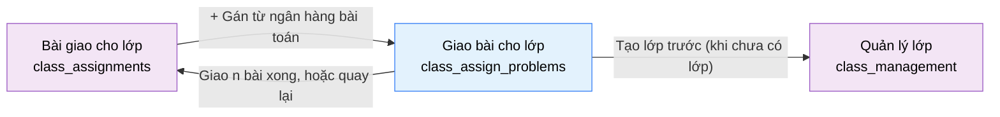

# Tài liệu thiết kế cơ bản (BD) — Giao bài cho lớp, màn con của `INS0202` (`INS0207`)

## Phương châm tài liệu [Nội bộ — không cần khách duyệt]

- Viết theo **mẫu 9 sheet**. Bộ thẻ đóng, quy ước ID, ký hiệu chuẩn, ranh giới với tài liệu khác và
  checklist kiểm toán nằm ở `02-bd/_rules/bd-template-9sheet.md` — file này không chép lại.
- Phần gắn nhãn `[Nội bộ]` phục vụ sinh mã và tự kiểm toán, không phải yêu cầu của khách hàng: mục 4.5,
  mục 7.3 và các ghi chú quy ước.
- **Mã màn `INS0207`** là mã mới, lấy số thứ tự kế tiếp trong nhóm "Lớp học" của khu Giảng viên (`INS0201` đến
  `INS0206` đã cấp) theo quy tắc "màn mới lấy số thứ tự kế tiếp trong nhóm"
  [Nguồn: 02-bd/_rules/bd-template-9sheet.md:165-170,199]. Dòng của mã này **chưa có** trong bảng mã (37 màn) ở
  `02-bd/_rules/bd-template-9sheet.md` mục 8: cần thêm một dòng và đổi "37 màn" thành 38 khi chủ dự án duyệt hình
  `[SoT: Suy luận]` (file quy ước nằm ngoài phạm vi lượt sửa này).
- Đây là **màn con** của `INS0202` (`class_assignments`): có route và slug riêng nên theo định nghĩa của mẫu là
  một **màn hình**, không phải popup [Nguồn: 02-bd/_rules/bd-template-9sheet.md mục 3, dòng 53]. Mẫu 9 sheet mỗi file
  một màn (Sheet 1 có một mã và một slug), nên màn này có file riêng thay vì thêm một khối vào BD của `INS0202`.
- Khung điều hướng bên trái **không mô tả lại ở đây** — dùng chung `02-bd/screens/teacher/_shell.md`.
  Khu Giảng viên **không có toolbar dùng chung**, nên hàng đầu tiên trong `<main>` là item của chính màn
  này và được mô tả ở Khu vực A [Nguồn: 02-bd/screens/teacher/_shell.md:30,113-114].

> Đọc cùng `01-rd/screens/teacher/INS0202_class_assignments.md` (yêu cầu giao bài cho lớp; **không có RD riêng cho
> `INS0207`**: yêu cầu không đổi, nằm ở RD `INS0202`, xem Câu hỏi mở Q1 đã đóng), `02-bd/screens/teacher/INS0202_class_assignments.md` (màn mở ra màn này, V0.18),
> `02-bd/database/F2_problem-bank.md` mục 1.7 (bảng `class_assignments`) và mục 1.1 (bảng `problems`).
>
> **Quyết định gốc:** `DEC-2026-1123-assign-problems-dedicated-screen` (ACTIVE, chủ dự án duyệt 2026-11-23), thay
> `DEC-2026-1122-assign-from-problem-list` (giao bài là thao tác chọn nhiều trên danh sách Quản lý bài tập) và
> `DEC-2026-1011-class-assignment-popup-on-assignments-screen` (popup trên `INS0202`), cả hai đã SUPERSEDED
> [Nguồn: .nexa/control/decision-registry.md:7821-7859,7860-7892].
>
> **Không thiết kế** danh sách bài đã giao và việc gỡ bài khỏi lớp — thuộc `INS0202`. **Không thiết kế** việc soạn
> bài toán — thuộc `problem_management` và `problem_authoring` [Nguồn: DEC-2026-0825-shared-content-authoring-screens].
> **Không có bước DD màn hình** cho màn này ở thời điểm viết: DD màn hình viết **sau** khi prototype được duyệt
> [Nguồn: CLAUDE.md, mục Process]; API đã có hợp đồng ở `03-dd/api/F2_problem-bank.md` mục 52 và 53.

> **Quy ước đặt tên khối** [Nội bộ]. Màn thuộc cụm 4 màn lớp học [Nguồn: 02-bd/screens/teacher/INS0201_class_management.md:27-30].
> Dùng tên khối `header` (hàng đầu `<main>`) như các màn cùng cụm. Các khối còn lại đặt theo nội dung thật:
> `bankList` (bộ lọc và bảng bài của ngân hàng), `selectionBar` (thanh chọn cố định ở đáy màn), `empty` (trạng thái
> chưa phụ trách lớp). Cột trong bảng thêm đoạn `col`. Tiền tố ID item của màn: `classAssignProblems.`
> (đúng khoá i18n `classAssignProblems` [Nguồn: 05-coding/frontend/messages/vi.json:2942]).

---

## Sheet 1. Bìa

| Mục | Giá trị |
| :--- | :--- |
| Hệ thống | AlgoPrep |
| Phân hệ | `problem-bank` (F2) |
| Công đoạn | BD — Thiết kế cơ bản |
| Phân loại | Màn hình |
| Tên màn | Giao bài cho lớp (màn con của "Bài giao cho lớp") |
| Mã màn hình | `INS0207` |
| Tên vật lý (slug) | `class_assign_problems` |
| Trục tài liệu | Màn hình (`02-bd/screens/`) |
| Actor | A2 (`INSTRUCTOR`) |
| Phiên bản | V0.2 |
| Người tạo | AI |
| Ngày tạo | 2026/11/23 |
| Người cập nhật | AI |
| Ngày cập nhật | 2026/11/23 |

---

## Sheet 2. Lịch sử sửa đổi

| Ver | Sheet bị sửa | Nội dung sửa | Ngày | Người sửa |
| :--- | :--- | :--- | :--- | :--- |
| V0.1 | Toàn bộ | Tạo mới theo mẫu 9 sheet từ `DEC-2026-1123-assign-problems-dedicated-screen` và từ bản dựng có sẵn (**chưa duyệt hình**, chưa chạy với backend thật). Hiện trạng bản dựng ghi kèm `file:line`. Phát sinh 6 câu hỏi mở. Phần backend của `ListAssignableProblems` (tham số `levelCode`, `topic`, trường `assigned`) đang được lát backend triển khai cùng ngày, **chưa kiểm chứng** | 2026/11/23 | AI |
| V0.2 | 4.1, 4.4, Sheet 5, 6, 9, Câu hỏi mở | Ghi các quyết định của chủ dự án ngày 2026/11/23 (**chưa duyệt hình**): (1) Q1 đóng, không viết RD riêng (ponytail bậc 1); (2) Q2 đóng, màn chặn quá 50 bài (nút "Giao n bài" khoá, thanh đáy hiện "Tối đa 50 bài mỗi lần giao"), thêm item C NO 4 ở cuối Sheet 5 và Sheet 6, sửa Sheet 9 NO 4; (3) Q3 đóng, tên bài ở mỗi dòng là liên kết mở `/instructor/problems/{id}` ở **tab mới**, sửa B NO 6 và bảng Hiện trạng; (4) Q4: "ẩn nút Giao theo `CLASS_MANAGEMENT:UPDATE`" chủ dự án đã duyệt nhưng **bị chặn** vì payload phiên chỉ có `id`, `displayName`, `baseCategory`, chưa có quyền (cần quyết định riêng ở hợp đồng F1); hai ý còn lại (hỏi xác nhận khi rời màn, báo lỗi tải danh sách lớp) **không làm lúc này** (ponytail bậc 3), mở lại được; (5) Q5 đóng, đã kiểm bằng ảnh chụp thật: mục "Bài giao cho lớp" sáng; (6) Q6 đóng, bài không có chủ đề hiện `-`. Cập nhật lại số dòng mã (file view dịch xuống do thêm mã) | 2026/11/23 | AI |

---

## Sheet 3. Sơ đồ chuyển màn

> [Nội bộ] Quy ước vẽ: bố trí từ trái sang phải. Màn gọi tới tô tím, màn hiện tại tô xanh nhạt, popup tô
> vàng. Màu và `[Nguồn:]` dùng để truy vết, không phải yêu cầu của khách hàng.

### 3.1 Danh sách chuyển màn

#### Giao bài cho lớp (`INS0202`) → Giao bài cho lớp (màn con `INS0207`)

[Điều kiện mở] Bấm nút "+ Gán từ ngân hàng bài toán" ở hàng đầu của `INS0202`; nút là liên kết và chỉ hiện khi có
`CLASS_MANAGEMENT:UPDATE` [Nguồn: 05-coding/frontend/src/views/teacher/class-assignments/ui/class-assignments-view.tsx:232-242].

[Chế độ mở] Điều hướng cùng tab sang `/instructor/assignments/new` trong khung Giảng viên.

[Thông tin truyền] `classId` của tab lớp đang chọn ở `INS0202`, qua `?classId=`. Tab "Tất cả" thì không truyền lớp.

[Giá trị trả về] Không có.

[Khi thành công] Mở màn với lớp nhận bài chọn sẵn theo `classId`. Nếu `classId` thiếu hoặc không nằm trong danh sách lớp
phụ trách thì chọn **lớp đầu tiên** của danh sách
[Nguồn: 05-coding/frontend/src/views/teacher/class-assign-problems/ui/class-assign-problems-view.tsx:72-78].

[Khi huỷ] Không có.

#### Giao bài cho lớp (màn con) → Bài giao cho lớp (`INS0202`), khi giao xong

[Điều kiện mở] Bấm "Giao n bài" ở thanh chọn và máy chủ đã trả lời (kể cả khi có bài bị bỏ qua hoặc bị từ chối).

[Chế độ mở] Điều hướng sang `/instructor/assignments?classId=<lớp vừa giao>`.

[Thông tin truyền] `classId` của lớp nhận bài đang chọn.

[Giá trị trả về] Kết quả giao bài (mới, bỏ qua, bị từ chối) **không** truyền sang màn đích mà được báo bằng toast ngay
trước khi chuyển màn [Nguồn: 05-coding/frontend/src/views/teacher/class-assign-problems/ui/class-assign-problems-view.tsx:126-144].

[Khi thành công] Mở `INS0202` ở tab lớp vừa giao; bảng bài đã giao tải lại khi vào màn.

[Khi huỷ] Không có. Gọi máy chủ lỗi thì ở lại màn, báo toast lỗi (EVT-11).

#### Giao bài cho lớp (màn con) → Bài giao cho lớp (`INS0202`), khi quay lại

[Điều kiện mở] Bấm mũi tên quay lại ở hàng đầu.

[Chế độ mở] Điều hướng sang `/instructor/assignments?classId=<lớp đang chọn>`; chưa có lớp nào thì sang `/instructor/assignments`.

[Thông tin truyền] `classId` của lớp nhận bài đang chọn.

[Giá trị trả về] Không có.

[Khi thành công] Mở `INS0202`. Những bài đã tick mà chưa giao **bị bỏ**, không hỏi xác nhận `[SoT: Suy luận]` (bản dựng không chặn rời màn,
chủ dự án chưa chọn làm, xem Câu hỏi mở Q4) [Nguồn: 05-coding/frontend/src/views/teacher/class-assign-problems/ui/class-assign-problems-view.tsx:198-208].

[Khi huỷ] Không có.

#### Giao bài cho lớp (màn con) → Danh sách lớp (`INS0201`), khi chưa phụ trách lớp nào

[Điều kiện mở] Bấm liên kết trong trạng thái rỗng "Bạn chưa phụ trách lớp nào".

[Chế độ mở] Điều hướng sang `/instructor/classes` (`class_management`).

[Thông tin truyền] Không có.

[Giá trị trả về] Không có.

[Khi thành công] Mở `INS0201` để tạo lớp [Nguồn: 05-coding/frontend/src/views/teacher/class-assign-problems/ui/class-assign-problems-view.tsx:198-209].

[Khi huỷ] Không có.

### 3.2 Sơ đồ

[Nguồn: 05-coding/frontend/src/views/teacher/class-assign-problems/ui/class-assign-problems-view.tsx:121-149,186-210; 02-bd/screens/teacher/INS0202_class_assignments.md Sheet 3]

---

## Sheet 4. Bố cục màn hình

### 4.1 Tổng quan màn

[Mục đích màn] Cho giảng viên chọn lớp, tìm bài đã xuất bản trong ngân hàng bài toán chung theo mã hoặc tên,
lọc theo độ khó và chủ đề, tick nhiều bài rồi giao cho lớp bằng **một lần xác nhận**; bài lớp đã có vẫn hiện nhưng
làm mờ để giảng viên thấy lớp đang có gì
[Nguồn: .nexa/control/decision-registry.md:7826-7840; 01-rd/screens/teacher/INS0202_class_assignments.md:66-74].

[Luồng nghiệp vụ chính]

1. **Vào màn**: từ nút "+ Gán từ ngân hàng bài toán" của `INS0202`. Hệ thống tải danh sách lớp phụ trách, danh mục độ khó,
   danh mục chủ đề và trang đầu của danh sách bài giao được cho lớp đang chọn. Chưa có lớp nào thì hiện trạng thái rỗng
   kèm liên kết sang `INS0201`. Lớp lấy từ `?classId=`, thiếu hoặc lạ thì lấy lớp đầu tiên.
2. **Chọn lớp nhận bài**: đổi lớp ở menu "Lớp nhận bài" cập nhật `?classId=` trên URL (nên tải lại trang vẫn giữ lớp),
   **xoá toàn bộ bài đã tick** vì cờ "Đã giao" khác nhau theo lớp, về trang 1 và tải lại danh sách.
3. **Tìm và lọc**: ô tìm theo mã hoặc tên, bộ lọc độ khó, bộ lọc chủ đề. Ba điều kiện cộng dồn (AND), do **máy chủ** lọc và
   phân trang; số kết quả hiện ở góc phải hàng lọc. Đổi bộ lọc về trang 1 nhưng **giữ** các bài đã tick.
4. **Chọn bài**: tick từng dòng (bấm vào dòng cũng tick), hoặc tick ô chọn tất cả ở tiêu đề bảng. Ô chọn tất cả chỉ
   áp cho **các dòng giao được của trang hiện tại**. Bài `assigned = true` (lớp đã có) hiện mờ, kèm huy hiệu "Đã giao", ô tick
   vô hiệu và bấm vào dòng không có tác dụng. Lựa chọn **giữ** khi đổi trang và đổi bộ lọc (lưu theo id bài).
5. **Xác nhận một lần**: khi có ít nhất một bài được tick, thanh nổi ở **đáy màn** hiện "Đã chọn {n} bài, giao cho lớp {tên lớp}"
   cùng hai nút "Bỏ chọn" và "Giao {n} bài". "Giao {n} bài" gọi `AssignProblemsToClass` với toàn bộ id đã tick, báo kết quả bằng toast
   (giao mới, bỏ qua vì lớp đã có, bị từ chối kèm lý do theo mã `PRB-`), rồi chuyển về `INS0202` ở tab lớp vừa giao.
6. **Quay lại**: mũi tên ở hàng đầu về `INS0202`.

[Người dùng] Giảng viên đã đăng nhập, có Function `CLASS_MANAGEMENT` (xem: `READ`, giao bài: `UPDATE`) [Nguồn: 01-rd/req/F1_identity.md:57].

[Tệp liên quan] Không có. Màn này không xuất hay nhập tệp.

[Phạm vi]
- Chỉ lớp có `instructor_id` bằng người đang đăng nhập; máy chủ kiểm lại ở từng yêu cầu (`PRB-005`)
  [Nguồn: 03-dd/api/F2_problem-bank.md mục 52.4].
- Chỉ liệt kê bài **đã xuất bản và chưa xoá**, sắp theo mã bài, gồm cả bài của người khác (F2-12); **không** liệt kê bản nháp
  hay bài đã rút `[Nguồn: 03-dd/api/F2_problem-bank.md mục 52.3]`.
- **Không** hiện danh sách bài đã giao, **không** gỡ bài khỏi lớp — thuộc `INS0202`.
- Xem đề: **tên bài ở mỗi dòng là liên kết** mở `/instructor/problems/{id}` ở **tab mới** (`target="_blank"`), để giảng viên đọc đề mà không mất các bài đã tick (Q3 đã đóng) [Nguồn: 05-coding/frontend/src/views/teacher/class-assign-problems/ui/class-assign-problems-view.tsx:167-173].
- **Không** có thao tác xoá hay sửa bài toán.

[Quyền sử dụng]
- Xem: được, khi có `CLASS_MANAGEMENT:READ` (liệt kê bài giao được).
- Thêm: được, khi có `CLASS_MANAGEMENT:UPDATE` (giao bài, `AssignProblemsToClass`).
- Sửa: không.
- Xoá: không.

[Số bản ghi tối đa] Bảng bài: **20 dòng mỗi trang**, máy chủ phân trang, thanh phân trang ẩn khi chỉ có một trang. Một lần giao tối đa
**50 bài** (giới hạn của `AssignProblemsToClass`, `MAX_IDS = 50`, lỗi `PRB-001`): màn **chặn trước** khi tick quá 50 — nút "Giao n bài" bị khoá và thanh đáy hiện "Tối đa 50 bài mỗi lần giao" (Q2 đã đóng)
[Nguồn: 03-dd/api/F2_problem-bank.md mục 53.2; 05-coding/frontend/src/views/teacher/class-assign-problems/ui/class-assign-problems-view.tsx:48,358-360,366-368; 05-coding/frontend/messages/vi.json:2966].

[Nguồn: .nexa/control/decision-registry.md:7821-7859; 03-dd/api/F2_problem-bank.md mục 52, 53]

### 4.2 DTO liên quan

- `AssignableProblemRowDto` — một dòng của bảng bài giao được (`problemId`, `code`, `title`, `levelCode`, `levelDisplayName`, `topicNames`, `assigned`).
- `AssignProblemsCommandDto` — danh sách id bài cần giao cho một lớp.
- `AssignProblemsResultDto` — kết quả từng bài: giao mới, bỏ qua, bị từ chối kèm mã lỗi.
- `ClassOptionDto` — một lớp phụ trách (id, tên) cho menu "Lớp nhận bài".

`[Suy luận]` — tên DTO do BD này đề xuất, tên trường của hai DTO đầu lấy từ `03-dd/api/F2_problem-bank.md` mục 52.3 và 53.3, DD chốt lại.

### 4.3 Bảng dữ liệu liên quan (6)

| NO | Bảng | Ghi chú |
| --: | :--- | :--- |
| 1 | `problem.problems` | Mã bài, tên bài, trạng thái xuất bản, cờ ẩn mềm, khoá `level_id` [Nguồn: 02-bd/database/F2_problem-bank.md:15,18,19] |
| 2 | `problem.problem_levels` | Danh mục độ khó do ADMIN quản lý: nhãn cột "Độ khó" và nguồn của bộ lọc độ khó (khớp theo `code`) [Nguồn: 02-bd/database/F2_problem-bank.md mục `problem_levels`] |
| 3 | `problem.topics` | Tên chủ đề cho cột "Chủ đề" và bộ lọc chủ đề (khớp **theo tên**) [Nguồn: 02-bd/database/F2_problem-bank.md:37-38] |
| 4 | `problem.problem_topics` | Nối bài với chủ đề [Nguồn: 02-bd/database/F2_problem-bank.md:35-39] |
| 5 | `problem.class_assignments` | Nguồn của cờ `assigned` (có dòng `removed_at IS NULL` cho cặp bài-lớp) và nơi ghi khi giao bài [Nguồn: 02-bd/database/F2_problem-bank.md:116-128] |
| 6 | `identity.classes` | Danh sách lớp phụ trách cho menu "Lớp nhận bài" và tên lớp trên thanh chọn. Đọc **qua cổng ra** `InstructorClassPort`, không join chéo schema [Nguồn: 02-bd/database/F1_identity.md:85-88; 02-bd/screens/teacher/INS0202_class_assignments.md Sheet 7.2 NO 6] |

### 4.4 Vùng bố cục

Màn **không có prototype `.dc.html`** trong `09-layoutBase/` (màn sinh ra sau khi prototype cũ đã đóng băng), nên bảng dưới đối chiếu
với **bản dựng Next.js**, không phải bằng chứng bố cục chỉ-đọc nào khác [Nguồn: CLAUDE.md, mục Directory map, dòng `09-layoutBase/`].

| Vùng | Vị trí trong bản dựng | Nội dung |
| :--- | :--- | :--- |
| Thanh điều hướng bên trái (khung chung Giảng viên) | `_shell.md` | Dùng lại khung chung, không mô tả lại. Ở `/instructor/assignments/new` mục "Bài giao cho lớp" sáng (đã kiểm bằng ảnh chụp thật, Q5 đã đóng) |
| Hàng đầu | `class-assign-problems-view.tsx:226-239` | `PageHeader`: mũi tên quay lại ở bên trái, tiêu đề "Giao bài cho lớp", dòng phụ, menu "Lớp nhận bài" ở bên phải |
| Khối danh sách — hàng lọc | `class-assign-problems-view.tsx:241-281` | Trong một thẻ (`Card`): ô tìm (co giãn), menu "Độ khó", menu "Chủ đề", số kết quả "{n} bài" căn phải |
| Khối danh sách — bảng | `class-assign-problems-view.tsx:283-309` | Cột chọn đứng đầu (ô chọn tất cả ở tiêu đề), cột "Bài tập" (mã, tên, huy hiệu "Đã giao"), "Chủ đề", "Độ khó" |
| Phân trang | `class-assign-problems-view.tsx:311-321` | Cuối thẻ, ẩn khi chỉ có một trang |
| Thanh chọn | `class-assign-problems-view.tsx:324-353` | `BulkActionBar` với `placement="bottom"`: nổi cố định ở đáy màn, chỉ hiện khi có bài được tick; thêm dòng cảnh báo "Tối đa 50 bài mỗi lần giao" khi tick quá 50 |
| Trạng thái rỗng (chưa có lớp) | `class-assign-problems-view.tsx:210-221` | `EmptyState` thay cho toàn bộ nội dung dưới hàng đầu |

**Hiện trạng bản dựng (2026/11/23, chưa duyệt hình).** Bảng 4.4a liệt kê các quy tắc của quyết định
`DEC-2026-1123-assign-problems-dedicated-screen` mà bản dựng Next.js đã thực hiện; mọi dòng **chưa duyệt hình** và **chưa chạy với backend thật**
(phần backend mở rộng #51 đang được lát backend làm cùng ngày).

Bảng 4.4a: Hiện trạng bản dựng của INS0207 (đối chiếu với `class-assign-problems-view.tsx`).

| Quy tắc (nguồn chốt) | Hiện trạng bản dựng | Nguồn mã | Trạng thái |
| :--- | :--- | :--- | :--- |
| Route và lớp theo URL | Trang `/instructor/assignments/new` dựng view; lớp lấy từ `?classId=`, id lạ hoặc thiếu thì lớp đầu tiên; đổi lớp bằng `router.replace` | `app/(instructor)/instructor/assignments/new/page.tsx:1-5`; `views/teacher/class-assign-problems/ui/class-assign-problems-view.tsx:76-80,106-110` | Dựng; mục "Bài giao cho lớp" của sidebar sáng ở route này (đã kiểm ảnh chụp thật, `06-plan/reports/261123-0030-giao-bai-man-rieng/img/03-da-chon-thanh-duoi.png`), chưa duyệt hình |
| Hàng đầu | Mũi tên quay lại (liên kết về `/instructor/assignments?classId=`, không lớp thì không kèm), tiêu đề, dòng phụ, menu "Lớp nhận bài" căn cuối | `class-assign-problems-view.tsx:198-208,226-239` | Dựng, chưa duyệt hình |
| Tìm, lọc, đếm | Ô tìm theo mã hoặc tên, tối đa 100 ký tự, trễ gõ (`useDebounced`); menu độ khó và chủ đề; "{n} bài" lấy từ tổng của máy chủ; chủ đề đi theo **tên** | `class-assign-problems-view.tsx:46,49,88-92,241-281` | Dựng, chưa duyệt hình |
| Cột "Chủ đề" | Chủ đề đầu theo chữ cái cộng "+n", tooltip đủ danh sách (cùng quy ước Q5 của `INS0202`); bài không có chủ đề hiện `-` | `class-assign-problems-view.tsx:51-60,182-188` | Dựng, chưa duyệt hình |
| Bài đã giao (`assigned`) | Vẫn nằm trong danh sách, huy hiệu "Đã giao", ô tick vô hiệu; mờ 55%; bấm dòng không tick | `class-assign-problems-view.tsx:176,307`; `shared/ui/data/data-table.tsx:241-268` | Dựng, chưa duyệt hình |
| Chọn tất cả | Chỉ thêm hoặc bỏ các dòng giao được của trang hiện tại | `class-assign-problems-view.tsx:295-305` | Dựng, chưa duyệt hình |
| Lựa chọn giữ khi lọc, đổi trang; xoá khi đổi lớp | Lưu tập id bài; đổi lớp tạo tập rỗng; đổi lọc chỉ về trang 1 | `class-assign-problems-view.tsx:86,106-110` | Dựng, chưa duyệt hình |
| Phân trang 20 dòng, ẩn khi một trang | `PAGE_SIZE = 20`, `hideWhenSinglePage` | `class-assign-problems-view.tsx:46,311-321` | Dựng, chưa duyệt hình |
| Thanh chọn ở đáy | `BulkActionBar placement="bottom"`; nhãn "Đã chọn {n} bài, giao cho lớp {tên lớp}"; nút "Bỏ chọn" và "Giao {n} bài" (khoá khi đang gửi, chưa có lớp hoặc tick quá 50 bài) | `class-assign-problems-view.tsx:324-353`; `shared/ui/data/bulk-action-bar.tsx:29,38,56` | Dựng, chưa duyệt hình |
| Giao một lần, toast, quay về | Gọi `AssignProblemsToClass` với mọi id đã tick; toast giao mới, bỏ qua, bị từ chối kèm lý do theo mã (`PRB-037` chưa xuất bản...); rồi `router.push` về `/instructor/assignments?classId=` | `class-assign-problems-view.tsx:123-150` | Dựng, chưa duyệt hình |
| Chặn quá 50 bài mỗi lần (Q2) | `ASSIGN_MAX = 50` (khớp `MAX_IDS = 50` ở máy chủ); nút "Giao n bài" khoá khi `selected.size > ASSIGN_MAX`; thanh đáy hiện "Tối đa 50 bài mỗi lần giao" (khoá i18n `classAssignProblems.overLimit`) | `class-assign-problems-view.tsx:48,358-360,366-368`; `messages/vi.json:2966` | Dựng, chưa duyệt hình |
| Tên bài là liên kết sang chi tiết bài ở tab mới (Q3) | `Link` tới `/instructor/problems/{id}` với `target="_blank"`, `rel="noopener noreferrer"`; bài đã tick không mất | `class-assign-problems-view.tsx:167-173` | Dựng, chưa duyệt hình; bấm vào liên kết không làm tick dòng vì `DataTable` bỏ qua click nằm trong thẻ `a` (`data-table.tsx:253`, `ROW_CONTROLS`) |
| Chưa có lớp | `EmptyState` "Bạn chưa phụ trách lớp nào" kèm liên kết sang `/instructor/classes` | `class-assign-problems-view.tsx:210-221`; `messages/vi.json:2968-2969` | Dựng, chưa duyệt hình |
| Lỗi tải | Vùng bảng hiện thông báo lỗi "Không tải được danh sách bài. Vui lòng thử lại sau." | `class-assign-problems-view.tsx:290`; `messages/vi.json:2961` | Dựng, chưa duyệt hình |

Kiểm thử bản dựng: `class-assign-problems-view.test.tsx` và `class-assign-problems-real.test.tsx` nằm cạnh view
[Nguồn: 05-coding/frontend/src/views/teacher/class-assign-problems/ui/]; BD này **chưa đọc nội dung** hai file đó nên không ghi số ca.

### 4.5 Cấu trúc slice FSD [Nội bộ]

| Khối | Slice | Căn cứ |
| :--- | :--- | :--- |
| Trang | `views/teacher/class-assign-problems`, route `app/(instructor)/instructor/assignments/new/page.tsx` | Có trong bản dựng [Nguồn: 05-coding/frontend/src/app/(instructor)/instructor/assignments/new/page.tsx:1-5] |
| Khung Giảng viên | Dùng lại `widgets/app-shell` (biến thể `instructor-sidebar`) | `02-bd/screens/teacher/_shell.md` mục 1 |
| Dữ liệu bài giao được và giao bài | `entities/class-assignment` (`useAssignableProblems`, `useAssignProblems`) | [Nguồn: 05-coding/frontend/src/entities/class-assignment/api/queries.ts:159-182] |
| Danh sách lớp | Dùng lại `entities/class` (`useInstructorClasses`) | Khai ở `INS0201` Sheet 4.5 |
| Danh mục độ khó, chủ đề | Dùng lại `entities/problem` (`useProblemLevels`, `useProblemTopics`) | [Nguồn: 05-coding/frontend/src/views/teacher/class-assign-problems/ui/class-assign-problems-view.tsx:19-25] |
| Bảng, menu lọc, phân trang, thanh chọn | `shared/ui` (`DataTable`, `FilterMenu`, `Pagination`, `BulkActionBar`) | Tái dùng, không thêm shared; `BulkActionBar` thêm thuộc tính `placement` [Nguồn: 05-coding/frontend/src/shared/ui/data/bulk-action-bar.tsx:29] |

`[Suy luận]` — ánh xạ slice do BD đề xuất, trùng với bản dựng; DD màn hình chốt lại sau khi duyệt hình.

> [Nội bộ] Ảnh minh hoạ đặt ở `08-diagram/02-bd/screens/teacher/`, chụp bằng Playwright trên ứng dụng
> Next.js thật khi đã có mã chạy được với backend thật. Chưa có thì không vẽ tay.

---

## Sheet 5. Danh sách item màn hình

> Quy ước ID, bộ thẻ và giá trị chuẩn: `02-bd/_rules/bd-template-9sheet.md` mục 2, 3, 4.

### Khu vực A — Hàng đầu

| Khu vực | NO | Tên item | ID item | Bảng DB | Cột DB | Loại UI | Kiểu | Độ dài | Bắt buộc | I/O | Giá trị mặc định | Định dạng | Ghi chú |
| :--- | --: | :--- | :--- | :--- | :--- | :--- | :--- | :--- | :-: | :-: | :--- | :--- | :--- |
| Hàng đầu | | | | | | | | | | | | | |
| | 1 | Quay lại | `classAssignProblems.header.btnBack` | - | - | Link | - | - | - | I | - | Mũi tên | Quay về `INS0202` ở tab lớp đang chọn [Nguồn giá trị] Nhãn tĩnh i18n "Quay lại Bài giao cho lớp" [EVT liên quan] EVT-2 |
| | 2 | Tiêu đề màn | `classAssignProblems.header.title` | - | - | Label | String | - | - | O | Giao bài cho lớp | - | Tên màn hiển thị cố định [Nguồn giá trị] Nhãn tĩnh i18n [EVT liên quan] - |
| | 3 | Dòng phụ | `classAssignProblems.header.subtitle` | - | - | Label | String | - | - | O | Chọn bài đã xuất bản trong ngân hàng bài toán rồi giao cho lớp | - | Câu hướng dẫn cố định [Nguồn giá trị] Nhãn tĩnh i18n [EVT liên quan] - |
| | 4 | Lớp nhận bài | `classAssignProblems.header.classPicker` | `identity.classes` | `id`, `name` | List | List | - | Bắt buộc | I/O | Lớp từ `?classId=`, thiếu thì lớp đầu tiên | Danh sách chọn một lớp | Chọn lớp sẽ nhận bài; đổi lớp xoá các bài đã tick và về trang 1 [Nguồn giá trị] `classes.name` qua `ListInstructorClasses`, chỉ lớp người đăng nhập phụ trách [EVT liên quan] EVT-1, EVT-3 |

### Khu vực B — Bộ lọc và bảng bài

| Khu vực | NO | Tên item | ID item | Bảng DB | Cột DB | Loại UI | Kiểu | Độ dài | Bắt buộc | I/O | Giá trị mặc định | Định dạng | Ghi chú |
| :--- | --: | :--- | :--- | :--- | :--- | :--- | :--- | :--- | :-: | :-: | :--- | :--- | :--- |
| Bộ lọc và bảng bài | | | | | | | | | | | | | |
| | 1 | Tìm theo mã hoặc tên | `classAssignProblems.bankList.search` | `problem.problems` | `code`, `title` | TextBox | String | 100 | - | I | rỗng | Chuỗi tự do | Lọc theo mã hoặc tên bài, khớp chuỗi con, do máy chủ lọc [Nguồn giá trị] Giá trị người dùng nhập, cắt còn 100 ký tự; đối chiếu hai cột `code`, `title` [Nguồn: 03-dd/api/F2_problem-bank.md mục 52.2] [EVT liên quan] EVT-4 |
| | 2 | Lọc độ khó | `classAssignProblems.bankList.levelFilter` | `problem.problem_levels` | `code`, `display_name` | List | List | - | - | I | Tất cả | Danh sách chọn một mức | Giá trị gửi lên là `levelCode` (khớp đúng); "Tất cả" thì không gửi [Nguồn giá trị] Nhãn là `problem_levels.display_name` đọc từ dữ liệu qua `ListProblemLevels` (`DEC-2026-1001-admin-configurable-settings` mục 7); mục "Tất cả" là nhãn tĩnh i18n [EVT liên quan] EVT-5 |
| | 3 | Lọc chủ đề | `classAssignProblems.bankList.topicFilter` | `problem.topics` | `name` | List | List | - | - | I | Tất cả | Danh sách chọn một chủ đề | Giá trị gửi lên là **tên** chủ đề (khớp đúng, không phải id); "Tất cả" thì không gửi [Nguồn giá trị] `topics.name` qua `ListProblemTopics`; mục "Tất cả" là nhãn tĩnh i18n [EVT liên quan] EVT-6 |
| | 4 | Số kết quả | `classAssignProblems.bankList.resultCount` | - | - | Label | String | 12 | - | O | 0 | `{số} bài` | Tổng số bài khớp bộ lọc, trên mọi trang [Công thức] Tổng số bản ghi do máy chủ trả (`page.totalItems`), không đếm tại trình duyệt [EVT liên quan] EVT-1, EVT-3, EVT-4, EVT-5, EVT-6, EVT-7 |
| | 5 | Bảng bài | `classAssignProblems.bankList.table` | `problem.problems` | - | List | List | - | - | O | rỗng | - | Bài đã xuất bản, chưa xoá, sắp theo mã; 20 dòng mỗi trang; kể cả bài lớp đã có [Nguồn giá trị] Kết quả gọi `ListAssignableProblems` theo lớp, từ khoá, độ khó, chủ đề, trang [EVT liên quan] EVT-1, EVT-3, EVT-4, EVT-5, EVT-6, EVT-7 |
| | 6 | Bài tập | `classAssignProblems.bankList.col.title` | `problem.problems` | `code`, `title` | ListColumn | String | 200 | - | O | - | `{mã} {tên bài}` | Mã bài (chữ đơn cách, màu nhạt) rồi tên bài (đậm); **tên bài là liên kết** mở `/instructor/problems/{id}` ở tab mới để xem đề mà không mất các bài đã tick (Q3 đã đóng) [Nguồn: 05-coding/frontend/src/views/teacher/class-assign-problems/ui/class-assign-problems-view.tsx:167-173] [Nguồn giá trị] Cột `code`, `title` [Nguồn: 02-bd/database/F2_problem-bank.md:15] [EVT liên quan] - |
| | 7 | Huy hiệu Đã giao | `classAssignProblems.bankList.col.assignedBadge` | `problem.class_assignments` | `problem_id`, `class_id`, `removed_at` | Badge | Boolean | - | - | O | - | `Đã giao` | Hiện cạnh tên bài khi lớp nhận bài **đang** có bài này [Công thức] `assigned = true` khi có dòng `class_assignments` cho cặp (bài, lớp) với `removed_at IS NULL`; bài từng giao rồi gỡ là `assigned = false` [EVT liên quan] - |
| | 8 | Chủ đề | `classAssignProblems.bankList.col.topic` | `problem.topics` | `name` | ListColumn | String | 60 | - | O | - | Chủ đề đầu theo chữ cái, thêm "+{n}" khi còn chủ đề khác | Cùng quy ước với cột "Chủ đề" của `INS0202` (Q5 đóng); tooltip liệt kê đủ [Nguồn giá trị] `topics.name` nối qua `problem_topics`, trường `topicNames` của DTO [Nguồn: 03-dd/api/F2_problem-bank.md mục 52.3] [EVT liên quan] - |
| | 9 | Độ khó | `classAssignProblems.bankList.col.difficulty` | `problem.problem_levels` | `display_name` | Badge | String | - | - | O | - | Huy hiệu `display_name` | Mức độ khó, màu huy hiệu theo mức (mức khởi tạo màu cũ, mức mới trung tính) [Nguồn giá trị] `levelCode`, `levelDisplayName` của DTO, đọc từ dữ liệu, không còn nhãn i18n cứng [EVT liên quan] - |
| | 10 | Ô chọn dòng | `classAssignProblems.bankList.col.rowCheck` | `problem.problems` | `id` | Toggle | Boolean | - | - | I/O | Bỏ chọn | Ô tick | Tick một bài để giao; bấm vào dòng cũng tick; vô hiệu khi `assigned = true` [Nguồn giá trị] Tập `problemId` đã tick ở phía màn hình, giữ khi đổi trang và đổi lọc [EVT liên quan] EVT-8 |
| | 11 | Chọn tất cả trên trang | `classAssignProblems.bankList.col.selectAll` | `problem.problems` | `id` | Toggle | Boolean | - | - | I/O | Bỏ chọn | Ô tick ở tiêu đề | Tick hoặc bỏ tick mọi dòng **giao được** (chưa `assigned`) của trang hiện tại; không đụng bài ở trang khác [Công thức] Áp cho các dòng `assigned = false` trong trang đang hiển thị [EVT liên quan] EVT-9 |
| | 12 | Phân trang | `classAssignProblems.bankList.pagination` | - | - | Pager | Number | - | - | I/O | Trang 1 | `Trang {trang} / {tổng trang}` | 20 dòng mỗi trang, cỡ trang là hằng số (ponytail bậc 5); đổi lớp hoặc đổi bộ lọc về trang 1; số kết quả (B NO 4) là tổng trên mọi trang [Nguồn giá trị] Tham số `page`, `pageSize` = 20 của `ListAssignableProblems` [EVT liên quan] EVT-7 |

### Khu vực C — Thanh chọn ở đáy

| Khu vực | NO | Tên item | ID item | Bảng DB | Cột DB | Loại UI | Kiểu | Độ dài | Bắt buộc | I/O | Giá trị mặc định | Định dạng | Ghi chú |
| :--- | --: | :--- | :--- | :--- | :--- | :--- | :--- | :--- | :-: | :-: | :--- | :--- | :--- |
| Thanh chọn | | | | | | | | | | | | | |
| | 1 | Nhãn đã chọn | `classAssignProblems.selectionBar.label` | `identity.classes` | `name` | Label | String | - | - | O | - | `Đã chọn {n} bài, giao cho lớp {tên lớp}` | Cho giảng viên nhìn lại số bài và lớp nhận trước khi xác nhận [Công thức] {n} là số id đã tick (mọi trang); {tên lớp} là `classes.name` của lớp đang chọn [EVT liên quan] EVT-8, EVT-9, EVT-10 |
| | 2 | Bỏ chọn | `classAssignProblems.selectionBar.btnClear` | - | - | Button | - | - | - | I | - | `Bỏ chọn` | Xoá toàn bộ bài đã tick, kể cả ở các trang khác [Nguồn giá trị] - [EVT liên quan] EVT-10 |
| | 3 | Giao n bài | `classAssignProblems.selectionBar.btnConfirm` | `problem.class_assignments` | `problem_id`, `class_id` | Button | - | - | - | I | - | `Giao {n} bài` | Một lần xác nhận cho toàn bộ bài đã tick; không có hộp xác nhận thứ hai; **khoá khi tick quá 50 bài** (C NO 4) [Nguồn giá trị] Id bài đã tick và `classId` đang chọn [EVT liên quan] EVT-11 |
| | 4 | Cảnh báo quá giới hạn | `classAssignProblems.selectionBar.overLimit` | - | - | Label | String | - | - | O | - | `Tối đa {max} bài mỗi lần giao` | Báo vì sao nút "Giao n bài" bị khoá khi đã tick hơn 50 bài; {max} = 50 [Công thức] Hiện khi số id đã tick lớn hơn `ASSIGN_MAX = 50` (bằng giới hạn `MAX_IDS` ở máy chủ) [Nguồn: 05-coding/frontend/src/views/teacher/class-assign-problems/ui/class-assign-problems-view.tsx:48,358-360; 05-coding/frontend/messages/vi.json:2966] [EVT liên quan] EVT-8, EVT-9 |

### Khu vực D — Trạng thái chưa có lớp

| Khu vực | NO | Tên item | ID item | Bảng DB | Cột DB | Loại UI | Kiểu | Độ dài | Bắt buộc | I/O | Giá trị mặc định | Định dạng | Ghi chú |
| :--- | --: | :--- | :--- | :--- | :--- | :--- | :--- | :--- | :-: | :-: | :--- | :--- | :--- |
| Trạng thái chưa có lớp | | | | | | | | | | | | | |
| | 1 | Thông báo chưa có lớp | `classAssignProblems.empty.message` | - | - | Label | String | - | - | O | Bạn chưa phụ trách lớp nào | - | Thay cho toàn bộ danh sách bài khi giảng viên chưa có lớp [Nguồn giá trị] Nhãn tĩnh i18n; điều kiện lấy từ kết quả `ListInstructorClasses` rỗng [EVT liên quan] EVT-1 |
| | 2 | Liên kết sang quản lý lớp | `classAssignProblems.empty.linkClasses` | - | - | Link | - | - | - | I | - | Chữ liên kết | Mở `/instructor/classes` để tạo lớp [Nguồn giá trị] Nhãn tĩnh i18n [EVT liên quan] EVT-12 |

[Nguồn: 05-coding/frontend/src/views/teacher/class-assign-problems/ui/class-assign-problems-view.tsx:151-334; 05-coding/frontend/messages/vi.json:2942-2975; 03-dd/api/F2_problem-bank.md mục 52.2, 52.3; 02-bd/database/F2_problem-bank.md:15-19,35-39,116-128; 02-bd/database/F1_identity.md:85-88]

---

## Sheet 6. Đặc tả điều khiển item

> Ký hiệu cột `Hiển thị` và thứ tự thẻ: `02-bd/_rules/bd-template-9sheet.md` mục 2, 3. Dùng đúng NO, tên
> item và thứ tự của Sheet 5. Lỗi nhập liệu ghi ở Sheet 9, xử lý nghiệp vụ ghi ở Sheet 8.

### Khu vực A — Hàng đầu

| Khu vực | NO | Tên item | Hiển thị | Ghi chú |
| :--- | --: | :--- | :-: | :--- |
| Hàng đầu | | | | |
| | 1 | Quay lại | Có | [Điều kiện kích hoạt] Luôn kích hoạt, kể cả khi bảng đang tải. |
| | 2 | Tiêu đề màn | Có | - |
| | 3 | Dòng phụ | Điều kiện | [Điều kiện hiển thị] Ẩn ở trạng thái chưa có lớp (D), khi đó chỉ còn tiêu đề. |
| | 4 | Lớp nhận bài | Điều kiện | [Điều kiện hiển thị] Ẩn ở trạng thái chưa có lớp (D). [Điều kiện kích hoạt] Luôn kích hoạt kể cả khi đang gửi giao bài `[SoT: Suy luận]`, xem Câu hỏi mở Q4. [Tự động đặt] Lấy từ `?classId=` khi hợp lệ, không thì lớp đầu tiên. Đổi lớp tự xoá các bài đã tick. |

### Khu vực B — Bộ lọc và bảng bài

| Khu vực | NO | Tên item | Hiển thị | Ghi chú |
| :--- | --: | :--- | :-: | :--- |
| Bộ lọc và bảng bài | | | | |
| | 1 | Tìm theo mã hoặc tên | Có | [Điều kiện kích hoạt] Luôn kích hoạt. [Tự động đặt] Giữ nguyên giá trị khi đổi lớp, đổi độ khó hoặc chủ đề — ba bộ lọc cộng dồn, không reset lẫn nhau; mỗi lần đổi về trang 1. |
| | 2 | Lọc độ khó | Có | [Tự động đặt] Mặc định "Tất cả"; không lưu giữa các lần vào màn. |
| | 3 | Lọc chủ đề | Có | [Tự động đặt] Mặc định "Tất cả"; không lưu giữa các lần vào màn. |
| | 4 | Số kết quả | Có | [Điều kiện hiển thị] Hiện kể cả khi kết quả bằng 0. |
| | 5 | Bảng bài | Có | [Điều kiện hiển thị] Trong lúc tải hiển thị khung chờ. Không còn bài nào khớp thì hiện "Không có bài nào khớp bộ lọc". Tải lỗi thì hiện "Không tải được danh sách bài. Vui lòng thử lại sau." trong vùng bảng. Ba trạng thái khác nhau, không dùng chung một câu. |
| | 6 | Bài tập | Có | - |
| | 7 | Huy hiệu Đã giao | Điều kiện | [Điều kiện hiển thị] Chỉ hiện ở dòng có `assigned = true`; dòng đó còn bị làm mờ 55%. |
| | 8 | Chủ đề | Điều kiện | [Điều kiện hiển thị] Bài chưa gắn chủ đề nào thì hiện `-` (cùng quy ước `INS0202`; Q6 đã đóng). Bài từ 2 chủ đề trở lên hiện chủ đề đầu kèm "+{n}". |
| | 9 | Độ khó | Có | - |
| | 10 | Ô chọn dòng | Có | [Điều kiện kích hoạt] Vô hiệu khi `assigned = true`; bấm vào dòng đó không tick. Kích hoạt ở các dòng còn lại. |
| | 11 | Chọn tất cả trên trang | Có | [Điều kiện kích hoạt] Vô hiệu khi mọi dòng của trang đều `assigned = true` hoặc trang không có dòng `[SoT: Suy luận]` (xem `shared/ui/data/data-table.tsx:119-120`: tập "pickable" rỗng). |
| | 12 | Phân trang | Điều kiện | [Điều kiện hiển thị] Chỉ hiện khi tổng số bài sau lọc vượt 20. [Tự động đặt] Đổi lớp hoặc đổi bộ lọc thì về trang 1; đổi trang **không** xoá bài đã tick. |

### Khu vực C — Thanh chọn ở đáy

| Khu vực | NO | Tên item | Hiển thị | Ghi chú |
| :--- | --: | :--- | :-: | :--- |
| Thanh chọn | | | | |
| | 1 | Nhãn đã chọn | Điều kiện | [Điều kiện hiển thị] Cả thanh chỉ hiện khi đã tick ít nhất một bài; nổi cố định ở đáy màn. |
| | 2 | Bỏ chọn | Điều kiện | [Điều kiện hiển thị] Cùng điều kiện với thanh. [Điều kiện kích hoạt] Vô hiệu trong lúc đang gửi giao bài. |
| | 3 | Giao n bài | Điều kiện | [Điều kiện hiển thị] Cùng điều kiện với thanh; dự kiến chỉ hiện khi có `CLASS_MANAGEMENT:UPDATE` (chủ dự án đã duyệt nhưng **chưa làm được**: payload phiên chưa mang quyền, xem Câu hỏi mở Q4; hiện máy chủ chặn bằng `PRB-002`). [Điều kiện kích hoạt] Vô hiệu trong lúc đang gửi, khi chưa xác định được lớp nhận bài, hoặc khi số bài đã tick lớn hơn 50. |
| | 4 | Cảnh báo quá giới hạn | Điều kiện | [Điều kiện hiển thị] Chỉ hiện khi số bài đã tick lớn hơn 50; thuộc thanh chọn nên cùng điều kiện hiện của thanh. |

### Khu vực D — Trạng thái chưa có lớp

| Khu vực | NO | Tên item | Hiển thị | Ghi chú |
| :--- | --: | :--- | :-: | :--- |
| Trạng thái chưa có lớp | | | | |
| | 1 | Thông báo chưa có lớp | Điều kiện | [Điều kiện hiển thị] Chỉ hiện khi tải danh sách lớp thành công và danh sách rỗng; khi hiện thì ẩn A NO 3, A NO 4, khối B và khối C. |
| | 2 | Liên kết sang quản lý lớp | Điều kiện | [Điều kiện hiển thị] Cùng điều kiện với D NO 1. |

[Nguồn: 05-coding/frontend/src/views/teacher/class-assign-problems/ui/class-assign-problems-view.tsx:186-334; 05-coding/frontend/src/shared/ui/data/data-table.tsx:119-120,241-268]

---

## Sheet 7. Danh sách truyền dữ liệu

### 7.1 Trường DTO

| NO | DTO | Trường DTO | Kiểu | Bảng DB | Cột DB | Item màn | Hiển thị | Ghi chú |
| --: | :--- | :--- | :--- | :--- | :--- | :--- | :-: | :--- |
| 1 | `AssignableProblemRowDto` | `problemId` | UUID | `problem.problems` | `id` | Ô chọn dòng, thanh chọn | Không | [Đích] Phần tử của tập đã tick, gửi trong `AssignProblemsCommandDto.problemIds`. |
| 2 | `AssignableProblemRowDto` | `code` | String | `problem.problems` | `code` | Bảng "Bài tập" | Có | - |
| 3 | `AssignableProblemRowDto` | `title` | String | `problem.problems` | `title` | Bảng "Bài tập" | Có | - |
| 4 | `AssignableProblemRowDto` | `levelCode`, `levelDisplayName` | String, String | `problem.problem_levels` | `code`, `display_name` | Bảng "Độ khó", Lọc độ khó | Có | [Chuyển đổi] Màn gửi `levelCode` làm tham số lọc; nhãn hiển thị là `levelDisplayName` đọc từ dữ liệu. |
| 5 | `AssignableProblemRowDto` | `topicNames` | List | `problem.topics` | `name` | Bảng "Chủ đề", Lọc chủ đề | Có | [Chuyển đổi] Giao diện hiện chủ đề đầu theo chữ cái kèm "+{n}", tooltip đủ danh sách; tham số lọc `topic` là **tên**. |
| 6 | `AssignableProblemRowDto` | `assigned` | Boolean | `problem.class_assignments` | `problem_id`, `class_id`, `removed_at` | Huy hiệu "Đã giao", Ô chọn dòng, Chọn tất cả | Có | [Nguồn] Máy chủ tính theo lớp nhận bài; `true` khi đang giao (`removed_at IS NULL`). [Chuyển đổi] `true` thì dòng mờ, ô tick vô hiệu và bị loại khỏi "chọn tất cả". Trường mới từ 2026-11-23, backend đang triển khai. |
| 7 | `AssignProblemsCommandDto` | `problemIds` | List | `problem.class_assignments` | `problem_id` | Thanh chọn "Giao n bài" | Không | [Đích] Mọi id đã tick, một lần xác nhận; hợp đồng giới hạn 1 đến 50 id. |
| 8 | `AssignProblemsCommandDto` | `classId` | UUID | `problem.class_assignments` | `class_id` | Lớp nhận bài | Không | [Đích] Tham số đường dẫn của `AssignProblemsToClass`. |
| 9 | `AssignProblemsResultDto` | `succeededIds` | List | `problem.class_assignments` | `problem_id` | Toast kết quả | Có | [Chuyển đổi] Số phần tử hiện trong toast "Đã giao {n} bài cho lớp {tên lớp}". |
| 10 | `AssignProblemsResultDto` | `skippedIds` | List | `problem.class_assignments` | `problem_id` | Toast kết quả | Có | [Chuyển đổi] Số phần tử hiện trong toast "{n} bài đã giao cho lớp từ trước nên được bỏ qua". |
| 11 | `AssignProblemsResultDto` | `failedItems` | List | `problem.problems` | `status`, `deleted` | Toast kết quả | Có | [Chuyển đổi] Gom theo mã lỗi (`PRB-037` chưa xuất bản, `PRB-010` không tồn tại, `PRB-056` ghi sự kiện lỗi...); mỗi mã một toast cảnh báo "Có {n} bài không giao được." kèm lý do dịch theo mã. |
| 12 | `ClassOptionDto` | `id`, `name` | UUID, String | `identity.classes` | `id`, `name` | Lớp nhận bài, Nhãn đã chọn | Có | [Nguồn] Kết quả `ListInstructorClasses`; `id` là giá trị của `?classId=`. |

### 7.2 Truy cập bảng dữ liệu (6)

| NO | Tên logic | Bảng | Repository | CRUD | Mục đích | Ghi chú |
| --: | :--- | :--- | :--- | :-: | :--- | :--- |
| 1 | Bài toán | `problem.problems` | `ProblemRepository` | R | Liệt kê bài đã xuất bản, chưa xoá, theo mã bài, lọc theo từ khoá | `ListAssignableProblems`: R |
| 2 | Danh mục độ khó | `problem.problem_levels` | `ProblemLevelRepository` | R | Lọc theo `code` và lấy nhãn độ khó | `ListAssignableProblems`: R, qua join `ListProblemLevels`: R |
| 3 | Danh mục chủ đề | `problem.topics` | `TopicRepository` | R | Lọc theo tên chủ đề và lấy tên chủ đề hiển thị | `ListAssignableProblems`: R `ListProblemTopics`: R |
| 4 | Chủ đề của bài | `problem.problem_topics` | `ProblemTopicRepository` | R | Nối bài với chủ đề | `ListAssignableProblems`: R |
| 5 | Bài giao cho lớp | `problem.class_assignments` | `ClassAssignmentRepository` | R, C | Tính cờ `assigned`; ghi dòng giao bài mới | `ListAssignableProblems`: R (`EXISTS` với `removed_at IS NULL`) `AssignProblemsToClass`: C (chèn dòng, bỏ qua bài đã đang giao nhờ chỉ mục duy nhất từng phần) |
| 6 | Lớp học | `identity.classes` | Cổng ra `InstructorClassPort` | R | Danh sách lớp phụ trách và kiểm quyền sở hữu lớp | `ListInstructorClasses`: R. **Không** truy vấn trực tiếp schema `identity` [Nguồn: 02-bd/database/F2_problem-bank.md:122] |

Màn này **không sửa và không xoá** dòng `class_assignments` nào: giao bài chỉ **thêm** dòng (hoặc bỏ qua nếu bài đang giao); gỡ bài thuộc `INS0202`.
Giao lại bài từng gỡ tạo **dòng mới**, dòng cũ giữ `removed_at` [Nguồn: 03-dd/api/F2_problem-bank.md mục 53.5].

`[Suy luận]` — tên repository và tên cổng ra do BD này đề xuất, trùng với `INS0202` Sheet 7.2; DD module `problem-bank` chốt lại.

### 7.3 Danh sách endpoint [Nội bộ]

> Chỉ tên nghiệp vụ và BC sở hữu. Hợp đồng chi tiết thuộc `03-dd/api/F2_problem-bank.md`.

| NO | Endpoint (tên nghiệp vụ) | Mục đích | BC sở hữu |
| --: | :--- | :--- | :--- |
| 1 | `ListAssignableProblems` | Tải một trang bài đã xuất bản kèm cờ `assigned` cho lớp đang chọn, lọc theo từ khoá, độ khó, chủ đề (mở rộng 2026-11-23, `DEC-2026-1123-assign-problems-dedicated-screen`) | `problem-bank` |
| 2 | `AssignProblemsToClass` | Giao nhiều bài cho một lớp trong một yêu cầu, trả kết quả từng bài (hợp đồng không đổi) | `problem-bank` |
| 3 | `ListInstructorClasses` | Tải danh sách lớp phụ trách cho menu "Lớp nhận bài" | `identity` |
| 4 | `ListProblemLevels` | Tải danh mục độ khó cho bộ lọc độ khó | `problem-bank` |
| 5 | `ListProblemTopics` | Tải danh mục chủ đề cho bộ lọc chủ đề | `problem-bank` |

Endpoint 3 đã được đặt tên ở `02-bd/screens/teacher/INS0201_class_management.md` (Sheet 7.3); endpoint 4 và 5 đã có ở `03-dd/api/F2_problem-bank.md`
(mục 15 và 20). Màn này gọi lại đúng tên, không đặt tên mới.

[Nguồn: 03-dd/api/F2_problem-bank.md:123-124 (#51, #52), mục 15, 20; 02-bd/screens/teacher/INS0201_class_management.md Sheet 7.3]

---

## Sheet 8. Danh sách sự kiện

> Bộ thẻ và quy ước cột `Chuyển màn`: `02-bd/_rules/bd-template-9sheet.md` mục 2, 3.

### Màn chính: Giao bài cho lớp

| NO | Loại | Sự kiện | Chi tiết | Chuyển màn | Gọi API | Tên xử lý | Ghi chú |
| --: | :--- | :--- | :--- | :-: | :-: | :--- | :--- |
| 1 | Màn hình | Khởi tạo màn | Vào màn thì tải danh sách lớp, danh mục độ khó, danh mục chủ đề và trang đầu bài giao được. | Không | Có | `ListInstructorClasses`, `ListProblemLevels`, `ListProblemTopics`, `ListAssignableProblems` | [Các bước] 1. Kiểm quyền `CLASS_MANAGEMENT:READ`. 2. Tải danh sách lớp, xác định lớp nhận bài từ `?classId=` (thiếu hoặc lạ thì lớp đầu tiên). 3. Có lớp thì tải trang 1 của bài giao được theo lớp đó, bộ lọc "Tất cả", ô tìm rỗng; chưa có lớp thì dựng trạng thái chưa có lớp và **không** gọi `ListAssignableProblems`. [Khi thành công] Hiển thị hàng đầu, hàng lọc, bảng và phân trang. [Khi lỗi] Lỗi tải danh sách bài hiện trong vùng bảng; lỗi tải lớp xem Câu hỏi mở Q4; không rời màn. |
| 2 | Liên kết | Quay lại Bài giao cho lớp | Bấm mũi tên ở hàng đầu. | Có | Không | - | [Các bước] 1. Điều hướng sang `/instructor/assignments?classId=<lớp đang chọn>`; chưa có lớp thì `/instructor/assignments`. [Khi thành công] Mở `INS0202`; bài đã tick mà chưa giao bị bỏ, không hỏi xác nhận. |
| 3 | Danh sách | Chọn lớp nhận bài | Chọn một lớp trong menu "Lớp nhận bài". | Không | Có | `ListAssignableProblems` | [Các bước] 1. Đặt `?classId=` bằng lớp được chọn (thay mục lịch sử, không thêm mục). 2. Xoá toàn bộ bài đã tick. 3. Về trang 1, giữ từ khoá và hai bộ lọc. 4. Tải lại bảng theo lớp mới. [Khi thành công] Bảng hiển thị đúng cờ "Đã giao" của lớp mới; thanh chọn ẩn vì chưa có bài tick. [Khi lỗi] Hiển thị lỗi trong vùng bảng. |
| 4 | Ô nhập | Tìm theo mã hoặc tên | Gõ hoặc xoá từ khoá trong ô tìm. | Không | Có | `ListAssignableProblems` | [Các bước] 1. Chờ ngưng gõ rồi mới gửi, tránh gọi mỗi ký tự; cắt từ khoá còn 100 ký tự. 2. Về trang 1, **giữ** bài đã tick. 3. Tải lại bảng với lớp, độ khó, chủ đề hiện tại; cập nhật số kết quả. [Khi thành công] Bảng chỉ còn dòng khớp; không còn dòng nào thì hiện "Không có bài nào khớp bộ lọc". [Khi lỗi] Hiển thị lỗi trong vùng bảng. |
| 5 | Danh sách | Chọn độ khó | Chọn một mức trong menu "Độ khó". | Không | Có | `ListAssignableProblems` | [Các bước] 1. Đặt bộ lọc bằng mức được chọn (gửi `levelCode`; "Tất cả" thì không gửi). 2. Về trang 1, giữ bài đã tick và các điều kiện còn lại. 3. Tải lại bảng. [Khi thành công] Bảng chỉ còn bài ở mức đó. [Khi lỗi] Hiển thị lỗi trong vùng bảng. |
| 6 | Danh sách | Chọn chủ đề | Chọn một chủ đề trong menu "Chủ đề". | Không | Có | `ListAssignableProblems` | [Các bước] 1. Đặt bộ lọc bằng **tên** chủ đề được chọn ("Tất cả" thì không gửi). 2. Về trang 1, giữ bài đã tick và các điều kiện còn lại. 3. Tải lại bảng. [Khi thành công] Bảng chỉ còn bài có chủ đề đó. [Khi lỗi] Hiển thị lỗi trong vùng bảng. |
| 7 | Nút | Chuyển trang | Bấm nút trước hoặc sau ở điều khiển phân trang. | Không | Có | `ListAssignableProblems` | [Các bước] 1. Đặt trang theo lựa chọn, `pageSize` = 20, giữ bộ lọc và lớp. 2. Tải lại bảng; **giữ** bài đã tick. [Khi thành công] Bảng hiển thị đúng trang; bài đã tick ở trang khác vẫn được tính trong thanh chọn. [Khi lỗi] Giữ trang cũ, hiển thị lỗi trong vùng bảng. |
| 8 | Ô nhập | Tick hoặc bỏ tick một bài | Bấm ô tick hoặc bấm vào dòng của một bài giao được. | Không | Không | - | [Các bước] 1. Thêm hoặc bớt `problemId` của dòng khỏi tập đã tick. 2. Cập nhật nhãn "Đã chọn {n} bài..." ở thanh chọn; thanh hiện khi {n} lớn hơn 0 và ẩn khi về 0. [Khi thành công] Dòng sáng màu khi được chọn. Dòng `assigned = true` không phản hồi khi bấm. |
| 9 | Ô nhập | Chọn tất cả trên trang | Bấm ô tick ở tiêu đề bảng. | Không | Không | - | [Các bước] 1. Thêm (hoặc bớt, nếu đang chọn hết) mọi dòng giao được của trang hiện tại vào tập đã tick; bỏ qua dòng `assigned = true`. 2. Cập nhật thanh chọn. [Khi thành công] Bài đã tick ở trang khác không đổi. |
| 10 | Nút | Bỏ chọn | Bấm "Bỏ chọn" ở thanh chọn. | Không | Không | - | [Các bước] 1. Xoá toàn bộ tập đã tick, kể cả ở trang khác. [Khi thành công] Thanh chọn ẩn; các ô tick về trạng thái bỏ chọn. |
| 11 | Nút | Giao n bài | Bấm "Giao {n} bài" ở thanh chọn. | Có | Có | `AssignProblemsToClass` | [Các bước] 1. Gửi một yêu cầu với `classId` đang chọn và mọi id đã tick; khoá hai nút của thanh trong lúc chờ. 2. Khi máy chủ trả lời: toast thành công nếu có bài giao mới (hoặc không có bài nào bị từ chối); toast thông tin nếu có bài bỏ qua; mỗi mã lỗi một toast cảnh báo kèm lý do. 3. Chuyển sang `/instructor/assignments?classId=<lớp vừa giao>`. [Khi xác nhận] Bấm nút này là bước xác nhận duy nhất; không có hộp xác nhận thứ hai (`DEC-2026-1123-assign-problems-dedicated-screen`). [Khi thành công] Về `INS0202` ở tab lớp vừa giao. [Khi lỗi] Máy chủ trả lỗi cho cả yêu cầu (ví dụ `PRB-005`, `PRB-002`): toast lỗi theo mã, ở lại màn, giữ nguyên các bài đã tick. [Thông báo hoàn tất] Toast "Đã giao {n} bài cho lớp {tên lớp}". |
| 12 | Liên kết | Tạo lớp trước | Bấm liên kết ở trạng thái chưa có lớp. | Có | Không | - | [Các bước] 1. Điều hướng sang `/instructor/classes`. [Khi thành công] Mở `INS0201`. |

[Nguồn: 05-coding/frontend/src/views/teacher/class-assign-problems/ui/class-assign-problems-view.tsx:97-149,186-334; 05-coding/frontend/messages/vi.json:2942-2975; 03-dd/api/F2_problem-bank.md mục 52, 53]

---

## Sheet 9. Đặc tả kiểm tra

> Bộ thẻ và quy ước mã thông báo: `02-bd/_rules/bd-template-9sheet.md` mục 2, 4. Sheet này ghi **điều kiện
> kiểm và thông báo**; tiêu chí nghiệm thu `AC-nn` của backend nằm ở `04-tdd/modules/F2_problem-bank.md` (AC-74, AC-75, AC-96, AC-97),
> màn này chưa có file TDD riêng.

| NO | Loại | Tóm tắt kiểm | Chi tiết | Mức | Mã thông báo | Ghi chú | EVT gọi | Thứ tự |
| --: | :--- | :--- | :--- | :--- | :--- | :--- | :--- | :-: |
| 1 | Kiểm quyền | Quyền truy cập màn | [Nội dung kiểm] Người dùng không có Function `CLASS_MANAGEMENT` thì không được vào màn; giao bài cần thêm `CLASS_MANAGEMENT:UPDATE`. [Nơi thực thi] Chặn ở cả tầng định tuyến phía giao diện và tầng phân quyền phía máy chủ (`PRB-002`), không chỉ ẩn giao diện. | Lỗi | `PRB-002` | Nội dung "Bạn không có quyền truy cập chức năng này." [Nguồn: 01-rd/req/F1_identity.md:57; 03-dd/api/F2_problem-bank.md mục 52.4, 53.4] | EVT-1, EVT-11 | 1 |
| 2 | Kiểm quyền | Phạm vi lớp phụ trách | [Nội dung kiểm] Chỉ trả về bài giao được và chỉ cho giao vào lớp có `instructor_id` bằng người đang đăng nhập; `classId` lạ trên URL không được lộ dữ liệu của lớp khác. [Nơi thực thi] Máy chủ, trên từng yêu cầu — màn hình chỉ chọn lớp trong danh sách lớp của mình nhưng không dựa vào đó. Kiểm sở hữu hỏi `identity` qua cổng ra. | Lỗi | `PRB-005` | Nội dung "Bạn không phụ trách lớp này." [Nguồn: 03-dd/api/F2_problem-bank.md mục 52.4, 53.4] | EVT-1, EVT-3, EVT-4, EVT-5, EVT-6, EVT-7, EVT-11 | 1 |
| 3 | Kiểm nhập liệu | Độ dài từ khoá tìm kiếm | [Nội dung kiểm] Từ khoá quá 100 ký tự thì cắt bớt và không gửi phần thừa. [Nơi thực thi] Màn hình và máy chủ. [Tiêu điểm] Ô "Tìm theo mã hoặc tên". | Cảnh báo | Chưa có mã thông báo | Nội dung "Từ khoá tìm kiếm quá dài." Giới hạn 100 ký tự lấy từ DD [Nguồn: 03-dd/api/F2_problem-bank.md mục 52.2; 05-coding/frontend/src/views/teacher/class-assign-problems/ui/class-assign-problems-view.tsx:47] | EVT-4 | 1 |
| 4 | Kiểm nghiệp vụ | Số bài một lần giao | [Nội dung kiểm] Một lần giao từ 1 đến 50 bài. [Nơi thực thi] Màn hình chặn trước khi quá 50 (khoá nút "Giao n bài", hiện "Tối đa 50 bài mỗi lần giao", Q2 đã đóng); máy chủ vẫn kiểm lại và trả `PRB-001` khi rỗng hoặc quá 50. [Tiêu điểm] Nút "Giao n bài". | Lỗi | `PRB-001` | Phía màn hình: "Tối đa 50 bài mỗi lần giao" [Nguồn: 05-coding/frontend/messages/vi.json:2966]. Phía máy chủ: "Mỗi lần chỉ giao được từ 1 đến 50 bài." `[SoT: Suy luận]` — câu chữ do BD đề xuất; mã lỗi lấy từ DD [Nguồn: 03-dd/api/F2_problem-bank.md mục 53.4] | EVT-8, EVT-9, EVT-11 | 2 |
| 5 | Kiểm nghiệp vụ | Bài lớp đã có | [Nội dung kiểm] Bài `assigned = true` không tick được; nếu vẫn lọt vào yêu cầu (lớp vừa được giao bài ở phiên khác) thì máy chủ **bỏ qua** và trả vào `skippedIds`, không tạo dòng thứ hai. [Nơi thực thi] Màn hình (vô hiệu ô tick) và máy chủ (chặn trùng, bảo đảm bởi `AssignProblemsToClass`). | Cảnh báo | Chưa có mã thông báo | Toast "{n} bài đã giao cho lớp từ trước nên được bỏ qua." [Nguồn: 05-coding/frontend/messages/vi.json:2972] | EVT-8, EVT-9, EVT-11 | 1 |
| 6 | Kiểm nghiệp vụ | Bài không còn xuất bản | [Nội dung kiểm] Bài bị rút xuất bản hoặc ẩn mềm giữa lúc chọn và lúc gửi bị từ chối riêng từng bài, các bài còn lại vẫn giao. [Nơi thực thi] Máy chủ. | Cảnh báo | `PRB-037` (bài không còn xuất bản), `PRB-010` (bài không tồn tại) | Toast "Có {n} bài không giao được." kèm lý do dịch theo mã, gom mỗi mã một toast [Nguồn: 03-dd/api/F2_problem-bank.md mục 53.4; 05-coding/frontend/src/views/teacher/class-assign-problems/ui/class-assign-problems-view.tsx:137-143] | EVT-11 | 2 |
| 7 | Kiểm nghiệp vụ | Chưa chọn bài | [Nội dung kiểm] Không có bài nào được tick thì không có nút giao (thanh chọn ẩn). [Nơi thực thi] Màn hình. [Tiêu điểm] Thanh chọn. | Lỗi | Chưa có mã thông báo | Không có thông báo: thanh chọn chỉ hiện khi có ít nhất một bài tick. | EVT-8, EVT-9, EVT-10, EVT-11 | 1 |
| 8 | Kiểm nghiệp vụ | Lỗi hệ thống hoặc lỗi gọi máy chủ | [Nội dung kiểm] Gọi máy chủ thất bại hoặc trả lỗi nghiệp vụ thì dừng thao tác, giữ nguyên dữ liệu đang hiển thị. [Nơi thực thi] Màn hình. | Lỗi | Mã lỗi trong phản hồi | Phản hồi có mã lỗi đã đăng ký thì hiển thị nội dung tương ứng. Lỗi tải danh sách bài hiện trong vùng bảng; lỗi khi giao bài hiện bằng toast [Nguồn: 05-coding/frontend/src/views/teacher/class-assign-problems/ui/class-assign-problems-view.tsx:146,276-278] | EVT-1, EVT-3, EVT-4, EVT-5, EVT-6, EVT-7, EVT-11 | 1 |

Cột `Thứ tự` là thứ tự kiểm trong cùng một sự kiện.

[Nguồn: 01-rd/req/F1_identity.md:57; 03-dd/api/F2_problem-bank.md mục 52, 53; 02-bd/database/F2_problem-bank.md:18,19,116-128]

---

## Câu hỏi mở

Cập nhật 2026/11/23: chủ dự án trả lời Q1, Q2, Q3, Q5, Q6 (đóng); Q4 chia ba ý, một ý đã duyệt nhưng bị chặn, hai ý không làm lúc này. Câu hỏi đóng giữ lại bằng chữ gạch ngang để lịch sử còn truy vết được.

| # | Câu hỏi | Vì sao chưa trả lời được | Chủ sở hữu |
| :-: | :--- | :--- | :--- |
| Q1 | ~~Màn có cần file RD riêng `01-rd/screens/teacher/INS0207_class_assign_problems.md` không?~~ | **Đã đóng 2026/11/23.** Không viết RD riêng: yêu cầu không đổi và nằm ở RD `INS0202` (tiêu chí ponytail bậc 1) | Chủ dự án |
| Q2 | ~~Màn chưa chặn trước việc tick quá 50 bài (giới hạn `AssignProblemsToClass`).~~ | **Đã đóng 2026/11/23.** Màn chặn quá 50 bài mỗi lần: nút "Giao n bài" khoá và thanh đáy hiện "Tối đa 50 bài mỗi lần giao" [Nguồn: 05-coding/frontend/src/views/teacher/class-assign-problems/ui/class-assign-problems-view.tsx:48,358-360,366-368; 05-coding/frontend/messages/vi.json:2966]. Giới hạn máy chủ `MAX_IDS = 50`, lỗi `PRB-001` | Chủ dự án |
| Q3 | ~~Dòng bài không có liên kết xem đề.~~ | **Đã đóng 2026/11/23.** Tên bài ở mỗi dòng là liên kết mở `/instructor/problems/{id}` ở tab mới (`target="_blank"`) để đọc đề mà không mất các bài đã tick [Nguồn: 05-coding/frontend/src/views/teacher/class-assign-problems/ui/class-assign-problems-view.tsx:167-173] | Chủ dự án |
| Q4 | Ba trường hợp bản dựng chưa xử lý: (a) **lỗi tải danh sách lớp**; (b) **ẩn nút "Giao n bài" khi thiếu `CLASS_MANAGEMENT:UPDATE`**; (c) **rời màn khi còn bài đã tick**. Quyết định 2026/11/23: (b) **đã duyệt nhưng bị chặn**, (a) và (c) **không làm lúc này** (ponytail bậc 3), mở lại được | (b) cần payload đăng nhập/phiên (hợp đồng F1 identity) mang danh sách quyền: hiện chỉ có `id`, `displayName`, `baseCategory`; nút "Gỡ khỏi lớp" của `INS0202` cũng chưa kiểm quyền ở phía màn hình (máy chủ trả 403). Cần quyết định riêng cho F1. **Còn mở.** | Chủ dự án (F1 identity) |
| Q5 | ~~Ở `/instructor/assignments/new` mục nav nào sáng?~~ | **Đã đóng 2026/11/23.** Kiểm bằng ảnh chụp thật: mục "Bài giao cho lớp" sáng (`06-plan/reports/261123-0030-giao-bai-man-rieng/img/03-da-chon-thanh-duoi.png`) | Nhóm phát triển |
| Q6 | ~~Bài chưa gắn chủ đề hiện ô trống.~~ | **Đã đóng 2026/11/23.** Hiện `-`, đồng bộ với `INS0202` (hàm `topicSummary`) [Nguồn: 05-coding/frontend/src/views/teacher/class-assign-problems/ui/class-assign-problems-view.tsx:51-60] | Nhóm phát triển |
