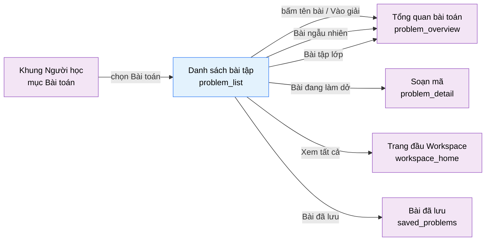

# Tài liệu thiết kế cơ bản (BD) — Danh sách bài tập (`USR0101`)

## Phương châm tài liệu [Nội bộ — không cần khách duyệt]

- Viết theo **mẫu 9 sheet**. Bộ thẻ đóng, quy ước ID, ký hiệu chuẩn, ranh giới với tài liệu khác và
  checklist kiểm toán nằm ở `02-bd/_rules/bd-template-9sheet.md` — file này không chép lại.
- Phần gắn nhãn `[Nội bộ]` phục vụ sinh mã và tự kiểm toán, không phải yêu cầu của khách hàng: mục 4.5,
  mục 7.3 và các ghi chú quy ước.
- Mã màn `USR0101` theo bảng mã ở `02-bd/_rules/bd-template-9sheet.md` mục 8; tên file mang tiền tố mã.
- Màn này **không có popup nào**. Mọi hành động đều là lọc tại chỗ hoặc rời sang màn khác.
- Đây là file BD đầu tiên của khu Người học. Quy ước đặt tên khối và ID item ở đây là khuôn cho 11 màn
  còn lại của khu, đặc biệt `saved_problems` (biến thể danh sách của chính màn này) và `problem_detail`.

> Đọc cùng `01-rd/screens/users/USR0101_problem_list.md` (hành vi ở mức yêu cầu, không lặp lại ở đây),
> `02-bd/screens/users/_shell.md` (khung điều hướng khu Người học) và ba file BD module:
> `02-bd/architecture/F2_problem-bank.md`, `02-bd/database/F2_problem-bank.md`,
> `02-bd/security/F2_problem-bank.md`.
>
> - **Header và chân trang không mô tả lại ở đây** — dùng chung khung khu Người học: header ngang dính
>   trên, không có thanh bên [Nguồn: 02-bd/screens/users/_shell.md:24,40-41], chân trang dùng chung
>   [Nguồn: 02-bd/screens/users/_shell.md:97-105].
> - **Không thiết kế** thao tác quản trị bài toán (xuất bản, đổi độ khó, nhân bản, xoá) — đó là màn
>   `problem_management` của A2/A3 [Nguồn: 02-bd/screens/shared/SHR0201_problem_management.md:550-562].
>   Màn này chỉ đọc.
> - **Không thiết kế** việc chọn mô hình nộp bài. Học viên chọn mỗi lượt làm ở `problem_detail`
>   (`DEC-2026-0824-dual-submission-model-per-problem`); màn này chỉ hiển thị nhãn cho biết bài có bị
>   giới hạn chỉ còn Standard I/O hay không [Nguồn: 01-rd/screens/users/USR0101_problem_list.md:106-107].
> - **Không hiển thị** nội dung testcase ẩn ở bất kỳ trạng thái nào. Màn này không đọc bảng `testcases`.

---

## Sheet 1. Bìa

| Mục | Giá trị |
| :--- | :--- |
| Hệ thống | AlgoPrep |
| Phân hệ | `problem-bank` (F2), đọc thêm từ `identity` (F1), `judge-orchestration` (F4), `ai-review` (F5) |
| Công đoạn | BD — Thiết kế cơ bản |
| Phân loại | Màn hình |
| Tên màn | Danh sách bài tập |
| Mã màn hình | `USR0101` |
| Tên vật lý (slug) | `problem_list` |
| Trục tài liệu | Màn hình (`02-bd/screens/`) |
| Actor | A1 (`STUDENT`) |
| Phiên bản | V1.1 |
| Người tạo | Nhóm phát triển AlgoPrep |
| Ngày tạo | 2026/09/21 |
| Người cập nhật | Claude |
| Ngày cập nhật | 2026/10/21 |

---

## Sheet 2. Lịch sử sửa đổi

| Ver | Sheet bị sửa | Nội dung sửa | Ngày | Người sửa |
| :--- | :--- | :--- | :--- | :--- |
| V0.1 | Toàn bộ | Tạo mới theo mẫu 9 sheet. Chốt nguồn dữ liệu của mọi trường hiển thị, chốt trạng thái lọc ghi vào URL, chốt cách suy ra trạng thái "Đã giải / Đang làm / Chưa làm" từ read model `user_problem_best_score`, chốt nguyên tắc suy giảm nhẹ nhàng khi `ai-review` hoặc `judge-orchestration` lỗi. Phát sinh 9 câu hỏi mở | 2026/09/21 | Nhóm phát triển AlgoPrep |
| V0.2 | Sheet 5, 7 | Đã chốt 2026-10-01 (owner uỷ quyền), xem `DEC-2026-1001-admin-configurable-settings`: danh mục chủ đề bài toán là dữ liệu do ADMIN quản lý (không còn seed cố định); thanh chủ đề và chip lọc đọc từ `ListTopicsWithProgress` trên dữ liệu `topics`, số chủ đề không cố định, chủ đề mới chưa có bài hiển thị tiến độ `0 / 0`. Không đổi tên endpoint | 2026/10/01 | AI |
| V0.3 | Sheet 8, 9 | Đổi cụm báo lỗi sau thao tác (tìm kiếm, đổi trang, bài ngẫu nhiên) và `[Tiêu điểm]` sang toast; giữ nguyên vùng lỗi tải bảng và các khối ẩn êm. Theo `DEC-2026-1003-toast-feedback-channel`. | 2026/10/03 | AI |
| V0.4 | Sheet 4, 5, 6, 7, 8, Câu hỏi mở | Đồng bộ `DEC-2026-1001-admin-configurable-settings` mục (7): độ khó bài tập là danh mục do ADMIN quản lý (bảng riêng `problem_levels`, không dùng chung với độ khó câu hỏi phỏng vấn), không còn enum cố định `EASY`/`MEDIUM`/`HARD`. DTO `difficulty` thành `levelCode`/`levelDisplayName` đọc qua `problems.level_id`; cột "Độ khó" hiển thị `display_name` đọc từ dữ liệu; tab độ khó là "Tất cả" cộng một tab mỗi mức, theo `sort_order`; sắp xếp theo độ khó theo `sort_order`, không theo chữ. Dải chỉ số tiến độ theo độ khó thành một ô mỗi mức. Màn gọi thêm `ListProblemLevels` (chỉ đọc), thêm `problem_levels` vào bảng liên quan và Truy cập bảng. Màn chỉ hiển thị nhãn, lọc và sắp xếp; không có logic nào gắn với độ khó | 2026/10/03 | AI |
| V0.5 | Sheet 3, 4, 5, 6, 7, 8, Câu hỏi mở | Owner bỏ hẳn dải chỉ số tiến độ (4 ô "Đã giải toàn bộ" và một ô mỗi mức độ khó) khỏi màn, ngày 2026-10-18, mở rộng quy tắc owner 2026-10-13 "không dải KPI trên màn danh sách"; tiêu chí ponytail bậc 1/3 (owner). Hai nút "Bài đã lưu" và "Bài ngẫu nhiên" chuyển sang cụm hành động của tiêu đề trang (`PageHeader`). Bỏ: Sheet 5 Khu vực A cũ (item `solvedTotal`, `solvedByLevel`), `ProblemCatalogSummaryDto` (Sheet 7 NO 10-11), endpoint `GetProblemCatalogSummary`, widget `widgets/problem-catalog-summary`; Khu vực A còn 2 nút, đánh số lại NO 1-2; Sheet 7.1, 7.3 đánh số lại. Đóng Q3 phần `GetProblemCatalogSummary` (rút). Làm mới các trích dẫn `problem-list-view.tsx`. Việc còn treo: DD cho `GetProblemCatalogSummary` — grep `03-dd/` không có chỗ nào nhắc tới, chưa cần sửa; RD và `PROTOTYPE_DEBT.md` xử lý riêng | 2026/10/18 | AI |
| V0.6 | Sheet 3, 4, 5, 6, 7, 8, 9, Câu hỏi mở | Ghi các quyết định owner ngày 2026-10-18 (`DEC-2026-1018-usr-open-questions-phase1-scope`), owner lấy đề xuất mặc định: đóng Q1 (bắt buộc đăng nhập, không có trạng thái khách), Q4 ("Bài đang làm dở" = bài nộp gần nhất chưa `ACCEPTED` đọc từ `judge.submissions`, không có bảng nháp; bản nháp mã nguồn lưu ở trình duyệt, thuộc `USR0102` Q4), Q5 (bỏ hàng chip chủ đề, chỉ giữ thanh chủ đề; đã bỏ item `problemList.filter.topicChips`, Khu vực C đánh số lại NO 1-4), Q6 (hoãn lọc theo thẻ), Q7 (không có nút lưu trên dòng bảng), Q8 (nhóm theo lớp, tối đa 3 lớp kèm liên kết xem tất cả; thêm item `problemList.assignment.linkViewAll` và EVT-15), Q9 (bài giao không có hạn nộp, dòng phụ chỉ hiện ngày giao). Làm mới trích dẫn `problem-list-view.tsx` và thêm ghi chú nợ prototype ở mục 4.4. Q2 và Q3 giữ mở (chưa thuộc đợt này). Không bỏ endpoint hay DTO nào | 2026/10/18 | Claude |
| V0.7 | Sheet 3, 4, 5, 6, 7, 8, Câu hỏi mở | Ghi các quyết định owner ngày 2026-10-18 (`DEC-2026-1018-usr-open-questions-phase2-5`, owner lấy đề xuất mặc định): đóng Q2 (`identity` cung cấp `ListMyProblemSolveStates`, cache Redis 60 giây theo người dùng; `problem-bank` nhận qua cổng ra, lọc theo trạng thái rồi mới phân trang; tiêu chí ponytail bậc 4) và Q3 (`ListTopicsWithProgress` đặt ở `problem-bank`, phần `GetProblemCatalogSummary` vẫn rút; bậc 4). Khối "Bài tập lớp" tối đa 3 lớp gần nhất theo `assigned_at` và **không có liên kết "Xem tất cả"** (owner bác mọi liên kết vì không có màn đích): bỏ chuyển màn "Xem tất cả bài tập lớp" và nhánh nét đứt ở Sheet 3, bỏ item `problemList.assignment.linkViewAll` (Sheet 5, 6), bỏ EVT-15 (Sheet 8), bỏ cờ `hasMoreClasses` (Sheet 7); đóng nốt nợ Q8. Bản dựng đã cắt 3 lớp bằng hằng `MAX_ASSIGNMENT_CLASSES` (`problem-list-view.tsx:56,117-121`). Làm mới trích dẫn `problem-list-view.tsx` (mã dịch xuống 9 dòng). Không có khoá i18n `problemList.assignment.linkViewAll` trong `messages/*.json` nên không có gì để gỡ | 2026/10/18 | Claude |
| V0.8 | Sheet 4, 5, Câu hỏi mở | Rà soát bản dựng 2026-10-19: owner chốt **giữ** chọn số dòng mỗi trang 12/24/48 (mặc định 12, nhớ ở trình duyệt) và **giữ** hai `FilterMenu` thay cho hai hàng tab; sửa BD cho khớp (mục 4.4, Sheet 5 NO 1, Sheet 8). Bản dựng sửa theo BD: nhãn mô hình chỉ vẽ cho bài `Chỉ Standard I/O` (RD REQ-05 sửa theo, bỏ nhãn "Cả hai"), bấm lại chủ đề đang chọn thì về "Tất cả" (EVT-5), trạng thái rỗng có nút "Xóa bộ lọc" (EVT-6), ô tìm kiếm cắt 100 ký tự, khối "Bài đang làm dở" cắt 3 mục, giao diện dưới `lg` xếp một cột, nhãn kết quả và dòng phụ bài giao đi qua i18n (DTO mock trả enum, số testcase, ngày giao). Làm mới trích dẫn `problem-list-view.tsx`. Không đổi endpoint hay DTO | 2026/10/19 | Claude |
| V0.9 | Sheet 9 (NO 5) | Owner chốt 2026/10/19 (`DEC-2026-1019-usr-fe-audit-fixes`, chốt nốt câu hỏi mở còn lại sau rà prototype). Chỉ tài liệu, không đổi code, chưa duyệt hình. Bỏ yêu cầu toast khi ô tìm kiếm chạm 100 ký tự: `maxLength` của trình duyệt dừng việc nhập là đủ (owner 2026/10/19, ponytail bậc 3); Sheet 9 dòng độ dài từ khoá đổi `[Tiêu điểm]` còn viền ô, không còn câu thông báo. | 2026/10/19 | Claude |
| V1.0 | Sheet 3, 4, 5, 6, 7, 8, 9, Câu hỏi mở | Đồng bộ bản dựng 2026/10/20 theo `DEC-2026-1020-student-workspace-split-and-password-in-settings`: `/problems/{id}` thành trang tổng quan chỉ-đọc (`USR0104`, slug `problem_overview`), màn soạn mã (`USR0102`, slug `problem_detail`) chuyển sang `/workspace/{id}`. Sheet 3 tách đích chuyển màn: dòng bảng, "Vào giải", "Bài ngẫu nhiên" và "Bài tập lớp" mở `problem_overview` (`/problems/{id}`); thẻ "Bài đang làm dở" mở `problem_detail` ở `/workspace/{id}`. Bỏ khung `PageHeader`: hàng tiêu đề thường, hai nút "Bài đã lưu" và "Bài ngẫu nhiên" cùng hàng (Sheet 4.4, 4.5, Sheet 5 Khu vực A). Sửa EVT-10, 11, 13, 14. Làm mới số dòng `problem-list-view.tsx` và các trích dẫn schema lệch: `F1_identity.md:111-112` thành `:156`; `F2_problem-bank.md` `:11-29` thành `:11-31`, `:37-39` thành `:55-64`, `:117-128` thành `:170-179`, `:125` thành `:179`, `:138` thành `:192`, `:31-33` thành `:33-35`, `:35-55` thành `:61`, `:41-45` thành `:97-103`; `F5_ai-review.md:44-47` thành `:35-42`; `01-rd/req/F2_problem-bank.md` `:42-43` thành `:46-47`, `:44-56` thành `:48-56`, `:59-62` thành `:61-66`; mock `problem-mocks.ts:206-224` thành `:213-235`. Bỏ trích dẫn `01-rd/req/F2_problem-bank.md:94` (dòng đó nay nói về F2-09, không liên quan Sheet 9). Chưa duyệt hình | 2026/10/20 | Claude |
| V1.1 | Sheet 3, 4, 5, 8, 9, Câu hỏi mở | Owner chốt 2026/10/21 (USR0105 Q9): khối "Bài đang làm dở" ở cột phải giữ tối đa 3 thẻ, thêm liên kết "Xem tất cả" dưới khối trỏ `/workspace` (`USR0105`), và dùng chung một component `InProgressList` với `USR0105` (đã dựng, ở `entities/problem/ui`, thay phần vẽ thẻ viết thẳng trong view; hình thẻ giữ như cũ). Thêm item `problemList.inProgress.linkViewAll` (Sheet 5, 9), thêm EVT-15 (Sheet 8), thêm nhãn kết quả `pending`, `compiling`, `compileError`, `systemError` vào `problemList.verdict` (Q5 của `USR0104`, 2026/10/21). Đo lại số dòng `file:line` của `problem-list-view.tsx` trên bản mã cuối (mã dịch lệch 1 đến 22 dòng). Không đổi endpoint hay DTO. Chưa duyệt hình | 2026/10/21 | Claude |

---
## Sheet 3. Sơ đồ chuyển màn

> [Nội bộ] Quy ước vẽ: bố trí từ trái sang phải. Màn gọi tới tô tím, màn hiện tại tô xanh nhạt, màn đích
> tô tím. Màu và `[Nguồn:]` dùng để truy vết, không phải yêu cầu của khách hàng.

### 3.1 Danh sách chuyển màn

#### Khung điều hướng Người học → Danh sách bài tập

[Điều kiện mở] Chọn mục "Bài toán" trên thanh điều hướng ngang của khung khu Người học
[Nguồn: 02-bd/screens/users/_shell.md:54].

[Chế độ mở] Chế độ duyệt, chỉ đọc. Không có chế độ sửa.

[Thông tin truyền] Tham số lọc trên URL nếu có (`q`, `status`, `difficulty`, `topic`, `sort`, `dir`,
`page`). Không có tham số thì dùng giá trị mặc định ở Sheet 5 Khu vực C.

[Giá trị trả về] Không có.

[Khi thành công] Hiển thị hàng tiêu đề thường (tiêu đề bên trái, hai nút hành động bên phải, không còn khung `PageHeader`), thanh chủ đề, bộ lọc, bảng danh sách bài
toán đã xuất bản và hai khối phụ bên phải. Không có dải chỉ số (đã bỏ 2026-10-18).

[Khi huỷ] Không có.

#### Danh sách bài tập → Tổng quan bài toán (mở từ bảng)

[Điều kiện mở] Bấm vào tên bài, hoặc bấm nút "Vào giải" của dòng đó
[Nguồn: 05-coding/frontend/src/views/users/problem-list/ui/problem-list-view.tsx:191-199,250-259; 09-layoutBase/Ngân hàng bài toán.dc.html:168,184-186]. Từ 2026/10/20 nút "Vào giải" không còn mở màn soạn mã mà mở trang tổng quan chỉ-đọc.

[Chế độ mở] Chế độ xem đề, chỉ đọc.

[Thông tin truyền] `problem_id` của dòng được chọn.

[Giá trị trả về] Không có.

[Khi thành công] Mở màn `problem_overview` (`USR0104`) ở `/problems/{problem_id}`. Muốn soạn mã thì bấm tiếp ở màn đó, đường sang `/workspace/{problem_id}` do `USR0104` mô tả [Nguồn: 02-bd/screens/users/USR0104_problem_overview.md:169].

[Khi huỷ] Không có.

#### Danh sách bài tập → Tổng quan bài toán (bài ngẫu nhiên)

[Điều kiện mở] Bấm nút "Bài ngẫu nhiên" nằm cùng hàng với tiêu đề trang
[Nguồn: 05-coding/frontend/src/views/users/problem-list/ui/problem-list-view.tsx:276-279,143-150; 09-layoutBase/Ngân hàng bài toán.dc.html:114].

[Chế độ mở] Chế độ xem đề, chỉ đọc.

[Thông tin truyền] `problem_id` do máy chủ bốc ngẫu nhiên trong phạm vi bộ lọc đang áp dụng.

[Giá trị trả về] Không có.

[Khi thành công] Mở màn `problem_overview` của bài được bốc, ở `/problems/{problem_id}` [Nguồn: 05-coding/frontend/src/views/users/problem-list/ui/problem-list-view.tsx:149]. Bài ngẫu nhiên **không** vào thẳng màn soạn mã.

[Khi huỷ] Không có mục nào khớp bộ lọc thì không chuyển màn, hiển thị thông báo ngay tại màn.

#### Danh sách bài tập → Soạn mã (mở từ khối "Bài đang làm dở")

[Điều kiện mở] Bấm một thẻ trong khối "Bài đang làm dở"
[Nguồn: 05-coding/frontend/src/views/users/problem-list/ui/problem-list-view.tsx:430-436; 05-coding/frontend/src/entities/problem/ui/in-progress-list.tsx:52-77; 09-layoutBase/Ngân hàng bài toán.dc.html:211].

[Chế độ mở] Chế độ giải bài.

[Thông tin truyền] `problem_id` của thẻ được chọn, đặt trên đường dẫn `/workspace/{problem_id}`.

[Giá trị trả về] Không có.

[Khi thành công] Mở màn `problem_detail` (`USR0102`) ở `/workspace/{problem_id}`: người học đang làm dở nên đi thẳng vào chỗ soạn mã, không qua trang tổng quan [Nguồn: 05-coding/frontend/src/views/users/problem-list/ui/problem-list-view.tsx:430-436]. Bộ lọc của màn danh sách không bị ảnh hưởng. Liên kết "Xem tất cả" dưới khối (V1.1, owner 2026/10/21) mở trang đầu Workspace `workspace_home` (`USR0105`, `/workspace`) [Nguồn: 05-coding/frontend/src/views/users/problem-list/ui/problem-list-view.tsx:435; 05-coding/frontend/src/entities/problem/ui/in-progress-list.tsx:81-87].

[Khi huỷ] Không có.

#### Danh sách bài tập → Tổng quan bài toán (mở từ khối "Bài tập lớp")

[Điều kiện mở] Bấm một bài trong khối "Bài tập lớp"
[Nguồn: 05-coding/frontend/src/views/users/problem-list/ui/problem-list-view.tsx:454-478; 09-layoutBase/Ngân hàng bài toán.dc.html:226-234].

[Chế độ mở] Chế độ xem đề, chỉ đọc.

[Thông tin truyền] `problem_id` của bài được chọn, đặt trên đường dẫn `/problems/{problem_id}`.

[Giá trị trả về] Không có.

[Khi thành công] Mở màn `problem_overview` (`USR0104`). Bộ lọc của màn danh sách không bị ảnh hưởng.

[Khi huỷ] Không có.

#### Danh sách bài tập → Bài đã lưu

[Điều kiện mở] Bấm nút "Bài đã lưu" nằm cùng hàng với tiêu đề trang (không còn dải chỉ số, không còn khung `PageHeader`)
[Nguồn: 05-coding/frontend/src/views/users/problem-list/ui/problem-list-view.tsx:268-275; 09-layoutBase/Ngân hàng bài toán.dc.html:113].

[Chế độ mở] Không có.

[Thông tin truyền] Không có. Bộ lọc hiện tại **không** mang theo — `saved_problems` có bộ lọc riêng.

[Giá trị trả về] Không có.

[Khi thành công] Mở màn `saved_problems`.

[Khi huỷ] Không có.

### 3.2 Sơ đồ

[Nguồn: 05-coding/frontend/src/views/users/problem-list/ui/problem-list-view.tsx:143-150,191-199,250-259,268-279,430-436,454-457;
09-layoutBase/Ngân hàng bài toán.dc.html:113,114,168,184-186,211,226-234; 02-bd/screens/users/_shell.md:54]

---

## Sheet 4. Bố cục màn hình

### 4.1 Tổng quan màn

[Mục đích màn] Cho người học tìm và chọn bài toán để luyện tập: tìm theo từ khoá, lọc theo chủ đề, độ khó
và trạng thái đã giải, đồng thời thấy ngay tiến độ của bản thân và những bài giảng viên đã giao cho lớp
[Nguồn: 01-rd/screens/users/USR0101_problem_list.md:17-19,103-104].

[Luồng nghiệp vụ chính]

1. **Hiển thị ban đầu**: vào màn, hệ thống đọc tham số lọc trên URL rồi tải song song năm nhóm dữ liệu —
   danh sách bài toán đã lọc, tiến độ theo chủ đề, bài giao theo lớp, bài đang làm dở, tập bài đã có
   Solution Review (cộng danh mục độ khó cho tab lọc). Màn không có dải chỉ số tiến độ tổng (owner bỏ 2026-10-18). Trong lúc chờ, mỗi khối hiển thị khung chờ đúng số dòng dự kiến.
2. **Lọc và tìm kiếm**: người học gõ từ khoá, chọn tab trạng thái, chọn tab độ khó (một tab mỗi mức do ADMIN quản lý) hoặc chọn chủ đề. Mỗi
   lần đổi bộ lọc, trang được đặt về 1 và bảng được tải lại từ máy chủ; trạng thái lọc ghi vào URL.
3. **Sắp xếp**: bấm tiêu đề cột "Độ khó" hoặc "AC rate" để đổi chiều sắp xếp.
4. **Phân trang**: chọn số trang ở cuối bảng. **Không dùng cuộn vô hạn**
   [Nguồn: 01-rd/screens/users/USR0101_problem_list.md:55].
5. **Vào giải**: bấm tên bài hoặc nút "Vào giải" của dòng, bấm "Bài ngẫu nhiên", hoặc bấm một bài trong khối
   "Bài tập lớp" thì mở trang tổng quan chỉ-đọc `problem_overview` ở `/problems/{id}`; bấm một thẻ trong khối
   "Bài đang làm dở" thì vào thẳng màn soạn mã `problem_detail` ở `/workspace/{id}` (quyết định 2026/10/20,
   `DEC-2026-1020-student-workspace-split-and-password-in-settings`); liên kết "Xem tất cả" dưới khối đó mở `workspace_home` ở `/workspace`.

[Người dùng] Người học đã đăng nhập (`STUDENT`). **Bắt buộc đăng nhập, không có trạng thái khách**: người
chưa đăng nhập bị chuyển về màn `auth` (đã chốt 2026-10-18, Câu hỏi mở Q1; tiêu chí ponytail bậc 3 — không
người dùng demo nào xem danh sách với tư cách khách; cùng câu với `02-bd/screens/users/_shell.md` mục 6 Q4,
file đó do bên khác cập nhật).

[Tệp liên quan] Không có. Màn này không xuất hay nhập tệp — xuất CSV (F2-17) chỉ có ở `problem_management`
[Nguồn: 02-bd/screens/shared/SHR0201_problem_management.md:560].

[Phạm vi]
- Chỉ hiển thị bài toán `status = PUBLISHED` **và** `deleted = false`
  (`DEC-2026-0830-problem-lifecycle-two-states`) [Nguồn: 02-bd/database/F2_problem-bank.md:18-19].
- Không có thao tác ghi nào lên `problems` — màn chỉ đọc. Độ khó là danh mục do ADMIN quản lý (`problem_levels`), màn chỉ hiển thị nhãn, lọc và sắp xếp theo thứ tự danh mục; độ khó không gắn logic nào [Nguồn: 02-bd/database/F2_problem-bank.md mục `problem_levels`].
- **Không có** nút đánh dấu lưu (bookmark) trên dòng bảng: F2-13 đã có màn riêng `saved_problems`, người học
  lưu bài ở `problem_detail`. Đã chốt 2026-10-18, Câu hỏi mở Q7 (tiêu chí ponytail bậc 3).
- Không có bộ lọc theo **thẻ** (`tags`, F2-02 amendment) dù F2-11 có nhắc
  [Nguồn: 01-rd/req/F2_problem-bank.md:42-43]: **hoãn sang đợt sau**, đã chốt 2026-10-18, Câu hỏi mở Q6 (tiêu
  chí ponytail bậc 3).
- Không có hàng chip chủ đề: chủ đề chỉ lọc bằng thanh chủ đề (Câu hỏi mở Q5, đã chốt 2026-10-18).
- Bài giao theo lớp **không có hạn nộp** (Câu hỏi mở Q9, đã chốt 2026-10-18).
- Không hiển thị điểm theo tỉ lệ testcase (F4-13) trên từng dòng. Tỉ lệ chỉ dùng **bên trong** để suy ra
  trạng thái "Đã giải / Đang làm" (`DEC-2026-0831-partial-score-testcase-ratio`).

[Quyền sử dụng]
- Xem: được, với người học đã đăng nhập.
- Thêm / Sửa / Xoá: không. Màn chỉ đọc.

[Số bản ghi tối đa] Bảng danh sách: mặc định 12 dòng mỗi trang, người học chọn 12/24/48 (nhớ ở trình duyệt, owner chốt 2026-10-19), phân trang phía máy chủ
[Nguồn: 09-layoutBase/Ngân hàng bài toán.dc.html:561]. Thanh chủ đề: theo số dòng
thật của bảng `topics`, prototype minh hoạ 7 mục [Nguồn: 09-layoutBase/Ngân hàng bài toán.dc.html:572-580].
Khối "Bài đang làm dở": tối đa 3 mục [Nguồn: 09-layoutBase/Ngân hàng bài toán.dc.html:737-741]. Khối "Bài
tập lớp": nhóm theo lớp, **tối đa 3 lớp** (3 lớp có bài giao gần nhất), **không có liên kết "Xem tất cả"** vì
không có màn đích (Câu hỏi mở Q8, đã chốt 2026-10-18); trong mỗi lớp là số bài đang giao cho lớp đó, prototype minh hoạ 2 mục
[Nguồn: 09-layoutBase/Ngân hàng bài toán.dc.html:754-757].

### 4.2 DTO liên quan

- `ProblemListItemDto`
- `TopicProgressDto`
- `ClassAssignmentGroupDto`
- `InProgressProblemDto`

`[Suy luận]` — tên DTO do BD này đề xuất, `03-dd/api/F2_problem-bank.md` chốt lại. Đặt tên **khác**
`ProblemManagementListItemDto` của màn quản trị [Nguồn: 02-bd/screens/shared/SHR0201_problem_management.md:514]
vì hai màn nhìn cùng bảng nhưng khác tập cột: màn này không có `submissionCount`, `testcaseCount`,
`updatedAt`, `status`; màn kia không có trạng thái đã giải theo người dùng.

### 4.3 Bảng dữ liệu liên quan (9)

| NO | Bảng | Ghi chú |
| --: | :--- | :--- |
| 1 | `problem.problems` | [Nguồn: 02-bd/database/F2_problem-bank.md:11-31] |
| 2 | `problem.topics` | [Nguồn: 02-bd/database/F2_problem-bank.md:55-64] |
| 3 | `problem.problem_topics` | [Nguồn: 02-bd/database/F2_problem-bank.md:55-64] |
| 4 | `problem.problem_stats` | Read model, nguồn của cột "AC rate" [Nguồn: 02-bd/database/F2_problem-bank.md:192] |
| 5 | `problem.class_assignments` | Nguồn khối "Bài tập lớp" [Nguồn: 02-bd/database/F2_problem-bank.md:170-179] |
| 6 | `identity.user_problem_best_score` | Read model, nguồn trạng thái "Đã giải / Đang làm / Chưa làm" [Nguồn: 02-bd/database/F1_identity.md:156] |
| 7 | `judge.submissions` | Nguồn khối "Bài đang làm dở" [Nguồn: 02-bd/database/F4_judge-orchestration.md:8-34] |
| 8 | `ai.solution_reviews` | Nguồn nhãn "đã có Solution Review" [Nguồn: 02-bd/database/F5_ai-review.md:35-42] |
| 9 | `problem.problem_levels` | Danh mục độ khó do ADMIN quản lý: nguồn nhãn cột "Độ khó" và các tab độ khó (không còn các ô tiến độ theo độ khó, đã bỏ 2026-10-18) [Nguồn: 02-bd/database/F2_problem-bank.md mục `problem_levels`] |

Ba bảng NO 6-8 nằm ở schema của module khác. Màn không truy vấn thẳng: `problem-bank` gọi qua cổng ra sang
`identity` / `judge-orchestration` / `ai-review`, đúng nguyên tắc mỗi schema một chủ
[Nguồn: 02-bd/database/F2_problem-bank.md:33-35]. Ranh giới sở hữu đã chốt 2026-10-18 ở Câu hỏi mở Q2 (`identity` cung cấp map trạng thái, `problem-bank` nhận qua cổng ra) và Q3 (`ListTopicsWithProgress` ở `problem-bank`).

### 4.4 Vùng bố cục

Đối chiếu `09-layoutBase/Ngân hàng bài toán.dc.html` — bằng chứng bố cục chỉ-đọc, **không phải** design
system cuối cùng.

| Vùng | Vị trí trong prototype | Nội dung |
| :--- | :--- | :--- |
| Header ngang dính trên (khung chung Người học) | `:51-98` | Thương hiệu, 6 mục nav, menu người dùng — dùng lại khung chung, không mô tả lại |
| Tiêu đề trang + cụm hành động | Bản dựng `problem-list-view.tsx:265-281` (prototype `:103-116`) | Hàng tiêu đề thường (`<h1>` ở `:266`, bên phải hai nút cùng hàng), **không còn khung `PageHeader`** (bỏ 2026/10/20): "Bài đã lưu" (liên kết sang `/saved`, `:267-275`) và "Bài ngẫu nhiên" (`pickRandom`, `:276-279`). **Không còn dải 4 chỉ số "Đã giải / Easy / Medium / Hard"** của prototype — owner bỏ 2026-10-18, tiêu chí ponytail bậc 1/3 |
| Thanh chủ đề | `:118-125` | Hàng ngang cuộn được, mỗi mục là tên chủ đề kèm tỉ lệ `đã giải / tổng`, mục đang chọn gạch chân |
| Khối lọc (đầu bảng) | `:131-153` | Ô tìm kiếm, tab trạng thái (4 tab), tab độ khó ("Tất cả" cộng một tab mỗi mức; prototype vẽ 4 tab với 3 mức khởi tạo). Hàng chip chủ đề của prototype `:148-152` **đã bỏ** (Q5, 2026-10-18). Bản dựng dùng hai menu thả xuống `FilterMenu` thay cho hai hàng tab (`problem-list-view.tsx:339-367`) |
| Bảng danh sách | `:155-192` | 5 cột: Bài toán (gộp chấm trạng thái, mã, tên, nhãn mô hình, nhãn Solution Review), Chủ đề, Độ khó, AC rate, cột hành động |
| Phân trang | `:194-201` | Dòng tóm tắt kết quả bên trái, các nút số trang bên phải |
| Cột phải — "Bài đang làm dở" | `:206-220` | Tối đa 3 thẻ, mỗi thẻ có tên bài, ngôn ngữ và trạng thái lần nộp gần nhất; nguồn là `judge.submissions`, không có bản nháp (Q4) — bản dựng `problem-list-view.tsx:426-437` (cắt tối đa 3 thẻ bằng `MAX_IN_PROGRESS`, `:59,430`); mỗi thẻ là liên kết sang `/workspace/{id}` (`:430-436`); phần vẽ thẻ là component dùng chung `InProgressList` (`layout="compact"`, `05-coding/frontend/src/entities/problem/ui/in-progress-list.tsx:23-88`), có liên kết "Xem tất cả" `/workspace` dưới khối (V1.1) |
| Cột phải — "Bài tập lớp" | `:222-236` | Nhóm theo lớp (tối đa 3 lớp, **không có liên kết "Xem tất cả"**), mỗi nhóm có tên lớp và danh sách bài đã giao kèm dòng phụ chỉ có ngày giao (bỏ hạn nộp, Q9). Bản dựng nhóm theo lớp và cắt tối đa 3 lớp bằng `MAX_ASSIGNMENT_CLASSES` (`problem-list-view.tsx:56,138-141`), không có liên kết "Xem tất cả" (`:439-484`); mỗi bài là liên kết sang `/problems/{id}` (`:457`) |
| Chân trang (khung chung Người học) | `:428-455` | Bản quyền, trạng thái cụm go-judge, phiên bản — dùng lại khung chung |

Bố cục hai cột `minmax(0, 1fr) 268px` (prototype `:127`; bản dựng `problem-list-view.tsx:324`, dưới `lg` xếp một cột, cột phải xuống dưới bảng): cột trái là
bảng danh sách, cột phải là hai khối phụ cố định bề rộng. Hàng tiêu đề (kèm hai nút hành động, `:265-281`)
và thanh chủ đề (`:283-322`) nằm **trên** lưới hai cột, chiếm trọn bề ngang; không có dải chỉ số. Giữ nguyên cấu
trúc này khi dựng Next.js; không quy định màu sắc, khoảng cách hay typography ở BD.

**Hiện trạng bản dựng so với các quyết định 2026-10-18 và 2026-10-20** (đọc lại `problem-list-view.tsx` ngày 2026-10-21; riêng Q8 đã sửa mã ngày 2026-10-18):

| Quyết định | Bản dựng | Khoảng lệch (nợ prototype) |
| :--- | :--- | :--- |
| Q5 bỏ hàng chip chủ đề | Chỉ có thanh chủ đề dạng nút tròn cuộn ngang, kèm `{solved}/{total}` (`:283-322`); bấm lại chủ đề đang chọn thì về "Tất cả" (EVT-5); không có hàng chip | Khớp. Không phải sửa |
| Q7 không có nút lưu trên dòng | Cột hành động chỉ có nút "Vào giải" (`:245-260`) | Khớp |
| Q4 bài đang làm dở = bài nộp chưa `ACCEPTED` | Thẻ hiển thị tên, ngôn ngữ, nhãn kết quả ghép từ enum và số testcase qua i18n (`:430-436`), không có nhãn nháp | Khớp về hiển thị; dữ liệu là mock |
| Q8 nhóm theo lớp, tối đa 3 lớp, không có liên kết | Nhóm theo lớp, `page.classAssignments.slice(0, MAX_ASSIGNMENT_CLASSES)` (`:138-141,448`); không có liên kết. Mock không có `assigned_at` nên 3 nhóm đầu thay cho "3 lớp gần nhất"; mock chỉ có 1 lớp (`entities/problem/api/__mock__/problem-mocks.ts:213-235`) | Khớp về hiển thị. **Nợ prototype**: chưa sắp theo `assigned_at` giảm dần vì dữ liệu mock chưa có trường này |
| Q9 dòng phụ chỉ có ngày giao | Mock trả `solvedCount`, `totalCount`, `assignedAt`; view ghép "0 / 5 bài · giao 24/08/2026" qua `assignment.meta` và `formatDateVN` (`problem-mocks.ts:221-223,229-231`): có ngày giao, không có hạn nộp, nhưng có thêm chỉ số "0 / 5 bài" mà DTO ở Sheet 7 không có | **Lệch nhẹ**: số "0 / 5 bài" chưa có nguồn trong `ClassAssignmentGroupDto`; hoặc bỏ khỏi mock, hoặc thêm trường (cần quyết định) |
| Q1 bắt buộc đăng nhập | Không có kiểm đăng nhập ở view này (prototype, chưa nối `identity`) | Chờ nối `identity`; chưa phải nợ của view |
| Bỏ `PageHeader` (2026/10/20) | Hàng tiêu đề viết thẳng: `<h1>` + hai nút cùng hàng, tự xuống dòng khi hẹp (`flex-wrap`, `:265-281`) | Khớp. Chưa duyệt hình |
| Đích điều hướng (2026/10/20) | Tên bài và "Vào giải" sang `/problems/{id}` (`:192,257`); "Bài ngẫu nhiên" sang `/problems/{id}` (`:149`); thẻ "Bài đang làm dở" sang `/workspace/{id}` (`:430-436`), liên kết "Xem tất cả" sang `/workspace` (`:435`); "Bài tập lớp" sang `/problems/{id}` (`:457`) | Khớp quyết định. Lưu ý: "Bài ngẫu nhiên" bốc ở máy khách trong danh sách đã lọc (`filtered`, `:143-150`), chưa phải `GetRandomProblem` của máy chủ (dữ liệu mock) |

Hai điểm khác đã được owner chốt 2026-10-19 là **giữ** như bản dựng, BD đã sửa theo: chọn số dòng mỗi trang
12/24/48 (mặc định 12, `:52,84-88,401-422`) và bộ lọc trạng thái, độ khó là `FilterMenu` thay vì tab. Nợ còn lại: tìm kiếm
chưa chờ 400 ms và chưa ghi vào URL (ghi ở đầu `problem-list-view.tsx`).

Nhánh `isSolve` của prototype (`:242-426`) là mã thừa của một hướng thiết kế cũ, **không đưa vào BD** —
đã chốt ở RD [Nguồn: 01-rd/screens/users/USR0101_problem_list.md:94].

### 4.5 Cấu trúc slice FSD [Nội bộ]

| Khối | Slice dự kiến | Căn cứ |
| :--- | :--- | :--- |
| Trang | `views/users/problem-list` | Quy ước FSD của dự án |
| Khung Người học | Dùng lại `widgets/app-shell` (biến thể `student-header`) | `02-bd/screens/users/_shell.md` mục 1 |
| Hàng tiêu đề + hai nút hành động | Viết thẳng trong view, không dùng `PageHeader`, không có widget riêng (`widgets/problem-catalog-summary` đã bỏ 2026-10-18; `PageHeader` bỏ 2026-10-20) | `problem-list-view.tsx:265-281` |
| Thanh chủ đề (không còn chip chủ đề, Q5 2026-10-18) | `features/problem-topic-filter` | Prototype `:118-125` |
| Ô tìm kiếm, tab trạng thái, tab độ khó, sắp xếp | `features/problem-filter` | Prototype `:131-147,161-162` |
| Bảng danh sách + phân trang | `widgets/problem-table` + `entities/problem` | Prototype `:155-201` |
| Khối "Bài đang làm dở" | `entities/problem/ui/in-progress-list.tsx` (component `InProgressList`, dùng chung với `USR0105`; thay cho `widgets/in-progress-problems` đã đề xuất, vì thẻ chỉ cần kiểu `InProgressProblem`) | Prototype `:206-220` |
| Khối "Bài tập lớp" | `widgets/class-assignment-panel` | Prototype `:222-236` |

`[Suy luận]` — ánh xạ slice do BD đề xuất, DD màn hình chốt lại. `entities/problem` được `saved_problems`
và `problem_detail` dùng lại, nên dòng bảng phải là component nhận dữ liệu từ ngoài, không tự gọi API.

> [Nội bộ] Ảnh minh hoạ đặt ở `08-diagram/02-bd/screens/users/`, chụp bằng Playwright trên ứng dụng
> Next.js thật khi đã có mã chạy được. Chưa có thì tham chiếu prototype, không vẽ tay.

---

## Sheet 5. Danh sách item màn hình

> Quy ước ID, bộ thẻ và giá trị chuẩn: `02-bd/_rules/bd-template-9sheet.md` mục 2, 3, 4.

### Khu vực A — Tiêu đề trang và hành động

> Dải chỉ số tiến độ (item `problemList.summary.solvedTotal`, `problemList.summary.solvedByLevel`, cũ NO 1-4) **đã bỏ 2026-10-18** theo owner, tiêu chí ponytail bậc 1/3. Khu vực A chỉ còn hai nút hành động nằm cùng hàng với tiêu đề trang; khung `PageHeader` đã bỏ 2026/10/20 [Nguồn: 05-coding/frontend/src/views/users/problem-list/ui/problem-list-view.tsx:265-281]. NO đánh số lại: "Bài đã lưu" cũ NO 5 thành NO 1, "Bài ngẫu nhiên" cũ NO 6 thành NO 2.

| Khu vực | NO | Tên item | ID item | Bảng DB | Cột DB | Loại UI | Kiểu | Độ dài | Bắt buộc | I/O | Giá trị mặc định | Định dạng | Ghi chú |
| :--- | --: | :--- | :--- | :--- | :--- | :--- | :--- | :--- | :-: | :-: | :--- | :--- | :--- |
| Tiêu đề trang và hành động | | | | | | | | | | | | | |
| | 1 | Bài đã lưu | `problemList.summary.linkSaved` | - | - | Button | - | - | - | I | - | - | Điều hướng sang màn `saved_problems` [Nguồn giá trị] Nhãn tĩnh i18n [EVT liên quan] EVT-12 |
| | 2 | Bài ngẫu nhiên | `problemList.summary.btnRandom` | - | - | Button | - | - | - | I | - | - | Bốc ngẫu nhiên một bài trong phạm vi bộ lọc đang áp dụng rồi mở `problem_overview` (`/problems/{id}`) [Nguồn giá trị] Nhãn tĩnh i18n [EVT liên quan] EVT-11 |

### Khu vực B — Thanh chủ đề

| Khu vực | NO | Tên item | ID item | Bảng DB | Cột DB | Loại UI | Kiểu | Độ dài | Bắt buộc | I/O | Giá trị mặc định | Định dạng | Ghi chú |
| :--- | --: | :--- | :--- | :--- | :--- | :--- | :--- | :--- | :-: | :-: | :--- | :--- | :--- |
| Thanh chủ đề | | | | | | | | | | | | | |
| | 1 | Danh sách chủ đề | `problemList.topicNav.list` | `problem.topics` | - | List | List | - | - | I/O | rỗng | - | Hàng ngang các chủ đề kèm tiến độ riêng từng chủ đề, vừa là chỉ số vừa là bộ lọc [Nguồn giá trị] Kết quả gọi `ListTopicsWithProgress` [EVT liên quan] EVT-1, EVT-5 |
| | 2 | Tên chủ đề | `problemList.topicNav.col.name` | `problem.topics` | `name` | ListColumn | String | - | - | O | - | - | Tên chủ đề đọc từ dữ liệu `topics` do ADMIN quản lý, số chủ đề không cố định (đã chốt 2026-10-01) [Nguồn giá trị] Cột `topics.name` [Nguồn: 02-bd/database/F2_problem-bank.md:61] [EVT liên quan] - |
| | 3 | Tiến độ chủ đề | `problemList.topicNav.col.ratio` | `identity.user_problem_best_score`, `problem.problem_topics` | `best_verdict`, `topic_id` | ListColumn | String | - | - | O | `0 / 0` | `{số} / {số}` | Số bài đã giải trên tổng số bài đã xuất bản thuộc chủ đề đó [Công thức] Tử số đếm dòng `user_problem_best_score` của người dùng có `best_verdict = ACCEPTED` thuộc chủ đề; mẫu số đếm `problems` có `status = PUBLISHED AND deleted = false` thuộc chủ đề, giới hạn theo `problem_topics.topic_id` (công thức từng đặt ở dải chỉ số đã bỏ 2026-10-18, nay chỉ còn ở đây) [EVT liên quan] - |

### Khu vực C — Bộ lọc

| Khu vực | NO | Tên item | ID item | Bảng DB | Cột DB | Loại UI | Kiểu | Độ dài | Bắt buộc | I/O | Giá trị mặc định | Định dạng | Ghi chú |
| :--- | --: | :--- | :--- | :--- | :--- | :--- | :--- | :--- | :-: | :-: | :--- | :--- | :--- |
| Bộ lọc | | | | | | | | | | | | | |
| | 1 | Ô tìm kiếm | `problemList.filter.query` | `problem.problems` | `code`, `title` | TextBox | String | 100 | - | I/O | rỗng | - | Tìm theo tên bài hoặc mã bài [Nguồn giá trị] Tham số URL `q`; không có thì rỗng. Gợi ý trong ô là nhãn tĩnh i18n "Tìm theo tên bài hoặc mã bài" [Nguồn: 09-layoutBase/Ngân hàng bài toán.dc.html:592] [EVT liên quan] EVT-2 |
| | 2 | Tab trạng thái | `problemList.filter.statusTabs` | `identity.user_problem_best_score` | `best_verdict` | List | Enum | - | - | I/O | `Tất cả` | - | 4 tab: Tất cả / Đã giải / Đang làm / Chưa làm [Nguồn: 09-layoutBase/Ngân hàng bài toán.dc.html:609] [Nguồn giá trị] Nhãn tĩnh i18n; giá trị đang chọn lấy từ tham số URL `status` [EVT liên quan] EVT-3 |
| | 3 | Tab độ khó | `problemList.filter.difficultyTabs` | `problem.problem_levels` | `code`, `display_name`, `sort_order` | List | List | - | - | I/O | `Tất cả` | - | Tab "Tất cả" cộng một tab mỗi mức trong `problem_levels`, theo `sort_order`; số tab không cố định (ba mức khởi tạo ra 4 tab). Chọn một mức tại một thời điểm, cộng dồn `VÀ` với các bộ lọc khác [Nguồn giá trị] Phản hồi của `ListProblemLevels` (Sheet 7 NO 14), đọc từ dữ liệu do ADMIN quản lý, không còn nhãn tĩnh i18n map từ enum [Nguồn: 02-bd/database/F2_problem-bank.md mục `problem_levels`]; giá trị đang chọn lấy từ tham số URL `difficulty` (mang `code` của mức) [EVT liên quan] EVT-4 |
| | 4 | Xoá bộ lọc | `problemList.filter.linkReset` | - | - | Link | - | - | - | I | - | - | Đưa cả 4 bộ lọc (tìm kiếm, trạng thái, độ khó, chủ đề) về mặc định. Chỉ xuất hiện ở trạng thái không có kết quả [Nguồn giá trị] Nhãn tĩnh i18n [EVT liên quan] EVT-6 |

### Khu vực D — Bảng danh sách bài toán

| Khu vực | NO | Tên item | ID item | Bảng DB | Cột DB | Loại UI | Kiểu | Độ dài | Bắt buộc | I/O | Giá trị mặc định | Định dạng | Ghi chú |
| :--- | --: | :--- | :--- | :--- | :--- | :--- | :--- | :--- | :-: | :-: | :--- | :--- | :--- |
| Bảng danh sách bài toán | | | | | | | | | | | | | |
| | 1 | Danh sách bài toán | `problemList.table.list` | `problem.problems` | - | List | List | - | - | O | rỗng | - | Bảng bài toán đã xuất bản, mặc định 12 dòng mỗi trang (chọn được 12/24/48) [Nguồn giá trị] Kết quả gọi `ListPublishedProblems` [EVT liên quan] EVT-1 |
| | 2 | Chấm trạng thái | `problemList.table.col.solveState` | `identity.user_problem_best_score` | `best_verdict` | Badge | Enum | - | - | O | `Chưa làm` | - | Ba trạng thái: Đã giải / Đang làm / Chưa làm [Công thức] Không có dòng `user_problem_best_score` thành "Chưa làm"; có dòng và `best_verdict = ACCEPTED` thành "Đã giải"; có dòng mà khác `ACCEPTED` thành "Đang làm" [Nguồn: 02-bd/database/F1_identity.md:156] [EVT liên quan] - |
| | 3 | Mã bài | `problemList.table.col.code` | `problem.problems` | `code` | ListColumn | String | 40 | - | O | - | - | Mã ngắn hiển thị của bài toán [Nguồn giá trị] Cột `code` [Nguồn: 02-bd/database/F2_problem-bank.md:14] [EVT liên quan] - |
| | 4 | Tên bài | `problemList.table.col.title` | `problem.problems` | `title` | ListColumn | String | 200 | - | O | - | - | Tiêu đề bài toán [Nguồn giá trị] Cột `title` [Nguồn: 02-bd/database/F2_problem-bank.md:15] [EVT liên quan] EVT-10 |
| | 5 | Nhãn mô hình nộp bài | `problemList.table.col.submissionModel` | `problem.problems` | `function_wrapper_supported` | Badge | Enum | - | - | O | Ẩn | - | Chỉ vẽ nhãn "Chỉ Standard I/O" khi `function_wrapper_supported = false` — ngoại lệ lược đồ kiểu R2; `true` (đa số) không vẽ nhãn nào (khu D NO 5 ở Sheet 6) [Nguồn giá trị] Cột `function_wrapper_supported` [Nguồn: 02-bd/database/F2_problem-bank.md:20], nhãn là chữ tĩnh i18n; RD REQ-05 đã sửa theo BD 2026-10-19 [Nguồn: 01-rd/screens/users/USR0101_problem_list.md:107] [EVT liên quan] - |
| | 6 | Nhãn đã có Solution Review | `problemList.table.col.hasReview` | `ai.solution_reviews` | `user_id`, `problem_id` | Badge | Boolean | - | - | O | Ẩn | - | Cho biết người học đã từng phân tích bài này bằng F5.1 [Công thức] Tồn tại dòng `solution_reviews` khớp `(user_id hiện tại, problem_id)` [Nguồn: 02-bd/database/F5_ai-review.md:41-42] [EVT liên quan] - |
| | 7 | Chủ đề | `problemList.table.col.topics` | `problem.topics` | `name` | ListColumn | String | - | - | O | `-` | - | Chủ đề của bài toán [Nguồn giá trị] `topics.name` qua `problem_topics.problem_id`; nhiều chủ đề thì nối bằng dấu phẩy, cùng cách đã dùng ở màn quản trị [Nguồn: 02-bd/screens/shared/SHR0201_problem_management.md:517] [EVT liên quan] - |
| | 8 | Độ khó | `problemList.table.col.difficulty` | `problem.problem_levels`, `problem.problems` | `display_name` | ListColumn | String | - | - | O | - | Nhãn `display_name`, badge | Mức độ khó của bài toán, lấy qua `problems.level_id` [Nguồn giá trị] Cột `problem_levels.display_name`, **đọc từ dữ liệu** do ADMIN quản lý, không còn ánh xạ cứng enum sang "Dễ/Trung bình/Khó". Màu badge: ba mức khởi tạo giữ màu cũ, mức ADMIN thêm sau dùng màu trung tính (không có cột màu) `DEC-2026-1001-admin-configurable-settings` mục (7) [Nguồn: 02-bd/database/F2_problem-bank.md mục `problem_levels`] [EVT liên quan] EVT-7 |
| | 9 | AC rate | `problemList.table.col.acRate` | `problem.problem_stats` | `ac_rate` | ListColumn | Number | 5 | - | O | `-` | `{số}%` | Tỉ lệ bài nộp được chấp nhận trên tổng số lượt nộp của toàn hệ thống [Nguồn giá trị] Read model `problem_stats.ac_rate` [Nguồn: 02-bd/database/F2_problem-bank.md:192]. Chưa có dòng read model thì hiển thị `-`, không hiển thị `0%` [EVT liên quan] EVT-8 |
| | 10 | Nút Vào giải | `problemList.table.col.btnSolve` | - | - | Button | - | - | - | I | - | - | Mở `problem_overview` của dòng đang trỏ (`/problems/{id}`, không còn mở màn soạn mã từ 2026/10/20) [Nguồn: 05-coding/frontend/src/views/users/problem-list/ui/problem-list-view.tsx:250-259; 09-layoutBase/Ngân hàng bài toán.dc.html:184-186]. Bản dựng vẽ nút luôn hiện ở cột cuối, không ẩn khi không rê chuột [Nguồn giá trị] Nhãn tĩnh i18n [EVT liên quan] EVT-10 |

### Khu vực E — Phân trang

| Khu vực | NO | Tên item | ID item | Bảng DB | Cột DB | Loại UI | Kiểu | Độ dài | Bắt buộc | I/O | Giá trị mặc định | Định dạng | Ghi chú |
| :--- | --: | :--- | :--- | :--- | :--- | :--- | :--- | :--- | :-: | :-: | :--- | :--- | :--- |
| Phân trang | | | | | | | | | | | | | |
| | 1 | Tóm tắt kết quả | `problemList.pager.summary` | - | - | Label | String | - | - | O | - | `Hiển thị {từ}–{đến} trong {tổng} bài` | Dòng tóm tắt phạm vi kết quả đang xem [Công thức] Từ tổng số dòng khớp bộ lọc và số trang hiện tại; không có dòng nào thì đổi thành nhãn tĩnh "Không có bài nào khớp bộ lọc" [Nguồn: 09-layoutBase/Ngân hàng bài toán.dc.html:631] [EVT liên quan] EVT-9 |
| | 2 | Nút số trang | `problemList.pager.pageButtons` | - | - | List | Number | - | - | I/O | `1` | Số nguyên | Danh sách số trang, trang đang xem được làm nổi [Công thức] Số trang bằng tổng số dòng khớp bộ lọc chia 12, làm tròn lên, tối thiểu 1 [EVT liên quan] EVT-9 |

### Khu vực F — Bài đang làm dở

| Khu vực | NO | Tên item | ID item | Bảng DB | Cột DB | Loại UI | Kiểu | Độ dài | Bắt buộc | I/O | Giá trị mặc định | Định dạng | Ghi chú |
| :--- | --: | :--- | :--- | :--- | :--- | :--- | :--- | :--- | :-: | :-: | :--- | :--- | :--- |
| Bài đang làm dở | | | | | | | | | | | | | |
| | 1 | Tiêu đề khối | `problemList.inProgress.title` | - | - | Label | String | - | - | O | Bài đang làm dở | - | Tiêu đề và câu phụ của khối [Nguồn giá trị] Nhãn tĩnh i18n. Câu phụ "Bản nháp lưu trong Workspace" của prototype **không dùng**: khối này đọc từ `judge.submissions`, không có bảng nháp (Câu hỏi mở Q4, đã chốt 2026-10-18) [EVT liên quan] - |
| | 2 | Danh sách bài dở | `problemList.inProgress.list` | `judge.submissions` | - | List | List | - | - | O | rỗng | - | Tối đa 3 bài mà lượt nộp gần nhất của chính người học chưa đạt `ACCEPTED` (định nghĩa chốt ở Q4; không có bảng nháp) [Nguồn giá trị] Kết quả gọi `ListMyUnsolvedRecentProblems` [EVT liên quan] EVT-1, EVT-13 |
| | 3 | Tên bài dở | `problemList.inProgress.col.title` | `problem.problems` | `title` | ListColumn | String | 200 | - | O | - | - | Tên bài toán của mục [Nguồn giá trị] Cột `title`, tra theo `submissions.problem_id` [Nguồn: 02-bd/database/F4_judge-orchestration.md:16] [EVT liên quan] - |
| | 4 | Ngôn ngữ lần nộp gần nhất | `problemList.inProgress.col.language` | `judge.submissions` | `language` | ListColumn | Enum | - | - | O | - | Nhãn cố định | Ngôn ngữ của lượt nộp gần nhất [Nguồn giá trị] `JAVA` thành "Java", `CPP` thành "C++", `PYTHON` thành "Python" [Nguồn: 02-bd/database/F4_judge-orchestration.md:18] [EVT liên quan] - |
| | 5 | Kết quả lần nộp gần nhất | `problemList.inProgress.col.lastVerdict` | `judge.submissions` | `status`, `passed_testcase_count`, `total_testcase_count` | ListColumn | String | - | - | O | - | `{nhãn} {đạt}/{tổng}` | Trạng thái lượt nộp gần nhất, kèm số testcase đạt khi có [Công thức] Nhãn tĩnh i18n map từ `status`; `status = WRONG_ANSWER` thì ghép thêm `passed_testcase_count`/`total_testcase_count` (F4-13, `DEC-2026-0831-partial-score-testcase-ratio`) [Nguồn: 02-bd/database/F4_judge-orchestration.md:22,25-26] [EVT liên quan] - |
| | 6 | Liên kết Xem tất cả | `problemList.inProgress.linkViewAll` | - | - | Link | - | - | - | I | - | - | Mở trang đầu Workspace liệt kê đủ bài đang làm dở (tối đa 12), đặt dưới khối 3 thẻ (V1.1, owner 2026/10/21) [Nguồn giá trị] Nhãn tĩnh i18n `problemList.inProgress.viewAll` "Xem tất cả" [Nguồn: 05-coding/frontend/messages/vi.json:178; 05-coding/frontend/src/views/users/problem-list/ui/problem-list-view.tsx:435]; đích `/workspace` [EVT liên quan] EVT-15 |
### Khu vực G — Bài tập lớp

| Khu vực | NO | Tên item | ID item | Bảng DB | Cột DB | Loại UI | Kiểu | Độ dài | Bắt buộc | I/O | Giá trị mặc định | Định dạng | Ghi chú |
| :--- | --: | :--- | :--- | :--- | :--- | :--- | :--- | :--- | :-: | :-: | :--- | :--- | :--- |
| Bài tập lớp | | | | | | | | | | | | | |
| | 1 | Tiêu đề khối | `problemList.assignment.title` | - | - | Label | String | - | - | O | Bài tập lớp | - | Tiêu đề khối [Nguồn giá trị] Nhãn tĩnh i18n [EVT liên quan] - |
| | 2 | Tên lớp | `problemList.assignment.className` | `identity.classes` | `name` | Label | String | 200 | - | O | - | - | Tên lớp người học đang tham gia, hiển thị ở dòng phụ [Nguồn giá trị] Trả kèm trong `ListMyClassAssignments`. Người học thuộc nhiều lớp thì nhóm theo lớp, mỗi lớp một tiêu đề phụ, tối đa 3 lớp có bài giao gần nhất (Câu hỏi mở Q8, đã chốt 2026-10-18) [EVT liên quan] - |
| | 3 | Danh sách bài được giao | `problemList.assignment.list` | `problem.class_assignments` | - | List | List | - | - | O | rỗng | - | Các bài đang được giao cho lớp của người học, chỉ tính dòng `removed_at IS NULL` [Nguồn: 02-bd/database/F2_problem-bank.md:179,181] [Nguồn giá trị] Kết quả gọi `ListMyClassAssignments` [EVT liên quan] EVT-1, EVT-14 |
| | 4 | Tên bài được giao | `problemList.assignment.col.title` | `problem.problems` | `title` | ListColumn | String | 200 | - | O | - | - | Tên bài toán được giao [Nguồn giá trị] Cột `title` qua `class_assignments.problem_id` [Nguồn: 02-bd/database/F2_problem-bank.md:175] [EVT liên quan] - |
| | 5 | Chấm trạng thái bài được giao | `problemList.assignment.col.solveState` | `identity.user_problem_best_score` | `best_verdict` | Badge | Enum | - | - | O | `Chưa làm` | - | Cùng ba trạng thái và cùng công thức với Khu vực D NO 2 [Công thức] Xem Khu vực D NO 2 [EVT liên quan] - |
| | 6 | Dòng phụ bài được giao | `problemList.assignment.col.meta` | `problem.class_assignments` | `assigned_at` | ListColumn | String | - | - | O | - | - | Câu phụ dưới tên bài. Prototype ghi "3 / 5 bài · hạn 24/08" [Nguồn: 09-layoutBase/Ngân hàng bài toán.dc.html:754-757] nhưng bài giao **không có hạn nộp**: `class_assignments` không có cột hạn nộp [Nguồn: 02-bd/database/F2_problem-bank.md:170-179] (Câu hỏi mở Q9, đã chốt 2026-10-18, tiêu chí ponytail bậc 1/3) [Nguồn giá trị] Chỉ hiển thị ngày giao từ `assigned_at`. Chỉ số "x / y bài" của prototype chưa có nguồn trong DTO, xem ghi chú nợ ở mục 4.4 [EVT liên quan] - |

[Nguồn: 09-layoutBase/Ngân hàng bài toán.dc.html:103-116,118-125,131-153,155-201,206-220,222-236;
02-bd/database/F2_problem-bank.md:11-31,55-64,170-179,192; 02-bd/database/F1_identity.md:156;
01-rd/screens/users/USR0101_problem_list.md:39-55]

---

## Sheet 6. Đặc tả điều khiển item

> Ký hiệu cột `Hiển thị` và thứ tự thẻ: `02-bd/_rules/bd-template-9sheet.md` mục 2, 3. Dùng đúng NO, tên
> item và thứ tự của Sheet 5. Lỗi nhập liệu ghi ở Sheet 9, xử lý nghiệp vụ ghi ở Sheet 8.

### Khu vực A — Tiêu đề trang và hành động

| Khu vực | NO | Tên item | Hiển thị | Ghi chú |
| :--- | --: | :--- | :-: | :--- |
| Tiêu đề trang và hành động | | | | |
| | 1 | Bài đã lưu | Có | [Điều kiện kích hoạt] Luôn kích hoạt. |
| | 2 | Bài ngẫu nhiên | Có | [Điều kiện kích hoạt] Không kích hoạt khi bộ lọc hiện tại không cho kết quả nào, và trong lúc đang tải bảng. |

### Khu vực B — Thanh chủ đề

| Khu vực | NO | Tên item | Hiển thị | Ghi chú |
| :--- | --: | :--- | :-: | :--- |
| Thanh chủ đề | | | | |
| | 1 | Danh sách chủ đề | Có | [Điều kiện hiển thị] Trong lúc tải hiển thị khung chờ 7 mục. Không có chủ đề nào thì ẩn cả thanh, không để hàng trống. [Điều kiện kích hoạt] Kích hoạt sau khi tải xong. [Tự động đặt] Mục ứng với chủ đề đang lọc được làm nổi; bấm lại chính mục đang chọn thì bỏ lọc, về "Tất cả". |
| | 2 | Tên chủ đề | Có | - |
| | 3 | Tiến độ chủ đề | Có | [Điều kiện hiển thị] Tải được danh mục chủ đề nhưng không lấy được tiến độ thì vẫn hiển thị tên chủ đề và ẩn phần tỉ lệ, không chặn cả thanh. |

### Khu vực C — Bộ lọc

| Khu vực | NO | Tên item | Hiển thị | Ghi chú |
| :--- | --: | :--- | :-: | :--- |
| Bộ lọc | | | | |
| | 1 | Ô tìm kiếm | Có | [Điều kiện kích hoạt] Luôn kích hoạt, kể cả khi bảng đang tải. [Tự động đặt] Nhận giá trị ban đầu từ tham số URL `q`. Gõ xong dừng 400 ms mới gọi máy chủ, không gọi theo từng ký tự. |
| | 2 | Tab trạng thái | Có | [Điều kiện kích hoạt] Kích hoạt sau khi tải xong lần đầu. [Tự động đặt] Tab đang chọn lấy từ tham số URL `status`, mặc định "Tất cả". |
| | 3 | Tab độ khó | Có | [Tự động đặt] Tab đang chọn lấy từ tham số URL `difficulty`, mặc định "Tất cả". |
| | 4 | Xoá bộ lọc | Điều kiện | [Điều kiện hiển thị] Chỉ hiển thị khi bảng không có dòng nào **và** đang có ít nhất một bộ lọc khác mặc định. Bảng rỗng vì danh mục chưa có bài nào thì không hiển thị liên kết này. |

### Khu vực D — Bảng danh sách bài toán

| Khu vực | NO | Tên item | Hiển thị | Ghi chú |
| :--- | --: | :--- | :-: | :--- |
| Bảng danh sách bài toán | | | | |
| | 1 | Danh sách bài toán | Có | [Điều kiện hiển thị] Trong lúc tải hiển thị khung chờ theo số dòng mỗi trang đang chọn (mặc định 12). Tải xong mà không có dòng nào thì thay bảng bằng dòng "Không có bài nào khớp bộ lọc" kèm liên kết xoá bộ lọc. Tải lỗi thì hiển thị thông báo lỗi kèm nút thử lại, giữ nguyên bộ lọc. |
| | 2 | Chấm trạng thái | Điều kiện | [Điều kiện hiển thị] Chỉ hiển thị khi lấy được dữ liệu trạng thái theo người dùng. Không lấy được thì ẩn chấm trạng thái trên mọi dòng và bảng vẫn hiển thị bình thường, xem EVT-1. |
| | 3 | Mã bài | Có | - |
| | 4 | Tên bài | Có | - |
| | 5 | Nhãn mô hình nộp bài | Điều kiện | [Điều kiện hiển thị] Chỉ hiển thị nhãn "Chỉ Standard I/O" khi `function_wrapper_supported = false`. Bài hỗ trợ cả hai mô hình — tức đa số — thì không vẽ nhãn nào, tránh nhiễu trên mọi dòng. |
| | 6 | Nhãn đã có Solution Review | Điều kiện | [Điều kiện hiển thị] Chỉ hiển thị khi người học đã có báo cáo phân tích cho bài đó. Gọi `ai-review` thất bại thì ẩn nhãn trên mọi dòng, **không** báo lỗi và **không** chặn bảng. |
| | 7 | Chủ đề | Có | - |
| | 8 | Độ khó | Có | [Điều kiện kích hoạt] Tiêu đề cột bấm được để đổi chiều sắp xếp; không kích hoạt trong lúc bảng đang tải. |
| | 9 | AC rate | Có | [Điều kiện kích hoạt] Tiêu đề cột bấm được để đổi chiều sắp xếp; không kích hoạt trong lúc bảng đang tải. |
| | 10 | Nút Vào giải | Có | [Điều kiện hiển thị] Bản dựng vẽ nút ở mọi dòng, không ẩn khi không rê chuột (`problem-list-view.tsx:245-260`); ý định ban đầu "chỉ hiện khi rê chuột" của prototype không theo. Người dùng bàn phím vào bài bằng liên kết tên bài (`:191-199`). |

### Khu vực E — Phân trang

| Khu vực | NO | Tên item | Hiển thị | Ghi chú |
| :--- | --: | :--- | :-: | :--- |
| Phân trang | | | | |
| | 1 | Tóm tắt kết quả | Có | [Tự động đặt] Cập nhật sau mỗi lần tải bảng. |
| | 2 | Nút số trang | Điều kiện | [Điều kiện hiển thị] Chỉ hiển thị khi có từ 2 trang trở lên. [Điều kiện kích hoạt] Nút của trang đang xem không kích hoạt. |

### Khu vực F — Bài đang làm dở

| Khu vực | NO | Tên item | Hiển thị | Ghi chú |
| :--- | --: | :--- | :-: | :--- |
| Bài đang làm dở | | | | |
| | 1 | Tiêu đề khối | Điều kiện | [Điều kiện hiển thị] Ẩn cả khối, gồm cả tiêu đề, khi không có bài dở nào hoặc khi gọi `judge-orchestration` thất bại. Không hiển thị khối rỗng. |
| | 2 | Danh sách bài dở | Điều kiện | [Điều kiện hiển thị] Như NO 1. Trong lúc tải hiển thị khung chờ 3 thẻ. [Tự động đặt] **Không** tải lại khi đổi bộ lọc — khối này độc lập với bộ lọc của bảng. |
| | 3 | Tên bài dở | Có | - |
| | 4 | Ngôn ngữ lần nộp gần nhất | Có | - |
| | 5 | Kết quả lần nộp gần nhất | Có | [Điều kiện hiển thị] Lượt nộp còn đang chấm (`PENDING`, `COMPILING`, `JUDGING`) thì hiển thị nhãn "Đang chấm" thay cho số testcase. |
| | 6 | Liên kết Xem tất cả | Điều kiện | [Điều kiện hiển thị] Hiển thị cùng khối (khi khối có ít nhất một thẻ); ẩn theo khối khi không có bài dở. Bản dựng: component `InProgressList` chỉ vẽ liên kết khi có thẻ [Nguồn: 05-coding/frontend/src/entities/problem/ui/in-progress-list.tsx:35-39,81-87]. |
### Khu vực G — Bài tập lớp

| Khu vực | NO | Tên item | Hiển thị | Ghi chú |
| :--- | --: | :--- | :-: | :--- |
| Bài tập lớp | | | | |
| | 1 | Tiêu đề khối | Điều kiện | [Điều kiện hiển thị] Ẩn cả khối khi người học không thuộc lớp nào, hoặc lớp không có bài nào đang được giao. |
| | 2 | Tên lớp | Điều kiện | [Điều kiện hiển thị] Như NO 1. |
| | 3 | Danh sách bài được giao | Điều kiện | [Điều kiện hiển thị] Như NO 1. Hiển thị tối đa 3 lớp, không có liên kết xem tất cả. Trong lúc tải hiển thị khung chờ 2 mục. [Tự động đặt] **Không** tải lại khi đổi bộ lọc — khối này độc lập với bộ lọc của bảng. |
| | 4 | Tên bài được giao | Có | - |
| | 5 | Chấm trạng thái bài được giao | Điều kiện | [Điều kiện hiển thị] Cùng điều kiện với Khu vực D NO 2 — không lấy được dữ liệu trạng thái thì ẩn chấm, giữ nguyên danh sách. |
| | 6 | Dòng phụ bài được giao | Có | - |

[Nguồn: 09-layoutBase/Ngân hàng bài toán.dc.html:161-162,184-186,195-199,561,631;
02-bd/database/F2_problem-bank.md:20,179; 02-bd/database/F4_judge-orchestration.md:22]

---

## Sheet 7. Danh sách truyền dữ liệu

### 7.1 Trường DTO

| NO | DTO | Trường DTO | Kiểu | Bảng DB | Cột DB | Item màn | Hiển thị | Ghi chú |
| --: | :--- | :--- | :--- | :--- | :--- | :--- | :-: | :--- |
| 1 | `ProblemListItemDto` | `id` | UUID | `problem.problems` | `id` | - | Không | [Nguồn] Phản hồi của `ListPublishedProblems` [Đích] Tham số điều hướng sang `problem_overview` (`/problems/{id}`) từ tên bài, "Vào giải" và "Bài ngẫu nhiên". Không hiển thị trên màn. |
| 2 | `ProblemListItemDto` | `code` | String | `problem.problems` | `code` | Bảng "Mã bài" | Có | [Nguồn] Phản hồi của `ListPublishedProblems` |
| 3 | `ProblemListItemDto` | `title` | String | `problem.problems` | `title` | Bảng "Tên bài" | Có | - |
| 4 | `ProblemListItemDto` | `topicNames` | List\<String\> | `problem.topics` | `name` | Bảng "Chủ đề" | Có | [Nguồn] `topics.name` qua `problem_topics.problem_id` [Chuyển đổi] Nối bằng dấu phẩy khi hiển thị. |
| 5 | `ProblemListItemDto` | `levelCode`, `levelDisplayName` | String, String | `problem.problem_levels` | `code`, `display_name` | Bảng "Độ khó", tab độ khó | Có | [Nguồn] Join qua `problems.level_id` (thay trường `difficulty` kiểu Enum cũ, theo `DEC-2026-1001-admin-configurable-settings` mục (7)) [Chuyển đổi] Đọc `display_name` từ dữ liệu; `levelCode` là slug dùng làm giá trị tham số URL `difficulty`. Sắp xếp theo cột này chạy theo `sort_order` của mức. |
| 6 | `ProblemListItemDto` | `acRate` | Number | `problem.problem_stats` | `ac_rate` | Bảng "AC rate" | Có | [Nguồn] Read model [Chuyển đổi] Không có dòng read model thì trả `null`, màn hiển thị `-`. |
| 7 | `ProblemListItemDto` | `functionWrapperSupported` | Boolean | `problem.problems` | `function_wrapper_supported` | Bảng "Nhãn mô hình nộp bài" | Có | [Chuyển đổi] `false` thành nhãn "Chỉ Standard I/O"; `true` thì không vẽ nhãn. |
| 8 | `ProblemListItemDto` | `solveState` | Enum | `identity.user_problem_best_score` | `best_verdict` | Bảng "Chấm trạng thái", tab trạng thái | Có | [Nguồn] `problem-bank` gọi cổng ra sang `identity` (`ListMyProblemSolveStates`), không đọc thẳng schema khác [Chuyển đổi] `SOLVED`/`ATTEMPTED`/`UNSOLVED` thành "Đã giải"/"Đang làm"/"Chưa làm". Ai ghép trường này: `problem-bank` ghép từ map của `identity`, xem Câu hỏi mở Q2 (đã chốt). |
| 9 | `ProblemListItemDto` | `hasSolutionReview` | Boolean | `ai.solution_reviews` | `user_id`, `problem_id` | Bảng "Nhãn đã có Solution Review" | Có | [Nguồn] Lời gọi **riêng** `ListMyReviewedProblemIds` sang `ai-review`, không gộp vào lời gọi bảng — để bảng vẫn hiển thị khi F5 chết (`CLAUDE.md` — AI suy giảm nhẹ nhàng). Xem Câu hỏi mở Q3. |
| 10 | `TopicProgressDto` | `topicId`, `topicName` | UUID, String | `problem.topics` | `id`, `name` | Thanh chủ đề, chip chủ đề | Có | [Nguồn] Phản hồi của `ListTopicsWithProgress` [Đích] `topicId` là giá trị của tham số URL `topic`. |
| 11 | `TopicProgressDto` | `solved`, `total` | Number | `identity.user_problem_best_score`, `problem.problem_topics` | `best_verdict`, `topic_id` | Thanh chủ đề "Tiến độ chủ đề" | Có | [Nguồn] Cùng lời gọi NO 10. |
| 12 | `ClassAssignmentGroupDto` | `classId`, `className` | UUID, String | `identity.classes` | `id`, `name` | Khối "Bài tập lớp" — tên lớp | Có | [Nguồn] Phản hồi của `ListMyClassAssignments` [Chuyển đổi] Máy chủ trả tối đa 3 nhóm, xếp theo bài giao gần nhất (`assigned_at` lớn nhất) trước (Q8, 2026-10-18). Không có cờ "còn lớp bị cắt": màn không có liên kết xem tất cả (đã bỏ 2026-10-18). |
| 13 | `ClassAssignmentGroupDto` | `items` | List | `problem.class_assignments` | `problem_id`, `assigned_at` | Khối "Bài tập lớp" — danh sách | Có | [Nguồn] Chỉ lấy dòng `removed_at IS NULL` [Chuyển đổi] Mỗi phần tử gồm `problemId`, `title`, `solveState`, `assignedAt`. Không có trường hạn nộp (Q9, 2026-10-18). |
| 14 | `ProblemLevelDto` | `code`, `displayName`, `sortOrder` | String, String, Number | `problem.problem_levels` | `code`, `display_name`, `sort_order` | Bộ lọc "Tab độ khó" | Có | [Nguồn] Phản hồi của `ListProblemLevels`, đọc từ dữ liệu do ADMIN quản lý; `code` là slug, không còn enum. Endpoint chỉ đọc, mọi người dùng đã xác thực gọi được (`DEC-2026-1001-admin-configurable-settings` mục (7)) [Chuyển đổi] Giao diện tự thêm tab "Tất cả" ở đầu; thứ tự tab theo `sortOrder`. |
| 15 | `InProgressProblemDto` | `problemId`, `title` | UUID, String | `judge.submissions`, `problem.problems` | `problem_id`, `title` | Khối "Bài đang làm dở" | Có | [Nguồn] Phản hồi của `ListMyUnsolvedRecentProblems` [Đích] `problemId` là tham số điều hướng sang `problem_detail` ở `/workspace/{problemId}`. |
| 16 | `InProgressProblemDto` | `language`, `lastStatus`, `passedTestcaseCount`, `totalTestcaseCount` | Enum, Enum, Number, Number | `judge.submissions` | `language`, `status`, `passed_testcase_count`, `total_testcase_count` | Khối "Bài đang làm dở" — ngôn ngữ và kết quả | Có | [Chuyển đổi] Ghép chuỗi hiển thị ở tầng giao diện; DTO trả số thô, không trả câu đã ghép. |

### 7.2 Truy cập bảng dữ liệu (9)

| NO | Tên logic | Bảng | Repository | CRUD | Mục đích | Ghi chú |
| --: | :--- | :--- | :--- | :-: | :--- | :--- |
| 1 | Bài toán | `problem.problems` | `ProblemRepository` | R | Đọc danh sách bài đã xuất bản theo bộ lọc | `ListPublishedProblems`: R `GetRandomProblem`: R |
| 2 | Chủ đề | `problem.topics` | `TopicRepository` | R | Đọc danh mục chủ đề cho thanh chủ đề và chip lọc | `ListTopicsWithProgress`: R |
| 3 | Gán chủ đề cho bài | `problem.problem_topics` | `ProblemTopicRepository` | R | Lọc theo chủ đề và đếm tiến độ theo chủ đề | `ListPublishedProblems`: R `ListTopicsWithProgress`: R |
| 4 | Thống kê bài toán | `problem.problem_stats` | `ProblemStatsRepository` | R | Đọc `ac_rate` cho cột AC rate và cho việc sắp xếp | `ListPublishedProblems`: R |
| 5 | Bài giao theo lớp | `problem.class_assignments` | `ClassAssignmentRepository` | R | Đọc bài đang giao cho lớp của chính người học | `ListMyClassAssignments`: R |
| 6 | Tiến độ theo bài của người dùng | `identity.user_problem_best_score` | `UserProblemBestScoreRepository` (module `identity`) | R | Suy ra trạng thái Đã giải / Đang làm / Chưa làm và tiến độ theo chủ đề | `ListMyProblemSolveStates`: R — gọi qua cổng ra, `problem-bank` không đọc thẳng schema `identity` |
| 7 | Bài nộp | `judge.submissions` | `SubmissionRepository` (module `judge-orchestration`) | R | Lấy tối đa 3 bài nộp gần nhất chưa đạt `ACCEPTED` | `ListMyUnsolvedRecentProblems`: R |
| 8 | Báo cáo phân tích bài giải | `ai.solution_reviews` | `SolutionReviewRepository` (module `ai-review`) | R | Lấy tập `problem_id` người học đã có báo cáo | `ListMyReviewedProblemIds`: R |
| 9 | Danh mục độ khó | `problem.problem_levels` | `ProblemLevelRepository` | R | Đọc nhãn độ khó của từng dòng (qua join `level_id`), đọc danh mục cho tab lọc độ khó | `ListProblemLevels`: R `ListPublishedProblems`: R, qua join (`GetProblemCatalogSummary` đã bỏ 2026-10-18, tiêu chí ponytail bậc 1/3, owner). Màn này không ghi; ADMIN quản lý độ khó ở `SHR0201` [Nguồn: 02-bd/database/F2_problem-bank.md mục `problem_levels`] |

Màn này **không có thao tác ghi nào** — không `C`, không `U`, không `D`. Ba bảng cuối thuộc module khác,
truy cập qua cổng ra chứ không qua repository của `problem-bank`.

`[Suy luận]` — tên repository do BD này đề xuất, DD module chốt lại.

### 7.3 Danh sách endpoint [Nội bộ]

> Chỉ tên nghiệp vụ và BC sở hữu. Hợp đồng chi tiết thuộc `03-dd/api/<module>.md`.

| NO | Endpoint (tên nghiệp vụ) | Mục đích | BC sở hữu |
| --: | :--- | :--- | :--- |
| 1 | `ListPublishedProblems` | Tìm kiếm, lọc, sắp xếp và phân trang danh sách bài toán đã xuất bản cho người học | `problem-bank` |
| 2 | `ListTopicsWithProgress` | Tải danh mục chủ đề kèm tiến độ đã giải trên tổng của từng chủ đề | `problem-bank` |
| 3 | `GetRandomProblem` | Bốc ngẫu nhiên một bài trong phạm vi bộ lọc đang áp dụng | `problem-bank` |
| 4 | `ListMyClassAssignments` | Tải bài đang được giao cho lớp của chính người học, nhóm theo lớp, tối đa 3 lớp gần nhất (không có cờ `hasMoreClasses`) | `problem-bank` |
| 5 | `ListMyProblemSolveStates` | Trả map `problem_id` → trạng thái Đã giải / Đang làm của chính người dùng (kích thước bị chặn bởi số bài người dùng từng nộp; cache Redis 60 giây theo người dùng) | `identity` |
| 6 | `ListMyUnsolvedRecentProblems` | Trả tối đa 3 bài mà lượt nộp gần nhất của chính người dùng chưa đạt `ACCEPTED`, đọc từ `judge.submissions` (không có bảng nháp, Q4) | `judge-orchestration` |
| 7 | `ListMyReviewedProblemIds` | Trả tập `problem_id` người học đã có báo cáo Solution Review | `ai-review` |
| 8 | `ListProblemLevels` | Tải danh mục độ khó (đọc từ dữ liệu) cho tab lọc độ khó; chỉ đọc, mọi người dùng đã xác thực gọi được | `problem-bank` |

Ghi chú ranh giới, để 11 màn còn lại của khu bám theo:
- **Tên nghiệp vụ khác hẳn màn quản trị.** `ListPublishedProblems` (A1) không dùng lại
  `ListProblemsAdmin` (A2/A3) [Nguồn: 02-bd/screens/shared/SHR0201_problem_management.md:550] vì khác
  phạm vi dữ liệu (chỉ bài đã xuất bản), khác tập cột và khác quyền. Trùng tên sẽ ép một endpoint gánh
  hai mô hình phân quyền.
- **Tiền tố `My` nghĩa là phạm vi khoá cứng theo người dùng đăng nhập**, không nhận `user_id` làm tham số.
  Quy ước này áp cho cả khu Người học.

[Nguồn: 02-bd/database/F2_problem-bank.md:11-31,170-179,192; 02-bd/database/F1_identity.md:156;
02-bd/database/F4_judge-orchestration.md:8-34; 02-bd/database/F5_ai-review.md:35-42]

---

## Sheet 8. Danh sách sự kiện

> Bộ thẻ và quy ước cột `Chuyển màn`: `02-bd/_rules/bd-template-9sheet.md` mục 2, 3.
>
> **Quy ước trạng thái lọc của khu Người học, chốt tại màn này:** mọi bộ lọc, sắp xếp và số trang đều ghi
> vào tham số truy vấn của URL (`q`, `status`, `difficulty`, `topic`, `sort`, `dir`, `page`). Lý do: người
> học thường xuyên mở một bài rồi quay lại, nút Quay lại của trình duyệt phải trả đúng bộ lọc cũ, và một
> đường dẫn đã lọc phải chia sẻ được `[SoT: Suy luận]`. Đổi bộ lọc dùng cơ chế thay thế mục lịch sử
> (replace) để không sinh một mục lịch sử cho mỗi ký tự gõ vào ô tìm kiếm; đổi trang thì thêm mục mới
> (push). Màn này **không có dữ liệu nhập chưa lưu**, nên không có trường hợp cảnh báo trước khi rời màn.

### Màn chính: Danh sách bài tập

| NO | Loại | Sự kiện | Chi tiết | Chuyển màn | Gọi API | Tên xử lý | Ghi chú |
| --: | :--- | :--- | :--- | :-: | :-: | :--- | :--- |
| 1 | Màn hình | Khởi tạo màn | Vào màn thì đọc tham số lọc trên URL rồi tải dữ liệu. | Không | Có | `ListPublishedProblems`, `ListTopicsWithProgress`, `ListProblemLevels`, `ListMyClassAssignments`, `ListMyUnsolvedRecentProblems`, `ListMyReviewedProblemIds` | [Các bước] 1. Kiểm tra người dùng đã đăng nhập. 2. Đọc và chuẩn hoá tham số URL; giá trị lạ thì bỏ qua và dùng mặc định. 3. Hiển thị khung chờ cho cả 4 khối (thanh chủ đề, bảng, hai khối phụ). 4. Tải song song các nhóm dữ liệu. [Khi thành công] Hiển thị đủ thanh chủ đề, bộ lọc, bảng và hai khối phụ. [Khi lỗi] Lỗi ở lời gọi bảng thì hiển thị lỗi kèm nút thử lại tại vùng bảng. Lỗi ở `ai-review` thì **ẩn nhãn Solution Review, không báo lỗi**. Lỗi ở `judge-orchestration` hoặc ở khối bài tập lớp thì ẩn đúng khối đó. Bảng danh sách **không bao giờ** bị chặn vì một module phụ chết. |
| 2 | Nhập liệu | Gõ từ khoá tìm kiếm | Gõ vào ô tìm kiếm. | Không | Có | `ListPublishedProblems` | [Các bước] 1. Chờ 400 ms sau lần gõ cuối. 2. Đặt trang về 1, cập nhật tham số URL `q` theo cơ chế thay thế. 3. Tải lại bảng. [Khi thành công] Bảng và dòng tóm tắt kết quả cập nhật. Hai khối phụ giữ nguyên. Nhấn Enter trong ô tìm kiếm thì toast thông tin báo số bài tìm thấy (hoặc không có bài nào); gõ dở thì không toast, tránh một toast cho mỗi ký tự [Nguồn: 05-coding/frontend/src/views/users/problem-list/ui/problem-list-view.tsx:152-159]. [Khi lỗi] Giữ nguyên kết quả cũ, hiển thị toast lỗi. |
| 3 | Nút | Chọn tab trạng thái | Bấm một trong 4 tab Tất cả / Đã giải / Đang làm / Chưa làm. | Không | Có | `ListPublishedProblems` | [Các bước] 1. Đặt trang về 1, cập nhật tham số URL `status`. 2. Tải lại bảng. [Khi thành công] Bảng chỉ còn các bài khớp trạng thái. Lọc chạy ở máy chủ, không lọc trên trang đang xem. [Khi lỗi] Như EVT-2. |
| 4 | Nút | Chọn tab độ khó | Bấm một trong các tab Tất cả hoặc một mức độ khó (mỗi mức trong `problem_levels` một tab, theo `sort_order`). | Không | Có | `ListPublishedProblems` | [Các bước] 1. Đặt trang về 1, cập nhật tham số URL `difficulty`. 2. Tải lại bảng. [Khi thành công] Bảng chỉ còn các bài đúng mức độ khó đã chọn; số tab và nhãn tab lấy từ `ListProblemLevels`, nên mức ADMIN vừa thêm tự có tab. [Khi lỗi] Như EVT-2. |
| 5 | Nút | Chọn chủ đề | Bấm một mục trên thanh chủ đề. | Không | Có | `ListPublishedProblems` | [Các bước] 1. Bấm đúng chủ đề đang chọn thì bỏ lọc, về "Tất cả"; ngược lại đặt chủ đề mới. 2. Đặt trang về 1, cập nhật tham số URL `topic`. 3. Tải lại bảng. [Khi thành công] Bảng chỉ còn bài thuộc chủ đề, thanh chủ đề làm nổi mục đang chọn. [Khi lỗi] Như EVT-2. |
| 6 | Liên kết | Xoá toàn bộ bộ lọc | Bấm liên kết "Xoá bộ lọc" ở trạng thái không có kết quả. | Không | Có | `ListPublishedProblems` | [Các bước] 1. Đặt lại cả 4 bộ lọc về mặc định và trang về 1. 2. Xoá các tham số lọc khỏi URL. 3. Tải lại bảng. [Khi thành công] Bảng trở lại danh sách đầy đủ. |
| 7 | Nút | Sắp xếp theo độ khó | Bấm tiêu đề cột "Độ khó". | Không | Có | `ListPublishedProblems` | [Các bước] 1. Đang sắp theo cột này thì đảo chiều; đang sắp theo cột khác thì chuyển sang cột này, chiều tăng dần. 2. Cập nhật tham số URL `sort` và `dir`, giữ nguyên số trang. 3. Tải lại bảng. [Khi thành công] Mũi tên chiều sắp xếp hiện trên đúng tiêu đề cột, cột còn lại bỏ mũi tên. Sắp xếp chạy ở máy chủ, trên toàn bộ kết quả lọc chứ không chỉ trang đang xem [Nguồn: 09-layoutBase/Ngân hàng bài toán.dc.html:613-616]. |
| 8 | Nút | Sắp xếp theo AC rate | Bấm tiêu đề cột "AC rate". | Không | Có | `ListPublishedProblems` | [Các bước] 1. Như EVT-7, áp cho cột AC rate. [Khi thành công] Như EVT-7. [Khi lỗi] Như EVT-2. |
| 9 | Nút | Chuyển trang | Bấm một nút số trang. | Không | Có | `ListPublishedProblems` | [Các bước] 1. Cập nhật tham số URL `page` bằng cơ chế thêm mục lịch sử. 2. Tải lại bảng và cuộn về đầu bảng. [Khi thành công] Bảng hiển thị trang mới, dòng tóm tắt kết quả cập nhật theo. [Khi lỗi] Giữ nguyên trang cũ và hiển thị toast lỗi. |
| 10 | Liên kết | Mở bài toán | Bấm tên bài trong bảng, hoặc bấm nút "Vào giải" của dòng đó. | Có | Không | - | [Các bước] 1. Điều hướng sang `/problems/{problem_id}` kèm `problem_id` của dòng [Nguồn: 05-coding/frontend/src/views/users/problem-list/ui/problem-list-view.tsx:192,257]. [Khi thành công] Mở màn `problem_overview` (trang tổng quan chỉ-đọc, `USR0104`); từ đó người học bấm tiếp để sang màn soạn mã. Không có dữ liệu chưa lưu nên **không hỏi xác nhận**. Bộ lọc còn nguyên trên URL của màn này, quay lại là thấy đúng trạng thái cũ. |
| 11 | Nút | Bài ngẫu nhiên | Bấm nút "Bài ngẫu nhiên" trong cụm hành động của tiêu đề trang. | Có | Có | `GetRandomProblem` | [Các bước] 1. Gửi bộ lọc hiện tại lên máy chủ để bốc ngẫu nhiên trong đúng phạm vi đó. 2. Nhận `problem_id` rồi điều hướng sang `/problems/{problem_id}` [Nguồn: 05-coding/frontend/src/views/users/problem-list/ui/problem-list-view.tsx:149]. [Khi thành công] Mở `problem_overview` của bài được bốc (không vào thẳng màn soạn mã). [Khi lỗi] Bộ lọc không còn bài nào thì **không chuyển màn**, hiển thị toast cảnh báo [Nguồn: 05-coding/frontend/src/views/users/problem-list/ui/problem-list-view.tsx:143-148]. |
| 12 | Nút | Bài đã lưu | Bấm nút "Bài đã lưu" trong cụm hành động của tiêu đề trang. | Có | Không | - | [Các bước] 1. Điều hướng sang `saved_problems`. [Khi thành công] Mở màn `saved_problems`. Bộ lọc của màn này **không** mang theo. |
| 13 | Liên kết | Mở bài đang làm dở | Bấm một thẻ trong khối "Bài đang làm dở". | Có | Không | - | [Các bước] 1. Điều hướng sang `/workspace/{problem_id}` kèm `problem_id` của thẻ [Nguồn: 05-coding/frontend/src/views/users/problem-list/ui/problem-list-view.tsx:430-436]. [Khi thành công] Mở `problem_detail` (màn soạn mã). Bản nháp mã nguồn (nếu có) lưu ở trình duyệt theo (bài, ngôn ngữ, mô hình nộp) và do `problem_detail` khôi phục — thuộc `USR0102` Câu hỏi mở Q4, không thuộc màn này; màn này không có bảng nháp. |
| 14 | Liên kết | Mở bài tập lớp | Bấm một bài trong khối "Bài tập lớp". | Có | Không | - | [Các bước] 1. Điều hướng sang `/problems/{problem_id}` kèm `problem_id` của bài [Nguồn: 05-coding/frontend/src/views/users/problem-list/ui/problem-list-view.tsx:457]. [Khi thành công] Mở `problem_overview`. |
| 15 | Liên kết | Bấm Xem tất cả bài đang làm dở | Bấm liên kết "Xem tất cả" dưới khối "Bài đang làm dở". | Có | Không | - | [Các bước] 1. Điều hướng sang `/workspace` [Nguồn: 05-coding/frontend/src/views/users/problem-list/ui/problem-list-view.tsx:435]. [Khi thành công] Mở `workspace_home` (`USR0105`), liệt kê tối đa 12 bài đang làm dở. Bộ lọc của màn này không mang theo. |

[Nguồn: 09-layoutBase/Ngân hàng bài toán.dc.html:113,114,135,139,144,150,161-162,168,184-186,197-199,211,226-234,539,613-616]

---
## Sheet 9. Đặc tả kiểm tra

> Bộ thẻ và quy ước mã thông báo: `02-bd/_rules/bd-template-9sheet.md` mục 2, 4. Sheet này ghi **điều kiện
> kiểm và thông báo**; tiêu chí nghiệm thu `AC-nn` thuộc `04-tdd/screens/users/USR0101_problem_list.md`, không lặp lại ở đây.

| NO | Loại | Tóm tắt kiểm | Chi tiết | Mức | Mã thông báo | Ghi chú | EVT gọi | Thứ tự |
| --: | :--- | :--- | :--- | :--- | :--- | :--- | :--- | :-: |
| 1 | Kiểm quyền | Yêu cầu đăng nhập | [Nội dung kiểm] Người dùng chưa đăng nhập thì chuyển về màn `auth`. [Nơi thực thi] Chặn ở cả tầng định tuyến phía giao diện và tầng phân quyền phía máy chủ. Màn này bắt buộc đăng nhập, không có trạng thái khách (Câu hỏi mở Q1, đã chốt 2026-10-18, tiêu chí ponytail bậc 3). | Lỗi | Chưa có mã thông báo | Nội dung "Vui lòng đăng nhập để tiếp tục." | EVT-1 | 1 |
| 2 | Kiểm nghiệp vụ | Phạm vi bài toán hiển thị | [Nội dung kiểm] Chỉ trả về bài có `status = PUBLISHED` và `deleted = false`; bài chưa xuất bản hoặc đã ẩn mềm không được lọt vào kết quả kể cả khi người dùng gõ đúng mã bài. [Nơi thực thi] Máy chủ, trong điều kiện truy vấn — không lọc ở giao diện. | Lỗi | Không có thông báo | Bài không thuộc phạm vi thì coi như không tồn tại, **không** báo "bạn không có quyền" — tránh lộ sự tồn tại của bài chưa xuất bản (`DEC-2026-0830-problem-lifecycle-two-states`) [Nguồn: 02-bd/database/F2_problem-bank.md:18-19]. | EVT-1, EVT-2, EVT-11 | 1 |
| 3 | Kiểm nghiệp vụ | Phạm vi khối Bài tập lớp | [Nội dung kiểm] Chỉ trả về bài đang giao cho lớp mà chính người dùng có ghi danh, và chỉ dòng `removed_at IS NULL`. [Nơi thực thi] Máy chủ. | Lỗi | Không có thông báo | Không nhận `class_id` từ giao diện; phạm vi lớp suy ra từ người dùng đăng nhập [Nguồn: 02-bd/database/F2_problem-bank.md:179]. | EVT-1 | 2 |
| 4 | Kiểm nghiệp vụ | Phạm vi dữ liệu cá nhân | [Nội dung kiểm] Trạng thái đã giải, bài đang làm dở và nhãn Solution Review chỉ được tính theo chính người dùng đăng nhập; không endpoint nào của màn này nhận `user_id` từ phía gọi. [Nơi thực thi] Máy chủ. | Lỗi | Không có thông báo | Cùng nguyên tắc riêng tư đã áp cho bookmark ở F2-13 [Nguồn: 01-rd/req/F2_problem-bank.md:61-66]. | EVT-1 | 3 |
| 5 | Kiểm nhập liệu | Độ dài từ khoá tìm kiếm | [Nội dung kiểm] Từ khoá dài quá 100 ký tự thì cắt còn 100, không gọi máy chủ với chuỗi dài hơn. [Nơi thực thi] Màn hình và máy chủ. [Tiêu điểm] Viền ô tìm kiếm. | Không báo | Không có thông báo | Không hiện toast: `maxLength` của trình duyệt dừng việc nhập ở 100 ký tự là đủ (owner chốt 2026/10/19, ponytail bậc 3). | EVT-2 | 1 |
| 6 | Kiểm nhập liệu | Tham số lọc trên URL | [Nội dung kiểm] Giá trị `status`, `difficulty`, `topic`, `sort`, `dir`, `page` không nằm trong tập hợp lệ thì bỏ qua và dùng mặc định (với `difficulty`: không khớp `code` của mức nào trong `problem_levels` thì coi như "Tất cả"), **không** báo lỗi cho người dùng. [Nơi thực thi] Màn hình khi khởi tạo, và máy chủ khi nhận tham số. | Cảnh báo | Không có thông báo | URL do người dùng sửa tay hoặc đường dẫn cũ đã hỏng không được làm màn trắng. | EVT-1 | 2 |
| 7 | Kiểm nghiệp vụ | Số trang vượt phạm vi | [Nội dung kiểm] `page` lớn hơn số trang hiện có thì trả về trang cuối cùng. [Nơi thực thi] Máy chủ. | Cảnh báo | Không có thông báo | Xảy ra khi bộ lọc đổi làm số trang giảm, hoặc khi mở lại một đường dẫn cũ. | EVT-9 | 1 |
| 8 | Kiểm nghiệp vụ | Bốc ngẫu nhiên trên tập rỗng | [Nội dung kiểm] Bộ lọc hiện tại không còn bài nào thì không chuyển màn. [Nơi thực thi] Màn hình và máy chủ. [Tiêu điểm] Nút "Bài ngẫu nhiên" + toast. | Cảnh báo | Chưa có mã thông báo | Nội dung "Không có bài nào khớp bộ lọc hiện tại." | EVT-11 | 1 |
| 9 | Kiểm nghiệp vụ | Suy giảm nhẹ nhàng khi module phụ lỗi | [Nội dung kiểm] Gọi `ai-review` hoặc `judge-orchestration` thất bại thì ẩn đúng phần dữ liệu của module đó và vẫn hiển thị bảng danh sách. [Nơi thực thi] Màn hình. | Cảnh báo | Không có thông báo | Bắt buộc theo nguyên tắc "phân hệ AI suy giảm nhẹ nhàng, F1-F4 vẫn chạy" (`CLAUDE.md` mục Rules). Không hiển thị thông báo lỗi cho phần này vì người học không có hành động khắc phục nào. | EVT-1 | 4 |
| 10 | Kiểm nghiệp vụ | Lỗi hệ thống hoặc lỗi gọi máy chủ | [Nội dung kiểm] Gọi máy chủ cho bảng danh sách thất bại thì giữ nguyên dữ liệu đang hiển thị và cho thử lại. [Nơi thực thi] Màn hình. | Lỗi | Mã lỗi trong phản hồi | Phản hồi có mã lỗi đã đăng ký thì hiển thị nội dung tương ứng; chưa đăng ký thì hiển thị "Không kết nối được máy chủ." Lỗi của EVT-1 hiện ở vùng bảng kèm nút thử lại (nội dung thay chỗ bảng); lỗi của EVT-2 đến EVT-9 hiện bằng toast. | EVT-1, EVT-2, EVT-3, EVT-4, EVT-5, EVT-7, EVT-8, EVT-9 | 1 |

Cột `Thứ tự` là thứ tự kiểm trong cùng một sự kiện.

[Nguồn: 02-bd/database/F2_problem-bank.md:18-19,179; 01-rd/req/F2_problem-bank.md:61-66]

---

## Câu hỏi mở

| # | Câu hỏi | Vì sao chưa trả lời được | Đề xuất | Chủ sở hữu |
| :-: | :--- | :--- | :--- | :--- |
| Q1 | **[Đã chốt 2026-10-18 (owner), theo đề xuất]** Chưa đăng nhập có xem được danh sách bài toán không? | Quyết định: **bắt buộc đăng nhập, không có trạng thái khách**; tiêu chí ponytail bậc 3 (không người dùng demo nào xem với tư cách khách). `DEC-2026-1018-usr-open-questions-phase1-scope`. Cùng câu với `02-bd/screens/users/_shell.md` mục 6 Q4 (file đó do bên khác cập nhật, ở đây chỉ ghi nhận) | Đóng. Sheet 4.1 và Sheet 9 NO 1 đã sửa theo | Chủ dự án |
| Q2 | **[Đã chốt 2026-10-18 (owner), theo đề xuất]** Ai ghép trường `solveState` vào từng dòng bảng, và lọc theo trạng thái chạy ở đâu? | Quyết định: `identity` cung cấp `ListMyProblemSolveStates` trả map `problem_id` → trạng thái của riêng người dùng (kích thước bị chặn bởi số bài họ từng nộp, không phải cả danh mục), **cache Redis 60 giây theo người dùng**; `problem-bank` nhận map qua cổng ra (outbound port), **lọc theo trạng thái rồi mới phân trang** trong tầng ứng dụng. Tiêu chí ponytail bậc 4 (dùng lại read model `user_problem_best_score` của `identity` và Redis đã có, không dựng bảng hay join xuyên schema). `DEC-2026-1018-usr-open-questions-phase2-5`. Cùng tinh thần `DEC-2026-0921-class-completion-owned-by-identity` | Đóng. Sheet 4.3, Sheet 7 NO 8, 7.2 NO 6, 7.3 NO 5 đã sửa theo; DD `problem-bank` + `identity` chốt chữ ký cổng ra khi viết | DD `problem-bank` + `identity` |
| Q3 | **[Đã chốt 2026-10-18 (owner), theo đề xuất]** `ListTopicsWithProgress` đặt ở module nào? (`GetProblemCatalogSummary` đã rút 2026-10-18) | Quyết định: `ListTopicsWithProgress` đặt ở `problem-bank`, dùng lại đúng cổng ra và map trạng thái của Q2 (cùng một lời gọi `identity`); phần `GetProblemCatalogSummary` **vẫn rút** (owner bỏ dải chỉ số, tiêu chí ponytail bậc 1/3). Tiêu chí ponytail bậc 4 (một chủ cho `topic_id`, không nhân đôi cổng). `DEC-2026-1018-usr-open-questions-phase2-5` | Đóng | DD `problem-bank` |
| Q4 | **[Đã chốt 2026-10-18 (owner), theo đề xuất]** Khối "Bài đang làm dở" định nghĩa thế nào — bài nộp chưa đạt, hay bản nháp chưa nộp? | Quyết định: "Bài đang làm dở" = **bài nộp gần nhất của chính người học mà chưa `ACCEPTED`**, đọc từ `judge.submissions`; **không có bảng nháp**; bỏ trạng thái "Nháp chưa nộp" của prototype [Nguồn: 09-layoutBase/Ngân hàng bài toán.dc.html:208,739]. Bản nháp mã nguồn lưu ở trình duyệt (localStorage) theo (bài, ngôn ngữ, mô hình nộp) — thuộc `USR0102` Q4, ở đây chỉ tham chiếu. Tiêu chí ponytail bậc 4/5 (dùng lại `judge.submissions` và trình duyệt, không dựng bảng mới) | Đóng. Sheet 5 Khu vực F, Sheet 7 NO 15-16, EVT-13 đã sửa theo | Chủ dự án |
| Q5 | **[Đã chốt 2026-10-18 (owner), theo đề xuất]** Giữ cả thanh chủ đề lẫn hàng chip chủ đề, hay bỏ một? | Quyết định: **giữ thanh chủ đề, bỏ hàng chip chủ đề**; tiêu chí ponytail bậc 4/5 (một control cho một giá trị lọc, thanh đã mang thêm tiến độ). Bản dựng vốn chỉ có thanh chủ đề (`problem-list-view.tsx:283-322`) nên không lệch. Đã bỏ item `problemList.filter.topicChips`; Khu vực C Sheet 5, 6 đánh số lại NO 1-4 | Đóng | Chủ dự án |
| Q6 | **[Đã chốt 2026-10-18 (owner), theo đề xuất]** Lọc theo thẻ (`tags`) có nằm trong màn này không? | Quyết định: **hoãn lọc theo thẻ sang đợt sau**; tiêu chí ponytail bậc 3 (prototype không có control, không người dùng demo nào lọc theo thẻ; thẻ là danh mục tự do, chưa chốt cách hiển thị khi có hàng trăm thẻ). Bảng `tags`/`problem_tags` vẫn giữ nguyên [Nguồn: 02-bd/database/F2_problem-bank.md:97-103] | Đóng (hoãn). Mở lại khi có yêu cầu | Chủ dự án |
| Q7 | **[Đã chốt 2026-10-18 (owner), theo đề xuất]** Có nút đánh dấu lưu ngay trên dòng bảng không? | Quyết định: **không có nút lưu trên dòng bảng**; tiêu chí ponytail bậc 3. Người học lưu bài ở `problem_detail`, màn này giữ nguyên thuần đọc. Bản dựng khớp (cột hành động chỉ có "Vào giải", `problem-list-view.tsx:245-260`) | Đóng | Chủ dự án |
| Q8 | **[Đã chốt 2026-10-18 (owner), theo đề xuất; bổ sung cùng ngày]** Người học thuộc nhiều lớp thì khối "Bài tập lớp" hiển thị ra sao? | Quyết định: **nhóm theo lớp, tối đa 3 lớp có bài giao gần nhất (`assigned_at` giảm dần), KHÔNG có liên kết "Xem tất cả"**. Bổ sung của owner cùng ngày: không có màn đích nào cho liên kết nên bác mọi liên kết (trước đó đề xuất có liên kết và cờ `hasMoreClasses`). `ClassAssignmentGroupDto` đã dạng nhóm nên không đổi hợp đồng, **không** thêm cờ `hasMoreClasses`. Tiêu chí ponytail bậc 3/5. Bản dựng đã cắt 3 lớp (`problem-list-view.tsx:56,138-141`); còn nợ prototype nhỏ: mock chưa có `assigned_at` nên chưa sắp theo ngày giao | Đóng hoàn toàn (không còn nợ màn đích) | Chủ dự án |
| Q9 | **[Đã chốt 2026-10-18 (owner), theo đề xuất]** Bài giao theo lớp có hạn nộp không? | Quyết định: **bài giao không có hạn nộp**, dòng phụ chỉ hiển thị ngày giao; tiêu chí ponytail bậc 1/3 (F2-12 không nhắc hạn [Nguồn: 01-rd/req/F2_problem-bank.md:48-56], `class_assignments` không có cột hạn [Nguồn: 02-bd/database/F2_problem-bank.md:170-179]). Prototype "hạn 24/08" [Nguồn: 09-layoutBase/Ngân hàng bài toán.dc.html:755] không theo | Đóng. Nếu sau này cần hạn nộp thì là amendment F2-12 của màn `class_assignments` (A2) | Chủ dự án |
