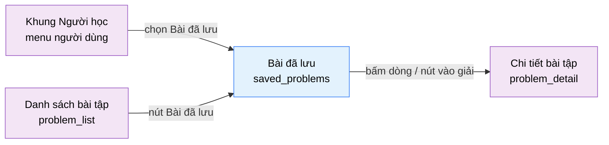

# Tài liệu thiết kế cơ bản (BD) — Bài đã lưu (`USR0103`)

## Phương châm tài liệu [Nội bộ — không cần khách duyệt]

- Viết theo **mẫu 9 sheet**. Bộ thẻ đóng, quy ước ID, ký hiệu chuẩn, ranh giới với tài liệu khác và
  checklist kiểm toán nằm ở `02-bd/_rules/bd-template-9sheet.md` — file này không chép lại.
- Phần gắn nhãn `[Nội bộ]` phục vụ sinh mã và tự kiểm toán, không phải yêu cầu của khách hàng: mục 4.5,
  mục 7.3 và các ghi chú quy ước.
- Mã màn `USR0103` theo bảng mã ở `02-bd/_rules/bd-template-9sheet.md` mục 8; tên file mang tiền tố mã.
- **Màn này là biến thể danh sách của `problem_list`.** Nguyên tắc số một khi đọc file: mọi thứ tương
  đương đều **dùng lại** quy ước đã chốt ở `02-bd/screens/users/USR0101_problem_list.md` — cùng bộ tên khối
  (`filter`, `table`, `pager`), cùng công thức ba trạng thái làm bài, cùng bộ tham số lọc trên URL, cùng
  cách suy giảm êm. Chỗ nào khác là khác thật: nguồn dữ liệu là tập bookmark của chính người học, mỗi dòng
  có ghi chú riêng tư sửa được, và có thao tác bỏ lưu.

> Đọc cùng `01-rd/screens/users/USR0103_saved_problems.md` (hành vi ở mức yêu cầu, không lặp lại ở đây),
> `02-bd/screens/users/USR0101_problem_list.md` (màn gốc của biến thể này),
> `02-bd/screens/users/_shell.md` (khung điều hướng khu Người học) và
> `02-bd/database/problem-bank.md` (bảng `bookmarks`).
>
> - **Header và chân trang không mô tả lại ở đây** — dùng chung khung khu Người học: header ngang dính
>   trên, không có thanh bên [Nguồn: 02-bd/screens/users/_shell.md:24,40-41], chân trang dùng chung
>   [Nguồn: 02-bd/screens/users/_shell.md:97-103].
> - **Màn này nằm trong menu người dùng của khung, không phải nav chính** — mục "Bài đã lưu" là một trong
>   năm mục của menu người dùng [Nguồn: 02-bd/screens/users/_shell.md:60,62-63]. Nó cũng có một lối vào
>   thứ hai: nút "Bài đã lưu" trong cụm hành động của tiêu đề trang `problem_list`
>   (dải chỉ số đã bỏ 2026-10-18)
>   [Nguồn: 02-bd/screens/users/USR0101_problem_list.md, Sheet 5 Khu vực A NO 1].
> - **Không thiết kế thao tác lưu bài lần đầu ở màn này.** Màn này chỉ **bỏ lưu** và **sửa ghi chú** trên
>   bookmark đã có. Nơi tạo bookmark là `problem_detail` — xem Câu hỏi mở Q1, đây chính là câu trả lời cho
>   `USR0101` Câu hỏi mở Q7 [Nguồn: 02-bd/screens/users/USR0101_problem_list.md:606].
> - **Không thiết kế** thao tác quản trị bài toán (xuất bản, đổi độ khó, xoá). Đó là màn
>   `problem_management` của A2/A3.
> - **Không hiển thị** nội dung testcase ẩn hay diff chi tiết ở bất kỳ trạng thái nào. Màn này không đọc
>   bảng `testcases`.

---

## Sheet 1. Bìa

| Mục | Giá trị |
| :--- | :--- |
| Hệ thống | AlgoPrep |
| Phân hệ | `problem-bank` (F2), đọc thêm từ `identity` (F1) |
| Công đoạn | BD — Thiết kế cơ bản |
| Phân loại | Màn hình |
| Tên màn | Bài đã lưu |
| Mã màn hình | `USR0103` |
| Tên vật lý (slug) | `saved_problems` |
| Trục tài liệu | Màn hình (`02-bd/screens/`) |
| Actor | A1 (`STUDENT`) |
| Phiên bản | V0.8 |
| Người tạo | Nhóm phát triển AlgoPrep |
| Ngày tạo | 2026/09/22 |
| Người cập nhật | Claude |
| Ngày cập nhật | 2026/10/19 |

---

## Sheet 2. Lịch sử sửa đổi

| Ver | Sheet bị sửa | Nội dung sửa | Ngày | Người sửa |
| :--- | :--- | :--- | :--- | :--- |
| V0.1 | Toàn bộ | Tạo mới theo mẫu 9 sheet. Kế thừa nguyên bộ quy ước của `USR0101`: tên khối `filter`/`table`/`pager`, công thức ba trạng thái làm bài từ `user_problem_best_score`, bộ tham số lọc trên URL, nguyên tắc suy giảm êm. Chốt phần đặc thù: ghi chú riêng tư sửa tại chỗ trong bảng, bỏ lưu kèm hoàn tác thay cho popup xác nhận, nhãn cảnh báo cho bài đã bị rút khỏi ngân hàng. Trả lời `USR0101` Câu hỏi mở Q7. Phát sinh 7 câu hỏi mở | 2026/09/22 | Nhóm phát triển AlgoPrep |
| V0.2 | Sheet 8, 9 | Đổi phản hồi sau thao tác (tìm kiếm, đổi trang, lưu ghi chú, bỏ lưu) và `[Tiêu điểm]` kiểm nhập liệu sang toast + viền ô; ghi nhận chỗ đặt nút Hoàn tác chờ owner chốt. Theo `DEC-2026-1003-toast-feedback-channel`. | 2026/10/03 | AI |
| V0.3 | Sheet 4, 5, 6, 7, 8 | Đồng bộ `DEC-2026-1001-admin-configurable-settings` mục (7): độ khó bài tập là danh mục do ADMIN quản lý (bảng riêng `problem_levels`), không còn enum cố định. DTO `difficulty` thành `levelCode`/`levelDisplayName` đọc qua `problems.level_id`; nhãn cạnh tên bài đọc `display_name` từ dữ liệu; tab độ khó là "Tất cả" cộng một tab mỗi mức theo `sort_order`. Màn gọi thêm `ListProblemLevels` (chỉ đọc, dùng lại endpoint của `USR0101`), thêm `problem_levels` vào bảng liên quan và Truy cập bảng. Màn chỉ hiển thị nhãn và lọc; không có logic gắn với độ khó | 2026/10/03 | AI |
| V0.4 | Sheet 3, 4, 5, 6, 7, 8, 9, Câu hỏi mở | Bỏ dải chỉ số (StatCard) theo quyết định owner 2026-10-18, mở rộng quy tắc owner 2026-10-13 "không dải KPI ở màn danh sách". Trang nay là `PageHeader` (tiêu đề + mô tả có tổng số đã lưu và số đã giải) rồi tới khối lọc, bảng, chân bảng. Bỏ Khu vực A cũ (ba chỉ số `savedTotal`/`todoCount`/`attemptedCount`) và nút "Lưu thêm từ ngân hàng bài" — bản dựng không còn nút này ở bất kỳ đâu trong màn; Khu vực A mới là đầu trang (tiêu đề, mô tả). Đánh lại EVT: bỏ EVT-14, EVT-14 thành EVT-14. `SavedProblemsSummaryDto` đổi thành `SavedProblemsPageMetaDto` (bỏ `todoCount`, `attemptedCount`; thêm `solvedCount` cho mô tả đầu trang). Thêm mục "Hiện trạng bản dựng" ở Sheet 4. Q7 đóng vì không còn dải chỉ số; Q1 điều chỉnh vì lối ra của trạng thái rỗng không còn là nút ở dải chỉ số | 2026/10/18 | AI |
| V0.4.1 | Câu hỏi mở (Q7) | RD `USR0103` dòng 36 đã được viết lại theo `DEC-2026-1018-usr-open-questions-phase1-scope` (không còn "dải chỉ số", mô tả đầu trang khớp bản dựng); cập nhật câu cuối ghi chú Q7 từ "cần đồng bộ ở lượt khác" thành đã đồng bộ. Không đổi thiết kế | 2026/10/18 | AI |
| V0.5 | Sheet 4 (Hiện trạng bản dựng), 5 (Khu vực B NO 8, D NO 2), 8 (EVT-11), 9 (NO 5, NO 7), Câu hỏi mở (đóng Q2 đến Q5) | Owner chốt Q2 đến Q5 ngày 2026/10/18 theo đề xuất (`DEC-2026-1018-usr-open-questions-phase2-5`, giai đoạn 3): bỏ lưu dùng Hoàn tác, không popup, hoàn tác trả cả bookmark lẫn ghi chú (Q2, ponytail bậc 5); ghi chú sửa tại chỗ trong bảng (Q3, bậc 3); ghi chú tối đa 1000 ký tự, văn bản thuần, có bộ đếm (Q4, bậc 5); phân trang 20 dòng một trang, ẩn khi chỉ một trang (Q5, bậc 5). Thiết kế đã mô tả các hành vi này từ trước nên Sheet 3, 6, 7 không đổi; sửa các câu "đề xuất" và "chờ owner" thành đã chốt, và viết lại Hiện trạng bản dựng sau khi dựng cả bốn trong `saved-problems-view.tsx`. Toast chuẩn chưa có nút hành động, nên bản dựng đặt Hoàn tác ở một thanh trạng thái ngay trong màn (xem Hiện trạng NO 8). Chưa duyệt hình | 2026/10/18 | Claude |
| V0.6 | Phương châm (Phạm vi), Sheet 3, 4 (4.1, Hiện trạng bản dựng), 5 (Khu vực C NO 5, 8, 10, 11, 13), 6 (Khu vực C NO 5, 8, 10, 11, 13), 7 (7.1 NO 9, 10, 11), 8 (EVT-8, EVT-13), 9 (NO 3), Câu hỏi mở Q1, Q6 | Owner 2026/10/18 (`DEC-2026-1018-usr-open-questions-last-four`, theo đề xuất): đóng **Q1** (trạng thái rỗng của `/saved` chỉ có câu hướng dẫn lưu bài từ trang chi tiết bài toán, **không liên kết**, bỏ câu "nếu owner muốn một liên kết"; ponytail bậc 3; Sheet 5 và 6 Khu vực C NO 13) và **Q6** (bài đã lưu rồi bị rút xuất bản hoặc ẩn mềm **vẫn nằm trong danh sách** với nhãn "Đã rút xuống", nút vào giải bị vô hiệu, vẫn tính vào tổng số đã lưu, ghi chú vẫn sửa và xoá được, nút Bỏ lưu vẫn dùng được; ponytail bậc 6). Nhãn lấy nguyên từ tiền lệ `INS0202` ("Đã rút xuống"), thay cho cụm "Đã rút khỏi ngân hàng" của V0.1. Sửa **mâu thuẫn nội bộ** của V0.1: Sheet 6 Khu vực C NO 8 từng không cho sửa ghi chú trên dòng đã rút, nay cho sửa. Trường DTO giữ tên `withdrawn` (Sheet 7.1 NO 9; không đổi thành `isWithdrawn` vì bản dựng và tiền lệ `INS0202` cùng dùng `withdrawn`), chốt ở DD. Sửa hai trích dẫn `INS0202` lệch dòng (`:414,491` thành `:520,543`). Không đổi số NO, EVT, Q | 2026/10/18 | Claude |
| V0.7 | Sheet 4 (Hiện trạng bản dựng: Bỏ lưu, Ghi chú), 5 (Khu vực C NO 11), 6 (NO 11), 8 (EVT-11), 9 (NO 4, NO 7) | Sửa theo đợt rà soát prototype 2026/10/19 (area B). **Hoàn tác chuyển sang toast chuẩn có nút hành động** (`toast.info(message, {label, onClick})`): mỗi lần bỏ lưu một toast riêng nên bỏ lưu bài thứ hai không làm mất cơ hội hoàn tác bài thứ nhất; toast nêu tên bài ("Đã bỏ lưu {tên bài}."); bỏ thanh trạng thái trong màn và `UNDO_WINDOW_MS`. Nhãn nút vào giải theo trạng thái (Xem lại, Làm tiếp, Giải). Nút Giải của dòng "Đã rút xuống" có `title` giải thích. Ô tìm kiếm giới hạn 100 ký tự bằng `FilterBar` `search.maxLength` (cắt im lặng, chưa có toast cảnh báo, nợ nhỏ). Đổi bộ lọc thì đóng ô ghi chú đang sửa. **Xác nhận lại:** sửa ghi chú trên dòng "Đã rút xuống" là **được phép** (Sheet 6 Khu vực C NO 8 đã sửa ở V0.6; bản dựng khớp BD, chủ dự án xác nhận 2026/10/19). Chưa duyệt hình | 2026/10/19 | Claude |
| V0.8 | Sheet 4 (Hiện trạng bản dựng), 9 (NO 4), Câu hỏi mở Q8 | Owner chốt 2026/10/19 (`DEC-2026-1019-usr-fe-audit-fixes`, chốt nốt câu hỏi mở còn lại sau rà prototype). Chỉ tài liệu, không đổi code, chưa duyệt hình. Thêm Q8 và đóng ngay: EVT-9, EVT-10, EVT-14 giữ là nợ prototype (ponytail bậc 3). Bỏ yêu cầu toast khi ô tìm kiếm chạm 100 ký tự: `maxLength` của trình duyệt dừng việc nhập là đủ (owner 2026/10/19, ponytail bậc 3); Sheet 9 dòng độ dài từ khoá đổi `[Tiêu điểm]` còn viền ô, không còn câu thông báo. | 2026/10/19 | Claude |

---

## Sheet 3. Sơ đồ chuyển màn

> [Nội bộ] Quy ước vẽ: bố trí từ trái sang phải. Màn gọi tới tô tím, màn hiện tại tô xanh nhạt, màn đích
> tô tím. Màu và `[Nguồn:]` dùng để truy vết, không phải yêu cầu của khách hàng.

### 3.1 Danh sách chuyển màn

#### Khung điều hướng Người học (menu người dùng) → Bài đã lưu

[Điều kiện mở] Mở menu người dùng trên header rồi chọn mục "Bài đã lưu"
[Nguồn: 02-bd/screens/users/_shell.md:60,62-63].

[Chế độ mở] Chế độ duyệt kèm sửa ghi chú tại chỗ. Không có chế độ sửa riêng biệt.

[Thông tin truyền] Tham số lọc trên URL nếu có (`q`, `status`, `difficulty`, `sort`, `dir`, `page`).
Không có tham số thì dùng giá trị mặc định ở Sheet 5 Khu vực B.

[Giá trị trả về] Không có.

[Khi thành công] Hiển thị đầu trang (tiêu đề kèm mô tả tổng số đã lưu và số đã giải), khối lọc, bảng bài đã lưu kèm ghi chú và chân bảng. Không còn dải chỉ số (đã bỏ 2026-10-18, owner)
[Nguồn: 05-coding/frontend/src/views/users/saved-problems/ui/saved-problems-view.tsx:280-283].

[Khi huỷ] Không có.

#### Danh sách bài tập → Bài đã lưu

[Điều kiện mở] Bấm nút "Bài đã lưu" trên dải chỉ số của `problem_list` (lối vào này thuộc BD `USR0101`; nếu `USR0101` cũng bỏ dải chỉ số thì lối vào duy nhất còn lại là menu người dùng)
[Nguồn: 02-bd/screens/users/USR0101_problem_list.md:303].

[Chế độ mở] Như trên.

[Thông tin truyền] Không có. Bộ lọc của `problem_list` **không** mang theo — hai màn có bộ lọc độc lập
[Nguồn: 02-bd/screens/users/USR0101_problem_list.md:136].

[Giá trị trả về] Không có.

[Khi thành công] Mở màn `saved_problems` với bộ lọc mặc định.

[Khi huỷ] Không có.

#### Bài đã lưu → Chi tiết bài tập

[Điều kiện mở] Bấm vào một dòng trong bảng, hoặc bấm nút vào giải hiện lên khi rê chuột qua dòng đó
[Nguồn: 09-layoutBase/Bài đã lưu.dc.html:139,154-159]. **Không áp dụng cho dòng có nhãn "Đã rút xuống"**: dòng đó
không mở được `problem_detail` (nút vào giải bị vô hiệu), xem Sheet 5 Khu vực C NO 5 và NO 11 (Câu hỏi mở Q6, đã chốt 2026/10/18).

[Chế độ mở] Chế độ giải bài.

[Thông tin truyền] `problem_id` của dòng được chọn.

[Giá trị trả về] Không có.

[Khi thành công] Mở màn `problem_detail` của bài được chọn.

[Khi huỷ] Còn ghi chú đang sửa chưa lưu thì hỏi xác nhận trước, xem EVT-14. Người dùng chọn ở lại thì
không chuyển màn.

> Đã bỏ 2026-10-18 (owner): chuyển màn "Bài đã lưu → Danh sách bài tập" qua nút "Lưu thêm từ ngân hàng
> bài". Nút này nằm ở cuối dải chỉ số; dải chỉ số bị bỏ và `saved-problems-view.tsx` không còn nút nào
> trỏ về `/problems` (grep `linkProblemList` và `/problems` chỉ còn liên kết tới `/problems/${id}` ở
> `:88` và `:157`). Người học quay về danh sách bài qua nav chính của khung Người học
> [Nguồn: 02-bd/screens/users/_shell.md:24,40-41], không qua chuyển màn riêng của màn này. Xem Câu hỏi mở Q1.

### 3.2 Sơ đồ

[Nguồn: 09-layoutBase/Bài đã lưu.dc.html:139,154-159;
02-bd/screens/users/_shell.md:60,62-63; 02-bd/screens/users/USR0101_problem_list.md:303]

---

## Sheet 4. Bố cục màn hình

### 4.1 Tổng quan màn

[Mục đích màn] Cho người học xem lại tập bài toán đã tự đánh dấu để quay lại, kèm ghi chú riêng tư theo
từng bài; lọc tập đó theo độ khó và theo trạng thái làm bài, sửa ghi chú tại chỗ, bỏ lưu hoặc vào giải
trực tiếp [Nguồn: 01-rd/screens/users/USR0103_saved_problems.md:16-17].

[Luồng nghiệp vụ chính]

1. **Hiển thị ban đầu**: vào màn, hệ thống đọc tham số lọc trên URL rồi tải hai nhóm dữ liệu — trang bài
   đã lưu đã lọc kèm hai con số của mô tả đầu trang (tổng số đã lưu, số đã giải), và trạng thái làm bài theo từng bài của chính người dùng. Trong lúc chờ,
   mỗi khối hiển thị khung chờ đúng số dòng dự kiến.
2. **Lọc và tìm kiếm**: gõ từ khoá, chọn tab độ khó, chọn tab trạng thái. Mỗi lần đổi bộ lọc, trang được
   đặt về 1 và bảng được tải lại từ máy chủ; trạng thái lọc ghi vào URL.
3. **Sửa ghi chú**: bấm vào ô ghi chú của một dòng để chuyển ô đó sang chế độ nhập, sửa rồi lưu. Đây là
   thao tác ghi duy nhất thường xuyên của màn.
4. **Bỏ lưu**: bấm "Bỏ lưu" trên một dòng. Dòng biến mất ngay, kèm một thông báo có nút hoàn tác.
5. **Vào giải**: bấm một dòng hoặc nút vào giải để sang `problem_detail`. Dòng có nhãn "Đã rút xuống" (bài đã
   bị rút xuất bản hoặc ẩn mềm sau khi lưu) vẫn nằm trong bảng nhưng không vào giải được; người học vẫn sửa
   ghi chú và bỏ lưu được như mọi dòng khác.

[Người dùng] Người học đã đăng nhập (`STUDENT`). Màn này **luôn** bắt buộc đăng nhập — khác `problem_list`
(nơi câu hỏi "khách xem được không" còn mở, `USR0101` Q1): toàn bộ nội dung màn này là dữ liệu cá nhân,
không có phần nào hiển thị được cho khách `[SoT: Suy luận]`.

[Tệp liên quan] Không có. Màn này không xuất hay nhập tệp.

[Phạm vi]
- Chỉ hiển thị bookmark của **chính người dùng đăng nhập**. Không có đường nào để `INSTRUCTOR`/`ADMIN` đọc
  bookmark hay ghi chú của người khác [Nguồn: 02-bd/database/problem-bank.md:132-134].
- Thao tác ghi đúng hai loại: sửa ghi chú và bỏ lưu (kèm hoàn tác). **Không có** thao tác lưu bài mới ở
  màn này — muốn lưu thêm thì sang `problem_list` (qua nav chính của khung) rồi vào `problem_detail`, xem Câu hỏi mở Q1.
- **Không có dải chỉ số** (StatCard) ở đầu trang — owner 2026-10-18, mở rộng quy tắc 2026-10-13. Hai con số
  tổng và đã giải chỉ còn nằm trong dòng mô tả dưới tiêu đề trang
  [Nguồn: 05-coding/frontend/src/views/users/saved-problems/ui/saved-problems-view.tsx:280-283].
- **Có** hiển thị bài đã bị rút xuất bản hoặc ẩn mềm, kèm nhãn cảnh báo "Đã rút xuống" — áp cùng cách đã xử lý ở
  `INS0202` (nhãn "Đã rút xuống", bảng vẫn giữ dòng) [Nguồn: 02-bd/screens/teacher/INS0202_class_assignments.md:520,543]
  cho `DEC-2026-0830-problem-lifecycle-two-states`. Dòng đó vẫn tính vào tổng số đã lưu, nút vào giải bị vô hiệu,
  ghi chú vẫn sửa và xoá được, Bỏ lưu vẫn dùng được. Đã chốt 2026/10/18 (owner), xem Câu hỏi mở Q6.
- Không có bộ lọc theo chủ đề: tập bài đã lưu nhỏ hơn hẳn ngân hàng bài, prototype cũng không có control
  nào cho chủ đề [Nguồn: 09-layoutBase/Bài đã lưu.dc.html:113-122]. Cột "Chủ đề" chỉ để đọc.
- Không hiển thị điểm theo tỉ lệ testcase (F4-13) trên từng dòng. Tỉ lệ chỉ dùng **bên trong** để suy ra
  trạng thái "Đã giải / Đang làm" (`DEC-2026-0831-partial-score-testcase-ratio`), đúng như `USR0101`.

[Quyền sử dụng]
- Xem: được, chỉ với chính chủ tài khoản.
- Thêm: không (không tạo bookmark mới ở màn này).
- Sửa: được, chỉ ghi chú của chính mình.
- Xoá: được, chỉ bookmark của chính mình (bỏ lưu).

[Số bản ghi tối đa] Bảng danh sách: 20 dòng mỗi trang, phân trang phía máy chủ — prototype không có phân
trang và minh hoạ 8 dòng [Nguồn: 09-layoutBase/Bài đã lưu.dc.html:183-192], nhưng tập bookmark không có
trần trên nên vẫn phải phân trang, xem Câu hỏi mở Q5. Đầu trang: một tiêu đề và một dòng mô tả chứa đúng 2 con số (tổng đã lưu, đã giải).

### 4.2 DTO liên quan

- `SavedProblemRowDto`
- `SavedProblemsPageMetaDto` (tên cũ `SavedProblemsSummaryDto`, đổi 2026-10-18 vì không còn dải chỉ số; chỉ còn số đếm cho mô tả đầu trang và chân bảng)

`[Suy luận]` — tên DTO do BD này đề xuất, `03-dd/api/problem-bank.md` chốt lại. Đặt tên **khác**
`ProblemListItemDto` của `USR0101` [Nguồn: 02-bd/screens/users/USR0101_problem_list.md:217] vì tập cột
khác hẳn: màn này có thêm `note` và `savedAt`, bỏ `acRate` và `hasSolutionReview`. Cũng đặt **khác** DTO
của màn quản trị, đúng quy ước "DTO khu người học đặt tên riêng"
[Nguồn: 02-bd/screens/users/USR0101_problem_list.md:223-226].

### 4.3 Bảng dữ liệu liên quan (6)

| NO | Bảng | Ghi chú |
| --: | :--- | :--- |
| 1 | `problem.bookmarks` | Bảng chủ của màn, nguồn của ghi chú và ngày lưu [Nguồn: 02-bd/database/problem-bank.md:130-134] |
| 2 | `problem.problems` | Mã, tên, khoá `level_id` của độ khó, trạng thái vòng đời của bài được lưu [Nguồn: 02-bd/database/problem-bank.md:11-29] |
| 3 | `problem.topics` | Tên chủ đề hiển thị ở cột "Chủ đề" [Nguồn: 02-bd/database/problem-bank.md:37-39] |
| 4 | `problem.problem_topics` | Nối bài với chủ đề [Nguồn: 02-bd/database/problem-bank.md:37-39] |
| 5 | `identity.user_problem_best_score` | Read model, nguồn cột "Trạng thái" của bảng, tab trạng thái và số "đã giải" ở mô tả đầu trang [Nguồn: 02-bd/database/identity.md:111-112; 05-coding/frontend/src/views/users/saved-problems/ui/saved-problems-view.tsx:94-96] |
| 6 | `problem.problem_levels` | Danh mục độ khó do ADMIN quản lý: nguồn nhãn cạnh tên bài và các tab độ khó [Nguồn: 02-bd/database/problem-bank.md mục `problem_levels`] |

Bảng cuối nằm ở schema của module khác. Màn không truy vấn thẳng: `problem-bank` gọi qua cổng ra sang
`identity`, đúng nguyên tắc mỗi schema một chủ [Nguồn: 02-bd/database/problem-bank.md:31-33] và đúng hướng
đã chọn ở `USR0101` Câu hỏi mở Q2 [Nguồn: 02-bd/screens/users/USR0101_problem_list.md:601].

Màn này **không** đọc `problem_stats` (không có cột AC rate), không đọc `judge.submissions`, không đọc
`ai.solution_reviews`.

### 4.4 Vùng bố cục

Đối chiếu `09-layoutBase/Bài đã lưu.dc.html` — bằng chứng bố cục chỉ-đọc, **không phải** design system
cuối cùng.

| Vùng | Vị trí trong prototype | Nội dung |
| :--- | :--- | :--- |
| Header ngang dính trên (khung chung Người học) | `:49-95` | Thương hiệu, nav, menu người dùng — dùng lại khung chung, không mô tả lại |
| Dải chỉ số (đã bỏ 2026-10-18, owner) | `:99-109` | Prototype có 3 chỉ số và nút "Lưu thêm từ ngân hàng bài" (`:108`); bản dựng và BD **không còn** vùng này. Thay bằng `PageHeader` (tiêu đề + mô tả), xem mục Hiện trạng bản dựng bên dưới |
| Khối lọc (đầu bảng) | `:112-123` | Ô tìm kiếm (`:115`), nhóm tab độ khó 4 mục với 3 mức khởi tạo (`:118`), nhóm tab trạng thái 4 mục (`:121`) |
| Bảng danh sách | `:125-165` | 6 cột: Bài toán (mã + tên + độ khó, `:129`), Chủ đề (`:130`), Trạng thái (`:131`), Ghi chú (`:132`), Đã lưu (`:133`), cột hành động rộng cố định (`:134`) |
| Khối trạng thái rỗng | `:167-172` | Tiêu đề và câu hướng dẫn, thay cho bảng khi không có dòng nào |
| Chân bảng | `:174-177` | Dòng tóm tắt số dòng bên trái, dòng nhắc riêng tư bên phải (`:176`) |
| Chân trang (khung chung Người học) | — | Prototype này **không có** thẻ `footer`; chân trang áp theo khung chung [Nguồn: 02-bd/screens/users/_shell.md:97-103] |

Bố cục **một cột**, không có cột phụ bên phải — đây là khác biệt bố cục rõ nhất so với `problem_list`
(hai cột `minmax(0, 1fr) 268px`) [Nguồn: 02-bd/screens/users/USR0101_problem_list.md:262]. Đầu trang
(tiêu đề + mô tả) nằm trên, phần còn lại nằm gọn trong một khung duy nhất có viền: lọc, bảng, trạng thái
rỗng và chân bảng đều là các phần của cùng một `section` (`:111-178`). Giữ nguyên cấu trúc này khi dựng
Next.js; không quy định màu sắc, khoảng cách hay typography ở BD.

**Hiện trạng bản dựng** (đọc lại `05-coding/frontend/src/views/users/saved-problems/ui/saved-problems-view.tsx`
ngày 2026-10-18; lệch so với prototype ở dải chỉ số là chủ ý của owner, các lệch khác là nợ prototype).

| Vùng BD | Bản dựng | Vị trí |
| :--- | :--- | :--- |
| Đầu trang | `PageHeader` với `title` và `description` = i18n `subtitle` nhận `total` (`all.length`) và `solved` (đếm `solveState === "solved"`) | `saved-problems-view.tsx:280-283`, `:94-96` |
| Dải chỉ số | **Không còn.** Không có `StatCard` nào; không có nút "Lưu thêm từ ngân hàng bài" ở bất kỳ đâu trong file (liên kết `Link` duy nhất trỏ tới `/problems/${id}`) | `:278-375` |
| Khối lọc | `FilterBar` (ô tìm kiếm, Enter báo toast) cùng hai `FilterMenu` (độ khó từ `useProblemLevels`, trạng thái). Là menu chọn, chưa phải nhóm tab như BD | `:286-318` |
| Bảng | `DataTable` 6 cột: Bài toán (mã + tên + badge độ khó), Chủ đề, Trạng thái, Ghi chú, Ngày lưu, hành động (Giải, Bỏ lưu); hiển thị đúng trang hiện tại (`pageRows`) | `:146-276`, `:340-348` |
| Trạng thái rỗng | `EmptyState` khi chưa lưu bài nào; `emptyMessage` của bảng khi lọc không khớp | `:337-348` |
| Chân bảng | Phân trang 20 dòng một trang, phân trang phía máy khách trên mảng mẫu; khối `Pagination` chỉ dựng khi số dòng khớp lớn hơn 20; đổi bộ lọc thì về trang 1. Dùng lại `shared/ui` `Pagination` như `my-submissions`. Dòng nhắc riêng tư giữ nguyên. **Chưa có** dòng tóm tắt `{khớp} / {tổng}` riêng (dòng tóm tắt chỉ nằm trong `Pagination`, hiện khi nhiều hơn một trang) | `:86-92`, `:350-368`, `:370-372` |
| Ghi chú | Sửa tại chỗ (Q3): bấm vào ô thì đổi thành `TextArea` có `maxLength` 1000 và bộ đếm `{đã gõ}/1000`, hai nút Lưu và Hủy (nút Lưu cắt khoảng trắng hai đầu, báo toast; chữ thuần, không dựng Markdown). Lệch BD: lưu bằng nút chứ chưa lưu khi rời tiêu điểm (EVT-9), chưa có hộp hỏi khi rời màn lúc ghi chú sửa dở (EVT-14, Khu vực F); nợ prototype. **Owner chốt 2026/10/19: EVT-9, EVT-10 và EVT-14 vẫn là nợ prototype, không dựng ở bước này (ponytail bậc 3), xem Q8** | `:44-47,120-130,190-239` |
| Bỏ lưu | Không popup. Xoá dòng khỏi state rồi `toast.info("Đã bỏ lưu {tên bài}.", { label: "Hoàn tác", onClick })`; closure của mỗi toast giữ dòng, vị trí cũ và ghi chú nên mỗi lần bỏ lưu có một nút Hoàn tác riêng (không mất bài thứ nhất khi bỏ bài thứ hai). Cửa sổ hoàn tác là thời gian hiện của toast. Ngày lưu giữ nguyên chứ không là ngày tạo lại (mock) | `saved-problems-view.tsx:unsave` |
| Bài đã rút xuống (Q6) | `SavedProblem.withdrawn` (tuỳ chọn) trong `entities/problem/model/types.ts:100-101`; bài mẫu `#895` có `withdrawn: true` (`entities/problem/api/__mock__/problem-mocks.ts:259-269`). Ô "Bài toán": dòng rút xuống hiển thị tên bài dạng chữ xám, **không còn là `Link`**, kèm `Badge` cảnh báo "Đã rút xuống" (khoá i18n `savedProblems.table.withdrawn`) cạnh badge độ khó; nút vào giải vẫn hiện nhưng `disabled`. Ghi chú (`:242`) và Bỏ lưu (`:291`) **không** bị chặn theo `withdrawn`; `total` của mô tả đầu trang là `all.length` nên vẫn đếm bài rút xuống. Khớp quyết định. **Chưa có:** chú giải (tooltip) câu dài của Sheet 9 NO 3, nợ prototype nhỏ. Prototype có nhãn cảnh báo | `05-coding/frontend/src/views/users/saved-problems/ui/saved-problems-view.tsx:150-175,266-275,304` |
| Trạng thái rỗng (Q1) | Một `EmptyState` duy nhất với khoá `emptyAll`: "Bạn chưa lưu bài toán nào. Mở một bài toán và bấm Lưu bài ở trang chi tiết để thêm vào đây." Không liên kết, không nút. Bản dựng gộp tiêu đề (NO 12) và câu hướng dẫn (NO 13) vào một câu; khác BD về cách chia, đúng về nội dung | `05-coding/frontend/src/views/users/saved-problems/ui/saved-problems-view.tsx:359-361`; `05-coding/frontend/messages/vi.json:230` |

Số liệu bản dựng lấy từ `fetchSavedProblems` (dữ liệu mẫu), nên mọi cột "Nguồn giá trị" ở Sheet 5 mô tả
đích backend, không phải hiện trạng.

Prototype tĩnh (`09-layoutBase`) hiển thị ghi chú như **văn bản chỉ đọc** trong ô bảng (`:151`), trong khi F2-13 yêu cầu ghi chú
**sửa được** [Nguồn: 01-rd/screens/users/USR0103_saved_problems.md:41]. Chủ dự án đã chốt ô ghi chú là ô sửa tại chỗ (Câu hỏi
mở Q3, 2026/10/18).

### 4.5 Cấu trúc slice FSD [Nội bộ]

| Khối | Slice dự kiến | Căn cứ |
| :--- | :--- | :--- |
| Trang | `views/users/saved-problems` | Quy ước FSD của dự án |
| Khung Người học | Dùng lại `widgets/app-shell` (biến thể `student-header`) | `02-bd/screens/users/_shell.md` mục 1 |
| Đầu trang | `PageHeader` của `shared/ui`, không có widget riêng | `saved-problems-view.tsx:280-283`. Đã bỏ slice `widgets/saved-problems-summary` (2026-10-18, owner) |
| Ô tìm kiếm, tab độ khó, tab trạng thái | Dùng lại `features/problem-filter` của `USR0101` | Prototype `:112-123`; cùng bộ tham số URL nên cùng một feature, chỉ khác tập tham số bật lên |
| Bảng + chân bảng | `widgets/saved-problem-table` + dùng lại `entities/problem` | Prototype `:125-177` |
| Ô ghi chú sửa tại chỗ | `features/bookmark-note-edit` | Prototype `:151`; F2-13 |
| Bỏ lưu kèm hoàn tác | `features/bookmark-toggle` | Prototype `:156,256` |

`[Suy luận]` — ánh xạ slice do BD đề xuất, DD màn hình chốt lại. `features/bookmark-toggle` cố ý đặt tên
theo hành vi bật/tắt chứ không phải "unsave", vì chính slice đó sẽ được `problem_detail` dùng lại cho
thao tác lưu (xem Câu hỏi mở Q1) — viết hai slice cho hai chiều của cùng một cờ là lãng phí.
`entities/problem` phải là component nhận dữ liệu từ ngoài, không tự gọi API — ràng buộc này đã đặt ở
`USR0101` [Nguồn: 02-bd/screens/users/USR0101_problem_list.md:282-283], màn này là lý do nó tồn tại.

> [Nội bộ] Ảnh minh hoạ đặt ở `08-diagram/02-bd/screens/users/`, chụp bằng Playwright trên ứng dụng
> Next.js thật khi đã có mã chạy được. Chưa có thì tham chiếu prototype, không vẽ tay.

---

## Sheet 5. Danh sách item màn hình

> Quy ước ID, bộ thẻ và giá trị chuẩn: `02-bd/_rules/bd-template-9sheet.md` mục 2, 3, 4.
>
> **Ba trạng thái làm bài dùng chung một công thức với `USR0101`**, không định nghĩa lại: không có dòng
> `user_problem_best_score` thành "Chưa làm"; có dòng và `best_verdict = ACCEPTED` thành "Đã giải"; có
> dòng mà khác `ACCEPTED` thành "Đang làm"
> [Nguồn: 02-bd/screens/users/USR0101_problem_list.md:332; 02-bd/database/identity.md:111-112].
> Prototype màn này dùng câu chữ khác ("CHƯA GIẢI / ĐANG DỞ / SOLVED",
> [Nguồn: 09-layoutBase/Bài đã lưu.dc.html:219]) — BD **thống nhất theo nhãn của `USR0101`** để hai màn
> không nói hai kiểu về cùng một trạng thái `[SoT: Suy luận]`.

### Khu vực A — Đầu trang

| Khu vực | NO | Tên item | ID item | Bảng DB | Cột DB | Loại UI | Kiểu | Độ dài | Bắt buộc | I/O | Giá trị mặc định | Định dạng | Ghi chú |
| :--- | --: | :--- | :--- | :--- | :--- | :--- | :--- | :--- | :-: | :-: | :--- | :--- | :--- |
| Đầu trang | | | | | | | | | | | | | |
| | 1 | Tiêu đề trang | `savedProblems.header.title` | - | - | Label | String | - | - | O | - | - | Tên màn "Bài đã lưu" [Nguồn giá trị] Nhãn tĩnh i18n `savedProblems.title` [Nguồn: 05-coding/frontend/src/views/users/saved-problems/ui/saved-problems-view.tsx:281] [EVT liên quan] - |
| | 2 | Mô tả trang | `savedProblems.header.description` | `problem.bookmarks`, `identity.user_problem_best_score` | `user_id`, `best_verdict` | Label | String | - | - | O | - | `{tổng} bài đã lưu, {đã giải} đã giải` | Một dòng mô tả dưới tiêu đề, chứa hai con số của **cả tập bookmark**, không chịu ảnh hưởng của bộ lọc [Công thức] `tổng` = số bookmark của người dùng đăng nhập (`SavedProblemsPageMetaDto.savedTotal`); `đã giải` = số bookmark có trạng thái làm bài "Đã giải" theo công thức ba trạng thái ở đầu Sheet 5 (`SavedProblemsPageMetaDto.solvedCount`). Bản dựng tính hai số này từ `all.length` và đếm `solveState === "solved"` trên mảng đầy đủ [Nguồn: 05-coding/frontend/src/views/users/saved-problems/ui/saved-problems-view.tsx:94-96,282] [Nguồn giá trị] Nhãn i18n `savedProblems.subtitle` nhận hai tham số `total`, `solved`. Thay vai trò của dải chỉ số đã bỏ (owner 2026-10-18); số "chưa bắt đầu" và "đang dở" không còn hiển thị ở đâu [EVT liên quan] EVT-1, EVT-11, EVT-12 |

### Khu vực B — Bộ lọc

| Khu vực | NO | Tên item | ID item | Bảng DB | Cột DB | Loại UI | Kiểu | Độ dài | Bắt buộc | I/O | Giá trị mặc định | Định dạng | Ghi chú |
| :--- | --: | :--- | :--- | :--- | :--- | :--- | :--- | :--- | :-: | :-: | :--- | :--- | :--- |
| Bộ lọc | | | | | | | | | | | | | |
| | 1 | Ô tìm kiếm | `savedProblems.filter.query` | `problem.problems` | `code`, `title` | TextBox | String | 100 | - | I/O | rỗng | - | Tìm trong tập bài đã lưu theo tên bài hoặc mã bài [Nguồn giá trị] Tham số URL `q`; không có thì rỗng. Gợi ý trong ô là nhãn tĩnh i18n "Tìm trong bài đã lưu" [Nguồn: 09-layoutBase/Bài đã lưu.dc.html:239] [EVT liên quan] EVT-2 |
| | 2 | Tab độ khó | `savedProblems.filter.difficultyTabs` | `problem.problem_levels` | `code`, `display_name`, `sort_order` | List | List | - | - | I/O | `Tất cả` | - | Tab "Tất cả" cộng một tab mỗi mức trong `problem_levels` theo `sort_order`; số tab không cố định (prototype vẽ 4 tab với 3 mức khởi tạo [Nguồn: 09-layoutBase/Bài đã lưu.dc.html:240]) [Nguồn giá trị] Phản hồi của `ListProblemLevels` (Sheet 7.3 NO 5), đọc từ dữ liệu do ADMIN quản lý, không còn nhãn tĩnh i18n map từ enum [Nguồn: 02-bd/database/problem-bank.md mục `problem_levels`]; giá trị đang chọn lấy từ tham số URL `difficulty` (mang `code` của mức) [EVT liên quan] EVT-3 |
| | 3 | Tab trạng thái | `savedProblems.filter.statusTabs` | `identity.user_problem_best_score` | `best_verdict` | List | Enum | - | - | I/O | `Tất cả` | - | 4 tab: Tất cả / Đã giải / Đang làm / Chưa làm — cùng tập giá trị và cùng nhãn với `USR0101` [Nguồn: 02-bd/screens/users/USR0101_problem_list.md:321], không dùng câu chữ riêng của prototype [Nguồn: 09-layoutBase/Bài đã lưu.dc.html:242] [Nguồn giá trị] Nhãn tĩnh i18n; giá trị đang chọn lấy từ tham số URL `status` [EVT liên quan] EVT-4 |
| | 4 | Xoá bộ lọc | `savedProblems.filter.linkReset` | - | - | Link | - | - | - | I | - | - | Đưa cả 3 bộ lọc về mặc định. Chỉ xuất hiện ở trạng thái không có kết quả **do lọc** [Nguồn giá trị] Nhãn tĩnh i18n [EVT liên quan] EVT-7 |

### Khu vực C — Bảng bài đã lưu

| Khu vực | NO | Tên item | ID item | Bảng DB | Cột DB | Loại UI | Kiểu | Độ dài | Bắt buộc | I/O | Giá trị mặc định | Định dạng | Ghi chú |
| :--- | --: | :--- | :--- | :--- | :--- | :--- | :--- | :--- | :-: | :-: | :--- | :--- | :--- |
| Bảng bài đã lưu | | | | | | | | | | | | | |
| | 1 | Danh sách bài đã lưu | `savedProblems.table.list` | `problem.bookmarks` | - | List | List | - | - | O | rỗng | - | Bảng bookmark của chính người dùng, 20 dòng mỗi trang [Nguồn giá trị] Kết quả gọi `ListMySavedProblems` [EVT liên quan] EVT-1 |
| | 2 | Mã bài | `savedProblems.table.col.code` | `problem.problems` | `code` | ListColumn | String | 40 | - | O | - | - | Mã ngắn hiển thị của bài toán [Nguồn giá trị] Cột `code` [Nguồn: 02-bd/database/problem-bank.md:14]; prototype hiển thị ở đầu ô "Bài toán" [Nguồn: 09-layoutBase/Bài đã lưu.dc.html:142] [EVT liên quan] - |
| | 3 | Tên bài | `savedProblems.table.col.title` | `problem.problems` | `title` | ListColumn | String | 200 | - | O | - | - | Tiêu đề bài toán [Nguồn giá trị] Cột `title` [Nguồn: 02-bd/database/problem-bank.md:15; 09-layoutBase/Bài đã lưu.dc.html:143] [EVT liên quan] EVT-13 |
| | 4 | Độ khó | `savedProblems.table.col.difficulty` | `problem.problem_levels`, `problem.problems` | `display_name` | ListColumn | String | - | - | O | - | Nhãn `display_name`, badge | Mức độ khó, hiển thị ngay cạnh tên bài chứ không phải cột riêng [Nguồn: 09-layoutBase/Bài đã lưu.dc.html:144] [Nguồn giá trị] Cột `problem_levels.display_name` (qua `problems.level_id`), **đọc từ dữ liệu**, không còn ánh xạ cứng enum; ba mức khởi tạo giữ màu badge cũ, mức mới màu trung tính `DEC-2026-1001-admin-configurable-settings` mục (7) [Nguồn: 02-bd/database/problem-bank.md mục `problem_levels`] [EVT liên quan] - |
| | 5 | Nhãn đã rút khỏi ngân hàng | `savedProblems.table.col.withdrawnBadge` | `problem.problems` | `status`, `deleted` | Badge | Boolean | - | - | O | Ẩn | Chữ "Đã rút xuống", badge cảnh báo | Cảnh báo bài đã lưu nhưng nay không còn truy cập được; đặt cạnh tên bài. Đã chốt 2026/10/18 (owner), Câu hỏi mở Q6 [Công thức] Hiện khi `status = UNPUBLISHED` **hoặc** `deleted = true` [Nguồn: 02-bd/database/problem-bank.md:18-19]; cờ do máy chủ tính sẵn (`SavedProblemRowDto.withdrawn`, Sheet 7.1 NO 9). Dòng mang nhãn này **vẫn nằm trong bảng và vẫn được đếm** vào tổng số đã lưu; nút vào giải (NO 11) bị vô hiệu, còn ghi chú (NO 8) và nút Bỏ lưu (NO 10) vẫn dùng được. [Nguồn giá trị] Nhãn tĩnh i18n; chữ "Đã rút xuống" lấy nguyên từ tiền lệ `INS0202` [Nguồn: 02-bd/screens/teacher/INS0202_class_assignments.md:520,543] [EVT liên quan] EVT-1 |
| | 6 | Chủ đề | `savedProblems.table.col.topics` | `problem.topics` | `name` | ListColumn | String | - | - | O | `-` | - | Chủ đề của bài toán, chỉ đọc, không lọc được [Nguồn giá trị] `topics.name` qua `problem_topics.problem_id`; nhiều chủ đề thì nối bằng dấu phẩy, cùng cách đã dùng ở `USR0101` [Nguồn: 02-bd/screens/users/USR0101_problem_list.md:337; 09-layoutBase/Bài đã lưu.dc.html:147] [EVT liên quan] - |
| | 7 | Trạng thái làm bài | `savedProblems.table.col.solveState` | `identity.user_problem_best_score` | `best_verdict` | Badge | Enum | - | - | O | `Chưa làm` | - | Ba trạng thái: Đã giải / Đang làm / Chưa làm [Công thức] Công thức ba trạng thái ghi ở đầu Sheet 5 [Nguồn: 02-bd/database/identity.md:111-112; 09-layoutBase/Bài đã lưu.dc.html:149] [EVT liên quan] - |
| | 8 | Ghi chú riêng tư | `savedProblems.table.col.note` | `problem.bookmarks` | `note` | TextArea | String | 1000 | - | I/O | rỗng | - | Ghi chú tự do của người học cho bài đó, **riêng tư tuyệt đối**, sửa tại chỗ trong bảng [Nguồn: 01-rd/req/problem-bank.md:57-61] [Nguồn giá trị] Cột `bookmarks.note` [Nguồn: 02-bd/database/problem-bank.md:132]; rỗng thì hiển thị dấu gạch ngang [Nguồn: 09-layoutBase/Bài đã lưu.dc.html:247]. Giới hạn 1000 ký tự đã chốt 2026/10/18 (Q4), ô nhập có bộ đếm `{đã gõ}/1000`. Dòng có nhãn "Đã rút xuống" (NO 5) **vẫn sửa và xoá được ghi chú** (Q6, 2026/10/18): đó là chữ chính người học đã gõ nên không bị khoá theo bài [EVT liên quan] EVT-8, EVT-9, EVT-10 |
| | 9 | Ngày lưu | `savedProblems.table.col.savedAt` | `problem.bookmarks` | `created_at` | ListColumn | Date | - | - | O | - | `dd/MM` | Ngày người học đánh dấu bài này [Nguồn giá trị] Cột `bookmarks.created_at` [Nguồn: 02-bd/database/problem-bank.md:132], **không phải** `updated_at` — sửa ghi chú không được làm đổi ngày lưu [Nguồn: 09-layoutBase/Bài đã lưu.dc.html:152] [EVT liên quan] EVT-5 |
| | 10 | Nút Bỏ lưu | `savedProblems.table.col.btnUnsave` | - | - | Button | - | - | - | I | - | - | Xoá bookmark của dòng đang trỏ. Chỉ hiện khi rê chuột qua dòng [Nguồn: 09-layoutBase/Bài đã lưu.dc.html:154-156]. Dùng được cả trên dòng có nhãn "Đã rút xuống" (NO 5): người học muốn dọn bài đã rút khỏi danh sách thì phải làm được [Nguồn giá trị] Nhãn tĩnh i18n "Bỏ lưu" [EVT liên quan] EVT-11 |
| | 11 | Nút vào giải | `savedProblems.table.col.btnSolve` | `identity.user_problem_best_score` | `best_verdict` | Button | - | - | - | I | - | - | Mở `problem_detail` của dòng đang trỏ. Chỉ hiện khi rê chuột qua dòng. **Dòng có nhãn "Đã rút xuống" (NO 5) thì nút hiện nhưng bị vô hiệu** (`disabled`), bấm cả dòng cũng không điều hướng — bài đã rút thì `problem_detail` chỉ trả lỗi (Q6, đã chốt 2026/10/18) [Công thức] Nhãn đổi theo trạng thái làm bài: "Đã giải" thành "Xem lại", "Đang làm" thành "Làm tiếp", "Chưa làm" thành "Giải" [Nguồn: 09-layoutBase/Bài đã lưu.dc.html:251] [EVT liên quan] EVT-13 |
| | 12 | Tiêu đề trạng thái rỗng | `savedProblems.table.emptyTitle` | - | - | Label | String | - | - | O | - | - | Câu tiêu đề thay cho bảng khi không có dòng nào [Công thức] Có bookmark nhưng bộ lọc không khớp thì dùng nhãn tĩnh "Không có bài nào khớp bộ lọc"; chưa lưu bài nào thì dùng nhãn tĩnh "Bạn chưa lưu bài nào" [Nguồn: 09-layoutBase/Bài đã lưu.dc.html:260] [EVT liên quan] EVT-1 |
| | 13 | Câu hướng dẫn trạng thái rỗng | `savedProblems.table.emptyNote` | - | - | Label | String | - | - | O | - | - | Câu phụ gợi hành động kế tiếp [Công thức] Trường hợp lọc không khớp dùng nhãn tĩnh "Bỏ một bộ lọc, hoặc lưu thêm bài từ ngân hàng bài toán." [Nguồn: 09-layoutBase/Bài đã lưu.dc.html:261]; trường hợp chưa lưu bài nào dùng nhãn tĩnh **một câu hướng dẫn, không có liên kết và không có nút**: "Mở một bài toán và bấm Lưu bài ở trang chi tiết để thêm vào đây." Nơi lưu bài **duy nhất** vẫn là `problem_detail`; màn này không dẫn người học tới đó bằng liên kết (đã chốt 2026/10/18 (owner), Câu hỏi mở Q1, ponytail bậc 3: không người dùng nào cần liên kết khi demo, nav chính của khung luôn có mặt) [EVT liên quan] EVT-1 |

### Khu vực D — Chân bảng

| Khu vực | NO | Tên item | ID item | Bảng DB | Cột DB | Loại UI | Kiểu | Độ dài | Bắt buộc | I/O | Giá trị mặc định | Định dạng | Ghi chú |
| :--- | --: | :--- | :--- | :--- | :--- | :--- | :--- | :--- | :-: | :-: | :--- | :--- | :--- |
| Chân bảng | | | | | | | | | | | | | |
| | 1 | Tóm tắt kết quả | `savedProblems.pager.summary` | - | - | Label | String | - | - | O | - | `{khớp} / {tổng} bài đã lưu` | Dòng tóm tắt số dòng khớp bộ lọc trên tổng số bookmark [Công thức] Tử số là tổng số dòng khớp bộ lọc, mẫu số là `SavedProblemsPageMetaDto.savedTotal`, cũng là số "tổng" ở mô tả đầu trang (Khu vực A NO 2) [Nguồn: 09-layoutBase/Bài đã lưu.dc.html:262-264]. Bản dựng chưa có dòng này, xem Hiện trạng bản dựng ở Sheet 4 [EVT liên quan] EVT-6 |
| | 2 | Nút số trang | `savedProblems.pager.pageButtons` | - | - | List | Number | - | - | I/O | `1` | Số nguyên | Danh sách số trang, trang đang xem được làm nổi. **Ẩn cả khối phân trang khi chỉ có một trang** (Q5, chốt 2026/10/18) [Công thức] Số trang bằng tổng số dòng khớp bộ lọc chia 20, làm tròn lên, tối thiểu 1. Prototype tĩnh không có phân trang; bản dựng Next.js đã có [EVT liên quan] EVT-6 |
| | 3 | Dòng nhắc riêng tư | `savedProblems.pager.privacyNote` | - | - | Label | String | - | - | O | - | - | Câu nhắc "Bài đã lưu chỉ hiển thị với bạn." [Nguồn giá trị] Nhãn tĩnh i18n [Nguồn: 09-layoutBase/Bài đã lưu.dc.html:176]; đúng mức riêng tư đã chốt ở RD [Nguồn: 01-rd/screens/users/USR0103_saved_problems.md:44] [EVT liên quan] - |

### Khu vực E — Thông báo hoàn tác bỏ lưu

| Khu vực | NO | Tên item | ID item | Bảng DB | Cột DB | Loại UI | Kiểu | Độ dài | Bắt buộc | I/O | Giá trị mặc định | Định dạng | Ghi chú |
| :--- | --: | :--- | :--- | :--- | :--- | :--- | :--- | :--- | :-: | :-: | :--- | :--- | :--- |
| Thông báo hoàn tác bỏ lưu | | | | | | | | | | | | | |
| | 1 | Câu thông báo | `savedProblems.undoNotice.message` | - | - | Label | String | - | - | O | - | - | Câu xác nhận đã bỏ lưu, kèm tên bài [Nguồn giá trị] Nhãn tĩnh i18n ghép với `savedProblems.table.col.title` của dòng vừa bỏ [EVT liên quan] EVT-11 |
| | 2 | Nút Hoàn tác | `savedProblems.undoNotice.btnUndo` | `problem.bookmarks` | `note` | Button | - | - | - | I | - | - | Tạo lại bookmark vừa bỏ **kèm nguyên ghi chú cũ** [Nguồn giá trị] Nhãn tĩnh i18n; ghi chú cũ giữ ở bộ nhớ tạm của màn cho tới khi thông báo tắt [EVT liên quan] EVT-12 |

### Khu vực F — Hỏi xác nhận rời màn

| Khu vực | NO | Tên item | ID item | Bảng DB | Cột DB | Loại UI | Kiểu | Độ dài | Bắt buộc | I/O | Giá trị mặc định | Định dạng | Ghi chú |
| :--- | --: | :--- | :--- | :--- | :--- | :--- | :--- | :--- | :-: | :-: | :--- | :--- | :--- |
| Hỏi xác nhận rời màn | | | | | | | | | | | | | |
| | 1 | Hộp xác nhận | `savedProblems.leaveGuard.dialog` | - | - | Popup | - | - | - | O | Ẩn | - | Hộp cảnh báo còn ghi chú đang sửa chưa lưu [Nguồn giá trị] Nhãn tĩnh i18n [EVT liên quan] EVT-14 |
| | 2 | Nút Ở lại | `savedProblems.leaveGuard.btnStay` | - | - | Button | - | - | - | I | - | - | Đóng hộp, giữ nguyên ô ghi chú đang sửa [Nguồn giá trị] Nhãn tĩnh i18n [EVT liên quan] EVT-14 |
| | 3 | Nút Rời đi | `savedProblems.leaveGuard.btnLeave` | - | - | Button | - | - | - | I | - | - | Bỏ nội dung đang sửa và tiếp tục điều hướng [Nguồn giá trị] Nhãn tĩnh i18n [EVT liên quan] EVT-14 |

[Nguồn: 09-layoutBase/Bài đã lưu.dc.html:99-109,112-123,125-165,167-172,174-177,212,219,231-235,239-243,247,251,260-264;
02-bd/database/problem-bank.md:11-29,37-39,130-134; 02-bd/database/identity.md:111-112;
01-rd/screens/users/USR0103_saved_problems.md:16-17,44]

---

## Sheet 6. Đặc tả điều khiển item

> Ký hiệu cột `Hiển thị` và thứ tự thẻ: `02-bd/_rules/bd-template-9sheet.md` mục 2, 3. Dùng đúng NO, tên
> item và thứ tự của Sheet 5. Lỗi nhập liệu ghi ở Sheet 9, xử lý nghiệp vụ ghi ở Sheet 8.

### Khu vực A — Đầu trang

| Khu vực | NO | Tên item | Hiển thị | Ghi chú |
| :--- | --: | :--- | :-: | :--- |
| Đầu trang | | | | |
| | 1 | Tiêu đề trang | Có | - |
| | 2 | Mô tả trang | Có | [Điều kiện hiển thị] Trong lúc tải chưa có số thì không dựng dòng mô tả. Không lấy được trạng thái làm bài từ `identity` thì bỏ vế "đã giải", giữ vế tổng số `[SoT: Suy luận]`. [Tự động đặt] **Không** tính lại khi đổi bộ lọc — đây là số của cả tập bookmark. Giảm 1 ngay khi bỏ lưu thành công (và giảm số đã giải nếu bài đó đang "Đã giải"), tăng lại khi hoàn tác. |

### Khu vực B — Bộ lọc

| Khu vực | NO | Tên item | Hiển thị | Ghi chú |
| :--- | --: | :--- | :-: | :--- |
| Bộ lọc | | | | |
| | 1 | Ô tìm kiếm | Có | [Điều kiện kích hoạt] Luôn kích hoạt, kể cả khi bảng đang tải. [Tự động đặt] Nhận giá trị ban đầu từ tham số URL `q`. Gõ xong dừng 400 ms mới gọi máy chủ, không gọi theo từng ký tự — cùng ngưỡng với `USR0101`. |
| | 2 | Tab độ khó | Có | [Điều kiện kích hoạt] Không kích hoạt trong lúc bảng đang tải. [Tự động đặt] Tab ứng với tham số URL `difficulty` được làm nổi; giá trị lạ thì về "Tất cả". |
| | 3 | Tab trạng thái | Điều kiện | [Điều kiện hiển thị] Ẩn cả nhóm tab khi không lấy được trạng thái làm bài từ `identity` — lọc theo một dữ liệu không có là bẫy người dùng. [Điều kiện kích hoạt] Không kích hoạt trong lúc bảng đang tải. [Tự động đặt] Tab ứng với tham số URL `status` được làm nổi. |
| | 4 | Xoá bộ lọc | Điều kiện | [Điều kiện hiển thị] Chỉ hiển thị khi bảng rỗng **và** đang có ít nhất một bộ lọc khác mặc định. Tập bookmark rỗng thật thì không hiển thị, vì xoá bộ lọc không giúp được gì. |

### Khu vực C — Bảng bài đã lưu

| Khu vực | NO | Tên item | Hiển thị | Ghi chú |
| :--- | --: | :--- | :-: | :--- |
| Bảng bài đã lưu | | | | |
| | 1 | Danh sách bài đã lưu | Điều kiện | [Điều kiện hiển thị] Trong lúc tải hiển thị khung chờ đúng 8 dòng. Tải xong mà không có dòng nào thì thay bảng bằng khối trạng thái rỗng (NO 12, NO 13). Tải lỗi thì hiển thị thông báo lỗi kèm nút thử lại, giữ nguyên bộ lọc. |
| | 2 | Mã bài | Có | - |
| | 3 | Tên bài | Có | - |
| | 4 | Độ khó | Có | - |
| | 5 | Nhãn đã rút khỏi ngân hàng | Điều kiện | [Điều kiện hiển thị] Chỉ hiển thị khi bài đã bị rút xuất bản hoặc ẩn mềm (`withdrawn = true`), chữ "Đã rút xuống". Dòng vẫn ở nguyên trong bảng và vẫn được đếm vào tổng số đã lưu, không bị giấu — giấu đi sẽ khiến người học tưởng mình đã bỏ lưu nhầm và làm mất ghi chú trước mặt họ (Q6, đã chốt 2026/10/18). |
| | 6 | Chủ đề | Có | - |
| | 7 | Trạng thái làm bài | Điều kiện | [Điều kiện hiển thị] Chỉ hiển thị khi lấy được trạng thái theo người dùng. Không lấy được thì ẩn ô trạng thái trên mọi dòng và bảng vẫn hiển thị bình thường, xem EVT-1. |
| | 8 | Ghi chú riêng tư | Có | [Điều kiện hiển thị] Mặc định hiển thị dạng văn bản một dòng, cắt bớt khi quá dài; bấm vào thì đổi thành ô nhập nhiều dòng ngay tại chỗ. [Điều kiện kích hoạt] Không kích hoạt trong lúc chính dòng đó đang lưu ghi chú. **Vẫn kích hoạt trên dòng có nhãn "Đã rút xuống"** (đổi so với V0.1, Q6 đã chốt 2026/10/18): ghi chú là dữ liệu của người học, sửa hay xoá trắng đều được, máy chủ vẫn nhận `SaveMyBookmark` cho bookmark của bài đã rút. [Tự động đặt] Đang mở ô nhập ở một dòng mà bấm sang dòng khác thì lưu dòng đang mở trước, rồi mới mở dòng mới. |
| | 9 | Ngày lưu | Có | [Điều kiện kích hoạt] Tiêu đề cột bấm được để đổi chiều sắp xếp; không kích hoạt trong lúc bảng đang tải. Đây là cột sắp xếp được **duy nhất** của màn. |
| | 10 | Nút Bỏ lưu | Điều kiện | [Điều kiện hiển thị] Chỉ hiển thị trên dòng đang được rê chuột hoặc đang nhận tiêu điểm bàn phím [Nguồn: 09-layoutBase/Bài đã lưu.dc.html:154]. Không dùng chuột được thì vẫn tới được bằng bàn phím. [Điều kiện kích hoạt] Không kích hoạt khi dòng đó đang có yêu cầu bỏ lưu chưa trả lời. Kích hoạt bình thường trên dòng có nhãn "Đã rút xuống" (Q6, 2026/10/18). |
| | 11 | Nút vào giải | Điều kiện | [Điều kiện hiển thị] Như NO 10. [Điều kiện kích hoạt] **Không kích hoạt** (`disabled`) khi dòng có nhãn "Đã rút xuống" — bài không còn truy cập được thì mở ra chỉ để nhận lỗi. Nút vẫn hiển thị (không ẩn) để người học thấy dòng đó khác dòng thường; tên bài trên dòng cũng không còn là liên kết (EVT-13). |
| | 12 | Tiêu đề trạng thái rỗng | Điều kiện | [Điều kiện hiển thị] Chỉ hiển thị khi tải xong và không có dòng nào [Nguồn: 09-layoutBase/Bài đã lưu.dc.html:167]. |
| | 13 | Câu hướng dẫn trạng thái rỗng | Điều kiện | [Điều kiện hiển thị] Như NO 12. Chỉ là một câu chữ: **không có liên kết hay nút** ở cả hai biến thể (Q1, đã chốt 2026/10/18). |

### Khu vực D — Chân bảng

| Khu vực | NO | Tên item | Hiển thị | Ghi chú |
| :--- | --: | :--- | :-: | :--- |
| Chân bảng | | | | |
| | 1 | Tóm tắt kết quả | Có | [Tự động đặt] Cập nhật sau mỗi lần tải bảng, sau khi bỏ lưu và sau khi hoàn tác. |
| | 2 | Nút số trang | Điều kiện | [Điều kiện hiển thị] Chỉ hiển thị khi có từ 2 trang trở lên — với đa số người học thì khối này không bao giờ xuất hiện. [Điều kiện kích hoạt] Nút của trang đang xem không kích hoạt. |
| | 3 | Dòng nhắc riêng tư | Có | [Điều kiện hiển thị] Hiển thị ở mọi trạng thái, kể cả trạng thái rỗng — nó nói về cả danh sách, không về một dòng nào. |

### Khu vực E — Thông báo hoàn tác bỏ lưu

| Khu vực | NO | Tên item | Hiển thị | Ghi chú |
| :--- | --: | :--- | :-: | :--- |
| Thông báo hoàn tác bỏ lưu | | | | |
| | 1 | Câu thông báo | Điều kiện | [Điều kiện hiển thị] Chỉ hiển thị sau khi bỏ lưu thành công, tự tắt sau 8 giây hoặc khi người dùng bỏ lưu bài tiếp theo. [Tự động đặt] Bỏ lưu bài thứ hai khi thông báo cũ còn hiện thì thông báo cũ bị thay, và cơ hội hoàn tác bài thứ nhất mất — nêu rõ ở Sheet 9 NO 7. |
| | 2 | Nút Hoàn tác | Điều kiện | [Điều kiện hiển thị] Như NO 1. [Điều kiện kích hoạt] Không kích hoạt sau khi đã bấm một lần, cho tới khi có phản hồi. |

### Khu vực F — Hỏi xác nhận rời màn

| Khu vực | NO | Tên item | Hiển thị | Ghi chú |
| :--- | --: | :--- | :-: | :--- |
| Hỏi xác nhận rời màn | | | | |
| | 1 | Hộp xác nhận | Điều kiện | [Điều kiện hiển thị] Chỉ hiển thị khi đang có ít nhất một ô ghi chú mở ở chế độ nhập **và** nội dung khác giá trị đã lưu, tại đúng lúc người dùng kích hoạt một đường rời màn. Không có thay đổi thì rời màn thẳng, không hỏi. |
| | 2 | Nút Ở lại | Có | [Điều kiện kích hoạt] Luôn kích hoạt khi hộp đang mở. |
| | 3 | Nút Rời đi | Có | [Điều kiện kích hoạt] Luôn kích hoạt khi hộp đang mở. |

[Nguồn: 09-layoutBase/Bài đã lưu.dc.html:154,167,183-192; 02-bd/database/problem-bank.md:18-19]

---

## Sheet 7. Danh sách truyền dữ liệu

### 7.1 Trường DTO

| NO | DTO | Trường DTO | Kiểu | Bảng DB | Cột DB | Item màn | Hiển thị | Ghi chú |
| --: | :--- | :--- | :--- | :--- | :--- | :--- | :-: | :--- |
| 1 | `SavedProblemRowDto` | `problemId` | UUID | `problem.bookmarks` | `problem_id` | - | Không | [Nguồn] Phản hồi của `ListMySavedProblems` [Đích] Tham số điều hướng sang `problem_detail`, và khoá của mọi thao tác ghi trên dòng. |
| 2 | `SavedProblemRowDto` | `code` | String | `problem.problems` | `code` | Bảng "Mã bài" | Có | - |
| 3 | `SavedProblemRowDto` | `title` | String | `problem.problems` | `title` | Bảng "Tên bài" | Có | - |
| 4 | `SavedProblemRowDto` | `levelCode`, `levelDisplayName` | String, String | `problem.problem_levels` | `code`, `display_name` | Bảng "Độ khó", tab độ khó | Có | [Nguồn] Join qua `problems.level_id` (thay trường `difficulty` kiểu Enum cũ, theo `DEC-2026-1001-admin-configurable-settings` mục (7)) [Chuyển đổi] Đọc `display_name` từ dữ liệu; `levelCode` là giá trị tham số URL `difficulty`. |
| 5 | `SavedProblemRowDto` | `topicNames` | List\<String\> | `problem.topics` | `name` | Bảng "Chủ đề" | Có | [Nguồn] `topics.name` qua `problem_topics.problem_id` [Chuyển đổi] Nối bằng dấu phẩy khi hiển thị. |
| 6 | `SavedProblemRowDto` | `solveState` | Enum | `identity.user_problem_best_score` | `best_verdict` | Bảng "Trạng thái làm bài", tab trạng thái, nhãn nút vào giải | Có | [Nguồn] `problem-bank` gọi cổng ra sang `identity` (`ListMyProblemSolveStates`), không đọc thẳng schema khác — dùng lại đúng cổng ra đã đề xuất ở `USR0101` [Nguồn: 02-bd/screens/users/USR0101_problem_list.md:601] [Chuyển đổi] `SOLVED`/`ATTEMPTED`/`UNSOLVED` thành "Đã giải"/"Đang làm"/"Chưa làm". |
| 7 | `SavedProblemRowDto` | `note` | String | `problem.bookmarks` | `note` | Bảng "Ghi chú riêng tư" | Có | [Nguồn] Chỉ trả về cho chính chủ tài khoản [Chuyển đổi] `NULL` trả về chuỗi rỗng; màn hiển thị dấu gạch ngang. |
| 8 | `SavedProblemRowDto` | `savedAt` | Date | `problem.bookmarks` | `created_at` | Bảng "Ngày lưu" | Có | [Chuyển đổi] Trả mốc thời gian đầy đủ, màn hiển thị rút gọn `dd/MM`. Không dùng `updated_at`. |
| 9 | `SavedProblemRowDto` | `withdrawn` | Boolean | `problem.problems` | `status`, `deleted` | Bảng "Nhãn đã rút khỏi ngân hàng" (nhãn "Đã rút xuống"), nút vào giải (vô hiệu khi `true`) | Có | [Chuyển đổi] `true` khi `status = UNPUBLISHED` hoặc `deleted = true`. Máy chủ tính sẵn, **không** trả hai cột thô ra ngoài — trạng thái vòng đời của bài không phải thông tin của người học. **Tên trường:** giữ `withdrawn` (không đổi thành `isWithdrawn`) vì bản dựng (`SavedProblem.withdrawn`) và `AssignedProblem.withdrawn` của `INS0202` đã dùng tên này `[SoT: Suy luận]`; **chốt ở DD `problem-bank`**. Dòng `withdrawn = true` vẫn nằm trong kết quả `ListMySavedProblems` (không lọc ra ở truy vấn) và vẫn được đếm vào `savedTotal` (Q6, 2026/10/18). |
| 10 | `SavedProblemsPageMetaDto` | `savedTotal` | Number | `problem.bookmarks` | `user_id` | Mô tả đầu trang "tổng" (Khu vực A NO 2), mẫu số của "Tóm tắt kết quả" | Có | [Nguồn] Trả kèm trong phản hồi của `ListMySavedProblems`, tính trên **toàn bộ** tập bookmark chứ không trên tập đã lọc. Không còn nuôi ô "Tổng số đã lưu" của dải chỉ số (đã bỏ 2026-10-18, owner). **Gồm cả bookmark của bài đã rút xuống** (`withdrawn = true`), đã chốt 2026/10/18 (Q6): con số này phải bằng số dòng người học đếm được trong danh sách chưa lọc |
| 11 | `SavedProblemsPageMetaDto` | `solvedCount` | Number | `identity.user_problem_best_score` | `best_verdict` | Mô tả đầu trang "đã giải" (Khu vực A NO 2) | Có | [Nguồn] Cùng lời gọi NO 10; số bookmark có trạng thái "Đã giải" theo công thức ba trạng thái. Trường mới 2026-10-18, thay cho cặp `todoCount`/`attemptedCount` [Chuyển đổi] Gọi `identity` thất bại thì trả `null`, màn bỏ vế "đã giải". Bài đã rút xuống vẫn xét theo cùng công thức: đã giải trước khi bị rút thì vẫn tính "đã giải" `[SoT: Suy luận]` (không có lý do loại khỏi số đếm trong khi dòng vẫn hiển thị). |
| 12 | `SavedProblemsPageMetaDto` | `filteredTotal` | Number | - | - | Chân bảng "Tóm tắt kết quả", "Nút số trang" | Có | [Nguồn] Tổng số dòng khớp bộ lọc, dùng cho cả dòng tóm tắt lẫn việc tính số trang. Từ 2026-10-18 chỉ là số đếm của chân bảng, không còn đi cùng chỉ số dải chỉ số |
| - | `SavedProblemsPageMetaDto` | `todoCount`, `attemptedCount` | Number | - | - | - | Không | Đã bỏ 2026-10-18, owner: ô "Chưa bắt đầu" và "Đang dở" của dải chỉ số không còn. Giữ dòng này để truy vết, DD không hiện thực hoá |
| 13 | `ProblemLevelDto` | `code`, `displayName`, `sortOrder` | String, String, Number | `problem.problem_levels` | `code`, `display_name`, `sort_order` | Bộ lọc "Tab độ khó" | Có | [Nguồn] Phản hồi của `ListProblemLevels`, **dùng lại** DTO của `USR0101` (Sheet 7 NO 16); chỉ đọc, mọi người dùng đã xác thực gọi được (`DEC-2026-1001-admin-configurable-settings` mục (7)) [Chuyển đổi] Giao diện tự thêm tab "Tất cả" ở đầu; thứ tự tab theo `sortOrder`. |

### 7.2 Truy cập bảng dữ liệu (6)

| NO | Tên logic | Bảng | Repository | CRUD | Mục đích | Ghi chú |
| --: | :--- | :--- | :--- | :-: | :--- | :--- |
| 1 | Bài đã lưu | `problem.bookmarks` | `BookmarkRepository` | C/R/U/D | Đọc trang bài đã lưu, ghi ghi chú, tạo lại khi hoàn tác, xoá khi bỏ lưu | `ListMySavedProblems`: R `SaveMyBookmark`: C khi hoàn tác, U khi sửa ghi chú (một lệnh upsert) `RemoveMyBookmark`: D — xoá thật, bảng không có cột ẩn mềm [Nguồn: 02-bd/database/problem-bank.md:132] |
| 2 | Bài toán | `problem.problems` | `ProblemRepository` | R | Lấy mã, tên, `level_id` của độ khó và trạng thái vòng đời của bài được lưu | `ListMySavedProblems`: R |
| 3 | Chủ đề | `problem.topics` | `TopicRepository` | R | Lấy tên chủ đề cho cột "Chủ đề" | `ListMySavedProblems`: R |
| 4 | Gán chủ đề cho bài | `problem.problem_topics` | `ProblemTopicRepository` | R | Nối bài với chủ đề | `ListMySavedProblems`: R |
| 5 | Tiến độ theo bài của người dùng | `identity.user_problem_best_score` | `UserProblemBestScoreRepository` (module `identity`) | R | Suy ra trạng thái Đã giải / Đang làm / Chưa làm của từng dòng và số "đã giải" ở mô tả đầu trang | `ListMyProblemSolveStates`: R — gọi qua cổng ra, `problem-bank` không đọc thẳng schema `identity` |
| 6 | Danh mục độ khó | `problem.problem_levels` | `ProblemLevelRepository` | R | Đọc nhãn độ khó của từng dòng (qua join `level_id`) và danh mục cho tab lọc độ khó | `ListProblemLevels`: R `ListMySavedProblems`: R, qua join. Màn này không ghi; ADMIN quản lý độ khó ở `SHR0201` [Nguồn: 02-bd/database/problem-bank.md mục `problem_levels`] |

Khác `USR0101` ở đúng một điểm về CRUD: màn này **có thao tác ghi**, và toàn bộ thao tác ghi chỉ chạm
**một** bảng là `bookmarks`. Năm bảng còn lại chỉ đọc.

`[Suy luận]` — tên repository do BD này đề xuất, DD module chốt lại.

### 7.3 Danh sách endpoint [Nội bộ]

> Chỉ tên nghiệp vụ và BC sở hữu. Hợp đồng chi tiết thuộc `03-dd/api/<module>.md`.

| NO | Endpoint (tên nghiệp vụ) | Mục đích | BC sở hữu |
| --: | :--- | :--- | :--- |
| 1 | `ListMySavedProblems` | Tìm kiếm, lọc, sắp xếp và phân trang tập bài đã lưu của chính người dùng, kèm `SavedProblemsPageMetaDto` (`savedTotal`, `solvedCount`, `filteredTotal`) | `problem-bank` |
| 2 | `SaveMyBookmark` | Tạo hoặc cập nhật bookmark của chính người dùng kèm ghi chú (một lệnh upsert) | `problem-bank` |
| 3 | `RemoveMyBookmark` | Xoá bookmark của chính người dùng | `problem-bank` |
| 4 | `ListMyProblemSolveStates` | Trả trạng thái Đã giải / Đang làm theo từng bài của chính người dùng | `identity` |
| 5 | `ListProblemLevels` | Tải danh mục độ khó (đọc từ dữ liệu) cho tab lọc độ khó; chỉ đọc, mọi người dùng đã xác thực gọi được; **dùng lại** endpoint của `USR0101` | `problem-bank` |

Ghi chú ranh giới:
- **Chỉ có 5 endpoint (4 endpoint nghiệp vụ của màn và `ListProblemLevels` dùng chung với `USR0101`), không có endpoint riêng cho số đếm đầu trang.** Hai con số của mô tả đầu trang (`savedTotal`, `solvedCount`) đi kèm phản hồi của
  `ListMySavedProblems` vì chúng tính trên cùng tập dữ liệu mà lời gọi đó vốn đã phải quét. Tách thành
  `GetMySavedProblemsSummary` sẽ thêm một vòng gọi mạng cho đúng hai con số `[SoT: Suy luận]`. Ba chỉ số cũ của dải chỉ số (`savedTotal`, `todoCount`, `attemptedCount`) và nút "Lưu thêm từ ngân hàng bài" đã bỏ 2026-10-18 (owner).
- **`SaveMyBookmark` là một lệnh upsert dùng chung cho ba việc**: lưu bài lần đầu (ở `problem_detail`),
  sửa ghi chú (màn này), và tạo lại khi hoàn tác (màn này). Khoá là `(user_id, problem_id)`, đúng khoá
  chính của bảng [Nguồn: 02-bd/database/problem-bank.md:133], nên ba việc là cùng một phép ghi. Viết ba
  endpoint cho một phép ghi sẽ đẻ ra ba nhánh kiểm quyền phải giữ đồng bộ.
- **`ListMyProblemSolveStates` dùng lại nguyên endpoint của `USR0101`**
  [Nguồn: 02-bd/screens/users/USR0101_problem_list.md:521], không đặt tên mới. Cùng dữ liệu, cùng phạm vi,
  cùng chủ sở hữu.
- **Tiền tố `My` nghĩa là phạm vi khoá cứng theo người dùng đăng nhập**, không nhận `user_id` làm tham số
  — quy ước chung của khu Người học [Nguồn: 02-bd/screens/users/USR0101_problem_list.md:530]. Với màn
  này quy ước đó còn là điều kiện bắt buộc của F2-13, xem Sheet 9 NO 2.
- **Tên nghiệp vụ không dùng lại tên của màn quản trị.** Không có endpoint quản trị nào đọc `bookmarks`,
  và đó là chủ ý [Nguồn: 02-bd/database/problem-bank.md:132-134].

[Nguồn: 02-bd/database/problem-bank.md:11-29,37-39,130-134; 02-bd/database/identity.md:111-112]

---

## Sheet 8. Danh sách sự kiện

> Bộ thẻ và quy ước cột `Chuyển màn`: `02-bd/_rules/bd-template-9sheet.md` mục 2, 3.
>
> **Trạng thái lọc ghi vào URL theo đúng quy ước đã chốt ở `USR0101`**
> [Nguồn: 02-bd/screens/users/USR0101_problem_list.md:542-547], không định nghĩa lại: dùng cùng bộ tham số
> `q` `status` `difficulty` `sort` `dir` `page` (màn này không có `topic` vì không lọc theo chủ đề); đổi
> bộ lọc dùng cơ chế thay thế mục lịch sử, đổi trang thì thêm mục mới; tham số lạ thì bỏ qua và dùng mặc
> định, **không** báo lỗi.
>
> **Khác `USR0101` ở một chỗ quan trọng:** màn này **có dữ liệu nhập chưa lưu** (ô ghi chú đang sửa), nên
> mọi đường rời màn phải đi qua EVT-14.

### Màn chính: Bài đã lưu

| NO | Loại | Sự kiện | Chi tiết | Chuyển màn | Gọi API | Tên xử lý | Ghi chú |
| --: | :--- | :--- | :--- | :-: | :-: | :--- | :--- |
| 1 | Màn hình | Khởi tạo màn | Vào màn thì đọc tham số lọc trên URL rồi tải dữ liệu. | Không | Có | `ListMySavedProblems`, `ListMyProblemSolveStates`, `ListProblemLevels` | [Các bước] 1. Kiểm tra người dùng đã đăng nhập. 2. Đọc và chuẩn hoá tham số URL; giá trị lạ thì bỏ qua và dùng mặc định. 3. Hiển thị khung chờ cho bảng; dòng mô tả đầu trang chờ có số mới dựng. 4. Tải song song hai nhóm dữ liệu. [Khi thành công] Hiển thị đủ đầu trang (kèm mô tả), khối lọc, bảng và chân bảng. Không có dòng nào thì hiển thị khối trạng thái rỗng đúng biến thể (chưa lưu bài nào, hay lọc không khớp). [Khi lỗi] Lỗi ở `ListMySavedProblems` thì hiển thị lỗi kèm nút thử lại tại vùng bảng. Lỗi ở `ListMyProblemSolveStates` thì **ẩn ô trạng thái, ẩn nhóm tab trạng thái và bỏ vế "đã giải" của mô tả đầu trang, không báo lỗi** — bảng bài đã lưu và ghi chú vẫn dùng được bình thường. |
| 2 | Nhập liệu | Gõ từ khoá tìm kiếm | Gõ vào ô tìm kiếm. | Không | Có | `ListMySavedProblems` | [Các bước] 1. Chờ 400 ms sau lần gõ cuối. 2. Đặt trang về 1, cập nhật tham số URL `q` theo cơ chế thay thế. 3. Tải lại bảng. [Khi thành công] Bảng và dòng tóm tắt cập nhật. Mô tả đầu trang giữ nguyên. Nhấn Enter trong ô tìm kiếm thì toast thông tin báo số bài đã lưu tìm thấy (hoặc không có bài nào); gõ dở thì không toast [Nguồn: 05-coding/frontend/src/views/users/saved-problems/ui/saved-problems-view.tsx:138-144]. [Khi lỗi] Giữ nguyên kết quả cũ, hiển thị toast lỗi. |
| 3 | Nút | Chọn tab độ khó | Bấm một trong các tab Tất cả hoặc một mức độ khó (mỗi mức trong `problem_levels` một tab, theo `sort_order`). | Không | Có | `ListMySavedProblems` | [Các bước] 1. Đặt trang về 1, cập nhật tham số URL `difficulty`. 2. Tải lại bảng. [Khi thành công] Bảng chỉ còn bài đã lưu đúng mức độ khó. [Khi lỗi] Như EVT-2. |
| 4 | Nút | Chọn tab trạng thái | Bấm một trong 4 tab Tất cả / Đã giải / Đang làm / Chưa làm. | Không | Có | `ListMySavedProblems` | [Các bước] 1. Đặt trang về 1, cập nhật tham số URL `status`. 2. Tải lại bảng. [Khi thành công] Bảng chỉ còn bài khớp trạng thái; ghi chú của từng dòng vẫn hiển thị đầy đủ [Nguồn: 01-rd/screens/users/USR0103_saved_problems.md:90]. Lọc chạy ở máy chủ, không lọc trên trang đang xem. [Khi lỗi] Như EVT-2. |
| 5 | Nút | Sắp xếp theo ngày lưu | Bấm tiêu đề cột "Đã lưu". | Không | Có | `ListMySavedProblems` | [Các bước] 1. Đảo chiều sắp xếp; mặc định ban đầu là mới lưu trước. 2. Cập nhật tham số URL `sort` và `dir`, giữ nguyên số trang. 3. Tải lại bảng. [Khi thành công] Mũi tên chiều sắp xếp hiện trên tiêu đề cột. Sắp xếp chạy ở máy chủ, trên toàn bộ kết quả lọc chứ không chỉ trang đang xem. [Khi lỗi] Như EVT-2. |
| 6 | Nút | Chuyển trang | Bấm một nút số trang. | Không | Có | `ListMySavedProblems` | [Các bước] 1. Còn ghi chú đang sửa chưa lưu thì chạy EVT-14 trước. 2. Cập nhật tham số URL `page` bằng cơ chế thêm mục lịch sử. 3. Tải lại bảng và cuộn về đầu bảng. [Khi thành công] Bảng hiển thị trang mới, dòng tóm tắt cập nhật theo. [Khi lỗi] Giữ nguyên trang cũ và hiển thị toast lỗi. |
| 7 | Liên kết | Xoá toàn bộ bộ lọc | Bấm liên kết "Xoá bộ lọc" ở trạng thái không có kết quả. | Không | Có | `ListMySavedProblems` | [Các bước] 1. Đặt lại cả 3 bộ lọc về mặc định và trang về 1. 2. Xoá các tham số lọc khỏi URL. 3. Tải lại bảng. [Khi thành công] Bảng trở lại toàn bộ tập bài đã lưu. |
| 8 | Nút | Mở ô ghi chú để sửa | Bấm vào ô "Ghi chú" của một dòng. | Không | Không | - | [Các bước] 1. Đang mở ô ghi chú ở dòng khác và nội dung đã đổi thì chạy EVT-9 cho dòng đó trước. 2. Đổi ô của dòng vừa bấm sang chế độ nhập, đặt sẵn nội dung hiện có và đưa con trỏ về cuối. [Khi thành công] Ô chuyển sang chế độ nhập. Không gọi máy chủ ở bước này. Áp dụng cả cho dòng có nhãn "Đã rút xuống" (Q6, 2026/10/18). |
| 9 | Nhập liệu | Lưu ghi chú | Rời tiêu điểm khỏi ô ghi chú, hoặc bấm tổ hợp phím lưu. | Không | Có | `SaveMyBookmark` | [Các bước] 1. Nội dung không đổi thì đóng ô, **không** gọi máy chủ. 2. Cắt khoảng trắng thừa hai đầu, kiểm độ dài theo Sheet 9 NO 5. 3. Gửi `problem_id` và nội dung ghi chú mới. [Khi thành công] Ô trở lại chế độ đọc với nội dung mới; **không** tải lại cả bảng, chỉ cập nhật đúng dòng đó. Ngày lưu không đổi. [Khi lỗi] Giữ ô ở chế độ nhập với nguyên nội dung người dùng vừa gõ, viền ô ghi chú đổi sang đỏ và hiển thị toast lỗi, cho lưu lại. Tuyệt đối không âm thầm bỏ nội dung. |
| 10 | Nút | Huỷ sửa ghi chú | Bấm phím thoát khi đang mở ô ghi chú. | Không | Không | - | [Các bước] 1. Trả ô về nội dung đã lưu gần nhất và đóng chế độ nhập. [Khi thành công] Nội dung vừa gõ bị bỏ, không gọi máy chủ. Đây là đường bỏ thay đổi duy nhất **không** hỏi lại, vì người dùng chủ động bấm huỷ. |
| 11 | Nút | Bỏ lưu một bài | Bấm "Bỏ lưu" trên một dòng. | Không | Có | `RemoveMyBookmark` | [Các bước] 1. Giữ lại `problem_id`, tên bài và ghi chú của dòng vào bộ nhớ tạm của màn. 2. Gọi máy chủ xoá bookmark. 3. Bỏ dòng khỏi bảng, giảm số trong mô tả đầu trang tương ứng. [Khi thành công] Dòng biến mất ngay [Nguồn: 01-rd/screens/users/USR0103_saved_problems.md:91] và hiện thông báo kèm nút "Hoàn tác" (không có popup xác nhận, Q2 đã chốt 2026/10/18). Hoàn tác là nút hành động của toast chuẩn (`toast.info` nhận `action`), mỗi lần bỏ lưu một toast (Sheet 9 NO 7). Trang hiện tại còn 0 dòng mà vẫn còn trang trước thì lùi về trang trước. [Khi lỗi] Đưa dòng trở lại đúng vị trí cũ và hiển thị toast lỗi. Bookmark đã bị xoá ở phiên khác thì coi như đã đạt kết quả mong muốn, xem Sheet 9 NO 6. [Thông báo hoàn tất] Toast "Đã bỏ lưu {tên bài}." |
| 12 | Nút | Hoàn tác bỏ lưu | Bấm "Hoàn tác" trên thông báo. | Không | Có | `SaveMyBookmark` | [Các bước] 1. Gửi lại `problem_id` kèm **nguyên ghi chú cũ** lấy từ bộ nhớ tạm. 2. Tải lại trang bảng hiện tại. [Khi thành công] Bài trở lại danh sách kèm ghi chú cũ; số trong mô tả đầu trang trở lại giá trị trước khi bỏ lưu. Ngày lưu là ngày tạo lại, **không phải** ngày lưu ban đầu — nêu rõ ở Sheet 9 NO 7. [Khi lỗi] Giữ thông báo và cho bấm lại. |
| 13 | Liên kết | Mở bài toán | Bấm một dòng trong bảng, hoặc bấm nút vào giải của dòng đó. | Có | Không | - | [Các bước] 1. Bấm rơi vào ô "Ghi chú" thì đây là EVT-8 chứ không phải EVT-13 — ô ghi chú nuốt sự kiện bấm, không cho nó lan ra cả dòng. 2. Dòng có nhãn "Đã rút xuống" (`withdrawn = true`) thì **dừng ở đây**: nút vào giải bị vô hiệu, không có đường điều hướng và không gọi gì (Q6, 2026/10/18). 3. Còn ghi chú đang sửa chưa lưu thì chạy EVT-14. 4. Điều hướng sang `problem_detail` kèm `problem_id` của dòng. [Khi thành công] Mở màn `problem_detail`. Bộ lọc còn nguyên trên URL của màn này, quay lại là thấy đúng trạng thái cũ. |
| 14 | Màn hình | Rời màn khi ghi chú chưa lưu | Kích hoạt bất kỳ đường rời màn nào (EVT-6, EVT-13, nút Quay lại của trình duyệt, đóng thẻ) khi đang có ô ghi chú sửa dở. | Không | Không | - | [Các bước] 1. Không có ô nào đang sửa, hoặc nội dung không khác giá trị đã lưu, thì cho đi thẳng, **không** hỏi. 2. Ngược lại chặn điều hướng và mở hộp xác nhận. [Khi xác nhận] Bấm "Rời đi" thì bỏ nội dung đang gõ và tiếp tục đường điều hướng ban đầu; bấm "Ở lại" thì đóng hộp, giữ nguyên ô đang sửa và đặt lại tiêu điểm vào ô đó. [Khi lỗi] Đóng thẻ hoặc tải lại trang thì trình duyệt chỉ cho hiện hộp cảnh báo mặc định của nó, không tuỳ biến được câu chữ — chấp nhận, không tìm cách lách. |

[Nguồn: 09-layoutBase/Bài đã lưu.dc.html:108,151,154-157,167,256;
01-rd/screens/users/USR0103_saved_problems.md:90-91;
02-bd/screens/users/USR0101_problem_list.md:542-547]

---

## Sheet 9. Đặc tả kiểm tra

> Bộ thẻ và quy ước mã thông báo: `02-bd/_rules/bd-template-9sheet.md` mục 2, 4. Sheet này ghi **điều kiện
> kiểm và thông báo**; tiêu chí nghiệm thu `AC-nn` thuộc `04-tdd/saved_problems.md`, không lặp lại ở đây.

| NO | Loại | Tóm tắt kiểm | Chi tiết | Mức | Mã thông báo | Ghi chú | EVT gọi | Thứ tự |
| --: | :--- | :--- | :--- | :--- | :--- | :--- | :--- | :-: |
| 1 | Kiểm quyền | Yêu cầu đăng nhập | [Nội dung kiểm] Người dùng chưa đăng nhập thì chuyển về màn `auth`. Màn này **không** có trạng thái khách, khác `problem_list` nơi câu hỏi đó còn mở. [Nơi thực thi] Chặn ở cả tầng định tuyến phía giao diện và tầng phân quyền phía máy chủ. | Lỗi | Chưa có mã thông báo | Nội dung "Vui lòng đăng nhập để tiếp tục." | EVT-1 | 1 |
| 2 | Kiểm quyền | Phạm vi dữ liệu cá nhân tuyệt đối | [Nội dung kiểm] Cả bốn endpoint của màn chỉ làm việc trên bookmark của **chính người dùng đăng nhập**; không endpoint nào nhận `user_id` từ phía gọi. Vai trò `INSTRUCTOR`/`ADMIN` **không** có đường đọc hay sửa bookmark và ghi chú của người khác, kể cả khi ma trận phân quyền F1-10 cấp toàn quyền. [Nơi thực thi] Máy chủ, ở tầng dịch vụ — không chỉ ở giao diện. | Lỗi | Không có thông báo | Đây là ràng buộc cứng của F2-13, không phải lựa chọn giao diện [Nguồn: 01-rd/req/problem-bank.md:59-61; 02-bd/database/problem-bank.md:132-134]. Quy ước tiền tố `My` của khu Người học chính là hình thức kỹ thuật của ràng buộc này [Nguồn: 02-bd/screens/users/USR0101_problem_list.md:530]. | EVT-1, EVT-9, EVT-11, EVT-12 | 1 |
| 3 | Kiểm nghiệp vụ | Bài đã rút khỏi ngân hàng | [Nội dung kiểm] Bookmark trỏ tới bài có `status = UNPUBLISHED` hoặc `deleted = true` vẫn phải trả về và vẫn hiển thị, kèm nhãn "Đã rút xuống" và nút vào giải bị vô hiệu; vẫn được đếm vào `savedTotal`; ghi chú vẫn sửa và xoá được, Bỏ lưu vẫn dùng được. Máy chủ **không** được từ chối `SaveMyBookmark` (sửa ghi chú) hay `RemoveMyBookmark` chỉ vì bài đã rút. Việc chặn mở `problem_detail` thuộc về `problem_detail`/`problem-bank`, không thuộc endpoint của màn này. [Nơi thực thi] Máy chủ tính cờ `withdrawn` và nhận ghi trên bookmark; màn hình hiển thị nhãn và vô hiệu nút vào giải. | Cảnh báo | Chưa có mã thông báo | Nội dung "Bài này đã bị rút khỏi ngân hàng — bạn không mở được nữa, nhưng ghi chú của bạn vẫn còn." Nhãn trên dòng là "Đã rút xuống"; câu dài trên là chú giải (tooltip) đề xuất cho nhãn, bản dựng chưa có (xem Hiện trạng bản dựng). Cùng cách xử lý đã áp cho `class_assignments` [Nguồn: 02-bd/screens/teacher/INS0202_class_assignments.md:520,543] theo `DEC-2026-0830-problem-lifecycle-two-states`. Khác `problem_list` ở chỗ đó: danh sách công khai thì coi bài như không tồn tại, còn ở đây người học đã tự tay lưu nó nên giấu đi là làm mất dữ liệu trước mặt họ. Đã chốt 2026/10/18 (owner), Câu hỏi mở Q6. | EVT-1, EVT-9, EVT-11, EVT-13 | 2 |
| 4 | Kiểm nhập liệu | Độ dài từ khoá tìm kiếm | [Nội dung kiểm] Từ khoá dài quá 100 ký tự thì cắt còn 100, không gọi máy chủ với chuỗi dài hơn. [Nơi thực thi] Màn hình và máy chủ. [Tiêu điểm] Viền ô tìm kiếm. | Không báo | Không có thông báo | Không hiện toast: `maxLength` của trình duyệt dừng việc nhập ở 100 ký tự là đủ (owner chốt 2026/10/19, ponytail bậc 3). Cùng ngưỡng đã chốt ở `USR0101` [Nguồn: 02-bd/screens/users/USR0101_problem_list.md:583]. | EVT-2 | 1 |
| 5 | Kiểm nhập liệu | Độ dài và nội dung ghi chú | [Nội dung kiểm] Ghi chú tối đa 1000 ký tự; cắt khoảng trắng thừa hai đầu trước khi lưu; chuỗi rỗng sau khi cắt thì lưu `NULL` chứ không lưu chuỗi rỗng. Nội dung là **văn bản thuần**, không dựng Markdown và không dựng HTML khi hiển thị. [Nơi thực thi] Màn hình và máy chủ. [Tiêu điểm] Viền ô ghi chú của dòng đang sửa + toast. | Lỗi | Chưa có mã thông báo | Nội dung "Ghi chú tối đa 1000 ký tự." Ngưỡng 1000 đã chốt 2026/10/18 (Câu hỏi mở Q4). Quy tắc "văn bản thuần" là bắt buộc: ghi chú là dữ liệu do người dùng nhập, dựng nó thành đánh dấu sẽ mở đường chèn mã vào trang `[SoT: Suy luận]`. | EVT-9 | 1 |
| 6 | Kiểm nghiệp vụ | Bookmark đã biến mất ở phiên khác | [Nội dung kiểm] Bỏ lưu một bookmark đã không còn, hoặc sửa ghi chú của một bookmark đã bị bỏ lưu ở thiết bị khác, thì không coi là lỗi hệ thống. [Nơi thực thi] Máy chủ. | Cảnh báo | Mã lỗi trong phản hồi | Bỏ lưu: coi là đã đạt kết quả mong muốn, trả thành công — thao tác phải bất biến khi lặp. Sửa ghi chú: nội dung "Bài này đã được bỏ lưu ở nơi khác. Đang tải lại danh sách." hiện bằng toast, rồi tải lại bảng, **không** âm thầm tạo lại bookmark từ một lần gõ ghi chú. | EVT-9, EVT-11 | 2 |
| 7 | Kiểm nghiệp vụ | Cửa sổ hoàn tác bỏ lưu | [Nội dung kiểm] Nút Hoàn tác chỉ còn tác dụng khi thông báo tương ứng còn hiển thị; thông báo tắt thì bookmark coi như đã xoá hẳn. Hoàn tác tạo lại bookmark kèm ghi chú cũ nhưng **ngày lưu là ngày tạo lại**. [Nơi thực thi] Màn hình giữ bộ nhớ tạm, máy chủ thực hiện ghi. | Cảnh báo | Chưa có mã thông báo | Nội dung "Đã bỏ lưu {tên bài}." kèm nút "Hoàn tác". Đây là lý do chọn hoàn tác thay cho popup xác nhận — Câu hỏi mở Q2 đã chốt 2026/10/18. Rủi ro đã biết: đóng thẻ ngay sau khi bỏ lưu thì mất luôn cơ hội hoàn tác. Hoàn tác là nút hành động của toast chuẩn, mỗi lần bỏ lưu một toast riêng nên không bài nào mất cơ hội hoàn tác vì bài khác (đã sửa 2026/10/19). | EVT-11, EVT-12 | 1 |
| 8 | Kiểm nghiệp vụ | Rời màn khi ghi chú chưa lưu | [Nội dung kiểm] Không được rời màn, chuyển trang hay mở bài khác khi đang có ô ghi chú sửa dở mà chưa hỏi người dùng. [Nơi thực thi] Màn hình. | Cảnh báo | Chưa có mã thông báo | Nội dung "Ghi chú của bạn chưa được lưu. Rời khỏi trang sẽ mất phần vừa gõ." kèm hai lựa chọn "Ở lại" và "Rời đi". Bắt buộc theo luật bắt lỗi thứ hai của mẫu 9 sheet — màn này là màn duy nhất trong khu có dữ liệu nhập chưa lưu. | EVT-6, EVT-13, EVT-14 | 1 |
| 9 | Kiểm nhập liệu | Tham số lọc trên URL | [Nội dung kiểm] Giá trị `status`, `difficulty`, `sort`, `dir`, `page` không nằm trong tập hợp lệ thì bỏ qua và dùng mặc định (với `difficulty`: không khớp `code` của mức nào trong `problem_levels` thì coi như "Tất cả"), **không** báo lỗi cho người dùng. [Nơi thực thi] Màn hình khi khởi tạo, và máy chủ khi nhận tham số. | Cảnh báo | Không có thông báo | Cùng quy ước với `USR0101` [Nguồn: 02-bd/screens/users/USR0101_problem_list.md:584]. Tham số `topic` nếu có trên URL cũng rơi vào nhóm "tham số lạ" và bị bỏ qua, vì màn này không lọc theo chủ đề. | EVT-1 | 2 |
| 10 | Kiểm nghiệp vụ | Số trang vượt phạm vi | [Nội dung kiểm] `page` lớn hơn số trang hiện có thì trả về trang cuối cùng. [Nơi thực thi] Máy chủ. | Cảnh báo | Không có thông báo | Hay xảy ra hơn `USR0101` vì bỏ lưu làm tổng số dòng giảm ngay trong lúc dùng. | EVT-6, EVT-11 | 1 |
| 11 | Kiểm nghiệp vụ | Suy giảm êm khi `identity` lỗi | [Nội dung kiểm] Gọi `ListMyProblemSolveStates` thất bại thì ẩn ô trạng thái làm bài, ẩn nhóm tab trạng thái, bỏ vế "đã giải" của mô tả đầu trang, và vẫn hiển thị đủ bảng bài đã lưu kèm ghi chú. [Nơi thực thi] Màn hình. | Cảnh báo | Không có thông báo | Đây là **điều kiện hiển thị, không phải thông báo lỗi** — người học không có hành động khắc phục nào, báo lỗi chỉ gây nhiễu. Cùng nguyên tắc đã áp ở `USR0101` [Nguồn: 02-bd/screens/users/USR0101_problem_list.md:587]. Nhãn nút vào giải khi đó lùi về nhãn trung tính "Giải". | EVT-1 | 3 |
| 12 | Kiểm nghiệp vụ | Lỗi hệ thống hoặc lỗi gọi máy chủ | [Nội dung kiểm] Gọi máy chủ cho bảng thất bại thì giữ nguyên dữ liệu đang hiển thị và cho thử lại. [Nơi thực thi] Màn hình. | Lỗi | Mã lỗi trong phản hồi | Phản hồi có mã lỗi đã đăng ký thì hiển thị nội dung tương ứng; chưa đăng ký thì hiển thị "Không kết nối được máy chủ." Lỗi của EVT-1 hiện ở vùng bảng kèm nút thử lại (nội dung thay chỗ bảng); lỗi của các EVT còn lại hiện bằng toast. | EVT-1, EVT-2, EVT-3, EVT-4, EVT-5, EVT-6, EVT-7, EVT-9, EVT-11, EVT-12 | 1 |

Cột `Thứ tự` là thứ tự kiểm trong cùng một sự kiện.

[Nguồn: 01-rd/req/problem-bank.md:59-61; 02-bd/database/problem-bank.md:18-19,132-134;
02-bd/screens/teacher/INS0202_class_assignments.md:520,543]

---

## Câu hỏi mở

| # | Câu hỏi | Vì sao chưa trả lời được | Đề xuất | Chủ sở hữu |
| :-: | :--- | :--- | :--- | :--- |
| Q1 | ~~**Luồng lưu bài bắt đầu từ đâu — đây là câu trả lời cho `USR0101` Q7.**~~ **ĐÃ CHỐT 2026/10/18 (owner), theo đề xuất:** điểm lưu duy nhất vẫn là `problem_detail`; trạng thái rỗng của `/saved` chỉ có **một câu hướng dẫn, không liên kết** (Sheet 5 và 6 Khu vực C NO 13). Ponytail bậc 3 (không người dùng nào cần liên kết khi demo; nav chính của khung luôn dẫn về danh sách bài). `DEC-2026-1018-usr-open-questions-last-four`. Nội dung câu hỏi gốc giữ làm lịch sử: Nếu `saved_problems` là nơi duy nhất bỏ lưu được thì người học tạo bookmark ở đâu? | `USR0101` Q7 hỏi có nên thêm nút đánh dấu lưu ngay trên dòng bảng danh sách bài toán và để ngỏ, ghi rõ "nên chốt cùng lúc với BD `saved_problems`" [Nguồn: 02-bd/screens/users/USR0101_problem_list.md:606]. Prototype của cả hai màn đều không có control lưu trên dòng [Nguồn: 09-layoutBase/Bài đã lưu.dc.html:154-157] | **Giữ nguyên: không thêm nút lưu trên dòng của `problem_list`.** Điểm lưu duy nhất là `problem_detail` — người học đọc đề rồi mới biết bài có đáng lưu không, lưu từ danh sách chỉ dựa trên tên bài là đoán mò. Đổi lại, màn này phải đảm bảo hai điều để luồng không cụt: (a) ~~nút "Lưu thêm từ ngân hàng bài" ở dải chỉ số~~ (đã bỏ 2026-10-18, owner; bản dựng không còn nút này, `EmptyState` chỉ có câu chữ `emptyAll` [Nguồn: 05-coding/frontend/src/views/users/saved-problems/ui/saved-problems-view.tsx:337-338]). Lối ra của trạng thái rỗng nay là nav chính của khung Người học, luôn có mặt; câu hướng dẫn trạng thái rỗng (Sheet 5 Khu vực C NO 13) phải nói rõ "lưu bài từ trang chi tiết bài toán". Không có liên kết trong trạng thái rỗng (đã chốt); (b) `SaveMyBookmark` là một endpoint upsert dùng chung cho cả `problem_detail` lẫn thao tác hoàn tác ở màn này, nên nếu sau này chủ dự án đổi ý và muốn nút lưu trên dòng danh sách thì chỉ phải thêm một nút gọi endpoint đã có, không phải thiết kế lại hợp đồng. Nói cách khác: hoãn được mà không tự khoá đường về | Chủ dự án |
| Q2 | ~~**Bỏ lưu có cần popup xác nhận không, hay hoàn tác là đủ?**~~ **Đã chốt 2026-10-18 (owner), theo đề xuất.** | ~~RD viết "Khi tôi xác nhận (nếu có)" — cố ý để ngỏ~~ | **Quyết định:** hoàn tác, không popup; Hoàn tác trả lại cả bookmark lẫn ghi chú. Ponytail bậc 5. RD REQ-04 đã viết lại theo hành vi này. Code: `unsave`, `undoUnsave` `saved-problems-view.tsx:98-118`; nút Hoàn tác là nút hành động của toast chuẩn (xem Sheet 9 NO 7) | Chủ dự án |
| Q3 | ~~**Ghi chú sửa ngay trong bảng, hay chỉ sửa được ở `problem_detail`?**~~ **Đã chốt 2026-10-18 (owner), theo đề xuất.** | ~~Prototype tĩnh vẽ ghi chú chỉ đọc~~ | **Quyết định:** sửa tại chỗ trong bảng (kéo theo EVT-8 đến EVT-10, EVT-14, Khu vực F, Sheet 9 NO 5 và NO 8). Ponytail bậc 3. Code: ô ghi chú `saved-problems-view.tsx:190-239`; hộp hỏi rời màn (EVT-14) chưa dựng, nợ prototype | Chủ dự án |
| Q4 | ~~**Giới hạn độ dài ghi chú là bao nhiêu?**~~ **Đã chốt 2026-10-18 (owner), theo đề xuất.** | ~~Cột `note` là `TEXT` không ràng buộc độ dài~~ | **Quyết định:** tối đa 1000 ký tự, văn bản thuần, có bộ đếm. Ponytail bậc 5 (hằng số). Code: `NOTE_MAX_LENGTH` `saved-problems-view.tsx:45` | DD `problem-bank` |
| Q5 | ~~**Danh sách bài đã lưu có phân trang không, và bao nhiêu dòng một trang?**~~ **Đã chốt 2026-10-18 (owner), theo đề xuất.** | ~~Số bookmark không có trần trên~~ | **Quyết định:** phân trang 20 dòng một trang (phía máy chủ ở bản thật), ẩn khối phân trang khi chỉ có một trang. Ponytail bậc 5 (hằng số). Code: `PAGE_SIZE` `saved-problems-view.tsx:46`, phân trang phía máy khách trên dữ liệu mẫu `:86-92,350-368` | Chủ dự án |
| Q6 | ~~**Bài đã lưu rồi bị rút xuất bản hoặc ẩn mềm thì hiển thị thế nào?**~~ **ĐÃ CHỐT 2026/10/18 (owner), theo đề xuất:** dòng **vẫn nằm trong danh sách** với nhãn "Đã rút xuống" (chữ lấy từ `INS0202` [Nguồn: 02-bd/screens/teacher/INS0202_class_assignments.md:520,543]), nút vào giải bị vô hiệu, vẫn tính vào tổng số đã lưu, ghi chú vẫn sửa và xoá được, Bỏ lưu vẫn dùng được. Ponytail bậc 6 (ẩn dòng sẽ âm thầm làm mất ghi chú người học đã gõ). `DEC-2026-1018-usr-open-questions-last-four`. Sheet 5 và 6 Khu vực C NO 5, 8, 10, 11; Sheet 7.1 NO 9 (`withdrawn`, chốt tên ở DD), NO 10, 11; Sheet 8 EVT-13; Sheet 9 NO 3. Prototype có nhãn cảnh báo [Nguồn: 05-coding/frontend/src/views/users/saved-problems/ui/saved-problems-view.tsx:150-175,266-275]. Nội dung câu hỏi gốc giữ làm lịch sử: | `DEC-2026-0830-problem-lifecycle-two-states` định nghĩa vòng đời nhưng không nói gì về bookmark trỏ tới bài đã rút. Hai tiền lệ trong dự án đi ngược nhau: `problem_list` coi bài ngoài phạm vi như không tồn tại [Nguồn: 02-bd/screens/users/USR0101_problem_list.md:580], còn `INS0202` vẫn hiển thị kèm nhãn cảnh báo [Nguồn: 02-bd/screens/teacher/INS0202_class_assignments.md:520,543] | **Theo tiền lệ `INS0202`: vẫn hiển thị, gắn nhãn cảnh báo, vô hiệu nút vào giải.** Hai tiền lệ không thật sự mâu thuẫn — `problem_list` giấu vì người dùng chưa từng biết bài đó tồn tại, còn ở đây chính người học đã tự tay lưu nó và có thể đã gõ ghi chú vào; xoá khỏi màn mà không nói gì là làm mất dữ liệu ngay trước mặt chủ của nó. Phương án ngược lại (ẩn dòng) còn làm lệch con số "Tổng số đã lưu" mà không ai giải thích được | Chủ dự án |
| Q7 | ~~Dải chỉ số có thêm ô "Đã giải" không?~~ **Đã đóng 2026-10-18 (owner): không còn dải chỉ số.** | RD mô tả dải chỉ số là "tổng số đã lưu / đã giải trong số đó" [Nguồn: 01-rd/screens/users/USR0103_saved_problems.md:36] nhưng prototype có đúng ba ô và không có ô nào là "Đã giải" [Nguồn: 09-layoutBase/Bài đã lưu.dc.html:231-235]. Owner đã bỏ cả dải (quy tắc 2026-10-13 mở rộng), nên câu hỏi hết đối tượng | Đóng, không xoá để giữ số thứ tự. Hai con số tổng và đã giải vẫn hiển thị, nằm trong dòng mô tả của `PageHeader` [Nguồn: 05-coding/frontend/src/views/users/saved-problems/ui/saved-problems-view.tsx:280-283], nguồn dữ liệu ghi ở Sheet 5 Khu vực A NO 2 và Sheet 7.1 NO 10-11. Ô "Chưa bắt đầu" và "Đang dở" không còn ở đâu. RD đã đồng bộ 2026-10-18: mục 2 khối 1 của RD nay mô tả đầu trang (tiêu đề + dòng mô tả tổng/đã giải), không còn "dải chỉ số" [Nguồn: 01-rd/screens/users/USR0103_saved_problems.md:36] | Chủ dự án (đã chốt) |
| Q8 | **Hộp hỏi khi rời màn lúc ghi chú sửa dở (EVT-14), lưu khi rời tiêu điểm (EVT-9) và EVT-10 có dựng ở prototype không?** | **ĐÃ CHỐT 2026-10-19 (owner)**: giữ là nợ prototype, không dựng. Bản dựng lưu bằng nút Lưu và Hủy; rời màn lúc đang sửa thì mất phần gõ dở. Hành vi đích ở Sheet 8 EVT-9, EVT-10, EVT-14 và Sheet 9 NO 8 vẫn là thiết kế khi nối API. Ponytail bậc 3 (cảnh demo không đi qua đường rời màn lúc sửa dở). | Đã đóng (nợ) | - |
