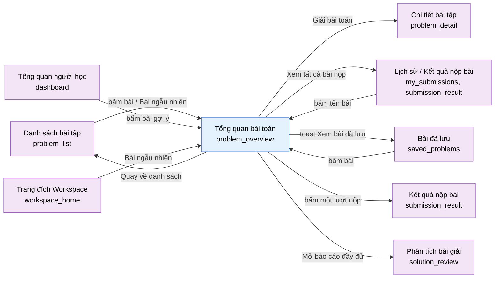

# Tài liệu thiết kế cơ bản (BD) — Tổng quan bài toán (`USR0104`)

## Phương châm tài liệu [Nội bộ — không cần khách duyệt]

- Viết theo **mẫu 9 sheet**. Bộ thẻ đóng, quy ước ID, ký hiệu chuẩn, ranh giới với tài liệu khác và
  checklist kiểm toán nằm ở `02-bd/_rules/bd-template-9sheet.md` — file này không chép lại.
- Phần gắn nhãn `[Nội bộ]` phục vụ sinh mã và tự kiểm toán, không phải yêu cầu của khách hàng: mục 4.5,
  mục 7.3 và các ghi chú quy ước.
- Mã màn `USR0104` lấy số thứ tự kế tiếp trong nhóm "Bài tập" theo `02-bd/_rules/bd-template-9sheet.md` mục 8
  [Nguồn: 02-bd/_rules/bd-template-9sheet.md:193]; tên file mang tiền tố mã. Bảng mã và bảng slug của khảo sát hệ
  thống **chưa có** hàng cho màn này, xem Câu hỏi mở Q1.
- **Màn này tách ra từ `problem_detail`** theo `DEC-2026-1020-student-workspace-split-and-password-in-settings`
  [Nguồn: .nexa/control/decision-registry.md:4239-4243]: trang chỉ-đọc `/problems/{problemId}` đứng trước trang
  soạn mã `/workspace/{problemId}` (`USR0102`). Mọi thứ liên quan trình soạn mã, chạy thử, nộp bài, kết quả từng
  testcase **không** thuộc màn này.
- **Không có prototype tĩnh** trong `09-layoutBase/`. Bằng chứng bố cục duy nhất là bản dựng
  `05-coding/frontend/src/views/users/problem-overview/ui/problem-overview-view.tsx` (viết tắt `V` trong file
  này) cùng ảnh mẫu trang đề bài kiểu online judge owner gửi 2026-10-20 (không lưu trong repo)
  [Nguồn: 05-coding/frontend/src/views/users/problem-overview/ui/problem-overview-view.tsx:3-7]. Mọi phần hình ảnh
  của màn là **Chưa duyệt hình**.
- **Chưa có DD** cho màn này (DD màn hình viết sau prototype). Tên DTO và tên endpoint ở Sheet 4.2 và 7.3 là đề
  xuất của BD này, không phải hợp đồng.

> Đọc cùng `01-rd/screens/users/USR0104_problem_overview.md` (hành vi ở mức yêu cầu, không lặp lại ở đây),
> `02-bd/screens/users/USR0102_problem_detail.md` (màn soạn mã mà nút "Giải bài toán" dẫn tới; nhiều DTO và endpoint
> dùng lại từ đó), `02-bd/screens/users/USR0101_problem_list.md` và `02-bd/screens/users/USR0103_saved_problems.md`
> (hai lối vào chính), `02-bd/screens/users/_shell.md` (khung điều hướng khu Người học) và
> `02-bd/database/F2_problem-bank.md` (bảng dữ liệu).
>
> - **Header và chân trang không mô tả lại ở đây** — dùng chung khung khu Người học: header ngang dính
>   trên, không có thanh bên [Nguồn: 02-bd/screens/users/_shell.md:24,40-41], chân trang dùng chung
>   [Nguồn: 02-bd/screens/users/_shell.md:97-103]. Khác `problem_detail`, màn này **không** dùng ngoại lệ
>   header thu gọn và không gắn `data-fullscreen-view` `[SoT: Suy luận]` — `V` là một trang cuộn thường
>   (`
`, `V:94`) chứ không phải vùng làm việc chiếm cả màn hình.
> - **Màn này không có mục nav riêng** — đây là màn khoan sâu từ danh sách bài, bài đã lưu, gợi ý ở tổng quan,
>   lịch sử nộp bài (xem Sheet 3). Mục nav "Bài toán" vẫn trỏ `problem_list`.
> - **Không thiết kế** trình soạn mã, nút chạy thử, nút nộp bài, bảng kết quả. Đó là `problem_detail`.
> - **Không hiển thị** nội dung testcase ẩn (input, output mong đợi, diff) ở bất kỳ trạng thái nào; chỉ **số
>   lượng** testcase ẩn được phép lộ (F2-08) [Nguồn: 01-rd/overview/system_survey.md:290; 02-bd/screens/users/USR0102_problem_detail.md:46].
> - **Không thiết kế** thao tác quản trị bài toán (xuất bản, đổi độ khó, xoá). Đó là `problem_management` của A2/A3.
> - **Hệ AI suy giảm êm:** thẻ tóm tắt Solution Review là thông tin phụ; `ai-review` lỗi thì thẻ biến mất, mọi phần
>   khác vẫn chạy [Nguồn: 02-bd/screens/users/USR0102_problem_detail.md:568,608].

---

## Sheet 1. Bìa

| Mục | Giá trị |
| :--- | :--- |
| Hệ thống | AlgoPrep |
| Phân hệ | `problem-bank` (F2), đọc thêm từ `judge-orchestration` (F4) và `ai-review` (F5) |
| Công đoạn | BD — Thiết kế cơ bản |
| Phân loại | Màn hình |
| Tên màn | Tổng quan bài toán |
| Mã màn hình | `USR0104` |
| Tên vật lý (slug) | `problem_overview` |
| Trục tài liệu | Màn hình (`02-bd/screens/`) |
| Actor | A1 (`STUDENT`) |
| Phiên bản | V0.4 |
| Người tạo | Claude |
| Ngày tạo | 2026/10/20 |
| Người cập nhật | Claude |
| Ngày cập nhật | 2026/10/22 |

---

## Sheet 2. Lịch sử sửa đổi

| Ver | Sheet bị sửa | Nội dung sửa | Ngày | Người sửa |
| :--- | :--- | :--- | :--- | :--- |
| V0.1 | Toàn bộ | Tạo mới theo mẫu 9 sheet, ghi lại bản dựng `problem-overview-view.tsx` theo quyết định owner 2026/10/20 (`DEC-2026-1020-student-workspace-split-and-password-in-settings`): tách trang tổng quan chỉ-đọc `/problems/{id}` khỏi màn soạn mã. Dùng lại DTO và endpoint của `USR0102` ở mức tối đa. Ghi nhận phần chưa dựng so với ảnh mẫu owner (Bình luận, Điểm, Nguồn bài). Chưa có DD. Chưa duyệt hình. Phát sinh 7 câu hỏi mở | 2026/10/20 | Claude |
| V0.2 | Sheet 6 (Khu vực bấm Bỏ lưu), Câu hỏi mở (đóng Q1, Q2, Q7) | Owner chốt 2026/10/20: bỏ lưu có Hoàn tác (đã dựng); Bình luận, Điểm, Nguồn bài hoãn thành nợ; đăng ký slug và mã màn vào bảng mã và khảo sát. Chưa duyệt hình | 2026/10/20 | Claude |
| V0.3 | Sheet 3, 4.4, 5 (khu F, G), 7, 8 (EVT-10, EVT-11), 9, Câu hỏi mở (đóng Q5, Q6, Q8) | Owner chốt 2026/10/21: thẻ "Bài nộp gần đây" sắp mới nhất trước, có nhãn cho mọi trạng thái nộp bài (thêm bốn nhãn Đang chờ, Đang biên dịch, Lỗi biên dịch, Lỗi hệ thống), mỗi dòng là liên kết tới `submission_result`; "Quay về danh sách" giữ đi thẳng `/problems`; thẻ Solution Review có liên kết "Mở báo cáo đầy đủ" tới báo cáo của lượt nộp `ACCEPTED` mới nhất. Đã dựng. Đo lại toàn bộ số dòng `file:line` trên bản mã cuối. Chưa duyệt hình | 2026/10/21 | Claude |
| V0.4 | Sheet 4.2, 4.3, 5 (Khu vực B NO 3 đến 8), 6 (Khu vực B NO 2), 7.1, 7.2, 7.3, Câu hỏi mở (Q4) | Sửa 2026-10-22 (đồng bộ DB vòng 3, DEC-2026-1022-problem-bank-schema-sync): ví dụ mẫu không còn đọc từ `problem.testcases`; nguồn là bảng `problem.worked_examples` (`position`, `input`, `output`, `explanation_md`) trả cùng payload đề; `testcases` chỉ còn dùng để đếm dòng `HIDDEN`; bỏ nhắc `function_signatures` (đã gộp vào `problem_specs`). Chỉ sửa tài liệu, bản dựng chưa đổi | 2026/10/22 | Claude |

---

## Sheet 3. Sơ đồ chuyển màn

> [Nội bộ] Quy ước vẽ: bố trí từ trái sang phải. Màn gọi tới tô tím, màn hiện tại tô xanh nhạt, màn đích
> tô tím. Màu và `[Nguồn:]` dùng để truy vết, không phải yêu cầu của khách hàng.

### 3.1 Danh sách chuyển màn

#### Danh sách bài tập → Tổng quan bài toán

[Điều kiện mở] Bấm tên bài hoặc dòng bài trong bảng `problem_list`, hoặc bấm "Bài ngẫu nhiên" trong cụm hành động
của tiêu đề trang
[Nguồn: 05-coding/frontend/src/views/users/problem-list/ui/problem-list-view.tsx:143-150,192,257].

[Chế độ mở] Chế độ đọc, chỉ xem.

[Thông tin truyền] `problem_id` trên đường dẫn `/problems/{problemId}`. Bộ lọc của `problem_list` **không** mang theo.

[Giá trị trả về] Không có.

[Khi thành công] Hiển thị đầu trang, khối đề bài và cột phải của bài được chọn. "Bài ngẫu nhiên" mở màn này chứ không mở
Workspace [Nguồn: .nexa/control/decision-registry.md:4249-4250].

[Khi huỷ] Không có.

#### Bài đã lưu → Tổng quan bài toán

[Điều kiện mở] Bấm tên bài hoặc nút vào giải ở dòng bài của `saved_problems`
[Nguồn: 05-coding/frontend/src/views/users/saved-problems/ui/saved-problems-view.tsx:150,274]. Dòng "Đã rút xuống" không mở được
(nút vô hiệu) [Nguồn: 02-bd/screens/users/USR0103_saved_problems.md:119-120].

[Chế độ mở] Như trên.

[Thông tin truyền] `problem_id`.

[Giá trị trả về] Không có.

[Khi thành công] Mở màn này; nút Lưu hiện sẵn trạng thái "Bỏ lưu" vì bài đang nằm trong danh sách đã lưu.

[Khi huỷ] Không có từ phía màn này. (Hộp hỏi rời màn lúc ghi chú sửa dở thuộc `USR0103` EVT-14, chưa dựng, xem `USR0103` Q8.)

#### Tổng quan người học (dashboard) → Tổng quan bài toán

[Điều kiện mở] Bấm một bài trong khối bài gợi ý của `dashboard`
[Nguồn: 05-coding/frontend/src/views/users/dashboard/ui/blocks/suggested-problems-block.tsx:112,235].

[Chế độ mở] Như trên.

[Thông tin truyền] `problem_id`.

[Giá trị trả về] Không có.

[Khi thành công] Mở màn này.

[Khi huỷ] Không có.

#### Trang đích Workspace (`USR0105`) → Tổng quan bài toán

[Điều kiện mở] Bấm "Bài ngẫu nhiên" ở trang đích `/workspace`: bản dựng bốc ngẫu nhiên trong các bài **chưa giải**
[Nguồn: 05-coding/frontend/src/views/users/workspace-home/ui/workspace-home-view.tsx:28-38]. Lối vào này thuộc BD `USR0105`.

[Chế độ mở] Như trên.

[Thông tin truyền] `problem_id`.

[Giá trị trả về] Không có.

[Khi thành công] Mở màn này.

[Khi huỷ] Không có.

#### Lịch sử nộp bài và Kết quả nộp bài → Tổng quan bài toán

[Điều kiện mở] Bấm tên bài trong dòng của `my_submissions`, hoặc liên kết tên bài trong `submission_result`
[Nguồn: 05-coding/frontend/src/views/users/my-submissions/ui/my-submissions-view.tsx:105;
05-coding/frontend/src/views/users/submission-result/ui/submission-result-view.tsx:151].

[Chế độ mở] Như trên.

[Thông tin truyền] `problem_id` (bản dựng đặt tên là `problemSlug`, cùng giá trị).

[Giá trị trả về] Không có.

[Khi thành công] Mở màn này.

[Khi huỷ] Không có.

#### Tổng quan bài toán → Chi tiết bài tập (soạn mã)

[Điều kiện mở] Bấm nút "Giải bài toán" ở đầu cột phải
[Nguồn: 05-coding/frontend/src/views/users/problem-overview/ui/problem-overview-view.tsx:157-162].

[Chế độ mở] Chế độ giải bài.

[Thông tin truyền] `problem_id`, đường dẫn đích `/workspace/{problemId}`. Không mang ngôn ngữ hay mô hình nộp nào.

[Giá trị trả về] Không có.

[Khi thành công] Mở `problem_detail` (`USR0102`) của đúng bài này.

[Khi huỷ] Không có.

#### Tổng quan bài toán → Danh sách bài tập

[Điều kiện mở] Bấm nút "Quay về danh sách" ở đầu trang, hoặc liên kết "Quay về danh sách bài toán" ở trạng thái không tìm thấy
[Nguồn: .../problem-overview-view.tsx:108-118,48-53].

[Chế độ mở] Chế độ duyệt.

[Thông tin truyền] Không có. Bộ lọc cũ của danh sách **không** được khôi phục, Câu hỏi mở Q6 đã chốt.

[Giá trị trả về] Không có.

[Khi thành công] Mở `problem_list` ở `/problems` với bộ lọc mặc định.

[Khi huỷ] Không có.

#### Tổng quan bài toán → Lịch sử nộp bài

[Điều kiện mở] Bấm "Xem tất cả bài nộp" ở cuối thẻ "Bài nộp gần đây" [Nguồn: .../problem-overview-view.tsx:273-277].

[Chế độ mở] Chế độ duyệt.

[Thông tin truyền] Không có (đích `/submissions`, không kèm bộ lọc theo bài; Câu hỏi mở Q5 đã chốt, giữ như vậy).

[Giá trị trả về] Không có.

[Khi thành công] Mở `my_submissions` với bộ lọc mặc định.

[Khi huỷ] Không có.

#### Tổng quan bài toán → Kết quả nộp bài

[Điều kiện mở] Bấm một dòng trong thẻ "Bài nộp gần đây" (mỗi dòng là một liên kết; V0.3, owner 2026/10/21)
[Nguồn: .../problem-overview-view.tsx:254-268].

[Chế độ mở] Chế độ đọc, chỉ xem.

[Thông tin truyền] `submission_id` của dòng, đường dẫn đích `/submissions/{submissionId}`.

[Giá trị trả về] Không có.

[Khi thành công] Mở `submission_result` của đúng lượt nộp đó.

[Khi huỷ] Không có.

#### Tổng quan bài toán → Phân tích bài giải

[Điều kiện mở] Bấm "Mở báo cáo đầy đủ" ở cuối thẻ Solution Review. Liên kết chỉ có khi thẻ được dựng **và** có ít nhất một lượt nộp `ACCEPTED`
[Nguồn: .../problem-overview-view.tsx:299-308].

[Chế độ mở] Chế độ đọc, chỉ xem.

[Thông tin truyền] `submission_id` của lượt nộp `ACCEPTED` mới nhất, đường dẫn đích `/submissions/{submissionId}/review`.

[Giá trị trả về] Không có.

[Khi thành công] Mở `solution_review` của lượt nộp đó.

[Khi huỷ] Không có.

#### Tổng quan bài toán → Bài đã lưu

[Điều kiện mở] Bấm hành động "Xem bài đã lưu" trên toast sau khi lưu bài thành công
[Nguồn: .../problem-overview-view.tsx:64-70; 05-coding/frontend/messages/vi.json:373].

[Chế độ mở] Chế độ duyệt.

[Thông tin truyền] Không có (đích `/saved`).

[Giá trị trả về] Không có.

[Khi thành công] Mở `saved_problems` với bộ lọc mặc định.

[Khi huỷ] Không có.

### 3.2 Sơ đồ

[Nguồn: 05-coding/frontend/src/views/users/problem-overview/ui/problem-overview-view.tsx:57-71,108-118,157-162,273-277;
.nexa/control/decision-registry.md:4239-4250]

---

## Sheet 4. Bố cục màn hình

### 4.1 Tổng quan màn

[Mục đích màn] Cho người học đọc đề, xem ví dụ, giới hạn theo ngôn ngữ, vài lượt nộp gần đây của chính mình và
(khi có) hai độ phức tạp của Solution Review **trước khi** vào trình soạn mã; lưu bài; rồi bấm "Giải bài toán"
để sang `problem_detail` [Nguồn: .nexa/control/decision-registry.md:4239-4243; 01-rd/screens/users/USR0104_problem_overview.md:20-26].

[Luồng nghiệp vụ chính]

1. **Hiển thị ban đầu**: vào màn với `problemId` trên đường dẫn, hệ thống tải dữ liệu của bài. Bài không tồn tại
   (hoặc chưa xuất bản, đã ẩn mềm) thì thay toàn bộ nội dung bằng thông báo "Không tìm thấy bài toán." kèm liên kết về
   danh sách (Khu vực H). Bài hợp lệ thì dựng đầu trang, cột trái (đề bài, ví dụ) và cột phải.
2. **Đọc đề**: đề là một khối Markdown (có LaTeX), phần "Ràng buộc" và "Câu hỏi mở rộng" là mục nằm trong Markdown, không
   có trường riêng [Nguồn: 05-coding/frontend/src/views/users/problem-overview/ui/problem-overview-view.tsx:123-124;
   05-coding/frontend/src/entities/problem/model/types.ts:147]. Dưới đề là mục "Ví dụ": mỗi ví dụ một cặp
   Input và Output, mỗi khối có nút Copy.
3. **Sao chép ví dụ**: bấm Copy thì chép nội dung khối vào bộ nhớ tạm, báo bằng toast.
4. **Lưu / bỏ lưu bài**: bấm nút Lưu ở cột phải để đánh dấu hoặc gỡ đánh dấu; báo bằng toast, toast lúc lưu có lối tắt
   tới `/saved`.
5. **Xem thông tin phụ**: thẻ Thông tin (tỉ lệ AC, số testcase ẩn, giới hạn theo ngôn ngữ), thẻ Dạng bài và ngôn ngữ cho
   phép, thẻ Bài nộp gần đây (3 lượt mới nhất), thẻ Solution Review (chỉ khi đã có báo cáo).
6. **Vào giải**: bấm "Giải bài toán" để sang `/workspace/{problemId}`.

[Người dùng] Người học đã đăng nhập (`STUDENT`). Khu Người học bắt buộc đăng nhập, không có trạng thái khách
[Nguồn: 02-bd/screens/users/_shell.md:136].

[Tệp liên quan] Không có. Màn này không xuất hay nhập tệp (nút Copy chỉ ghi bộ nhớ tạm của trình duyệt).

[Phạm vi]
- Chỉ **đọc** dữ liệu bài toán đã xuất bản (`status = PUBLISHED` và `deleted = false`)
  [Nguồn: 02-bd/screens/users/USR0102_problem_detail.md:803]. Không có trường nào dùng được để sửa đề.
- Thao tác ghi duy nhất của màn: tạo hoặc xoá một dòng `problem.bookmarks` của chính người dùng (nút Lưu/Bỏ lưu)
  [Nguồn: 02-bd/database/F2_problem-bank.md:184-188].
- Thông tin cá nhân (bài đã lưu, bài nộp gần đây, Solution Review) chỉ là của **chính người dùng đăng nhập**, không có
  đường để người khác đọc [Nguồn: 02-bd/database/F2_problem-bank.md:187-188].
- **Chỉ lộ số lượng** testcase ẩn, tuyệt đối không lộ nội dung (F2-08)
  [Nguồn: 05-coding/frontend/src/entities/problem/model/types.ts:158-159].
- **Chưa có** Bình luận, Điểm, Nguồn bài dù có trong ảnh mẫu của owner; xem Câu hỏi mở Q2. Không tự thêm.
- **Không có dải chỉ số nhỏ** (StatCard) ở đầu trang, theo quy tắc owner 2026-10-13 đã áp ở các màn khác
  [Nguồn: 02-bd/screens/users/USR0103_saved_problems.md:192-194]. Đầu trang là tên bài, mã bài, độ khó và nút quay về.

[Quyền sử dụng]
- Xem: được, người học đã đăng nhập.
- Thêm: có, duy nhất bookmark của chính mình (nút Lưu).
- Sửa: không.
- Xoá: có, duy nhất bookmark của chính mình (nút Bỏ lưu).

[Số bản ghi tối đa] Một bài mỗi màn. Ví dụ: không giới hạn cứng trong bản dựng (hiển thị mọi phần tử
`examples`, `V:129`); bài nộp gần đây: tối đa 3 (hằng `RECENT_SUBMISSION_LIMIT`, `V:27,86-89`); bảng giới hạn: đúng 3 dòng
(Java, C++, Python, hằng `LANGUAGES`, `V:26`).

### 4.2 DTO liên quan

- `ProblemOverviewDto`
- `ProblemExampleDto`
- `LanguageLimitDto`
- `MySubmissionSummaryDto` (dùng lại của `USR0102`)
- `SolutionReviewQuickInsightDto` (dùng lại của `USR0102`)
- `ProblemLevelDto` (dùng lại của `USR0101`)

`[SoT: Suy luận]` — tên DTO do BD này đề xuất, `03-dd/api/F2_problem-bank.md` chốt lại. Dùng lại tên
`MySubmissionSummaryDto` và `SolutionReviewQuickInsightDto` [Nguồn: 02-bd/screens/users/USR0102_problem_detail.md:679-680,686]
vì cùng dữ liệu, cùng phạm vi, cùng chủ sở hữu. `ProblemOverviewDto` đặt **khác** `ProblemWorkspaceDto` vì tập trường
khác: màn này cần `hiddenTestcaseCount`, `limitsByLanguage` cho cả 3 ngôn ngữ, `examples` kèm lời giải thích (nguồn `worked_examples`, Sửa 2026-10-22 (đồng bộ DB vòng 3, DEC-2026-1022-problem-bank-schema-sync));
không cần `functionWrapperSupported`, `stdinFormatMd`, `stdoutFormatMd`, mã khung. Xem Câu hỏi mở Q4.

### 4.3 Bảng dữ liệu liên quan (11)

| NO | Bảng | Ghi chú |
| --: | :--- | :--- |
| 1 | `problem.problems` | Mã, tên, `level_id`, đề `statement_md`, giới hạn cơ sở `time_limit_ms`/`memory_limit_mb` [Nguồn: 02-bd/database/F2_problem-bank.md:11-29] |
| 2 | `problem.problem_levels` | Nhãn và màu badge độ khó (join `level_id`) [Nguồn: 02-bd/database/F2_problem-bank.md mục `problem_levels`] |
| 3 | `problem.topics` | Tên chủ đề ở thẻ "Dạng bài" [Nguồn: 02-bd/database/F2_problem-bank.md:37-39] |
| 4 | `problem.problem_topics` | Nối bài với chủ đề [Nguồn: 02-bd/database/F2_problem-bank.md:37-39] |
| 5 | `problem.testcases` | **Chỉ đếm** dòng `HIDDEN` cho "Testcase ẩn"; không còn là nguồn của ví dụ (Sửa 2026-10-22 (đồng bộ DB vòng 3, DEC-2026-1022-problem-bank-schema-sync)) [Nguồn: 02-bd/database/F2_problem-bank.md:136-150,212] |
| 6 | `problem.problem_stats` | Read model, nguồn `ac_rate` [Nguồn: 02-bd/database/F2_problem-bank.md:192] |
| 6a | `problem.worked_examples` | Ví dụ mẫu kèm giải thích: `position`, `input`, `output`, `explanation_md`; không dùng để chấm, không có khoá nối với `testcases` (Sửa 2026-10-22 (đồng bộ DB vòng 3, DEC-2026-1022-problem-bank-schema-sync)) [Nguồn: 02-bd/database/F2_problem-bank.md:234-247] |
| 7 | `problem.bookmarks` | Trạng thái đã lưu của chính người dùng; tạo/xoá dòng khi bật/tắt [Nguồn: 02-bd/database/F2_problem-bank.md:184-188] |
| 8 | `judge.submissions` | Bài nộp gần đây của chính người dùng cho bài này (module `judge-orchestration`) [Nguồn: 02-bd/screens/users/USR0102_problem_detail.md:700] |
| 9 | `judge.language_configs` | Hệ số nhân giới hạn theo ngôn ngữ, có thể là nguồn danh sách ngôn ngữ (Câu hỏi mở Q3) [Nguồn: 02-bd/screens/users/USR0102_problem_detail.md:702] |
| 10 | `ai.solution_reviews` | Tóm tắt hai độ phức tạp (module `ai-review`) [Nguồn: 02-bd/screens/users/USR0102_problem_detail.md:703] |

Ba bảng cuối thuộc module khác (`judge-orchestration` ×2, `ai-review`); `problem-bank` không đọc thẳng schema đó mà
gọi qua endpoint/cổng ra của module sở hữu, đúng nguyên tắc mỗi schema một chủ
[Nguồn: 02-bd/screens/users/USR0102_problem_detail.md:707-708]. Màn **không** đọc `problem_specs` (đã gộp cả chữ ký hàm, bảng `function_signatures` không còn; PB-10)
(không có mã khung) và không đọc `submission_testcase_results`.

### 4.4 Vùng bố cục

Không có prototype tĩnh (`09-layoutBase/`) cho màn này; bảng dưới đối chiếu **bản dựng** (`V`) và mô tả ảnh mẫu
owner gửi. Mọi vùng là **Chưa duyệt hình**; BD không quy định màu sắc, khoảng cách hay typography.

| Vùng | Vị trí trong bản dựng | Nội dung |
| :--- | :--- | :--- |
| Header ngang dính trên (khung chung Người học) | - | Dùng lại khung chung, không mô tả lại |
| Đầu trang | `V:95-119` | Một hàng: tên bài (chữ lớn nhất trang), mã bài (chữ đơn cách), nhãn độ khó, nút "Quay về danh sách" đẩy về mép phải; đường kẻ dưới hàng |
| Khối đề bài (cột trái) | `V:122-154` | Một thẻ: Markdown của đề, đường kẻ, mục "Ví dụ" gồm các cặp Input/Output đánh số 01, 02... |
| Khối ví dụ | `V:126-152,317-346` | Mỗi ví dụ: nhãn "Input NN", khối chữ đơn cách, nút Copy ghim góc trên-phải khối; nhãn "Output NN" và nút Copy tương tự; dòng giải thích bên dưới nếu có |
| Cột phải (dính khi cuộn) | `V:156-311` | Từ trên xuống: nút "Giải bài toán" (cỡ lớn, chiếm hết bề rộng cột), nút Lưu/Bỏ lưu (chiếm hết bề rộng), thẻ Thông tin, thẻ Dạng bài và ngôn ngữ, thẻ Bài nộp gần đây, thẻ Solution Review (có điều kiện) |
| Trạng thái không tìm thấy | `V:44-55` | Thay toàn bộ trang: thông báo một dòng và một liên kết về danh sách |
| Chân trang (khung chung Người học) | - | Áp theo khung chung [Nguồn: 02-bd/screens/users/_shell.md:97-103] |

Bố cục **hai cột** từ ngưỡng `lg` trở lên: cột trái co giãn, cột phải rộng cố định **300px** trong bản dựng
(`lg:[grid-template-columns:minmax(0,1fr)_300px]`, `V:121`; chỉ là con số của bản dựng, không phải yêu cầu); cột phải
dính ở khoảng cách `top-24` so với đỉnh khi cuộn (`V:156`); thẻ đề bài có chiều cao tối thiểu `60dvh` từ `lg`
(`V:122`). Dưới `lg` thành **một cột**, thứ tự cột trái rồi cột phải (`grid-cols-1`, `V:121`). Giữ cấu trúc này khi
dựng Next.js chính thức.

**Hiện trạng bản dựng** (đọc lại `problem-overview-view.tsx` ngày 2026-10-21; dữ liệu là mẫu từ `fetchProblemDetail`).

| Vùng BD | Bản dựng | Vị trí |
| :--- | :--- | :--- |
| Đầu trang | `<h1>` tên bài, mã bài, `Badge` độ khó qua `problemLevelTone/problemLevelLabel` và `useProblemLevels`, nút `Button asChild` ghost có biểu tượng `ArrowLeft` tới `/problems`, viền dưới | `V:95-119`, `V:40` |
| Đề bài | `MarkdownPreview size="lg"` render `detail.statementMd`; chú thích trong mã nói ràng buộc và câu hỏi mở rộng là mục của Markdown | `V:122-124` |
| Ví dụ | Mỗi `examples[i]` thành `ExampleBlock` Input, `ExampleBlock` Output, và `
` giải thích khi có `explanation`; số thứ tự đệm hai chữ số | `V:126-152` |
| Nút Copy | Nút thường ghim góc trên-phải khối; `navigator.clipboard.writeText`; thành công `toast.success("Đã sao chép.")`; thất bại hoặc không có `clipboard` thì `toast.error("Không sao chép được, hãy chọn và copy thủ công.")` | `V:73-83,336-342`; `messages/vi.json:2957-2959` |
| Giải bài toán | `Button asChild variant="cta"` chứa `Link` tới `/workspace/${problemId}`, biểu tượng `Code2`, nhãn "Giải bài toán" | `V:157-162` |
| Lưu/Bỏ lưu | `Button` có `aria-pressed={saved}`; khi đã lưu: viền và nền vàng nhạt (biến `--color-admin-warn`) và biểu tượng `Bookmark` tô đặc (`fill-current`); nhãn đổi "Lưu bài" / "Bỏ lưu"; chỉ đổi `useState`, **chưa gọi máy chủ**; toast lưu có hành động "Xem bài đã lưu" tới `/saved`; toast bỏ lưu **không** có nút Hoàn tác | `V:41,57-71,163-176`; `messages/vi.json:288-289,365-366,373` |
| Thẻ Thông tin | `dl` hai dòng: "AC rate:" (hiện `-` nếu `acRate = null`, ngược lại `{n}%`) và "Testcase ẩn"; bên dưới bảng 3 cột Ngôn ngữ / Thời gian / Bộ nhớ, 3 dòng Java, C++, Python, giá trị `{timeLimitMs} ms`, `{memoryLimitMb} MB`; có `<caption>` ẩn "Giới hạn theo ngôn ngữ" cho trình đọc màn hình | `V:178-223` |
| Dạng bài và ngôn ngữ | Mỗi chủ đề một `Badge` trung tính; "Ngôn ngữ cho phép" là chuỗi nối của **hằng** `LANGUAGES` (không đọc theo bài) | `V:225-242`, `V:26` |
| Bài nộp gần đây | `detail.mySubmissions` sắp theo `submittedAt` **giảm dần** (mới nhất trước) rồi lấy 3 phần tử đầu; mỗi dòng là **liên kết** tới `/submissions/{id}`, nhãn kết quả (`problemDetail.verdict.*`, đủ 9 trạng thái) bên trái, "{ngôn ngữ} · {ngày giờ}" bên phải; rỗng thì câu "Bạn chưa nộp bài này lần nào."; luôn có liên kết "Xem tất cả bài nộp" tới `/submissions` | `V:244-278`, `V:86-89`; `messages/vi.json:283,351-359` |
| Solution Review | Chỉ dựng khi `detail.solutionReview` khác `null`; hai dòng "Độ phức tạp thời gian" và "Độ phức tạp bộ nhớ"; liên kết "Mở báo cáo đầy đủ" (`problemDetail.panel.linkFullReport`) tới `/submissions/{id}/review` của lượt nộp `ACCEPTED` mới nhất, **ẩn** khi chưa có lượt nộp `ACCEPTED` | `V:280-310`; `messages/vi.json:281,284-285` |
| Không tìm thấy | `EmptyState` "Không tìm thấy bài toán." cộng liên kết "Quay về danh sách bài toán"; điều kiện là thiếu `problemId` hoặc `fetchProblemDetail` trả `undefined`; không có nhánh "không có quyền" | `V:44-55`; `messages/vi.json:264-266` |
| Trạng thái chờ / lỗi tải | **Chưa có.** `fetchProblemDetail` đồng bộ trên dữ liệu mẫu nên không cần; bản thật phải thêm khung chờ và vùng lỗi kèm thử lại | `V:32-35` |
| Thử nghiệm | Hai ca Vitest: mở bài `121` thì có `<h1>` đúng tên và liên kết "Giải bài toán" trỏ `/workspace/121`, không có chữ "Run Code"; id lạ thì thấy "Không tìm thấy bài toán." | `problem-overview-view.test.tsx:22-39` |

Số liệu bản dựng lấy từ dữ liệu mẫu, nên mọi cột "Nguồn giá trị" ở Sheet 5 mô tả đích backend, không phải hiện trạng.

### 4.5 Cấu trúc slice FSD [Nội bộ]

| Khối | Slice dự kiến | Căn cứ |
| :--- | :--- | :--- |
| Trang | `views/users/problem-overview` | Quy ước FSD của dự án; bản dựng `V` |
| Khung Người học | Dùng lại `widgets/app-shell` (biến thể `student-header`) | `02-bd/screens/users/_shell.md` mục 1 |
| Đề bài, nhãn độ khó, thông tin phụ | Dùng lại `entities/problem` (`fetchProblemDetail`, `problemLevelLabel`, `problemLevelTone`, `useProblemLevels`, kiểu `ProblemDetail`) | `V:14-20` |
| Thẻ, huy hiệu, nút, trạng thái rỗng, Markdown | `shared/ui` (`Badge`, `Button`, `Card`, `EmptyState`, `MarkdownPreview`) và `shared/lib/toast-store` | `V:23-24` |
| Nút Lưu/Bỏ lưu | Nên dùng `features/bookmark-toggle` — slice đã đề xuất ở `USR0103` để `problem_detail` dùng lại; bản dựng hiện viết thẳng trong view | `02-bd/screens/users/USR0103_saved_problems.md:297-301`; `V:57-71` |
| Khối ví dụ có nút Copy | Component nội bộ `ExampleBlock` trong slice; một nơi dùng nên chưa nâng lên `shared/` | `V:317-346` |

`[SoT: Suy luận]` — ánh xạ slice do BD đề xuất, DD màn hình chốt lại. Nếu về sau `USR0102` cũng cần nút Copy
cho ví dụ thì nâng `ExampleBlock` lên `shared/ui` (quy tắc "shared first" của dự án).

> [Nội bộ] Ảnh minh hoạ đặt ở `08-diagram/02-bd/screens/users/`, chụp bằng Playwright trên ứng dụng Next.js thật.
> Chưa chụp.

---

## Sheet 5. Danh sách item màn hình

> Quy ước ID, bộ thẻ và giá trị chuẩn: `02-bd/_rules/bd-template-9sheet.md` mục 2, 3, 4.
>
> Tên cột đề `V:` là số dòng trong `05-coding/frontend/src/views/users/problem-overview/ui/problem-overview-view.tsx`;
> `vi.json:` là `05-coding/frontend/messages/vi.json`. Nhãn dùng chung namespace i18n `problemDetail`, nhãn riêng của
> màn nằm ở `problemOverview` [Nguồn: V:7; vi.json:2946-2964].

### Khu vực A — Đầu trang

| Khu vực | NO | Tên item | ID item | Bảng DB | Cột DB | Loại UI | Kiểu | Độ dài | Bắt buộc | I/O | Giá trị mặc định | Định dạng | Ghi chú |
| :--- | --: | :--- | :--- | :--- | :--- | :--- | :--- | :--- | :-: | :-: | :--- | :--- | :--- |
| Đầu trang | | | | | | | | | | | | | |
| | 1 | Tên bài | `problemOverview.header.title` | `problem.problems` | `title` | Label | String | 200 | - | O | - | - | Tiêu đề lớn nhất trang, là `<h1>` duy nhất [Nguồn giá trị] Cột `title` [Nguồn: 02-bd/database/F2_problem-bank.md:15; V:96-98] [EVT liên quan] EVT-1 |
| | 2 | Mã bài | `problemOverview.header.code` | `problem.problems` | `code` | Label | String | 40 | - | O | - | Chữ đơn cách | Mã ngắn của bài, đặt cạnh tên bài [Nguồn giá trị] Cột `code` [Nguồn: 02-bd/database/F2_problem-bank.md:14; V:99-101] [EVT liên quan] EVT-1 |
| | 3 | Nhãn độ khó | `problemOverview.header.level` | `problem.problem_levels`, `problem.problems` | `display_name` | Badge | String | - | - | O | - | Nhãn `display_name`, badge | Mức độ khó, đọc từ danh mục do ADMIN quản lý, không còn enum cố định [Nguồn giá trị] Cột `problem_levels.display_name` qua `problems.level_id`; màu badge theo mức [Nguồn: 02-bd/database/F2_problem-bank.md mục `problem_levels`; V:102-107] [EVT liên quan] EVT-1 |
| | 4 | Nút Quay về danh sách | `problemOverview.header.btnBack` | - | - | Button | - | - | - | I | - | - | Liên kết dạng nút, có biểu tượng mũi tên trái, đẩy về mép phải hàng đầu trang [Nguồn giá trị] Nhãn tĩnh i18n `problemOverview.btnBack` "Quay về danh sách" [Nguồn: vi.json:2956; V:108-118] [EVT liên quan] EVT-7 |

### Khu vực B — Đề bài và ví dụ (cột trái)

| Khu vực | NO | Tên item | ID item | Bảng DB | Cột DB | Loại UI | Kiểu | Độ dài | Bắt buộc | I/O | Giá trị mặc định | Định dạng | Ghi chú |
| :--- | --: | :--- | :--- | :--- | :--- | :--- | :--- | :--- | :-: | :-: | :--- | :--- | :--- |
| Đề bài và ví dụ | | | | | | | | | | | | | |
| | 1 | Nội dung đề | `problemOverview.statement.body` | `problem.problems` | `statement_md` | Label | String | - | - | O | - | Markdown kèm LaTeX | Toàn bộ đề, gồm cả mục "Ràng buộc" và "Câu hỏi mở rộng" nếu tác giả có viết [Nguồn giá trị] Cột `statement_md` [Nguồn: 02-bd/database/F2_problem-bank.md:16; V:123-124]. Máy chủ trả nguyên văn, giao diện kết xuất [EVT liên quan] EVT-1 |
| | 2 | Tiêu đề mục Ví dụ | `problemOverview.examples.title` | - | - | Label | String | - | - | O | - | - | Chữ "Ví dụ" trên danh sách ví dụ [Nguồn giá trị] Nhãn tĩnh i18n `problemDetail.panel.examplesTitle` [Nguồn: vi.json:282; V:127] [EVT liên quan] - |
| | 3 | Danh sách ví dụ | `problemOverview.examples.list` | `problem.worked_examples` | `position` | List | List | - | - | O | rỗng | - | Các ví dụ mẫu của bài, mỗi ví dụ là một cặp Input/Output [Nguồn giá trị] Mọi dòng `worked_examples` của bài, sắp theo `position`; bài chưa có dòng nào thì danh sách rỗng (Sửa 2026-10-22 (đồng bộ DB vòng 3, DEC-2026-1022-problem-bank-schema-sync)) [Nguồn: 02-bd/database/F2_problem-bank.md:234-247]; bản dựng đọc `detail.examples` [Nguồn: V:128-152] [EVT liên quan] EVT-1 |
| | 4 | Nhãn Input / Output | `problemOverview.examples.col.label` | - | - | ListColumn | String | - | - | O | - | `Input {NN}`, `Output {NN}` | Nhãn từng khối, số thứ tự đệm hai chữ số bắt đầu từ 01 [Công thức] `NN` = vị trí ví dụ trong danh sách cộng 1, đệm số 0 [Nguồn: V:134,140,331] [Nguồn giá trị] Nhãn tĩnh i18n `problemOverview.exampleInput`, `exampleOutput` [Nguồn: vi.json:2960-2961] [EVT liên quan] - |
| | 5 | Khối Input | `problemOverview.examples.col.input` | `problem.worked_examples` | `input` | ListColumn | String | - | - | O | - | Chữ đơn cách, giữ xuống dòng | Dữ liệu vào của ví dụ [Nguồn giá trị] Cột `worked_examples.input` (Sửa 2026-10-22 (đồng bộ DB vòng 3, DEC-2026-1022-problem-bank-schema-sync)) [Nguồn: 02-bd/database/F2_problem-bank.md:234-247; V:133-138,333-335] [EVT liên quan] EVT-6 |
| | 6 | Khối Output | `problemOverview.examples.col.output` | `problem.worked_examples` | `output` | ListColumn | String | - | - | O | - | Chữ đơn cách, giữ xuống dòng | Kết quả mong đợi của ví dụ (ví dụ mẫu công khai nên được phép hiển thị) [Nguồn giá trị] Cột `worked_examples.output` (Sửa 2026-10-22 (đồng bộ DB vòng 3, DEC-2026-1022-problem-bank-schema-sync)) [Nguồn: 02-bd/database/F2_problem-bank.md:234-247; V:139-144] [EVT liên quan] EVT-6 |
| | 7 | Nút Copy | `problemOverview.examples.col.btnCopy` | - | - | Button | - | - | - | I | - | - | Một nút trên mỗi khối Input và mỗi khối Output, ghim góc trên-phải khối [Nguồn giá trị] Nhãn tĩnh i18n `problemOverview.btnCopy` "Copy" [Nguồn: vi.json:2957; V:336-342] [EVT liên quan] EVT-6 |
| | 8 | Giải thích ví dụ | `problemOverview.examples.col.explanation` | `problem.worked_examples` | `explanation_md` | ListColumn | String | - | - | O | Ẩn | Chữ thường | Lời giải thích vì sao ví dụ cho kết quả đó [Nguồn giá trị] Cột `worked_examples.explanation_md`, nullable (Sửa 2026-10-22 (đồng bộ DB vòng 3, DEC-2026-1022-problem-bank-schema-sync); cột cũ `testcases.explanation_md` và cờ `is_worked_example` đã bỏ) [Nguồn: 02-bd/database/F2_problem-bank.md:234-247; V:145-149]. Bản dựng in ra dạng chữ thường (`
`); cột là Markdown, chưa rõ có dựng Markdown không, xem Câu hỏi mở Q4 [EVT liên quan] - |

### Khu vực C — Hành động chính (cột phải)

| Khu vực | NO | Tên item | ID item | Bảng DB | Cột DB | Loại UI | Kiểu | Độ dài | Bắt buộc | I/O | Giá trị mặc định | Định dạng | Ghi chú |
| :--- | --: | :--- | :--- | :--- | :--- | :--- | :--- | :--- | :-: | :-: | :--- | :--- | :--- |
| Hành động chính | | | | | | | | | | | | | |
| | 1 | Nút Giải bài toán | `problemOverview.action.btnSolve` | - | - | Button | - | - | - | I | - | - | Nút nhấn mạnh nhất trang, liên kết tới `/workspace/{problemId}`, biểu tượng mã nguồn [Nguồn giá trị] Nhãn tĩnh i18n `problemOverview.btnSolve` "Giải bài toán" [Nguồn: vi.json:2947; V:157-162] [EVT liên quan] EVT-2 |
| | 2 | Nút Lưu / Bỏ lưu | `problemOverview.action.btnSave` | `problem.bookmarks` | `user_id`, `problem_id` | Toggle | Boolean | - | - | I/O | `Chưa lưu` | - | Bật/tắt đánh dấu lưu bài của chính người dùng; mang `aria-pressed` [Công thức] Trạng thái ban đầu = có dòng `(user_id, problem_id)` trong `bookmarks` hay không (`ProblemOverviewDto.bookmarked`); nhãn "Lưu bài" khi chưa lưu, "Bỏ lưu" khi đã lưu [Nguồn: vi.json:288-289; V:41,163-176] [EVT liên quan] EVT-3, EVT-4 |

### Khu vực D — Thẻ Thông tin

| Khu vực | NO | Tên item | ID item | Bảng DB | Cột DB | Loại UI | Kiểu | Độ dài | Bắt buộc | I/O | Giá trị mặc định | Định dạng | Ghi chú |
| :--- | --: | :--- | :--- | :--- | :--- | :--- | :--- | :--- | :-: | :-: | :--- | :--- | :--- |
| Thẻ Thông tin | | | | | | | | | | | | | |
| | 1 | Tiêu đề thẻ | `problemOverview.info.title` | - | - | Label | String | - | - | O | - | - | Chữ "Thông tin" [Nguồn giá trị] Nhãn tĩnh i18n `problemOverview.infoTitle` [Nguồn: vi.json:2948; V:179] [EVT liên quan] - |
| | 2 | Tỉ lệ AC | `problemOverview.info.acRate` | `problem.problem_stats` | `ac_rate` | Label | Number | - | - | O | `-` | `{n}%` | Tỉ lệ nộp đạt Accepted của bài [Nguồn giá trị] Read model `problem_stats.ac_rate` [Nguồn: 02-bd/database/F2_problem-bank.md:192]; không có dòng thì hiển thị `-` [Nguồn: V:181-186]. Nhãn tĩnh i18n `problemDetail.panel.acRate` "AC rate:" [Nguồn: vi.json:292] [EVT liên quan] EVT-1 |
| | 3 | Số testcase ẩn | `problemOverview.info.hiddenTestcaseCount` | `problem.testcases` | `visibility` | Label | Number | - | - | O | `0` | Số nguyên | **Chỉ con số**, không kèm nội dung nào (F2-08) [Công thức] Đếm dòng `testcases` của bài có `visibility = HIDDEN`, tính ở máy chủ [Nguồn: 02-bd/database/F2_problem-bank.md:142,212; V:187-192]. Nhãn tĩnh i18n `problemOverview.hiddenTestcases` "Testcase ẩn" [Nguồn: vi.json:2949] [EVT liên quan] EVT-1 |
| | 4 | Bảng giới hạn theo ngôn ngữ | `problemOverview.info.limits` | `problem.problems`, `judge.language_configs` | `time_limit_ms`, `memory_limit_mb`, `time_limit_multiplier`, `memory_limit_multiplier` | List | List | - | - | O | 3 dòng | - | Ba dòng Java, C++, Python; có chú thích ẩn cho trình đọc màn hình "Giới hạn theo ngôn ngữ" [Công thức] Giới hạn hiệu dụng mỗi ngôn ngữ = giới hạn cơ sở của bài nhân hệ số của ngôn ngữ đó (F2-10), tính ở máy chủ, màn không tự nhân [Nguồn: 02-bd/screens/users/USR0102_problem_detail.md:677; 05-coding/frontend/src/entities/problem/model/types.ts:150-154; V:194-222] [EVT liên quan] EVT-1 |
| | 5 | Cột Ngôn ngữ | `problemOverview.info.limits.col.language` | - | - | ListColumn | Enum | - | - | O | - | - | Tên ngôn ngữ: Java, C++, Python [Nguồn giá trị] Nhãn tĩnh i18n `problemDetail.language.*` [Nguồn: vi.json:315-317; V:212]. Tập ngôn ngữ là hằng trong bản dựng (`LANGUAGES`, `V:26`), xem Câu hỏi mở Q3 [EVT liên quan] - |
| | 6 | Cột Thời gian | `problemOverview.info.limits.col.time` | `problem.problems`, `judge.language_configs` | `time_limit_ms`, `time_limit_multiplier` | ListColumn | Number | - | - | O | - | `{n} ms` | Giới hạn thời gian hiệu dụng [Công thức] Như NO 4 [Nguồn: V:213-215] [EVT liên quan] EVT-1 |
| | 7 | Cột Bộ nhớ | `problemOverview.info.limits.col.memory` | `problem.problems`, `judge.language_configs` | `memory_limit_mb`, `memory_limit_multiplier` | ListColumn | Number | - | - | O | - | `{n} MB` | Giới hạn bộ nhớ hiệu dụng [Công thức] Như NO 4 [Nguồn: V:216-218] [EVT liên quan] EVT-1 |

### Khu vực E — Thẻ Dạng bài và Ngôn ngữ cho phép

| Khu vực | NO | Tên item | ID item | Bảng DB | Cột DB | Loại UI | Kiểu | Độ dài | Bắt buộc | I/O | Giá trị mặc định | Định dạng | Ghi chú |
| :--- | --: | :--- | :--- | :--- | :--- | :--- | :--- | :--- | :-: | :-: | :--- | :--- | :--- |
| Dạng bài và ngôn ngữ | | | | | | | | | | | | | |
| | 1 | Chủ đề của bài | `problemOverview.topics.list` | `problem.topics` | `name` | List | List | - | - | O | rỗng | Mỗi chủ đề một nhãn trung tính | Các chủ đề của bài, chỉ đọc, không bấm được [Nguồn giá trị] `topics.name` qua `problem_topics.problem_id` [Nguồn: 02-bd/database/F2_problem-bank.md:37-39; V:226-233]. Nhãn mục "Dạng bài" là nhãn tĩnh i18n `problemOverview.topicsTitle` [Nguồn: vi.json:2962] [EVT liên quan] EVT-1 |
| | 2 | Ngôn ngữ cho phép | `problemOverview.topics.languages` | - | - | Label | String | - | - | O | `Java, C++, Python` | Nối bằng dấu phẩy | Các ngôn ngữ được nộp bài [Nguồn giá trị] Bản dựng nối từ hằng `LANGUAGES` [Nguồn: V:234-241]; nguồn thật chưa chốt, xem Câu hỏi mở Q3. Nhãn mục là nhãn tĩnh i18n `problemOverview.languagesTitle` [Nguồn: vi.json:2963] [EVT liên quan] EVT-1 |

### Khu vực F — Thẻ Bài nộp gần đây

| Khu vực | NO | Tên item | ID item | Bảng DB | Cột DB | Loại UI | Kiểu | Độ dài | Bắt buộc | I/O | Giá trị mặc định | Định dạng | Ghi chú |
| :--- | --: | :--- | :--- | :--- | :--- | :--- | :--- | :--- | :-: | :-: | :--- | :--- | :--- |
| Bài nộp gần đây | | | | | | | | | | | | | |
| | 1 | Danh sách bài nộp gần đây | `problemOverview.recent.list` | `judge.submissions` | `problem_id`, `user_id`, `submitted_at` | List | List | - | - | O | rỗng | - | Tối đa 3 lượt nộp **mới nhất** của chính người dùng cho bài này; mỗi dòng là liên kết tới `submission_result` (V0.3) [Nguồn giá trị] Kết quả `ListMySubmissionsForProblem` cắt 3 [Nguồn: 02-bd/screens/users/USR0102_problem_detail.md:726; V:27,86-89]. Bản dựng sắp bản sao của mảng theo `submittedAt` giảm dần rồi cắt 3 [Nguồn: V:86-89]; khi nối API máy chủ trả mới nhất trước, đã cắt 3 (Câu hỏi mở Q5, đã chốt) [EVT liên quan] EVT-1, EVT-10 |
| | 2 | Kết quả lượt nộp | `problemOverview.recent.col.verdict` | `judge.submissions` | `status` | ListColumn | Enum | - | - | O | - | Nhãn chữ đậm | Kết quả tổng hợp của lượt nộp [Nguồn giá trị] Cột `status` [Nguồn: 02-bd/screens/users/USR0102_problem_detail.md:679]; nhãn tĩnh i18n `problemDetail.verdict.*` [Nguồn: vi.json:351-359; V:258-260]. Có nhãn cho mọi trạng thái nộp bài: ngoài 5 nhãn cũ đã thêm `pending`, `compiling`, `compileError`, `systemError` (Câu hỏi mở Q5, đã chốt) [EVT liên quan] - |
| | 3 | Ngôn ngữ và thời điểm nộp | `problemOverview.recent.col.meta` | `judge.submissions` | `language`, `submitted_at` | ListColumn | String | - | - | O | - | `{ngôn ngữ} · dd/MM/yyyy HH:mm` | Ngôn ngữ và thời điểm nộp, múi giờ UTC+7 [Nguồn giá trị] Cột `language`, `submitted_at` [Nguồn: 02-bd/screens/users/USR0102_problem_detail.md:680]; định dạng bằng `formatDateVN(..., { locale, withTime: true })` [Nguồn: V:261-267; types.ts:130-131] [EVT liên quan] - |
| | 4 | Câu chưa nộp lần nào | `problemOverview.recent.empty` | - | - | Label | String | - | - | O | - | - | Câu thay cho danh sách khi người học chưa nộp bài này [Nguồn giá trị] Nhãn tĩnh i18n `problemDetail.panel.noSubmissions` "Bạn chưa nộp bài này lần nào." [Nguồn: vi.json:283; V:246-249] [EVT liên quan] EVT-1 |
| | 5 | Liên kết Xem tất cả bài nộp | `problemOverview.recent.linkAll` | - | - | Link | - | - | - | I | - | - | Mở lịch sử nộp bài toàn bộ, không kèm bộ lọc theo bài [Nguồn giá trị] Nhãn tĩnh i18n `problemOverview.linkAllSubmissions` [Nguồn: vi.json:2955; V:273-277] [EVT liên quan] EVT-8 |

### Khu vực G — Thẻ tóm tắt Solution Review

| Khu vực | NO | Tên item | ID item | Bảng DB | Cột DB | Loại UI | Kiểu | Độ dài | Bắt buộc | I/O | Giá trị mặc định | Định dạng | Ghi chú |
| :--- | --: | :--- | :--- | :--- | :--- | :--- | :--- | :--- | :-: | :-: | :--- | :--- | :--- |
| Solution Review | | | | | | | | | | | | | |
| | 1 | Độ phức tạp thời gian | `problemOverview.review.timeComplexity` | `ai.solution_reviews` | `result_json` | Label | String | - | - | O | - | Chữ đơn cách | Ví dụ `O(n)` [Nguồn giá trị] Phản hồi `GetMySolutionReviewQuickInsight`, trường lấy từ `result_json` [Nguồn: 02-bd/screens/users/USR0102_problem_detail.md:686; V:286-291]. Nhãn tĩnh i18n `problemDetail.panel.timeComplexity` [Nguồn: vi.json:284] [EVT liên quan] EVT-1 |
| | 2 | Độ phức tạp bộ nhớ | `problemOverview.review.spaceComplexity` | `ai.solution_reviews` | `result_json` | Label | String | - | - | O | - | Chữ đơn cách | Ví dụ `O(1)` [Nguồn giá trị] Cùng nguồn NO 1 [Nguồn: V:292-297]. Nhãn tĩnh i18n `problemDetail.panel.spaceComplexity` [Nguồn: vi.json:285] [EVT liên quan] EVT-1 |

| | 3 | Liên kết Mở báo cáo đầy đủ | `problemOverview.review.linkFull` | `judge.submissions`, `ai.solution_reviews` | `id`, `status` | Link | - | - | - | I | - | - | Mở báo cáo phân tích bài giải đầy đủ của lượt nộp `ACCEPTED` mới nhất có báo cáo (V0.3) [Nguồn giá trị] Nhãn tĩnh i18n `problemDetail.panel.linkFullReport` [Nguồn: vi.json:294; V:299-308]; đích `/submissions/{submissionId}/review`, `submissionId` lấy từ DTO (Sheet 7 NO 14, 15) [EVT liên quan] EVT-11 |

Tiêu đề thẻ lấy nhãn `problemDetail.panel.tabReview` "Solution Review" [Nguồn: vi.json:281; V:282-284].

### Khu vực H — Bài không tìm thấy

| Khu vực | NO | Tên item | ID item | Bảng DB | Cột DB | Loại UI | Kiểu | Độ dài | Bắt buộc | I/O | Giá trị mặc định | Định dạng | Ghi chú |
| :--- | --: | :--- | :--- | :--- | :--- | :--- | :--- | :--- | :-: | :-: | :--- | :--- | :--- |
| Không tìm thấy | | | | | | | | | | | | | |
| | 1 | Thông báo không tìm thấy | `problemOverview.notFound.message` | - | - | Label | String | - | - | O | - | - | Câu "Không tìm thấy bài toán.", thay toàn bộ nội dung màn; **không bao giờ** là "không có quyền" [Nguồn giá trị] Nhãn tĩnh i18n `problemDetail.empty.title` [Nguồn: vi.json:265; V:46-47] [EVT liên quan] EVT-1 |
| | 2 | Liên kết về danh sách | `problemOverview.notFound.linkList` | - | - | Link | - | - | - | I | - | - | Liên kết "Quay về danh sách bài toán" tới `/problems` [Nguồn giá trị] Nhãn tĩnh i18n `problemDetail.empty.linkList` [Nguồn: vi.json:266; V:48-53] [EVT liên quan] EVT-9 |

[Nguồn: 05-coding/frontend/src/views/users/problem-overview/ui/problem-overview-view.tsx:44-311;
05-coding/frontend/messages/vi.json:2946-2964; 02-bd/database/F2_problem-bank.md:11-29,37-39,136-150,184-192,212;
02-bd/screens/users/USR0102_problem_detail.md:676-680,686,697,726]

---

## Sheet 6. Đặc tả điều khiển item

> Ký hiệu cột `Hiển thị` và thứ tự thẻ: `02-bd/_rules/bd-template-9sheet.md` mục 2, 3. Dùng đúng NO, tên
> item và thứ tự của Sheet 5. Lỗi nhập liệu ghi ở Sheet 9, xử lý nghiệp vụ ghi ở Sheet 8.

### Khu vực A — Đầu trang

| Khu vực | NO | Tên item | Hiển thị | Ghi chú |
| :--- | --: | :--- | :-: | :--- |
| Đầu trang | | | | |
| | 1 | Tên bài | Có | - |
| | 2 | Mã bài | Có | - |
| | 3 | Nhãn độ khó | Có | [Tự động đặt] Không lấy được danh mục độ khó (`ListProblemLevels`) thì vẫn hiển thị nhãn bằng mã mức, màu trung tính `[SoT: Suy luận]`. |
| | 4 | Nút Quay về danh sách | Có | [Điều kiện kích hoạt] Luôn kích hoạt. |

### Khu vực B — Đề bài và ví dụ

| Khu vực | NO | Tên item | Hiển thị | Ghi chú |
| :--- | --: | :--- | :-: | :--- |
| Đề bài và ví dụ | | | | |
| | 1 | Nội dung đề | Có | [Điều kiện hiển thị] Luôn hiển thị khi bài tồn tại; trong lúc tải chưa có nội dung thì hiển thị khung chờ (bản dựng chưa có, xem Hiện trạng). |
| | 2 | Tiêu đề mục Ví dụ | Điều kiện | [Điều kiện hiển thị] Bản dựng luôn dựng tiêu đề kể cả khi `examples` rỗng [Nguồn: V:127]. Đích: ẩn tiêu đề khi bài không có ví dụ mẫu nào (bài đủ điều kiện xuất bản phải có ít nhất 2 dòng `worked_examples` [Nguồn: 02-bd/database/F2_problem-bank.md:247, Sửa 2026-10-22 (đồng bộ DB vòng 3, DEC-2026-1022-problem-bank-schema-sync)]) `[SoT: Suy luận]`. |
| | 3 | Danh sách ví dụ | Điều kiện | [Điều kiện hiển thị] Hiển thị khi có ít nhất một ví dụ mẫu; không có thì không dựng. |
| | 4 | Nhãn Input / Output | Có | - |
| | 5 | Khối Input | Có | [Điều kiện hiển thị] Cuộn ngang khi dòng dài, không bẻ dòng [Nguồn: V:333-335]. |
| | 6 | Khối Output | Có | Như NO 5. |
| | 7 | Nút Copy | Có | [Điều kiện kích hoạt] Luôn kích hoạt. Hiển thị trên **mọi** khối Input và Output. |
| | 8 | Giải thích ví dụ | Điều kiện | [Điều kiện hiển thị] Chỉ hiện khi ví dụ có `explanation_md` khác rỗng; rỗng thì ẩn, **không tự bịa** câu giải thích [Nguồn: V:145-149; 02-bd/screens/users/USR0102_problem_detail.md:588]. |

### Khu vực C — Hành động chính

| Khu vực | NO | Tên item | Hiển thị | Ghi chú |
| :--- | --: | :--- | :-: | :--- |
| Hành động chính | | | | |
| | 1 | Nút Giải bài toán | Có | [Điều kiện kích hoạt] Luôn kích hoạt khi bài tồn tại. Không đòi bài đã lưu hay đã nộp. |
| | 2 | Nút Lưu / Bỏ lưu | Có | [Điều kiện kích hoạt] Không kích hoạt trong lúc chính lần bật/tắt trước chưa có phản hồi. [Tự động đặt] Nhận trạng thái ban đầu từ `bookmarked`. Khi đã lưu: nhãn "Bỏ lưu", nút đổi sang kiểu nổi bật (vàng nhạt), biểu tượng đặc, `aria-pressed=true`. Đổi ngay theo thao tác. |

### Khu vực D — Thẻ Thông tin

| Khu vực | NO | Tên item | Hiển thị | Ghi chú |
| :--- | --: | :--- | :-: | :--- |
| Thẻ Thông tin | | | | |
| | 1 | Tiêu đề thẻ | Có | - |
| | 2 | Tỉ lệ AC | Có | [Điều kiện hiển thị] Luôn hiển thị dòng; không có dữ liệu (`ac_rate` rỗng) thì giá trị là `-`. |
| | 3 | Số testcase ẩn | Có | [Điều kiện hiển thị] Luôn hiển thị; bài chưa có testcase ẩn thì giá trị `0`. |
| | 4 | Bảng giới hạn theo ngôn ngữ | Có | - |
| | 5 | Cột Ngôn ngữ | Có | - |
| | 6 | Cột Thời gian | Có | - |
| | 7 | Cột Bộ nhớ | Có | - |

### Khu vực E — Thẻ Dạng bài và Ngôn ngữ cho phép

| Khu vực | NO | Tên item | Hiển thị | Ghi chú |
| :--- | --: | :--- | :-: | :--- |
| Dạng bài và ngôn ngữ | | | | |
| | 1 | Chủ đề của bài | Điều kiện | [Điều kiện hiển thị] Bản dựng luôn dựng tiêu đề "Dạng bài" kể cả khi bài không có chủ đề (khi đó chỉ còn khoảng trống) [Nguồn: V:226-233]. Đích: bài không có chủ đề thì ẩn tiêu đề "Dạng bài" `[SoT: Suy luận]`. |
| | 2 | Ngôn ngữ cho phép | Có | - |

### Khu vực F — Thẻ Bài nộp gần đây

| Khu vực | NO | Tên item | Hiển thị | Ghi chú |
| :--- | --: | :--- | :-: | :--- |
| Bài nộp gần đây | | | | |
| | 1 | Danh sách bài nộp gần đây | Điều kiện | [Điều kiện hiển thị] Chỉ khi người học đã nộp bài này ít nhất một lần; chưa thì thay bằng NO 4. |
| | 2 | Kết quả lượt nộp | Điều kiện | [Điều kiện hiển thị] Như NO 1. |
| | 3 | Ngôn ngữ và thời điểm nộp | Điều kiện | [Điều kiện hiển thị] Như NO 1. |
| | 4 | Câu chưa nộp lần nào | Điều kiện | [Điều kiện hiển thị] Chỉ khi người học chưa nộp bài này lần nào. |
| | 5 | Liên kết Xem tất cả bài nộp | Có | [Điều kiện kích hoạt] Luôn kích hoạt, hiển thị cả khi chưa có lượt nộp nào [Nguồn: V:273-277]. |

### Khu vực G — Thẻ tóm tắt Solution Review

| Khu vực | NO | Tên item | Hiển thị | Ghi chú |
| :--- | --: | :--- | :-: | :--- |
| Solution Review | | | | |
| | 1 | Độ phức tạp thời gian | Điều kiện | [Điều kiện hiển thị] Cả thẻ chỉ hiển thị khi đã có báo cáo Solution Review của chính người học cho bài này. Chưa có báo cáo, hoặc gọi `ai-review` thất bại, thì **không dựng thẻ**, không chừa khoảng trống, không báo lỗi [Nguồn: V:280; 02-bd/screens/users/USR0102_problem_detail.md:608]. |
| | 2 | Độ phức tạp bộ nhớ | Điều kiện | [Điều kiện hiển thị] Như NO 1. |
| | 3 | Liên kết Mở báo cáo đầy đủ | Điều kiện | [Điều kiện hiển thị] Chỉ khi thẻ được dựng và người học có ít nhất một lượt nộp `ACCEPTED` của bài này; thẻ có mà không có lượt `ACCEPTED` thì **ẩn** liên kết, không để liên kết chết [Nguồn: V:299-308]. |

### Khu vực H — Bài không tìm thấy

| Khu vực | NO | Tên item | Hiển thị | Ghi chú |
| :--- | --: | :--- | :-: | :--- |
| Không tìm thấy | | | | |
| | 1 | Thông báo không tìm thấy | Điều kiện | [Điều kiện hiển thị] Khi tải xong mà bài không tồn tại, chưa xuất bản, đã ẩn mềm, hoặc `problemId` thiếu/không hợp lệ. Khi hiển thị, **toàn bộ** các khu vực A đến G không dựng [Nguồn: V:44-55]. |
| | 2 | Liên kết về danh sách | Điều kiện | [Điều kiện hiển thị] Như NO 1. |

[Nguồn: 05-coding/frontend/src/views/users/problem-overview/ui/problem-overview-view.tsx:44-55,127,145-149,226-233,244-310;
02-bd/screens/users/USR0102_problem_detail.md:588,608]

---

## Sheet 7. Danh sách truyền dữ liệu

### 7.1 Trường DTO

| NO | DTO | Trường DTO | Kiểu | Bảng DB | Cột DB | Item màn | Hiển thị | Ghi chú |
| --: | :--- | :--- | :--- | :--- | :--- | :--- | :-: | :--- |
| 1 | `ProblemOverviewDto` | `problemId` | UUID | `problem.problems` | `id` | - | Không | [Nguồn] Phản hồi của `GetProblemOverview` [Đích] Tham số đường dẫn `/workspace/{problemId}` của nút Giải bài toán, và khoá của mọi lời gọi còn lại. |
| 2 | `ProblemOverviewDto` | `code`, `title` | String | `problem.problems` | `code`, `title` | Đầu trang "Mã bài", "Tên bài" | Có | - |
| 3 | `ProblemOverviewDto` | `levelCode`, `levelDisplayName` | String, String | `problem.problem_levels` | `code`, `display_name` | Đầu trang "Nhãn độ khó" | Có | [Nguồn] Join qua `problems.level_id`, cùng quy ước với `USR0102` [Nguồn: 02-bd/screens/users/USR0102_problem_detail.md:668] [Chuyển đổi] Đọc `display_name` từ dữ liệu, không ánh xạ cứng enum. |
| 4 | `ProblemOverviewDto` | `statementMd` | String | `problem.problems` | `statement_md` | Đề bài "Nội dung đề" | Có | [Chuyển đổi] Máy chủ trả nguyên văn, giao diện kết xuất Markdown + LaTeX. Ràng buộc và câu hỏi mở rộng là mục trong chính chuỗi này, không có trường riêng [Nguồn: 05-coding/frontend/src/entities/problem/model/types.ts:147]. |
| 5 | `ProblemOverviewDto` | `topicNames` | List\<String\> | `problem.topics` | `name` | Thẻ "Chủ đề của bài" | Có | [Nguồn] `topics.name` qua `problem_topics.problem_id` [Chuyển đổi] Mỗi chủ đề một nhãn, không nối bằng dấu phẩy. |
| 6 | `ProblemOverviewDto` | `acRate` | Number | `problem.problem_stats` | `ac_rate` | Thẻ Thông tin "Tỉ lệ AC" | Có | [Nguồn] Read model [Chuyển đổi] Không có dòng read model thì trả `null`, màn hiển thị `-`. |
| 7 | `ProblemOverviewDto` | `hiddenTestcaseCount` | Number | `problem.testcases` | `visibility` | Thẻ Thông tin "Số testcase ẩn" | Có | [Chuyển đổi] Máy chủ đếm dòng `HIDDEN`; **không** trả bất kỳ trường nào khác của testcase ẩn (F2-08). Trường này **chưa có** trong `ProblemWorkspaceDto` của `USR0102`, xem Câu hỏi mở Q4. |
| 8 | `ProblemOverviewDto` | `bookmarked` | Boolean | `problem.bookmarks` | `user_id`, `problem_id` | Nút "Lưu / Bỏ lưu" | Có | [Nguồn] Tính theo người dùng đăng nhập; endpoint **không** nhận `user_id`. |
| 9 | `ProblemExampleDto` | `input`, `output` | String, String | `problem.worked_examples` | `input`, `output` | Khối Input, khối Output | Có | [Nguồn] Dòng `worked_examples` của bài, thứ tự theo `position` (Sửa 2026-10-22 (đồng bộ DB vòng 3, DEC-2026-1022-problem-bank-schema-sync)); không đọc `testcases` [Chuyển đổi] Hiển thị nguyên văn, giữ xuống dòng. |
| 10 | `ProblemExampleDto` | `explanationMd` | String | `problem.worked_examples` | `explanation_md` | Giải thích ví dụ | Điều kiện | [Chuyển đổi] `NULL` thì màn ẩn dòng; bản dựng gọi tên `explanation` và coi là chữ thường. |
| 11 | `LanguageLimitDto` | `language`, `timeLimitMs`, `memoryLimitMb` | Enum, Number, Number | `problem.problems`, `judge.language_configs` | `time_limit_ms`, `memory_limit_mb`, `time_limit_multiplier`, `memory_limit_multiplier` | Bảng giới hạn theo ngôn ngữ | Có | [Chuyển đổi] Đã nhân hệ số ở máy chủ, đúng một phần tử cho mỗi ngôn ngữ trong danh sách (Java, C++, Python). Khác `ExecutionLimitsDto` của `USR0102` là DTO chỉ trả **một** ngôn ngữ đang chọn [Nguồn: 02-bd/screens/users/USR0102_problem_detail.md:677]. |
| 12 | `MySubmissionSummaryDto` | `status` | Enum | `judge.submissions` | `status` | Bài nộp gần đây "Kết quả lượt nộp" | Có | [Nguồn] Dùng lại DTO của `USR0102` [Nguồn: 02-bd/screens/users/USR0102_problem_detail.md:679] [Chuyển đổi] Ánh xạ trạng thái thành nhãn ở tầng giao diện, xem Câu hỏi mở Q5. |
| 13 | `MySubmissionSummaryDto` | `language`, `submittedAt` | Enum, Date | `judge.submissions` | `language`, `submitted_at` | Bài nộp gần đây "Ngôn ngữ và thời điểm nộp" | Có | [Chuyển đổi] Thời điểm trả dạng ISO, màn định dạng theo UTC+7 và ngôn ngữ giao diện. |
| 14 | `MySubmissionSummaryDto` | `submissionId` | UUID | `judge.submissions` | `id` | - | Không | [Đích] Đích của liên kết mỗi dòng bài nộp `/submissions/{submissionId}` (EVT-10) [Nguồn: V:254-257], và của liên kết "Mở báo cáo đầy đủ" khi dòng đó là lượt `ACCEPTED` mới nhất (EVT-11). |
| 15 | `SolutionReviewQuickInsightDto` | `timeComplexity`, `spaceComplexity` | String, String | `ai.solution_reviews` | `result_json` | Thẻ Solution Review | Điều kiện | [Nguồn] Dùng lại lời gọi **riêng** `GetMySolutionReviewQuickInsight` sang `ai-review`, không gộp vào lời gọi đề bài để màn vẫn chạy đủ khi F5 chết [Nguồn: 02-bd/screens/users/USR0102_problem_detail.md:686]. Màn dùng `submissionId` làm đích liên kết "Mở báo cáo đầy đủ" (V0.3), **không** dùng `highlights` của DTO. |
| 16 | `ProblemLevelDto` | `code`, `displayName`, `sortOrder` | String, String, Number | `problem.problem_levels` | `code`, `display_name`, `sort_order` | Nhãn độ khó (màu badge) | Có | [Nguồn] Phản hồi `ListProblemLevels`, **dùng lại** DTO của `USR0101` [Nguồn: 02-bd/screens/users/USR0103_saved_problems.md:482]. Bản dựng gọi `useProblemLevels` để lấy nhãn và tông màu theo mức [Nguồn: V:40,102-107]. |

### 7.2 Truy cập bảng dữ liệu (10)

| NO | Tên logic | Bảng | Repository | CRUD | Mục đích | Ghi chú |
| --: | :--- | :--- | :--- | :-: | :--- | :--- |
| 1 | Bài toán | `problem.problems` | `ProblemRepository` | R | Đọc mã, tên, `level_id`, đề, giới hạn cơ sở của bài đã xuất bản | `GetProblemOverview`: R |
| 2 | Danh mục độ khó | `problem.problem_levels` | `ProblemLevelRepository` | R | Nhãn và màu độ khó (join `level_id`) | `GetProblemOverview`: R qua join `ListProblemLevels`: R. Màn không ghi; ADMIN quản lý độ khó ở `SHR0201` |
| 3 | Chủ đề | `problem.topics` | `TopicRepository` | R | Tên chủ đề của bài | `GetProblemOverview`: R |
| 4 | Gán chủ đề cho bài | `problem.problem_topics` | `ProblemTopicRepository` | R | Nối bài với chủ đề | `GetProblemOverview`: R |
| 5 | Testcase | `problem.testcases` | `TestcaseRepository` | R | **Chỉ đếm** dòng `HIDDEN` để lấy con số (không còn đọc `SAMPLE` làm ví dụ) | `GetProblemOverview`: R (không bao giờ đọc nội dung dòng `HIDDEN`) |
| 5a | Ví dụ mẫu | `problem.worked_examples` | `WorkedExampleRepository` ([SoT: Suy luận] tên đề xuất) | R | Đọc ví dụ mẫu kèm giải thích theo `position` (Sửa 2026-10-22 (đồng bộ DB vòng 3, DEC-2026-1022-problem-bank-schema-sync)) | `GetProblemOverview`: R |
| 6 | Thống kê bài toán | `problem.problem_stats` | `ProblemStatsRepository` | R | Đọc `ac_rate` | `GetProblemOverview`: R |
| 7 | Bài đã lưu | `problem.bookmarks` | `BookmarkRepository` | C/R/D | Đọc trạng thái đã lưu; tạo dòng khi lưu, xoá dòng khi bỏ lưu | `GetProblemOverview`: R `ToggleMyProblemBookmark`: C khi lưu, D khi bỏ lưu — xoá thật, kéo theo `note` của dòng [Nguồn: 02-bd/database/F2_problem-bank.md:184-188] |
| 8 | Bài nộp | `judge.submissions` | `SubmissionRepository` (module `judge-orchestration`) | R | Đọc các lượt nộp gần đây của chính người học cho bài này | `ListMySubmissionsForProblem`: R |
| 9 | Cấu hình ngôn ngữ | `judge.language_configs` | `LanguageConfigRepository` (module `judge-orchestration`) | R | Hệ số nhân giới hạn theo ngôn ngữ; có thể là nguồn danh sách ngôn ngữ (Câu hỏi mở Q3) | `GetProblemLanguageLimits`: R |
| 10 | Báo cáo phân tích bài giải | `ai.solution_reviews` | `SolutionReviewRepository` (module `ai-review`) | R | Lấy hai độ phức tạp | `GetMySolutionReviewQuickInsight`: R |

Màn có đúng **một** loại thao tác ghi: tạo hoặc xoá một dòng `bookmarks`. Các bảng còn lại chỉ đọc. Ba bảng cuối thuộc
module khác, truy cập qua endpoint của module sở hữu chứ không qua repository của `problem-bank`. Bảng
`problem_specs` (đã gộp chữ ký hàm, PB-10) **không** được đọc (khác `USR0102`).

`[SoT: Suy luận]` — tên repository do BD này đề xuất, DD module chốt lại.

### 7.3 Danh sách endpoint [Nội bộ]

> Chỉ tên nghiệp vụ và BC sở hữu. Hợp đồng chi tiết thuộc `03-dd/api/<module>.md`.

| NO | Endpoint (tên nghiệp vụ) | Mục đích | BC sở hữu |
| --: | :--- | :--- | :--- |
| 1 | `GetProblemOverview` | Tải đề, độ khó, chủ đề, ví dụ mẫu kèm lời giải thích, tỉ lệ AC, số testcase ẩn và trạng thái đã lưu của một bài đã xuất bản (đề xuất; có thể thay bằng dùng lại `GetProblemForWorkspace` và thêm ví dụ mẫu từ `worked_examples`, xem Câu hỏi mở Q4; `ListSampleTestcases` không còn trả ví dụ mẫu) | `problem-bank` |
| 2 | `ToggleMyProblemBookmark` | Bật hoặc tắt đánh dấu lưu bài của chính người dùng — **dùng lại** endpoint của `USR0102` [Nguồn: 02-bd/screens/users/USR0102_problem_detail.md:720] | `problem-bank` |
| 3 | `GetProblemLanguageLimits` | Trả giới hạn thời gian và bộ nhớ đã nhân hệ số cho **cả ba** ngôn ngữ của một bài (đề xuất; `GetEffectiveExecutionLimits` của `USR0102` chỉ trả một ngôn ngữ [Nguồn: 02-bd/screens/users/USR0102_problem_detail.md:722]) | `judge-orchestration` |
| 4 | `ListMySubmissionsForProblem` | Trả các lượt nộp gần nhất của chính người dùng cho bài này — **dùng lại** [Nguồn: 02-bd/screens/users/USR0102_problem_detail.md:726] | `judge-orchestration` |
| 5 | `GetMySolutionReviewQuickInsight` | Trả tóm tắt nhanh báo cáo phân tích bài giải của chính người dùng cho bài này — **dùng lại** [Nguồn: 02-bd/screens/users/USR0102_problem_detail.md:728] | `ai-review` |
| 6 | `ListProblemLevels` | Tải danh mục độ khó cho nhãn và màu badge; chỉ đọc — **dùng lại** endpoint của `USR0101` [Nguồn: 02-bd/screens/users/USR0103_saved_problems.md:510] | `problem-bank` |

Ghi chú ranh giới:
- **Tiền tố `My` nghĩa là phạm vi khoá cứng theo người dùng đăng nhập**, không nhận `user_id` làm tham số — quy ước chung
  khu Người học [Nguồn: 02-bd/screens/users/USR0102_problem_detail.md:731-733].
- **`GetProblemOverview` khác `GetProblemForWorkspace`** (tên chỉ đề xuất): màn này không cần mã khung, định dạng stdin/stdout
  hay cờ mô hình nộp; cần số testcase ẩn và lời giải thích ví dụ. Nếu DD chọn dùng lại `GetProblemForWorkspace` thì phải thêm
  trường `hiddenTestcaseCount` cho DTO đó.
- Thẻ Bài nộp gần đây và thẻ Solution Review đi **lời gọi riêng**, không gộp vào lời gọi đề: lỗi ở `judge-orchestration`
  hay `ai-review` không được kéo đổ trang đề (tiền lệ `USR0102`).
- **Không có endpoint nào lấy nội dung testcase ẩn** [Nguồn: 01-rd/overview/system_survey.md:290].

[Nguồn: 02-bd/database/F2_problem-bank.md:11-29,37-39,136-150,184-192; 02-bd/screens/users/USR0102_problem_detail.md:668-686,716-733]

---

## Sheet 8. Danh sách sự kiện

> Bộ thẻ và quy ước cột `Chuyển màn`: `02-bd/_rules/bd-template-9sheet.md` mục 2, 3.
>
> **Trạng thái ghi vào URL ở màn này:** chỉ có `problemId` trên đường dẫn `/problems/{problemId}`. Không có tham số
> truy vấn, không bộ lọc, không tab. Màn **không có dữ liệu nhập chưa lưu** (không có ô nhập), nên không có hộp hỏi
> rời màn, khác `USR0103`.

### Màn chính: Tổng quan bài toán

| NO | Loại | Sự kiện | Chi tiết | Chuyển màn | Gọi API | Tên xử lý | Ghi chú |
| --: | :--- | :--- | :--- | :-: | :-: | :--- | :--- |
| 1 | Màn hình | Khởi tạo màn | Vào màn với `problemId` trên đường dẫn thì tải dữ liệu bài. | Không | Có | `GetProblemOverview`, `GetProblemLanguageLimits`, `ListMySubmissionsForProblem`, `GetMySolutionReviewQuickInsight`, `ListProblemLevels` | [Các bước] 1. Kiểm tra người dùng đã đăng nhập. 2. Lấy `problemId` từ đường dẫn; thiếu hoặc không đọc được thì coi như không tìm thấy. 3. Hiển thị khung chờ. 4. Tải `GetProblemOverview` (và giới hạn theo ngôn ngữ) song song với `ListMySubmissionsForProblem` và `GetMySolutionReviewQuickInsight`. [Khi thành công] Dựng đầy đủ đầu trang, cột trái, cột phải. Chưa có bài nộp thì thẻ Bài nộp gần đây hiện câu "Bạn chưa nộp bài này lần nào."; chưa có báo cáo thì không dựng thẻ Solution Review. [Khi lỗi] Bài không tồn tại, chưa xuất bản hoặc đã ẩn mềm thì dựng Khu vực H "Không tìm thấy bài toán." (không phải lỗi, không toast). Lỗi hệ thống ở lời gọi đề thì hiển thị vùng lỗi kèm nút Thử lại thay chỗ nội dung. Lỗi ở `ListMySubmissionsForProblem` hoặc `GetMySolutionReviewQuickInsight` thì ẩn êm thẻ tương ứng, không toast, các phần khác vẫn dùng được (Sheet 9 NO 5). Bản dựng: đọc đồng bộ từ dữ liệu mẫu, chưa có khung chờ, vùng lỗi [Nguồn: V:32-35]. |
| 2 | Liên kết | Bấm Giải bài toán | Bấm nút "Giải bài toán" ở đầu cột phải. | Có | Không | - | [Các bước] 1. Điều hướng sang `/workspace/{problemId}` bằng liên kết thường (không popup xác nhận, không chặn). [Khi thành công] Mở `problem_detail` của đúng bài này [Nguồn: V:157-162]. |
| 3 | Nút | Bấm Lưu bài | Bấm nút khi đang ở trạng thái "Lưu bài" (chưa lưu). | Không | Có | `ToggleMyProblemBookmark` | [Các bước] 1. Gửi `problem_id` lên máy chủ để tạo bookmark (chưa có ghi chú, `note = NULL`). 2. Đổi nút sang "Bỏ lưu" kiểu nổi bật, `aria-pressed = true`. [Khi thành công] Toast thành công "Đã lưu bài." kèm hành động "Xem bài đã lưu" (EVT-5) [Nguồn: V:64-70; vi.json:365,373]. [Khi lỗi] Trả nút về trạng thái "Lưu bài" và hiển thị toast lỗi. Bản dựng **chưa có** nhánh lỗi: chỉ đổi `useState`, chưa gọi máy chủ [Nguồn: V:57-71]. [Thông báo hoàn tất] Toast "Đã lưu bài." |
| 4 | Nút | Bấm Bỏ lưu | Bấm nút khi đang ở trạng thái "Bỏ lưu" (đã lưu). | Không | Có | `ToggleMyProblemBookmark` | [Các bước] 1. Gửi yêu cầu xoá bookmark. Việc xoá kéo theo ghi chú riêng tư của bookmark đó (Câu hỏi mở Q7). 2. Đổi nút về "Lưu bài", `aria-pressed = false`. [Khi thành công] Toast thông tin "Đã bỏ lưu bài." **kèm nút Hoàn tác** (V0.2, owner 2026/10/20; bấm Hoàn tác trả nút về "Bỏ lưu") [Nguồn: V:59-63; vi.json:366]. [Khi lỗi] Trả nút về "Bỏ lưu" và hiển thị toast lỗi. Bookmark đã bị xoá ở phiên khác thì coi như đã đạt kết quả mong muốn, xem Sheet 9 NO 6. [Thông báo hoàn tất] Toast "Đã bỏ lưu bài." |
| 5 | Liên kết | Bấm Xem bài đã lưu (trên toast) | Bấm hành động "Xem bài đã lưu" của toast sau khi lưu. | Có | Không | - | [Các bước] 1. Điều hướng sang `/saved`. [Khi thành công] Mở `saved_problems` [Nguồn: V:66-67]. Toast tự tắt theo cơ chế chung, nên cơ hội bấm có hạn. |
| 6 | Nút | Bấm Copy | Bấm Copy ở một khối Input hoặc Output. | Không | Không | - | [Các bước] 1. Chép nguyên văn nội dung khối đó vào bộ nhớ tạm của trình duyệt (không cắt, không thêm ký tự). [Khi thành công] Toast thành công "Đã sao chép." [Khi lỗi] Trình duyệt không có bộ nhớ tạm, hoặc từ chối ghi, thì toast lỗi "Không sao chép được, hãy chọn và copy thủ công." [Nguồn: V:73-83; vi.json:2958-2959]. [Thông báo hoàn tất] Toast "Đã sao chép." |
| 7 | Liên kết | Bấm Quay về danh sách | Bấm nút "Quay về danh sách" ở đầu trang. | Có | Không | - | [Các bước] 1. Điều hướng sang `/problems`. [Khi thành công] Mở `problem_list` với bộ lọc mặc định [Nguồn: V:108-118]. Không khôi phục bộ lọc và trang cũ (Câu hỏi mở Q6, đã chốt). |
| 8 | Liên kết | Bấm Xem tất cả bài nộp | Bấm liên kết ở cuối thẻ Bài nộp gần đây. | Có | Không | - | [Các bước] 1. Điều hướng sang `/submissions`. [Khi thành công] Mở `my_submissions` với bộ lọc mặc định [Nguồn: V:273-277]. |
| 9 | Liên kết | Bấm Quay về danh sách bài toán (không tìm thấy) | Bấm liên kết ở Khu vực H. | Có | Không | - | [Các bước] 1. Điều hướng sang `/problems`. [Khi thành công] Mở `problem_list` [Nguồn: V:48-53]. |
| 10 | Liên kết | Bấm một dòng bài nộp gần đây | Bấm một dòng trong thẻ Bài nộp gần đây. | Có | Không | - | [Các bước] 1. Điều hướng sang `/submissions/{submissionId}` của dòng đó. [Khi thành công] Mở `submission_result` của lượt nộp [Nguồn: V:254-257]. |
| 11 | Liên kết | Bấm Mở báo cáo đầy đủ | Bấm liên kết ở cuối thẻ Solution Review. | Có | Không | - | [Các bước] 1. Điều hướng sang `/submissions/{submissionId}/review`, với `submissionId` là lượt nộp `ACCEPTED` mới nhất. [Khi thành công] Mở `solution_review` [Nguồn: V:299-308]. Liên kết ẩn khi chưa có lượt `ACCEPTED`. |

[Nguồn: 05-coding/frontend/src/views/users/problem-overview/ui/problem-overview-view.tsx:32-35,48-53,57-83,108-118,157-162,273-277;
05-coding/frontend/messages/vi.json:365-366,373,2957-2959]

---

## Sheet 9. Đặc tả kiểm tra

> Bộ thẻ và quy ước mã thông báo: `02-bd/_rules/bd-template-9sheet.md` mục 2, 4. Sheet này ghi **điều kiện
> kiểm và thông báo**; tiêu chí nghiệm thu `AC-nn` thuộc `04-tdd/screens/users/USR0104_problem_overview.md` (chưa viết), không lặp lại ở đây.

| NO | Loại | Tóm tắt kiểm | Chi tiết | Mức | Mã thông báo | Ghi chú | EVT gọi | Thứ tự |
| --: | :--- | :--- | :--- | :--- | :--- | :--- | :--- | :-: |
| 1 | Kiểm quyền | Yêu cầu đăng nhập | [Nội dung kiểm] Người dùng chưa đăng nhập thì chuyển về màn `auth`; màn này không có trạng thái khách. [Nơi thực thi] Chặn ở cả tầng định tuyến phía giao diện và tầng phân quyền phía máy chủ. | Lỗi | Chưa có mã thông báo | Nội dung "Vui lòng đăng nhập để tiếp tục." Khu Người học bắt buộc đăng nhập [Nguồn: 02-bd/screens/users/_shell.md:136]. | EVT-1 | 1 |
| 2 | Kiểm quyền | Phạm vi dữ liệu cá nhân | [Nội dung kiểm] Bookmark, bài nộp gần đây và Solution Review chỉ lấy theo **chính người dùng đăng nhập**; không endpoint nào nhận `user_id`. `INSTRUCTOR`/`ADMIN` không có đường đọc bookmark của người khác. [Nơi thực thi] Máy chủ, ở tầng dịch vụ. | Lỗi | Không có thông báo | Ràng buộc cứng của F2-13 [Nguồn: 02-bd/database/F2_problem-bank.md:187-188]; quy ước tiền tố `My` [Nguồn: 02-bd/screens/users/USR0102_problem_detail.md:731-733]. | EVT-1, EVT-3, EVT-4 | 1 |
| 3 | Kiểm nghiệp vụ | Bài mở được | [Nội dung kiểm] Chỉ mở được bài `status = PUBLISHED` và `deleted = false`; bài chưa xuất bản, đã ẩn mềm hoặc không tồn tại đều trả về như không tồn tại. [Nơi thực thi] Máy chủ, trong điều kiện truy vấn; giao diện hiển thị Khu vực H. | Lỗi | Chưa có mã thông báo | Nội dung "Không tìm thấy bài toán." **Không** báo "bạn không có quyền" để không lộ sự tồn tại của bài chưa xuất bản (`DEC-2026-0830-problem-lifecycle-two-states`) [Nguồn: 02-bd/screens/users/USR0102_problem_detail.md:803]. Bản dựng đã đúng điều này [Nguồn: V:44-55]. | EVT-1 | 2 |
| 4 | Kiểm nghiệp vụ | Không lộ testcase ẩn | [Nội dung kiểm] Phản hồi và giao diện chỉ chứa **số lượng** testcase ẩn. Danh sách ví dụ chỉ chứa dòng `worked_examples` (Sửa 2026-10-22, đồng bộ DB vòng 3, DEC-2026-1022-problem-bank-schema-sync; không đọc `testcases`, nên không thể lẫn dòng `HIDDEN`). Không có input, output mong đợi hay diff của dòng `HIDDEN` ở bất kỳ trường nào. [Nơi thực thi] Máy chủ (không đưa dữ liệu vào phản hồi) và giao diện. | Lỗi | Không có thông báo | F2-08 [Nguồn: 01-rd/overview/system_survey.md:290]; cùng nguyên tắc `USR0102` [Nguồn: 02-bd/screens/users/USR0102_problem_detail.md:46]. | EVT-1 | 3 |
| 5 | Kiểm nghiệp vụ | Suy giảm êm khi module phụ lỗi | [Nội dung kiểm] Gọi `GetMySolutionReviewQuickInsight` (`ai-review`) thất bại thì không dựng thẻ Solution Review. Gọi `ListMySubmissionsForProblem` hoặc `GetProblemLanguageLimits` (`judge-orchestration`) thất bại thì ẩn êm phần tương ứng. Đề, ví dụ, nút Giải bài toán và nút Lưu vẫn hiển thị đủ. [Nơi thực thi] Màn hình. | Cảnh báo | Không có thông báo | Đây là **điều kiện hiển thị, không phải thông báo lỗi** — người học không có hành động khắc phục nào. Riêng `ai-review` là quy tắc cứng "AI suy giảm êm" của dự án [Nguồn: 02-bd/screens/users/USR0102_problem_detail.md:568,608]. Cách ẩn thẻ bài nộp và bảng giới hạn khi lỗi là `[SoT: Suy luận]`, chưa có tiền lệ cho hai thẻ này. | EVT-1 | 4 |
| 6 | Kiểm nghiệp vụ | Bật/tắt lưu bài bất biến khi lặp | [Nội dung kiểm] Bỏ lưu một bookmark đã không còn (do phiên khác) thì coi là đã đạt kết quả mong muốn, trả thành công; lưu một bài đã có bookmark thì giữ nguyên bookmark (không đè mất ghi chú đang có). [Nơi thực thi] Máy chủ. | Cảnh báo | Mã lỗi trong phản hồi | Cùng nguyên tắc `USR0103` [Nguồn: 02-bd/screens/users/USR0103_saved_problems.md:583]. Điểm thứ hai quan trọng vì `bookmarks` có khoá `(user_id, problem_id)` và cột `note` [Nguồn: 02-bd/database/F2_problem-bank.md:186-188]: lưu lại không được xoá ghi chú cũ `[SoT: Suy luận]`. | EVT-3, EVT-4 | 1 |
| 7 | Kiểm nghiệp vụ | Sao chép vào bộ nhớ tạm | [Nội dung kiểm] Trình duyệt không có API bộ nhớ tạm, hoặc người dùng từ chối quyền ghi, thì không coi là lỗi hệ thống; báo bằng toast. [Nơi thực thi] Màn hình. [Tiêu điểm] Toast. | Lỗi | Chưa có mã thông báo | Nội dung "Không sao chép được, hãy chọn và copy thủ công." [Nguồn: vi.json:2959; V:73-82]. Thành công: "Đã sao chép." | EVT-6 | 1 |
| 8 | Kiểm nghiệp vụ | Lỗi hệ thống hoặc lỗi gọi máy chủ | [Nội dung kiểm] Gọi máy chủ cho đề thất bại (không phải "không tìm thấy") thì cho thử lại; lỗi của thao tác lưu/bỏ lưu thì hoàn nút về trạng thái cũ. [Nơi thực thi] Màn hình. | Lỗi | Mã lỗi trong phản hồi | Phản hồi có mã lỗi đã đăng ký thì hiển thị nội dung tương ứng; chưa đăng ký thì "Không kết nối được máy chủ." Lỗi của EVT-1 hiện ở vùng nội dung kèm nút thử lại; lỗi của EVT-3 và EVT-4 hiện bằng toast. | EVT-1, EVT-3, EVT-4 | 2 |
| 9 | Kiểm nhập liệu | Tham số đường dẫn `problemId` | [Nội dung kiểm] `problemId` thiếu hoặc không đúng định dạng thì coi như không tìm thấy, **không** báo lỗi định dạng riêng. [Nơi thực thi] Màn hình (kiểm có tồn tại) và máy chủ (tra cứu). [Tiêu điểm] Khu vực H. | Lỗi | Chưa có mã thông báo | Nội dung "Không tìm thấy bài toán." Bản dựng: thiếu `problemId` hoặc `fetchProblemDetail` trả `undefined` thì đều dựng Khu vực H [Nguồn: V:44]. | EVT-1 | 1 |

Cột `Thứ tự` là thứ tự kiểm trong cùng một sự kiện.

[Nguồn: 02-bd/screens/users/USR0102_problem_detail.md:46,568,608,731-733,803;
02-bd/screens/users/USR0103_saved_problems.md:583; 02-bd/database/F2_problem-bank.md:186-188; 02-bd/screens/users/_shell.md:136]

---

## Câu hỏi mở

| # | Câu hỏi | Vì sao chưa trả lời được | Đề xuất | Chủ sở hữu |
| :-: | :--- | :--- | :--- | :--- |
| Q1 | **Slug `problem_overview` và mã `USR0104` chưa được đăng ký ở đâu?** | Quy tắc "slug lấy từ khảo sát hệ thống, không tự đặt mới ở BD" [Nguồn: 02-bd/_rules/bd-template-9sheet.md:196], nhưng bảng 7.1 của khảo sát dừng ở dòng `saved_problems` [Nguồn: 01-rd/overview/system_survey.md:571-584] và bảng mã (33 màn) không có `USR0104` [Nguồn: 02-bd/_rules/bd-template-9sheet.md:145-185]. Việc sửa hai file đó nằm ngoài phạm vi lượt viết này | **ĐÃ CHỐT 2026/10/20 (owner): đã thêm hàng `USR0104` vào bảng mã (`bd-template-9sheet.md` mục 8, nay 35 màn) và `problem_overview`/`workspace_home` vào khảo sát mục 7.1. Phần mô tả `problem_detail` ở khảo sát còn lại để phase 4.** Đề xuất cũ: Bổ sung hàng `problem_overview` ("Tổng quan bài toán"; F2-01, F2-10, F2-13; BC `problem-bank`, `judge-orchestration`, `ai-review`) vào khảo sát mục 7.1 và hàng `USR0104` vào bảng mã (nhóm "Bài tập"), cùng lượt với `USR0105`; sửa luôn chỗ `problem_detail` ở khảo sát vẫn mô tả "đề bài, soạn mã, chạy thử, nộp bài" sau khi tách | Chủ dự án |
| Q2 | **Ba mục trong ảnh mẫu của owner (Bình luận, Điểm, Nguồn bài) có đưa vào màn này không?** | Bản dựng không có ba mục này; không có yêu cầu F-code nào cho bình luận người học; "Điểm" chưa rõ là điểm gì (tỉ lệ testcase F4-13 của chính người học, điểm độ khó, hay điểm cộng đồng); "Nguồn bài" cần cột dữ liệu mới. **Chưa duyệt** — chỉ ghi nhận "chưa dựng" | **ĐÃ CHỐT 2026/10/20 (owner): hoãn, chưa dựng Bình luận, Điểm, Nguồn bài; ghi là nợ prototype (ponytail bậc 1, 2, 3).** Đề xuất cũ: Chưa đưa vào. Theo ponytail: Bình luận bậc 1 (không có yêu cầu nguồn, kéo theo bảng, kiểm duyệt, quyền) nên hoãn; Điểm cần owner nói rõ nghĩa trước, nếu là tỉ lệ testcase tốt nhất của chính người học thì đã có read model `user_problem_best_score` [Nguồn: 02-bd/screens/users/USR0103_saved_problems.md:233] (bậc 4); Nguồn bài cần cột `source` mới trên `problems` nên chỉ làm khi có người nhập liệu (bậc 2/3). Owner quyết | Chủ dự án |
| Q3 | **"Ngôn ngữ cho phép" lấy từ đâu?** | Bản dựng nối từ hằng `LANGUAGES = [java, cpp, python]`, không đọc theo bài và không đọc theo cấu hình [Nguồn: V:26,234-241]. Danh sách ngôn ngữ hỗ trợ là bất biến bậc quyết định (đúng ba, `CLAUDE.md`), nhưng có màn `admin_language_config` quản trị cấu hình ngôn ngữ và `judge.language_configs` đã chứa hệ số theo ngôn ngữ | Giữ hằng trong prototype (ponytail bậc 5). Khi nối API: đọc từ `language_configs` (cùng nguồn với hệ số giới hạn của thẻ Thông tin) để thẻ không nói dối nếu admin tắt một ngôn ngữ; quyết ở DD `judge-orchestration`. Không thêm ngôn ngữ thứ tư ở bất kỳ phương án nào | DD `judge-orchestration` |
| Q4 | **Lấy dữ liệu bằng endpoint mới `GetProblemOverview` hay dùng lại `GetProblemForWorkspace` của `USR0102`?** | `ProblemWorkspaceDto` thiếu `hiddenTestcaseCount` và `explanationMd` của ví dụ; `GetEffectiveExecutionLimits` chỉ trả một ngôn ngữ nhưng màn cần cả ba [Nguồn: 02-bd/screens/users/USR0102_problem_detail.md:672-677,722]. Cột `worked_examples.explanation_md` là Markdown [Nguồn: 02-bd/database/F2_problem-bank.md:234-247] nhưng bản dựng in thành chữ thường (`V:145-149`), chưa rõ có cần dựng Markdown/LaTeX cho lời giải thích không | Đề xuất `GetProblemOverview` (thuộc `problem-bank`) trả mọi trường của `problem-bank` một lần, và `GetProblemLanguageLimits` riêng thuộc `judge-orchestration` (3 ngôn ngữ). Lý do: tránh bắt `problem_detail` gánh các trường chỉ màn này cần, và để lỗi `judge-orchestration` không đổ cả trang. Lời giải thích dựng bằng cùng `MarkdownPreview` với đề cho nhất quán. Chốt ở DD `problem-bank`. Sửa 2026-10-22 (đồng bộ DB vòng 3, DEC-2026-1022-problem-bank-schema-sync): nguồn ví dụ đổi sang `worked_examples`, ví dụ trả cùng payload đề, không qua `ListSampleTestcases` | DD `problem-bank` |
| Q5 | **Thẻ Bài nộp gần đây: thứ tự, độ phủ nhãn kết quả, và dòng có bấm được không?** | (a) Bản dựng cắt 3 phần tử đầu mảng, không sắp xếp [Nguồn: V:86-89]; thứ tự thật do máy chủ. (b) Bản dựng dùng nhãn `problemDetail.verdict.*` chỉ có 5 giá trị (Accepted, Sai kết quả, Lỗi runtime, Quá thời gian, Đang chấm) [Nguồn: vi.json:351-359], trong khi trạng thái nộp bài thật còn có `PENDING`, `COMPILING`, `SYSTEM_ERROR`... [Nguồn: vi.json:1832-1840] — trạng thái không có nhãn sẽ hiển thị khoá thô. (c) Dòng không phải liên kết nên không mở được `submission_result`; liên kết cuối đi `/submissions` không lọc theo bài | **ĐÃ CHỐT 2026/10/21 (owner): (a) sắp theo `submittedAt` giảm dần, mới nhất trước; (b) có nhãn cho mọi trạng thái nộp bài, không bao giờ hiện khoá thô; (c) mỗi dòng là liên kết tới `/submissions/{id}` (`submission_result`). Đã dựng: `OverallVerdict` mở rộng thêm `pending`, `compiling`, `compileError`, `systemError`; thêm 4 nhãn vào `problemDetail.verdict` và `problemList.verdict`. Liên kết cuối vẫn đi `/submissions` không lọc theo bài. Ponytail bậc 3 (người dùng demo bấm vào chi tiết một lượt nộp) và bậc 2 (trạng thái nộp bài có sẵn ở `judge.submissions.status`).** Khi nối API máy chủ trả mới nhất trước, đã cắt 3. Đề xuất cũ: giữ dòng không bấm được ở prototype | Chủ dự án |
| Q6 | **"Quay về danh sách" có phải khôi phục bộ lọc và trang cũ của danh sách không?** | Bản dựng luôn đi `/problems` trơn [Nguồn: V:108-118]; `problem_list` ghi bộ lọc vào URL nên người học vào từ danh sách đã lọc rồi quay về sẽ mất bộ lọc; còn nếu vào từ `saved_problems`, `dashboard` hay lịch sử nộp thì "Quay về danh sách" lại đưa tới danh sách bài toán chứ không về nơi họ xuất phát | **ĐÃ CHỐT 2026/10/21 (owner): giữ đi thẳng `/problems`, không khôi phục bộ lọc hay trang cũ. Không đổi mã. Ponytail bậc 3 (nhãn nói rõ "danh sách", người dùng demo không cần quay đúng nơi xuất phát).** Đề xuất cũ: dùng lịch sử trình duyệt cho lối vào từ danh sách nếu owner muốn trả về đúng nơi xuất phát | Chủ dự án |
| Q7 | **Bỏ lưu ở trang này xoá luôn ghi chú riêng tư mà không có Hoàn tác — chấp nhận không?** | `bookmarks` có khoá `(user_id, problem_id)` và cột `note`, xoá bookmark là xoá thật kèm ghi chú [Nguồn: 02-bd/database/F2_problem-bank.md:186-188]. `USR0103` chọn bỏ lưu kèm **Hoàn tác** đúng vì lý do mất ghi chú [Nguồn: 02-bd/screens/users/USR0103_saved_problems.md:560]. Ở đây bản dựng chỉ toast "Đã bỏ lưu bài." không có nút Hoàn tác và chưa gọi máy chủ [Nguồn: V:57-71]; người học có ghi chú viết ở `/saved` có thể mất chúng chỉ bằng một lần bấm nhầm | **ĐÃ CHỐT 2026/10/20 (owner): thêm Hoàn tác như USR0104 đề xuất. Đã dựng: toast có nút Hoàn tác trả lại trạng thái đã lưu, `problem-overview-view.tsx` `toggleSaved`. Ghi chú riêng tư chỉ có ở `/saved` nên khi nối API phải giữ ghi chú ở bộ nhớ tạm của màn như USR0103.** Đề xuất cũ: Dùng cùng cơ chế Hoàn tác như `USR0103` (toast có nút, giữ ghi chú ở bộ nhớ tạm của màn) nếu bài đang có ghi chú; bài không có ghi chú thì toast thường. Ponytail bậc 6 (mất dữ liệu người dùng) — cũng là lý do `features/bookmark-toggle` nên dùng chung giữa hai màn | Chủ dự án |
| Q8 | **Thẻ Solution Review có cần liên kết sang báo cáo đầy đủ không?** | Bản dựng không có liên kết, trong khi tab Solution Review của `problem_detail` có nhãn "Mở báo cáo đầy đủ" (`problemDetail.panel.linkFullReport`) [Nguồn: vi.json:294; 02-bd/screens/users/USR0102_problem_detail.md:533]. Không có yêu cầu nào buộc phải có | **ĐÃ CHỐT 2026/10/21 (owner): thêm liên kết "Mở báo cáo đầy đủ" (`problemDetail.panel.linkFullReport`) tới `/submissions/{submissionId}/review` của lượt nộp `ACCEPTED` mới nhất có báo cáo; thẻ có mà không có lượt `ACCEPTED` thì ẩn liên kết. Đã dựng. Ponytail bậc 4 (dùng lại nhãn có sẵn của `problem_detail`).** `submissionId` có sẵn ở `SolutionReviewQuickInsightDto` | Chủ dự án |

**Đã chốt, không còn mở:** (1) "Bài ngẫu nhiên" mở trang tổng quan, không mở Workspace; (2) tách tổng quan khỏi soạn mã, `USR0102` giữ nguyên nội dung — owner 2026-10-20, `DEC-2026-1020-student-workspace-split-and-password-in-settings`
[Nguồn: .nexa/control/decision-registry.md:4239-4250]; (3) bài không có hoặc chưa xuất bản chỉ báo "Không tìm thấy bài toán." — `DEC-2026-0830-problem-lifecycle-two-states` [Nguồn: 02-bd/screens/users/USR0102_problem_detail.md:803]; (4) khu Người học bắt buộc đăng nhập [Nguồn: 02-bd/screens/users/_shell.md:136].

**Còn phải sửa ở tài liệu khác (không thuộc lượt này):** `USR0102` Sheet 3 và Sheet 4 còn mô tả `problem_detail` là điểm đến của bấm dòng bài (nay là `/workspace/{id}`); `USR0103` Sheet 3 "→ Chi tiết bài tập" nay mở trang tổng quan; `_shell.md` mục 2.2 dòng "Workspace" và mục 6 Q2 (đã thay bởi quyết định owner).
