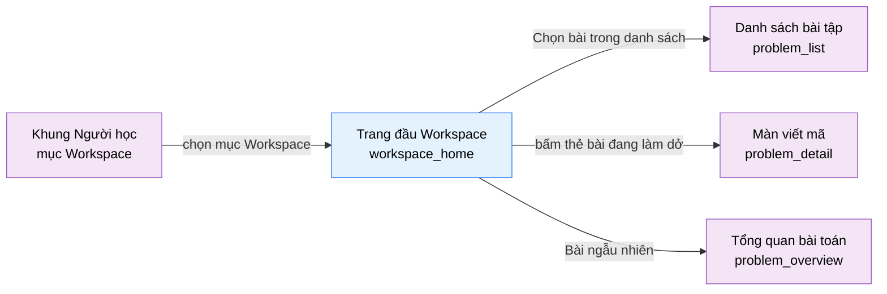

# Tài liệu thiết kế cơ bản (BD) — Trang đầu Workspace (`USR0105`)

## Phương châm tài liệu [Nội bộ — không cần khách duyệt]

- Viết theo **mẫu 9 sheet**. Bộ thẻ đóng, quy ước ID, ký hiệu chuẩn, ranh giới với tài liệu khác và
  checklist kiểm toán nằm ở `02-bd/_rules/bd-template-9sheet.md` — file này không chép lại.
- Phần gắn nhãn `[Nội bộ]` phục vụ sinh mã và tự kiểm toán, không phải yêu cầu của khách hàng: mục 4.5,
  mục 7.3 và các ghi chú quy ước.
- Mã màn `USR0105` theo mục 8 của `02-bd/_rules/bd-template-9sheet.md`; **bảng mã ở mục đó chưa có dòng này**
  (màn mới 2026-10-20), xem Câu hỏi mở Q8. Tên file mang tiền tố mã.
- **Màn mới do `DEC-2026-1020-student-workspace-split-and-password-in-settings`** [Nguồn: .nexa/control/decision-registry.md:4233-4250]:
  thay phần chuyển hướng của mục nav "Workspace" bằng một trang thật. Màn này **không có prototype tĩnh** trong
  `09-layoutBase/`; bằng chứng bố cục duy nhất là bản dựng
  `05-coding/frontend/src/views/users/workspace-home/ui/workspace-home-view.tsx`. Mọi hình **chưa duyệt**
  (xem nhãn "Chưa duyệt hình" ở Sheet 2 và Sheet 4).
- **Màn này tái sử dụng, không tạo mới.** Khối "Bài đang làm dở", nút "Bài ngẫu nhiên", DTO
  `InProgressProblemDto` và hai endpoint đều đã có ở `USR0101`
  [Nguồn: 02-bd/screens/users/USR0101_problem_list.md:235,541,544]; màn này dùng lại tên đã chốt, không đặt tên
  song song.
- Màn **chỉ đọc**: không có thao tác ghi, không có dữ liệu nhập, không có popup.

> Đọc cùng `01-rd/screens/users/USR0105_workspace_home.md` (hành vi ở mức yêu cầu, không lặp lại ở đây),
> `02-bd/screens/users/USR0101_problem_list.md` (nơi định nghĩa "bài đang làm dở" và "bài ngẫu nhiên"),
> `02-bd/screens/users/USR0102_problem_detail.md` (đích `/workspace/{id}`) và
> `02-bd/screens/users/_shell.md` (khung điều hướng khu Người học).
>
> - **Header và chân trang không mô tả lại ở đây** — dùng chung khung khu Người học: header ngang dính
>   trên, không có thanh bên [Nguồn: 02-bd/screens/users/_shell.md:24,40-41], chân trang dùng chung
>   [Nguồn: 02-bd/screens/users/_shell.md:97-103]. Mục "Workspace" là mục nav thứ 2
>   [Nguồn: 02-bd/screens/users/_shell.md:63]; `_shell.md` mục 2.2 và Q2 đã được sửa ngày 2026-10-20 cho khớp
>   (mục này mở màn này, không còn chuyển hướng), xem Câu hỏi mở Q8.
> - **Không thiết kế** soạn mã, chạy thử, nộp bài (`USR0102`) và đọc đề (`USR0104`).
> - **Không hiển thị** nội dung testcase ẩn hay diff chi tiết. Màn chỉ hiện con số đạt trên tổng.
> - **Không hiển thị** điểm theo tỉ lệ testcase dưới dạng phần trăm hay điểm; chỉ hiện "kết quả + đạt/tổng" như
>   thẻ của `USR0101` (F4-13: `DEC-2026-0831-partial-score-testcase-ratio`).

---

## Sheet 1. Bìa

| Mục | Giá trị |
| :--- | :--- |
| Hệ thống | AlgoPrep |
| Phân hệ | `judge-orchestration` (F4), `problem-bank` (F2) |
| Công đoạn | BD — Thiết kế cơ bản |
| Phân loại | Màn hình |
| Tên màn | Trang đầu Workspace |
| Mã màn hình | `USR0105` |
| Tên vật lý (slug) | `workspace_home` |
| Trục tài liệu | Màn hình (`02-bd/screens/`) |
| Actor | A1 (`STUDENT`) |
| Phiên bản | V0.3 |
| Người tạo | Claude |
| Ngày tạo | 2026/10/20 |
| Người cập nhật | Claude |
| Ngày cập nhật | 2026/10/21 |

---

## Sheet 2. Lịch sử sửa đổi

| Ver | Sheet bị sửa | Nội dung sửa | Ngày | Người sửa |
| :--- | :--- | :--- | :--- | :--- |
| V0.1 | Toàn bộ | Tạo mới theo mẫu 9 sheet cho màn mới `/workspace`, theo `DEC-2026-1020-student-workspace-split-and-password-in-settings` (owner 2026-10-20): thay phần chuyển hướng của mục nav "Workspace" bằng một trang liệt kê bài đang làm dở, kèm nút "Chọn bài trong danh sách" và "Bài ngẫu nhiên" (mở trang tổng quan `/problems/{id}`, không mở Workspace). Dùng lại `InProgressProblemDto`, `ListMyUnsolvedRecentProblems`, `GetRandomProblem` của `USR0101`. Khối "Bài tập lớp" và "Bài đã lưu" chưa dựng, chờ owner (Q1). Phát sinh 9 câu hỏi mở. **Chưa duyệt hình** (không có prototype tĩnh, bản dựng là bằng chứng duy nhất) | 2026/10/20 | Claude |
| V0.2 | Sheet 4 (Số bản ghi tối đa, Hiện trạng), Câu hỏi mở (đóng Q1, Q2, Q6) | Owner chốt 2026/10/20: không thêm khối Bài tập lớp và Bài đã lưu; tối đa 12 bài đang làm dở, mới nhất trước (đã dựng); bài đã rút xuống bị lọc ra ở truy vấn. Chưa duyệt hình | 2026/10/20 | Claude |
| V0.3 | Sheet 4 (Hiện trạng, Ánh xạ slice), Sheet 9, Câu hỏi mở (đóng Q3, Q4, Q5, Q7, Q9) | Owner chốt 2026/10/21: "bài đang làm dở" chỉ gồm bài đã nộp ít nhất một lần và chưa `ACCEPTED`, bản gõ nháp ở trình duyệt chưa nộp thì không liệt kê; "Bài ngẫu nhiên" bốc trong các bài chưa giải (gồm "Đang làm") và bản thật do máy chủ bốc, prototype giữ bốc ở máy khách; thêm khoá riêng `workspaceHome.toast.randomEmpty` và dùng trong `pickRandom`; trạng thái tải, lỗi, đăng nhập hoãn thành nợ prototype; khối "Bài đang làm dở" dùng chung một component `InProgressList` với `USR0101` (đã dựng, ở `entities/problem/ui`). Đo lại số dòng `file:line` trên bản mã cuối. Chưa duyệt hình | 2026/10/21 | Claude |

---

## Sheet 3. Sơ đồ chuyển màn

> [Nội bộ] Quy ước vẽ: bố trí từ trái sang phải. Màn gọi tới tô tím, màn hiện tại tô xanh nhạt, màn đích
> tô tím. Màu và `[Nguồn:]` dùng để truy vết, không phải yêu cầu của khách hàng.

### 3.1 Danh sách chuyển màn

#### Khung điều hướng Người học (mục nav "Workspace") → Trang đầu Workspace

[Điều kiện mở] Chọn mục "Workspace" trên thanh điều hướng ngang của khung khu Người học
[Nguồn: 02-bd/screens/users/_shell.md:63; 05-coding/frontend/src/app/(student)/workspace/page.tsx:1-5].

[Chế độ mở] Chế độ duyệt, chỉ đọc. Không còn chuyển hướng tự động sang một bài (đã thay, owner 2026-10-20)
[Nguồn: .nexa/control/decision-registry.md:4244].

[Thông tin truyền] Không có.

[Giá trị trả về] Không có.

[Khi thành công] Hiển thị đầu trang (tiêu đề, mô tả, hai hành động) và khối "Bài đang làm dở"
[Nguồn: 05-coding/frontend/src/views/users/workspace-home/ui/workspace-home-view.tsx:40-75].

[Khi huỷ] Không có.

#### Trang đầu Workspace → Danh sách bài tập

[Điều kiện mở] Bấm nút "Chọn bài trong danh sách" ở đầu trang
[Nguồn: 05-coding/frontend/src/views/users/workspace-home/ui/workspace-home-view.tsx:50-57].

[Chế độ mở] Chế độ duyệt.

[Thông tin truyền] Không có. Mở `problem_list` với bộ lọc mặc định.

[Giá trị trả về] Không có.

[Khi thành công] Mở màn `problem_list` (`/problems`).

[Khi huỷ] Không có.

#### Trang đầu Workspace → Chi tiết bài tập (màn viết mã)

[Điều kiện mở] Bấm một thẻ bài trong khối "Bài đang làm dở"
[Nguồn: 05-coding/frontend/src/entities/problem/ui/in-progress-list.tsx:52-77].

[Chế độ mở] Chế độ giải bài, có ghi (nộp bài, lưu bài) — chính là `USR0102` ở đường dẫn `/workspace/{problemId}`
[Nguồn: .nexa/control/decision-registry.md:4242-4243].

[Thông tin truyền] `problem_id` của thẻ được bấm.

[Giá trị trả về] Không có.

[Khi thành công] Mở màn `problem_detail` của bài đó, bản nháp mã (nếu có) do `USR0102` khôi phục từ trình
duyệt [Nguồn: 02-bd/screens/users/USR0102_problem_detail.md:270].

[Khi huỷ] Không có.

#### Trang đầu Workspace → Tổng quan bài toán (bài ngẫu nhiên)

[Điều kiện mở] Bấm nút "Bài ngẫu nhiên" ở đầu trang và còn ít nhất một bài chưa giải
[Nguồn: 05-coding/frontend/src/views/users/workspace-home/ui/workspace-home-view.tsx:28-38,58-61].

[Chế độ mở] Chế độ đọc đề (trang tổng quan, chỉ đọc). **Không** mở thẳng màn viết mã (owner 2026-10-20)
[Nguồn: .nexa/control/decision-registry.md:4249-4250].

[Thông tin truyền] `problem_id` của bài được bốc.

[Giá trị trả về] Không có.

[Khi thành công] Mở màn `problem_overview` (`USR0104`, `/problems/{problemId}`) của bài được bốc.

[Khi huỷ] Không còn bài chưa giải thì không chuyển màn, hiển thị toast cảnh báo
[Nguồn: 05-coding/frontend/src/views/users/workspace-home/ui/workspace-home-view.tsx:33-36].

### 3.2 Sơ đồ

[Nguồn: 02-bd/screens/users/_shell.md:63; .nexa/control/decision-registry.md:4239-4250;
05-coding/frontend/src/views/users/workspace-home/ui/workspace-home-view.tsx:34,56,67-72]

---

## Sheet 4. Bố cục màn hình

### 4.1 Tổng quan màn

[Mục đích màn] Cho người học, khi bấm mục "Workspace", thấy ngay những bài mình đang làm dở để tiếp tục, hoặc đi
chọn một bài khác (từ danh sách, hoặc ngẫu nhiên) để bắt đầu
[Nguồn: 05-coding/frontend/src/views/users/workspace-home/ui/workspace-home-view.tsx:3-5].

[Luồng nghiệp vụ chính]

1. **Hiển thị ban đầu**: vào màn, hệ thống tải danh sách bài đang làm dở của chính người học và dựng đầu trang
   cùng khối bài đang làm dở. Bản dựng lấy dữ liệu đồng bộ từ dữ liệu mẫu nên chưa có khung chờ
   [Nguồn: 05-coding/frontend/src/views/users/workspace-home/ui/workspace-home-view.tsx:26].
2. **Tiếp tục bài đang làm dở**: bấm một thẻ để vào màn viết mã `/workspace/{problemId}` của bài đó.
3. **Chọn bài khác**: bấm "Chọn bài trong danh sách" để sang `problem_list`, hoặc bấm "Bài ngẫu nhiên" để được
   bốc một bài chưa giải và mở trang tổng quan của nó. Không còn bài chưa giải thì ở lại trang, báo bằng toast.
4. **Chưa có bài đang làm dở**: khối thay danh sách bằng một câu hướng dẫn; hai hành động ở đầu trang vẫn dùng được.

[Người dùng] Người học đã đăng nhập (`STUDENT`). Bắt buộc đăng nhập, không có trạng thái khách `[SoT: Suy luận]` —
cùng kết luận đã chốt cho cả khu Người học [Nguồn: 02-bd/screens/users/_shell.md:136]; bản dựng chưa có kiểm
đăng nhập (Câu hỏi mở Q7).

[Tệp liên quan] Không có. Màn này không xuất hay nhập tệp.

[Phạm vi]
- Chỉ hiển thị bài đang làm dở của **chính người dùng đăng nhập**, đọc từ các lần nộp của họ, không phải từ
  bản nháp ở trình duyệt [Nguồn: 02-bd/screens/users/USR0101_problem_list.md:384; 02-bd/screens/users/USR0102_problem_detail.md:270].
- **Chỉ đọc**: không tạo, sửa hay xoá dữ liệu nào.
- Màn **không** có khối "Bài tập lớp" và khối "Bài đã lưu". Chủ dự án xác nhận mặc định "trang đầu Workspace chỉ
  chứa bài đang làm dở" [Nguồn: .nexa/control/decision-registry.md:4250]; việc có thêm hai khối kia là câu hỏi
  mở (Q1, ponytail bậc 3).
- **Không có dải chỉ số** (StatCard) ở đầu trang — quy tắc owner 2026-10-13, mở rộng 2026-10-18
  [Nguồn: 02-bd/screens/users/USR0103_saved_problems.md:192].
- Màn **không phụ thuộc hệ AI** (F5/F6): bản dựng không import gì từ `ai-review` hay `interview-bank`
  [Nguồn: 05-coding/frontend/src/views/users/workspace-home/ui/workspace-home-view.tsx:10-17].

[Quyền sử dụng]
- Xem: được, chỉ với chính chủ tài khoản.
- Thêm / Sửa / Xoá: không.

[Số bản ghi tối đa] Khối "Bài đang làm dở": tối đa 12 mục, mới nhất trước (Câu hỏi mở Q2, owner chốt 2026/10/20). Bản dựng cắt 12 phần tử đầu của mảng mẫu (mẫu có 3 mục)
[Nguồn: 05-coding/frontend/src/views/users/workspace-home/ui/workspace-home-view.tsx:20,67-72; 05-coding/frontend/src/entities/problem/api/__mock__/problem-mocks.ts:186-211],
khác khối cùng tên ở `USR0101` cắt tối đa 3
[Nguồn: 02-bd/screens/users/USR0101_problem_list.md:225]. Đầu trang: một tiêu đề và một dòng mô tả.

### 4.2 DTO liên quan

- `InProgressProblemDto` — **dùng lại nguyên** của `USR0101`
  [Nguồn: 02-bd/screens/users/USR0101_problem_list.md:235,511-512]; không đặt DTO mới.

`[Suy luận]` — tên DTO do `USR0101` đề xuất, `03-dd/api/F4_judge-orchestration.md` chốt lại. Bản dựng dùng kiểu
`InProgressProblem` với cùng tập trường (`problemId`, `title`, `language`, `lastVerdict`, `passedCount`,
`totalCount`) [Nguồn: 05-coding/frontend/src/entities/problem/model/types.ts:50-58]. Kết quả "Bài ngẫu nhiên" chỉ
cần `problemId` (Sheet 7.1 NO 7), không đặt DTO riêng ở mức BD.

### 4.3 Bảng dữ liệu liên quan (3)

| NO | Bảng | Ghi chú |
| --: | :--- | :--- |
| 1 | `judge.submissions` | Nguồn của khối "Bài đang làm dở": `problem_id`, `language`, `status`, `passed_testcase_count`, `total_testcase_count`, `submitted_at` [Nguồn: 02-bd/database/F4_judge-orchestration.md:12-34] |
| 2 | `problem.problems` | Tên bài của từng thẻ; tập bài để bốc ngẫu nhiên; trạng thái vòng đời [Nguồn: 02-bd/database/F2_problem-bank.md:11-29] |
| 3 | `identity.user_problem_best_score` | Read model để loại bài **đã giải** khỏi tập bốc ngẫu nhiên [Nguồn: 02-bd/database/F1_identity.md:156] |

Bảng NO 1 và NO 3 nằm ở schema của module khác. Màn không truy vấn thẳng: `problem-bank` gọi qua cổng ra, đúng
nguyên tắc mỗi schema một chủ [Nguồn: 02-bd/database/F2_problem-bank.md:34]; ranh giới đã chọn ở `USR0101`
[Nguồn: 02-bd/screens/users/USR0101_problem_list.md:256-258].

Màn này **không** đọc `testcases`, `problem_stats`, `ai.solution_reviews`, `problem.bookmarks`,
`problem.class_assignments`.

### 4.4 Vùng bố cục

Không có prototype tĩnh cho màn này trong `09-layoutBase/`. Phần gần nhất là trạng thái "chưa chọn bài" của
`Workspace giải bài.dc.html:112-152` mà `USR0102` từng mô tả rồi **đã bỏ 2026-10-19**
[Nguồn: 02-bd/screens/users/USR0102_problem_detail.md:345]; màn này là nơi thay thế nó. Bố cục dưới đây bám bản dựng.

| Vùng | Vị trí trong bản dựng | Nội dung |
| :--- | :--- | :--- |
| Header ngang dính trên (khung chung Người học) | - | Thương hiệu, nav, menu người dùng — dùng lại khung chung, không mô tả lại |
| Đầu trang | `workspace-home-view.tsx:42-63` | Bên trái: tiêu đề (`h1`) và một dòng mô tả. Bên phải: nút "Chọn bài trong danh sách" (kiểu viền, `:50-57`) và nút "Bài ngẫu nhiên" kèm biểu tượng xáo trộn (kiểu nhấn mạnh, `:58-61`). Hàng xuống dòng khi hẹp (`flex-wrap`) |
| Khối "Bài đang làm dở" | `:61-91` | Một thẻ (`Card`) chứa tiêu đề khối và lưới các thẻ bài: 1 cột (mặc định), 2 cột từ `md`, 3 cột từ `xl` (`:68`). Mỗi thẻ bài là một liên kết có viền, rê chuột đổi nền, hiển thị tên bài (cắt bớt) và một dòng "Ngôn ngữ · Kết quả đạt/tổng" (`:71-86`) |
| Trạng thái rỗng | `:63-66` | Một câu hướng dẫn thay cho lưới, trong cùng thẻ |
| Chân trang (khung chung Người học) | - | Dùng khung chung [Nguồn: 02-bd/screens/users/_shell.md:97-103] |

Bố cục **một cột**. Giữ nguyên cấu trúc này khi nối API; không quy định màu sắc, khoảng cách hay typography ở BD.

**Hiện trạng bản dựng** (đọc `workspace-home-view.tsx` ngày 2026-10-21; **chưa duyệt hình**).

| Vùng BD | Bản dựng | Vị trí |
| :--- | :--- | :--- |
| Trang | `app/(student)/workspace/page.tsx` chỉ render `WorkspaceHomeView`; không còn lệnh chuyển hướng như BD cũ của `USR0102` mô tả | `src/app/(student)/workspace/page.tsx:1-5` |
| Đầu trang | Tiêu đề và mô tả lấy từ i18n `workspaceHome.title` ("Workspace") và `workspaceHome.subtitle`. **Không** dùng `PageHeader` của `shared/ui` mà tự dựng một hàng `div` (khác `USR0103`, nơi dùng `PageHeader`) | `workspace-home-view.tsx:42-63`; `messages/vi.json:2967-2968` |
| Nút "Chọn bài trong danh sách" | `Button asChild` bọc `Link href="/problems"`, nhãn i18n `workspaceHome.linkProblems` | `workspace-home-view.tsx:50-57`; `messages/vi.json:2969` |
| Nút "Bài ngẫu nhiên" | `Button variant="cta"`, nhãn **dùng lại** `problemList.summary.btnRandom`; `pickRandom` lọc `solveState !== "solved"` trên `page.items`, chọn bằng `Math.random`, rồi `router.push('/problems/{id}')`; rỗng thì `toast.warning` với khoá riêng `workspaceHome.toast.randomEmpty` "Bạn đã giải hết mọi bài hiện có." (Câu hỏi mở Q5, đã chốt); bản dựng bốc ở máy khách, bản thật do máy chủ bốc (Q4) | `workspace-home-view.tsx:28-38,58-61`; `messages/vi.json:135,2973` |
| Khối bài đang làm dở | `Card` chứa component dùng chung `InProgressList` (`layout="grid"`, lưới 1/2/3 cột; `limit` = `MAX_DRAFTS` = 12), cùng component với cột phải `USR0101` (`layout="compact"`, 3 thẻ); mỗi mục là `Link` tới `/workspace/{problemId}`; dữ liệu `page.inProgress`; ngôn ngữ lấy từ `problemDetail.language.*`, kết quả từ `problemDetail.verdict.*` ghép bằng `problemList.inProgress.lastVerdict` (`{verdict} {passed}/{total}`) | `workspace-home-view.tsx:65-73`; `entities/problem/ui/in-progress-list.tsx:23-88`; `messages/vi.json:177,315-317,351-359` |
| Trạng thái rỗng | Câu i18n `workspaceHome.empty`, truyền vào `InProgressList` qua `emptyText` | `workspace-home-view.tsx:71`; `in-progress-list.tsx:35-39`; `messages/vi.json:2971` |
| Nguồn dữ liệu | `useState(fetchProblemListPage)` — **cả** trang danh sách bài mẫu (`items` + `inProgress`) được tải để lấy hai thứ; nguồn thật sẽ là `judge.submissions` khi có DD | `workspace-home-view.tsx:7,26` |
| Trạng thái tải, lỗi, kiểm đăng nhập | **Chưa có** (dữ liệu mẫu đồng bộ, không guard), xem Câu hỏi mở Q7 | `workspace-home-view.tsx:26` |

Số liệu bản dựng lấy từ dữ liệu mẫu, nên mọi cột "Nguồn giá trị" ở Sheet 5 mô tả đích backend, không phải
hiện trạng.

### 4.5 Cấu trúc slice FSD [Nội bộ]

| Khối | Slice dự kiến | Căn cứ |
| :--- | :--- | :--- |
| Trang | `views/users/workspace-home` | Bản dựng: `workspace-home-view.tsx` [Nguồn: 05-coding/frontend/src/app/(student)/workspace/page.tsx:1] |
| Khung Người học | Dùng lại `widgets/app-shell` (biến thể `student-header`) | `02-bd/screens/users/_shell.md` mục 1 |
| Dữ liệu bài đang làm dở, kiểu `InProgressProblem` | Dùng lại `entities/problem` | `workspace-home-view.tsx:14` |
| Nút, thẻ, toast | `shared/ui` (`Button`, `Card`), `shared/lib/toast-store` | `workspace-home-view.tsx:16-17` |
| i18n | Namespace `workspaceHome`; dùng chung `problemList`, `problemDetail` | `workspace-home-view.tsx:23-24` |

`[Suy luận]` — ánh xạ slice do BD đề xuất. **Ghi nhận lặp:** khối "Bài đang làm dở" đã là một slice
`widgets/in-progress-problems` ở `USR0101` [Nguồn: 02-bd/screens/users/USR0101_problem_list.md:310]. **Đã gộp 2026/10/21
(Câu hỏi mở Q9):** cả hai màn dùng component `InProgressList` ở `entities/problem/ui/in-progress-list.tsx` (nhận danh
sách, số thẻ tối đa, kiểu bố cục `compact`/`grid` và liên kết cuối tuỳ chọn) [Nguồn: 05-coding/frontend/src/entities/problem/ui/in-progress-list.tsx:23-88]; không còn lưới tự vẽ ở màn này. Đặt ở `entities`
thay vì `widgets` vì thẻ chỉ dùng kiểu `InProgressProblem` của `entities/problem`.

> [Nội bộ] Ảnh minh hoạ đặt ở `08-diagram/02-bd/screens/users/`, chụp bằng Playwright trên ứng dụng
> Next.js thật. Chưa chụp: hình chưa duyệt.

---

## Sheet 5. Danh sách item màn hình

> Quy ước ID, bộ thẻ và giá trị chuẩn: `02-bd/_rules/bd-template-9sheet.md` mục 2, 3, 4.
>
> **Mọi dòng "Nhãn tĩnh i18n" trỏ về namespace `workspaceHome` hoặc namespace dùng chung** (`problemList`,
> `problemDetail`). ID item dùng slug chính tắc camelCase `workspaceHome`, trùng tên namespace i18n.

### Khu vực A — Đầu trang

| Khu vực | NO | Tên item | ID item | Bảng DB | Cột DB | Loại UI | Kiểu | Độ dài | Bắt buộc | I/O | Giá trị mặc định | Định dạng | Ghi chú |
| :--- | --: | :--- | :--- | :--- | :--- | :--- | :--- | :--- | :-: | :-: | :--- | :--- | :--- |
| Đầu trang | | | | | | | | | | | | | |
| | 1 | Tiêu đề trang | `workspaceHome.header.title` | - | - | Label | String | - | - | O | - | - | Tên màn "Workspace" [Nguồn giá trị] Nhãn tĩnh i18n `workspaceHome.title` [Nguồn: 05-coding/frontend/messages/vi.json:2967; 05-coding/frontend/src/views/users/workspace-home/ui/workspace-home-view.tsx:44] [EVT liên quan] - |
| | 2 | Mô tả trang | `workspaceHome.header.subtitle` | - | - | Label | String | - | - | O | - | - | Một dòng gợi ý hành động: tiếp tục bài đang làm dở hoặc chọn bài mới [Nguồn giá trị] Nhãn tĩnh i18n `workspaceHome.subtitle` [Nguồn: 05-coding/frontend/messages/vi.json:2968; 05-coding/frontend/src/views/users/workspace-home/ui/workspace-home-view.tsx:45-47] [EVT liên quan] - |
| | 3 | Nút Chọn bài trong danh sách | `workspaceHome.header.linkProblems` | - | - | Link | - | - | - | I | - | - | Đi tới danh sách bài toán [Nguồn giá trị] Nhãn tĩnh i18n `workspaceHome.linkProblems` [Nguồn: 05-coding/frontend/messages/vi.json:2969; 05-coding/frontend/src/views/users/workspace-home/ui/workspace-home-view.tsx:50-57] [EVT liên quan] EVT-2 |
| | 4 | Nút Bài ngẫu nhiên | `workspaceHome.header.btnRandom` | `problem.problems`, `identity.user_problem_best_score` | `id`, `best_verdict` | Button | - | - | - | I | - | - | Bốc một bài chưa giải ngẫu nhiên rồi mở trang tổng quan của bài đó [Công thức] Tập bốc = bài đã xuất bản mà người học **chưa** ở trạng thái "Đã giải" theo công thức ba trạng thái của `USR0101` [Nguồn: 02-bd/screens/users/USR0101_problem_list.md:360]; bản dựng lọc `solveState !== "solved"`, nên **gồm cả bài "Đang làm"** [Nguồn: 05-coding/frontend/src/views/users/workspace-home/ui/workspace-home-view.tsx:30-38] (Câu hỏi mở Q4) [Nguồn giá trị] Nhãn **dùng lại** i18n `problemList.summary.btnRandom` [Nguồn: 05-coding/frontend/messages/vi.json:135]; kết quả gọi `GetRandomProblem` (Sheet 7.3 NO 2) [EVT liên quan] EVT-3 |

### Khu vực B — Khối "Bài đang làm dở"

| Khu vực | NO | Tên item | ID item | Bảng DB | Cột DB | Loại UI | Kiểu | Độ dài | Bắt buộc | I/O | Giá trị mặc định | Định dạng | Ghi chú |
| :--- | --: | :--- | :--- | :--- | :--- | :--- | :--- | :--- | :-: | :-: | :--- | :--- | :--- |
| Khối Bài đang làm dở | | | | | | | | | | | | | |
| | 1 | Tiêu đề khối | `workspaceHome.resume.title` | - | - | Label | String | - | - | O | Bài đang làm dở | - | Tiêu đề khối [Nguồn giá trị] Nhãn tĩnh i18n `workspaceHome.resumeTitle` [Nguồn: 05-coding/frontend/messages/vi.json:2970; 05-coding/frontend/src/views/users/workspace-home/ui/workspace-home-view.tsx:66] [EVT liên quan] - |
| | 2 | Danh sách bài đang làm dở | `workspaceHome.resume.list` | `judge.submissions` | - | List | List | - | - | O | rỗng | - | Các bài mà lượt nộp gần nhất của chính người học chưa đạt `ACCEPTED` (định nghĩa chốt ở `USR0101`, không có bảng nháp) [Nguồn: 02-bd/screens/users/USR0101_problem_list.md:384]. Số mục tối đa và thứ tự: chưa chốt (Câu hỏi mở Q2) [Nguồn giá trị] Kết quả gọi `ListMyUnsolvedRecentProblems` (Sheet 7.3 NO 1) [EVT liên quan] EVT-1, EVT-4 |
| | 3 | Thẻ bài | `workspaceHome.resume.item` | `judge.submissions` | `problem_id` | Link | - | - | - | I | - | - | Cả thẻ là một liên kết tới màn viết mã `/workspace/{problemId}` của bài đó [Nguồn giá trị] `problemId` của `InProgressProblemDto` (Sheet 7.1 NO 1) [Nguồn: 05-coding/frontend/src/entities/problem/ui/in-progress-list.tsx:52-77] [EVT liên quan] EVT-4 |
| | 4 | Tên bài | `workspaceHome.resume.col.title` | `problem.problems` | `title` | ListColumn | String | 200 | - | O | - | - | Tên bài toán của thẻ, cắt bớt khi quá dài [Nguồn giá trị] Cột `title`, tra theo `submissions.problem_id` [Nguồn: 02-bd/database/F2_problem-bank.md:15; 02-bd/database/F4_judge-orchestration.md:16; 05-coding/frontend/src/entities/problem/ui/in-progress-list.tsx:58-64] [EVT liên quan] - |
| | 5 | Ngôn ngữ lần nộp gần nhất | `workspaceHome.resume.col.language` | `judge.submissions` | `language` | ListColumn | Enum | - | - | O | - | Nhãn cố định | Ngôn ngữ của lượt nộp gần nhất [Nguồn giá trị] `JAVA` thành "Java", `CPP` thành "C++", `PYTHON` thành "Python" [Nguồn: 02-bd/database/F4_judge-orchestration.md:18]; nhãn từ i18n `problemDetail.language.*` [Nguồn: 05-coding/frontend/messages/vi.json:315-317; 05-coding/frontend/src/entities/problem/ui/in-progress-list.tsx:70] [EVT liên quan] - |
| | 6 | Kết quả lần nộp gần nhất | `workspaceHome.resume.col.lastVerdict` | `judge.submissions` | `status`, `passed_testcase_count`, `total_testcase_count` | ListColumn | String | - | - | O | - | `{kết quả} {đạt}/{tổng}` | Kết quả của lượt nộp gần nhất kèm số testcase đạt trên tổng, ví dụ "Sai kết quả 6/10" [Công thức] Ghép ở tầng giao diện: nhãn `problemDetail.verdict.*` của `status` cộng `passed_testcase_count` và `total_testcase_count`; DTO trả số thô, không trả câu đã ghép [Nguồn: 02-bd/screens/users/USR0101_problem_list.md:512; 05-coding/frontend/src/entities/problem/ui/in-progress-list.tsx:71-75] [Nguồn giá trị] Nhãn kết quả từ i18n `problemDetail.verdict.*` [Nguồn: 05-coding/frontend/messages/vi.json:351-359]; mẫu ghép `problemList.inProgress.lastVerdict` [Nguồn: 05-coding/frontend/messages/vi.json:177] [EVT liên quan] - |
| | 7 | Câu trạng thái rỗng | `workspaceHome.resume.empty` | - | - | Label | String | - | - | O | Chưa có bài đang làm dở. Hãy chọn một bài trong danh sách. | - | Câu hướng dẫn thay cho lưới khi không có bài đang làm dở. Chỉ là chữ, **không có liên kết hay nút**: đường đi tiếp là nút "Chọn bài trong danh sách" ở đầu trang (Khu vực A NO 3) [Nguồn giá trị] Nhãn tĩnh i18n `workspaceHome.empty` [Nguồn: 05-coding/frontend/messages/vi.json:2971; 05-coding/frontend/src/views/users/workspace-home/ui/workspace-home-view.tsx:71] [EVT liên quan] EVT-1 |

[Nguồn: 05-coding/frontend/src/views/users/workspace-home/ui/workspace-home-view.tsx:40-75;
05-coding/frontend/messages/vi.json:2966-2972; 02-bd/database/F4_judge-orchestration.md:12-34;
02-bd/screens/users/USR0101_problem_list.md:384-387]

---

## Sheet 6. Đặc tả điều khiển item

> Ký hiệu cột `Hiển thị` và thứ tự thẻ: `02-bd/_rules/bd-template-9sheet.md` mục 2, 3. Dùng đúng NO, tên
> item và thứ tự của Sheet 5. Lỗi nhập liệu ghi ở Sheet 9, xử lý nghiệp vụ ghi ở Sheet 8.

### Khu vực A — Đầu trang

| Khu vực | NO | Tên item | Hiển thị | Ghi chú |
| :--- | --: | :--- | :-: | :--- |
| Đầu trang | | | | |
| | 1 | Tiêu đề trang | Có | - |
| | 2 | Mô tả trang | Có | - |
| | 3 | Nút Chọn bài trong danh sách | Có | [Điều kiện kích hoạt] Luôn kích hoạt, kể cả khi khối bài đang làm dở đang tải hoặc lỗi. |
| | 4 | Nút Bài ngẫu nhiên | Có | [Điều kiện kích hoạt] Luôn kích hoạt. Khi không còn bài chưa giải thì **bấm được, bị chặn kèm toast** (nội dung nêu lý do) thay vì vô hiệu, theo quy ước kênh thông báo [Nguồn: 02-bd/_rules/bd-template-9sheet.md:62]. Khác nút cùng tên ở `USR0101` (vô hiệu khi bộ lọc không có kết quả [Nguồn: 02-bd/screens/users/USR0101_problem_list.md:418]) vì màn này không có bộ lọc. |

### Khu vực B — Khối "Bài đang làm dở"

| Khu vực | NO | Tên item | Hiển thị | Ghi chú |
| :--- | --: | :--- | :-: | :--- |
| Khối Bài đang làm dở | | | | |
| | 1 | Tiêu đề khối | Có | - |
| | 2 | Danh sách bài đang làm dở | Điều kiện | [Điều kiện hiển thị] Chỉ hiển thị khi có ít nhất một bài đang làm dở; không có thì thay bằng câu trạng thái rỗng (NO 7). Trong lúc tải: khung chờ; tải lỗi: thông báo lỗi kèm nút thử lại thay chỗ danh sách, **chưa dựng ở bản dựng** (Câu hỏi mở Q7) `[SoT: Suy luận]`. |
| | 3 | Thẻ bài | Có | [Điều kiện kích hoạt] Luôn kích hoạt khi thẻ hiển thị. Thẻ trỏ tới bài đã bị rút xuống thì xử lý chưa chốt (Câu hỏi mở Q6). |
| | 4 | Tên bài | Có | - |
| | 5 | Ngôn ngữ lần nộp gần nhất | Có | - |
| | 6 | Kết quả lần nộp gần nhất | Có | - |
| | 7 | Câu trạng thái rỗng | Điều kiện | [Điều kiện hiển thị] Chỉ hiển thị khi tải xong và không có bài đang làm dở. |

[Nguồn: 05-coding/frontend/src/views/users/workspace-home/ui/workspace-home-view.tsx:50-72]

---

## Sheet 7. Danh sách truyền dữ liệu

### 7.1 Trường DTO

| NO | DTO | Trường DTO | Kiểu | Bảng DB | Cột DB | Item màn | Hiển thị | Ghi chú |
| --: | :--- | :--- | :--- | :--- | :--- | :--- | :-: | :--- |
| 1 | `InProgressProblemDto` | `problemId` | UUID | `judge.submissions` | `problem_id` | - | Không | [Nguồn] Phản hồi của `ListMyUnsolvedRecentProblems` [Đích] Tham số điều hướng sang `problem_detail` (`/workspace/{problemId}`) [Nguồn: 02-bd/screens/users/USR0101_problem_list.md:511]. |
| 2 | `InProgressProblemDto` | `title` | String | `problem.problems` | `title` | Khối bài đang làm dở "Tên bài" | Có | [Nguồn] Cùng phản hồi; tra theo `submissions.problem_id`. |
| 3 | `InProgressProblemDto` | `language` | Enum | `judge.submissions` | `language` | Khối bài đang làm dở "Ngôn ngữ lần nộp gần nhất" | Có | [Chuyển đổi] `JAVA`/`CPP`/`PYTHON` thành "Java"/"C++"/"Python" ở tầng giao diện [Nguồn: 02-bd/screens/users/USR0101_problem_list.md:512]. |
| 4 | `InProgressProblemDto` | `lastStatus` | Enum | `judge.submissions` | `status` | Khối bài đang làm dở "Kết quả lần nộp gần nhất" | Có | [Chuyển đổi] Ghép chuỗi hiển thị ở tầng giao diện; DTO trả số thô, không trả câu đã ghép. Bản dựng gọi trường này `lastVerdict` (kiểu `OverallVerdict`) [Nguồn: 05-coding/frontend/src/entities/problem/model/types.ts:54-55]; tên chốt ở DD. |
| 5 | `InProgressProblemDto` | `passedTestcaseCount` | Number | `judge.submissions` | `passed_testcase_count` | Khối bài đang làm dở "Kết quả lần nộp gần nhất" | Có | [Chuyển đổi] Bản dựng gọi `passedCount` [Nguồn: 05-coding/frontend/src/entities/problem/model/types.ts:56]. |
| 6 | `InProgressProblemDto` | `totalTestcaseCount` | Number | `judge.submissions` | `total_testcase_count` | Khối bài đang làm dở "Kết quả lần nộp gần nhất" | Có | [Chuyển đổi] Bản dựng gọi `totalCount` [Nguồn: 05-coding/frontend/src/entities/problem/model/types.ts:57]. |
| 7 | (kết quả `GetRandomProblem`) | `problemId` | UUID | `problem.problems` | `id` | - | Không | [Nguồn] Phản hồi của `GetRandomProblem` [Đích] Tham số điều hướng sang `problem_overview` (`/problems/{problemId}`). Tên DTO chốt ở DD `[SoT: Suy luận]`. |

### 7.2 Truy cập bảng dữ liệu (3)

| NO | Tên logic | Bảng | Repository | CRUD | Mục đích | Ghi chú |
| --: | :--- | :--- | :--- | :-: | :--- | :--- |
| 1 | Bài nộp | `judge.submissions` | `SubmissionRepository` (module `judge-orchestration`) | R | Lấy các bài mà lượt nộp gần nhất chưa đạt `ACCEPTED`, kèm ngôn ngữ, trạng thái, số testcase đạt/tổng | `ListMyUnsolvedRecentProblems`: R [Nguồn: 02-bd/screens/users/USR0101_problem_list.md:524] |
| 2 | Bài toán | `problem.problems` | `ProblemRepository` | R | Lấy tên bài của từng thẻ; chọn ngẫu nhiên trong tập bài đã xuất bản | `ListMyUnsolvedRecentProblems`: R (tên bài) `GetRandomProblem`: R |
| 3 | Tiến độ theo bài của người dùng | `identity.user_problem_best_score` | `UserProblemBestScoreRepository` (module `identity`) | R | Loại bài đã giải khỏi tập bốc ngẫu nhiên | `GetRandomProblem`: R — gọi qua cổng ra `ListMyProblemSolveStates` của `problem-bank` sang `identity`, không đọc thẳng schema khác `[SoT: Suy luận]` |

Màn **chỉ đọc**: cả ba bảng chỉ R. `[Suy luận]` — tên repository lấy theo `USR0101`, DD module chốt lại.

### 7.3 Danh sách endpoint [Nội bộ]

> Chỉ tên nghiệp vụ và BC sở hữu. Hợp đồng chi tiết thuộc `03-dd/api/<module>.md`.

| NO | Endpoint (tên nghiệp vụ) | Mục đích | BC sở hữu |
| --: | :--- | :--- | :--- |
| 1 | `ListMyUnsolvedRecentProblems` | Trả các bài mà lượt nộp gần nhất của chính người dùng chưa đạt `ACCEPTED`, đọc từ `judge.submissions`. **Dùng lại** endpoint của `USR0101`, nhưng định nghĩa gốc ghi "tối đa 3" [Nguồn: 02-bd/screens/users/USR0101_problem_list.md:544]; số mục tối đa cho màn này chưa chốt (Câu hỏi mở Q2) | `judge-orchestration` |
| 2 | `GetRandomProblem` | Bốc ngẫu nhiên một bài chưa giải. **Dùng lại** endpoint của `USR0101` [Nguồn: 02-bd/screens/users/USR0101_problem_list.md:541]; định nghĩa gốc là "trong phạm vi bộ lọc đang áp dụng", màn này không có bộ lọc nên phạm vi là "mọi bài chưa giải" (Câu hỏi mở Q4) | `problem-bank` |

Ghi chú ranh giới:
- **Không có endpoint riêng cho màn này.** Cả hai đã tồn tại; màn không thêm hợp đồng mới ở mức BD.
- **Tiền tố `My` nghĩa là phạm vi khoá cứng theo người dùng đăng nhập**, không nhận `user_id`
  [Nguồn: 02-bd/screens/users/USR0101_problem_list.md:553]. `GetRandomProblem` không mang tiền tố nhưng đọc trạng
  thái giải của chính người gọi; DD phải khoá phạm vi tương tự `[SoT: Suy luận]`.
- Bản dựng **không** gọi hai endpoint này: nó tải cả `fetchProblemListPage` (mẫu) rồi lọc ở máy khách
  [Nguồn: 05-coding/frontend/src/views/users/workspace-home/ui/workspace-home-view.tsx:26,30-38]. Bản thật không nên
  tải cả trang danh sách chỉ để lấy bài đang làm dở và một `problem_id`.

[Nguồn: 02-bd/screens/users/USR0101_problem_list.md:524,541,544; 02-bd/database/F4_judge-orchestration.md:12-34]

---

## Sheet 8. Danh sách sự kiện

> Bộ thẻ và quy ước cột `Chuyển màn`: `02-bd/_rules/bd-template-9sheet.md` mục 2, 3.
>
> Màn không có dữ liệu nhập chưa lưu, nên **không có hộp hỏi xác nhận rời màn** (khác `USR0103`). Màn không có
> bộ lọc nên **không ghi trạng thái vào URL**.

### Màn chính: Trang đầu Workspace

| NO | Loại | Sự kiện | Chi tiết | Chuyển màn | Gọi API | Tên xử lý | Ghi chú |
| --: | :--- | :--- | :--- | :-: | :-: | :--- | :--- |
| 1 | Màn hình | Khởi tạo màn | Vào màn (từ mục nav "Workspace") thì tải bài đang làm dở. | Không | Có | `ListMyUnsolvedRecentProblems` | [Các bước] 1. Kiểm tra người dùng đã đăng nhập. 2. Hiển thị khung chờ cho khối bài đang làm dở; đầu trang dựng ngay vì không phụ thuộc dữ liệu. 3. Gọi `ListMyUnsolvedRecentProblems`. [Khi thành công] Có bài thì dựng lưới thẻ; không có bài nào thì hiển thị câu trạng thái rỗng (Khu vực B NO 7). [Khi lỗi] Hiển thị lỗi kèm nút thử lại tại vùng khối, hai nút ở đầu trang vẫn dùng được `[SoT: Suy luận]`. Bản dựng chưa có khung chờ, trạng thái lỗi (Câu hỏi mở Q7). |
| 2 | Liên kết | Chọn bài trong danh sách | Bấm nút "Chọn bài trong danh sách". | Có | Không | - | [Các bước] 1. Điều hướng sang `problem_list` (`/problems`) với bộ lọc mặc định. [Khi thành công] Mở màn `problem_list` [Nguồn: 05-coding/frontend/src/views/users/workspace-home/ui/workspace-home-view.tsx:56]. |
| 3 | Nút | Bài ngẫu nhiên | Bấm nút "Bài ngẫu nhiên". | Có | Có | `GetRandomProblem` | [Các bước] 1. Yêu cầu máy chủ bốc ngẫu nhiên một bài chưa giải của chính người học. 2. Nhận `problem_id` rồi điều hướng sang `/problems/{problem_id}` (trang tổng quan `USR0104`), **không** sang `/workspace/{problem_id}`. [Khi thành công] Mở màn `problem_overview` của bài được bốc [Nguồn: 05-coding/frontend/src/views/users/workspace-home/ui/workspace-home-view.tsx:28-38; .nexa/control/decision-registry.md:4249-4250]. [Khi lỗi] Không còn bài chưa giải thì **không chuyển màn**, hiển thị toast cảnh báo (Sheet 9 NO 3) [Nguồn: 05-coding/frontend/src/views/users/workspace-home/ui/workspace-home-view.tsx:33-36]. Lỗi gọi máy chủ: toast lỗi, ở lại trang `[SoT: Suy luận]`. [Thông báo hoàn tất] Không có (chuyển màn là phản hồi). |
| 4 | Liên kết | Mở bài đang làm dở | Bấm một thẻ trong khối "Bài đang làm dở". | Có | Không | - | [Các bước] 1. Điều hướng sang `problem_detail` ở `/workspace/{problem_id}` của thẻ. [Khi thành công] Mở màn viết mã; bản nháp mã (nếu có) do `USR0102` khôi phục từ trình duyệt, không thuộc màn này [Nguồn: 05-coding/frontend/src/entities/problem/ui/in-progress-list.tsx:52-77; 02-bd/screens/users/USR0102_problem_detail.md:270]. |

[Nguồn: 05-coding/frontend/src/views/users/workspace-home/ui/workspace-home-view.tsx:28-38,50-61,65-73; 05-coding/frontend/src/entities/problem/ui/in-progress-list.tsx:52-77;
.nexa/control/decision-registry.md:4239-4250]

---

## Sheet 9. Đặc tả kiểm tra

> Bộ thẻ và quy ước mã thông báo: `02-bd/_rules/bd-template-9sheet.md` mục 2, 4. Sheet này ghi **điều kiện
> kiểm và thông báo**; tiêu chí nghiệm thu `AC-nn` thuộc `04-tdd/screens/users/USR0105_workspace_home.md`, không lặp lại ở đây.

| NO | Loại | Tóm tắt kiểm | Chi tiết | Mức | Mã thông báo | Ghi chú | EVT gọi | Thứ tự |
| --: | :--- | :--- | :--- | :--- | :--- | :--- | :--- | :-: |
| 1 | Kiểm quyền | Yêu cầu đăng nhập | [Nội dung kiểm] Người dùng chưa đăng nhập thì chuyển về màn `auth`. Màn này không có trạng thái khách. [Nơi thực thi] Chặn ở cả tầng định tuyến phía giao diện và tầng phân quyền phía máy chủ. | Lỗi | Chưa có mã thông báo | Nội dung "Vui lòng đăng nhập để tiếp tục." Cùng quy ước đã chốt cho khu Người học [Nguồn: 02-bd/screens/users/_shell.md:136]. `[SoT: Suy luận]` cho riêng màn này; bản dựng chưa có kiểm (Câu hỏi mở Q7). | EVT-1, EVT-3 | 1 |
| 2 | Kiểm quyền | Phạm vi dữ liệu cá nhân | [Nội dung kiểm] Bài đang làm dở và tập bài bốc ngẫu nhiên chỉ được tính theo chính người dùng đăng nhập; không endpoint nào của màn nhận `user_id` từ phía gọi. [Nơi thực thi] Máy chủ, ở tầng dịch vụ. | Lỗi | Không có thông báo | Cùng nguyên tắc đã áp ở `USR0101` [Nguồn: 02-bd/screens/users/USR0101_problem_list.md:605]. | EVT-1, EVT-3 | 2 |
| 3 | Kiểm nghiệp vụ | Bốc ngẫu nhiên trên tập rỗng | [Nội dung kiểm] Không còn bài chưa giải thì không chuyển màn. [Nơi thực thi] Màn hình và máy chủ. [Tiêu điểm] Nút "Bài ngẫu nhiên" + toast. | Cảnh báo | Chưa có mã thông báo | Nội dung "Bạn đã giải hết mọi bài hiện có." (khoá riêng `workspaceHome.toast.randomEmpty`, Câu hỏi mở Q5 đã chốt) [Nguồn: 05-coding/frontend/messages/vi.json:2973]. | EVT-3 | 1 |
| 4 | Kiểm nghiệp vụ | Bài đang làm dở trỏ tới bài đã rút xuống | [Nội dung kiểm] Bài có `status = UNPUBLISHED` hoặc `deleted = true` không được dẫn người học tới màn viết mã chỉ để nhận lỗi; cách xử lý (lọc khỏi danh sách hay gắn nhãn) **chưa chốt**. [Nơi thực thi] Máy chủ trong điều kiện truy vấn, nếu chọn lọc ra. | Cảnh báo | Chưa có mã thông báo | Tiền lệ: `problem_list` coi bài ngoài phạm vi như không tồn tại [Nguồn: 02-bd/screens/users/USR0101_problem_list.md:603]; `saved_problems` giữ dòng và gắn nhãn "Đã rút xuống" [Nguồn: 02-bd/screens/users/USR0103_saved_problems.md:607]. Chưa có quyết định cho màn này (Câu hỏi mở Q6). | EVT-1, EVT-4 | 3 |
| 5 | Kiểm nghiệp vụ | Lỗi hệ thống hoặc lỗi gọi máy chủ | [Nội dung kiểm] Gọi máy chủ cho khối bài đang làm dở thất bại thì không làm hỏng cả trang: hai nút ở đầu trang vẫn dùng được, khối hiển thị lỗi kèm nút thử lại. [Nơi thực thi] Màn hình. | Lỗi | Mã lỗi trong phản hồi | Phản hồi có mã lỗi đã đăng ký thì hiển thị nội dung tương ứng; chưa đăng ký thì hiển thị "Không kết nối được máy chủ." Lỗi của EVT-1 hiện ở vùng khối kèm nút thử lại; lỗi của EVT-3 hiện bằng toast. `[SoT: Suy luận]` theo cách `USR0103` xử lý lỗi tải [Nguồn: 02-bd/screens/users/USR0103_saved_problems.md:589]; bản dựng chưa có (Câu hỏi mở Q7). | EVT-1, EVT-3 | 4 |

Cột `Thứ tự` là thứ tự kiểm trong cùng một sự kiện.

[Nguồn: 02-bd/screens/users/USR0101_problem_list.md:603,605; 02-bd/screens/users/USR0103_saved_problems.md:589,607;
05-coding/frontend/messages/vi.json:2973]

---

## Câu hỏi mở

| # | Câu hỏi | Vì sao chưa trả lời được | Đề xuất | Chủ sở hữu |
| :-: | :--- | :--- | :--- | :--- |
| Q1 | **Trang đầu Workspace có thêm khối "Bài tập lớp" và khối "Bài đã lưu" không?** | Owner xác nhận mặc định "trang chỉ chứa bài đang làm dở" [Nguồn: .nexa/control/decision-registry.md:4250] nhưng chưa nói hai khối kia bỏ hẳn hay làm sau. Bản dựng không có. | **ĐÃ CHỐT 2026/10/20 (owner): không thêm khối "Bài tập lớp" và "Bài đã lưu"; trang chỉ có bài đang làm dở (ponytail bậc 3).** Đề xuất cũ: **Chưa quyết, chờ owner.** Nếu phải chọn: không thêm (ponytail bậc 3, khối "Bài tập lớp" đã có ở `USR0101` và "Bài đã lưu" có menu người dùng riêng, nên thêm vào đây là một lối vào thứ hai không ai cần khi demo). | Chủ dự án |
| Q2 | **Khối "Bài đang làm dở" hiển thị tối đa bao nhiêu mục, sắp theo thứ tự nào?** | Bản dựng không cắt số mục và không sắp (thứ tự mảng mẫu) [Nguồn: 05-coding/frontend/src/views/users/workspace-home/ui/workspace-home-view.tsx:20,67-72; 05-coding/frontend/src/entities/problem/api/__mock__/problem-mocks.ts:186-211]. Khối cùng tên ở `USR0101` tối đa 3, và endpoint gốc định nghĩa "tối đa 3" [Nguồn: 02-bd/screens/users/USR0101_problem_list.md:225,544]; trang đầu Workspace là nơi duy nhất liệt kê, nên 3 là quá ít, nhưng không có trần thì người học làm nhiều bài sẽ có danh sách dài. | **ĐÃ CHỐT 2026/10/20 (owner): tối đa 12 mục, lượt nộp mới nhất trước, không phân trang. Đã dựng hằng `MAX_DRAFTS = 12` ở `workspace-home-view.tsx`; thứ tự "mới nhất trước" do máy chủ khi nối API (mẫu giữ thứ tự mảng).** Đề xuất cũ: Đề xuất: DD thêm tham số giới hạn cho `ListMyUnsolvedRecentProblems`, sắp theo lượt nộp gần nhất giảm dần, trần là một hằng số (gợi ý 12, hợp lưới 3 cột), không phân trang (ponytail bậc 5). Con số do owner chốt. | Chủ dự án, DD `judge-orchestration` |
| Q3 | **"Bài đang làm dở" của trang này có gồm cả bài mới gõ nháp mà chưa nộp lần nào không?** | Định nghĩa đã chốt là "lượt nộp gần nhất chưa `ACCEPTED`", đọc từ `judge.submissions`, không có bảng nháp [Nguồn: 02-bd/screens/users/USR0101_problem_list.md:384]; bản nháp mã chỉ nằm ở `localStorage` [Nguồn: 02-bd/screens/users/USR0102_problem_detail.md:270]. Hệ quả: bài đã gõ dở nhưng chưa nộp lần nào **không hiện** ở đây dù tên khối nghe như "bản nháp"; còn bài đã nộp rồi và bỏ dở thì có hiện. Trước đây `/workspace` cũng dùng đúng nguồn này nên không đổi hành vi, nhưng nay đây là trang riêng nên khoảng trống dễ thấy hơn. | **ĐÃ CHỐT 2026/10/21 (owner): "bài đang làm dở" chỉ gồm bài người học đã nộp ít nhất một lần và chưa `ACCEPTED` (dữ liệu `judge.submissions`); bản gõ dở ở trình duyệt mà chưa nộp lần nào **không** được liệt kê. Không đổi mã. Ponytail bậc 2: không có nguồn dữ liệu phía máy chủ cho bản nháp (bản nháp chỉ ở `localStorage`).** Đề xuất cũ: giữ nguyên định nghĩa theo lượt nộp (không thêm bảng nháp ở máy chủ, ponytail bậc 3); đổi chữ nếu cần. Owner xác nhận. | Chủ dự án |
| Q4 | **"Bài ngẫu nhiên" bốc trong tập nào, và ai bốc?** | (a) Bản dựng lọc `solveState !== "solved"` nên gồm cả bài "Đang làm" [Nguồn: 05-coding/frontend/src/views/users/workspace-home/ui/workspace-home-view.tsx:30-38], trong khi mô tả của owner là "chưa giải"; hai cách hiểu trùng nhau chỉ khi coi "Đang làm" là chưa giải. (b) Bản dựng bốc ở máy khách trên `page.items`; bản thật có phân trang nên không có sẵn toàn bộ danh sách ở máy khách. `GetRandomProblem` gốc nhận một bộ lọc trạng thái đơn [Nguồn: 02-bd/screens/users/USR0101_problem_list.md:541], chưa chắc biểu diễn được "khác Đã giải". | **ĐÃ CHỐT 2026/10/21 (owner): tập bốc là các bài chưa giải, gồm cả "Đang làm"; máy chủ bốc, dùng lại `GetRandomProblem` với bộ lọc trạng thái "chưa giải". Prototype giữ bốc ở máy khách (`pickRandom`, `workspace-home-view.tsx:28-38`); bản thật bốc ở máy chủ. Ponytail bậc 4 (dùng lại endpoint có sẵn của `USR0101`). Cách `GetRandomProblem` biểu diễn điều kiện "khác Đã giải" vẫn do DD `problem-bank` chốt.** Đề xuất cũ: tập bốc = mọi bài đã xuất bản mà trạng thái khác "Đã giải" (gồm "Chưa làm" và "Đang làm"), bốc ở máy chủ; DD `problem-bank` chốt cách `GetRandomProblem` nhận điều kiện này. | Chủ dự án (tập bốc), DD `problem-bank` (hợp đồng) |
| Q5 | **Toast khi hết bài chưa giải dùng câu nào?** | Bản dựng dùng lại `problemList.toast.randomEmpty` = "Không có bài nào khớp bộ lọc để chọn ngẫu nhiên." [Nguồn: 05-coding/frontend/messages/vi.json:2973], nhắc bộ lọc mà màn này không có. | **ĐÃ CHỐT 2026/10/21 (owner): thêm khoá riêng `workspaceHome.toast.randomEmpty` = "Bạn đã giải hết mọi bài hiện có." (en: "You have solved every available problem."). Đã dựng, `pickRandom` dùng khoá này [Nguồn: 05-coding/frontend/src/views/users/workspace-home/ui/workspace-home-view.tsx:34; 05-coding/frontend/messages/vi.json:2972-2974]. Ponytail bậc 1 (owner quyết).** Đề xuất cũ: thêm khoá riêng `workspaceHome.toast.randomEmpty` với câu như "Bạn đã giải hết mọi bài hiện có." Chỉ là câu chữ, nợ nhỏ. | Chủ dự án |
| Q6 | **Bài đang làm dở mà đã bị rút xuống (hoặc ẩn mềm) thì xử lý thế nào?** | Thẻ dẫn thẳng `/workspace/{id}`, nơi `problem_detail` sẽ không mở được bài đã rút. Hai tiền lệ ngược nhau: `problem_list` coi như không tồn tại [Nguồn: 02-bd/screens/users/USR0101_problem_list.md:603]; `saved_problems` giữ dòng và gắn nhãn [Nguồn: 02-bd/screens/users/USR0103_saved_problems.md:607]. Bản dựng không xử lý (dữ liệu mẫu không có bài rút). | **ĐÃ CHỐT 2026/10/20 (owner): lọc bài đã rút xuống ra ở truy vấn `ListMyUnsolvedRecentProblems`, không hiện thẻ. Dữ liệu mẫu không có bài rút nên bản dựng chưa cần xử lý.** Đề xuất cũ: Đề xuất: **lọc ra ở truy vấn** `ListMyUnsolvedRecentProblems` (theo cách `problem_list`), vì người học không có ghi chú hay dữ liệu cần giữ ở màn này, khác `saved_problems`. Chờ owner. | Chủ dự án |
| Q7 | **Trạng thái tải, lỗi và kiểm đăng nhập của màn.** | Bản dựng đồng bộ trên dữ liệu mẫu, chưa có khung chờ, trạng thái lỗi, hay kiểm đăng nhập [Nguồn: 05-coding/frontend/src/views/users/workspace-home/ui/workspace-home-view.tsx:26]; `USR0101` cũng ghi chờ nối `identity` cho phần đăng nhập [Nguồn: 02-bd/screens/users/USR0101_problem_list.md:291]. | **ĐÃ CHỐT 2026/10/21 (owner): trạng thái tải, lỗi và kiểm đăng nhập hoãn thành nợ prototype, dựng khi nối API. Ponytail bậc 3 (người dùng demo chạy trên dữ liệu mẫu đồng bộ).** Đề xuất cũ: dựng cùng khuôn với `USR0101` khi nối API (khung chờ, lỗi kèm thử lại, chuyển về `auth`); coi là nợ prototype, không dựng ở bước này (ponytail bậc 3). | Chủ dự án |
| Q8 | **Đồng bộ các tài liệu đang nói khác về mục nav "Workspace" và danh mục màn.** | Màn này mới, chưa có chỗ nào khác ghi nhận. Tài liệu ngoài phạm vi của file này (tác nhân này không sửa): (a) `02-bd/screens/users/_shell.md` dòng 61 ghi đích mục "Workspace" là `problem_detail` ("vào thẳng màn giải bài") và dòng 134 (Q2 đóng 2026-09-22) ghi chuyển hướng; (b) `02-bd/screens/users/USR0102_problem_detail.md` dòng 112-129 (chuyển màn từ khung Người học), Sheet 7.3 NO 10 dòng 727 và Câu hỏi mở Q12 còn mô tả chuyển hướng; `01-rd/screens/users/USR0102_problem_detail.md` dòng 50-53 cũng vậy; (c) bảng mã `02-bd/_rules/bd-template-9sheet.md` mục 8 chưa có `USR0104`/`USR0105` (tiêu đề bảng "33 màn"); (d) `01-rd/overview/system_survey.md` mục 7.1 chưa có dòng `workspace_home` (và `problem_overview`) [Nguồn: 01-rd/overview/system_survey.md:571-584]; (e) `.nexa/control/decision-registry.md:4257-4260` đã liệt kê các việc này là "docs pending". | **ĐÃ XỬ LÝ 2026/10/21:** (a) `_shell.md` mục 2.2, Q2 và token nền sáng; (b) BD và RD `USR0102`; (c) bảng mã nay 35 màn; (d) `system_survey.md` mục 7.1 đã thêm hai slug (phần mô tả `problem_detail` ở khảo sát còn lại cho phase 4); (e) PROTOTYPE_DEBT còn lại cho phase 4. Đề xuất cũ: Đề xuất: người điều phối sửa các điểm (a) đến (d) cùng đợt với việc ghi nhận hai màn mới; Q2 của `_shell.md` ghi thêm "phần chuyển hướng bị thay bởi `DEC-2026-1020-student-workspace-split-and-password-in-settings`" thay vì xoá. | Người điều phối |
| Q9 | **Khối "Bài đang làm dở" ở `USR0101` còn giữ không, và có dùng chung một slice với màn này không?** | Hai nơi cùng liệt kê một nguồn dữ liệu: khối ở cột phải `USR0101` (tối đa 3 thẻ, `problem-list-view.tsx:137,429-448`) và khối ở màn này. Bản dựng vẽ hai lần, mỗi nơi một kiểu (khối ở `USR0101` cắt 3, khối ở đây không cắt) [Nguồn: 05-coding/frontend/src/views/users/problem-list/ui/problem-list-view.tsx:137,429-448; 05-coding/frontend/src/views/users/workspace-home/ui/workspace-home-view.tsx:65-73]. Quyết định 2026-10-20 không nói gì về khối ở `USR0101`. | **ĐÃ CHỐT 2026/10/21 (owner): giữ khối ở `USR0101`, giới hạn 3 thẻ, thêm liên kết "Xem tất cả" dưới khối trỏ `/workspace`; `USR0101` và `USR0105` dùng chung một component `InProgressList` (`entities/problem/ui/in-progress-list.tsx`), `USR0101` cắt 3, `USR0105` cắt 12, hình thẻ giữ như cũ. Đã dựng. Ponytail bậc 4 (tái sử dụng).** Đề xuất cũ: giữ khối ở `USR0101` (không bỏ khi chưa có lệnh), nhưng gom phần vẽ thẻ vào một component dùng chung (ponytail bậc 4, tái sử dụng) khi dựng thật; nếu owner muốn bỏ khối ở `USR0101` vì đã có trang này thì đó là sửa BD `USR0101`, không thuộc file này. | Chủ dự án |
