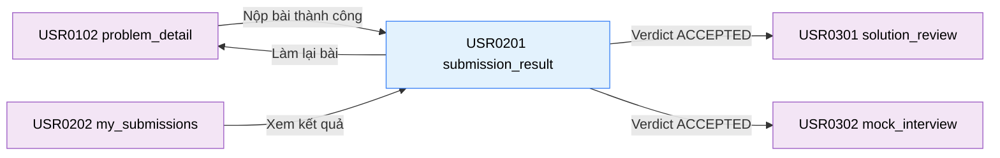

# Tài liệu thiết kế cơ bản (BD) — Kết quả nộp bài (`USR0201`)

## Phương châm tài liệu [Nội bộ — không cần khách duyệt]

- Viết theo **mẫu 9 sheet**. Bộ thẻ đóng, quy ước ID, ký hiệu chuẩn, ranh giới với tài liệu khác và
  checklist kiểm toán nằm ở `02-bd/_rules/bd-template-9sheet.md` — file này không chép lại.
- Phần gắn nhãn `[Nội bộ]` phục vụ sinh mã và tự kiểm toán, không phải yêu cầu của khách hàng: mục 4.5,
  mục 7.3 và các ghi chú quy ước.
- Mã màn `USR0201` theo bảng mã ở `02-bd/_rules/bd-template-9sheet.md` mục 8 dòng 140; tên file mang tiền
  tố mã.
- Khung điều hướng **không mô tả lại ở đây** — dùng chung `02-bd/screens/users/_shell.md`. Khu Người học
  dùng **header ngang dính trên, không có sidebar**, và chân trang dùng chung
  [Nguồn: 02-bd/screens/users/_shell.md:24,86-104]. Màn này là màn khoan sâu từ `problem_detail` hoặc
  `my_submissions`, không có mục nav trực tiếp [Nguồn: 02-bd/screens/users/_shell.md:66-67].
- Màn này **không có popup**. Mọi hành động mở rộng đều chuyển màn hoặc mở ngăn phụ (drawer).

> Đọc cùng `01-rd/screens/users/USR0201_submission_result.md` (hành vi ở mức yêu cầu, không lặp lại ở đây),
> `01-rd/req/judge-orchestration.md` (F4-01, F4-03, F4-08, F4-12, F4-13), `01-rd/req/problem-bank.md` (F2-08),
> `01-rd/req/harness.md` (F3-11, F3-12, F3-13), `01-rd/req/ai-review.md` (F5-01, F5-09),
> `02-bd/architecture/judge-orchestration.md`, `02-bd/database/judge-orchestration.md`,
> `02-bd/security/judge-orchestration.md`.
>
> - **Không gộp với `problem_detail`**: hai màn có URL riêng, vòng đời riêng và mục đích khác nhau;
>   `problem_detail` phục vụ soạn thảo và thử nghiệm, `submission_result` phục vụ kiểm tra kết quả chấm
>   chính thức và lưu trữ vĩnh viễn [Nguồn: 01-rd/screens/users/USR0201_submission_result.md:22-25].
> - **Tuyệt đối chống rò rỉ testcase ẩn**: chỉ hiển thị trạng thái (Accepted, WA, TLE...), thời gian và bộ nhớ;
>   không trả về dữ liệu `input` và `expected_output` của testcase ẩn ở bất kỳ trạng thái nào [Nguồn: F2-08].
> - **Chế độ chấm chạy đủ mọi testcase**: hệ thống chấm toàn bộ N testcase để tính điểm tỷ lệ F4-13, không dừng
>   ở testcase sai đầu tiên (fail-fast đã bãi bỏ theo `DEC-2026-0831-partial-score-testcase-ratio`).
> - **Chỉ số Beats (F4-12)**: tính theo phân phối thời gian chạy của các bài nộp `Accepted` khác cùng bài toán
>   và cùng ngôn ngữ; chỉ hiển thị khi verdict là `Accepted` **và** hệ thống có ít nhất 10 bài nộp `Accepted`
>   cùng bài, cùng ngôn ngữ; ít hơn thì in "Chưa đủ dữ liệu so sánh" thay cho số % (Q2, chốt 2026/10/18).

- **Bài đã rút khỏi ngân hàng** (`deleted = true`, G4 2026-10-08): kết quả nộp vẫn mở được; liên kết về `problem_detail` ở breadcrumb và nút "Làm lại" bị vô hiệu kèm nhãn "Đã rút khỏi ngân hàng". Quy tắc đầy đủ ở `02-bd/database/problem-bank.md` mục 1.1a, không chép lại ở đây.

> **Quy ước đặt tên khối** [Nội bộ]. Sáu khối: `breadcrumb` (đường dẫn phân cấp), `verdictBanner` (thẻ kết quả
> tổng quan kèm điểm tỷ lệ), `runStats` (thanh 6 chỉ số vận hành), `testcaseList` (danh sách kết quả từng
> testcase), `codeViewer` (vùng xem mã nguồn đã nộp kèm chỉ báo dòng lỗi biên dịch nếu có), `actionPanel`
> (khối điều hướng tiếp theo: Phân tích AI, Phỏng vấn giả lập, Nộp lại). Tiền tố ID item của toàn màn là
> `submissionResult.`.

---

## Sheet 1. Bìa

| Mục | Giá trị |
| :--- | :--- |
| Hệ thống | AlgoPrep |
| Phân hệ | `judge-orchestration` (F4) — đọc từ `problem-bank` (F2), `harness` (F3), liên kết sang `ai-review` (F5) |
| Công đoạn | BD — Thiết kế cơ bản |
| Phân loại | Màn hình |
| Tên màn | Kết quả nộp bài |
| Mã màn hình | `USR0201` |
| Tên vật lý (slug) | `submission_result` |
| Trục tài liệu | Màn hình (`02-bd/screens/`) |
| Actor | A1 (`STUDENT`); A2 (`INSTRUCTOR`) ở chế độ chỉ đọc, xem mục "Vùng giảng viên (A2)" |
| Phiên bản | V0.9 |
| Người tạo | Nhóm phát triển AlgoPrep |
| Ngày tạo | 2026/09/22 |
| Người cập nhật | Claude |
| Ngày cập nhật | 2026/10/19 |

---

## Sheet 2. Lịch sử sửa đổi

| Ver | Sheet bị sửa | Nội dung sửa | Ngày | Người sửa |
| :--- | :--- | :--- | :--- | :--- |
| V0.1 | Toàn bộ | Tạo mới theo mẫu 9 sheet. Chốt cơ chế realtime WebSocket per-testcase (`/topic/submissions/{id}`), công thức Beats F4-12, hiển thị điểm tỷ lệ F4-13, che giấu testcase ẩn F2-08, ánh xạ lỗi biên dịch F3-11/F3-12 và phân quyền truy cập kết quả bài nộp | 2026/09/22 | Nhóm phát triển AlgoPrep |
| V0.2 | Sheet 3, 5, 7.3, 6, Câu hỏi mở | Viết lại Sheet 3 theo khuôn "Danh sách chuyển màn" 6 thẻ + sơ đồ Mermaid; viết lại Sheet 5 theo khuôn 14 cột (thêm Bảng DB/Cột DB, mỗi item một dòng); bỏ cột "Phương thức & URL dự kiến" ở Sheet 7.3 (đường dẫn API thuộc `03-dd/api/`, chưa viết). Sửa nguồn `beats_percent`: không phải cột DB, là giá trị tính tại thời điểm đọc theo công thức ở `02-bd/architecture/judge-orchestration.md:224-229`. Sửa cột testcase Mẫu/Ẩn về đúng tên thật `testcases.visibility` (không phải `is_sample`), input/expected về `input_inline`/`expected_output_inline`. Bổ sung điều kiện ẩn hẳn bảng testcase khi `status = COMPILE_ERROR` (Sheet 6 Khu vực D NO 1, theo Q3 đã chốt ở RD). Phát hiện thêm: chưa có cột lưu output thực tế của testcase mẫu — thêm Câu hỏi mở Q4 | 2026/09/24 | Nhóm phát triển AlgoPrep |
| V0.2 | Sheet 6, 8 | Kết quả sao chép mã nguồn báo bằng toast thay vì đổi nhãn nút; giữ nguyên vùng không tìm thấy bài nộp và khối lỗi biên dịch. Theo `DEC-2026-1003-toast-feedback-channel`. | 2026/10/03 | AI |
| V0.3 | Sheet 4, 5, 7 | Đồng bộ `DEC-2026-1001-admin-configurable-settings` mục (7): độ khó bài tập là danh mục do ADMIN quản lý (bảng riêng `problem_levels`), không còn enum cố định. DTO `SubmissionDetailDto.difficulty` thành `levelCode`/`levelDisplayName` đọc qua `problems.level_id`; badge độ khó hiển thị `display_name` từ dữ liệu; thêm `problem.problem_levels` vào danh sách bảng và Truy cập bảng. Màn chỉ hiển thị nhãn, không lọc và không gọi `ListProblemLevels` (nhãn nằm sẵn trong phản hồi); độ khó không gắn logic nào | 2026/10/03 | AI |
| V0.4 | Sheet 3, 5, 6, Câu hỏi mở | Theo `02-bd/database/problem-bank.md` mục 1.1a: bài đã rút khỏi ngân hàng vẫn xem được kết quả nộp; breadcrumb và nút "Làm lại" về bài đó bị vô hiệu kèm nhãn "Đã rút khỏi ngân hàng". Chỉ tài liệu, chưa đổi code | 2026/10/08 | AI |
| V0.5 | Sheet 1, 4.1, mục mới "Vùng giảng viên (A2)", Câu hỏi mở (thêm Q5), Tham chiếu | Áp `DEC-2026-1014-instructor-submissions-list-rules` mục (9) và `DEC-2026-1013-instructor-avatar-menu-and-read-source`: thêm mục "Vùng giảng viên (A2) đọc bài nộp của học viên" phản chiếu RD chương 10 (REQ-13 đến REQ-16 của chương đó): chỉ đọc, không có hành động của học viên, breadcrumb về màn gọi tới, học viên và lớp trên query, 404 ngoài lớp (ngoại lệ học viên đã rời lớp, `DEC-2026-1014-keep-learning-history-on-leave`). Khác biệt item, chuyển màn, kiểm tra, endpoint chỉ ghi chỗ **khác** vùng học viên. Sheet 3 đến 9 của vùng học viên (A1) **không đổi**. Thêm Q5 (cách trang biết màn gọi tới). Prototype có sẵn (`submission-result-view.tsx`, `submission-context`), ghi hiện trạng và lệch ngay trong mục mới | 2026/10/14 | AI |
| V0.6 | Mục "Vùng giảng viên (A2)" (Chuyển màn, Truyền dữ liệu, Kiểm tra A2-1, A2-2, Hiện trạng NO 2 đến 4), Câu hỏi mở (đóng Q5) | Áp `DEC-2026-1014-instructor-submissions-list-details` (ponytail bậc 5, 4, 6): (1) đóng Q5: trang biết màn gọi tới qua query `from=submissions\|student\|class`, mặc định `submissions`, chỉ dùng cho breadcrumb và mục sidebar sáng; (2) trang kết quả vùng giảng viên **không đăng ký kênh realtime STOMP**, tải một lần (đã là đề xuất `[SoT: Suy luận]`, nay là quyết định); (3) máy chủ lấy tên học viên và lớp từ chính lượt nộp, bỏ qua `studentId`, `classId` trên URL (query chỉ gợi ý breadcrumb); (4) công thức cửa sổ thuộc lớp viết đúng thứ tự `submitted_at >= joined_at` và nêu khoảng đã rời tính là trong lớp; (5) breadcrumb về danh sách `INS0206` lùi lịch sử khi mở từ danh sách. Sheet 3 đến 9 của vùng học viên (A1) không đổi | 2026/10/14 | AI |
| V0.7 | Mục "Vùng giảng viên (A2)" (Hiện trạng bản dựng NO 2, 3, 4, thêm NO 6, 7; cột "Bản dựng" của bảng khác biệt item NO A1, A3, Ngữ cảnh 1 đến 3) | Dựng prototype trang kết quả của giảng viên (`from=`, breadcrumb, sidebar). Breadcrumb theo `from` (`submissions` lùi lịch sử bằng `router.back()`, `student` và `class` có chuỗi lớp), sidebar sáng mục màn gọi tới, gợi ý `studentId`/`classId` được kiểm với lớp, trang không đăng ký realtime. Đóng NO 2 và NO 3; NO 4 còn lệch một phần; thêm NO 6 (chủ lượt nộp không đọc được từ lượt nộp mẫu) và NO 7 (`from=class` chưa có nơi gọi). Không đổi yêu cầu hay quyết định thiết kế. **Chưa duyệt hình** | 2026/10/14 | AI |
| V0.8 | Phương châm, Sheet 3.1, 4.1 (DTO), 5 (C NO 5, D NO 10), 6 (C NO 5, D NO 10), 7.1, 7.3, 9 (thêm NO 6, 7), Vùng A2 (Truyền dữ liệu, Hiện trạng), Câu hỏi mở (đóng Q1 đến Q4) | Áp `DEC-2026-1018-usr-open-questions-phase1-scope` và `DEC-2026-1018-usr-open-questions-phase2-5` cho màn này, chủ dự án chốt theo đề xuất: (1) Q1 kênh STOMP dùng user-destination `/user/queue/submissions`, interceptor kiểm quyền sở hữu bài nộp (ponytail bậc 6); (2) Q2 Beats chỉ hiện khi hệ thống có từ 10 bài nộp `Accepted` cùng bài, cùng ngôn ngữ, ít hơn in "Chưa đủ dữ liệu so sánh" (bậc 5), hằng `BEATS_MIN_ACCEPTED`; (3) Q3 giữ kết quả từng testcase 90 ngày, sau đó chỉ còn verdict tổng (bậc 5); (4) Q4 cột `submission_testcase_results.actual_output_snippet`, chỉ ghi cho testcase `SAMPLE` (bậc 1), tài liệu cơ sở dữ liệu do bên khác sửa nên ở đây chỉ gọi tên cột. Code: thẻ Beats trong `submission-result-view.tsx` theo ngưỡng; hộp "Kết quả thực tế mẫu" đã có sẵn. Chưa duyệt hình | 2026/10/18 | Claude |
| V0.9 | Sheet 5 (Khu vực C, Khu vực D NO 11), 6 (Khu vực C, Khu vực D NO 11), 8 (mở rộng testcase), Hiện trạng bản dựng vùng học viên (NO 4, 5) | Sửa theo đợt rà soát prototype 2026/10/19 (area B), owner chốt: (1) **Khu vực C của vùng học viên bỏ dải 5 thẻ**, gộp thành **một dòng chữ trong banner** như vùng giảng viên (quy tắc owner 2026-10-13; Runtime, Memory, Beats, Cách nộp; Testcase đã nằm trong banner, thẻ Điểm trùng điểm tỷ lệ ở Khu vực B NO 3 nên không lặp); (2) **bỏ Khu vực D NO 11** (dòng thông báo testcase ẩn): nút mở rộng của testcase ẩn bị vô hiệu theo Sheet 6 NO 7 nên dòng này không bao giờ hiện, hai dòng BD mâu thuẫn nhau; không phải đổi hành vi, chỉ bỏ mã chết và khoá i18n `sample.hiddenNotice`. Nút mở rộng có `aria-expanded`. Giờ nộp in bằng `formatDateVN` (UTC+7, theo locale hiện hành). Chưa duyệt hình | 2026/10/19 | Claude |

---

## Sheet 3. Sơ đồ chuyển màn

> [Nội bộ] Quy ước vẽ: `02-bd/_rules/bd-template-9sheet.md` mục 2, 3.

### 3.1 Danh sách chuyển màn

#### Chi tiết bài tập → Kết quả nộp bài (mở ngay sau khi nộp)

[Điều kiện mở] Nộp bài thành công từ Workspace, máy chủ trả về `submission_id` (F4-01)
[Nguồn: 01-rd/screens/users/USR0201_submission_result.md:36].

[Chế độ mở] Điều hướng URL `/submissions/{submission_id}`.

[Thông tin truyền] `submission_id`.

[Giá trị trả về] Không có.

[Khi thành công] Hiển thị màn kết quả; nếu bài nộp chưa ở trạng thái cuối (`PENDING`/`COMPILING`/`JUDGING`)
thì tự động subscribe kênh WebSocket riêng của người dùng `/user/queue/submissions` (máy chủ chỉ đẩy bản tin của bài nộp thuộc chính người đó, Q1 đã chốt) để nhận cập nhật theo F4-08
[Nguồn: 01-rd/screens/users/USR0201_submission_result.md:141].

[Khi huỷ] Không có.

#### Bài đã nộp → Kết quả nộp bài (mở lại từ lịch sử)

[Điều kiện mở] Bấm nút "Kết quả" ở một dòng lịch sử nộp bài
[Nguồn: 02-bd/screens/users/USR0202_my_submissions.md — Sheet 3 dòng "Xem kết quả"].

[Chế độ mở] Điều hướng URL `/submissions/{submission_id}`.

[Thông tin truyền] `submission_id`.

[Giá trị trả về] Không có.

[Khi thành công] Hiển thị kết quả đã lưu của bài nộp; bài nộp ở lịch sử luôn đã ở trạng thái cuối nên
**không** subscribe WebSocket [Nguồn: 01-rd/screens/users/USR0201_submission_result.md:93-96].

[Khi huỷ] Không có.

#### Kết quả nộp bài → Phân tích bài giải

[Điều kiện mở] Bài nộp có verdict `ACCEPTED`, bấm nút "Phân tích bài giải"
[Nguồn: 01-rd/req/ai-review.md — F5-01].

[Chế độ mở] Điều hướng URL `/submissions/{submission_id}/review`.

[Thông tin truyền] `submission_id`.

[Giá trị trả về] Không có.

[Khi thành công] Mở màn `solution_review`.

[Khi huỷ] Không có — nút bị vô hiệu hoá khi verdict khác `ACCEPTED`, không phát sinh luồng huỷ riêng.

#### Kết quả nộp bài → Phỏng vấn giả lập

[Điều kiện mở] Bài nộp có verdict `ACCEPTED`, bấm nút "Phỏng vấn giả lập"
[Nguồn: 01-rd/req/ai-review.md — F5-09].

[Chế độ mở] Điều hướng URL `/mock-interview?submission_id={submission_id}`.

[Thông tin truyền] `submission_id`, `problem_id`.

[Giá trị trả về] Không có.

[Khi thành công] Mở màn `mock_interview` gắn với bài nộp hiện tại.

[Khi huỷ] Không có.

#### Kết quả nộp bài → Chi tiết bài tập (Làm lại bài)

[Điều kiện mở] Bấm nút "Làm lại bài" hoặc bấm tiêu đề bài toán ở breadcrumb.

[Chế độ mở] Điều hướng URL `/problems/{problem_slug}`.

[Thông tin truyền] `problem_slug` hoặc `problem_id`.

[Giá trị trả về] Không có.

[Khi thành công] Mở Workspace giải bài của đúng bài toán.

[Khi huỷ] Không có.

### 3.2 Sơ đồ

[Nguồn: 01-rd/screens/users/USR0201_submission_result.md:36,93-96,141;
01-rd/req/ai-review.md — F5-01, F5-09]

---

## Sheet 4. Bố cục màn hình

### 4.1. Tổng quan theo thẻ

- `[Mục đích màn]` Hiển thị kết quả chấm chi tiết và tiến trình chấm thời gian thực của một bài nộp, phân tích lỗi (nếu có), thống kê chạy và cung cấp các lựa chọn học tập tiếp theo.
- `[Luồng nghiệp vụ chính]` Sau khi nộp mã từ Workspace, người học vào màn này để theo dõi tiến độ từng testcase qua STOMP WebSocket. Khi hoàn tất, xem verdict tổng, điểm tỷ lệ, bảng testcase, xem lại mã đã nộp và chuyển sang phân tích AI nếu bài giải đạt `ACCEPTED`.
- `[Người dùng]` Học viên (A1 — chủ sở hữu bài nộp). Giảng viên (A2) xem **chỉ đọc** bài nộp của học viên trong lớp mình phụ trách ở vùng giảng viên (mục "Vùng giảng viên (A2) đọc bài nộp của học viên", từ V0.5). Quản trị viên (A3) xem để kiểm toán nếu có quyền: chưa có thiết kế `[SoT: Suy luận]`.
- `[Tệp liên quan]` `01-rd/screens/users/USR0201_submission_result.md`, `09-layoutBase/Kết quả nộp bài.dc.html`.
- `[Phạm vi]` Hiển thị một bài nộp đơn lẻ dựa trên `submission_id`.
- `[Quyền sử dụng]` Học viên chỉ xem được bài nộp của chính mình; cố tình mở bài nộp của học viên khác sẽ bị máy chủ từ chối lỗi `403 FORBIDDEN` hoặc `404 NOT_FOUND`. Giảng viên: quy tắc riêng, chỉ đọc, 404 ngoài lớp, ở mục "Vùng giảng viên (A2)".
- `[Số bản ghi tối đa]` Một bài nộp; danh sách testcase hiển thị tối đa toàn bộ số testcase của bài toán (thông thường từ 10 đến 50 testcase).

### 4.2. Danh sách cấu trúc dữ liệu màn hình (DTOs)

| STT | Tên DTO | Mô tả | Chi tiết trường |
| :-: | :--- | :--- | :--- |
| 1 | `SubmissionDetailDto` | Thông tin chi tiết một lượt nộp | `id`, `problemId`, `problemCode`, `problemTitle`, `levelCode`, `levelDisplayName`, `language`, `submissionMode`, `status`, `verdict`, `score`, `runtimeMs`, `memoryMb`, `beatsPercent`, `beatsSampleSize`, `passedCount`, `totalCount`, `submittedAt`, `completedAt`, `errorMessage`, `sourceCode` |
| 2 | `SubmissionTestcaseResultDto` | Kết quả chi tiết một testcase | `testcaseIndex`, `isSample`, `status`, `runtimeMs`, `memoryMb`, `input` (nullable, chỉ sample), `expectedOutput` (nullable, chỉ sample), `actualOutput` (nullable, chỉ sample) |
| 3 | `SubmissionProgressEventDto` | Sự kiện cập nhật qua WebSocket | `submissionId`, `testcaseIndex`, `status`, `runtimeMs`, `memoryMb`, `isCompleted`, `finalVerdict`, `score` |

### 4.3. Danh sách bảng dữ liệu

| STT | Tên bảng | Mô tả | Thao tác | Bounded Context |
| :-: | :--- | :--- | :--- | :--- |
| 1 | `judge.submissions` | Bản ghi bài nộp và verdict tổng | R | `judge-orchestration` |
| 2 | `judge.submission_testcase_results` | Kết quả chấm từng testcase | R | `judge-orchestration` |
| 3 | `problem.problems` | Thông tin tiêu đề, mã bài, độ khó | R | `problem-bank` |
| 4 | `problem.testcases` | Thông tin testcase mẫu để hiện input/output | R | `problem-bank` |
| 5 | `problem.problem_levels` | Nhãn độ khó của bài (`display_name`), đọc qua join `problems.level_id` [Nguồn: 02-bd/database/problem-bank.md mục `problem_levels`] | R | `problem-bank` |

### 4.4. Vùng bố cục bám prototype

Bố cục dạng luồng dọc đơn cột (Single-column layout), chia thành 6 khu vực chính:

| Ký hiệu | Tên khu vực | Tham chiếu prototype | Ghi chú |
| :-: | :--- | :--- | :--- |
| **A** | Thanh đường dẫn (Breadcrumb) | `Kết quả nộp bài.dc.html:103-108` | Đường dẫn `Bài toán / {Tên bài} / Lượt nộp #{ID}` |
| **B** | Banner kết quả tổng (Verdict Banner) | `Kết quả nộp bài.dc.html:111-122` | Badge verdict (AC/WA/TLE/CE/RE), Điểm tỷ lệ (F4-13), tóm tắt testcase |
| **C** | Thanh 6 chỉ số vận hành (Run Stats) | `Kết quả nộp bài.dc.html:123-131,314-320` | Testcase, Điểm, Runtime, Memory, Beats, Cách nộp |
| **D** | Bảng kết quả từng testcase | `Kết quả nộp bài.dc.html:134-170` | Danh sách testcase, mở rộng chi tiết mẫu, che ẩn testcase bảo mật |
| **E** | Trình xem mã nguồn đã nộp | `Kết quả nộp bài.dc.html:173-195` | Monaco Editor chỉ đọc, syntax highlight, chỉ báo lỗi biên dịch |
| **F** | Thanh hành động tiếp theo | `Kết quả nộp bài.dc.html:198-215` | Nút Phân tích bài giải, Phỏng vấn giả lập, Nộp lại bài |

### 4.5. Cấu trúc slice FSD [Nội bộ]

- Route: `/submissions/[id]`
- View slice: `src/views/users/submission-result/`
  - `ui/submission-result-page.tsx`
  - `ui/verdict-banner.tsx`
  - `ui/run-stats-grid.tsx`
  - `ui/testcase-results-table.tsx`
  - `ui/submitted-code-viewer.tsx`
  - `ui/next-actions-panel.tsx`
  - `model/use-submission-realtime.ts` (quản lý STOMP socket và fallback polling)

---

## Sheet 5. Danh sách item màn hình

> Quy ước ID, bộ thẻ và giá trị chuẩn: `02-bd/_rules/bd-template-9sheet.md` mục 2, 3, 4.

### Khu vực A — Thanh đường dẫn (Breadcrumb)

| Khu vực | NO | Tên item | ID item | Bảng DB | Cột DB | Loại UI | Kiểu | Độ dài | Bắt buộc | I/O | Giá trị mặc định | Định dạng | Ghi chú |
| :--- | --: | :--- | :--- | :--- | :--- | :--- | :--- | :--- | :-: | :-: | :--- | :--- | :--- |
| Breadcrumb | | | | | | | | | | | | | |
| | 1 | Link Bài toán | `submissionResult.breadcrumb.linkProblems` | - | - | Link | String | 50 | Có | O | "Ngân hàng bài toán" | - | Nhãn cố định dẫn về danh sách bài tập [Nguồn giá trị] Nhãn tĩnh i18n [EVT liên quan] EVT-2 |
| | 2 | Link Chi tiết bài | `submissionResult.breadcrumb.linkProblem` | `problem.problems` | `title` | Link | String | 120 | Có | O | - | - | Tên bài toán đang nộp [Nguồn giá trị] Cột `title` [Nguồn: 02-bd/database/problem-bank.md:15] [EVT liên quan] EVT-3 |
| | 3 | Nhãn Lượt nộp | `submissionResult.breadcrumb.lblCurrent` | `judge.submissions` | `id` | Label | String | 50 | Có | O | - | `Lượt nộp #{id}` | Mã định danh lượt nộp [Nguồn giá trị] Cột `id` [Nguồn: 02-bd/database/judge-orchestration.md:14] [EVT liên quan] - |

### Khu vực B — Banner kết quả tổng (Verdict Banner)

| Khu vực | NO | Tên item | ID item | Bảng DB | Cột DB | Loại UI | Kiểu | Độ dài | Bắt buộc | I/O | Giá trị mặc định | Định dạng | Ghi chú |
| :--- | --: | :--- | :--- | :--- | :--- | :--- | :--- | :--- | :-: | :-: | :--- | :--- | :--- |
| Verdict Banner | | | | | | | | | | | | | |
| | 1 | Chấm màu trạng thái | `submissionResult.verdict.statusDot` | `judge.submissions` | `status` | Label | String | 20 | Có | O | - | - | Đèn màu suy ra từ verdict (xanh lá AC, đỏ WA/RE, cam TLE, vàng CE, xanh dương đang chấm) [Công thức] Ánh xạ tĩnh `status` → màu, không lưu cột riêng [Nguồn: 02-bd/database/judge-orchestration.md:22] [EVT liên quan] - |
| | 2 | Nhãn Verdict chính | `submissionResult.verdict.lblTitle` | `judge.submissions` | `status` | Label | String | 50 | Có | O | - | Chữ hoa | Tên verdict [Nguồn giá trị] Cột `status` [Nguồn: 02-bd/database/judge-orchestration.md:22] [EVT liên quan] - |
| | 3 | Điểm số tỷ lệ | `submissionResult.verdict.lblScore` | `judge.submissions` | `passed_testcase_count`, `total_testcase_count`, `score_ratio` | Badge | String | 20 | Có | O | - | `{passed}/{total}` | Điểm đạt theo tỷ lệ testcase F4-13 [Công thức] `score_ratio = passed_testcase_count / total_testcase_count`, `NULL` khi `COMPILE_ERROR`/`SYSTEM_ERROR` — hiển thị `-` [Nguồn: 02-bd/database/judge-orchestration.md:25-27] [EVT liên quan] - |
| | 4 | Dòng mô tả phụ | `submissionResult.verdict.lblSubtitle` | `judge.submissions` | `passed_testcase_count`, `total_testcase_count`, `submitted_at` | Label | String | 150 | Có | O | - | - | Thông tin chi tiết kết quả và thời gian nộp [Công thức] Ghép số testcase đạt/tổng và `submitted_at` [Nguồn: 02-bd/database/judge-orchestration.md:25-26,31] [EVT liên quan] - |
| | 5 | Badge Độ khó bài | `submissionResult.verdict.badgeDifficulty` | `problem.problem_levels` | `display_name` | Badge | String | 20 | Có | O | - | Nhãn `display_name` | Độ khó bài toán [Nguồn giá trị] Cột `problem_levels.display_name` qua `problems.level_id`, **đọc từ dữ liệu** do ADMIN quản lý, không còn ánh xạ cứng enum; ba mức khởi tạo giữ màu badge cũ, mức mới màu trung tính `DEC-2026-1001-admin-configurable-settings` mục (7) [Nguồn: 02-bd/database/problem-bank.md mục `problem_levels`] [EVT liên quan] - |

### Khu vực C — Dòng chỉ số vận hành (Run Stats)

> Từ V0.9 các item Khu vực C không còn là thẻ: chúng là các đoạn của **một dòng chữ** dưới banner (`Runtime ... · Memory ... · Beats ... · Cách nộp`). Item NO 1 (Testcase) đã có trong banner (Khu vực B NO 3) và NO 2 (Điểm) trùng điểm tỷ lệ ở Khu vực B NO 3, nên bản dựng không lặp lại hai item này.

| Khu vực | NO | Tên item | ID item | Bảng DB | Cột DB | Loại UI | Kiểu | Độ dài | Bắt buộc | I/O | Giá trị mặc định | Định dạng | Ghi chú |
| :--- | --: | :--- | :--- | :--- | :--- | :--- | :--- | :--- | :-: | :-: | :--- | :--- | :--- |
| Run Stats | | | | | | | | | | | | | |
| | 1 | Thẻ Testcase | `submissionResult.stats.cardTestcase` | `judge.submissions` | `passed_testcase_count`, `total_testcase_count` | Label | String | 30 | Có | O | - | `{passed} / {total}` | Số testcase đạt trên tổng số testcase [Nguồn: 02-bd/database/judge-orchestration.md:25-26] [EVT liên quan] - |
| | 2 | Thẻ Điểm | `submissionResult.stats.cardScore` | `judge.submissions` | `score_ratio` | Label | String | 30 | Có | O | - | `{score} đ` | Điểm số theo F4-13 [Công thức] `ROUND(score_ratio, 2)` [Nguồn: 02-bd/database/judge-orchestration.md:27] [EVT liên quan] - |
| | 3 | Thẻ Runtime | `submissionResult.stats.cardRuntime` | `judge.submissions` | `runtime_ms` | Label | String | 30 | Có | O | `-` | `{runtime} ms` | Thời gian thực thi lớn nhất trong các testcase [Nguồn: 02-bd/database/judge-orchestration.md:28] [EVT liên quan] - |
| | 4 | Thẻ Memory | `submissionResult.stats.cardMemory` | `judge.submissions` | `memory_kb` | Label | String | 30 | Có | O | `-` | `{memory/1024} MB` | Bộ nhớ lớn nhất trong các testcase [Chuyển đổi] Cột lưu KB, hiển thị quy đổi MB [Nguồn: 02-bd/database/judge-orchestration.md:29] [EVT liên quan] - |
| | 5 | Thẻ Beats | `submissionResult.stats.cardBeats` | `judge.submissions` | `runtime_ms` (của bài nộp hiện tại và của các bài `ACCEPTED` khác cùng `problem_id`+`language`) | Label | String | 30 | Có | O | `-` | `Nhanh hơn {beats}%` | Tỷ lệ % bài nộp `ACCEPTED` khác (cùng bài, cùng ngôn ngữ) có runtime chậm hơn hoặc bằng — **không phải cột lưu sẵn**, tính tại thời điểm đọc [Công thức] `beats% = ROUND(SỐ bài Accepted khác có runtime_ms >= runtime_ms hiện tại / TỔNG bài Accepted cùng problem+language kể cả bài hiện tại * 100)` [Nguồn: 02-bd/architecture/judge-orchestration.md:224-229]. Rỗng khi verdict khác `ACCEPTED`. **Ngưỡng dữ liệu (Q2, chốt 2026/10/18):** chỉ in số % khi `beatsSampleSize` (số bài `ACCEPTED` cùng bài, cùng ngôn ngữ, kể cả bài hiện tại) >= 10; ít hơn thì in "Chưa đủ dữ liệu so sánh", máy chủ trả `beatsPercent = null` [EVT liên quan] - |
| | 6 | Thẻ Cách nộp | `submissionResult.stats.cardMode` | `judge.submissions` | `submission_model` | Label | String | 30 | Có | O | - | "Hàm (Wrapper)" / "Standard I/O" | Chế độ nộp bài F3-13 [Nguồn: 02-bd/database/judge-orchestration.md:19] [EVT liên quan] - |

### Khu vực D — Bảng kết quả từng testcase

| Khu vực | NO | Tên item | ID item | Bảng DB | Cột DB | Loại UI | Kiểu | Độ dài | Bắt buộc | I/O | Giá trị mặc định | Định dạng | Ghi chú |
| :--- | --: | :--- | :--- | :--- | :--- | :--- | :--- | :--- | :-: | :-: | :--- | :--- | :--- |
| Bảng kết quả testcase | | | | | | | | | | | | | |
| | 1 | Danh sách kết quả testcase | `submissionResult.testcase.list` | `judge.submission_testcase_results` | - | List | List | - | - | O | rỗng | - | Toàn bộ dòng kết quả của submission, sắp theo `testcase_order` [Nguồn: 02-bd/database/judge-orchestration.md:51]. **Ẩn hẳn khối này** khi `status = COMPILE_ERROR` — chưa có testcase nào chạy [Nguồn: 01-rd/screens/users/USR0201_submission_result.md:142] [EVT liên quan] EVT-1 |
| | 2 | Cột Số thứ tự | `submissionResult.testcase.col.index` | `judge.submission_testcase_results` | `testcase_order` | ListColumn | Number | 5 | - | O | - | - | Thứ tự chạy trong submission [Nguồn: 02-bd/database/judge-orchestration.md:51] [EVT liên quan] - |
| | 3 | Cột Loại testcase | `submissionResult.testcase.col.isSample` | `problem.testcases` | `visibility` | ListColumn | Badge | 20 | - | O | - | "Mẫu" / "Ẩn" | Phân biệt `SAMPLE`/`HIDDEN`, tra theo `submission_testcase_results.testcase_id` [Nguồn: 02-bd/database/problem-bank.md:89] [EVT liên quan] - |
| | 4 | Cột Trạng thái | `submissionResult.testcase.col.verdict` | `judge.submission_testcase_results` | `verdict` | ListColumn | Badge | 30 | - | O | - | - | Verdict riêng của testcase: `AC`/`WA`/`TLE`/`MLE`/`RE` [Nguồn: 02-bd/database/judge-orchestration.md:52] [EVT liên quan] - |
| | 5 | Cột Runtime | `submissionResult.testcase.col.runtime` | `judge.submission_testcase_results` | `runtime_ms` | ListColumn | String | 20 | - | O | - | `{runtime} ms` | Thời gian thực thi của riêng testcase [Nguồn: 02-bd/database/judge-orchestration.md:53] [EVT liên quan] - |
| | 6 | Cột Memory | `submissionResult.testcase.col.memory` | `judge.submission_testcase_results` | `memory_kb` | ListColumn | String | 20 | - | O | - | `{memory/1024} MB` | Bộ nhớ của riêng testcase [Chuyển đổi] Cột lưu KB, hiển thị quy đổi MB [Nguồn: 02-bd/database/judge-orchestration.md:54] [EVT liên quan] - |
| | 7 | Nút Mở rộng chi tiết | `submissionResult.testcase.btnExpand` | - | - | Button | - | 20 | - | I | - | "Chi tiết" | Chỉ kích hoạt với testcase Mẫu (`visibility = SAMPLE`) [Nguồn giá trị] Nhãn tĩnh [EVT liên quan] EVT-4 |
| | 8 | Hộp Dữ liệu đầu vào mẫu | `submissionResult.testcase.sampleInput` | `problem.testcases` | `input_inline` (hoặc `input_object_key` trên MinIO nếu `input_storage = MINIO`) | TextArea | String | 2000 | - | O | - | - | Input của testcase mẫu [Nguồn: 02-bd/database/problem-bank.md:90-92] [EVT liên quan] - |
| | 9 | Hộp Kết quả kỳ vọng mẫu | `submissionResult.testcase.sampleExpected` | `problem.testcases` | `expected_output_inline` (hoặc `expected_output_object_key` trên MinIO) | TextArea | String | 2000 | - | O | - | - | Output kỳ vọng của testcase mẫu [Nguồn: 02-bd/database/problem-bank.md:93-95] [EVT liên quan] - |
| | 10 | Hộp Kết quả thực tế mẫu | `submissionResult.testcase.sampleActual` | `judge.submission_testcase_results` | `actual_output_snippet` | TextArea | String | 2000 | - | O | - | - | Output chương trình học viên trả về cho testcase mẫu. Cột `actual_output_snippet` (cắt như `stderr_snippet`, **chỉ ghi cho testcase `SAMPLE`**) do chủ dự án chốt ở Q4 ngày 2026/10/18 (`DEC-2026-1018-usr-open-questions-phase2-5`); định nghĩa cột nằm ở `02-bd/database/judge-orchestration.md`, tài liệu đó do bên khác cập nhật, ở đây chỉ gọi tên cột. Testcase `HIDDEN` không có giá trị [EVT liên quan] - |

### Khu vực E — Trình xem mã nguồn đã nộp

| Khu vực | NO | Tên item | ID item | Bảng DB | Cột DB | Loại UI | Kiểu | Độ dài | Bắt buộc | I/O | Giá trị mặc định | Định dạng | Ghi chú |
| :--- | --: | :--- | :--- | :--- | :--- | :--- | :--- | :--- | :-: | :-: | :--- | :--- | :--- |
| Trình xem mã nguồn | | | | | | | | | | | | | |
| | 1 | Nhãn Ngôn ngữ đã nộp | `submissionResult.code.lblLanguage` | `judge.submissions` | `language` | Badge | String | 30 | Có | O | - | - | Ngôn ngữ nộp bài — một trong ba ngôn ngữ khoá cứng [Nguồn: 02-bd/database/judge-orchestration.md:18] [EVT liên quan] - |
| | 2 | Nút Sao chép mã | `submissionResult.code.btnCopy` | - | - | Button | - | 20 | Có | I | - | "Sao chép mã" | Copy mã nguồn vào clipboard [Nguồn giá trị] Nhãn tĩnh [EVT liên quan] EVT-5 |
| | 3 | Trình soạn thảo chỉ đọc | `submissionResult.code.editorViewer` | `judge.submissions` | `source_code` | TextArea | String | 50000 | Có | O | - | - | Monaco Editor chỉ đọc hiển thị mã nguồn đã nộp [Nguồn: 02-bd/database/judge-orchestration.md:20] [EVT liên quan] - |
| | 4 | Khối thông báo lỗi biên dịch | `submissionResult.code.boxCompileError` | `judge.submissions` | `compile_error_message` | TextArea | String | 10000 | - | O | - | - | Lỗi biên dịch đã ánh xạ dòng, che giấu mã harness (F3-11/F3-12); chỉ có giá trị khi `status = COMPILE_ERROR` [Nguồn: 02-bd/database/judge-orchestration.md:24] [EVT liên quan] - |

### Khu vực F — Thanh hành động tiếp theo

| Khu vực | NO | Tên item | ID item | Bảng DB | Cột DB | Loại UI | Kiểu | Độ dài | Bắt buộc | I/O | Giá trị mặc định | Định dạng | Ghi chú |
| :--- | --: | :--- | :--- | :--- | :--- | :--- | :--- | :--- | :-: | :-: | :--- | :--- | :--- |
| Thanh hành động | | | | | | | | | | | | | |
| | 1 | Nút Phân tích bài giải | `submissionResult.action.btnSolutionReview` | - | - | Button | String | 50 | Có | I | - | "Phân tích bài giải (AI)" | Mở phân tích AI F5-01, chỉ bật khi `status = ACCEPTED` [Nguồn giá trị] Nhãn tĩnh [EVT liên quan] EVT-6 |
| | 2 | Nút Phỏng vấn giả lập | `submissionResult.action.btnMockInterview` | - | - | Button | String | 50 | Có | I | - | "Phỏng vấn giả lập (AI)" | Mở phỏng vấn 1:1 F5-09, chỉ bật khi `status = ACCEPTED` [Nguồn giá trị] Nhãn tĩnh [EVT liên quan] EVT-7 |
| | 3 | Nút Làm lại bài | `submissionResult.action.btnRetry` | - | - | Button | String | 50 | Có | I | - | "Quay lại Workspace" | Trở lại Workspace của bài toán hiện tại [Nguồn giá trị] Nhãn tĩnh [EVT liên quan] EVT-8 |

[Nguồn: 02-bd/database/judge-orchestration.md:14,18-31,46-57;
02-bd/database/problem-bank.md:15,17,89-95;
02-bd/architecture/judge-orchestration.md:216-233;
01-rd/screens/users/USR0201_submission_result.md:36,93-96,141-142]

---

## Sheet 6. Đặc tả điều khiển item

### Khu vực A: Thanh đường dẫn (Breadcrumb)

| NO | Tên item | Hiển thị | Kích hoạt | Ghi chú |
| --: | :--- | :--- | :--- | :--- |
| 1 | Link Bài toán | Có | Có | [Điều kiện hiển thị] Luôn hiển thị. [Điều kiện kích hoạt] Luôn kích hoạt. [Tự động đặt] - |
| 2 | Link Chi tiết bài | Có | Có | [Điều kiện hiển thị] Luôn hiển thị. [Điều kiện kích hoạt] Luôn kích hoạt. [Tự động đặt] - |
| 3 | Nhãn Lượt nộp | Có | Không | [Điều kiện hiển thị] Luôn hiển thị. [Điều kiện kích hoạt] Là text hiển thị, không kích hoạt. [Tự động đặt] - |

### Khu vực B: Banner kết quả tổng

| NO | Tên item | Hiển thị | Kích hoạt | Ghi chú |
| --: | :--- | :--- | :--- | :--- |
| 1 | Chấm màu trạng thái | Có | Không | [Điều kiện hiển thị] Luôn hiển thị. [Điều kiện kích hoạt] Không áp dụng. [Tự động đặt] Tự đổi class màu tương ứng với trạng thái kết quả. |
| 2 | Nhãn Verdict chính | Có | Không | [Điều kiện hiển thị] Luôn hiển thị. [Điều kiện kích hoạt] Không áp dụng. [Tự động đặt] Hiển thị "Đang chấm..." khi status đang chạy, hiển thị tên Verdict khi xong. |
| 3 | Điểm số tỷ lệ | Có | Không | [Điều kiện hiển thị] Luôn hiển thị cho mọi verdict sau khi chấm xong (F4-13). [Điều kiện kích hoạt] Không áp dụng. [Tự động đặt] Tính toán từ tỷ lệ số testcase đạt. |
| 4 | Dòng mô tả phụ | Có | Không | [Điều kiện hiển thị] Luôn hiển thị. [Điều kiện kích hoạt] Không áp dụng. [Tự động đặt] Cập nhật số testcase đạt/tổng và mốc thời gian nộp. |
| 5 | Badge Độ khó bài | Có | Không | [Điều kiện hiển thị] Luôn hiển thị. [Điều kiện kích hoạt] Không áp dụng. [Tự động đặt] - |

### Khu vực C: Dòng chỉ số vận hành

> Từ V0.9 các item Khu vực C không còn là thẻ: chúng là các đoạn của **một dòng chữ** dưới banner (`Runtime ... · Memory ... · Beats ... · Cách nộp`). Item NO 1 (Testcase) đã có trong banner (Khu vực B NO 3) và NO 2 (Điểm) trùng điểm tỷ lệ ở Khu vực B NO 3, nên bản dựng không lặp lại hai item này.

| NO | Tên item | Hiển thị | Kích hoạt | Ghi chú |
| --: | :--- | :--- | :--- | :--- |
| 1 | Thẻ Testcase | Có | Không | [Điều kiện hiển thị] Luôn hiển thị. [Điều kiện kích hoạt] Không áp dụng. [Tự động đặt] - |
| 2 | Thẻ Điểm | Có | Không | [Điều kiện hiển thị] Luôn hiển thị. [Điều kiện kích hoạt] Không áp dụng. [Tự động đặt] - |
| 3 | Thẻ Runtime | Có | Không | [Điều kiện hiển thị] Luôn hiển thị. [Điều kiện kích hoạt] Không áp dụng. [Tự động đặt] Hiển thị `-` nếu bài nộp bị lỗi biên dịch hoặc đang chấm. |
| 4 | Thẻ Memory | Có | Không | [Điều kiện hiển thị] Luôn hiển thị. [Điều kiện kích hoạt] Không áp dụng. [Tự động đặt] Hiển thị `-` nếu bài nộp bị lỗi biên dịch hoặc đang chấm. |
| 5 | Thẻ Beats | Có | Không | [Điều kiện hiển thị] Luôn hiển thị. [Điều kiện kích hoạt] Không áp dụng. [Tự động đặt] Chỉ có giá trị khi verdict = `ACCEPTED`; các verdict khác hiển thị `-`. Verdict `ACCEPTED` nhưng dưới 10 bài `Accepted` cùng bài, cùng ngôn ngữ thì hiển thị "Chưa đủ dữ liệu so sánh" (Q2). |
| 6 | Thẻ Cách nộp | Có | Không | [Điều kiện hiển thị] Luôn hiển thị. [Điều kiện kích hoạt] Không áp dụng. [Tự động đặt] "Hàm (Wrapper)" hoặc "Standard I/O". |

### Khu vực D: Bảng kết quả từng testcase

| NO | Tên item | Hiển thị | Kích hoạt | Ghi chú |
| --: | :--- | :--- | :--- | :--- |
| 1 | Danh sách kết quả testcase | Điều kiện | Không | [Điều kiện hiển thị] **Ẩn toàn bộ khối này** khi `status = COMPILE_ERROR` — chưa có testcase nào chạy, thay bằng khối thông báo lỗi biên dịch ở Khu vực E NO 4 (Q3 đã chốt) [Nguồn: 01-rd/screens/users/USR0201_submission_result.md:142]. Các trạng thái còn lại hiển thị bình thường, kể cả khi đang `JUDGING` (bảng lấp dần theo realtime). [Điều kiện kích hoạt] Không áp dụng. [Tự động đặt] - |
| 2 | Cột Số thứ tự | Có | Không | [Điều kiện hiển thị] Luôn hiển thị. [Điều kiện kích hoạt] Không áp dụng. [Tự động đặt] - |
| 3 | Cột Loại testcase | Có | Không | [Điều kiện hiển thị] Luôn hiển thị. [Điều kiện kích hoạt] Không áp dụng. [Tự động đặt] - |
| 4 | Cột Trạng thái | Có | Không | [Điều kiện hiển thị] Luôn hiển thị. [Điều kiện kích hoạt] Không áp dụng. [Tự động đặt] Cập nhật realtime khi từng testcase chấm xong. |
| 5 | Cột Runtime | Có | Không | [Điều kiện hiển thị] Luôn hiển thị. [Điều kiện kích hoạt] Không áp dụng. [Tự động đặt] - |
| 6 | Cột Memory | Có | Không | [Điều kiện hiển thị] Luôn hiển thị. [Điều kiện kích hoạt] Không áp dụng. [Tự động đặt] - |
| 7 | Nút Mở rộng chi tiết | Có | Điều kiện | [Điều kiện hiển thị] Luôn hiển thị. [Điều kiện kích hoạt] Chỉ kích hoạt khi dòng là testcase Mẫu (`visibility = SAMPLE`). Hàng testcase Ẩn (`HIDDEN`) bấm vào không mở dữ liệu vào/ra. [Tự động đặt] - |
| 8 | Hộp Dữ liệu đầu vào mẫu | Điều kiện | Không | [Điều kiện hiển thị] Chỉ hiển thị khi hàng testcase mẫu được mở rộng. [Điều kiện kích hoạt] Không áp dụng. [Tự động đặt] - |
| 9 | Hộp Kết quả kỳ vọng mẫu | Điều kiện | Không | [Điều kiện hiển thị] Chỉ hiển thị khi hàng testcase mẫu được mở rộng. [Điều kiện kích hoạt] Không áp dụng. [Tự động đặt] - |
| 10 | Hộp Kết quả thực tế mẫu | Điều kiện | Không | [Điều kiện hiển thị] Chỉ hiển thị khi hàng testcase mẫu được mở rộng, **và** khi `actual_output_snippet` có giá trị (chỉ testcase `SAMPLE`, Q4 đã chốt); không có giá trị thì hộp in `-`. [Điều kiện kích hoạt] Không áp dụng. [Tự động đặt] - |

### Khu vực E: Trình xem mã nguồn đã nộp

| NO | Tên item | Hiển thị | Kích hoạt | Ghi chú |
| --: | :--- | :--- | :--- | :--- |
| 1 | Nhãn Ngôn ngữ đã nộp | Có | Không | [Điều kiện hiển thị] Luôn hiển thị. [Điều kiện kích hoạt] Không áp dụng. [Tự động đặt] - |
| 2 | Nút Sao chép mã | Có | Có | [Điều kiện hiển thị] Luôn hiển thị. [Điều kiện kích hoạt] Luôn kích hoạt. [Tự động đặt] Nhãn nút giữ nguyên "Sao chép mã"; kết quả sao chép báo bằng toast (xem EVT-5). |
| 3 | Trình soạn thảo chỉ đọc | Có | Không | [Điều kiện hiển thị] Luôn hiển thị ở chế độ `readOnly: true`. [Điều kiện kích hoạt] Cho phép cuộn, chọn text; không cho phép gõ phím sửa mã. [Tự động đặt] Highlight dòng lỗi nếu có thông tin lỗi biên dịch. |
| 4 | Khối thông báo lỗi biên dịch | Điều kiện | Không | [Điều kiện hiển thị] Chỉ hiển thị khi verdict là `COMPILE_ERROR`. [Điều kiện kích hoạt] Cho phép cuộn đọc log lỗi. [Tự động đặt] - |

### Khu vực F: Thanh hành động tiếp theo

| NO | Tên item | Hiển thị | Kích hoạt | Ghi chú |
| --: | :--- | :--- | :--- | :--- |
| 1 | Nút Phân tích bài giải | Có | Điều kiện | [Điều kiện hiển thị] Luôn hiển thị. [Điều kiện kích hoạt] Chỉ kích hoạt khi verdict là `ACCEPTED`. Nếu bài chưa đạt, nút bị mờ kèm tooltip giải thích. [Tự động đặt] - |
| 2 | Nút Phỏng vấn giả lập | Có | Điều kiện | [Điều kiện hiển thị] Luôn hiển thị. [Điều kiện kích hoạt] Chỉ kích hoạt khi verdict là `ACCEPTED`. Nếu bài chưa đạt, nút bị mờ kèm tooltip giải thích. [Tự động đặt] - |
| 3 | Nút Làm lại bài | Có | Có | [Điều kiện hiển thị] Luôn hiển thị. [Điều kiện kích hoạt] Luôn kích hoạt để quay lại Workspace tiếp tục cải thiện code. [Tự động đặt] - |

---

## Sheet 7. Danh sách truyền dữ liệu

### 7.1. Danh sách trường truyền dữ liệu

| STT | Trường giao diện | Kiểu | Trường DTO | Hướng | Ghi chú |
| :-: | :--- | :--- | :--- | :-: | :--- |
| 1 | `submissionResult.verdict.lblTitle` | String | `SubmissionDetailDto.verdict` | O | Chuyển đổi sang nhãn i18n hoa |
| 2 | `submissionResult.verdict.lblScore` | String | `SubmissionDetailDto.score` | O | Hiển thị dạng điểm số tỷ lệ F4-13 |
| 3 | `submissionResult.stats.cardRuntime` | Number | `SubmissionDetailDto.runtimeMs` | O | Định dạng `{runtimeMs} ms` |
| 4 | `submissionResult.stats.cardMemory` | Number | `SubmissionDetailDto.memoryMb` | O | Định dạng `{memoryMb} MB` |
| 5 | `submissionResult.stats.cardBeats` | Number | `SubmissionDetailDto.beatsPercent`, `SubmissionDetailDto.beatsSampleSize` | O | Định dạng `Nhanh hơn {beatsPercent}%`; `beatsSampleSize` < 10 hoặc `beatsPercent` null thì "Chưa đủ dữ liệu so sánh" |
| 6 | `submissionResult.code.editorViewer` | String | `SubmissionDetailDto.sourceCode` | O | Đổ vào Monaco Editor |
| 7 | `submissionResult.code.boxCompileError` | String | `SubmissionDetailDto.errorMessage` | O | Đổ vào khối log lỗi biên dịch |
| 8 | `submissionResult.testcase.col.verdict` | String | `SubmissionTestcaseResultDto.status` | O | Nhận qua REST hoặc kênh STOMP |

### 7.2. Truy cập bảng dữ liệu

| STT | Tên bảng | C | R | U | D | Điều kiện lọc |
| :-: | :--- | :-: | :-: | :-: | :-: | :--- |
| 1 | `judge.submissions` | - | Có | - | - | `id = :submissionId AND user_id = :currentUserId` |
| 2 | `judge.submission_testcase_results` | - | Có | - | - | `submission_id = :submissionId ORDER BY testcase_index ASC` |
| 3 | `problem.problems` | - | Có | - | - | `id = :problemId` |
| 4 | `problem.testcases` | - | Có | - | - | `problem_id = :problemId AND is_sample = true ORDER BY order_index ASC` |
| 5 | `problem.problem_levels` | - | Có | - | - | Qua join `problems.level_id` để lấy `display_name`; màn không ghi, ADMIN quản lý độ khó ở `SHR0201` |

### 7.3. Danh sách endpoint [Nội bộ]

> Chỉ tên nghiệp vụ và BC sở hữu. Hợp đồng chi tiết (đường dẫn, request, response, mã lỗi) thuộc
> `03-dd/api/<module>.md`, chưa viết.

| NO | Endpoint (tên nghiệp vụ) | Mục đích | BC sở hữu |
| --: | :--- | :--- | :--- |
| 1 | `GetSubmissionDetail` | Lấy chi tiết toàn bộ bài nộp và danh sách kết quả testcase | `judge-orchestration` |
| 2 | `SubscribeSubmissionRealtime` | Kênh realtime (STOMP) đẩy kết quả từng testcase và verdict cuối cùng, theo F4-08. Đích `/user/queue/submissions`; interceptor kiểm quyền sở hữu bài nộp trước khi đẩy (Q1) | `judge-orchestration` |
| 3 | `GetProblemSampleTestcases` | Lấy dữ liệu testcase Mẫu để hiển thị đối chiếu trong bảng kết quả | `problem-bank` |

---

## Sheet 8. Danh sách sự kiện

| NO | Loại | Sự kiện | Chi tiết | Chuyển màn | Gọi API | Tên xử lý | Ghi chú |
| --: | :--- | :--- | :--- | :-: | :-: | :--- | :--- |
| 1 | Khởi tạo | Mở màn hình | Tải thông tin ban đầu của bài nộp dựa trên `submission_id` từ URL. | Không | Có | `GetSubmissionDetail` | [Các bước] 1. Đọc `submission_id` từ URL. 2. Gọi `GetSubmissionDetail`. 3. Nếu trạng thái là `PENDING` hoặc `JUDGING`, kích hoạt kết nối STOMP. [Khi thành công] Hiển thị các khối dữ liệu. [Khi lỗi] Báo lỗi không tìm thấy bài nộp hoặc không có quyền truy cập. |
| 2 | Điều hướng | Bấm link Ngân hàng bài | Người dùng bấm link quay về danh sách bài tập. | Có | Không | - | [Các bước] 1. Điều hướng sang `problem_list` (`USR0101`). |
| 3 | Điều hướng | Bấm link Tiêu đề bài | Người dùng bấm vào tiêu đề bài toán. | Có | Không | - | [Các bước] 1. Điều hướng sang `problem_detail` (`USR0102`) của bài toán tương ứng. |
| 4 | Giao diện | Mở rộng chi tiết testcase | Bấm mở rộng hàng kết quả testcase. | Không | Không | - | [Các bước] 1. Nếu là testcase mẫu: toggle mở rộng hiển thị Input, Expected, Actual. 2. Nếu là testcase ẩn: nút bị vô hiệu, không mở rộng (Khu vực D NO 7); không có dòng thông báo (bỏ NO 11 ở V0.9). |
| 5 | Giao diện | Sao chép mã nguồn | Bấm nút Sao chép mã. | Không | Không | - | [Các bước] 1. Gọi Clipboard API sao chép toàn bộ `sourceCode`. [Khi thành công] Hiện toast thành công "Đã sao chép mã nguồn." [Khi lỗi] Trình duyệt không hỗ trợ Clipboard API hoặc ghi vào clipboard bị từ chối thì hiện toast lỗi "Không sao chép được mã nguồn." [Nguồn: 05-coding/frontend/src/views/users/submission-result/ui/submission-result-view.tsx:109-119]. |
| 6 | Điều hướng | Bấm Phân tích bài giải | Bấm nút Phân tích bài giải AI. | Có | Không | - | [Các bước] 1. Kiểm tra verdict = `ACCEPTED`. 2. Điều hướng sang `solution_review` (`USR0301`) kèm `submission_id`. |
| 7 | Điều hướng | Bấm Phỏng vấn giả lập | Bấm nút Phỏng vấn giả lập AI. | Có | Không | - | [Các bước] 1. Kiểm tra verdict = `ACCEPTED`. 2. Điều hướng sang `mock_interview` (`USR0302`) kèm `submission_id`. |
| 8 | Điều hướng | Bấm Làm lại bài | Bấm nút Làm lại bài. | Có | Không | - | [Các bước] 1. Điều hướng về `problem_detail` (`USR0102`) của bài toán tương ứng để mở lại Workspace. |
| 9 | Realtime | Nhận event testcase xong | Nhận bản tin STOMP cập nhật tiến độ từ máy chủ. | Không | Không | - | [Các bước] 1. Cập nhật trạng thái dòng testcase tương ứng trong bảng. 2. Tăng số đếm testcase hoàn thành. 3. Nếu `isCompleted = true`, cập nhật verdict tổng và đóng kết nối WebSocket. |

---

## Sheet 9. Đặc tả kiểm tra

| NO | Loại | Tóm tắt kiểm | Chi tiết | Mức | Mã thông báo | Ghi chú | EVT gọi | Thứ tự |
| --: | :--- | :--- | :--- | :--- | :--- | :--- | :--- | :-: |
| 1 | Kiểm quyền | Phải đăng nhập | [Nội dung kiểm] Người dùng chưa đăng nhập thì chuyển hướng về `auth`. [Nơi thực thi] Giao diện và API gateway. [Tiêu điểm] Toàn màn. | Lỗi | Chưa có mã thông báo | Nội dung "Vui lòng đăng nhập để xem kết quả nộp bài." | EVT-1 | 1 |
| 2 | Kiểm quyền | Quyền sở hữu bài nộp | [Nội dung kiểm] Học viên chỉ được xem bài nộp của chính mình. Nếu `user_id` không khớp, trả về lỗi 403 hoặc 404. [Nơi thực thi] Máy chủ tầng dịch vụ. [Tiêu điểm] Toàn màn. | Lỗi | Mã lỗi trong phản hồi | Tránh lỗ hổng IDOR làm lộ mã nguồn của học viên khác. | EVT-1 | 2 |
| 3 | Kiểm nghiệp vụ | Bảo mật testcase ẩn | [Nội dung kiểm] Kiểm tra phản hồi API không bao giờ chứa input/output của testcase ẩn (F2-08). [Nơi thực thi] Máy chủ tầng truy vấn. [Tiêu điểm] Bảng testcase. | Lỗi | Không có thông báo | Ràng buộc bảo mật bắt buộc của phân hệ `problem-bank`. | EVT-1, EVT-4 | 1 |
| 4 | Kiểm nghiệp vụ | Khóa nút AI khi chưa Accepted | [Nội dung kiểm] Nút "Phân tích bài giải" và "Phỏng vấn giả lập" bị vô hiệu hóa khi verdict khác `ACCEPTED`. [Nơi thực thi] Màn hình. [Tiêu điểm] Khối hành động. | Cảnh báo | Chưa có mã thông báo | Tooltip "Tính năng chỉ mở khi bài nộp đạt Accepted." | EVT-6, EVT-7 | 1 |
| 5 | Kiểm nghiệp vụ | Xử lý đứt kết nối WebSocket | [Nội dung kiểm] Nếu kênh STOMP mất kết nối trong khi bài nộp đang `JUDGING`, chuyển sang cơ chế Polling REST mỗi 3 giây tối đa 10 lần. [Nơi thực thi] Màn hình. [Tiêu điểm] Trạng thái chấm. | Cảnh báo | Không có thông báo | Đảm bảo học viên không bị treo giao diện khi kết nối realtime chập chờn. | EVT-9 | 1 |
| 6 | Kiểm nghiệp vụ | Beats thiếu dữ liệu so sánh | [Nội dung kiểm] Verdict `ACCEPTED` nhưng hệ thống có dưới 10 bài nộp `Accepted` cùng bài, cùng ngôn ngữ thì thẻ Beats in "Chưa đủ dữ liệu so sánh", không in số %. [Nơi thực thi] Máy chủ (trả `beatsPercent = null`) và màn hình (hằng `BEATS_MIN_ACCEPTED`). [Tiêu điểm] Thẻ Beats. | Cảnh báo | Chưa có mã thông báo | Tránh % nhảy giật hoặc 100% gây hiểu lầm khi bài mới xuất bản (Q2). Ponytail bậc 5 | EVT-1 | 2 |
| 7 | Kiểm quyền | Kênh realtime chỉ của chủ bài nộp | [Nội dung kiểm] Kênh `/user/queue/submissions` chỉ nhận bản tin của bài nộp thuộc người dùng đang kết nối; interceptor kiểm quyền sở hữu khi đăng ký và khi đẩy bản tin, không cho nghe `submission_id` của người khác. [Nơi thực thi] Máy chủ, interceptor WebSocket. [Tiêu điểm] Kênh realtime. | Lỗi | Không có thông báo | Q1 đã chốt, ponytail bậc 6 (bảo mật). Prototype chưa có STOMP thật | EVT-9 | 2 |

---

## Vùng giảng viên (A2) đọc bài nộp của học viên

> Mục thêm ở V0.5 (2026/10/14), đặt sau Sheet 9 và trước Câu hỏi mở để **không đánh số lại** các sheet cũ. Sheet 1 đến 9 phía trên mô tả vùng học viên (A1) và giữ nguyên. Mục này mô tả **cùng một trang kết quả** ở vùng giảng viên và chỉ ghi chỗ **khác** vùng học viên; không tạo tài liệu trùng
> (`DEC-2026-1014-instructor-submissions-list-rules` mục (9) [Nguồn: .nexa/control/decision-registry.md:3908-3910]).
> Phản chiếu RD `01-rd/screens/users/USR0201_submission_result.md` chương 10 (REQ-13 đến REQ-16 của chương đó) [Nguồn: 01-rd/screens/users/USR0201_submission_result.md:210-235].
> Nguồn quyền đọc: A2 đọc được bài nộp (kể cả mã nguồn) của học viên trong lớp mình phụ trách, chỉ đọc, ngoài lớp 404
> (`DEC-2026-1013-instructor-avatar-menu-and-read-source` [Nguồn: .nexa/control/decision-registry.md:3412-3415]).
> Điểm vào: `INS0206` (danh sách bài nộp), `INS0204` (lịch sử nộp của một học viên). RD còn nhắc `INS0205` [Nguồn: 01-rd/screens/users/USR0201_submission_result.md:217] nhưng BD `INS0205` không có đường mở lượt nộp nào, nên đường đó chưa được thiết kế.

### Phạm vi và quyền (theo thẻ của Sheet 4.1, chỉ chỗ khác)

- `[Mục đích màn]` Cho giảng viên đọc kết quả chấm và mã nguồn của một lượt nộp của học viên trong lớp mình, để hỗ trợ và đánh giá. Không có thao tác nào của học viên.
- `[Luồng nghiệp vụ chính]` Từ danh sách `INS0206` hoặc lịch sử `INS0204` mở lượt nộp, xem thẻ ngữ cảnh (ai nộp, lớp nào), verdict, mã nguồn, bảng testcase; quay về màn gọi tới bằng breadcrumb.
- `[Người dùng]` Giảng viên (A2) có Function `CLASS_MANAGEMENT`, thuộc nhóm giảng viên phụ trách lớp chứa lượt nộp.
- `[Phạm vi]` Một lượt nộp. Route `/instructor/submissions/{submissionId}?studentId=&classId=` [Nguồn: 05-coding/frontend/src/app/(instructor)/instructor/submissions/[submissionId]/page.tsx:10-21]. Dùng lại cùng nội dung các khu vực B, D, E của vùng học viên; **không** có khu vực F; khu vực C đổi hình thức; thêm thẻ ngữ cảnh (bảng "Khác biệt item" bên dưới).
- `[Quyền sử dụng]` Xem: được khi lượt nộp thuộc phạm vi lớp phụ trách (Sheet "Kiểm tra" bên dưới). Thêm, sửa, xoá: không có. **Quy tắc bảo vệ testcase ẩn (F2-08) áp nguyên vẹn**: vùng này không mở thêm dữ liệu testcase nào [Nguồn: 01-rd/screens/users/USR0201_submission_result.md:231-232, `[SoT: Suy luận]` ở RD].

### Chuyển màn (6 thẻ, chỉ đường của vùng giảng viên)

#### Màn của giảng viên → Kết quả nộp bài (vùng giảng viên)

[Điều kiện mở] Bấm icon "Xem bài nộp" ở một dòng của `INS0206` (EVT-7 của màn đó), hoặc bấm "Xem kết quả" ở một dòng bảng "Lịch sử nộp bài" của `INS0204` [Nguồn: 02-bd/screens/teacher/INS0204_class_student_detail.md — Sheet 8 EVT-9]. Không có điều kiện theo trạng thái verdict.

[Chế độ mở] Điều hướng URL `/instructor/submissions/{submission_id}?studentId=&classId=&from=`, chỉ đọc.

[Thông tin truyền] `submission_id` (đường dẫn); `studentId` và `classId` (query, **chỉ là gợi ý** dựng breadcrumb và liên kết); `from` (query) với giá trị `submissions`, `student` hoặc `class`: `INS0206` mở với `from=submissions`, `INS0204` với `from=student`, `INS0205` với `from=class` (hiện `INS0205` chưa có liên kết tới lượt nộp, xem BD `INS0205` Sheet 3). Vắng `from` hoặc giá trị lạ thì coi là `submissions`. **ĐÃ CHỐT 2026-10-14 (DEC-2026-1014-instructor-submissions-list-details):** `from` là hằng số tuỳ chọn, **chỉ dùng cho breadcrumb và mục sidebar sáng**, không cấp quyền và không đổi dữ liệu trả về. Máy chủ lấy tên học viên và lớp từ chính lượt nộp, bỏ qua `studentId`, `classId` trên URL (xem "Kiểm tra" A2-2) [Nguồn: .nexa/control/decision-registry.md:3989-3993].

[Giá trị trả về] Không có.

[Khi thành công] Hiển thị kết quả đã lưu, chỉ đọc, **tải một lần** (không đăng ký kênh realtime, xem "Truyền dữ liệu và endpoint"). Sidebar giữ sáng mục của màn gọi tới theo `from` (`from=submissions` thì "Bài nộp"; `from=student` thì mục đang sáng ở `INS0204`; `from=class` thì "Lớp của tôi"), không có mục riêng cho trang này (REQ-16 của RD chương 10, `_shell.md` mục 3.2). Ngoài phạm vi lớp: trang "không tìm thấy" (xem "Kiểm tra" bên dưới).

[Khi huỷ] Không có.

#### Kết quả nộp bài (vùng giảng viên) → màn gọi tới (breadcrumb)

[Điều kiện mở] Bấm mục đầu của breadcrumb. Đích là màn đã gọi tới theo `from`: `submissions` về `INS0206`, `student` về `INS0204`, `class` về `INS0205`; vắng `from` thì về danh sách bài nộp (`INS0206`) **ĐÃ CHỐT 2026-10-14 (DEC-2026-1014-instructor-submissions-list-details):**.

[Chế độ mở] Khi trang được mở từ màn gọi tới (có lịch sử trình duyệt của màn đó) thì mục breadcrumb **lùi lịch sử** (`router.back()`), nên khôi phục bộ lọc, từ khoá, trang của màn gọi tới (với `INS0206`: `?classId=&result=&q=&page=`). Mở thẳng URL, hoặc tải lại trang làm mất lịch sử, thì breadcrumb điều hướng tới đường dẫn gốc của màn đích theo `from`, không kèm bộ lọc [Nguồn: .nexa/control/decision-registry.md:3989-3993].

[Thông tin truyền] Không có.

[Giá trị trả về] Không có.

[Khi thành công] Về đúng màn gọi tới.

[Khi huỷ] Không có.

### Khác biệt item so với vùng học viên

Bảng liệt kê mọi khu vực của Sheet 5, ghi chỗ khác ở vùng giảng viên; khu vực không có trong bảng là **không đổi**. Ba cột cuối là bằng chứng bản dựng.

| Khu vực | NO | Tên item | Khác ở vùng giảng viên | Bản dựng |
| :--- | --: | :--- | :--- | :--- |
| A — Breadcrumb | 1 | Link Bài toán | **Thay** bằng mục dẫn về màn gọi tới (REQ-16). Không dẫn về `problem_list` của học viên | `submission-result-view.tsx:129-141`; `instructor-submission-context.tsx:59-142` (cập nhật 2026/10/14) |
| A — Breadcrumb | 2 | Link Chi tiết bài | **Không là liên kết**: giảng viên không vào Workspace giải bài (REQ-13). Tên bài chỉ hiện dạng chữ, ở thẻ ngữ cảnh | `instructor-submission-context.tsx:211-214,227` (cập nhật 2026/10/14) |
| A — Breadcrumb | 3 | Nhãn Lượt nộp | Giữ, `Lượt nộp #{id}` | `instructor-submission-context.tsx:79,139` (cập nhật 2026/10/14) |
| Ngữ cảnh (mới, vùng giảng viên) | 1 | Thẻ ngữ cảnh "Bài nộp của học viên" | **Item mới** ID `submissionResult.instructor.context`. Nguồn: học viên đã nộp và lớp (REQ-14). Nhãn tĩnh `instructorSubmission.contextLabel` | `instructor-submission-context.tsx:178-235` (cập nhật 2026/10/14) |
| Ngữ cảnh (mới) | 2 | Tên học viên | **Mới**, ID `submissionResult.instructor.context.studentName`, Link. Dẫn `INS0204` của lớp đó; học viên đã rời lớp thì chữ thường, kèm ghi chú "Đã rời lớp" (cùng REQ-17 của `INS0206`). Nguồn tên: phản hồi máy chủ của lượt nộp (`studentName`, `leftClass`) | `instructor-submission-context.tsx:204-210`, tra tên theo query ở `:46-57` (cập nhật 2026/10/14) |
| Ngữ cảnh (mới) | 3 | Tên lớp | **Mới**, ID `submissionResult.instructor.context.className`, Link dẫn `INS0205` (`/instructor/classes/{classId}`). Nguồn: phản hồi máy chủ (`className`) | `instructor-submission-context.tsx:216-223` (cập nhật 2026/10/14) |
| Ngữ cảnh (mới) | 4 | Huy hiệu và ghi chú Chỉ đọc | **Mới**, ID `submissionResult.instructor.context.badgeReadOnly`. Nhãn tĩnh `instructorSubmission.readOnlyBadge`, `readOnlyNote` | `instructor-submission-context.tsx:229-232` (cập nhật 2026/10/14); `messages/vi.json:2397-2398` (chưa đọc lại) |
| B — Verdict Banner | 1 đến 5 | Banner | **Không đổi**: chấm màu, nhãn verdict, điểm tỉ lệ, dòng phụ, badge độ khó | `submission-result-view.tsx:172-195` |
| C — Run Stats | 1 đến 6 | Thanh 6 chỉ số | **Thay hình thức**: không dải thẻ số liệu (quy tắc chủ dự án 2026-10-13); runtime, memory, cách nộp thành **một dòng chữ** trong banner. Thẻ Beats và thẻ Điểm riêng không hiển thị ở vùng này `[SoT: Suy luận]` | `submission-result-view.tsx:196-214`; `instructor-submission-readonly.spec.ts:45-46` |
| D — Bảng testcase | 1 đến 10 | Bảng testcase | **Không đổi nội dung** (ẩn khi `COMPILE_ERROR`, che testcase ẩn, mở rộng testcase mẫu). Chỉ **thứ tự dọc** đổi: mã nguồn đứng trước bảng testcase | `submission-result-view.tsx:241-249,301-307` |
| E — Mã nguồn | 1 đến 4 | Trình xem mã | **Không đổi**, gồm nút "Sao chép mã" và khối lỗi biên dịch; chỉ đọc. Đứng ngay sau banner | `submission-result-view.tsx:301-325` |
| F — Hành động tiếp theo | 1 đến 3 | Phân tích bài giải, Phỏng vấn giả lập, Làm lại bài | **Không dựng** (REQ-13): giảng viên không gọi AI, không "Sửa lại và nộp tiếp" | `submission-result-view.tsx:327-328` |

Trạng thái trang: đang tải, không tìm thấy dùng nhãn `submissionResult.notFound` ("Không tìm thấy bài nộp.") [Nguồn: 05-coding/frontend/e2e/instructor-submission-readonly.spec.ts:6-11; submission-result-view.tsx:94-104].

### Truyền dữ liệu và endpoint (chỉ chỗ khác)

- **Endpoint:** vẫn `GetSubmissionDetail` (mục 7.3 NO 1), **thêm biến thể cho A2**: điều kiện lọc không còn `user_id = :currentUserId` mà là kiểm phạm vi lớp (quy tắc ở "Kiểm tra" bên dưới); phản hồi thêm `studentId`, `studentName`, `classId`, `className`, `leftClass` và không cần `beatsPercent`. Tên DTO và biến thể chốt ở `03-dd/api/judge-orchestration.md` `[SoT: Suy luận]`.
- **Không có** `SubscribeSubmissionRealtime` cho A2. **ĐÃ CHỐT 2026-10-14 (DEC-2026-1014-instructor-submissions-list-details):** trang kết quả vùng giảng viên **không đăng ký kênh STOMP**: tải một lần bằng `GetSubmissionDetail`, lượt nộp đang chạy hiện trạng thái hiện tại, muốn cập nhật thì tải lại trang. Lý do: không mở thêm cửa nghe kênh realtime của học viên (kênh người dùng `/user/queue/submissions`, Câu hỏi mở Q1, đã chốt 2026/10/18 là kênh gắn với chủ bài nộp) [Nguồn: .nexa/control/decision-registry.md:3989-3993].
- Phạm vi lớp (kiểm ở máy chủ) cần từ `identity` dữ liệu ghi danh kèm `joined_at`, `left_at` và từ `problem-bank` bài đã giao, qua cổng ra; `identity` giữ lịch sử ghi danh (đã có `left_at`) [Nguồn: 02-bd/database/identity.md:98-115].
- Bảng truy cập thêm so với Sheet 7.2: `identity.classes`, `identity.class_enrollments`, `problem.class_assignments` (đều R, gián tiếp qua cổng).

### Kiểm tra (chỉ chỗ khác, mã thông báo `Chưa có mã thông báo`)

| NO | Loại | Tóm tắt kiểm | Chi tiết | Mức | Mã thông báo | Ghi chú | EVT gọi | Thứ tự |
| --: | :--- | :--- | :--- | :--- | :--- | :--- | :--- | :-: |
| A2-1 | Kiểm quyền | Phạm vi lớp phụ trách | [Nội dung kiểm] Giảng viên chỉ đọc được lượt nộp khi tồn tại một lớp có `instructor_id` bằng người đăng nhập, học viên của lượt nộp có ghi danh lớp đó với `submitted_at >= joined_at` và (`left_at IS NULL` hoặc `submitted_at <= left_at`; học viên rời rồi vào lại thì `left_at` về NULL và khoảng đã rời tính là trong lớp, **ĐÃ CHỐT 2026-10-14 (DEC-2026-1014-instructor-submissions-list-details):**), và bài của lượt nộp đã giao cho lớp đó (kể cả bài đã gỡ mềm). Ngoài các điều kiện này trả **404**, giống mã không tồn tại, không phải 403, không lộ lượt nộp có thật. [Nơi thực thi] Máy chủ, tầng ứng dụng, từng yêu cầu; không chỉ ẩn nút. [Tiêu điểm] Toàn trang. | Lỗi | Chưa có mã thông báo | Nội dung "Không tìm thấy bài nộp." (nhãn `submissionResult.notFound`). Cùng quy tắc phạm vi với danh sách `INS0206` (Sheet 4.1 Phạm vi (a) đến (c)); ngoại lệ học viên đã rời lớp: bài nộp làm lúc còn trong lớp vẫn mở bình thường (REQ-15 của RD chương 10) | EVT-1 | 1 |
| A2-2 | Kiểm quyền | Query không mở rộng quyền | [Nội dung kiểm] Quyền đọc chỉ phụ thuộc lượt nộp và phạm vi lớp phụ trách, **không** phụ thuộc `studentId`, `classId` trên query. Query sai lệch với lượt nộp thì dùng `studentName`, `className` do máy chủ trả, không tin query. **ĐÃ CHỐT 2026-10-14 (DEC-2026-1014-instructor-submissions-list-details):** máy chủ lấy tên học viên và lớp từ chính lượt nộp, **bỏ qua** `studentId` và `classId` trên URL (query chỉ gợi ý breadcrumb); URL giả mạo cặp `studentId`, `classId` không làm trang hiện sai học viên hay lớp. `from` cũng không ảnh hưởng quyền đọc hay dữ liệu. [Nơi thực thi] Máy chủ. [Tiêu điểm] Thẻ ngữ cảnh, breadcrumb. | Lỗi | Không có thông báo | [Nguồn: .nexa/control/decision-registry.md:3989-3993]. Bản dựng tra tên theo query rồi đối chiếu với lớp (`instructor-submission-context.tsx:46-57`), chưa lấy chủ từ chính lượt nộp, xem Hiện trạng NO 4, 6 | EVT-1 | 2 |
| A2-3 | Kiểm quyền | Không có hành động của học viên | [Nội dung kiểm] Vùng này không có điều khiển dẫn sang `solution_review`, `mock_interview`, Workspace; máy chủ cũng không nhận lệnh ghi nào từ vùng này. [Nơi thực thi] Màn hình và máy chủ. [Tiêu điểm] Khu vực F không dựng. | Lỗi | Không có thông báo | REQ-13 của RD chương 10 | EVT-1 | 3 |
| A2-4 | Kiểm nghiệp vụ | Bảo mật testcase ẩn | [Nội dung kiểm] Phản hồi cho A2 không chứa input hay output của testcase ẩn (F2-08), như vùng học viên (Sheet 9 NO 3). [Nơi thực thi] Máy chủ tầng truy vấn. [Tiêu điểm] Bảng testcase. | Lỗi | Không có thông báo | Mã nguồn **được** trả cho A2 (khác các DTO danh sách `INS0204`, `INS0206` không có mã nguồn) | EVT-1, EVT-4 | 4 |

### Hiện trạng bản dựng (2026-10-14)

Ghi chỗ bản dựng lệch thiết kế ở trên; không phải câu hỏi mở, là nợ prototype.

| # | Điều quan sát | Vị trí | Thiết kế |
| :-: | :--- | :--- | :--- |
| 1 | 404 ngoài lớp chỉ kiểm id có nằm trong bốn mã mẫu `SB-9xxxx` (`isSubmissionInInstructorScope`), chưa mô phỏng cửa sổ thuộc lớp và ngoại lệ học viên đã rời lớp | `entities/submission/api/__mock__/submission-mocks.ts:176-186`; `submission-result-view.tsx:94-97` | A2-1 |
Cột "Tình trạng" ghi rõ dòng nào đã dựng; **mọi dòng đã dựng đều ở trạng thái chưa duyệt hình** (chưa có ảnh Playwright chụp lại, chủ dự án chưa xem). Cập nhật 2026/10/14 sau lần dựng Phase 3 (`from=`, breadcrumb, sidebar).

| # | Điều quan sát | Vị trí | Thiết kế | Tình trạng |
| :-: | :--- | :--- | :--- | :--- |
| 1 | 404 ngoài lớp chỉ kiểm id có nằm trong bốn mã mẫu `SB-9xxxx` (`isSubmissionInInstructorScope`), chưa mô phỏng cửa sổ thuộc lớp và ngoại lệ học viên đã rời lớp | `entities/submission/api/__mock__/submission-mocks.ts:176-186`; `submission-result-view.tsx:94-97` | A2-1 | Còn nợ (không đổi, chưa đọc lại ở lần cập nhật này) |
| 2 | Breadcrumb theo `from` (mặc định `submissions`): `submissions` là `Bài nộp / Lượt nộp`, bấm mục đầu thì `router.back()` khi có `from=submissions` và còn lịch sử (bộ lọc, ô tìm, trang của danh sách được khôi phục), không còn lịch sử thì đi thẳng `/instructor/submissions`; `student` là `Lớp của tôi / {lớp} / {học viên} / Lượt nộp`; `class` là `Lớp của tôi / {lớp} / Lượt nộp`. Thiếu `studentId` hoặc `classId`, hoặc gợi ý không khớp lớp, thì rơi về breadcrumb danh sách | `entities/submission/model/origin.ts:4-10`; `instructor-submission-context.tsx:35-44,59-142` | REQ-16: breadcrumb về màn gọi tới theo `from`, lùi lịch sử khi mở từ màn gọi tới | Đã dựng, chưa duyệt hình. Kiểm đơn vị: `entities/submission/model/origin.test.ts`; e2e `instructor-submission-readonly.spec.ts` (bấm breadcrumb về, giữ `result=accepted`) |
| 3 | Sidebar giữ sáng mục của màn gọi tới: `from=student` sáng "Danh sách học viên" (`/instructor/students`), `from=class` sáng "Lớp của tôi" (`/instructor/classes`), còn lại "Bài nộp"; chỉ áp cho đường `/instructor/submissions/{id}`, không áp cho danh sách | `entities/submission/model/origin.ts:13-17`; `widgets/app-shell/ui/instructor-sidebar.tsx:24-26,46-64`; `grouped-sidebar.tsx:35,60,100`; kiểm đơn vị `instructor-sidebar.test.ts`; e2e `instructor-submission-readonly.spec.ts:30-33` | REQ-16: sáng mục của màn gọi tới theo `from` (Q5 đã đóng) | Đã dựng, chưa duyệt hình. Suy luận cũ "luôn sáng Bài nộp" không còn đúng |
| 4 | Thẻ ngữ cảnh và breadcrumb tra tên học viên, lớp theo query `studentId`, `classId` bằng dữ liệu mẫu (`useClassStudentDetail(..., includeLeft = true)`, học viên đã rời lớp vẫn tra được). Gợi ý không khớp học viên nào của lớp thì **bị bỏ qua**: trang chỉ hiện thẻ "Chỉ đọc" và breadcrumb danh sách. Phần còn lệch: A2-2 yêu cầu máy chủ lấy chủ lượt nộp từ chính lượt nộp, bản dựng vẫn tin gợi ý (chỉ kiểm với lớp), xem NO 6 | `instructor-submission-context.tsx:46-57,144-235` | A2-2; REQ-14 | Phần kiểm gợi ý với lớp và học viên đã rời: đã dựng, chưa duyệt hình. Phần nguồn tên từ lượt nộp: còn nợ |
| 5 | Dữ liệu trang là mock (`fetchSubmissionDetail`), không có endpoint thật. Trang không có đăng ký realtime nào (không có gì để huỷ đăng ký), khớp quyết định tải một lần | `submission-result-view.tsx:86-89`; ghi chú đầu tệp "No real STOMP socket here" ở `submission-result-view.tsx:11`; `instructor-submission-context.tsx` (đọc toàn bộ) không có đăng ký kênh nào | Biến thể `GetSubmissionDetail` cho A2 | Còn nợ (endpoint); không đăng ký realtime: khớp thiết kế, chưa duyệt hình |
| 6 | Các lượt nộp mẫu `SB-9xxxx` được nhiều học viên dùng chung, nên **không đọc được chủ lượt nộp từ chính lượt nộp** như máy chủ thật sẽ làm (`DEC-2026-1014-instructor-submissions-list-details` mục 7); gợi ý trên URL vẫn là nguồn duy nhất và chỉ được đối chiếu với lớp | `instructor-submission-context.tsx:9-10` (ghi chú `ponytail`) | A2-2 | Còn nợ, chỉ là dữ liệu mẫu; đã có ghi chú trong mã trỏ tới `PROTOTYPE_DEBT.md` (tài liệu đó do phía khác phụ trách) |
| 7 | `from=class` đã được hiểu (breadcrumb, sidebar) nhưng **chưa có màn nào mang nó**: `INS0205` chưa có liên kết sang lượt nộp. Hai nơi gọi hiện có: danh sách `INS0206` (`from=submissions`) và lịch sử nộp của `INS0204` (`from=student`) | `submission-management-view.tsx:162`; `class-student-detail-view.tsx:224` | REQ-16 (ba màn gọi tới) | Còn nợ: chờ `INS0205` dựng liên kết |

---

## Hiện trạng bản dựng vùng học viên (2026-10-18)

Bản dựng prototype so với các quyết định ngày 2026/10/18 (Q1 đến Q4). Mọi dòng ở trạng thái chưa duyệt hình.

| # | Điều quan sát | Vị trí | Thiết kế | Tình trạng |
| :-: | :--- | :--- | :--- | :--- |
| 1 | Thẻ Beats in "Nhanh hơn {percent}%" khi verdict `ACCEPTED` và `beatsSampleSize` (nếu có) >= `BEATS_MIN_ACCEPTED` = 10; ngược lại "Chưa đủ dữ liệu so sánh"; verdict khác in `-`. Thực thể `SubmissionDetail` chưa có `beatsSampleSize`, mock bỏ trống nên coi là đủ | `submission-result-view.tsx:45,57-68,232-233` | Sheet 5 C NO 5, Q2 | Đã dựng, chưa duyệt hình. Còn nợ: thêm `beatsSampleSize` vào thực thể và mock (việc của `src/entities`) |
| 2 | Hộp "Kết quả thực tế mẫu" đã có, đọc `sampleActualOutput`; chỉ hiện khi mở rộng testcase mẫu | `submission-result-view.tsx:444-445`; mock `entities/submission/api/__mock__/submission-mocks.ts:87` | Sheet 5 D NO 10, Q4 | Khớp thiết kế, không đổi code |
| 3 | Không có STOMP thật, trang đọc dữ liệu mock một lần | `submission-result-view.tsx:11-13` | Q1, Sheet 9 NO 7 | Còn nợ (chờ backend) |
| 4 | Khu vực C vùng học viên: một dòng chữ dưới banner (`Runtime · Memory · Beats · Cách nộp`), không còn dải 5 thẻ; giờ nộp qua `formatDateVN` | `submission-result-view.tsx` (khối Khu vực B, C) | Sheet 5 C, quy tắc owner 2026-10-13 | Khớp, owner chốt 2026/10/19 |
| 5 | Nút mở rộng testcase có `aria-expanded`; testcase ẩn vô hiệu, không còn nhánh `hiddenNotice`. Mã verdict từng testcase (`AC`, `WA`, `TLE`...) in mã quốc tế, chưa qua i18n | `submission-result-view.tsx` (`TestcaseRow`) | Sheet 5 D NO 4, Sheet 6 D NO 7 | Mã verdict là nợ nhỏ (Thấp), chấp nhận ở prototype |

---

## Câu hỏi mở

| # | Câu hỏi | Vì sao chưa trả lời được | Đề xuất | Chủ sở hữu |
| :-: | :--- | :--- | :--- | :--- |
| Q1 | ~~**Kênh WebSocket STOMP xác thực thế nào để tránh nghe trộm bài nộp của nhau?**~~ **Đã chốt 2026-10-18 (owner), theo đề xuất.** | ~~Cần cơ chế bảo vệ topic `/topic/submissions/{id}`~~ | **Quyết định:** dùng user-destination `/user/queue/submissions`, interceptor kiểm quyền sở hữu bài nộp. Ponytail bậc 6 (bảo mật). Chỉ tài liệu: prototype chưa có STOMP thật (`DEC-2026-1018-usr-open-questions-phase2-5`, giai đoạn 4) | DD `judge-orchestration` + Security |
| Q2 | ~~**Công thức tính Beats chính xác khi số lượng bài nộp trong hệ thống còn ít (ví dụ < 10 lượt nộp)?**~~ **Đã chốt 2026-10-18 (owner), theo đề xuất.** | ~~Bài mới xuất bản, % Beats nhảy giật hoặc 100%~~ | **Quyết định:** chỉ hiện % khi có ít nhất 10 bài nộp `Accepted` cùng bài, cùng ngôn ngữ; ít hơn in "Chưa đủ dữ liệu so sánh". Ponytail bậc 5 (hằng số). Code: `BEATS_MIN_ACCEPTED` trong `submission-result-view.tsx:45`, hàm `beatsTileValue` `:57-68`; Beats chỉ ở màn này, không ở `problem_detail` | Chủ dự án |
| Q3 | ~~**Thời gian lưu giữ chi tiết kết quả từng testcase trong DB là bao lâu?**~~ **Đã chốt 2026-10-18 (owner), theo đề xuất.** | ~~Bảng `submission_testcase_results` tăng trưởng nhanh~~ | **Quyết định:** giữ dòng kết quả từng testcase 90 ngày; sau đó chỉ còn verdict tổng ở `submissions`. Ponytail bậc 5 (hằng số). Chỉ tài liệu; việc dọn dữ liệu thuộc BD Database và DD `jobs` `judge-orchestration` | BD Database `judge-orchestration` |
| Q4 | ~~**Output thực tế của testcase mẫu ("Kết quả thực tế mẫu", Khu vực D NO 10) lấy từ cột nào?**~~ **Đã chốt 2026-10-18 (owner), theo đề xuất.** | ~~`submission_testcase_results` chưa có cột lưu output thực tế~~ | **Quyết định:** thêm cột `submission_testcase_results.actual_output_snippet`, chỉ ghi cho testcase `SAMPLE`. Ponytail bậc 1 (RD yêu cầu hiển thị Output thực tế). Định nghĩa cột do bên sửa tài liệu cơ sở dữ liệu thêm. Code: hộp đã có (`submission-result-view.tsx:444-445`, đọc `sampleActualOutput` của mock, mock lượt `SB-90412` có `[0,1]`); không đổi `entities` | BD Database `judge-orchestration` |
| Q5 | ~~**Trang kết quả vùng giảng viên biết "màn gọi tới" bằng cách nào, để dựng breadcrumb và sáng đúng mục sidebar (REQ-16 của RD chương 10)?**~~ **Đã đóng.** | ~~Chưa có nguồn nào quy định tham số~~ | **ĐÃ CHỐT 2026-10-14 (DEC-2026-1014-instructor-submissions-list-details):** tham số query `from=submissions\|student\|class` (mặc định danh sách bài nộp), chỉ dùng cho breadcrumb và mục sidebar sáng; không thêm ô nhập. Viết ở mục "Vùng giảng viên (A2)", Chuyển màn [Nguồn: .nexa/control/decision-registry.md:3989-3993] | Chủ dự án |

---

## Tham chiếu

- `01-rd/screens/users/USR0201_submission_result.md` — Yêu cầu màn hình.
- `09-layoutBase/Kết quả nộp bài.dc.html` — Bằng chứng bố cục prototype.
- `01-rd/req/judge-orchestration.md` — F4-01, F4-03, F4-08, F4-12, F4-13.
- `01-rd/req/problem-bank.md` — F2-08.
- `01-rd/req/harness.md` — F3-11, F3-12, F3-13.
- `02-bd/_rules/bd-template-9sheet.md` — Quy ước mẫu 9 sheet.
- Quyết định: `DEC-2026-0831-partial-score-testcase-ratio`.
- Vùng giảng viên (A2), V0.5: `01-rd/screens/users/USR0201_submission_result.md` chương 10; `01-rd/screens/teacher/INS0206_submission_management.md`; `02-bd/screens/teacher/INS0206_submission_management.md` (màn gọi tới); `02-bd/screens/teacher/INS0204_class_student_detail.md`; `02-bd/screens/teacher/_shell.md` mục 3.2. Quyết định: `DEC-2026-1014-instructor-submissions-list-rules`, `DEC-2026-1013-instructor-submissions-list`, `DEC-2026-1013-instructor-avatar-menu-and-read-source`, `DEC-2026-1014-keep-learning-history-on-leave`.
