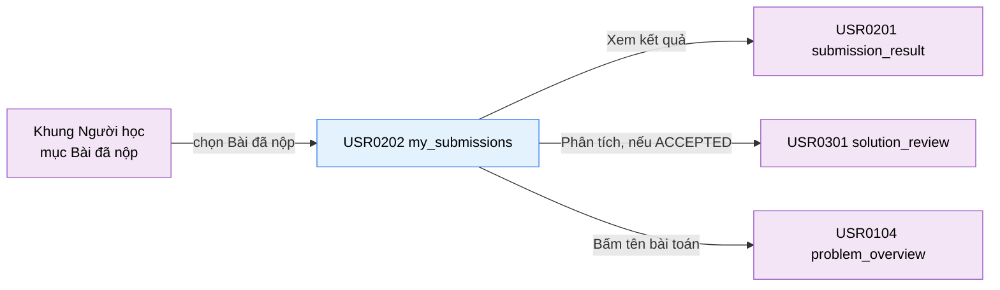

# Tài liệu thiết kế cơ bản (BD) — Bài đã nộp (`USR0202`)

## Phương châm tài liệu [Nội bộ — không cần khách duyệt]

- Viết theo **mẫu 9 sheet**. Bộ thẻ đóng, quy ước ID, ký hiệu chuẩn, ranh giới với tài liệu khác và
  checklist kiểm toán nằm ở `02-bd/_rules/bd-template-9sheet.md` — file này không chép lại.
- Phần gắn nhãn `[Nội bộ]` phục vụ sinh mã và tự kiểm toán, không phải yêu cầu của khách hàng: mục 4.5,
  mục 7.3 và các ghi chú quy ước.
- Mã màn `USR0202` theo bảng mã ở `02-bd/_rules/bd-template-9sheet.md` mục 8 dòng 141; tên file mang tiền
  tố mã.
- Khung điều hướng **không mô tả lại ở đây** — dùng chung `02-bd/screens/users/_shell.md`. Màn này có mục
  điều hướng trực tiếp trên thanh nav chính của header (Mục thứ 4: "Bài đã nộp")
  [Nguồn: 02-bd/screens/users/_shell.md:57].
- Màn này **không có popup**. Tất cả hành động xem chi tiết đều chuyển màn.

> Đọc cùng `01-rd/screens/users/USR0202_my_submissions.md` (hành vi ở mức yêu cầu, không lặp lại ở đây),
> `01-rd/req/F1_identity.md` (F1-18; F1-07 ở `USR0501`), `01-rd/req/F4_judge-orchestration.md` (F4-01→F4-08),
> `01-rd/req/F5_ai-review.md` (F5-01), `02-bd/architecture/F4_judge-orchestration.md`,
> `02-bd/database/F4_judge-orchestration.md`, `02-bd/database/F1_identity.md`.
>
> - **Phạm vi dữ liệu cá nhân tuyệt đối**: màn này chỉ hiển thị các bài nộp của chính người dùng đang đăng nhập
>   thông qua token phiên; không nhận tham số `user_id` từ phía giao diện nhằm triệt tiêu lỗ hổng IDOR.
> - **Mã yêu cầu F1-18**: cung cấp giao diện tra cứu, tìm kiếm theo mã bài/tên bài, lọc theo verdict và ngôn ngữ
>   cho toàn bộ lịch sử bài nộp của người học.
> - **Quy tắc phân tích AI**: nút "Phân tích" trên từng dòng chỉ kích hoạt khi bài nộp đạt verdict `ACCEPTED`
>   (khớp quy tắc F5-01); các dòng không đạt chỉ hiển thị nút "Kết quả".
> - **Phân trang phía máy chủ**: khác với prototype tĩnh vẽ 10 dòng cố định, thiết kế BD bắt buộc thực hiện phân
>   trang tại máy chủ (20 dòng/trang) kèm sắp xếp giảm dần theo thời gian nộp bài (`submitted_at DESC`).

- **Bài đã rút khỏi ngân hàng** (`deleted = true`, G4 2026-10-08): dòng lịch sử vẫn hiện tiêu đề bài kèm nhãn "Đã rút khỏi ngân hàng", **bỏ liên kết mở bài**; nút "Kết quả" và "Phân tích" vẫn dùng được. Ô tìm kiếm theo tên bài vẫn khớp bài đã rút. Quy tắc đầy đủ ở `02-bd/database/F2_problem-bank.md` mục 1.1a, không chép lại ở đây.

> **Quy ước đặt tên khối** [Nội bộ]. Ba khối: `filterToolbar` (thanh công cụ tìm kiếm và lọc
> verdict/ngôn ngữ), `submissionsTable` (bảng lịch sử bài nộp), `tableFooter` (dòng tổng kết số liệu và
> phân trang). Khối `summaryStats` (dải 4 thẻ thống kê) **đã bỏ 2026-10-18** theo quyết định của owner (mở rộng
> quy tắc "không dải KPI ở màn danh sách" ngày 2026-10-13); ký hiệu khu vực B/C/D giữ nguyên, không đổi lại thành
> A/B/C vì chú thích đầu file code trích theo B/C/D
> [Nguồn: 05-coding/frontend/src/views/users/my-submissions/ui/my-submissions-view.tsx:3-5]. Tiền tố ID item
> của toàn màn là `mySubmissions.`.
>
> **Lệch RD đã đóng 2026-10-18** [Nội bộ]: owner chọn phương án (a). RD `USR0202` đã bỏ yêu cầu dải chỉ số,
> F1-07 (tỉ lệ chấp thuận) hiển thị ở màn tiến độ `USR0501`, Khu vực A "Dải chỉ số tổng" NO 3
> [Nguồn: 01-rd/screens/users/USR0202_my_submissions.md:32,108; 01-rd/screens/users/USR0501_my_progress.md:90;
> 02-bd/screens/users/USR0501_my_progress.md:295]. Bản dựng không hiển thị là đúng thiết kế. Xem Câu hỏi mở Q5.

---

## Sheet 1. Bìa

| Mục | Giá trị |
| :--- | :--- |
| Hệ thống | AlgoPrep |
| Phân hệ | `judge-orchestration` (F4) — đọc từ `identity` (F1), `problem-bank` (F2), liên kết sang `ai-review` (F5) |
| Công đoạn | BD — Thiết kế cơ bản |
| Phân loại | Màn hình |
| Tên màn | Bài đã nộp |
| Mã màn hình | `USR0202` |
| Tên vật lý (slug) | `my_submissions` |
| Trục tài liệu | Màn hình (`02-bd/screens/`) |
| Actor | A1 (`STUDENT`) |
| Phiên bản | V1.0 |
| Người tạo | Nhóm phát triển AlgoPrep |
| Ngày tạo | 2026/09/22 |
| Người cập nhật | Claude |
| Ngày cập nhật | 2026/10/20 |

---

## Sheet 2. Lịch sử sửa đổi

| Ver | Sheet bị sửa | Nội dung sửa | Ngày | Người sửa |
| :--- | :--- | :--- | :--- | :--- |
| V0.1 | Toàn bộ | Tạo mới theo mẫu 9 sheet. Chốt 4 thẻ thống kê tổng quan (khớp F1-07), bộ lọc kết hợp tìm kiếm và đa tiêu chí (F1-18), phân trang máy chủ và quy tắc mở khóa nút Phân tích AI F5-01 | 2026/09/22 | Nhóm phát triển AlgoPrep |
| V0.2 | Sheet 3, 5, 7.3, Câu hỏi mở | Viết lại Sheet 3 theo khuôn "Danh sách chuyển màn" 6 thẻ + sơ đồ Mermaid; viết lại Sheet 5 theo khuôn 14 cột (thêm Bảng DB/Cột DB, mỗi item một dòng); bỏ cột "Phương thức & URL dự kiến" ở Sheet 7.3. Sửa nguồn 2 thẻ thống kê: "Được chấp nhận" và "Đúng ngay lần đầu" đổi công thức đúng theo cột thật của `identity.user_submission_stats` (không có `acceptedRate` lưu sẵn); phát hiện "Dùng nhiều nhất" (ngôn ngữ) chưa có cột read model nào — thêm Câu hỏi mở Q4 | 2026/09/24 | Nhóm phát triển AlgoPrep |
| V0.2 | Sheet 8, 9 | Đổi báo lỗi tải sau thao tác lọc, tìm kiếm và `[Tiêu điểm]` ô tìm kiếm sang toast; giữ nguyên khối lỗi tải màn kèm nút thử lại ở EVT-1. Theo `DEC-2026-1003-toast-feedback-channel`. | 2026/10/03 | AI |
| V0.3 | Sheet 4, 5, 7 | Đồng bộ `DEC-2026-1001-admin-configurable-settings` mục (7): độ khó bài tập là danh mục do ADMIN quản lý (bảng riêng `problem_levels`), không còn enum cố định. DTO `StudentSubmissionItemDto.difficulty` thành `levelCode`/`levelDisplayName` đọc qua `problems.level_id`; badge độ khó cạnh tên bài hiển thị `display_name` từ dữ liệu; thêm `problem.problem_levels` vào danh sách bảng và Truy cập bảng. Màn chỉ hiển thị nhãn, không lọc và không gọi `ListProblemLevels` (nhãn nằm sẵn trong phản hồi); độ khó không gắn logic nào | 2026/10/03 | AI |
| V0.4 | Sheet 3, 5, 6, Câu hỏi mở | Theo `02-bd/database/F2_problem-bank.md` mục 1.1a: dòng lịch sử của bài đã rút vẫn hiện tiêu đề kèm nhãn "Đã rút khỏi ngân hàng", bỏ liên kết mở bài; nút "Kết quả" và "Phân tích" vẫn dùng được. Chỉ tài liệu, chưa đổi code | 2026/10/08 | AI |
| V0.5 | Phương châm, Sheet 1, 3, 4, 5, 6, 7, 8, Câu hỏi mở | Bỏ dải 4 thẻ thống kê (khu vực A) theo quyết định owner 2026/10/18, mở rộng quy tắc "không dải KPI ở màn danh sách" 2026/10/13: bỏ DTO `StudentSubmissionSummaryStatsDto`, endpoint `GetMySubmissionSummaryStats`, truy cập `identity.user_submission_stats`, item và đặc tả khu vực A; tải màn không còn gọi thống kê. Giữ ký hiệu khu vực B/C/D. Đóng Q1, Q4 (không còn đối tượng). Thêm Q5: lệch RD F1-07 (RD yêu cầu hiển thị, bản dựng đã bỏ). Sửa Sheet 4.5 theo code thật (file tách nhỏ chỉ là dự kiến, chưa từng có). Không sửa RD | 2026/10/18 | AI |
| V0.6 | Phương châm, Câu hỏi mở (Q5), Tham chiếu | Owner chốt Q5 phương án (a) 2026/10/18 (`DEC-2026-1018-usr-open-questions-phase1-scope`): RD `USR0202` đã bỏ yêu cầu dải chỉ số và REQ-01, F1-07 chuyển sang `USR0501`. Đổi đoạn "Lệch RD cần owner quyết" thành ghi chú đã đóng, bỏ câu nói RD yêu cầu hiển thị chỉ số. Không đổi thiết kế, không đổi code | 2026/10/18 | AI |
| V0.7 | Câu hỏi mở (đóng Q2, Q3), mục "Hiện trạng bản dựng" | Owner chốt Q2 và Q3 ngày 2026/10/18 theo đề xuất (`DEC-2026-1018-usr-open-questions-phase2-5`, giai đoạn 3): bản đầu không có bộ lọc khoảng ngày (ponytail bậc 3); lượt nộp không bao giờ bị xoá hay ẩn (bậc 6). Không có item hay sự kiện mới, vì cả hai đều là "không làm". Đã đọc lại code: không có điều khiển lọc ngày hay xoá/ẩn. Không đổi code | 2026/10/18 | Claude |
| V0.8 | Sheet 5 (Khu vực B NO 2, C NO 1, 2), Hiện trạng bản dựng | Sửa theo đợt rà soát prototype 2026/10/19 (area B), owner chốt: menu lọc verdict có **đủ 6 giá trị theo BD** (Tất cả, Accepted, Sai kết quả, Quá thời gian, Lỗi biên dịch, Lỗi thực thi; thêm Lỗi thực thi, `SYSTEM_ERROR` vẫn hiện trong bảng nhưng không có trong menu lọc). Cột Bài toán thêm badge độ khó (`problemLevelTone/Label` + `useProblemLevels`). Cột Thời điểm dùng `formatDateVN` (UTC+7, theo locale; định dạng `HH:mm dd/MM/yyyy`, khác BD ở dấu gạch giữa giờ và ngày, chấp nhận ở prototype). Ô tìm kiếm có `maxLength` 100 qua `FilterBar` (cắt im lặng, chưa có toast cảnh báo). Chưa duyệt hình | 2026/10/19 | Claude |
| V0.9 | Sheet 9 (NO 3) | Owner chốt 2026/10/19 (`DEC-2026-1019-usr-fe-audit-fixes`, chốt nốt câu hỏi mở còn lại sau rà prototype). Chỉ tài liệu, không đổi code, chưa duyệt hình. Bỏ yêu cầu toast khi ô tìm kiếm chạm 100 ký tự: `maxLength` của trình duyệt dừng việc nhập là đủ (owner 2026/10/19, ponytail bậc 3); Sheet 9 dòng độ dài từ khoá đổi `[Tiêu điểm]` còn viền ô, không còn câu thông báo. | 2026/10/19 | Claude |
| V1.0 | Sheet 3, 4 (4.4), 8 (EVT-5), Hiện trạng bản dựng | Đồng bộ bản dựng 2026/10/20 (`DEC-2026-1020-student-workspace-split-and-password-in-settings`): bỏ khung `PageHeader`, đầu trang là hàng tiêu đề thường (`<h1>` và một dòng phụ), rồi thẻ chứa B, C, D (mục 4.4). Liên kết tên bài sang `/problems/{slug}` nay mở trang tổng quan chỉ-đọc `problem_overview` (`USR0104`), không còn là màn soạn mã `USR0102` (Sheet 3, mermaid, EVT-5). Làm mới số dòng `my-submissions-view.tsx` (mã dịch xuống so với V0.9): `:184-219` thành `:207-245`, `:76-177,221-228` thành `:88-196,247-254`, `:230-258` thành `:256-284`, `:181` thành `:198-205`, `:183-259` thành `:207-285`, `:47-50` thành `:59-67`, `:42-55` thành `:50-53,63-67`, `:12-17,57-60` thành `:17-22,69-72`, `:141-176` thành `:160-195`, `:75-78` thành `:79-86`. Không đổi endpoint, DTO hay item. Chưa duyệt hình | 2026/10/20 | Claude |

---

## Sheet 3. Sơ đồ chuyển màn

> [Nội bộ] Quy ước vẽ: `02-bd/_rules/bd-template-9sheet.md` mục 2, 3.

### 3.1 Danh sách chuyển màn

#### Khung điều hướng Người học → Bài đã nộp

[Điều kiện mở] Chọn mục "Bài đã nộp" trên thanh nav chính của header
[Nguồn: 02-bd/screens/users/_shell.md:57].

[Chế độ mở] Điều hướng URL `/my-submissions`.

[Thông tin truyền] Không có.

[Giá trị trả về] Không có.

[Khi thành công] Hiển thị thanh lọc, bảng lịch sử nộp bài của chính học viên và chân bảng kèm phân trang (không còn dải thống kê, bỏ 2026/10/18).

[Khi huỷ] Không có.

#### Bài đã nộp → Kết quả nộp bài

[Điều kiện mở] Bấm nút "Kết quả" ở một dòng bài nộp.

[Chế độ mở] Điều hướng URL `/submissions/{submission_id}`.

[Thông tin truyền] `submission_id`.

[Giá trị trả về] Không có.

[Khi thành công] Mở màn `submission_result` tương ứng.

[Khi huỷ] Không có.

#### Bài đã nộp → Phân tích bài giải

[Điều kiện mở] Bấm nút "Phân tích" ở dòng có verdict `ACCEPTED`
[Nguồn: 01-rd/req/F5_ai-review.md — F5-01].

[Chế độ mở] Điều hướng URL `/submissions/{submission_id}/review`.

[Thông tin truyền] `submission_id`.

[Giá trị trả về] Không có.

[Khi thành công] Mở màn `solution_review`.

[Khi huỷ] Không có — nút bị vô hiệu hoá khi verdict khác `ACCEPTED`.

#### Bài đã nộp → Tổng quan bài toán

[Điều kiện mở] Bấm vào tên hoặc mã bài toán trong bảng
[Nguồn: 05-coding/frontend/src/views/users/my-submissions/ui/my-submissions-view.tsx:104-109].

[Chế độ mở] Điều hướng URL `/problems/{problem_slug}`, trang tổng quan chỉ-đọc (từ 2026/10/20, trước đó là màn soạn mã).

[Thông tin truyền] `problem_slug`.

[Giá trị trả về] Không có.

[Khi thành công] Mở màn `problem_overview` (`USR0104`) của bài. Muốn soạn mã lại thì bấm tiếp ở màn đó, đích `/workspace/{problem_id}` do `USR0104` mô tả [Nguồn: 02-bd/screens/users/USR0104_problem_overview.md:169].

[Khi huỷ] Không có.

### 3.2 Sơ đồ

[Nguồn: 02-bd/screens/users/_shell.md:57; 01-rd/req/F5_ai-review.md — F5-01]

---

## Sheet 4. Bố cục màn hình

### 4.1. Tổng quan theo thẻ

- `[Mục đích màn]` Cho phép người học xem lại toàn bộ lịch sử các lần nộp bài của mình, tìm kiếm bài đã nộp và mở lại kết quả chi tiết hoặc phân tích AI.
- `[Luồng nghiệp vụ chính]` Người học vào màn hình để tra cứu bài đã nộp, sử dụng bộ lọc trạng thái verdict hoặc ngôn ngữ lập trình, tìm kiếm theo từ khóa bài toán, sau đó xem kết quả testcase tại `submission_result` hoặc nhận phản hồi sư phạm AI tại `solution_review`.
- `[Người dùng]` Học viên (A1 — sở hữu lịch sử nộp bài).
- `[Tệp liên quan]` `01-rd/screens/users/USR0202_my_submissions.md`, `09-layoutBase/Bài đã nộp.dc.html`.
- `[Phạm vi]` Toàn bộ lịch sử bài nộp của học viên đang đăng nhập trên hệ thống.
- `[Quyền sử dụng]` Yêu cầu đăng nhập tài khoản học viên (A1).
- `[Số bản ghi tối đa]` Mặc định hiển thị 20 bản ghi trên mỗi trang, phân trang phía máy chủ.

### 4.2. Danh sách cấu trúc dữ liệu màn hình (DTOs)

| STT | Tên DTO | Mô tả | Chi tiết trường |
| :-: | :--- | :--- | :--- |
| 1 | `StudentSubmissionItemDto` | Một dòng trong bảng lịch sử | `id`, `problemId`, `problemCode`, `problemTitle`, `levelCode`, `levelDisplayName`, `language`, `verdict`, `passedCount`, `totalCount`, `runtimeMs`, `memoryMb`, `submittedAt` |
| 2 | `StudentSubmissionPageResponseDto` | Kết quả phân trang lịch sử bài nộp | `items` (List<StudentSubmissionItemDto>), `currentPage`, `pageSize`, `totalItems`, `totalPages`, `filteredAcceptedCount` |

> Đã bỏ 2026/10/18 (owner): `StudentSubmissionSummaryStatsDto` (`totalSubmissions`, `acceptedCount`, `acceptedRate`, `firstTryAcceptedCount`, `firstTryAcceptedRate`, `mostUsedLanguage`, `mostUsedLanguagePercent`) cùng dải thống kê.

### 4.3. Danh sách bảng dữ liệu

| STT | Tên bảng | Mô tả | Thao tác | Bounded Context |
| :-: | :--- | :--- | :--- | :--- |
| 1 | `judge.submissions` | Bản ghi các bài nộp của người học | R | `judge-orchestration` |
| 2 | `problem.problems` | Thông tin mã bài, tên bài, độ khó | R | `problem-bank` |
| 3 | `problem.problem_levels` | Nhãn độ khó của bài (`display_name`), đọc qua join `problems.level_id` [Nguồn: 02-bd/database/F2_problem-bank.md mục `problem_levels`] | R | `problem-bank` |

> Đã bỏ 2026/10/18 (owner): `identity.user_submission_stats` (R) — màn không còn đọc read model thống kê; không item nào khác của màn dùng bảng này.

### 4.4. Vùng bố cục bám prototype

Bố cục dạng danh sách trung tâm một cột với các khối chức năng phân lớp:

| Ký hiệu | Tên khu vực | Tham chiếu prototype | Ghi chú |
| :-: | :--- | :--- | :--- |
| **A** | ~~Dải 4 thẻ thống kê (Summary Stats)~~ — **đã bỏ 2026-10-18, owner** | `Bài đã nộp.dc.html:104-110,238-243` (chỉ còn là bằng chứng mockup, bản dựng không có) | Từng gồm 4 thẻ: Lượt nộp, Được chấp nhận (F1-07), Đúng lần đầu, Ngôn ngữ chính. Lệch RD, xem Q5 |
| **B** | Thanh công cụ lọc & tìm kiếm (Filter Toolbar) | `Bài đã nộp.dc.html:112-123`; code `my-submissions-view.tsx:207-245` | Ô tìm kiếm bài, menu lọc Verdict, menu lọc Ngôn ngữ (`FilterBar` + `FilterMenu`) |
| **C** | Bảng lịch sử nộp bài (Submissions Table) | `Bài đã nộp.dc.html:126-170`; code `my-submissions-view.tsx:88-196,247-254` | Bảng dữ liệu (`DataTable`), cột thao tác Kết quả / Phân tích |
| **D** | Chân bảng & phân trang (Table Footer) | `Bài đã nộp.dc.html:171-174`; code `my-submissions-view.tsx:256-284` | Dòng tóm tắt số bản ghi, chọn cỡ trang (10/20/50), thanh chuyển trang (`Pagination`) |

Trang hiện tại = hàng tiêu đề thường: `<h1>` "Bài đã nộp" và dòng phụ "Toàn bộ lịch sử nộp bài của bạn", **không còn khung `PageHeader`** (bỏ 2026/10/20) [Nguồn: 05-coding/frontend/src/views/users/my-submissions/ui/my-submissions-view.tsx:198-205], rồi một thẻ chứa B, C, D theo thứ tự [Nguồn: 05-coding/frontend/src/views/users/my-submissions/ui/my-submissions-view.tsx:207-285].

**Hiện trạng bản dựng** (2026-10-20, đọc lại code; số dòng đã làm mới): trạng thái lọc và trang giữ trong state cục bộ, chưa đưa lên query param `q`/`verdict`/`language`/`page` [Nguồn: 05-coding/frontend/src/views/users/my-submissions/ui/my-submissions-view.tsx:5-7,59-67]; menu lọc verdict có 6 giá trị đúng BD (Tất cả, ACCEPTED, WRONG_ANSWER, TIME_LIMIT_EXCEEDED, COMPILE_ERROR, RUNTIME_ERROR), chốt 2026/10/19 [Nguồn: 05-coding/frontend/src/views/users/my-submissions/ui/my-submissions-view.tsx, `FilterMenu` verdict, `:218-233`]; có chọn cỡ trang 10/20/50 nhớ theo trình duyệt, mặc định 20 [Nguồn: 05-coding/frontend/src/views/users/my-submissions/ui/my-submissions-view.tsx:50-53,63-67]; dữ liệu lấy qua `fetchMySubmissionsPage` (mock), không còn gọi `fetchMySubmissionStats` [Nguồn: 05-coding/frontend/src/views/users/my-submissions/ui/my-submissions-view.tsx:17-22,69-72]. **Đối chiếu Q2, Q3 (2026-10-18, đã đọc lại code):** thanh lọc chỉ có ô tìm, Verdict, Ngôn ngữ, không có bộ chọn ngày [Nguồn: 05-coding/frontend/src/views/users/my-submissions/ui/my-submissions-view.tsx:207-245]; cột hành động chỉ có nút "Kết quả" và "Phân tích", không có nút xoá hay ẩn [Nguồn: 05-coding/frontend/src/views/users/my-submissions/ui/my-submissions-view.tsx:160-195]. Khớp quyết định, không đổi code.

### 4.5. Cấu trúc slice FSD [Nội bộ]

- Route: `/my-submissions`
- View slice thực tế: `src/views/users/my-submissions/` gồm `index.ts`, `ui/my-submissions-view.tsx` (một
  file chứa B, C, D) và `ui/my-submissions-view.test.tsx` (Glob 2026-10-18).
- Các file `ui/my-submissions-page.tsx`, `ui/submission-stats-cards.tsx`, `ui/submission-filter-toolbar.tsx`,
  `ui/submissions-data-table.tsx`, `ui/submissions-table-footer.tsx`, `model/use-my-submissions.ts` (state URL
  query params `q`, `verdict`, `language`, `page`) chỉ là **dự kiến ở V0.1-V0.4, chưa từng tồn tại trong code**;
  `submission-stats-cards.tsx` bỏ hẳn cùng khu vực A. Việc tách file còn lại hoãn đến khi viết DD.

---

## Sheet 5. Danh sách item màn hình

> Quy ước ID, bộ thẻ và giá trị chuẩn: `02-bd/_rules/bd-template-9sheet.md` mục 2, 3, 4.

### Khu vực A — Dải 4 thẻ thống kê (Summary Stats) — đã bỏ 2026/10/18 (owner)

4 item `mySubmissions.stats.cardTotal`, `cardAccepted`, `cardFirstTry`, `cardTopLang` đã bỏ, kèm công thức đọc `identity.user_submission_stats` và `GROUP BY language` trên `judge.submissions`. Khu vực B/C/D giữ nguyên NO riêng của từng khu vực. Lệch RD F1-07: xem Câu hỏi mở Q5.

### Khu vực B — Thanh công cụ lọc & tìm kiếm (Filter Toolbar)

| Khu vực | NO | Tên item | ID item | Bảng DB | Cột DB | Loại UI | Kiểu | Độ dài | Bắt buộc | I/O | Giá trị mặc định | Định dạng | Ghi chú |
| :--- | --: | :--- | :--- | :--- | :--- | :--- | :--- | :--- | :-: | :-: | :--- | :--- | :--- |
| Filter Toolbar | | | | | | | | | | | | | |
| | 1 | Ô tìm kiếm bài toán | `mySubmissions.filter.txtSearch` | `problem.problems` | `code`, `title` | TextBox | String | 100 | Không | I/O | rỗng | - | Nhập mã bài hoặc tên bài cần tìm [Nguồn giá trị] Tham số URL `q` [EVT liên quan] EVT-2 |
| | 2 | Tab Lọc verdict | `mySubmissions.filter.tabVerdict` | `judge.submissions` | `status` | Toggle | Enum | 30 | Có | I/O | `ALL` | - | Tất cả, Accepted, Sai kết quả, Quá thời gian, Lỗi biên dịch, Lỗi thực thi — map từ ENUM `status` [Nguồn: 02-bd/database/F4_judge-orchestration.md:22] [Nguồn giá trị] Tham số URL `verdict` [EVT liên quan] EVT-3 |
| | 3 | Tab Lọc ngôn ngữ | `mySubmissions.filter.tabLanguage` | `judge.submissions` | `language` | Toggle | Enum | 20 | Có | I/O | `ALL` | - | Tất cả, Python, Java, C++ — ba ngôn ngữ khoá cứng [Nguồn: 02-bd/database/F4_judge-orchestration.md:18] [Nguồn giá trị] Tham số URL `language` [EVT liên quan] EVT-4 |

### Khu vực C — Bảng lịch sử nộp bài (Submissions Table)

| Khu vực | NO | Tên item | ID item | Bảng DB | Cột DB | Loại UI | Kiểu | Độ dài | Bắt buộc | I/O | Giá trị mặc định | Định dạng | Ghi chú |
| :--- | --: | :--- | :--- | :--- | :--- | :--- | :--- | :--- | :-: | :-: | :--- | :--- | :--- |
| Submissions Table | | | | | | | | | | | | | |
| | 1 | Cột Thời điểm | `mySubmissions.table.col.submittedAt` | `judge.submissions` | `submitted_at` | ListColumn | Date | 30 | Có | O | - | `HH:mm - dd/MM/yyyy` | Mốc thời gian nộp bài [Nguồn: 02-bd/database/F4_judge-orchestration.md:31] [EVT liên quan] - |
| | 2 | Cột Bài toán | `mySubmissions.table.col.problem` | `problem.problems`, `problem.problem_levels` | `code`, `title`, `display_name` | ListColumn | Link | 150 | Có | O | - | `{code} · {title}` | Mã và tiêu đề bài toán kèm badge độ khó [Nguồn: 02-bd/database/F2_problem-bank.md:14-17] [Nguồn giá trị] Nhãn badge là `problem_levels.display_name` qua `problems.level_id`, **đọc từ dữ liệu** do ADMIN quản lý, không còn ánh xạ cứng enum; ba mức khởi tạo giữ màu badge cũ, mức mới màu trung tính `DEC-2026-1001-admin-configurable-settings` mục (7) [Nguồn: 02-bd/database/F2_problem-bank.md mục `problem_levels`] [EVT liên quan] EVT-5 |
| | 3 | Cột Ngôn ngữ | `mySubmissions.table.col.language` | `judge.submissions` | `language` | ListColumn | Badge | 20 | Có | O | - | - | Ngôn ngữ nộp bài [Nguồn: 02-bd/database/F4_judge-orchestration.md:18] [EVT liên quan] - |
| | 4 | Cột Kết quả | `mySubmissions.table.col.verdict` | `judge.submissions` | `status` | ListColumn | Badge | 30 | Có | O | - | - | Badge trạng thái có màu đặc trưng [Nguồn: 02-bd/database/F4_judge-orchestration.md:22] [EVT liên quan] - |
| | 5 | Cột Testcase | `mySubmissions.table.col.testcases` | `judge.submissions` | `passed_testcase_count`, `total_testcase_count` | ListColumn | String | 20 | Có | O | - | `{passed}/{total}` | Số testcase đạt / tổng số testcase [Nguồn: 02-bd/database/F4_judge-orchestration.md:25-26] [EVT liên quan] - |
| | 6 | Cột Thời gian chạy | `mySubmissions.table.col.runtime` | `judge.submissions` | `runtime_ms` | ListColumn | String | 20 | Có | O | `-` | `{runtime} ms` | Thời gian thực thi lớn nhất [Nguồn: 02-bd/database/F4_judge-orchestration.md:28] [EVT liên quan] - |
| | 7 | Nút Xem kết quả | `mySubmissions.table.row.btnResult` | - | - | Button | String | 20 | Có | I | - | "Kết quả" | Mở màn `submission_result` của dòng đang trỏ [Nguồn giá trị] Nhãn tĩnh [EVT liên quan] EVT-6 |
| | 8 | Nút Phân tích AI | `mySubmissions.table.row.btnReview` | - | - | Button | String | 20 | Có | I | - | "Phân tích" | Mở phân tích AI F5-01, chỉ bật khi `status = ACCEPTED` [Nguồn giá trị] Nhãn tĩnh [EVT liên quan] EVT-7 |

### Khu vực D — Chân bảng & phân trang (Table Footer)

| Khu vực | NO | Tên item | ID item | Bảng DB | Cột DB | Loại UI | Kiểu | Độ dài | Bắt buộc | I/O | Giá trị mặc định | Định dạng | Ghi chú |
| :--- | --: | :--- | :--- | :--- | :--- | :--- | :--- | :--- | :-: | :-: | :--- | :--- | :--- |
| Table Footer | | | | | | | | | | | | | |
| | 1 | Dòng tóm tắt số bản ghi | `mySubmissions.footer.lblSummary` | - | - | Label | String | 100 | Có | O | - | `Hiển thị {từ} - {đến} trong số {tổng} bài nộp` | Tóm tắt khoảng bản ghi và tổng số kết quả lọc [Công thức] Tính từ kết quả phân trang của `ListMySubmissions` [EVT liên quan] - |
| | 2 | Nút Chuyển trang trước | `mySubmissions.footer.btnPrevPage` | - | - | Button | String | 10 | Có | I | - | "‹" | Chuyển về trang trước [Nguồn giá trị] Thao tác người dùng [EVT liên quan] EVT-8 |
| | 3 | Danh sách nút số trang | `mySubmissions.footer.btnPageNumber` | - | - | Button | Number | 5 | Có | I | `1` | Số nguyên | Các nút bấm số trang [Nguồn giá trị] Phân trang máy chủ [EVT liên quan] EVT-9 |
| | 4 | Nút Chuyển trang sau | `mySubmissions.footer.btnNextPage` | - | - | Button | String | 10 | Có | I | - | "›" | Chuyển sang trang kế tiếp [Nguồn giá trị] Thao tác người dùng [EVT liên quan] EVT-10 |

[Nguồn: 02-bd/database/F1_identity.md:114; 02-bd/database/F4_judge-orchestration.md:18,22,25-26,28,31;
02-bd/database/F2_problem-bank.md:14-17; 01-rd/req/F5_ai-review.md — F5-01]

---

## Sheet 6. Đặc tả điều khiển item

### Khu vực A: Dải 4 thẻ thống kê — đã bỏ 2026/10/18 (owner)

Toàn bộ 4 dòng đặc tả (Thẻ Tổng lượt nộp, Được chấp nhận, Đúng ngay lần đầu, Dùng nhiều nhất) đã bỏ cùng khu vực A.

### Khu vực B: Thanh công cụ lọc & tìm kiếm

| NO | Tên item | Hiển thị | Kích hoạt | Ghi chú |
| --: | :--- | :--- | :--- | :--- |
| 1 | Ô tìm kiếm bài toán | Có | Có | [Điều kiện hiển thị] Luôn hiển thị. [Điều kiện kích hoạt] Luôn kích hoạt. [Tự động đặt] Đọc giá trị từ query param `q` trên URL. |
| 2 | Tab Lọc verdict | Có | Có | [Điều kiện hiển thị] Luôn hiển thị. [Điều kiện kích hoạt] Luôn kích hoạt. [Tự động đặt] Đọc giá trị từ query param `verdict` trên URL. |
| 3 | Tab Lọc ngôn ngữ | Có | Có | [Điều kiện hiển thị] Luôn hiển thị. [Điều kiện kích hoạt] Luôn kích hoạt. [Tự động đặt] Đọc giá trị từ query param `language` trên URL. |

### Khu vực C: Bảng lịch sử nộp bài

| NO | Tên item | Hiển thị | Kích hoạt | Ghi chú |
| --: | :--- | :--- | :--- | :--- |
| 1 | Cột Thời điểm | Có | Không | [Điều kiện hiển thị] Luôn hiển thị. [Điều kiện kích hoạt] Không áp dụng. [Tự động đặt] - |
| 2 | Cột Bài toán | Có | Có | [Điều kiện hiển thị] Luôn hiển thị. [Điều kiện kích hoạt] Bấm để mở bài toán. [Tự động đặt] - |
| 3 | Cột Ngôn ngữ | Có | Không | [Điều kiện hiển thị] Luôn hiển thị. [Điều kiện kích hoạt] Không áp dụng. [Tự động đặt] - |
| 4 | Cột Kết quả | Có | Không | [Điều kiện hiển thị] Luôn hiển thị. [Điều kiện kích hoạt] Không áp dụng. [Tự động đặt] - |
| 5 | Cột Testcase | Có | Không | [Điều kiện hiển thị] Luôn hiển thị. [Điều kiện kích hoạt] Không áp dụng. [Tự động đặt] - |
| 6 | Cột Thời gian chạy | Có | Không | [Điều kiện hiển thị] Luôn hiển thị. [Điều kiện kích hoạt] Không áp dụng. [Tự động đặt] - |
| 7 | Nút Xem kết quả | Có | Có | [Điều kiện hiển thị] Luôn hiển thị ở trạng thái hover hoặc cố định. [Điều kiện kích hoạt] Luôn kích hoạt cho mọi bài nộp. [Tự động đặt] - |
| 8 | Nút Phân tích AI | Có | Điều kiện | [Điều kiện hiển thị] Luôn hiển thị. [Điều kiện kích hoạt] Chỉ kích hoạt khi dòng có verdict = `ACCEPTED`. Nếu bài chưa đạt, nút bị ẩn hoặc vô hiệu hóa. [Tự động đặt] - |

### Khu vực D: Chân bảng & phân trang

| NO | Tên item | Hiển thị | Kích hoạt | Ghi chú |
| --: | :--- | :--- | :--- | :--- |
| 1 | Dòng tóm tắt số bản ghi | Có | Không | [Điều kiện hiển thị] Luôn hiển thị. [Điều kiện kích hoạt] Không áp dụng. [Tự động đặt] - |
| 2 | Nút Chuyển trang trước | Có | Điều kiện | [Điều kiện hiển thị] Luôn hiển thị. [Điều kiện kích hoạt] Kích hoạt khi `currentPage > 1`. [Tự động đặt] - |
| 3 | Danh sách nút số trang | Có | Có | [Điều kiện hiển thị] Luôn hiển thị khi `totalPages > 1`. [Điều kiện kích hoạt] Kích hoạt trừ số trang hiện tại đang xem. [Tự động đặt] - |
| 4 | Nút Chuyển trang sau | Có | Điều kiện | [Điều kiện hiển thị] Luôn hiển thị. [Điều kiện kích hoạt] Kích hoạt khi `currentPage < totalPages`. [Tự động đặt] - |

---

## Sheet 7. Danh sách truyền dữ liệu

### 7.1. Danh sách trường truyền dữ liệu

| STT | Trường giao diện | Kiểu | Trường DTO | Hướng | Ghi chú |
| :-: | :--- | :--- | :--- | :-: | :--- |
| 1 | `mySubmissions.filter.txtSearch` | String | Query parameter `q` | I | Lọc theo mã hoặc tên bài |
| 2 | `mySubmissions.filter.tabVerdict` | String | Query parameter `verdict` | I | Lọc theo kết quả verdict |
| 3 | `mySubmissions.filter.tabLanguage` | String | Query parameter `language` | I | Lọc theo ngôn ngữ lập trình |
| 4 | `mySubmissions.table.col.problem` | String | `StudentSubmissionItemDto.problemTitle` | O | Tên bài toán kèm link |
| 5 | `mySubmissions.table.col.verdict` | String | `StudentSubmissionItemDto.verdict` | O | Ánh xạ sang nhãn và badge |
| 6 | `mySubmissions.footer.lblSummary` | String | `StudentSubmissionPageResponseDto.totalItems` | O | Tổng số kết quả phù hợp |

> Đã bỏ 2026/10/18 (owner): 2 trường `mySubmissions.stats.cardTotal`, `mySubmissions.stats.cardAccepted` (DTO `StudentSubmissionSummaryStatsDto`).

### 7.2. Truy cập bảng dữ liệu

| STT | Tên bảng | C | R | U | D | Điều kiện lọc |
| :-: | :--- | :-: | :-: | :-: | :-: | :--- |
| 1 | `judge.submissions` | - | Có | - | - | `user_id = :currentUserId [AND conditions] ORDER BY submitted_at DESC` |
| 2 | `problem.problems` | - | Có | - | - | `id IN (:problemIds)` |
| 3 | `problem.problem_levels` | - | Có | - | - | Qua join `problems.level_id` để lấy `display_name`; màn không ghi, ADMIN quản lý độ khó ở `SHR0201` |

### 7.3. Danh sách endpoint [Nội bộ]

> Chỉ tên nghiệp vụ và BC sở hữu. Hợp đồng chi tiết (đường dẫn, request, response, mã lỗi) thuộc
> `03-dd/api/<module>.md`, chưa viết.

| NO | Endpoint (tên nghiệp vụ) | Mục đích | BC sở hữu |
| --: | :--- | :--- | :--- |
| 1 | `ListMySubmissions` | Lấy danh sách lịch sử nộp bài có phân trang, tìm kiếm và lọc theo verdict/ngôn ngữ | `judge-orchestration` |

> Đã bỏ 2026/10/18 (owner): endpoint `GetMySubmissionSummaryStats` (BC `identity`, 4 chỉ số tổng quan); không còn endpoint nào của `identity` trên màn này.

Ghi chú ranh giới: tiền tố `My` khoá cứng phạm vi theo người dùng đăng nhập, không nhận `user_id` làm tham
số — cùng quy ước đã chốt ở `02-bd/screens/users/USR0101_problem_list.md` mục 7.3.

---

## Sheet 8. Danh sách sự kiện

| NO | Loại | Sự kiện | Chi tiết | Chuyển màn | Gọi API | Tên xử lý | Ghi chú |
| --: | :--- | :--- | :--- | :-: | :-: | :--- | :--- |
| 1 | Khởi tạo | Tải màn hình | Đọc tham số URL và tải trang danh sách bài nộp đầu tiên. | Không | Có | `ListMySubmissions` | [Các bước] 1. Kiểm tra đăng nhập. 2. Đọc các tham số `q`, `verdict`, `language`, `page` từ URL. 3. Tải bảng dữ liệu (không còn gọi thống kê, bỏ 2026/10/18, owner). [Khi thành công] Hiển thị thanh lọc, bảng lịch sử và phân trang. [Khi lỗi] Hiển thị thông báo lỗi và nút thử lại. |
| 2 | Nhập liệu | Nhập tìm kiếm bài | Gõ từ khóa vào ô tìm kiếm bài toán. | Không | Có | `ListMySubmissions` | [Các bước] 1. Debounce 400ms. 2. Đặt `page = 1`, cập nhật param `q` vào URL. 3. Gọi `ListMySubmissions` tải lại bảng. [Khi thành công] Bảng cập nhật danh sách bài khớp từ khóa. Nhấn Enter trong ô tìm kiếm thì toast thông tin báo số lượt nộp tìm thấy (hoặc không có lượt nào); gõ dở thì không toast [Nguồn: 05-coding/frontend/src/views/users/my-submissions/ui/my-submissions-view.tsx:79-86]. [Khi lỗi] Hiển thị toast lỗi tải dữ liệu. |
| 3 | Lọc | Chọn tab Verdict | Bấm chọn một tab verdict (Accepted, WA, TLE...). | Không | Có | `ListMySubmissions` | [Các bước] 1. Đặt `page = 1`, cập nhật param `verdict` vào URL. 2. Gọi `ListMySubmissions`. [Khi thành công] Bảng chỉ hiện bài nộp đúng verdict đang chọn. [Khi lỗi] Hiển thị toast lỗi tải dữ liệu. |
| 4 | Lọc | Chọn tab Ngôn ngữ | Bấm chọn một tab ngôn ngữ (Python, Java, C++). | Không | Có | `ListMySubmissions` | [Các bước] 1. Đặt `page = 1`, cập nhật param `language` vào URL. 2. Gọi `ListMySubmissions`. [Khi thành công] Bảng chỉ hiện bài nộp bằng ngôn ngữ đang chọn. [Khi lỗi] Hiển thị toast lỗi tải dữ liệu. |
| 5 | Điều hướng | Bấm link bài toán | Bấm vào tên bài toán trong bảng. | Có | Không | - | [Các bước] 1. Điều hướng sang `/problems/{problem_slug}` [Nguồn: 05-coding/frontend/src/views/users/my-submissions/ui/my-submissions-view.tsx:105]. [Khi thành công] Mở `problem_overview` (`USR0104`) của bài tương ứng, không còn mở thẳng màn soạn mã (2026/10/20). |
| 6 | Điều hướng | Bấm nút Kết quả | Bấm nút "Kết quả" trên dòng bài nộp. | Có | Không | - | [Các bước] 1. Điều hướng sang `submission_result` (`USR0201`) kèm `submission_id`. |
| 7 | Điều hướng | Bấm nút Phân tích | Bấm nút "Phân tích" trên dòng bài nộp Accepted. | Có | Không | - | [Các bước] 1. Kiểm tra verdict = `ACCEPTED`. 2. Điều hướng sang `solution_review` (`USR0301`) kèm `submission_id`. |
| 8 | Phân trang | Bấm Trang trước | Bấm nút ‹ trang trước. | Không | Có | `ListMySubmissions` | [Các bước] 1. Giảm `page = page - 1`, cập nhật URL. 2. Gọi `ListMySubmissions` và cuộn lên đầu bảng. |
| 9 | Phân trang | Bấm Số trang | Bấm một số trang cụ thể. | Không | Có | `ListMySubmissions` | [Các bước] 1. Đặt `page = targetPage`, cập nhật URL. 2. Gọi `ListMySubmissions` và cuộn lên đầu bảng. |
| 10 | Phân trang | Bấm Trang sau | Bấm nút › trang sau. | Không | Có | `ListMySubmissions` | [Các bước] 1. Tăng `page = page + 1`, cập nhật URL. 2. Gọi `ListMySubmissions` và cuộn lên đầu bảng. |

---

## Sheet 9. Đặc tả kiểm tra

| NO | Loại | Tóm tắt kiểm | Chi tiết | Mức | Mã thông báo | Ghi chú | EVT gọi | Thứ tự |
| --: | :--- | :--- | :--- | :--- | :--- | :--- | :--- | :-: |
| 1 | Kiểm quyền | Phải đăng nhập | [Nội dung kiểm] Học viên chưa đăng nhập không được truy cập lịch sử bài nộp. [Nơi thực thi] Giao diện và API gateway. [Tiêu điểm] Toàn màn. | Lỗi | Chưa có mã thông báo | Nội dung "Vui lòng đăng nhập để xem lịch sử bài nộp." | EVT-1 | 1 |
| 2 | Kiểm quyền | Giới hạn dữ liệu cá nhân | [Nội dung kiểm] API chỉ quét các bài nộp có `user_id` trùng với ID trong token phiên đăng nhập. [Nơi thực thi] Máy chủ tầng truy vấn. [Tiêu điểm] Toàn màn. | Lỗi | Mã lỗi trong phản hồi | Bảo đảm quyền riêng tư tuyệt đối cho học viên. | EVT-1, EVT-2, EVT-3, EVT-4 | 2 |
| 3 | Kiểm nhập liệu | Độ dài từ khóa tìm kiếm | [Nội dung kiểm] Cắt gọn chuỗi tìm kiếm tối đa 100 ký tự. [Nơi thực thi] Màn hình. [Tiêu điểm] Viền ô tìm kiếm. | Không báo | Không có thông báo | Không hiện toast: `maxLength` của trình duyệt dừng việc nhập ở 100 ký tự là đủ (owner chốt 2026/10/19, ponytail bậc 3). | EVT-2 | 1 |
| 4 | Kiểm nghiệp vụ | Tham số lọc URL không hợp lệ | [Nội dung kiểm] Nếu người dùng chỉnh tay tham số `verdict` hoặc `language` trên URL thành giá trị lạ, tự động fallback về `ALL`. [Nơi thực thi] Màn hình và máy chủ. [Tiêu điểm] Thanh lọc. | Cảnh báo | Không có thông báo | Tránh lỗi làm trắng màn hình khi mở link cũ. | EVT-1 | 3 |
| 5 | Kiểm nghiệp vụ | Trạng thái nút Phân tích | [Nội dung kiểm] Kiểm tra các dòng có verdict khác `ACCEPTED` không được phép click nút Phân tích AI. [Nơi thực thi] Màn hình. [Tiêu điểm] Nút Phân tích. | Cảnh báo | Không có thông báo | Tuân thủ nghiêm ngặt quy tắc F5-01. | EVT-7 | 1 |

---

## Câu hỏi mở

| # | Câu hỏi | Vì sao chưa trả lời được | Đề xuất | Chủ sở hữu |
| :-: | :--- | :--- | :--- | :--- |
| Q1 | **(Đã đóng 2026/10/18 — không còn đối tượng)** Chỉ số "Đúng ngay lần đầu" tính realtime hay lưu trong read model? | Thẻ thống kê đã bỏ khỏi màn theo quyết định owner, màn không còn hiển thị chỉ số này. Câu hỏi về read model `first_try_accepted_count` vẫn thuộc `identity` / màn tiến độ `USR0501` nếu chỉ số được dùng ở đó | Rút lại ở màn này; không xoá để giữ số thứ tự | BD Database `identity` |
| Q2 | ~~**Có hỗ trợ lọc theo khoảng thời gian nộp bài không (ví dụ: tuần này, tháng này)?**~~ **Đã chốt 2026-10-18 (owner), theo đề xuất.** | ~~Prototype chỉ có bộ lọc Verdict và Ngôn ngữ, chưa có DatePicker~~ | **Quyết định:** phiên bản đầu không có bộ lọc khoảng ngày; giữ tìm kiếm, Verdict và Ngôn ngữ. Ponytail bậc 3 (không demo nào cần). Bổ sung khi có phản hồi của người học | Chủ dự án |
| Q3 | ~~**Có cho phép học viên xóa hoặc ẩn một lượt nộp bài không?**~~ **Đã chốt 2026-10-18 (owner), theo đề xuất.** | ~~RD F1-18 và F4 không nhắc tới quyền xóa bài nộp~~ | **Quyết định:** không bao giờ xoá hay ẩn lượt nộp (xoá làm sai chỉ số AC rate và tiến độ, mở đường gian lận). Ponytail bậc 6 (bảo toàn dữ liệu). Màn không có nút xoá/ẩn, API không có thao tác ghi nào trên lượt nộp | Chủ dự án + Security |
| Q4 | **(Đã đóng 2026/10/18 — không còn đối tượng)** Thẻ "Dùng nhiều nhất" (ngôn ngữ) tính trực tiếp trên `judge.submissions` có chấp nhận được không? | Thẻ đã bỏ khỏi màn nên không còn truy vấn `GROUP BY language` ở đây. Nếu chỉ số này cần ở nơi khác thì xét lại ở màn đó (`03-dd/api/F1_identity.md:140` đã có ngôn ngữ dùng nhiều nhất trong `GET /api/v1/identity/me/progress/summary`) | Rút lại ở màn này; không xoá để giữ số thứ tự | BD Database `identity` |
| Q5 | **(Đã chốt 2026/10/18, owner, phương án (a))** Lệch RD: F1-07 (tỉ lệ chấp thuận) không hiển thị trên màn này — giữ bỏ hay khôi phục? | Trước đây RD yêu cầu hiển thị chỉ số tổng (REQ-01) còn owner đã bỏ dải thống kê. Nay RD đã sửa: REQ-01 đã chuyển, mục 2 khối 1 ghi dải đã bỏ, thêm Q3 đã chốt [Nguồn: 01-rd/screens/users/USR0202_my_submissions.md:32,100,108] | Giữ bỏ: F1-07 hiển thị ở `USR0501`, Khu vực A NO 3 "Tỉ lệ AC" [Nguồn: 02-bd/screens/users/USR0501_my_progress.md:295]; không khôi phục dòng chữ tỉ lệ AC ở `PageHeader` (phương án (b) không chọn) | Owner (đã chốt) |

---

## Tham chiếu

- `01-rd/screens/users/USR0202_my_submissions.md` — Yêu cầu màn hình.
- `09-layoutBase/Bài đã nộp.dc.html` — Bằng chứng bố cục prototype.
- `01-rd/req/F1_identity.md` — F1-18 (F1-07 chuyển sang `02-bd/screens/users/USR0501_my_progress.md`).
- `01-rd/req/F4_judge-orchestration.md` — F4-01→F4-08.
- `01-rd/req/F5_ai-review.md` — F5-01.
- `02-bd/_rules/bd-template-9sheet.md` — Quy ước mẫu 9 sheet.
