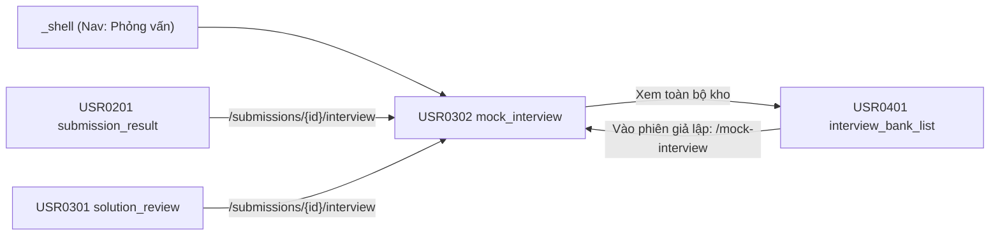

# Tài liệu thiết kế cơ bản (BD) — Phỏng vấn giả lập (`USR0302`)

## Phương châm tài liệu [Nội bộ — không cần khách duyệt]

- Viết theo **mẫu 9 sheet**. Bộ thẻ đóng, quy ước ID, ký hiệu chuẩn, ranh giới với tài liệu khác và
  checklist kiểm toán nằm ở `02-bd/_rules/bd-template-9sheet.md` — file này không chép lại.
- Phần gắn nhãn `[Nội bộ]` phục vụ sinh mã và tự kiểm toán, không phải yêu cầu của khách hàng: mục 4.5,
  mục 7.3 và các ghi chú quy ước.
- Mã màn `USR0302` theo bảng mã ở `02-bd/_rules/bd-template-9sheet.md` mục 8 dòng 143; tên file mang tiền
  tố mã.
- Khung điều hướng **không mô tả lại ở đây** — dùng chung `02-bd/screens/users/_shell.md`. Màn này có mục
  điều hướng trực tiếp trên thanh nav chính của header (Mục thứ 5: "Phỏng vấn giả lập")
  [Nguồn: 02-bd/screens/users/_shell.md:58].
- Màn này có **một popup**: xác nhận kết thúc phiên phỏng vấn sớm trước khi hết số lượt.

> Đọc cùng `01-rd/screens/users/USR0302_mock_interview.md` (hành vi ở mức yêu cầu, không lặp lại ở đây),
> `01-rd/req/ai-review.md` (F5-09→F5-16, F5-17, F5-18, F5-19, F5-22, F5-24, F5-25, F5-28),
> `01-rd/req/user_stories/a1_student.md` (`US-A1-07`), `02-bd/architecture/ai-review.md`,
> `02-bd/database/ai-review.md`, `02-bd/security/ai-review.md`.
>
> - **Mô hình 3 trạng thái**: màn hình quản lý 3 trạng thái rõ rệt trong cùng một URL:
>   1. `entry`: Cửa sổ chọn nguồn bài phỏng vấn và cấu hình phiên.
>   2. `running`: Giao diện hội thoại tương tác 1:1 trực tiếp với AI qua SSE streaming.
>   3. `result`: Báo cáo kết quả và chấm điểm Rubric 4 tiêu chí khi kết phiên.
> - **Ba giai đoạn phỏng vấn (F5-10..F5-12)**: Giải trình thuật toán → Phản biện ca biên & bẫy → Mở rộng quy mô
>   (Scale-up). AI tự quyết định chuyển giai đoạn dựa trên ngữ cảnh hội thoại.
> - **Ngữ cảnh qua Redis (`ChatMemory` F5-13)**: duy trì toàn bộ lịch sử các lượt thoại trong phiên để AI nắm
>   bắt mạch trao đổi. Redis chỉ là bộ nhớ ngữ cảnh ngắn hạn cho LLM, **không phải nguồn khôi phục phiên**: nguồn lâu dài là `ai.interview_turns` (`02-bd/database/ai-review.md:136-140`, `DEC-2026-1022-ai-judge-schema-sync`); stream từng token phản hồi qua Server-Sent Events (SSE F5-14).
> - **Rubric 4 tiêu chí cố định (F5-15)**: Độ rõ ràng — `CLARITY` (25%), Độ chính xác kỹ thuật —
>   `TECHNICAL_ACCURACY` (30%), Khả năng phản biện — `PUSHBACK_HANDLING` (25%), Nhận thức độ phức tạp —
>   `COMPLEXITY_AWARENESS` (20%) — trọng số cố định, chốt tại `02-bd/database/ai-review.md:149-150`.
> - **Ba lối vào phiên (F5-24)**: (1) Bài nộp `Accepted` gần đây; (2) Ngân hàng câu hỏi phỏng vấn F6; (3) Tự chọn
>   chủ đề tự do.
> - **Bảo mật và chống injection (F5-17)**: mã nguồn và câu trả lời của người học luôn được bọc trong block
>   dữ liệu người dùng, tách biệt khỏi chỉ thị hệ thống của AI.

> **Quy ước đặt tên khối** [Nội bộ]. Chín khối (khối `entryStats` đã bỏ 2026/10/18, owner; khối `runningSide` thêm 2026/10/21, chưa duyệt hình): `entryTabs`
> (3 tab chọn lối vào bài phỏng vấn), `entryConfig` (tham số cấu hình phiên F5-28), `runningHeader` (thanh tiến
> trình 3 giai đoạn và đồng hồ), `runningDrawer` (ngăn kéo xem lại đề bài và mã nguồn gốc), `runningChat` (khung
> chat dòng thời gian SSE), `runningControls` (ô nhập câu trả lời, nút gửi, nút xin gợi ý, nút dừng sớm),
> `earlyExitModal` (popup xác nhận kết thúc sớm), `resultSummary` (vòng điểm tổng và bảng điểm Rubric 4 tiêu chí kèm thanh điểm), `runningSide` (cột phải trạng thái `running`: thẻ "Phiên hiện tại" và thẻ "Mẹo trả lời").
> Tiền tố ID item của toàn màn là `mockInterview.`.

---

## Sheet 1. Bìa

| Mục | Giá trị |
| :--- | :--- |
| Hệ thống | AlgoPrep |
| Phân hệ | `ai-review` (F5.2) — đọc từ `interview-bank` (F6), `problem-bank` (F2), liên kết từ `judge-orchestration` (F4) |
| Công đoạn | BD — Thiết kế cơ bản |
| Phân loại | Màn hình |
| Tên màn | Phỏng vấn giả lập |
| Mã màn hình | `USR0302` |
| Tên vật lý (slug) | `mock_interview` |
| Trục tài liệu | Màn hình (`02-bd/screens/`) |
| Actor | A1 (`STUDENT`) |
| Phiên bản | V0.12 |
| Người tạo | Nhóm phát triển AlgoPrep |
| Ngày tạo | 2026/09/22 |
| Người cập nhật | Claude |
| Ngày cập nhật | 2026/10/22 |

---

## Sheet 2. Lịch sử sửa đổi

| Ver | Sheet bị sửa | Nội dung sửa | Ngày | Người sửa |
| :--- | :--- | :--- | :--- | :--- |
| V0.1 | Toàn bộ | Tạo mới theo mẫu 9 sheet. Chốt quản lý 3 trạng thái (entry/running/result), 3 lối vào F5-24, tiến trình 3 giai đoạn F5-10..F5-12, stream phản hồi SSE F5-14, rubric 4 tiêu chí F5-15 trọng số 25/30/25/20%, và popup xác nhận dừng sớm | 2026/09/22 | Nhóm phát triển AlgoPrep |
| V0.2 | Sheet 1 (header), Sheet 5, Sheet 6, Sheet 7 | Sửa lỗi review: (1) gỡ trích dẫn bịa `DEC-2026-0913-interview-rubric-fixed-weights` (không tồn tại trong decision-registry), thay bằng `02-bd/database/ai-review.md:96-97`; (2) đổi tên 4 tiêu chí rubric đúng theo RD/database — Kỹ thuật→Độ rõ ràng (`CLARITY`), Giao tiếp→Độ chính xác kỹ thuật (`TECHNICAL_ACCURACY`), Giải quyết vấn đề→Khả năng phản biện (`PUSHBACK_HANDLING`), Chất lượng mã→Nhận thức độ phức tạp (`COMPLEXITY_AWARENESS`), áp dụng cho toàn bộ field/ID/nhãn liên quan; (3) xác nhận `interviewer_level` 4 mức theo `DEC-2026-0922-users-and-admin-conflict-resolutions`, đóng Câu hỏi mở Q1 cũ; (4) viết lại Sheet 5 và Sheet 7 đúng khuôn mẫu 9 sheet (thêm cột Bảng DB/Cột DB ở Sheet 5 và 7.1, Sheet 7.3 bỏ method/path HTTP); (5) phát hiện và ghi Câu hỏi mở Q4 mới — schema chưa có cột lưu `overallScore`/`feedbackSummary` tổng hợp | 2026/09/24 | Nhóm phát triển AlgoPrep |
| V0.3 | Sheet 8, 9 | Bổ sung toast khi kết thúc phiên (EVT-14, EVT-18) và đổi báo hết hạn mức khi bắt đầu phiên sang toast; giữ nguyên nút Thử tải lại và popup xác nhận dừng sớm. Theo `DEC-2026-1003-toast-feedback-channel`. | 2026/10/03 | AI |
| V0.4 | Câu hỏi mở (Q4) | Áp `DEC-2026-1014-drop-ai-score-10`: câu so sánh Q4 với cột điểm AI quy đổi thang 10 của Solution Review không còn đúng vì cột đã bỏ, nên được viết lại; nội dung Q4 và đề xuất không đổi. Cách đánh số giữ nguyên | 2026/10/14 | AI |
| V0.5 | Sheet 5 (NO 2, 1), Sheet 7 (NO 5) | Áp `DEC-2026-1014-batch7-remaining-open-questions` (ponytail bậc 5): bỏ cột `rubric_scores.weight_percent_snapshot`; điểm tổng phiên dùng hằng số trọng số F5-15, cột nguồn chỉ còn `score`. Không đổi F5-15 | 2026/10/14 | AI |
| V0.6 | Quy ước đặt tên khối, Sheet 4 (4.4, 4.5), Sheet 5, Sheet 6, Sheet 7 (7.1, 7.3), Sheet 8 (EVT-1), Câu hỏi mở (thêm Q5) | Owner 2026/10/18: bỏ dải 3 thẻ thống kê (StatCard) ở trạng thái `entry` theo quy tắc owner 2026/10/13 "không dải KPI nhỏ trên màn prototype". Bỏ Khu vực A cũ (3 item `statsSessions`, `statsAvgScore`, `statsWeakest`), endpoint `GetMyInterviewStats`, khối `entryStats`, file `entry-stats-banner.tsx`; EVT-1 không còn gọi API. Khu vực B..I đánh lại thành A..H; sửa tham chiếu chéo. Ghi Câu hỏi mở Q5 (RD còn yêu cầu thanh chỉ số) | 2026/10/18 | AI |
| V0.7 | Sheet 4 (4.4), Câu hỏi mở Q5 | Owner 2026/10/18 (`DEC-2026-1018-usr-open-questions-phase1-scope` mục 1, ponytail bậc 1): RD `USR0302` đã bỏ mục "Thanh chỉ số"; đóng Q5, ghi F5-16 còn được đáp ứng ở bảng "Phiên gần đây" của RD và ở `USR0501`/`USR0601`. Trích dẫn `mock-interview-view.tsx:63-72` đã đọc lại. Không đổi Sheet 5-9 vì BD đã bỏ dải thống kê từ V0.6 | 2026/10/18 | Claude |
| V0.8 | Sheet 3, 4 (4.4), 6, 8 (EVT-1), Câu hỏi mở Q2, Q3, Q4 | Ghi các quyết định owner ngày 2026-10-18 (`DEC-2026-1018-usr-open-questions-phase2-5`, owner lấy đề xuất mặc định): đóng Q2 (tải lại trang khi phiên đang chạy: lưu `sessionId` vào `sessionStorage`, khôi phục bằng `GetSessionDetail` đọc từ Redis; bậc 5), Q3 (một lượt bỏ trống 15 phút thì đóng phiên và chuyển sang `result`; bậc 5), Q4 (`overallScore` tính ở tầng ứng dụng từ 4 dòng `rubric_scores`, `feedbackSummary` ghép từ 4 `comment`, không thêm cột; bậc 5, `02-bd/database/ai-review.md` do bên khác sửa nên chỉ tham chiếu theo tên). Owner bỏ lối vào "Phỏng vấn câu này" từ `USR0401`: bỏ dòng chuyển màn NO 4 và cạnh mermaid ở Sheet 3, bỏ tham số URL `question_id` (Sheet 6 A.2, EVT-1); các lối vào còn lại giữ nguyên (mục "Phỏng vấn giả lập" trên thanh nav, nút "Vào phiên giả lập" ở đầu `USR0401`, `submission_id` từ `USR0201`/`USR0301`). Lối "Kho câu hỏi" ngay trong màn (chọn một câu trong danh sách rút gọn rồi bấm "Bắt đầu phỏng vấn") giữ nguyên. Ghi nợ prototype ở mục 4.4: bản dựng giữ phiên trong bộ nhớ, chưa có `sessionStorage` và chưa có hẹn giờ 15 phút. Bản dựng không có đường tiền điền `question_id` trên URL nên không phải sửa mã | 2026/10/18 | Claude |
| V0.9 | Sheet 4 (4.4), Sheet 5 (Khu vực A NO 4, NO 5; Khu vực F NO 1) | Owner 2026/10/19 (rà soát prototype nhóm C): (1) tab "Tự chọn chủ đề" có **chip chủ đề** đọc từ danh mục chủ đề, chưa tick chủ đề nào thì không bắt đầu được (Sheet 9 NO 3 chạy thật); (2) danh sách nguồn chỉ hiện tiêu đề, **không hiện mã** `SUB-nnnn` hay `IQ-nnn`; (3) **hoãn** ngăn kéo "Xem đề và mã" ở trạng thái `running` (C20), ghi nợ prototype; (4) ô nhập tối đa 4000 ký tự, Ctrl+Enter để gửi, ô nhập `readOnly` thay vì `disabled` khi AI đang gõ; (5) vùng tin nhắn `role=log`, chỉ báo "AI đang gõ" `role=status`; (6) xoá ô nhập khi phiên kết thúc hoặc bắt đầu lại | 2026/10/19 | AI |
| V0.10 | Sheet 4 (4.4), Câu hỏi mở Q2, Q3 | Owner chốt 2026/10/19 (`DEC-2026-1019-usr-fe-audit-fixes`, chốt nốt câu hỏi mở còn lại sau rà prototype). Chỉ tài liệu, không đổi code, chưa duyệt hình. Q2 (khôi phục phiên khi tải lại) và Q3 (hết giờ 15 phút) không dựng ở prototype, đóng và hoãn sang API thật (ponytail bậc 3). Tab Trình độ: số mức lấy từ mức độ khó admin cấu hình động, RD F5-28 sửa theo. | 2026/10/19 | Claude |
| V0.11 | Quy ước đặt tên khối, Sheet 3, Sheet 4 (4.4), Sheet 5, Sheet 6, Sheet 8 (EVT-1, 13, 14, 18, thêm EVT-21), Câu hỏi mở (thêm Q6, Q7, Q8), Tham chiếu | Bản dựng lại màn ngày 2026/10/20 theo yêu cầu owner "bớt đơn điệu" (**Chưa duyệt hình**, chưa phải thiết kế được chốt). (1) `entry`: tiêu đề + phụ đề; hai cột, trái là thẻ nguồn có icon và dấu tick rồi thẻ "Phiên diễn ra thế nào" (3 giai đoạn), phải là bảng cấu hình dính (`sticky`) có mô tả từng cấp độ (`levelDesc`), dòng gạt gợi ý, nút CTA lớn có icon tên lửa. (2) `running`: 3 viên giai đoạn có dấu tick khi xong + thanh tiến độ theo lượt; tin nhắn có avatar (Bot/User) và nhãn người nói; cột phải "Phiên hiện tại" và "Mẹo trả lời"; ô soạn là MỘT thẻ (textarea 3 dòng, thanh công cụ dưới: Xin gợi ý, Kết thúc sớm chữ đỏ, bộ đếm ký tự, gợi ý "Ctrl + Enter để gửi", nút Gửi có icon). (3) `result`: vòng điểm tổng tô màu theo ngưỡng (>= 8 xanh, >= 5 vàng, còn lại đỏ) và thanh điểm từng tiêu chí. (4) Sửa route theo owner 2026/10/21: nút "Phỏng vấn giả lập" ở `USR0201` và `USR0301` đi `/submissions/{submissionId}/interview`, thay cho `/mock-interview?submission_id={id}` ở mọi chỗ; `/mock-interview` là lối vào tự do từ thanh nav và từ `USR0401`; ghi nợ view chưa đọc `submissionId`. (5) Đọc lại và sửa lệch dòng của các trích dẫn `mock-interview-view.tsx` và `use-mock-interview-session.ts`. Ngưỡng màu 8/5 và nội dung "Mẹo trả lời" là lựa chọn của prototype, chưa có quyết định (Q6, Q7) | 2026/10/21 | Claude |
| V0.12 | Sheet 4 (4.1, 4.4), Sheet 5 (Khu vực B NO 1), Sheet 8 (EVT-1), Câu hỏi mở (Q2, Q3, thêm Q9), Tham chiếu, Quy ước đầu file | Sửa 2026-10-22 đồng bộ DB, `DEC-2026-1022-ai-judge-schema-sync` (AI-03, AI-04) và `02-bd/database/ai-review.md` (AI-05, AI-18): (1) mức người phỏng vấn là **enum cố định 4 giá trị** `INTERN`/`JUNIOR`/`MIDDLE`/`SENIOR`, không còn "admin cấu hình động" (thay ghi chú của V0.10 ở mục 4.4 và Sheet 5 B NO 1); (2) khôi phục phiên khi tải lại đọc từ `ai.interview_turns`, không đọc từ Redis (Q2, EVT-1); (3) hết 15 phút bỏ trống: chưa đủ lượt thì `ABANDONED` không chấm, đủ lượt thì tự chấm `COMPLETED`; ngưỡng đủ lượt là hằng số `application.yml`, mặc định đề xuất 4 (Q3, thêm Q9 về giao diện); (4) kết thúc sớm cho `COMPLETED` có điểm (EVT-18 đã đúng, giữ); (5) sửa lệch dòng trích dẫn `02-bd/database/ai-review.md:96-97` thành `:149-150`. **Không sửa** (còn mở): `strengths`/`improvements` của `InterviewResultSummaryDto` (AI-19) và nguồn tên câu hỏi, snapshot tiêu đề (AI-20, Sheet 5 Khu vực I NO 1) | 2026/10/22 | Claude |
| V0.13 | Câu hỏi mở (Q9) | Sửa 2026-10-22 (đồng bộ DB vòng 2, `DEC-2026-1022-db-sync-round2` mục 8). Đóng Q9: phiên `ABANDONED` không có màn kết quả; quay lại thì mở `entry` kèm toast giải thích (câu chữ là đề xuất, chưa duyệt). Không đổi sheet 5/6/8 vì prototype chưa dựng đường này | 2026/10/22 | Nhóm phát triển AlgoPrep |

---

## Sheet 3. Sơ đồ chuyển màn

| STT | Màn hình nguồn | Màn hình đích | Tham số truyền | Ghi chú |
| :-: | :--- | :--- | :--- | :--- |
| 1 | Khung điều hướng (`_shell`) | Màn hình hiện tại (`USR0302`) | Không có | [Điều kiện mở] Bấm mục "Phỏng vấn giả lập" trên thanh nav chính (lối vào tự do). [Chế độ mở] Điều hướng URL `/mock-interview`. [Thông tin truyền] Không có. [Giá trị trả về] Không có. [Khi thành công] Mở màn hình ở trạng thái `entry`. [Khi huỷ] Không có. |
| 2 | `submission_result` (`USR0201`) | Màn hình hiện tại (`USR0302`) | `submissionId` | [Điều kiện mở] Bấm "Phỏng vấn giả lập" từ màn kết quả nộp bài. [Chế độ mở] Điều hướng URL `/submissions/{submissionId}/interview` (owner xác nhận 2026/10/21; trang `app/(student)/submissions/[submissionId]/interview/page.tsx` dựng `MockInterviewView`). [Thông tin truyền] `submissionId` là tham số đường dẫn. [Giá trị trả về] Không có. [Khi thành công] Đích: tự chọn tab "Bài nộp Accepted", chọn sẵn bài nộp đó và nạp sẵn cấu hình. **Nợ prototype:** view chưa đọc `submissionId` (Câu hỏi mở Q8), hiện mở ở `entry` mặc định như lối vào tự do. [Khi huỷ] Không có. |
| 3 | `solution_review` (`USR0301`) | Màn hình hiện tại (`USR0302`) | `submissionId` | [Điều kiện mở] Bấm "Phỏng vấn về bài này" từ màn phân tích. [Chế độ mở] Điều hướng URL `/submissions/{submissionId}/interview` (owner xác nhận 2026/10/21; trang `app/(student)/submissions/[submissionId]/interview/page.tsx` dựng `MockInterviewView`). [Thông tin truyền] `submissionId` là tham số đường dẫn. [Giá trị trả về] Không có. [Khi thành công] Đích: tự chọn tab "Bài nộp Accepted", chọn sẵn bài nộp đó và nạp sẵn cấu hình. **Nợ prototype:** view chưa đọc `submissionId` (Câu hỏi mở Q8), hiện mở ở `entry` mặc định như lối vào tự do. [Khi huỷ] Không có. |
| 4 | Màn hình hiện tại (`USR0302`) | `interview_bank_list` (`USR0401`) | Không có | [Điều kiện mở] Bấm link "Xem toàn bộ N câu hỏi" tại tab Kho câu hỏi. **Nợ prototype:** bản dựng chưa có link này (grep `interview-bank` trong `views/users/mock-interview/ui/` không có kết quả). [Chế độ mở] Điều hướng sang `/interview-bank`. [Thông tin truyền] Không có. [Giá trị trả về] Không có. [Khi thành công] Mở danh sách ngân hàng câu hỏi. [Khi huỷ] Giữ nguyên màn hiện tại. |
| 5 | `interview_bank_list` (`USR0401`) | Màn hình hiện tại (`USR0302`) | Không có | [Điều kiện mở] Bấm nút "Vào phiên giả lập" ở đầu `USR0401`. [Chế độ mở] Điều hướng URL `/mock-interview` (`05-coding/frontend/src/views/users/interview-bank-list/ui/interview-bank-list-view.tsx:321`). [Thông tin truyền] Không có. [Giá trị trả về] Không có. [Khi thành công] Mở màn hình ở trạng thái `entry`. [Khi huỷ] Không có. |

[Ghi chú 2026/10/18] Lối vào "Phỏng vấn câu này" từ `USR0401` đã **bỏ** (owner, `DEC-2026-1018-usr-open-questions-phase2-5`, mục theo dõi): không có chuyển màn từ `USR0401` kèm `question_id`. Từ `USR0401` chỉ còn nút "Vào phiên giả lập" ở đầu trang mở `/mock-interview` không tham số, ngoài mục "Phỏng vấn giả lập" trên thanh nav. Câu hỏi F6 vẫn chọn được ngay trong màn, ở tab "Kho câu hỏi".

[Sửa route 2026/10/21, owner xác nhận, chưa duyệt hình] Mọi chỗ ghi `/mock-interview?submission_id={id}` đã đổi thành `/submissions/{submissionId}/interview`; liên kết thật ở `submission-result-view.tsx:327` và `:503`, `solution-review-view.tsx:267` (cùng thư mục `05-coding/frontend/src/views/users/`). `/mock-interview` chỉ còn là lối vào tự do (thanh nav `widgets/app-shell/model/student-nav.ts:40`, `USR0401`, và `recent-interviews-block.tsx:45` của `USR0601`). **Nợ:** `MockInterviewView` chưa nhận `submissionId` (không có `useParams`/`searchParams`), nên hai route cho cùng một giao diện `entry` mặc định.

---

## Sheet 4. Bố cục màn hình

### 4.1. Tổng quan theo thẻ

- `[Mục đích màn]` Cung cấp môi trường luyện phỏng vấn kỹ thuật trực tiếp 1:1 với AI, mô phỏng quy trình phỏng vấn chuẩn của các công ty công nghệ lớn, đánh giá kỹ năng diễn giải và phản biện thuật toán.
- `[Luồng nghiệp vụ chính]` Người học chọn một chủ đề phỏng vấn (từ bài nộp, kho câu hỏi, hoặc chủ đề tự do), cấu hình tham số phiên rồi bắt đầu. Trong phiên, AI đặt câu hỏi qua 3 giai đoạn (Giải trình, Phản biện, Mở rộng); người học trả lời qua ô nhập liệu. Khi kết phiên (hết lượt hoặc chủ động dừng), AI chấm điểm theo Rubric 4 tiêu chí và đưa ra lộ trình cải thiện.
- `[Người dùng]` Học viên (A1).
- `[Tệp liên quan]` `01-rd/screens/users/USR0302_mock_interview.md`, `09-layoutBase/Phỏng vấn giả lập.dc.html`.
- `[Phạm vi]` Một phiên phỏng vấn đơn lẻ từ lúc bắt đầu cấu hình đến khi hoàn tất và xem điểm. Tải lại trang khi phiên đang chạy thì khôi phục phiên qua `sessionStorage` + `GetSessionDetail`, đọc các lượt từ `ai.interview_turns` (Q2); phiên bỏ trống 15 phút: đủ lượt thì tự chấm điểm và sang `COMPLETED`, chưa đủ lượt thì sang `ABANDONED` và không chấm điểm (Q3). Kết thúc sớm (popup) cho `COMPLETED` có điểm tính từ các lượt đã có.
- `[Quyền sử dụng]` Yêu cầu đăng nhập học viên; kiểm tra hạn mức ngân sách token cá nhân trước khi mở phiên.
- `[Số bản ghi tối đa]` Mỗi phiên tối đa 16 lượt hỏi đáp (turn); lịch sử chat lưu toàn văn trong phiên.

### 4.2. Danh sách cấu trúc dữ liệu màn hình (DTOs)

| STT | Tên DTO | Mô tả | Chi tiết trường |
| :-: | :--- | :--- | :--- |
| 1 | `InterviewSessionInitDto` | Yêu cầu khởi tạo phiên | `entryMode`, `submissionId`, `questionId` (chọn trong tab "Kho câu hỏi" ngay trong màn, không đến từ URL), `customTopic`, `difficultyLevel`, `maxTurns`, `hintAllowed` |
| 2 | `InterviewSessionDetailDto` | Chi tiết phiên đang chạy | `sessionId`, `currentStage`, `currentTurn`, `maxTurns`, `startTime`, `elapsedSeconds`, `problemContext`, `sourceCode` |
| 3 | `InterviewMessageDto` | Một tin nhắn trong khung chat | `id`, `sender` (AI/USER), `content`, `stage`, `turnIndex`, `sentAt`, `isStreaming` |
| 4 | `InterviewResultSummaryDto` | Kết quả tổng kết phiên | `sessionId`, `overallScore`, `clarityScore`, `technicalAccuracyScore`, `pushbackHandlingScore`, `complexityAwarenessScore`, `feedbackSummary`, `strengths`, `improvements` |

### 4.3. Danh sách bảng dữ liệu

| STT | Tên bảng | Mô tả | Thao tác | Bounded Context |
| :-: | :--- | :--- | :--- | :--- |
| 1 | `ai.interview_sessions` | Lưu trữ phiên phỏng vấn và kết quả rubric | C, R, U | `ai-review` |
| 2 | `ai.interview_turns` | Lưu trữ chi tiết từng lượt hỏi đáp | C, R | `ai-review` |
| 3 | `interview.interview_questions` | Câu hỏi từ kho F6 khi mở từ lối 2 | R | `interview-bank` |
| 4 | `judge.submissions` | Mã nguồn bài nộp khi mở từ lối 1 | R | `judge-orchestration` |

### 4.4. Vùng bố cục bám prototype

Màn hình thay đổi bố cục linh hoạt theo 3 trạng thái:

| Ký hiệu | Tên khu vực | Tham chiếu prototype | Ghi chú |
| :-: | :--- | :--- | :--- |
| **A** | 3 tab chọn lối vào (Entry Tabs) | `Phỏng vấn giả lập.dc.html:118-121` | Trạng thái `entry`: Bài Accepted / Kho câu hỏi / Tự chọn. Bản dựng 2026/10/21: cột trái; nguồn là thẻ có icon + dấu tick, thêm thẻ "Phiên diễn ra thế nào" bên dưới |
| **B** | Cấu hình phiên (Entry Config) | `Phỏng vấn giả lập.dc.html:166-196` | Trạng thái `entry`: Chọn cấp độ (kèm mô tả `levelDesc`), số lượt, gợi ý (F5-28). Bản dựng 2026/10/21: cột phải rộng 340px, dính khi cuộn, nút CTA lớn có icon |
| **C** | Thanh tiến trình 3 giai đoạn (Running Header) | `Phỏng vấn giả lập.dc.html:202-218` | Trạng thái `running`: Giải trình → Phản biện → Mở rộng. Bản dựng 2026/10/21: 3 viên có dấu tick khi xong + thanh tiến độ theo lượt |
| **D** | Ngăn kéo đề bài & mã nguồn (Running Drawer) | `Phỏng vấn giả lập.dc.html:220-235` | Trạng thái `running`: Drawer trượt ra xem lại mã đã nộp |
| **E** | Khung hội thoại streaming (Running Chat) | `Phỏng vấn giả lập.dc.html:240-310` | Trạng thái `running`: Luồng chat với AI; bản dựng 2026/10/21: tin nhắn có avatar và nhãn người nói (hiển thị văn bản thuần `whitespace-pre-wrap`, chưa dựng Markdown) |
| **F** | Thanh tương tác chat (Running Controls) | `Phỏng vấn giả lập.dc.html:315-340` | Trạng thái `running`: bản dựng 2026/10/21 gộp thành MỘT thẻ: ô nhập 3 dòng, thanh công cụ dưới (xin gợi ý, kết thúc sớm, bộ đếm ký tự, gợi ý phím tắt, nút Gửi) |
| **G** | Popup xác nhận dừng phiên sớm | `[SoT: Suy luận]` | Hộp thoại cảnh báo kết thúc trước khi đủ số lượt |
| **H** | Bảng điểm Rubric & nhận xét (Result Summary) | `Phỏng vấn giả lập.dc.html:350-410` | Trạng thái `result`: vòng điểm tổng tô màu theo ngưỡng + 4 thẻ tiêu chí có thanh điểm (bản dựng 2026/10/21) |
| **I** | Cột phải trạng thái `running` (Running Side) | `[SoT: Suy luận]` (không có trong prototype `.dc.html`; thêm ở bản dựng 2026/10/20) | Thẻ "Phiên hiện tại" (nguồn, cấp độ, lượt còn lại, gợi ý) và thẻ "Mẹo trả lời" (3 mẹo); rộng 300px từ `lg`, xếp dưới khung chat ở màn nhỏ |

`[Hiện trạng bản dựng]` (đọc lại 2026/10/21; V0.11 sửa lệch dòng sau lần dựng lại) Trạng thái `entry` trong `05-coding/frontend/src/views/users/mock-interview/ui/mock-interview-view.tsx` mở đầu bằng thẻ chọn lối vào (3 tab và danh sách nguồn, dòng 156-238), thẻ "Phiên diễn ra thế nào" (dòng 240-262) rồi bảng cấu hình phiên ở cột phải (dòng 265-333); **dải 3 thẻ thống kê (số phiên, điểm TB, tiêu chí yếu) đã bỏ 2026-10-18, owner** (quy tắc owner 2026/10/13). Khu vực A cũ, endpoint `GetMyInterviewStats` và EVT-1 bước tải thống kê bị bỏ theo; RD đã sửa theo, xem Câu hỏi mở Q5 (đã chốt 2026-10-18). Trạng thái `running` (khung chat) gắn `data-fullscreen-view` nên khung student cho nó toàn bộ chiều cao còn lại (bỏ `calc(100vh - 84px)` viết cứng, 2026-10-18); trạng thái `entry` và `result` vẫn là trang cuộn thường.

`[Hiện trạng bản dựng]` **Tab Trình độ (sửa 2026/10/22, `DEC-2026-1022-ai-judge-schema-sync` mục 1, AI-03):** mức người phỏng vấn là **enum cố định 4 giá trị** `INTERN`, `JUNIOR`, `MIDDLE`, `SENIOR`, cùng enum với `identity.user_preferences.preferred_interview_level` (`02-bd/database/ai-review.md:105`); **không** lấy từ danh sách mức độ khó admin cấu hình động. Quyết định 2026/10/19 ở V0.10 (mức "admin cấu hình động") **bị thay thế**. Bản dựng dùng hằng `INTERVIEWER_LEVELS` (`05-coding/frontend/src/entities/mock-interview/model/types.ts:71`), khớp thiết kế mới; không còn nợ "chưa đọc danh sách động". RD F5-28 còn câu chữ cũ "admin cấu hình": thuộc RD, sheet này không sửa.

`[Hiện trạng bản dựng]` **Cập nhật 2026/10/19 (rà soát nhóm C):** tab "Tự chọn chủ đề" đã có chip chủ đề (`mock-interview-view.tsx`, nhóm `role=group`, nhãn từ `useInterviewTopics`) và nút Bắt đầu chỉ bật khi tick ít nhất một chủ đề (`use-mock-interview-session.ts`, `canStart`); hai danh sách nguồn chỉ hiện tiêu đề, không hiện mã. **Nợ còn lại:** (e) khu vực D (ngăn kéo "Xem đề và mã", nút C.6, EVT-11, EVT-12) **chưa có** ở trạng thái `running`: owner hoãn 2026/10/19, làm khi có dữ liệu đề bài và mã nộp thật; (f) câu hỏi kịch bản, gợi ý và nhận xét kết quả là chuỗi tiếng Việt cố định trong mock, không qua `t()`, hiện cả ở giao diện `en`.

`[Hiện trạng bản dựng]` **Nợ prototype so với các quyết định 2026/10/18** (đọc `model/use-mock-interview-session.ts` và `ui/mock-interview-view.tsx`, chưa đổi mã): (a) Q2 chưa có: phiên và tin nhắn nằm trong bộ nhớ (`useState`, `use-mock-interview-session.ts:34-52`), không có `sessionStorage`, tải lại trang là mất phiên và quay về `entry`; (b) Q3 chưa có: chỉ có đồng hồ đếm giờ phiên (`:102`) và hiệu ứng stream giả (`:78`), không có hẹn giờ 15 phút; (c) Q4: `computeInterviewResult` ở `entities/mock-interview/api/__mock__/mock-interview-mocks.ts:85` trả sẵn một đối tượng kết quả mock, chưa tính từ 4 dòng rubric; **Owner chốt 2026/10/19: (a) Q2 và (b) Q3 không dựng ở prototype, hoãn sang lúc nối API thật (ponytail bậc 3); câu hỏi đóng, hành vi đích vẫn ở Q2, Q3 và EVT-1.** (d) bỏ lối vào từ `USR0401`: bản dựng **khớp**, không đọc `question_id` hay `submissionId` từ URL (grep `searchParams`, `useParams` trong `views/users/mock-interview/**` không có kết quả, đọc lại 2026/10/21); câu hỏi F6 chọn ngay trong tab "Kho câu hỏi" (`mock-interview-view.tsx:191-204`, `setQuestionId` ở `:198`).

`[Hiện trạng bản dựng]` **Dựng lại 2026/10/20, đọc lại 2026/10/21 (owner yêu cầu bớt đơn điệu; chưa duyệt hình, chưa phải thiết kế được chốt).** Giao diện nằm trọn trong `mock-interview-view.tsx`, chuỗi chữ ở namespace `mockInterview` của `05-coding/frontend/messages/vi.json:2102-2178`:

- `entry` (`:143-335`): tiêu đề `title` + phụ đề `subtitle` (`:148-151`); lưới hai cột `minmax(0,1fr)_340px` từ `lg` (`:154`). Cột trái: thẻ nguồn gồm `SegmentedTabs` 3 lối vào và danh sách `PickRow` có icon theo nguồn (`SOURCE_ICON` `:61-65`) và dấu `Check` ở dòng được chọn (`:73-114`); thẻ `howTitle` "Phiên diễn ra thế nào" liệt kê 3 giai đoạn kèm mô tả `how.*` (`:240-262`). Cột phải: `aside` `lg:sticky lg:top-24` (`:265`) có cấp độ + mô tả `levelDesc.*` theo cấp đang chọn (`:281-283`), số lượt, dòng gạt gợi ý có icon bóng đèn (`:305-318`), nút CTA `startCta` có icon `Rocket` (`:320-332`). Khoá `startMockInterviewUnavailable` không còn được mã gọi (grep `src` không có kết quả).
- `running` (`:339-602`): 3 viên giai đoạn, viên đang chạy `aria-current="step"`, viên đã qua có `Check` (`:358-380`); `turnCount` + đồng hồ (`:381-389`); thanh tiến độ `turnCount / maxTurns` (`:391-398`). Tin nhắn: avatar `Bot`/`User`, nhãn `aiName`/`youName`, tin AI nằm trái, tin của người học nằm phải (`:411-458`), rộng tối đa 78%. Ô soạn một thẻ (`:471-535`): `TextArea` 3 dòng, `readOnly` khi AI gõ, giới hạn 4000 ký tự (`MESSAGE_MAX_LENGTH` `:51`), Ctrl/Cmd + Enter gửi (`:480-490`); thanh công cụ có nút Xin gợi ý chỉ hiện khi `hintAllowed` (`:495-509`), nút Kết thúc sớm chữ đỏ mở `ConfirmDialog` (`:510-518`, `:585-599`), bộ đếm `{n} / 4000` + `sendShortcut` (`:519-521`), nút Gửi có icon `SendHorizontal`, tắt khi AI gõ hoặc ô trống (`:522-533`). Cột phải (`:538-582`): thẻ `sessionTitle` (nguồn, cấp độ, lượt còn lại = `maxTurns - turnCount`, gợi ý bật/tắt) và thẻ `tipsTitle` với `tip1..tip3`.
- `result` (`:604-680`): vòng điểm tổng viền 6px tô bằng `scoreColor` (`:67-71`: điểm >= 8 `--color-success`, >= 5 `--color-admin-warn`, còn lại `--color-admin-negative`), cạnh là `feedbackSummary`; lưới 2 cột 4 thẻ tiêu chí, mỗi thẻ có `{score} / 10` và thanh điểm rộng `score * 10`% cùng màu theo ngưỡng (`:628-662`); nút `retryCta` và `backCta` (liên kết `/problems`, `:664-678`).
- Kiểm thử `mock-interview-view.test.tsx` phủ: 3 tab và 4 cấp độ (`:17-32`), nút Bắt đầu bị khoá đến khi chọn nguồn (`:34-44`), đúng 4 nhãn rubric ở `result` (`:46-71`), không hiện mã `SUB-`/`IQ-` (`:73-79`), tab chủ đề đòi tick chip (`:81-92`). **Chưa có test** cho thanh tiến độ, nhãn người nói, cột phải, Ctrl+Enter, màu theo ngưỡng.
- **Nợ prototype 2026/10/21:** (g) view chưa đọc `submissionId` từ route `/submissions/{submissionId}/interview` (Q8); (h) ngưỡng màu 8 và 5, nội dung `tip1..tip3`, `levelDesc`, `how.*` là chữ và số do prototype tự chọn, chưa có quyết định (Q6, Q7); (i) màu vàng/đỏ dùng token `--color-admin-warn`, `--color-admin-negative` đặt tên theo khu admin, `[SoT: Suy luận]` chưa có token chung cho màn học viên; (j) khoá `startMockInterviewUnavailable` còn nằm ở `messages/vi.json:1929` và `messages/en.json:2058` (không thuộc namespace `mockInterview`) nhưng không còn nơi gọi: khoá thừa.

### 4.5. Cấu trúc slice FSD [Nội bộ]

- Route: `/mock-interview` (lối vào tự do) và `/submissions/{submissionId}/interview` (từ `USR0201`/`USR0301`, cùng dựng `MockInterviewView`; owner xác nhận 2026/10/21)
- Ghi chú bản dựng: cấu trúc file bên dưới là đích; bản dựng hiện gom toàn bộ giao diện vào `ui/mock-interview-view.tsx` và `model/use-mock-interview-session.ts`.
- View slice: `src/views/users/mock-interview/`
  - `ui/mock-interview-page.tsx`
  - `ui/entry/entry-source-tabs.tsx`
  - `ui/entry/session-config-panel.tsx`
  - `ui/running/running-stage-header.tsx`
  - `ui/running/chat-stream-timeline.tsx`
  - `ui/running/chat-input-toolbar.tsx`
  - `ui/running/code-reference-drawer.tsx`
  - `ui/running/early-exit-confirm-modal.tsx`
  - `ui/result/interview-rubric-card.tsx`
  - `model/use-mock-interview-session.ts` (quản lý state machine: `entry` -> `running` -> `result`)

---

## Sheet 5. Danh sách item màn hình

> Cột và bộ thẻ: `02-bd/_rules/bd-template-9sheet.md` mục 2, 3, 4.

### Khu vực A — 3 tab chọn lối vào (Trạng thái Entry)

| Khu vực | NO | Tên item | ID item | Bảng DB | Cột DB | Loại UI | Kiểu | Độ dài | Bắt buộc | I/O | Giá trị mặc định | Định dạng | Ghi chú |
| :--- | --: | :--- | :--- | :--- | :--- | :--- | :--- | :-: | :-: | :-: | :--- | :--- | :--- |
| 3 tab chọn lối vào | | | | | | | | | | | | | |
| | 1 | Tab Bài nộp Accepted | `mockInterview.entry.tabAccepted` | - | - | Toggle | String | 30 | Có | I/O | `ACTIVE` | - | Lối vào từ bài giải đã nộp, ứng với `entry_type = SUBMISSION` (F5-24) [Nguồn giá trị] Trạng thái tab chọn tại giao diện [EVT liên quan] EVT-2 |
| | 2 | Tab Kho câu hỏi F6 | `mockInterview.entry.tabBank` | - | - | Toggle | String | 30 | Có | I/O | `` | - | Lối vào từ ngân hàng câu hỏi, ứng với `entry_type = QUESTION_BANK` [Nguồn giá trị] Trạng thái tab chọn tại giao diện [EVT liên quan] EVT-3 |
| | 3 | Tab Tự chọn chủ đề | `mockInterview.entry.tabCustom` | - | - | Toggle | String | 30 | Có | I/O | `` | - | Lối vào tự do, ứng với `entry_type = TOPIC_SELECTION` [Nguồn giá trị] Trạng thái tab chọn tại giao diện [EVT liên quan] EVT-4 |
| | 4 | Danh sách bài nộp mẫu | `mockInterview.entry.listAccepted` | `judge.submissions` | `id`, `problem_id`, `status`, `created_at` | List | String | 2000 | Không | I/O | rỗng | - | Danh sách bài nộp `ACCEPTED` gần đây của chính người dùng; mỗi dòng là thẻ có icon nguồn, tiêu đề bài, nhãn ngôn ngữ và dấu tick ở dòng được chọn (bản dựng 2026/10/21, chưa duyệt hình) [Nguồn giá trị] Kết quả gọi `ListMyAcceptedSubmissions` [EVT liên quan] EVT-5 |
| | 5 | Danh sách câu hỏi F6 | `mockInterview.entry.listBankQuestions` | `interview.interview_questions` | `id`, `title` | List | String | 2000 | Không | I/O | rỗng | - | Danh sách câu hỏi gợi ý từ kho F6; dòng thẻ có icon và dấu tick như trên (bản dựng 2026/10/21) [Nguồn giá trị] Kết quả gọi `ListInterviewBankShortlist` [EVT liên quan] EVT-6 |
| | 6 | Tiêu đề và phụ đề màn | `mockInterview.entry.lblHeading` | - | - | Label | String | 200 | Có | O | `Phỏng vấn giả lập` | - | Tiêu đề `title` và phụ đề `subtitle` ở đầu trạng thái `entry` (bản dựng 2026/10/21, chưa duyệt hình) [Nguồn giá trị] Nhãn tĩnh i18n [EVT liên quan] - |
| | 7 | Thẻ "Phiên diễn ra thế nào" | `mockInterview.entry.cardHow` | - | - | Label | String | 600 | Không | O | - | - | Giải thích 3 giai đoạn F5-10..F5-12, mỗi giai đoạn một icon và một câu mô tả (`how.explain`, `how.challenge`, `how.scaleUp`); nội dung câu mô tả là chữ của prototype (Câu hỏi mở Q7) [Nguồn giá trị] Nhãn tĩnh i18n [EVT liên quan] - |

### Khu vực B — Cấu hình phiên (Trạng thái Entry)

| Khu vực | NO | Tên item | ID item | Bảng DB | Cột DB | Loại UI | Kiểu | Độ dài | Bắt buộc | I/O | Giá trị mặc định | Định dạng | Ghi chú |
| :--- | --: | :--- | :--- | :--- | :--- | :--- | :--- | :-: | :-: | :-: | :--- | :--- | :--- |
| Cấu hình phiên | | | | | | | | | | | | | |
| | 1 | Cụm chọn Cấp độ | `mockInterview.entry.optLevel` | `ai.interview_sessions` | `interviewer_level` | Toggle | Enum | 20 | Có | I/O | `MIDDLE` | - | Chọn mức độ: Intern, Junior, Middle, Senior — 4 mức cố định thống nhất toàn hệ thống (enum, không do admin cấu hình, xem 4.4); dòng mô tả `levelDesc.*` đổi theo cấp đang chọn ngay dưới cụm (item `mockInterview.entry.lblLevelDesc`, chữ là lựa chọn của prototype, Q7) [Nguồn giá trị] Tham số F5-28, ghi vào cột `interviewer_level` (`02-bd/database/ai-review.md:105`, mục 1.4; `DEC-2026-0922-users-and-admin-conflict-resolutions` mục (2); chốt lại `DEC-2026-1022-ai-judge-schema-sync` mục 1) [EVT liên quan] EVT-7 |
| | 2 | Cụm chọn Số lượt hỏi | `mockInterview.entry.optTurns` | `ai.interview_sessions` | `max_turns` | Toggle | Number | 10 | Có | I/O | `12` | Số nguyên | Số lượt tối đa: 8, 12 hoặc 16 lượt [Nguồn giá trị] Tham số F5-28, ghi vào cột `max_turns` [EVT liên quan] EVT-8 |
| | 3 | Toggle Cho phép gợi ý | `mockInterview.entry.togHint` | `ai.interview_sessions` | `hint_allowed` | Toggle | Boolean | 10 | Có | I/O | `true` | - | Bật/tắt nút xin gợi ý trong phiên; bản dựng 2026/10/21 đặt thành một dòng có icon bóng đèn, nhãn bên trái và công tắc bên phải [Nguồn giá trị] Tham số F5-28, ghi vào cột `hint_allowed` [EVT liên quan] EVT-9 |
| | 4 | Nút Bắt đầu phiên | `mockInterview.entry.btnStart` | - | - | Button | String | 30 | Có | I | - | - | Khởi tạo phiên và chuyển sang trạng thái `running`; nút CTA to có icon tên lửa, rộng hết cột phải (bản dựng 2026/10/21). Khoá `startMockInterviewUnavailable` không còn dùng [Nguồn giá trị] Nhãn tĩnh i18n [EVT liên quan] EVT-10 |

### Khu vực C — Thanh tiến trình 3 giai đoạn (Trạng thái Running)

| Khu vực | NO | Tên item | ID item | Bảng DB | Cột DB | Loại UI | Kiểu | Độ dài | Bắt buộc | I/O | Giá trị mặc định | Định dạng | Ghi chú |
| :--- | --: | :--- | :--- | :--- | :--- | :--- | :--- | :-: | :-: | :-: | :--- | :--- | :--- |
| Thanh tiến trình 3 giai đoạn | | | | | | | | | | | | | |
| | 1 | Chỉ báo Giai đoạn 1 | `mockInterview.running.stepExplain` | `ai.interview_sessions` | `stage` | Badge | String | 30 | Có | O | `1. Giải trình` | - | Giai đoạn giải trình thuật toán F5-10; ba chỉ báo là viên bo tròn: viên đang chạy viền xanh chủ đạo, viên đã qua viền xanh lá kèm dấu tick, viên chưa tới viền xám (bản dựng 2026/10/21) [Nguồn giá trị] Cột `stage`, làm nổi khi `stage = EXPLAIN` [EVT liên quan] - |
| | 2 | Chỉ báo Giai đoạn 2 | `mockInterview.running.stepChallenge` | `ai.interview_sessions` | `stage` | Badge | String | 30 | Có | O | `2. Phản biện` | - | Giai đoạn phản biện ca biên F5-11 [Nguồn giá trị] Cột `stage`, làm nổi khi `stage = CHALLENGE` [EVT liên quan] - |
| | 3 | Chỉ báo Giai đoạn 3 | `mockInterview.running.stepScaleUp` | `ai.interview_sessions` | `stage` | Badge | String | 30 | Có | O | `3. Mở rộng` | - | Giai đoạn mở rộng quy mô dữ liệu F5-12 [Nguồn giá trị] Cột `stage`, làm nổi khi `stage = SCALE_UP` [EVT liên quan] - |
| | 4 | Đếm số lượt hỏi | `mockInterview.running.lblTurnCount` | `ai.interview_sessions` | `turn_count`, `max_turns` | Label | String | 20 | Có | O | `Lượt 0 / 12` | `Lượt {số} / {số}` | Số lượt hiện tại trên tổng số lượt [Nguồn giá trị] Cột `turn_count` / `max_turns` [EVT liên quan] - |
| | 5 | Đồng hồ bấm giờ | `mockInterview.running.lblTimer` | `ai.interview_sessions` | `started_at` | Label | String | 20 | Có | O | `00:00` | `{phút}:{giây}` | Thời gian đã trôi qua trong phiên [Công thức] Bộ đếm giây phía giao diện tính từ `started_at` [EVT liên quan] - |
| | 6 | Nút Mở ngăn kéo mã | `mockInterview.running.btnOpenDrawer` | - | - | Button | String | 30 | Có | I | - | - | Mở drawer xem lại đề bài và mã nguồn gốc [Nguồn giá trị] Nhãn tĩnh i18n [EVT liên quan] EVT-11 |
| | 7 | Thanh tiến độ theo lượt | `mockInterview.running.barProgress` | `ai.interview_sessions` | `turn_count`, `max_turns` | Label | Number | 10 | Có | O | `0` | `{phần trăm}%` | Thanh dưới các viên giai đoạn, rộng `min(100, turn_count / max_turns * 100)`% (bản dựng 2026/10/21, chưa duyệt hình) [Công thức] `turn_count / max_turns` [EVT liên quan] - |

### Khu vực D — Ngăn kéo đề bài & mã nguồn (Trạng thái Running)

| Khu vực | NO | Tên item | ID item | Bảng DB | Cột DB | Loại UI | Kiểu | Độ dài | Bắt buộc | I/O | Giá trị mặc định | Định dạng | Ghi chú |
| :--- | --: | :--- | :--- | :--- | :--- | :--- | :--- | :-: | :-: | :-: | :--- | :--- | :--- |
| Ngăn kéo đề bài & mã nguồn | | | | | | | | | | | | | |
| | 1 | Vùng đề bài tham chiếu | `mockInterview.drawer.txtStatement` | `problem.problems` | `statement_md` | TextArea | String | 10000 | Có | O | - | Markdown | Nội dung đề bài dạng Markdown, chỉ có khi `entry_type = SUBMISSION` [Nguồn giá trị] Cột `statement_md`, tra theo `submissions.problem_id` [EVT liên quan] - |
| | 2 | Vùng mã nguồn đã nộp | `mockInterview.drawer.viewerCode` | `judge.submissions` | `source_code` | TextArea | String | 50000 | Có | O | - | - | Monaco Editor chỉ đọc hiển thị mã đã nộp [Nguồn giá trị] Cột `source_code` [EVT liên quan] - |
| | 3 | Nút Đóng ngăn kéo | `mockInterview.drawer.btnClose` | - | - | Button | String | 20 | Có | I | - | - | Đóng drawer, quay về khung chat [Nguồn giá trị] Nhãn tĩnh i18n [EVT liên quan] EVT-12 |

### Khu vực E — Khung hội thoại streaming (Trạng thái Running)

| Khu vực | NO | Tên item | ID item | Bảng DB | Cột DB | Loại UI | Kiểu | Độ dài | Bắt buộc | I/O | Giá trị mặc định | Định dạng | Ghi chú |
| :--- | --: | :--- | :--- | :--- | :--- | :--- | :--- | :-: | :-: | :-: | :--- | :--- | :--- |
| Khung hội thoại streaming | | | | | | | | | | | | | |
| | 1 | Luồng tin nhắn chat | `mockInterview.chat.streamTimeline` | `ai.interview_turns` | `role`, `content`, `turn_index`, `stage_at_turn` | List | String | 100000 | Có | O | rỗng | - | Dòng thời gian các bubble tin nhắn F5-14; nguồn sự thật lâu dài là `interview_turns`, phiên đang mở đọc nhanh qua Redis `ChatMemory` [Nguồn giá trị] Nhận qua Server-Sent Events (SSE) khi phiên đang chạy; nạp lại từ `interview_turns` khi mở lại phiên [EVT liên quan] - |
| | 2 | Chỉ báo AI đang gõ | `mockInterview.chat.typingIndicator` | - | - | Label | String | 30 | Không | O | `` | - | Hiệu ứng hiển thị khi SSE đang stream token [Nguồn giá trị] Trạng thái stream phía giao diện, không lưu DB [EVT liên quan] - |
| | 3 | Avatar và nhãn người nói | `mockInterview.chat.lblSpeaker` | `ai.interview_turns` | `role` | Label | String | 30 | Có | O | - | - | Mỗi tin có avatar tròn (icon Bot cho `role = AI`, icon User cho `role = USER`) và nhãn `aiName` "Người phỏng vấn AI" hoặc `youName` "Bạn"; tin AI nằm trái, tin của người học nằm phải (bản dựng 2026/10/21, chưa duyệt hình) [Nguồn giá trị] Cột `role`, nhãn tĩnh i18n [EVT liên quan] - |

### Khu vực F — Thanh tương tác chat (Trạng thái Running)

| Khu vực | NO | Tên item | ID item | Bảng DB | Cột DB | Loại UI | Kiểu | Độ dài | Bắt buộc | I/O | Giá trị mặc định | Định dạng | Ghi chú |
| :--- | --: | :--- | :--- | :--- | :--- | :--- | :--- | :-: | :-: | :-: | :--- | :--- | :--- |
| Thanh tương tác chat | | | | | | | | | | | | | |
| | 1 | Ô nhập câu trả lời | `mockInterview.controls.txtMessage` | `ai.interview_turns` | `content` | TextArea | String | 4000 | Có | I | `` | - | Người học gõ câu trả lời phỏng vấn (textarea 3 dòng trong thẻ soạn duy nhất, `readOnly` khi AI đang gõ), ghi thành một dòng `interview_turns` (`role = USER`) khi gửi [Nguồn giá trị] Người dùng nhập [EVT liên quan] EVT-13 |
| | 2 | Nút Gửi câu trả lời | `mockInterview.controls.btnSend` | - | - | Button | String | 20 | Có | I | - | - | Gửi câu trả lời lên máy chủ; bản dựng 2026/10/21 có icon gửi, nằm cuối thanh công cụ của thẻ soạn [Nguồn giá trị] Nhãn tĩnh i18n [EVT liên quan] EVT-14 |
| | 3 | Nút Xin gợi ý | `mockInterview.controls.btnHint` | - | - | Button | String | 30 | Không | I | - | - | Yêu cầu AI đưa ra gợi ý giải pháp (F5-28), chỉ hiện khi `hintAllowed = true`; bản dựng 2026/10/21 là nút có icon bóng đèn ở thanh công cụ dưới ô nhập [Nguồn giá trị] Nhãn tĩnh i18n [EVT liên quan] EVT-15 |
| | 4 | Nút Kết thúc sớm | `mockInterview.controls.btnStopEarly` | - | - | Button | String | 30 | Có | I | - | - | Kích hoạt popup xác nhận kết thúc sớm; bản dựng 2026/10/21 là nút icon cờ, chữ đỏ, ở thanh công cụ dưới ô nhập [Nguồn giá trị] Nhãn tĩnh i18n [EVT liên quan] EVT-16 |
| | 5 | Bộ đếm ký tự | `mockInterview.controls.lblCharCount` | - | - | Label | String | 20 | Có | O | `0 / 4000` | `{số} / 4000` | Số ký tự đang gõ trên giới hạn 4000 (bản dựng 2026/10/21) [Công thức] Độ dài chuỗi trong ô nhập [EVT liên quan] EVT-13 |
| | 6 | Gợi ý phím tắt gửi | `mockInterview.controls.lblSendShortcut` | - | - | Label | String | 30 | Có | O | `Ctrl + Enter để gửi` | - | Nằm cạnh bộ đếm ký tự; Ctrl hoặc Cmd + Enter gửi tin khi AI không gõ và ô không trống [Nguồn giá trị] Nhãn tĩnh i18n (`sendShortcut`) [EVT liên quan] EVT-21 |

### Khu vực G — Popup xác nhận dừng sớm

| Khu vực | NO | Tên item | ID item | Bảng DB | Cột DB | Loại UI | Kiểu | Độ dài | Bắt buộc | I/O | Giá trị mặc định | Định dạng | Ghi chú |
| :--- | --: | :--- | :--- | :--- | :--- | :--- | :--- | :-: | :-: | :-: | :--- | :--- | :--- |
| Popup xác nhận dừng sớm | | | | | | | | | | | | | |
| | 1 | Tiêu đề popup | `mockInterview.earlyExit.lblTitle` | - | - | Label | String | 50 | Có | O | `Kết thúc phiên phỏng vấn?` | - | Tiêu đề cảnh báo [Nguồn giá trị] Nhãn tĩnh i18n [EVT liên quan] - |
| | 2 | Nội dung cảnh báo | `mockInterview.earlyExit.lblMessage` | - | - | Label | String | 200 | Có | O | - | - | Giải thích hệ quả khi dừng sớm [Nguồn giá trị] Nhãn tĩnh i18n [EVT liên quan] - |
| | 3 | Nút Tiếp tục phỏng vấn | `mockInterview.earlyExit.btnResume` | - | - | Button | String | 20 | Có | I | - | - | Đóng popup, trở lại phiên chat [Nguồn giá trị] Nhãn tĩnh i18n [EVT liên quan] EVT-17 |
| | 4 | Nút Xác nhận dừng | `mockInterview.earlyExit.btnConfirmExit` | - | - | Button | String | 30 | Có | I | - | - | Dừng phiên và chuyển sang màn kết quả [Nguồn giá trị] Nhãn tĩnh i18n [EVT liên quan] EVT-18 |

### Khu vực H — Bảng điểm Rubric & nhận xét (Trạng thái Result)

| Khu vực | NO | Tên item | ID item | Bảng DB | Cột DB | Loại UI | Kiểu | Độ dài | Bắt buộc | I/O | Giá trị mặc định | Định dạng | Ghi chú |
| :--- | --: | :--- | :--- | :--- | :--- | :--- | :--- | :-: | :-: | :-: | :--- | :--- | :--- |
| Bảng điểm Rubric & nhận xét | | | | | | | | | | | | | |
| | 1 | Điểm tổng kết phiên | `mockInterview.result.lblOverallScore` | `ai.rubric_scores` | `score` | Label | String | 30 | Có | O | `- / 10` | `{số} / 10` | Điểm tổng hợp 4 tiêu chí có trọng số F5-15; bản dựng 2026/10/21 hiển thị trong vòng tròn viền dày, viền và chữ tô theo ngưỡng: >= 8 xanh lá, >= 5 vàng, còn lại đỏ (ngưỡng là lựa chọn của prototype, chưa có quyết định, Q6) [Công thức] Tổng `score * trọng số hằng số F5-15 / 100` (25/30/25/20, cột `weight_percent_snapshot` đã bỏ 2026/10/14, `DEC-2026-1014-batch7-remaining-open-questions`) của 4 dòng `rubric_scores` cùng `owner_id = sessionId`; không có cột lưu sẵn (Câu hỏi mở Q4, đã chốt 2026-10-18) [EVT liên quan] - |
| | 2 | Thẻ Điểm Độ rõ ràng (25%) | `mockInterview.result.cardClarity` | `ai.rubric_scores` | `criterion_code`, `score`, `comment` | Label | String | 150 | Có | O | - | `{số} / 10 · {nhận xét}` | Tiêu chí Độ rõ ràng — `CLARITY` (25%); thẻ có thanh điểm rộng `score * 10`% tô theo cùng ngưỡng (Q6) [Nguồn giá trị] Dòng `rubric_scores` với `criterion_code = CLARITY` (`02-bd/database/ai-review.md:149-150`) [EVT liên quan] - |
| | 3 | Thẻ Điểm Độ chính xác kỹ thuật (30%) | `mockInterview.result.cardTechAccuracy` | `ai.rubric_scores` | `criterion_code`, `score`, `comment` | Label | String | 150 | Có | O | - | `{số} / 10 · {nhận xét}` | Tiêu chí Độ chính xác kỹ thuật — `TECHNICAL_ACCURACY` (30%) [Nguồn giá trị] Dòng `rubric_scores` với `criterion_code = TECHNICAL_ACCURACY` (`02-bd/database/ai-review.md:149-150`) [EVT liên quan] - |
| | 4 | Thẻ Khả năng phản biện (25%) | `mockInterview.result.cardPushback` | `ai.rubric_scores` | `criterion_code`, `score`, `comment` | Label | String | 150 | Có | O | - | `{số} / 10 · {nhận xét}` | Tiêu chí Khả năng phản biện — `PUSHBACK_HANDLING` (25%) [Nguồn giá trị] Dòng `rubric_scores` với `criterion_code = PUSHBACK_HANDLING` (`02-bd/database/ai-review.md:149-150`) [EVT liên quan] - |
| | 5 | Thẻ Nhận thức độ phức tạp (20%) | `mockInterview.result.cardComplexity` | `ai.rubric_scores` | `criterion_code`, `score`, `comment` | Label | String | 150 | Có | O | - | `{số} / 10 · {nhận xét}` | Tiêu chí Nhận thức độ phức tạp — `COMPLEXITY_AWARENESS` (20%) [Nguồn giá trị] Dòng `rubric_scores` với `criterion_code = COMPLEXITY_AWARENESS` (`02-bd/database/ai-review.md:149-150`) [EVT liên quan] - |
| | 6 | Đoạn nhận xét tổng quan | `mockInterview.result.txtFeedback` | - | - | TextArea | String | 2000 | Có | O | - | - | Đánh giá tổng thể từ AI, tổng hợp 4 nhận xét tiêu chí — không có cột riêng lưu đoạn tổng hợp này, và không thêm cột (Câu hỏi mở Q4, đã chốt 2026-10-18) [Nguồn giá trị] Ghép từ `comment` của 4 dòng `rubric_scores` ở tầng ứng dụng [EVT liên quan] - |
| | 7 | Nút Luyện tập lại | `mockInterview.result.btnRetry` | - | - | Button | String | 30 | Có | I | - | - | Reset màn hình về trạng thái `entry` [Nguồn giá trị] Nhãn tĩnh i18n [EVT liên quan] EVT-19 |
| | 8 | Nút Về danh sách | `mockInterview.result.btnBack` | - | - | Button | String | 30 | Có | I | - | - | Điều hướng về `problem_list` [Nguồn giá trị] Nhãn tĩnh i18n [EVT liên quan] EVT-20 |

### Khu vực I — Cột phải trạng thái Running (bản dựng 2026/10/21, chưa duyệt hình)

| Khu vực | NO | Tên item | ID item | Bảng DB | Cột DB | Loại UI | Kiểu | Độ dài | Bắt buộc | I/O | Giá trị mặc định | Định dạng | Ghi chú |
| :--- | --: | :--- | :--- | :--- | :--- | :--- | :--- | :-: | :-: | :-: | :--- | :--- | :--- |
| Cột phải Running | | | | | | | | | | | | | |
| | 1 | Thẻ Phiên hiện tại | `mockInterview.side.cardSession` | `ai.interview_sessions` | `entry_type`, `interviewer_level`, `turn_count`, `max_turns`, `hint_allowed` | Label | String | 300 | Có | O | - | - | Danh sách 4 dòng: Nguồn (tên bài, tên câu hỏi hoặc các chủ đề đã chọn), Cấp độ, Lượt còn lại, Gợi ý Bật/Tắt [Công thức] Lượt còn lại = `max(0, max_turns - turn_count)` [Nguồn giá trị] Cấu hình phiên đã chọn ở `entry`; tên nguồn tra từ danh sách nguồn [EVT liên quan] - |
| | 2 | Thẻ Mẹo trả lời | `mockInterview.side.cardTips` | - | - | Label | String | 300 | Không | O | - | - | 3 mẹo tĩnh `tip1..tip3` (nêu hướng giải trước; nói rõ độ phức tạp; chủ động nhắc ca biên). Nội dung là chữ của prototype, chưa có quyết định (Câu hỏi mở Q7) [Nguồn giá trị] Nhãn tĩnh i18n [EVT liên quan] - |

---

## Sheet 6. Đặc tả điều khiển item

### Khu vực A, B: Trạng thái Entry (A.4 và B.5 thêm 2026/10/21)

| NO | Tên item | Hiển thị | Kích hoạt | Ghi chú |
| --: | :--- | :--- | :--- | :--- |
| A.1 | Tab Bài nộp Accepted | Điều kiện | Có | [Điều kiện hiển thị] Chỉ hiển thị ở trạng thái `entry`. [Điều kiện kích hoạt] Kích hoạt. [Tự động đặt] Đích: tự chọn tab này và chọn sẵn bài nộp khi vào bằng route `/submissions/{submissionId}/interview`. **Nợ prototype:** view chưa đọc `submissionId` (Q8); trước 2026/10/21 BD ghi sai là query param `submission_id`. |
| A.2 | Tab Kho câu hỏi F6 | Điều kiện | Có | [Điều kiện hiển thị] Chỉ hiển thị ở trạng thái `entry`. [Điều kiện kích hoạt] Kích hoạt. [Tự động đặt] Không có tự chọn theo URL: bỏ tham số `question_id` cùng lối vào "Phỏng vấn câu này" từ `USR0401` (2026/10/18). |
| A.3 | Tab Tự chọn chủ đề | Điều kiện | Có | [Điều kiện hiển thị] Chỉ hiển thị ở trạng thái `entry`. [Điều kiện kích hoạt] Kích hoạt. [Tự động đặt] - |
| A.4 | Thẻ "Phiên diễn ra thế nào" | Điều kiện | Không | [Điều kiện hiển thị] Chỉ hiển thị ở trạng thái `entry`, dưới thẻ chọn nguồn (cột trái). [Điều kiện kích hoạt] Không áp dụng. [Tự động đặt] - |
| B.1 | Cụm chọn Cấp độ | Điều kiện | Có | [Điều kiện hiển thị] Chỉ hiển thị ở trạng thái `entry`. [Điều kiện kích hoạt] Luôn kích hoạt. [Tự động đặt] Mặc định `MIDDLE`. |
| B.2 | Cụm chọn Số lượt hỏi | Điều kiện | Có | [Điều kiện hiển thị] Chỉ hiển thị ở trạng thái `entry`. [Điều kiện kích hoạt] Luôn kích hoạt. [Tự động đặt] Mặc định 12 lượt. |
| B.3 | Toggle Cho phép gợi ý | Điều kiện | Có | [Điều kiện hiển thị] Chỉ hiển thị ở trạng thái `entry`. [Điều kiện kích hoạt] Luôn kích hoạt. [Tự động đặt] Mặc định Bật (`true`). |
| B.4 | Nút Bắt đầu phiên | Điều kiện | Điều kiện | [Điều kiện hiển thị] Chỉ hiển thị ở trạng thái `entry`. [Điều kiện kích hoạt] Chỉ kích hoạt khi đã chọn 1 bài nộp hoặc 1 câu hỏi hoặc chọn ít nhất 1 chủ đề. [Tự động đặt] - |
| B.5 | Mô tả cấp độ | Điều kiện | Không | [Điều kiện hiển thị] Chỉ hiển thị ở trạng thái `entry`, dưới cụm chọn Cấp độ. [Điều kiện kích hoạt] Không áp dụng. [Tự động đặt] Đổi nội dung theo cấp độ đang chọn (`levelDesc.{level}`). |

### Khu vực C, D, E, F, I: Trạng thái Running (C.7, E.2, F.5, F.6, I.1, I.2 thêm 2026/10/21)

| NO | Tên item | Hiển thị | Kích hoạt | Ghi chú |
| --: | :--- | :--- | :--- | :--- |
| C.1 | Chỉ báo Giai đoạn 1 | Điều kiện | Không | [Điều kiện hiển thị] Chỉ hiển thị ở trạng thái `running`. [Điều kiện kích hoạt] Không áp dụng. [Tự động đặt] Highlight khi `currentStage = EXPLAIN`; viên đã qua hiện dấu tick (áp dụng cả C.1..C.3). |
| C.2 | Chỉ báo Giai đoạn 2 | Điều kiện | Không | [Điều kiện hiển thị] Chỉ hiển thị ở trạng thái `running`. [Điều kiện kích hoạt] Không áp dụng. [Tự động đặt] Highlight khi `currentStage = CHALLENGE`. |
| C.3 | Chỉ báo Giai đoạn 3 | Điều kiện | Không | [Điều kiện hiển thị] Chỉ hiển thị ở trạng thái `running`. [Điều kiện kích hoạt] Không áp dụng. [Tự động đặt] Highlight khi `currentStage = SCALE_UP`. |
| C.4 | Đếm số lượt hỏi | Điều kiện | Không | [Điều kiện hiển thị] Chỉ hiển thị ở trạng thái `running`. [Điều kiện kích hoạt] Không áp dụng. [Tự động đặt] Cập nhật tăng mỗi lượt hội thoại. |
| C.5 | Đồng hồ bấm giờ | Điều kiện | Không | [Điều kiện hiển thị] Chỉ hiển thị ở trạng thái `running`. [Điều kiện kích hoạt] Không áp dụng. [Tự động đặt] Tự đếm tăng mỗi giây. |
| C.6 | Nút Mở ngăn kéo mã | Điều kiện | Có | [Điều kiện hiển thị] Chỉ hiển thị khi phiên có gắn với bài toán/mã nguồn. **Chưa có ở bản dựng** (mục 4.4, nợ (e)). [Điều kiện kích hoạt] Luôn kích hoạt. [Tự động đặt] - |
| C.7 | Thanh tiến độ theo lượt | Điều kiện | Không | [Điều kiện hiển thị] Chỉ hiển thị ở trạng thái `running`, dưới các viên giai đoạn. [Điều kiện kích hoạt] Không áp dụng. [Tự động đặt] Rộng theo `turn_count / max_turns`, tối đa 100%. |
| E.1 | Luồng tin nhắn chat | Điều kiện | Có | [Điều kiện hiển thị] Chỉ hiển thị ở trạng thái `running`. [Điều kiện kích hoạt] Cho phép cuộn, chọn text. [Tự động đặt] Tự cuộn xuống đáy khi có tin nhắn mới. |
| E.2 | Avatar và nhãn người nói | Điều kiện | Không | [Điều kiện hiển thị] Cạnh mỗi tin nhắn ở trạng thái `running`. [Điều kiện kích hoạt] Không áp dụng. [Tự động đặt] Bot + `aiName` cho tin AI, User + `youName` cho tin của người học. |
| F.1 | Ô nhập câu trả lời | Điều kiện | Điều kiện | [Điều kiện hiển thị] Chỉ hiển thị ở trạng thái `running`. [Điều kiện kích hoạt] Bị khóa (`readOnly`) khi AI đang stream câu trả lời; Ctrl/Cmd + Enter gửi tin. [Tự động đặt] Tự focus khi AI hoàn tất trả lời. |
| F.2 | Nút Gửi câu trả lời | Điều kiện | Điều kiện | [Điều kiện hiển thị] Chỉ hiển thị ở trạng thái `running`. [Điều kiện kích hoạt] Chỉ kích hoạt khi ô nhập có ít nhất 1 ký tự và AI không đang gõ. [Tự động đặt] - |
| F.3 | Nút Xin gợi ý | Điều kiện | Điều kiện | [Điều kiện hiển thị] Chỉ hiển thị khi `hintAllowed = true` ở cấu hình phiên. [Điều kiện kích hoạt] Kích hoạt khi AI không đang gõ. [Tự động đặt] - |
| F.4 | Nút Kết thúc sớm | Điều kiện | Có | [Điều kiện hiển thị] Chỉ hiển thị ở trạng thái `running`. [Điều kiện kích hoạt] Luôn kích hoạt. [Tự động đặt] - |
| F.5 | Bộ đếm ký tự | Điều kiện | Không | [Điều kiện hiển thị] Chỉ hiển thị ở trạng thái `running`, thanh công cụ dưới ô nhập. [Điều kiện kích hoạt] Không áp dụng. [Tự động đặt] Cập nhật theo độ dài ô nhập. |
| F.6 | Gợi ý phím tắt gửi | Điều kiện | Không | [Điều kiện hiển thị] Chỉ hiển thị ở trạng thái `running`, cạnh bộ đếm ký tự. [Điều kiện kích hoạt] Không áp dụng. [Tự động đặt] - |
| I.1 | Thẻ Phiên hiện tại | Điều kiện | Không | [Điều kiện hiển thị] Chỉ hiển thị ở trạng thái `running`, cột phải. [Điều kiện kích hoạt] Không áp dụng. [Tự động đặt] Lượt còn lại giảm theo mỗi lượt hội thoại. |
| I.2 | Thẻ Mẹo trả lời | Điều kiện | Không | [Điều kiện hiển thị] Chỉ hiển thị ở trạng thái `running`, cột phải. [Điều kiện kích hoạt] Không áp dụng. [Tự động đặt] - |

### Khu vực G, H: Trạng thái Result & Popup

| NO | Tên item | Hiển thị | Kích hoạt | Ghi chú |
| --: | :--- | :--- | :--- | :--- |
| G.1 | Popup dừng sớm | Điều kiện | Có | [Điều kiện hiển thị] Chỉ hiển thị khi bấm nút Kết thúc sớm. [Điều kiện kích hoạt] Chứa nút Huỷ và Xác nhận. [Tự động đặt] - |
| H.1 | Điểm tổng kết phiên | Điều kiện | Không | [Điều kiện hiển thị] Chỉ hiển thị ở trạng thái `result`. [Điều kiện kích hoạt] Không áp dụng. [Tự động đặt] Màu vòng điểm theo ngưỡng: >= 8 xanh lá, >= 5 vàng, còn lại đỏ (chưa có quyết định, Q6). |
| H.2 | Thẻ Điểm Độ rõ ràng (25%) | Điều kiện | Không | [Điều kiện hiển thị] Chỉ hiển thị ở trạng thái `result`. [Điều kiện kích hoạt] Không áp dụng. [Tự động đặt] Màu thanh điểm theo cùng ngưỡng với H.1 (Q6). |
| H.3 | Thẻ Điểm Độ chính xác kỹ thuật (30%) | Điều kiện | Không | [Điều kiện hiển thị] Chỉ hiển thị ở trạng thái `result`. [Điều kiện kích hoạt] Không áp dụng. [Tự động đặt] Màu thanh điểm theo cùng ngưỡng với H.1 (Q6). |
| H.4 | Thẻ Khả năng phản biện (25%) | Điều kiện | Không | [Điều kiện hiển thị] Chỉ hiển thị ở trạng thái `result`. [Điều kiện kích hoạt] Không áp dụng. [Tự động đặt] Màu thanh điểm theo cùng ngưỡng với H.1 (Q6). |
| H.5 | Thẻ Nhận thức độ phức tạp (20%) | Điều kiện | Không | [Điều kiện hiển thị] Chỉ hiển thị ở trạng thái `result`. [Điều kiện kích hoạt] Không áp dụng. [Tự động đặt] Màu thanh điểm theo cùng ngưỡng với H.1 (Q6). |
| H.6 | Đoạn nhận xét tổng quan | Điều kiện | Không | [Điều kiện hiển thị] Chỉ hiển thị ở trạng thái `result`. [Điều kiện kích hoạt] Không áp dụng. [Tự động đặt] - |
| H.7 | Nút Luyện tập lại | Điều kiện | Có | [Điều kiện hiển thị] Chỉ hiển thị ở trạng thái `result`. [Điều kiện kích hoạt] Kích hoạt. [Tự động đặt] - |
| H.8 | Nút Về danh sách | Điều kiện | Có | [Điều kiện hiển thị] Chỉ hiển thị ở trạng thái `result`. [Điều kiện kích hoạt] Kích hoạt. [Tự động đặt] - |

---

## Sheet 7. Danh sách truyền dữ liệu

### 7.1. Trường DTO

| NO | DTO | Trường DTO | Kiểu | Bảng DB | Cột DB | Item màn | Hướng | Ghi chú |
| --: | :--- | :--- | :--- | :--- | :--- | :--- | :-: | :--- |
| 1 | `SendMessageRequest` | `message` | String | `ai.interview_turns` | `content` | `mockInterview.controls.txtMessage` | I | [Đích] Ghi thành một dòng `interview_turns` với `role = USER` |
| 2 | - | Server-Sent Event `token` | String | - | - | `mockInterview.chat.streamTimeline` | O | Stream từng token phản hồi của AI qua SSE (F5-14); tích luỹ đủ lượt thì máy chủ ghi một dòng `interview_turns` với `role = AI` |
| 3 | `InterviewSessionDetailDto` | `currentStage` | Enum | `ai.interview_sessions` | `stage` | `mockInterview.running.stepExplain`, `stepChallenge`, `stepScaleUp` | O | Đồng bộ giai đoạn hiện tại |
| 4 | `InterviewSessionDetailDto` | `currentTurn`, `maxTurns` | Number | `ai.interview_sessions` | `turn_count`, `max_turns` | `mockInterview.running.lblTurnCount` | O | - |
| 5 | `InterviewResultSummaryDto` | `overallScore` | Number | `ai.rubric_scores` | `score` | `mockInterview.result.lblOverallScore` | O | [Nguồn] Tính từ 4 dòng `rubric_scores` cùng `owner_id`, không đọc từ một cột lưu sẵn — xem Sheet 5 Khu vực H NO 1 |
| 6 | `InterviewResultSummaryDto` | `clarityScore` | Number | `ai.rubric_scores` | `score` (`criterion_code = CLARITY`) | `mockInterview.result.cardClarity` | O | Điểm tiêu chí Độ rõ ràng (25%), `02-bd/database/ai-review.md:149-150` |
| 7 | `InterviewResultSummaryDto` | `technicalAccuracyScore` | Number | `ai.rubric_scores` | `score` (`criterion_code = TECHNICAL_ACCURACY`) | `mockInterview.result.cardTechAccuracy` | O | Điểm tiêu chí Độ chính xác kỹ thuật (30%), `02-bd/database/ai-review.md:149-150` |
| 8 | `InterviewResultSummaryDto` | `pushbackHandlingScore` | Number | `ai.rubric_scores` | `score` (`criterion_code = PUSHBACK_HANDLING`) | `mockInterview.result.cardPushback` | O | Điểm tiêu chí Khả năng phản biện (25%), `02-bd/database/ai-review.md:149-150` |
| 9 | `InterviewResultSummaryDto` | `complexityAwarenessScore` | Number | `ai.rubric_scores` | `score` (`criterion_code = COMPLEXITY_AWARENESS`) | `mockInterview.result.cardComplexity` | O | Điểm tiêu chí Nhận thức độ phức tạp (20%), `02-bd/database/ai-review.md:149-150` |
| 10 | `InterviewResultSummaryDto` | `feedbackSummary` | String | - | - | `mockInterview.result.txtFeedback` | O | Ghép từ 4 `comment` của `rubric_scores` ở tầng ứng dụng, không có cột riêng (Câu hỏi mở Q4, đã chốt 2026-10-18) |

### 7.2. Truy cập bảng dữ liệu (4)

| NO | Tên logic | Bảng | Repository | CRUD | Mục đích | Ghi chú |
| --: | :--- | :--- | :--- | :-: | :--- | :--- |
| 1 | Phiên phỏng vấn | `ai.interview_sessions` | `InterviewSessionRepository` | C, R, U | Khởi tạo phiên, đọc chi tiết phiên đang chạy, cập nhật `stage`/`turn_count`/`ended_at` | `StartInterviewSession`: C `SendInterviewAnswerStream`: R, U `CompleteInterviewSession`: U |
| 2 | Lượt hội thoại | `ai.interview_turns` | `InterviewTurnRepository` | C, R | Ghi mỗi lượt hỏi đáp theo thời gian thực, đọc lại khi mở phiên cũ | `SendInterviewAnswerStream`: C, R |
| 3 | Câu hỏi ngân hàng F6 | `interview.interview_questions` (module `interview-bank`) | `InterviewQuestionRepository` (module `interview-bank`) | R | Đọc tiêu đề rút gọn khi mở từ lối vào 2 | `ListInterviewBankShortlist`: R — gọi qua cổng ra, `ai-review` không đọc thẳng schema `interview` |
| 4 | Bài nộp | `judge.submissions` (module `judge-orchestration`) | `SubmissionRepository` (module `judge-orchestration`) | R | Đọc mã nguồn và đề bài liên quan khi mở từ lối vào 1 | `ListMyAcceptedSubmissions`: R — gọi qua cổng ra, `ai-review` không đọc thẳng schema `judge` |

`[Suy luận]` — tên repository do BD này đề xuất, DD module `ai-review` chốt lại.

### 7.3. Danh sách endpoint [Nội bộ]

> Chỉ tên nghiệp vụ và BC sở hữu. Hợp đồng chi tiết (đường dẫn, request, response, mã lỗi) thuộc
> `03-dd/api/ai-review.md`.

| NO | Endpoint (tên nghiệp vụ) | Mục đích | BC sở hữu |
| --: | :--- | :--- | :--- |
| 1 | `StartInterviewSession` | Khởi tạo phiên phỏng vấn mới và nhận câu hỏi mở đầu | `ai-review` |
| 2 | `SendInterviewAnswerStream` | Gửi câu trả lời của người học và stream phản hồi của AI qua SSE | `ai-review` |
| 3 | `RequestInterviewHint` | Yêu cầu AI cung cấp gợi ý ngắn | `ai-review` |
| 4 | `CompleteInterviewSession` | Kết thúc phiên và trả bảng điểm rubric tổng kết | `ai-review` |
| 5 | `ListMyAcceptedSubmissions` | Trả danh sách bài nộp `ACCEPTED` gần đây của chính người dùng | `judge-orchestration` |
| 6 | `ListInterviewBankShortlist` | Trả danh sách câu hỏi gợi ý rút gọn từ kho F6 | `interview-bank` |

---

## Sheet 8. Danh sách sự kiện

| NO | Loại | Sự kiện | Chi tiết | Chuyển màn | Gọi API | Tên xử lý | Ghi chú |
| --: | :--- | :--- | :--- | :-: | :-: | :--- | :--- |
| 1 | Khởi tạo | Mở màn hình | Đọc tham số route, hiển thị trạng thái `entry` (hoặc khôi phục phiên đang chạy). | Không | Có | `GetSessionDetail` (chỉ khi có `currentSessionId`) | [Các bước] 1. Kiểm tra đăng nhập. 2. Đọc `submissionId` từ đường dẫn `/submissions/{submissionId}/interview` (nếu vào bằng route này) để active tab "Bài nộp Accepted" và chọn sẵn bài; vào bằng `/mock-interview` thì không nạp sẵn nguồn nào. Không có `question_id` (đã bỏ 2026/10/18). **Nợ prototype:** view chưa đọc `submissionId` (Q8). 3. Nếu `sessionStorage` có `currentSessionId` của một phiên đang chạy thì gọi `GetSessionDetail` khôi phục tin nhắn từ `ai.interview_turns` (không đọc Redis `ChatMemory`) và vào thẳng `running` (Câu hỏi mở Q2). Phiên đã quá 15 phút bỏ trống: nếu đủ lượt thì đã tự chấm, vào `result`; nếu chưa đủ lượt thì phiên `ABANDONED`, không có điểm (Q3, Q9). |
| 2 | Lựa chọn | Bấm Tab Bài Accepted | Chuyển sang chọn bài nộp Accepted gần đây. | Không | Có | `ListMyAcceptedSubmissions` | [Các bước] 1. Active tab `tabAccepted`. 2. Tải danh sách bài nộp Accepted gần nhất. |
| 3 | Lựa chọn | Bấm Tab Kho câu hỏi | Chuyển sang chọn câu hỏi từ ngân hàng F6. | Không | Có | `ListInterviewBankShortlist` | [Các bước] 1. Active tab `tabBank`. 2. Tải danh sách câu hỏi phỏng vấn gợi ý. |
| 4 | Lựa chọn | Bấm Tab Tự chọn | Chuyển sang chọn chủ đề tự do. | Không | Không | - | [Các bước] 1. Active tab `tabCustom`. 2. Hiển thị danh sách chips chủ đề (Tree, Graph, DP...). |
| 5 | Lựa chọn | Chọn một bài Accepted | Bấm chọn một bài nộp trong danh sách. | Không | Không | - | [Các bước] 1. Highlight bài nộp được chọn. 2. Mở khóa nút "Bắt đầu phỏng vấn". |
| 6 | Lựa chọn | Chọn một câu hỏi F6 | Bấm chọn một câu hỏi trong danh sách. | Không | Không | - | [Các bước] 1. Highlight câu hỏi được chọn. 2. Mở khóa nút "Bắt đầu phỏng vấn". |
| 7 | Cấu hình | Đổi Cấp độ | Chọn mức độ Intern, Junior, Middle, Senior. | Không | Không | - | [Các bước] 1. Lưu giá trị cấp độ vào state cấu hình phiên. |
| 8 | Cấu hình | Đổi Số lượt hỏi | Chọn số lượt 8, 12, hoặc 16. | Không | Không | - | [Các bước] 1. Lưu số lượt vào state cấu hình phiên. |
| 9 | Cấu hình | Đổi Gợi ý | Bật hoặc tắt toggle xin gợi ý. | Không | Không | - | [Các bước] 1. Lưu cờ `hintAllowed` vào state cấu hình. |
| 10 | Hành động | Bấm Bắt đầu phỏng vấn | Khởi tạo phiên làm việc với AI. | Không | Có | `StartInterviewSession` | [Các bước] 1. Gửi cấu hình phiên lên `StartInterviewSession`. 2. Nhận `sessionId` và lời chào/câu hỏi đầu tiên của AI. 3. Chuyển state màn hình sang `running`. 4. Bắt đầu đồng hồ bấm giờ. |
| 11 | Giao diện | Bấm Xem đề & mã | Bấm nút mở drawer tham khảo. | Không | Không | - | [Các bước] 1. Mở drawer hiển thị đề bài và mã nguồn gốc. |
| 12 | Giao diện | Bấm Đóng drawer | Bấm nút đóng drawer. | Không | Không | - | [Các bước] 1. Đóng drawer trở lại khung chat. |
| 13 | Nhập liệu | Nhập tin nhắn | Gõ vào ô nhập câu trả lời. | Không | Không | - | [Các bước] 1. Cập nhật state input và bộ đếm ký tự `{n} / 4000`; nếu có ký tự thì mở khóa nút Gửi. |
| 14 | Hành động | Bấm Gửi câu trả lời | Gửi câu trả lời của người học qua SSE. | Không | Có | `SendInterviewAnswerStream` | [Các bước] 1. Thêm bubble tin nhắn của người học vào timeline. 2. Xóa trắng ô nhập. 3. Khóa ô nhập và nút gửi. 4. Mở kết nối SSE nhận stream phản hồi từ AI. 5. Append từng token vào bubble tin nhắn của AI. 6. Khi stream kết thúc: mở khóa ô nhập, tăng số lượt hỏi. 7. Nếu đạt `maxTurns`: tự động kích hoạt `CompleteInterviewSession`; khi sang màn kết quả thì hiện toast thành công "Phiên phỏng vấn đã kết thúc. Kết quả đánh giá đã sẵn sàng." [Nguồn: 05-coding/frontend/src/views/users/mock-interview/ui/mock-interview-view.tsx:130-136]. |
| 15 | Hành động | Bấm Xin gợi ý | Yêu cầu AI gợi ý hướng tư duy. | Không | Có | `RequestInterviewHint` | [Các bước] 1. Gửi yêu cầu gợi ý lên máy chủ. 2. AI trả về tin nhắn gợi ý đóng khung đặc biệt trong timeline. |
| 16 | Giao diện | Bấm Dừng phỏng vấn | Bấm nút kết thúc sớm. | Không | Không | - | [Các bước] 1. Mở popup xác nhận `earlyExitModal`. |
| 17 | Giao diện | Huỷ dừng sớm | Bấm "Tiếp tục" trong popup. | Không | Không | - | [Các bước] 1. Đóng popup, tiếp tục phiên phỏng vấn. |
| 18 | Hành động | Xác nhận dừng sớm | Bấm "Kết thúc & Chấm điểm" trong popup. | Không | Có | `CompleteInterviewSession` | [Các bước] 1. Đóng popup. 2. Gọi `CompleteInterviewSession` chấm điểm các lượt đã có. 3. Chuyển state màn hình sang `result`, hiện cùng toast kết thúc phiên như EVT-14 (chỉ một toast cho mỗi lần kết thúc, dù kết thúc bằng đường nào) [Nguồn: 05-coding/frontend/src/views/users/mock-interview/ui/mock-interview-view.tsx:130-136]. |
| 19 | Hành động | Bấm Luyện tập lại | Bấm nút Luyện tập lại ở màn kết quả. | Không | Không | - | [Các bước] 1. Reset toàn bộ state phiên chat. 2. Chuyển màn hình về trạng thái `entry`. |
| 20 | Điều hướng | Bấm Về danh sách | Bấm nút Về trang bài toán. | Có | Không | - | [Các bước] 1. Điều hướng về `problem_list` (`USR0101`). |
| 21 | Hành động | Nhấn Ctrl (hoặc Cmd) + Enter trong ô nhập | Gửi câu trả lời bằng phím tắt, tương đương EVT-14. | Không | Có | `SendInterviewAnswerStream` | [Các bước] 1. Chỉ xử lý khi AI không đang gõ và ô nhập có nội dung sau khi bỏ khoảng trắng đầu cuối. 2. Các bước tiếp theo như EVT-14. Prototype: `mock-interview-view.tsx:480-490` (bản dựng 2026/10/21, chưa duyệt hình). |

---

## Sheet 9. Đặc tả kiểm tra

| NO | Loại | Tóm tắt kiểm | Chi tiết | Mức | Mã thông báo | Ghi chú | EVT gọi | Thứ tự |
| --: | :--- | :--- | :--- | :--- | :--- | :--- | :--- | :-: |
| 1 | Kiểm quyền | Phải đăng nhập | [Nội dung kiểm] Học viên chưa đăng nhập không được mở phiên phỏng vấn. [Nơi thực thi] Giao diện và API gateway. [Tiêu điểm] Toàn màn. | Lỗi | Chưa có mã thông báo | Nội dung "Vui lòng đăng nhập để bắt đầu phỏng vấn giả lập." | EVT-1, EVT-10 | 1 |
| 2 | Kiểm nghiệp vụ | Hạn mức ngân sách token | [Nội dung kiểm] Kiểm tra hạn mức token AI của học viên trước khi bắt đầu phiên (F5-25). Nếu đã chạm trần, từ chối tạo phiên và báo bằng toast. [Nơi thực thi] Máy chủ. [Tiêu điểm] Toast; nút Bắt đầu. | Lỗi | Chưa có mã thông báo | Nội dung "Bạn đã đạt giới hạn sử dụng AI hôm nay. Vui lòng quay lại vào ngày mai." | EVT-10 | 2 |
| 3 | Kiểm nghiệp vụ | Bắt buộc chọn câu hỏi / chủ đề | [Nội dung kiểm] Không cho phép bấm bắt đầu khi chưa chọn bài nộp, chưa chọn câu hỏi hoặc chưa tick chủ đề. [Nơi thực thi] Màn hình. [Tiêu điểm] Nút Bắt đầu. | Cảnh báo | Chưa có mã thông báo | Nội dung "Vui lòng chọn một bài nộp, câu hỏi hoặc chủ đề để phỏng vấn." | EVT-10 | 1 |
| 4 | Kiểm nghiệp vụ | Chống tấn công Prompt Injection | [Nội dung kiểm] Kiểm tra nội dung câu trả lời của học viên; ngăn chặn các chỉ thị ghi đè prompt hệ thống (F5-17). [Nơi thực thi] Máy chủ tầng AI gateway. [Tiêu điểm] Ô nhập tin nhắn. | Lỗi | Mã lỗi trong phản hồi | Bảo vệ an toàn mô hình ngôn ngữ lớn. | EVT-14 | 1 |
| 5 | Kiểm nghiệp vụ | Xử lý đứt kết nối SSE giữa chừng | [Nội dung kiểm] Nếu kết nối SSE stream bị đứt trong khi AI đang trả lời, màn hình hiển thị nút "Thử tải lại câu trả lời" đọc từ Redis cache. [Nơi thực thi] Màn hình. [Tiêu điểm] Khung chat. | Cảnh báo | Không có thông báo | Giữ trải nghiệm liền mạch cho học viên khi mạng chập chờn. | EVT-14 | 2 |

---

## Câu hỏi mở

| # | Câu hỏi | Vì sao chưa trả lời được | Đề xuất | Chủ sở hữu |
| :-: | :--- | :--- | :--- | :--- |
| ~~Q1~~ | ~~Số cấp độ phỏng vấn là 3 hay 4 mức?~~ | **Đã đóng 2026-09-24**: `DEC-2026-0922-users-and-admin-conflict-resolutions` mục (2) chốt 4 mức enum (`INTERN`, `JUNIOR`, `MIDDLE`, `SENIOR`) thống nhất toàn hệ thống. Cột `ai.interview_sessions.interviewer_level` đã sửa theo (`02-bd/database/ai-review.md` mục 1.4 và mục 7) | Đã áp dụng vào Sheet 5 Khu vực B NO 1 | Đã đóng |
| Q2 | **[Đã chốt 2026-10-18 (owner), theo đề xuất; chốt lại 2026-10-19 (owner): không dựng ở prototype, hoãn sang API thật, nợ giữ nguyên, ponytail bậc 3)]** Học viên vô tình tải lại trang (F5) khi phiên đang chạy thì xử lý thế nào? | Quyết định: lưu `currentSessionId` vào `sessionStorage`; khi tải lại trang, gọi `GetSessionDetail` khôi phục toàn bộ tin nhắn và tiếp tục phiên. **Sửa 2026-10-22 (AI-05):** nguồn khôi phục là bảng `ai.interview_turns` (nguồn sự thật lâu dài, `02-bd/database/ai-review.md:136-140`), **không phải** Redis `ChatMemory` (chỉ giữ ngữ cảnh LLM, TTL đề xuất 2 giờ, `:281`); bản ghi gốc của quyết định nói "từ Redis" và bị sửa ở điểm này. Tiêu chí ponytail bậc 5 (dùng mặc định của trình duyệt và bảng đã có, không thêm bảng). `DEC-2026-1018-usr-open-questions-phase2-5`. **Nợ prototype**: bản dựng giữ phiên trong bộ nhớ, chưa có `sessionStorage` (mục 4.4) | Đóng. EVT-1 đã sửa theo; chữ ký `GetSessionDetail` do DD `ai-review` chốt | DD `ai-review` + Frontend |
| Q3 | **[Đã chốt 2026-10-18 (owner), theo đề xuất; chốt lại 2026-10-19 (owner): không dựng ở prototype, hoãn sang API thật, nợ giữ nguyên, ponytail bậc 3)]** Thời gian tối đa cho mỗi lượt trả lời của học viên là bao lâu? | Quyết định: một lượt bỏ trống **15 phút** thì máy chủ đóng phiên. **Sửa 2026-10-22 (AI-04, AI-18, `DEC-2026-1022-ai-judge-schema-sync` mục 2):** (a) **chưa đủ lượt** để chấm: `stage = ABANDONED`, **không chấm điểm**, không có `rubric_scores`, không phát sự kiện; (b) **đủ lượt**: tự chấm điểm, `stage = COMPLETED`; (c) ngưỡng "đủ lượt" là hằng số `application.yml`, mặc định đề xuất 4 lượt (`[SoT: Suy luận]`, `02-bd/database/ai-review.md:108`); (d) job quét dùng index `(stage, updated_at)` (`:114`); (e) **Kết thúc sớm** bằng popup là đường khác: luôn cho `COMPLETED` có điểm tính từ các lượt đã có (`:108`, `:157`). Bản ghi gốc nói "chuyển sang `result` (chấm các lượt đã có)" cho mọi trường hợp: chỉ còn đúng cho (b) và (e). Tiêu chí ponytail bậc 5 (hằng số máy chủ, không thêm ô cấu hình). `DEC-2026-1018-usr-open-questions-phase2-5`. **Nợ prototype**: chưa có hẹn giờ này (mục 4.4) | Đóng. DD `ai-review` ghi hằng số 15 phút, ngưỡng đủ lượt và cách giải phóng khoá Redis của phiên (job ở `03-dd/jobs`) | DD `ai-review` |
| Q4 | **[Đã chốt 2026-10-18 (owner), theo đề xuất]** `overallScore` và `feedbackSummary` của kết quả phỏng vấn lưu ở cột nào? | Quyết định: **không thêm cột**. `overallScore` tính ở tầng ứng dụng từ 4 dòng `rubric_scores` (không cache); `feedbackSummary` ghép từ 4 `comment` của 4 dòng đó. Tiêu chí ponytail bậc 5 (suy ra từ dữ liệu đã có thay vì lưu thêm). `DEC-2026-1018-usr-open-questions-phase2-5`. Tài liệu CSDL `02-bd/database/ai-review.md` do bên khác sửa cùng đợt, ở đây chỉ tham chiếu theo tên | Đóng. Sheet 5 Khu vực H NO 1, NO 6 và Sheet 7.1 NO 5, NO 10 đã sửa theo | DD `ai-review` |
| Q5 | ~~**RD `USR0302` còn yêu cầu "Thanh chỉ số" 3 ô ở trạng thái `entry`, prototype đã bỏ — giữ hay sửa RD?**~~ **Đã chốt 2026-10-18 (owner), RD đã sửa:** RD `USR0302` đã bỏ mục "Thanh chỉ số" (nay là ghi chú đầu mục "Trạng thái `entry`", các khoản đánh lại 1-12), `DEC-2026-1018-usr-open-questions-phase1-scope` mục (1), ponytail bậc 1. **F5-16 vẫn được đáp ứng ở chỗ khác:** RD `USR0302` giữ bảng "Phiên gần đây" mở lại rubric phiên cũ, và `USR0501`/`USR0601` giữ lịch sử phỏng vấn mở lại được (`01-rd/screens/users/USR0501_my_progress.md:20`, `01-rd/screens/users/USR0601_dashboard.md:43`). Bản dựng `entry` mở đầu bằng thẻ chọn lối vào, không có dải thống kê [Nguồn: 05-coding/frontend/src/views/users/mock-interview/ui/mock-interview-view.tsx:63-72]. | Owner 2026/10/18 bỏ dải thẻ thống kê khỏi prototype; `01-rd/screens/users/USR0302_mock_interview.md:46-48` (mục 1 của trạng thái `entry`) vẫn mô tả thanh chỉ số, và `README.md`/RD F5-16 chưa bị sửa. BD này không sửa RD | Cập nhật RD bỏ mục "Thanh chỉ số" (hoặc ghi rõ hoãn sau demo); dữ liệu tổng hợp F5-16 vẫn có ở `ai.interview_sessions`/`ai.rubric_scores`, nên khi cần chỉ thêm lại endpoint thống kê, không đổi schema | Owner (RD) |
| Q6 | **Ngưỡng màu điểm (>= 8 xanh, >= 5 vàng, còn lại đỏ) ở vòng điểm tổng và thanh điểm tiêu chí có giữ không?** | Con số 8 và 5 do prototype tự chọn (`mock-interview-view.tsx:67-71`), không có RD, decision hay `README.md` nào quy định; RD F5-15 chỉ chốt 4 tiêu chí và trọng số. Màu vàng/đỏ còn dùng token tên theo khu admin (`--color-admin-warn`, `--color-admin-negative`). Chưa duyệt hình (2026/10/21) | **ĐÃ CHỐT 2026/10/21 (owner): chốt ngưỡng 8 và 5 (thang 0-10; từ 8 xanh, từ 5 vàng, dưới 5 đỏ). Màu dùng token `--color-admin-warn`/`--color-admin-negative` trên màn học viên, ghi nhận là dùng tạm cho đến khi có token học viên riêng.** Đề xuất cũ: Chưa quyết. Nếu giữ: ghi ngưỡng vào RD `USR0302` hoặc một decision, và tách token màu dùng chung. Nếu không: bỏ tô màu, dùng một màu nhấn (ponytail bậc 1) | Owner |
| Q7 | **Nội dung 3 mẹo "Mẹo trả lời", mô tả từng cấp độ (`levelDesc`) và mô tả 3 giai đoạn (`how.*`) có là nội dung chính thức không?** | Toàn bộ là chuỗi tĩnh do prototype tự viết (`vi.json:2155-2176`), không có nguồn RD. `levelDesc` còn phải khớp hành vi prompt thật của F5 (mức độ phản biện theo cấp), mà prompt/rubric AI cần decision riêng trước khi đổi (`.nexa/control/sot-precedence.md` mục 5). Chưa duyệt hình (2026/10/21) | **ĐÃ CHỐT 2026/10/21 (owner): coi nội dung `tip1..3`, `levelDesc` và `how.*` là nội dung tạm của prototype, chưa phải quyết định. Khi nối AI thật phải rà lại cho khớp prompt F5; đổi prompt cần quyết định riêng theo `sot-precedence.md` mục 5. Ghi vào nợ prototype.** Đề xuất cũ: Chưa quyết. Giữ làm nội dung minh hoạ cho demo, đánh dấu chưa duyệt; khi nối AI thật thì viết lại `levelDesc` bám prompt đã chốt | Owner + DD `ai-review` |
| Q8 | **`MockInterviewView` chưa đọc `submissionId`: nối thế nào khi route `/submissions/{submissionId}/interview` đã dựng?** | Trang route chỉ render view, view không nhận tham số (`app/(student)/submissions/[submissionId]/interview/page.tsx`; `mock-interview-view.tsx` không có `useParams`), nên đi từ `USR0201`/`USR0301` mở ra `entry` mặc định giống lối vào tự do. Chưa kiểm mock `ACCEPTED_SUBMISSIONS` có chứa bài tương ứng hay không | **ĐÃ CHỐT 2026/10/21 (owner): ghi nợ, chưa sửa code: màn chưa đọc `submissionId` từ route để chọn sẵn bài nộp; nối khi có backend.** Đề xuất cũ: Đề xuất: truyền `submissionId` từ page xuống view, tự chọn tab Bài nộp Accepted và chọn sẵn bài (Sheet 3 NO 2, 3; Sheet 6 A.1); làm khi nối API thật hoặc ngay ở prototype nếu owner muốn | Frontend (owner duyệt) |
| Q9 | ~~**Phiên `ABANDONED` (bỏ trống 15 phút, chưa đủ lượt) hiển thị thế nào khi người học quay lại màn?**~~ **ĐÃ CHỐT 2026-10-22 (chủ dự án, `DEC-2026-1022-db-sync-round2` mục 8):** quay lại phiên `ABANDONED` thì mở màn `entry` kèm toast "Phiên trước đã đóng do bỏ trống quá 15 phút, chưa đủ lượt để chấm điểm"; **không có màn `result`** cho phiên này. Câu toast là **đề xuất chữ**, chưa duyệt; ngưỡng đủ lượt mặc định 4 vẫn là hằng số đề xuất. Không dựng ở prototype (mock không có hẹn giờ, nợ như Q3). `USR0501` giữ nguyên: chỉ đếm `COMPLETED` (`:307`). (thêm 2026-10-22) | DB chốt `ABANDONED` không chấm điểm, không `rubric_scores` (`02-bd/database/ai-review.md:108`, `:157`), nhưng sheet này chưa có trạng thái giao diện cho phiên đó: `result` cần 4 điểm. `DEC-2026-1022-ai-judge-schema-sync` không nêu giao diện. Chưa có đường trong prototype (mock không có hẹn giờ) | Đề xuất: tải lại thấy phiên `ABANDONED` thì quay về `entry` kèm toast "Phiên trước đã đóng do bỏ trống quá 15 phút, chưa đủ lượt để chấm điểm"; không có màn `result`. Cần owner xác nhận, và xác nhận ngưỡng đủ lượt mặc định 4 | Owner + DD `ai-review` |

---

## Tham chiếu

- `01-rd/screens/users/USR0302_mock_interview.md` — Yêu cầu màn hình.
- `09-layoutBase/Phỏng vấn giả lập.dc.html` — Bằng chứng bố cục prototype.
- `01-rd/req/ai-review.md` — F5-09→F5-16, F5-17, F5-18, F5-19, F5-22, F5-24, F5-25, F5-28.
- `02-bd/_rules/bd-template-9sheet.md` — Quy ước mẫu 9 sheet.
- `02-bd/database/ai-review.md` mục 1.4 (`:95-114`), 1.4a (`:120-140`), 1.5 (`:142-163`, rubric 4 tiêu chí `:149-150`) — schema `interview_sessions`, `interview_turns`, `rubric_scores`.
- Quyết định: `DEC-2026-0922-users-and-admin-conflict-resolutions`, `DEC-2026-1022-ai-judge-schema-sync`.
- Bản dựng (bằng chứng 2026/10/21): `05-coding/frontend/src/views/users/mock-interview/ui/mock-interview-view.tsx`, `05-coding/frontend/src/views/users/mock-interview/ui/mock-interview-view.test.tsx`, namespace `mockInterview` ở `05-coding/frontend/messages/vi.json:2102-2178`, trang route `05-coding/frontend/src/app/(student)/submissions/[submissionId]/interview/page.tsx`.
