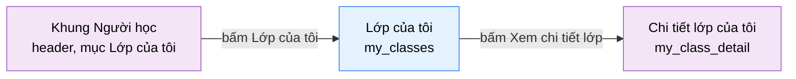

# Tài liệu thiết kế cơ bản (BD) — Lớp của tôi (`USR0701`)

## Phương châm tài liệu [Nội bộ — không cần khách duyệt]

- Viết theo **mẫu 9 sheet**. Bộ thẻ đóng, quy ước ID, ký hiệu chuẩn, ranh giới với tài liệu khác và
  checklist kiểm toán nằm ở `02-bd/_rules/bd-template-9sheet.md` — file này không chép lại.
- Phần gắn nhãn `[Nội bộ]` phục vụ sinh mã và tự kiểm toán, không phải yêu cầu của khách hàng: mục 4.5,
  mục 7.3 và các ghi chú quy ước.
- Mã màn `USR0701` theo bảng mã ở `02-bd/_rules/bd-template-9sheet.md` mục 8 (nhóm 07 "Lớp học" của khu Người
  học, thêm 2026/10/23); tên file mang tiền tố mã.
- **Màn mới theo `DEC-2026-1023-student-class-screens`** (owner 2026/10/23: giao diện học viên chưa có màn
  nào cho lớp; dựng danh sách lớp và chi tiết lớp; mục "Lớp của tôi" nằm ở header; dựng prototype trước, tài
  liệu viết sau). **Không có prototype tĩnh `09-layoutBase`** cho màn này, nên mục 4.4 bám thẳng bản dựng
  Next.js (`my-classes-view.tsx`), không bám file `.dc.html`.
- **Màn này là cửa vào của hai thao tác khác nhau**: xem các lớp mình đang ở (chỉ đọc) và **nhập mã mời để
  tham gia lớp** (F1-23). Thao tác thứ hai là nghiệp vụ đã có sẵn ở DD
  [Nguồn: 03-dd/api/F1_identity.md:70; 03-dd/logic/F1_identity.md:182-190]; BD này **chỉ liên kết**, không
  nhắc lại request, response hay mã lỗi.
- **Không thiết kế** thao tác rời lớp, đổi lớp, hay xem thông tin liên hệ của giảng viên (RD Out of Scope; Câu hỏi mở Q3). Không
  thiết kế quản lý lớp — đó là `class_management` của A2.

> Đọc cùng `01-rd/screens/users/USR0701_my_classes.md` (hành vi ở mức yêu cầu, không lặp lại ở đây),
> `02-bd/screens/users/USR0702_my_class_detail.md` (màn đích của thẻ lớp),
> `02-bd/screens/users/USR0101_problem_list.md` (khối "Bài tập lớp" dùng chung tên nguồn dữ liệu),
> `02-bd/screens/users/_shell.md` (khung điều hướng khu Người học) và
> `02-bd/database/F1_identity.md` (`classes`, `class_enrollments`, `class_invite_codes`).
>
> - **Header và chân trang không mô tả lại ở đây** — dùng chung khung khu Người học
>   [Nguồn: 02-bd/screens/users/_shell.md:26,40-42]. "Lớp của tôi" là mục nav thứ 7 trên header
>   [Nguồn: 02-bd/screens/users/_shell.md:74].
> - **Không hiển thị** nội dung testcase ẩn hay diff chi tiết. Màn này không đọc bảng `testcases` và không
>   đọc `judge.submissions`.

---

## Sheet 1. Bìa

| Mục | Giá trị |
| :--- | :--- |
| Hệ thống | AlgoPrep |
| Phân hệ | `identity` (F1), đọc thêm từ `problem-bank` (F2) |
| Công đoạn | BD — Thiết kế cơ bản |
| Phân loại | Màn hình |
| Tên màn | Lớp của tôi |
| Mã màn hình | `USR0701` |
| Tên vật lý (slug) | `my_classes` |
| Đường dẫn | `/classes` |
| Trục tài liệu | Màn hình (`02-bd/screens/`) |
| Actor | A1 (`STUDENT`) |
| Phiên bản | V0.1 |
| Người tạo | Claude |
| Ngày tạo | 2026/10/23 |
| Người cập nhật | Claude |
| Ngày cập nhật | 2026/10/23 |

---

## Sheet 2. Lịch sử sửa đổi

| Ver | Sheet bị sửa | Nội dung sửa | Ngày | Người sửa |
| :--- | :--- | :--- | :--- | :--- |
| V0.1 | Toàn bộ | Tạo mới theo mẫu 9 sheet sau khi dựng prototype (`DEC-2026-1023-student-class-screens`). Chốt: danh sách thẻ lớp chỉ đọc kèm khung nhập mã mời ở cột phải; tiến độ x/y tính khi đọc từ bài giao và trạng thái làm bài (ponytail bậc 4); `ListMyClasses` thuộc `identity`, bài giao thuộc `problem-bank` (thao tác mới `ListMyClassProblems` vì thao tác hiện có cắt 3 nhóm và ẩn bài đã rút, Q2); trạng thái bài giao chỉ hai nhãn theo RD REQ-04. Căn REQ và Q theo RD `USR0701` (REQ-01 đến REQ-12; Q1 đến Q7 trùng RD, Q8 và Q9 là của BD). Chưa duyệt hình | 2026/10/23 | Claude |

---

## Sheet 3. Sơ đồ chuyển màn

> [Nội bộ] Quy ước vẽ: bố trí từ trái sang phải. Màn gọi tới tô tím, màn hiện tại tô xanh nhạt, màn đích
> tô tím. Màu và `[Nguồn:]` dùng để truy vết, không phải yêu cầu của khách hàng.

### 3.1 Danh sách chuyển màn

#### Khung điều hướng Người học (header) → Lớp của tôi

[Điều kiện mở] Bấm mục "Lớp của tôi" (mục thứ 7) trên header của bất kỳ màn nào trong khu Người học, kể cả
`dashboard`; ngăn kéo hamburger dưới ngưỡng `lg` dùng cùng danh sách mục nên cũng có mục này
[Nguồn: 05-coding/frontend/src/widgets/app-shell/model/student-nav.ts:42-43; 05-coding/frontend/src/widgets/app-shell/ui/student-header.tsx:83,177].

[Chế độ mở] Chế độ xem chỉ đọc kèm một biểu mẫu nhập mã mời.

[Thông tin truyền] Không có.

[Giá trị trả về] Không có.

[Khi thành công] Hiển thị đầu trang, danh sách thẻ lớp và khung "Tham gia lớp". Mục "Lớp của tôi" sáng với mọi
đường dẫn bắt đầu bằng `/classes`, gồm cả `/classes/{classId}` (khớp tiền tố)
[Nguồn: 05-coding/frontend/src/widgets/app-shell/ui/student-header.tsx:51-52].

[Khi huỷ] Không có.

#### Lớp của tôi → Chi tiết lớp của tôi

[Điều kiện mở] Bấm liên kết "Xem chi tiết lớp" ở cuối một thẻ lớp
[Nguồn: 05-coding/frontend/src/views/users/my-classes/ui/my-classes-view.tsx:145-150].

[Chế độ mở] Chế độ xem chỉ đọc.

[Thông tin truyền] `classId` của thẻ được chọn, đặt trên đường dẫn `/classes/{classId}`.

[Giá trị trả về] Không có.

[Khi thành công] Mở màn `my_class_detail` (`USR0702`) của lớp được chọn.

[Khi huỷ] Không có.

> Màn này **không có** liên kết sang bài toán: thẻ lớp chỉ hiển thị tiến độ, từng bài giao nằm ở `USR0702`
> [Nguồn: 05-coding/frontend/src/views/users/my-classes/ui/my-classes-view.tsx:131-144].

### 3.2 Sơ đồ

[Nguồn: 05-coding/frontend/src/widgets/app-shell/model/student-nav.ts:42-43;
05-coding/frontend/src/views/users/my-classes/ui/my-classes-view.tsx:145-150]

---

## Sheet 4. Bố cục màn hình

### 4.1 Tổng quan màn

[Mục đích màn] Cho người học thấy các lớp mình đang tham gia (tên, mô tả, giảng viên, lịch học, ngày tham
gia, tiến độ bài giảng viên giao) và tham gia thêm một lớp bằng mã mời giảng viên gửi
[Nguồn: 01-rd/screens/users/USR0701_my_classes.md:17-18]. Vết yêu cầu: tham gia lớp REQ-01 đến REQ-05, xem lớp REQ-06 đến REQ-09, đi sang chi tiết REQ-10, lối vào header REQ-11, không phụ thuộc AI REQ-12 [Nguồn: 01-rd/screens/users/USR0701_my_classes.md:117-128].

[Luồng nghiệp vụ chính]

1. **Hiển thị ban đầu**: vào màn, hệ thống tải các lớp người học đang ở và bài giao của các lớp đó để tính
   tiến độ. Trong lúc chờ hiển thị dòng "Đang tải...".
2. **Xem lớp**: mỗi lớp là một thẻ gồm tên, mô tả, giảng viên, lịch học, ngày tham gia và thanh tiến độ. Bấm
   "Xem chi tiết lớp" để sang `USR0702`.
3. **Tham gia lớp**: nhập mã mời vào khung bên phải rồi bấm "Tham gia". Thành công thì ô nhập được xoá,
   toast báo tên lớp và danh sách tải lại. Mã sai hoặc hết hạn thì toast lỗi, ô giữ nguyên nội dung.
4. **Chưa ở lớp nào**: thay danh sách bằng câu hướng dẫn nhập mã mời ở khung bên cạnh.

[Người dùng] Người học đã đăng nhập (`STUDENT`). Bắt buộc đăng nhập, không có trạng thái khách, cùng quy ước
cả khu [Nguồn: 02-bd/screens/users/_shell.md:173].

[Tệp liên quan] Không có.

[Phạm vi]
- Chỉ hiển thị lớp mà **chính người dùng** đang ghi danh còn hiệu lực (`left_at IS NULL`)
  [Nguồn: 02-bd/database/F1_identity.md:132-134]. Không có đường nào để xem lớp của người khác.
- Thao tác ghi duy nhất là **tham gia lớp bằng mã mời**; không có rời lớp, sửa lớp hay xoá lớp ở màn này.
- Tiến độ chỉ là **một con số x/y và một thanh** cho mỗi lớp. Danh sách từng bài giao không nằm ở đây mà ở
  `USR0702`.
- Không hiển thị điểm theo tỉ lệ testcase (F4-13); tiến độ chỉ dựa trên trạng thái "Đã giải"
  (`DEC-2026-0831-partial-score-testcase-ratio`, cùng cách dùng của `USR0101`).
- **Không có** huy hiệu đếm số lớp trên mục nav (Câu hỏi mở Q5) và **không có** dải chỉ số tổng quan ở đầu
  trang (quy tắc owner 2026-10-13 "không dải KPI ở màn danh sách").

[Quyền sử dụng]
- Xem: được, chỉ lớp của chính mình.
- Thêm: được, bằng cách tham gia lớp qua mã mời (tạo hoặc kích hoạt lại dòng ghi danh của chính mình).
- Sửa: không.
- Xoá: không.

[Số bản ghi tối đa] Không phân trang: một học viên thuộc ít lớp. Số lớp không có trần trên trong schema; nếu
thực tế vượt vài chục thì cần chốt phân trang ở DD `[SoT: Suy luận — chưa có yêu cầu, demo chỉ có vài lớp]`.

### 4.2 DTO liên quan

- `MyClassDto`
- `MyClassProblemDto` (dùng chung với `USR0702`)
- `JoinClassResultDto`

`[Suy luận]` — tên DTO do BD này đề xuất, `03-dd/api/F1_identity.md` và `03-dd/api/F2_problem-bank.md` chốt
lại. Đặt tên theo quy ước "DTO khu người học đặt tên riêng, tiền tố `My`"
[Nguồn: 02-bd/screens/users/USR0101_problem_list.md:574]. Bản dựng dùng kiểu `MyClass` và `MyClassAssignment`
gộp bài giao vào lớp [Nguồn: 05-coding/frontend/src/entities/class/model/types.ts:122-136]; BD tách hai DTO vì hai
nguồn thuộc hai module khác nhau (Câu hỏi mở Q2).

### 4.3 Bảng dữ liệu liên quan (7)

| NO | Bảng | Ghi chú |
| --: | :--- | :--- |
| 1 | `identity.class_enrollments` | Bảng chủ: lớp người học đang ở (`left_at IS NULL`) và ngày tham gia `joined_at`; nơi ghi khi tham gia lớp [Nguồn: 02-bd/database/F1_identity.md:122-124,211] |
| 2 | `identity.classes` | Tên, mô tả, lịch học `schedule`, khoá `instructor_id` [Nguồn: 02-bd/database/F1_identity.md:112] |
| 3 | `identity.users` | Tên hiển thị của giảng viên `display_name` [Nguồn: 02-bd/database/F1_identity.md:20] |
| 4 | `identity.class_invite_codes` | Tra mã mời khi tham gia lớp: `code` 8 ký tự, `expires_at` [Nguồn: 02-bd/database/F1_identity.md:119-120] |
| 5 | `problem.class_assignments` | Bài đang giao cho lớp, chỉ dòng `removed_at IS NULL`; `assigned_at` [Nguồn: 02-bd/database/F2_problem-bank.md:184-196] |
| 6 | `problem.problems` | Trạng thái vòng đời của bài giao, để biết bài đã rút (`status`, `deleted`) [Nguồn: 02-bd/database/F2_problem-bank.md:23-24] |
| 7 | `identity.user_problem_best_score` | Read model: bài giao nào người học đã giải (`best_verdict = ACCEPTED`) [Nguồn: 02-bd/database/F1_identity.md:193] |

Bốn bảng đầu thuộc schema `identity` và được đọc trong cùng module. Bảng 5 và 6 thuộc `problem-bank`; bảng 7
thuộc `identity` nhưng `problem-bank` chỉ đọc qua cổng ra (`SolveStatePort`, `StudentEnrollmentPort`), không join
chéo schema [Nguồn: 03-dd/api/F2_problem-bank.md:417-425].

### 4.4 Vùng bố cục

**Không có `09-layoutBase` cho màn này.** Bảng dưới bám thẳng bản dựng Next.js
`05-coding/frontend/src/views/users/my-classes/ui/my-classes-view.tsx`. Không quy định màu sắc, khoảng cách hay
typography ở BD.

| Vùng | Vị trí trong bản dựng | Nội dung |
| :--- | :--- | :--- |
| Header ngang dính trên (khung chung Người học) | — | Dùng lại khung chung, không mô tả lại |
| Đầu trang | `my-classes-view.tsx:52-57` | Tiêu đề và một dòng mô tả; không dùng `PageHeader`, không có dải chỉ số |
| Lưới hai cột | `my-classes-view.tsx:59` | Cột trái co giãn chứa danh sách lớp, cột phải cố định hẹp chứa khung nhập mã; dưới ngưỡng `lg` xếp một cột |
| Cột trái — danh sách lớp | `my-classes-view.tsx:60-76` | Một thẻ cho mỗi lớp; hoặc dòng "Đang tải..."; hoặc khối trạng thái rỗng |
| Thẻ lớp | `my-classes-view.tsx:102-153` | Tên, mô tả (nếu có), ba cặp nhãn-giá trị (Giảng viên, Lịch học nếu có, Ngày tham gia), thanh tiến độ và câu tiến độ (nếu có bài giao), liên kết "Xem chi tiết lớp" |
| Cột phải — khung "Tham gia lớp" | `my-classes-view.tsx:78-96` | Tiêu đề, gợi ý, ô "Mã mời", nút "Tham gia" |
| Chân trang (khung chung Người học) | — | Áp theo khung chung [Nguồn: 02-bd/screens/users/_shell.md:105-109] |

**Hiện trạng bản dựng** (đọc `my-classes-view.tsx` ngày 2026/10/23; dữ liệu là mock, `PROTOTYPE_DEBT.md` mục 40).

| Vùng BD | Bản dựng | Vị trí |
| :--- | :--- | :--- |
| Khung nhập mã | Gửi bằng `<form>` nên Enter cũng gửi; ô `maxLength` 16 (mã máy chủ 8 ký tự, chừa chỗ cho khoảng trắng khi dán); placeholder `K7P2M9QX`; nút bị vô hiệu trong lúc `isPending` | `my-classes-view.tsx:26,35-45,83-95` |
| Chuẩn hoá mã | **Lệch BD:** view gửi nguyên chuỗi người dùng gõ; việc cắt khoảng trắng và đổi chữ hoa nằm trong mock `joinClassByCode`. BD yêu cầu máy khách gửi chuỗi đã cắt và đổi chữ hoa (Sheet 9 NO 4). Nợ prototype | `my-classes-view.tsx:38`; `entities/class/api/__mock__/class-mocks.ts:515` |
| Lỗi tham gia | **Lệch BD:** mọi lỗi (kể cả lỗi mạng) đều hiện câu "Mã mời không đúng hoặc đã hết hạn." BD yêu cầu tách lỗi `IDT-410` khỏi lỗi hệ thống (Sheet 9 NO 7). Ô không đổi viền đỏ khi lỗi (view không truyền trạng thái lỗi cho ô). Nợ prototype | `my-classes-view.tsx:43,84-91` |
| Trạng thái lỗi tải | **Chưa có.** Khi tải lỗi, `classes.data ?? []` làm danh sách rỗng nên hiện nhầm câu "Bạn chưa thuộc lớp nào". BD yêu cầu vùng lỗi kèm Thử lại (Khu vực B NO 12, 13). Nợ prototype | `my-classes-view.tsx:48,63-66` |
| Tiến độ | Đếm `assignments.filter(solved)` trên `total`; thanh và câu "Đã xong x/y bài" chỉ hiện khi `total > 0`; trạng thái chỉ hai giá trị đã xong / chưa, đúng RD REQ-04 [Nguồn: 01-rd/screens/users/USR0701_my_classes.md:124] | `my-classes-view.tsx:104-106,131-144` |
| Dữ liệu | `listMyClasses` trả lớp kèm bài giao trong một lời gọi (mock); BD tách hai nguồn (Q2). Giảng viên là một hằng mock; ngày tham gia là chuỗi nhãn dựng sẵn `17/08/2026` | `entities/class/api/__mock__/class-mocks.ts:487-508` |
| Thứ tự lớp | Theo thứ tự mảng mock; BD đề xuất mới tham gia trước (Q8) | `class-mocks.ts:504-508` |
| Mã mời mock | Mã của giảng viên trong mock có dạng `JAVA21-XK9F`, không phải 8 ký tự như DB; là nợ mock, không phải câu hỏi thiết kế (`PROTOTYPE_DEBT.md` CL-04) | `class-mocks.ts:260-270` |
| Mục nav | Mục thứ 7 `classes` trỏ `/classes`, nhãn khoá `nav.myClasses` | `student-nav.ts:42-43`; `messages/vi.json:44` |

### 4.5 Cấu trúc slice FSD [Nội bộ]

| Khối | Slice | Căn cứ |
| :--- | :--- | :--- |
| Trang | `views/users/my-classes` (`MyClassesView`) | `app/(student)/classes/page.tsx` chỉ render view |
| Khung Người học | Dùng lại `widgets/app-shell` (`student-header`, mục trong `model/student-nav.ts`) | `02-bd/screens/users/_shell.md` mục 1 |
| Dữ liệu lớp, kiểu `MyClass`, `MyClassAssignment` | `entities/class` — **dùng chung với cụm Giảng viên** | `entities/class/model/types.ts:122-136` |
| Hook dữ liệu | `entities/class/api/queries.ts`: `useMyClasses`, `useJoinClass` | `queries.ts:148-153,161-169` |
| Chuỗi lịch học một dòng | `entities/class/model/schedule.ts` `formatClassSchedule` — hàm thuần, không phải cột | `schedule.ts:10-34` |
| Thành phần giao diện | `shared/ui`: `Card`, `EmptyState`, `ProgressBar`, `TextField`, `Button`, `SeeAllLink` | `my-classes-view.tsx:16-23` |
| Nhãn tĩnh | i18n namespace `myClasses` và `classManagement.schedule.dayShort.*` | `messages/vi.json:2976-3012`, `:2250-2259` |

`[Suy luận]` — ánh xạ slice theo bản dựng, DD màn hình chốt lại. Không tách `features/class-join` riêng: khung
nhập mã chỉ dùng ở một màn và chỉ có một nút gửi (ponytail bậc 3); khi nơi thứ hai cần nhập mã thì nâng lên.

> [Nội bộ] Ảnh minh hoạ đặt ở `08-diagram/02-bd/screens/users/`, chụp bằng Playwright trên ứng dụng
> Next.js thật. Chưa chụp.

---

## Sheet 5. Danh sách item màn hình

> Quy ước ID, bộ thẻ và giá trị chuẩn: `02-bd/_rules/bd-template-9sheet.md` mục 2, 3, 4.
>
> **Trạng thái của bài giao ở màn lớp chỉ có hai nhãn** (RD `USR0701` REQ-08 và `USR0702` REQ-04
> [Nguồn: 01-rd/screens/users/USR0702_my_class_detail.md:109]): "Đã xong" khi người học có lượt nộp `Accepted`
> ít nhất một lần, còn lại là "Chưa làm", kể cả bài đang làm dở. Công thức nguồn dùng chung với `USR0101`
> Khu vực G: có dòng `user_problem_best_score` với `best_verdict = ACCEPTED` thì xong
> [Nguồn: 02-bd/screens/users/USR0101_problem_list.md:419; 02-bd/database/F1_identity.md:193]. Màn này chỉ dùng
> **số bài "Đã xong"** để tính tiến độ.

### Khu vực A — Đầu trang

| Khu vực | NO | Tên item | ID item | Bảng DB | Cột DB | Loại UI | Kiểu | Độ dài | Bắt buộc | I/O | Giá trị mặc định | Định dạng | Ghi chú |
| :--- | --: | :--- | :--- | :--- | :--- | :--- | :--- | :--- | :-: | :-: | :--- | :--- | :--- |
| Đầu trang | | | | | | | | | | | | | |
| | 1 | Tiêu đề trang | `myClasses.header.title` | - | - | Label | String | - | - | O | Lớp của tôi | - | Tên màn [Nguồn giá trị] Nhãn tĩnh i18n `myClasses.title` [Nguồn: 05-coding/frontend/messages/vi.json:2977] [EVT liên quan] - |
| | 2 | Mô tả trang | `myClasses.header.description` | - | - | Label | String | - | - | O | - | - | Một dòng mô tả dưới tiêu đề: "Các lớp bạn đang tham gia và bài giảng viên giao." [Nguồn giá trị] Nhãn tĩnh i18n `myClasses.subtitle` [Nguồn: 05-coding/frontend/messages/vi.json:2978] [EVT liên quan] - |

### Khu vực B — Danh sách lớp

| Khu vực | NO | Tên item | ID item | Bảng DB | Cột DB | Loại UI | Kiểu | Độ dài | Bắt buộc | I/O | Giá trị mặc định | Định dạng | Ghi chú |
| :--- | --: | :--- | :--- | :--- | :--- | :--- | :--- | :--- | :-: | :-: | :--- | :--- | :--- |
| Danh sách lớp | | | | | | | | | | | | | |
| | 1 | Danh sách lớp | `myClasses.list.cards` | `identity.class_enrollments`, `identity.classes` | `student_id`, `left_at`, `class_id` | List | List | - | - | O | rỗng | - | Các lớp người học đang ở, mỗi lớp một thẻ [Nguồn giá trị] Kết quả gọi `ListMyClasses`: dòng `class_enrollments` có `student_id` là người đăng nhập và `left_at IS NULL`, nối `classes` [Nguồn: 02-bd/database/F1_identity.md:132-134,211]. Thứ tự: mới tham gia trước (Câu hỏi mở Q8) [EVT liên quan] EVT-1, EVT-5 |
| | 2 | Tên lớp | `myClasses.card.name` | `identity.classes` | `name` | Label | String | 120 | - | O | - | - | Tên lớp, tiêu đề thẻ [Nguồn giá trị] Cột `classes.name` [Nguồn: 02-bd/database/F1_identity.md:112] [EVT liên quan] - |
| | 3 | Mô tả lớp | `myClasses.card.description` | `identity.classes` | `description` | Label | String | 500 | - | O | - | - | Mô tả ngắn của lớp, dưới tên lớp [Nguồn giá trị] Cột `classes.description` (NULL được) [Nguồn: 02-bd/database/F1_identity.md:112] [EVT liên quan] - |
| | 4 | Giảng viên | `myClasses.card.instructor` | `identity.users` | `display_name` | Label | String | - | - | O | - | - | Tên giảng viên phụ trách lớp; chỉ tên hiển thị, không có thông tin liên hệ (Câu hỏi mở Q3) [Nguồn giá trị] Cột `users.display_name` qua `classes.instructor_id` [Nguồn: 02-bd/database/F1_identity.md:20,112]; nhãn "Giảng viên" là nhãn tĩnh i18n `myClasses.card.instructor` [Nguồn: 05-coding/frontend/messages/vi.json:2991] [EVT liên quan] - |
| | 5 | Lịch học | `myClasses.card.schedule` | `identity.classes` | `schedule` | Label | String | - | - | O | - | Một dòng, ví dụ `T2 · T4 — 19:00–21:00 · B203 · 17/08–20/12` | Lịch học của lớp [Công thức] Chuỗi một dòng là kết quả hàm thuần `formatClassSchedule(schedule, dayLabel)` trên cột `classes.schedule` (jsonb, cấu trúc ở mục 1.14), nhãn thứ viết tắt lấy từ i18n `classManagement.schedule.dayShort.*`; không phải một cột [Nguồn: 05-coding/frontend/src/entities/class/model/schedule.ts:10-34; 02-bd/database/F1_identity.md:248-261] [EVT liên quan] - |
| | 6 | Ngày tham gia | `myClasses.card.joinedAt` | `identity.class_enrollments` | `joined_at` | Label | Date | - | - | O | - | `dd/MM/yyyy` | Ngày người học vào lớp. Học viên rời rồi vào lại giữ nguyên ngày cũ (dòng cũ được kích hoạt lại) [Nguồn giá trị] Cột `class_enrollments.joined_at` [Nguồn: 02-bd/database/F1_identity.md:124,142; 03-dd/logic/F1_identity.md:188]; định dạng theo nhãn mẫu `17/08/2026` [Nguồn: 05-coding/frontend/src/entities/class/api/__mock__/class-mocks.ts:494] [EVT liên quan] - |
| | 7 | Thanh tiến độ | `myClasses.card.progressBar` | `problem.class_assignments`, `identity.user_problem_best_score` | `removed_at`, `best_verdict` | ProgressBar | Number | - | - | O | - | - | Tỉ lệ bài giao đã giải của lớp đó [Công thức] giá trị = số bài giao đang hiệu lực mà người học "Đã xong"; tối đa = tổng số bài giao đang hiệu lực (`removed_at IS NULL`), **kể cả bài đã rút xuống** để khớp bảng ở `USR0702` (Câu hỏi mở Q9). Tính khi đọc, không có cột lưu sẵn (ponytail bậc 4, cùng tinh thần `completionPct` [Nguồn: 02-bd/database/F1_identity.md:126]) [Nguồn: 01-rd/screens/users/USR0701_my_classes.md:124] [EVT liên quan] EVT-1 |
| | 8 | Câu tiến độ | `myClasses.card.progressText` | `problem.class_assignments`, `identity.user_problem_best_score` | `removed_at`, `best_verdict` | Label | String | - | - | O | - | `Đã xong {x}/{y} bài` | Câu chữ cạnh thanh tiến độ [Công thức] Cùng giá trị với NO 7; mẫu câu là nhãn tĩnh i18n `myClasses.card.progress` nhận `solved` và `total` [Nguồn: 05-coding/frontend/messages/vi.json:2996; 05-coding/frontend/src/views/users/my-classes/ui/my-classes-view.tsx:104-106] [EVT liên quan] EVT-1 |
| | 9 | Liên kết Xem chi tiết lớp | `myClasses.card.linkDetail` | - | - | Link | - | - | - | I | - | - | Mở `my_class_detail` của lớp đó [Nguồn giá trị] Nhãn tĩnh i18n `myClasses.card.viewDetail`, nhãn đọc cho trình đọc màn hình `viewDetailOf` kèm tên lớp [Nguồn: 05-coding/frontend/messages/vi.json:2999-3000] [EVT liên quan] EVT-4 |
| | 10 | Trạng thái đang tải | `myClasses.list.loading` | - | - | Label | String | - | - | O | Ẩn | - | Dòng "Đang tải..." thay danh sách trong lúc chờ [Nguồn giá trị] Nhãn tĩnh i18n `myClasses.loading` [Nguồn: 05-coding/frontend/messages/vi.json:2979] [EVT liên quan] EVT-1 |
| | 11 | Trạng thái chưa có lớp | `myClasses.list.empty` | - | - | Label | String | - | - | O | Ẩn | - | Câu thay danh sách khi người học chưa ở lớp nào, chỉ về khung nhập mã bên cạnh [Nguồn giá trị] Nhãn tĩnh i18n `myClasses.empty` [Nguồn: 05-coding/frontend/messages/vi.json:2980] [EVT liên quan] EVT-1 |
| | 12 | Vùng lỗi tải | `myClasses.list.loadError` | - | - | Label | String | - | - | O | Ẩn | - | Câu lỗi thay danh sách khi tải lỗi lần đầu, giữ nguyên khung nhập mã. Bản dựng chưa có (xem Hiện trạng bản dựng) [Nguồn giá trị] Nhãn tĩnh i18n; cùng mẫu vùng lỗi kèm Thử lại của `USR0103` [Nguồn: 02-bd/screens/users/USR0103_saved_problems.md:421,591] [EVT liên quan] EVT-1 |
| | 13 | Nút Thử lại | `myClasses.list.btnRetry` | - | - | Button | - | - | - | I | - | - | Tải lại danh sách lớp từ vùng lỗi [Nguồn giá trị] Nhãn tĩnh i18n [EVT liên quan] EVT-5 |

### Khu vực C — Khung tham gia lớp

| Khu vực | NO | Tên item | ID item | Bảng DB | Cột DB | Loại UI | Kiểu | Độ dài | Bắt buộc | I/O | Giá trị mặc định | Định dạng | Ghi chú |
| :--- | --: | :--- | :--- | :--- | :--- | :--- | :--- | :--- | :-: | :-: | :--- | :--- | :--- |
| Khung tham gia lớp | | | | | | | | | | | | | |
| | 1 | Tiêu đề khung | `myClasses.join.title` | - | - | Label | String | - | - | O | Tham gia lớp | - | Tiêu đề khung nhập mã [Nguồn giá trị] Nhãn tĩnh i18n `myClasses.join.title` [Nguồn: 05-coding/frontend/messages/vi.json:2982] [EVT liên quan] - |
| | 2 | Gợi ý nhập mã | `myClasses.join.hint` | - | - | Label | String | - | - | O | - | - | Câu gợi ý: nhập mã giảng viên gửi, mã có hạn dùng 7 ngày [Nguồn giá trị] Nhãn tĩnh i18n `myClasses.join.hint` [Nguồn: 05-coding/frontend/messages/vi.json:2983]; con số 7 ngày là hạn cố định đã chốt [Nguồn: 01-rd/req/F1_identity.md:143-145] [EVT liên quan] - |
| | 3 | Ô Mã mời | `myClasses.join.code` | `identity.class_invite_codes` | `code` | TextBox | String | 16 | Bắt buộc | I/O | rỗng | Chữ hoa và số | Mã mời giảng viên gửi. Máy chủ sinh mã 8 ký tự; ô cho gõ tới 16 ký tự để chịu được khoảng trắng khi dán. Gửi đi đã cắt khoảng trắng hai đầu và đổi chữ hoa [Nguồn giá trị] Người dùng nhập; độ dài mã máy chủ [Nguồn: 02-bd/database/F1_identity.md:119]; hằng `CODE_MAX_LENGTH` [Nguồn: 05-coding/frontend/src/views/users/my-classes/ui/my-classes-view.tsx:26]; nhãn "Mã mời" là nhãn tĩnh i18n `myClasses.join.label` [Nguồn: 05-coding/frontend/messages/vi.json:2984] [EVT liên quan] EVT-2, EVT-3 |
| | 4 | Nút Tham gia | `myClasses.join.btnSubmit` | `identity.class_enrollments` | `class_id`, `student_id`, `left_at` | Button | - | - | - | I | - | - | Gửi mã mời; Enter trong ô cũng gửi [Nguồn giá trị] Nhãn tĩnh i18n `myClasses.join.submit` [Nguồn: 05-coding/frontend/messages/vi.json:2985]; thao tác ghi theo BR-09 [Nguồn: 03-dd/logic/F1_identity.md:182-190] [EVT liên quan] EVT-3 |

[Nguồn: 05-coding/frontend/src/views/users/my-classes/ui/my-classes-view.tsx:26,50-100,102-153;
02-bd/database/F1_identity.md:20,112,119,122-134,248-261; 02-bd/database/F2_problem-bank.md:184-196;
05-coding/frontend/messages/vi.json:2976-3012]

---

## Sheet 6. Đặc tả điều khiển item

> Ký hiệu cột `Hiển thị` và thứ tự thẻ: `02-bd/_rules/bd-template-9sheet.md` mục 2, 3. Dùng đúng NO, tên
> item và thứ tự của Sheet 5. Lỗi nhập liệu ghi ở Sheet 9, xử lý nghiệp vụ ghi ở Sheet 8.

### Khu vực A — Đầu trang

| Khu vực | NO | Tên item | Hiển thị | Ghi chú |
| :--- | --: | :--- | :-: | :--- |
| Đầu trang | | | | |
| | 1 | Tiêu đề trang | Có | - |
| | 2 | Mô tả trang | Có | - |

### Khu vực B — Danh sách lớp

| Khu vực | NO | Tên item | Hiển thị | Ghi chú |
| :--- | --: | :--- | :-: | :--- |
| Danh sách lớp | | | | |
| | 1 | Danh sách lớp | Điều kiện | [Điều kiện hiển thị] Chỉ khi tải xong và có ít nhất một lớp. Trong lúc tải hiện NO 10; tải xong mà không có lớp thì hiện NO 11; tải lỗi lần đầu thì hiện NO 12. [Tự động đặt] Làm mới sau khi tham gia lớp thành công (EVT-3). |
| | 2 | Tên lớp | Có | - |
| | 3 | Mô tả lớp | Điều kiện | [Điều kiện hiển thị] Chỉ khi lớp có mô tả (`description` khác rỗng). |
| | 4 | Giảng viên | Có | - |
| | 5 | Lịch học | Điều kiện | [Điều kiện hiển thị] Chỉ khi lớp có lịch và chuỗi lịch một dòng khác rỗng. Lớp không có lịch thì ẩn cả cặp nhãn-giá trị, không hiện chữ "Chưa có lịch học" (chữ đó chỉ dùng ở `USR0702`). |
| | 6 | Ngày tham gia | Có | - |
| | 7 | Thanh tiến độ | Điều kiện | [Điều kiện hiển thị] Chỉ khi lấy được bài giao của lớp **và** lớp có ít nhất một bài giao hiệu lực (y lớn hơn 0). Không lấy được bài giao thì ẩn, thẻ lớp vẫn hiển thị (Sheet 9 NO 9). |
| | 8 | Câu tiến độ | Điều kiện | [Điều kiện hiển thị] Như NO 7. |
| | 9 | Liên kết Xem chi tiết lớp | Có | [Điều kiện kích hoạt] Luôn kích hoạt. |
| | 10 | Trạng thái đang tải | Điều kiện | [Điều kiện hiển thị] Chỉ trong lúc tải lần đầu. |
| | 11 | Trạng thái chưa có lớp | Điều kiện | [Điều kiện hiển thị] Chỉ khi tải xong và không có lớp nào. Chỉ là câu chữ, không có liên kết hay nút; lối "tham gia" là khung bên cạnh luôn hiển thị. |
| | 12 | Vùng lỗi tải | Điều kiện | [Điều kiện hiển thị] Chỉ khi tải danh sách lớp lỗi. Thay chỗ danh sách, không che khung nhập mã. |
| | 13 | Nút Thử lại | Điều kiện | [Điều kiện hiển thị] Như NO 12. [Điều kiện kích hoạt] Không kích hoạt trong lúc đang tải lại. |

### Khu vực C — Khung tham gia lớp

| Khu vực | NO | Tên item | Hiển thị | Ghi chú |
| :--- | --: | :--- | :-: | :--- |
| Khung tham gia lớp | | | | |
| | 1 | Tiêu đề khung | Có | - |
| | 2 | Gợi ý nhập mã | Có | - |
| | 3 | Ô Mã mời | Có | [Điều kiện kích hoạt] Luôn nhập được, kể cả khi danh sách đang tải hoặc lỗi. [Tự động xoá] Xoá về rỗng khi tham gia thành công; lỗi thì giữ nguyên nội dung để người học sửa. |
| | 4 | Nút Tham gia | Có | [Điều kiện kích hoạt] Không kích hoạt trong lúc đang chờ phản hồi của lần gửi trước. Ô rỗng thì vẫn bấm được, bấm thì toast lỗi (Sheet 9 NO 3) — không khoá nút theo ô rỗng. |

[Nguồn: 05-coding/frontend/src/views/users/my-classes/ui/my-classes-view.tsx:61-75,92-94,111-130,131-144]

---

## Sheet 7. Danh sách truyền dữ liệu

### 7.1 Trường DTO

| NO | DTO | Trường DTO | Kiểu | Bảng DB | Cột DB | Item màn | Hiển thị | Ghi chú |
| --: | :--- | :--- | :--- | :--- | :--- | :--- | :-: | :--- |
| 1 | `MyClassDto` | `classId` | UUID | `identity.classes` | `id` | - | Không | [Nguồn] Phản hồi của `ListMyClasses` [Đích] Tham số đường dẫn `/classes/{classId}` của liên kết "Xem chi tiết lớp"; khoá để ghép bài giao theo lớp. |
| 2 | `MyClassDto` | `name` | String | `identity.classes` | `name` | Thẻ lớp "Tên lớp" | Có | - |
| 3 | `MyClassDto` | `description` | String | `identity.classes` | `description` | Thẻ lớp "Mô tả lớp" | Có | [Chuyển đổi] `NULL` trả về rỗng; thẻ ẩn dòng mô tả. |
| 4 | `MyClassDto` | `schedule` | Object (JSON) | `identity.classes` | `schedule` | Thẻ lớp "Lịch học" | Có | [Chuyển đổi] Giữ nguyên cấu trúc jsonb (mục 1.14); giao diện ghép thành một dòng bằng `formatClassSchedule`. |
| 5 | `MyClassDto` | `instructorName` | String | `identity.users` | `display_name` | Thẻ lớp "Giảng viên" | Có | [Nguồn] Nối `users` qua `classes.instructor_id`, cùng schema `identity`. |
| 6 | `MyClassDto` | `joinedAt` | Date | `identity.class_enrollments` | `joined_at` | Thẻ lớp "Ngày tham gia" | Có | [Chuyển đổi] Trả mốc thời gian đầy đủ, màn hiển thị `dd/MM/yyyy`. |
| 7 | `MyClassProblemDto` | `classId` | UUID | `problem.class_assignments` | `class_id` | - | Không | [Nguồn] Phản hồi của `ListMyClassProblems` [Đích] Gom bài giao theo lớp để tính x/y của từng thẻ. |
| 8 | `MyClassProblemDto` | `solveState` | Enum | `identity.user_problem_best_score` | `best_verdict` | Thẻ lớp "Thanh tiến độ", "Câu tiến độ" | Có | [Nguồn] `problem-bank` hỏi `identity` qua cổng ra `SolveStatePort` [Nguồn: 03-dd/api/F2_problem-bank.md:419,425] [Chuyển đổi] `SOLVED`/`ATTEMPTED`/`UNSOLVED`; màn chỉ đếm `SOLVED` làm x, hai giá trị còn lại đều là "Chưa làm". |
| 9 | `JoinClassResultDto` | `className` | String | `identity.classes` | `name` | Toast thành công | Có | [Nguồn] Phản hồi của `JoinClassByCode` [Đích] Điền vào câu "Đã tham gia lớp {name}." |
| - | (tính ở giao diện) | `solvedCount`, `totalCount` | Number, Number | - | - | Thẻ lớp "Thanh tiến độ", "Câu tiến độ" | Có | [Chuyển đổi] `solvedCount` = số phần tử `MyClassProblemDto` của lớp có `solveState = SOLVED`; `totalCount` = số phần tử của lớp, gồm cả bài đã rút xuống (Q9). Không có endpoint riêng cho hai số này [Nguồn: 05-coding/frontend/src/views/users/my-classes/ui/my-classes-view.tsx:104-105]. |

### 7.2 Truy cập bảng dữ liệu (7)

| NO | Tên logic | Bảng | Repository | CRUD | Mục đích | Ghi chú |
| --: | :--- | :--- | :--- | :-: | :--- | :--- |
| 1 | Ghi danh lớp | `identity.class_enrollments` | `ClassEnrollmentRepository` | C/R/U | Đọc lớp người học đang ở; tạo dòng khi vào lớp lần đầu, kích hoạt lại dòng cũ khi vào lại | `ListMyClasses`: R `JoinClassByCode`: C (chưa có dòng) hoặc U (`left_at` đặt lại `NULL`, `joined_at` giữ nguyên) bằng một lệnh upsert [Nguồn: 03-dd/logic/F1_identity.md:188] |
| 2 | Lớp | `identity.classes` | `ClassRepository` | R | Lấy tên, mô tả, lịch, `instructor_id` | `ListMyClasses`: R; `JoinClassByCode`: R (lấy tên lớp cho toast) |
| 3 | Người dùng | `identity.users` | `UserRepository` | R | Lấy `display_name` của giảng viên | `ListMyClasses`: R |
| 4 | Mã mời | `identity.class_invite_codes` | `ClassInviteCodeRepository` | R | Tra mã chưa hết hạn | `JoinClassByCode`: R (`code = :code AND expires_at > now()`) [Nguồn: 03-dd/logic/F1_identity.md:186] |
| 5 | Bài giao theo lớp | `problem.class_assignments` | `ClassAssignmentRepository` | R | Đọc bài đang giao cho các lớp của người học | `ListMyClassProblems`: R, chỉ `removed_at IS NULL` |
| 6 | Bài toán | `problem.problems` | `ProblemRepository` | R | Biết bài giao nào đã rút xuống | `ListMyClassProblems`: R |
| 7 | Tiến độ theo bài của người dùng | `identity.user_problem_best_score` | `UserProblemBestScoreRepository` (module `identity`) | R | Suy ra "Đã giải" của từng bài giao | `ListMyClassProblems`: R — gọi qua cổng ra, `problem-bank` không đọc thẳng schema `identity` |

`[Suy luận]` — tên repository do BD này đề xuất, DD module chốt lại.

### 7.3 Danh sách endpoint [Nội bộ]

> Chỉ tên nghiệp vụ và BC sở hữu. Hợp đồng chi tiết thuộc `03-dd/api/<module>.md`.

| NO | Endpoint (tên nghiệp vụ) | Mục đích | BC sở hữu |
| --: | :--- | :--- | :--- |
| 1 | `ListMyClasses` | Liệt kê lớp người học đang ghi danh (`left_at IS NULL`) kèm tên giảng viên, lịch và ngày tham gia. **Chưa có trong DD, cần bổ sung** | `identity` |
| 2 | `ListMyClassProblems` | Liệt kê bài giao đang hiệu lực của các lớp người học đang ở, kèm trạng thái làm bài và cờ `withdrawn`, không cắt 3 lớp. **Chưa có trong DD, cần bổ sung** (Câu hỏi mở Q2) | `problem-bank` |
| 3 | `JoinClassByCode` | Tham gia lớp bằng mã mời; thao tác **đã có** trong DD [Nguồn: 03-dd/api/F1_identity.md:70] | `identity` |

Ghi chú ranh giới:
- **Không dùng lại `ListMyClassAssignments`** của `USR0101` cho màn này: thao tác đó cắt còn 3 nhóm và chỉ trả bài
  `PUBLISHED AND NOT deleted` [Nguồn: 03-dd/api/F2_problem-bank.md:408,418], nên không đủ để tính tiến độ cho
  mọi lớp và không thể hiện bài đã rút. Xem Câu hỏi mở Q2.
- **Tiền tố `My` nghĩa là phạm vi khoá cứng theo người dùng đăng nhập**, không nhận `user_id` làm tham số
  [Nguồn: 02-bd/screens/users/USR0101_problem_list.md:574].
- **Bản dựng gộp** lớp và bài giao thành một lời gọi mock `listMyClasses`
  [Nguồn: 05-coding/frontend/src/entities/class/api/__mock__/class-mocks.ts:504-508]; BD tách hai nguồn vì
  `identity` không phụ thuộc `problem-bank` (hướng phụ thuộc ngược lại) [Nguồn: .nexa/control/dependency-map.md:100,126].
  Giao diện gọi song song hai thao tác rồi ghép theo `classId`.
- `JoinClassByCode`: màn chỉ cần tên lớp từ phản hồi để hiển thị toast; mọi chi tiết request, response và mã
  lỗi thuộc DD.

[Nguồn: 03-dd/api/F1_identity.md:70; 03-dd/api/F2_problem-bank.md:393-425]

---

## Sheet 8. Danh sách sự kiện

> Bộ thẻ và quy ước cột `Chuyển màn`: `02-bd/_rules/bd-template-9sheet.md` mục 2, 3.
>
> **Mục "Lớp của tôi" trên header là sự kiện của khung chung** (`_shell.md`), không thuộc màn này; chuyển màn
> vào đây xem Sheet 3. Màn này **không có dữ liệu nhập chưa lưu** đáng giữ: ô mã mời là dữ liệu tạm, rời màn
> không hỏi xác nhận.

### Màn chính: Lớp của tôi

| NO | Loại | Sự kiện | Chi tiết | Chuyển màn | Gọi API | Tên xử lý | Ghi chú |
| --: | :--- | :--- | :--- | :-: | :-: | :--- | :--- |
| 1 | Màn hình | Khởi tạo màn | Vào màn thì tải danh sách lớp và bài giao. | Không | Có | `ListMyClasses`, `ListMyClassProblems` | [Các bước] 1. Kiểm tra người dùng đã đăng nhập. 2. Hiển thị dòng "Đang tải..." thay danh sách. 3. Tải song song hai nhóm dữ liệu rồi ghép bài giao vào từng lớp theo `classId`. [Khi thành công] Mỗi lớp một thẻ kèm tiến độ; không có lớp nào thì hiện câu hướng dẫn nhập mã mời. [Khi lỗi] Lỗi ở `ListMyClasses` thì hiện vùng lỗi kèm nút Thử lại thay danh sách (không toast, vì là lỗi tải lần đầu). Lỗi ở `ListMyClassProblems` thì **ẩn thanh và câu tiến độ, không báo lỗi** — thẻ lớp vẫn dùng được. |
| 2 | Nhập liệu | Gõ mã mời | Gõ hoặc dán vào ô "Mã mời". | Không | Không | - | [Các bước] 1. Cập nhật giá trị ô; không chuẩn hoá khi đang gõ, chặn ở 16 ký tự. [Khi thành công] Ô hiện đúng nội dung vừa gõ. Không gọi máy chủ. |
| 3 | Nút | Gửi mã mời | Bấm "Tham gia" hoặc nhấn Enter trong ô mã. | Không | Có | `JoinClassByCode` | [Các bước] 1. Chặn gửi mặc định của biểu mẫu. 2. Cắt khoảng trắng hai đầu; rỗng thì dừng ở Sheet 9 NO 3, **không** gọi máy chủ. 3. Đổi chữ hoa rồi gửi mã (Sheet 9 NO 4). 4. Khoá nút Tham gia trong lúc chờ. [Khi thành công] Xoá ô mã, hiện toast thành công "Đã tham gia lớp {tên lớp}." và tải lại danh sách lớp (`ListMyClasses`, `ListMyClassProblems`) để thẻ mới xuất hiện. Đã là thành viên thì vẫn thành công như thường (Sheet 9 NO 6). [Khi lỗi] Hiện toast lỗi, ô mã giữ nguyên nội dung, nút được mở khoá. Nội dung toast phân biệt mã sai hoặc hết hạn với lỗi hệ thống (Sheet 9 NO 5, 7). [Thông báo hoàn tất] Toast "Đã tham gia lớp {tên lớp}." |
| 4 | Liên kết | Xem chi tiết lớp | Bấm "Xem chi tiết lớp" ở một thẻ. | Có | Không | - | [Các bước] 1. Điều hướng sang `/classes/{classId}` kèm `classId` của thẻ [Nguồn: 05-coding/frontend/src/views/users/my-classes/ui/my-classes-view.tsx:145-146]. [Khi thành công] Mở màn `my_class_detail`. Ô mã mời chưa gửi bị bỏ, không hỏi lại. |
| 5 | Nút | Thử lại tải danh sách | Bấm "Thử lại" ở vùng lỗi tải. | Không | Có | `ListMyClasses`, `ListMyClassProblems` | [Các bước] 1. Khoá nút trong lúc tải. 2. Gọi lại hai thao tác như EVT-1. [Khi thành công] Vùng lỗi được thay bằng danh sách hoặc câu chưa có lớp. [Khi lỗi] Giữ vùng lỗi và hiện toast lỗi (tải lại mà vẫn lỗi thì có toast, theo `02-bd/_rules/bd-template-9sheet.md` mục 3). |

Vết yêu cầu: EVT-1 ứng REQ-06, REQ-07, REQ-08, REQ-09; EVT-3 ứng REQ-01 đến REQ-05; EVT-4 ứng REQ-10
[Nguồn: 01-rd/screens/users/USR0701_my_classes.md:117-126].

[Nguồn: 05-coding/frontend/src/views/users/my-classes/ui/my-classes-view.tsx:35-45,61-75,83-95,145-150;
03-dd/logic/F1_identity.md:182-190]

---

## Sheet 9. Đặc tả kiểm tra

> Bộ thẻ và quy ước mã thông báo: `02-bd/_rules/bd-template-9sheet.md` mục 2, 4. Sheet này ghi **điều kiện
> kiểm và thông báo**; tiêu chí nghiệm thu `AC-nn` thuộc `04-tdd/USR0701_my_classes.md`, không lặp lại ở đây.
> Nhãn kênh thông báo: kết quả thao tác và lỗi nhập liệu đều là toast; ô nhập sai chỉ đổi viền đỏ.

| NO | Loại | Tóm tắt kiểm | Chi tiết | Mức | Mã thông báo | Ghi chú | EVT gọi | Thứ tự |
| --: | :--- | :--- | :--- | :--- | :--- | :--- | :--- | :-: |
| 1 | Kiểm quyền | Yêu cầu đăng nhập | [Nội dung kiểm] Người dùng chưa đăng nhập thì chuyển về màn `auth`. Màn không có trạng thái khách. [Nơi thực thi] Chặn ở cả tầng định tuyến phía giao diện và tầng phân quyền phía máy chủ. | Lỗi | Chưa có mã thông báo | Nội dung "Vui lòng đăng nhập để tiếp tục." (cùng câu `USR0103`) [Nguồn: 02-bd/screens/users/USR0103_saved_problems.md:580]. | EVT-1, EVT-3 | 1 |
| 2 | Kiểm quyền | Phạm vi dữ liệu cá nhân | [Nội dung kiểm] `ListMyClasses` và `ListMyClassProblems` chỉ làm việc trên ghi danh còn hiệu lực (`left_at IS NULL`) của **chính người dùng đăng nhập**; không thao tác nào nhận `student_id` hay `class_id` từ phía gọi. `JoinClassByCode` chỉ ghi danh cho chính người gọi. [Nơi thực thi] Máy chủ, ở tầng dịch vụ. | Lỗi | Không có thông báo | Quy ước tiền tố `My` [Nguồn: 02-bd/screens/users/USR0101_problem_list.md:574]; ghi danh còn hiệu lực [Nguồn: 02-bd/database/F1_identity.md:132-134]. | EVT-1, EVT-3, EVT-5 | 1 |
| 3 | Kiểm nhập liệu | Mã mời bắt buộc | [Nội dung kiểm] Mã mời rỗng sau khi cắt khoảng trắng hai đầu thì không gửi. [Nơi thực thi] Màn hình. [Tiêu điểm] Viền ô Mã mời + toast. | Lỗi | Chưa có mã thông báo | Nội dung "Nhập mã mời trước khi tham gia." [Nguồn: 05-coding/frontend/messages/vi.json:2986]. Không gọi máy chủ. | EVT-3 | 1 |
| 4 | Kiểm nhập liệu | Độ dài và dạng mã | [Nội dung kiểm] Ô nhận tối đa 16 ký tự. Mã gửi đi đã cắt khoảng trắng hai đầu và đổi chữ hoa; máy chủ so khớp mã 8 ký tự chữ hoa và số. [Nơi thực thi] Màn hình (chuẩn hoá và cắt độ dài) và máy chủ (so khớp). [Tiêu điểm] Viền ô Mã mời. | Không báo | Không có thông báo | Không báo lỗi riêng cho độ dài: mã sai hình dạng chỉ rơi vào "mã không đúng" (NO 5), tránh tiết lộ quy tắc sinh mã. Cắt khoảng trắng và chữ hoa là việc của máy khách theo BD, hiện đang nằm trong mock (Hiện trạng bản dựng). | EVT-2, EVT-3 | 2 |
| 5 | Kiểm nghiệp vụ | Mã không tồn tại hoặc đã hết hạn | [Nội dung kiểm] Mã không có trong `class_invite_codes` hoặc `expires_at` đã qua thì từ chối. Hai trường hợp dùng **cùng một** thông báo, không cho người gọi biết mã từng tồn tại hay chưa. [Nơi thực thi] Máy chủ. [Tiêu điểm] Viền ô Mã mời + toast. | Lỗi | Mã lỗi trong phản hồi | Mã lỗi `IDT-410` do DD đặt [Nguồn: 03-dd/logic/F1_identity.md:187]. Nội dung "Mã mời không đúng hoặc đã hết hạn." [Nguồn: 05-coding/frontend/messages/vi.json:2988]. Mã giữ nguyên trong ô. | EVT-3 | 1 |
| 6 | Kiểm nghiệp vụ | Đã là thành viên hoặc vào lại sau khi rời | [Nội dung kiểm] Người đã ở trong lớp (`left_at IS NULL`) nhập mã hợp lệ thì **thành công, không đổi gì** (idempotent), không báo "đã tham gia". Người từng bị gỡ (`left_at` khác rỗng) nhập mã hợp lệ thì dòng cũ được kích hoạt lại, `joined_at` giữ nguyên. [Nơi thực thi] Máy chủ. | Cảnh báo | Không có thông báo | Cùng toast thành công "Đã tham gia lớp {tên lớp}." cho cả hai trường hợp [Nguồn: 03-dd/logic/F1_identity.md:188; 02-bd/database/F1_identity.md:142]. | EVT-3 | 2 |
| 7 | Kiểm nghiệp vụ | Lỗi hệ thống khi tham gia | [Nội dung kiểm] Gọi `JoinClassByCode` thất bại **không phải** do mã (mất mạng, lỗi máy chủ) thì không được báo "mã không đúng". [Nơi thực thi] Màn hình. [Tiêu điểm] Toast. | Lỗi | Chưa có mã thông báo | Nội dung "Không kết nối được máy chủ." (cùng câu `USR0103`) [Nguồn: 02-bd/screens/users/USR0103_saved_problems.md:591]. Bản dựng chưa tách: mọi lỗi đều hiện câu mã sai (Hiện trạng bản dựng). | EVT-3 | 3 |
| 8 | Kiểm nghiệp vụ | Lỗi tải danh sách | [Nội dung kiểm] Tải lần đầu lỗi thì thay danh sách bằng vùng lỗi kèm Thử lại, giữ nguyên khung nhập mã; tải lại mà vẫn lỗi thì thêm toast lỗi. [Nơi thực thi] Màn hình. | Lỗi | Mã lỗi trong phản hồi | Mã lỗi đã đăng ký thì hiện nội dung tương ứng; chưa thì "Không kết nối được máy chủ." Cùng mẫu `USR0103` NO 12 [Nguồn: 02-bd/screens/users/USR0103_saved_problems.md:591]. | EVT-1, EVT-5 | 1 |
| 9 | Kiểm nghiệp vụ | Suy giảm êm khi `problem-bank` lỗi | [Nội dung kiểm] Gọi `ListMyClassProblems` thất bại thì ẩn thanh và câu tiến độ của mọi thẻ, vẫn hiển thị đủ thẻ lớp. [Nơi thực thi] Màn hình. | Cảnh báo | Không có thông báo | Là **điều kiện hiển thị, không phải thông báo lỗi** — người học không có hành động khắc phục; cùng nguyên tắc đã áp ở `USR0101` và `USR0103`. | EVT-1 | 2 |

Cột `Thứ tự` là thứ tự kiểm trong cùng một sự kiện.

Vết yêu cầu: NO 3 ứng REQ-05; NO 5 ứng REQ-02; NO 6 ứng REQ-03 và REQ-04; NO 2 ứng REQ-07; NO 9 ứng REQ-12
[Nguồn: 01-rd/screens/users/USR0701_my_classes.md:117-128].

[Nguồn: 03-dd/logic/F1_identity.md:182-190; 02-bd/database/F1_identity.md:119,132-134,142;
05-coding/frontend/messages/vi.json:2986-2988]

---

## Câu hỏi mở

Q1 đến Q7 trùng số với RD `USR0701` Phần 4 [Nguồn: 01-rd/screens/users/USR0701_my_classes.md:101-109]; Q8 và Q9 chỉ có ở BD.

| # | Câu hỏi | Vì sao chưa trả lời được | Đề xuất | Chủ sở hữu |
| :-: | :--- | :--- | :--- | :-: |
| Q1 | **Hai màn có cần mã `Fx-nn` riêng không?** (RD Q1) | RD đề xuất mở rộng F1-23 và F2-12, không cấp mã mới | BD trích F1-23 và F2-12 như RD; không có thiết kế nào của BD phụ thuộc vào câu trả lời | Chủ dự án |
| Q2 | **API đọc lớp của học viên có gộp bài giao vào một lời gọi không?** (RD Q2, **BD đề xuất khác RD**) | RD đề xuất một lần gọi trả cả giảng viên, lịch, bài giao và trạng thái (đúng hình `MyClass` của mock) [Nguồn: 01-rd/screens/users/USR0701_my_classes.md:104]. Nhưng bài giao thuộc `problem-bank`, còn `identity` không phụ thuộc `problem-bank` [Nguồn: .nexa/control/dependency-map.md:100,126]; và `ListMyClassAssignments` hiện có cắt còn 3 nhóm, chỉ trả bài `PUBLISHED AND NOT deleted` [Nguồn: 03-dd/api/F2_problem-bank.md:408,418] nên không dùng được | **Tách hai thao tác**: `ListMyClasses` (`identity`, chỉ thông tin lớp) và `ListMyClassProblems` (`problem-bank`, mọi bài giao hiệu lực kèm `solveState`, `withdrawn`, nhận `classId` tuỳ chọn cho `USR0702`), giao diện ghép theo `classId`. Giữ đúng hướng phụ thuộc, không đụng hợp đồng `USR0101`. Cần DD cho hai thao tác mới và ghi vào `DEC-2026-1023-student-class-screens` | Chủ dự án |
| Q3 | **Nguồn tên giảng viên và mức hiển thị?** (RD Q3, gồm cả "thông tin liên hệ" ngoài phạm vi) | Prototype dùng hằng mock [Nguồn: 05-coding/frontend/src/entities/class/api/__mock__/class-mocks.ts:467]; `users` có `email` nhưng cho học viên đọc email người khác là vấn đề riêng tư | **Chỉ `users.display_name` của chủ lớp**, không có email hay điện thoại. Giảng viên đã ẩn danh hoá thì hiện giá trị ẩn danh đang lưu ở cột [Nguồn: 02-bd/database/F1_identity.md:38]. Ponytail bậc 1 và bậc 6 | Chủ dự án |
| Q4 | **Lớp bị giảng viên xoá khi học viên đang mở trang?** (RD Q4) | Không có yêu cầu thời gian thực | Lần tải kế tiếp lớp biến khỏi danh sách (xoá cứng kéo ghi danh theo, `ON DELETE CASCADE` [Nguồn: 02-bd/database/F1_identity.md:124]); thẻ đang hiện không xử lý riêng. Ponytail bậc 3 | Chủ dự án |
| Q5 | **Mục nav có huy hiệu số lớp không?** (RD Q5) | Không có yêu cầu; header chưa mục nào có huy hiệu | **Không.** Ponytail bậc 3 | Chủ dự án |
| Q6 | **Chuẩn hoá mã và giới hạn thử sai?** (RD Q6) | Mã 8 ký tự nên dò mã là rủi ro thật; `02-bd/security/` chưa mô tả giới hạn thử cho thao tác tham gia lớp `[SoT: Suy luận — chưa tìm thấy mục nào, grep "classes/join", "IDT-410", "mã mời" trong 02-bd/security/ không có kết quả]` | Máy khách cắt khoảng trắng và đổi chữ hoa trước khi gửi (Sheet 9 NO 4); máy chủ áp giới hạn tần suất theo người dùng bằng Redis rate limit sẵn có, ngưỡng do DD đặt. Ponytail bậc 6. Chưa có nội dung thông báo cho trường hợp bị giới hạn, thêm khi DD chốt | DD `identity` |
| Q7 | **Lỗi tham gia không phải do mã có dùng chung một câu không?** (RD Q7) | Prototype báo một câu cho mọi lỗi [Nguồn: 05-coding/frontend/src/views/users/my-classes/ui/my-classes-view.tsx:43] | Giữ một câu cho `IDT-410`; lỗi khác dùng câu "Không kết nối được máy chủ." (Sheet 9 NO 5, 7) | Chủ dự án |
| Q8 | **Thứ tự các lớp trên màn?** (chỉ BD) | Bản dựng theo thứ tự mảng mock, DB không quy định | **Lớp mới tham gia trước** (`joined_at` giảm dần), vì lớp vừa nhập mã là lớp người học muốn thấy ngay. Ponytail bậc 5 | Chủ dự án |
| Q9 | **Bài giao đã rút xuống có tính vào y của "Đã xong x/y bài" không?** (chỉ BD, trùng RD `USR0702` Q2) | Hai phía chưa có quy tắc: `INS0203` và `INS0101` không nói gì về bài rút khi tính tỉ lệ hoàn thành [Nguồn: 01-rd/screens/users/USR0702_my_class_detail.md:95] | **Tính** (theo đề xuất RD), để con số khớp số dòng bảng ở `USR0702` và không đổi bất ngờ khi bài bị rút. Nhược điểm: lớp có bài rút sẽ không bao giờ đạt đủ; nếu owner chọn ngược lại thì dùng cờ `withdrawn` của `ListMyClassProblems` để loại khỏi y. Cần đối chiếu cách `completionPct` phía giảng viên tính | Chủ dự án |
