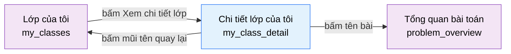

# Tài liệu thiết kế cơ bản (BD) — Chi tiết lớp của tôi (`USR0702`)

## Phương châm tài liệu [Nội bộ — không cần khách duyệt]

- Viết theo **mẫu 9 sheet**. Bộ thẻ đóng, quy ước ID, ký hiệu chuẩn, ranh giới với tài liệu khác và
  checklist kiểm toán nằm ở `02-bd/_rules/bd-template-9sheet.md` — file này không chép lại.
- Phần gắn nhãn `[Nội bộ]` phục vụ sinh mã và tự kiểm toán, không phải yêu cầu của khách hàng: mục 4.5,
  mục 7.3 và các ghi chú quy ước.
- Mã màn `USR0702` theo bảng mã ở `02-bd/_rules/bd-template-9sheet.md` mục 8 (nhóm 07 "Lớp học", thêm 2026/10/23).
- **Màn mới theo `DEC-2026-1023-student-class-screens`**, viết sau prototype. **Không có prototype tĩnh
  `09-layoutBase`**, mục 4.4 bám thẳng bản dựng Next.js `my-class-detail-view.tsx`.
- **Màn chỉ đọc**, là màn anh em của `USR0701`: dùng lại nguyên tên DTO, tên thao tác nghiệp vụ và công thức
  tiến độ của `USR0701`, chỉ viết phần khác. Khác thật: màn này có bảng đầy đủ các bài giao (có cờ đã rút
  xuống), có trạng thái "không tìm thấy", và nhận `classId` từ đường dẫn.

> Đọc cùng `01-rd/screens/users/USR0702_my_class_detail.md` (hành vi ở mức yêu cầu, không lặp lại ở đây),
> `02-bd/screens/users/USR0701_my_classes.md` (màn danh sách, nơi DTO và thao tác được định nghĩa),
> `02-bd/screens/users/_shell.md` (khung điều hướng) và `02-bd/database/F1_identity.md`.
>
> - **Header và chân trang không mô tả lại ở đây** — dùng chung khung khu Người học
>   [Nguồn: 02-bd/screens/users/_shell.md:26,40-42]. Mục "Lớp của tôi" của header vẫn sáng khi ở màn này
>   (khớp tiền tố `/classes`) [Nguồn: 05-coding/frontend/src/widgets/app-shell/ui/student-header.tsx:51-52].
> - **Không thiết kế** rời lớp, sửa lớp, xem bạn cùng lớp hay điểm của người khác (RD Out of Scope)
>   [Nguồn: 01-rd/screens/users/USR0702_my_class_detail.md:73-83].

---

## Sheet 1. Bìa

| Mục | Giá trị |
| :--- | :--- |
| Hệ thống | AlgoPrep |
| Phân hệ | `identity` (F1), đọc thêm từ `problem-bank` (F2) |
| Công đoạn | BD — Thiết kế cơ bản |
| Phân loại | Màn hình |
| Tên màn | Chi tiết lớp của tôi |
| Mã màn hình | `USR0702` |
| Tên vật lý (slug) | `my_class_detail` |
| Đường dẫn | `/classes/{classId}` |
| Trục tài liệu | Màn hình (`02-bd/screens/`) |
| Actor | A1 (`STUDENT`) |
| Phiên bản | V0.1 |
| Người tạo | Claude |
| Ngày tạo | 2026/10/23 |
| Người cập nhật | Claude |
| Ngày cập nhật | 2026/10/23 |

---

## Sheet 2. Lịch sử sửa đổi

| Ver | Sheet bị sửa | Nội dung sửa | Ngày | Người sửa |
| :--- | :--- | :--- | :--- | :--- |
| V0.1 | Toàn bộ | Tạo mới theo mẫu 9 sheet sau khi dựng prototype (`DEC-2026-1023-student-class-screens`). Chốt: màn chỉ đọc; bài giao đã rút xuống vẫn hiện, làm mờ, nhãn "Đã rút xuống", không bấm được (đề xuất RD Q1, theo `INS0202`); ba trường hợp lớp không tồn tại, không phải thành viên, đã rời lớp cùng một trạng thái "không tìm thấy"; tiến độ x/y tính khi đọc và y gồm cả bài đã rút. Căn REQ và Q theo RD `USR0702` (REQ-01 đến REQ-10; Q1 đến Q5 trùng RD, Q6 và Q7 là của BD). Chưa duyệt hình | 2026/10/23 | Claude |

---

## Sheet 3. Sơ đồ chuyển màn

> [Nội bộ] Quy ước vẽ: bố trí từ trái sang phải. Màn gọi tới tô tím, màn hiện tại tô xanh nhạt, màn đích
> tô tím. Màu và `[Nguồn:]` dùng để truy vết, không phải yêu cầu của khách hàng.

### 3.1 Danh sách chuyển màn

#### Lớp của tôi → Chi tiết lớp của tôi

[Điều kiện mở] Bấm "Xem chi tiết lớp" ở một thẻ của `USR0701`
[Nguồn: 05-coding/frontend/src/views/users/my-classes/ui/my-classes-view.tsx:145-150]. Gõ thẳng đường dẫn
`/classes/{classId}` cũng mở được màn này, và `classId` có thể sai (Sheet 9 NO 3).

[Chế độ mở] Chế độ xem chỉ đọc.

[Thông tin truyền] `classId` trên đường dẫn `/classes/{classId}`.

[Giá trị trả về] Không có.

[Khi thành công] Hiển thị đầu trang, thẻ thông tin lớp, thẻ tiến độ và bảng bài được giao.

[Khi huỷ] Không có.

#### Chi tiết lớp của tôi → Lớp của tôi

[Điều kiện mở] Bấm nút mũi tên quay lại ở đầu trang, có cả ở trạng thái "không tìm thấy"
[Nguồn: 05-coding/frontend/src/views/users/my-class-detail/ui/my-class-detail-view.tsx:28-30,41-42].

[Chế độ mở] Chế độ xem chỉ đọc kèm ô nhập mã mời.

[Thông tin truyền] Không có.

[Giá trị trả về] Không có.

[Khi thành công] Mở màn `my_classes` (`USR0701`), danh sách tải lại.

[Khi huỷ] Không có.

#### Chi tiết lớp của tôi → Tổng quan bài toán

[Điều kiện mở] Bấm tên một bài trong bảng "Bài được giao"
[Nguồn: 05-coding/frontend/src/views/users/my-class-detail/ui/my-class-detail-view.tsx:61-67]. **Không áp dụng
cho dòng có nhãn "Đã rút xuống"**: tên bài của dòng đó không phải liên kết (Câu hỏi mở Q1).

[Chế độ mở] Chế độ xem đề, chỉ đọc.

[Thông tin truyền] `problem_id` của dòng được chọn, đặt trên đường dẫn `/problems/{problem_id}`.

[Giá trị trả về] Không có.

[Khi thành công] Mở màn `problem_overview` (`USR0104`). Muốn soạn mã thì bấm tiếp ở màn đó
[Nguồn: 02-bd/screens/users/USR0104_problem_overview.md:171].

[Khi huỷ] Không có.

### 3.2 Sơ đồ

[Nguồn: 05-coding/frontend/src/views/users/my-classes/ui/my-classes-view.tsx:145-150;
05-coding/frontend/src/views/users/my-class-detail/ui/my-class-detail-view.tsx:28-30,61-67]

---

## Sheet 4. Bố cục màn hình

### 4.1 Tổng quan màn

[Mục đích màn] Cho người học xem mọi thứ về một lớp mình đang học ở một chỗ: thông tin lớp, tiến độ bài giao
và bảng đầy đủ các bài được giao kèm trạng thái, rồi mở thẳng từng bài
[Nguồn: 01-rd/screens/users/USR0702_my_class_detail.md:18-20].

[Luồng nghiệp vụ chính]

1. **Hiển thị ban đầu**: đọc `classId` trên đường dẫn, tải thông tin lớp và bài giao của lớp đó. Trong lúc chờ
   hiển thị khung chờ.
2. **Xem thông tin và tiến độ**: thẻ "Thông tin lớp" (giảng viên, lịch học, ngày tham gia) và thẻ "Tiến độ bài
   được giao" (thanh và câu "Đã xong x/y bài").
3. **Xem bài giao**: bảng liệt kê toàn bộ bài được giao, mỗi dòng gồm tên bài, ngày giao, trạng thái. Bấm tên bài
   để sang `problem_overview`. Bài đã rút xuống vẫn nằm trong bảng, làm mờ, không bấm được.
4. **Không tìm thấy**: lớp không tồn tại, người học không ở lớp đó hoặc đã rời lớp thì cùng hiện một câu
   thông báo kèm nút quay lại.

[Người dùng] Người học đã đăng nhập (`STUDENT`), bắt buộc đăng nhập
[Nguồn: 02-bd/screens/users/_shell.md:173]. Vết yêu cầu: REQ-01 thông tin lớp, REQ-02 tiến độ, REQ-03 bảng bài,
REQ-04 trạng thái, REQ-05 mở bài, REQ-06 không tìm thấy, REQ-07 chưa giao bài, REQ-08 quay lại, REQ-09 chỉ dữ
liệu của chính mình, REQ-10 không phụ thuộc AI [Nguồn: 01-rd/screens/users/USR0702_my_class_detail.md:106-115].

[Tệp liên quan] Không có.

[Phạm vi]
- Chỉ lớp mà người dùng đang ghi danh còn hiệu lực (`left_at IS NULL`)
  [Nguồn: 02-bd/database/F1_identity.md:132-134].
- **Chỉ đọc**: không có nút rời lớp, sửa lớp hay xoá bài giao
  [Nguồn: 05-coding/frontend/src/views/users/my-class-detail/ui/my-class-detail-view.tsx:3-4].
- Bảng liệt kê **toàn bộ** bài giao hiệu lực của lớp, không phân trang, không cắt (ponytail bậc 3: lớp giao
  vài chục bài là cùng lắm).
- Không có cột hạn nộp: bài giao theo lớp không có hạn nộp
  [Nguồn: 02-bd/screens/users/USR0101_problem_list.md:233].
- Không hiển thị tên hay điểm của học viên khác (REQ-09). Không hiển thị điểm theo tỉ lệ testcase (F4-13), chỉ
  trạng thái "Đã xong" / "Chưa làm" (`DEC-2026-0831-partial-score-testcase-ratio`).

[Quyền sử dụng]
- Xem: được, chỉ lớp của chính mình.
- Thêm: không.
- Sửa: không.
- Xoá: không.

[Số bản ghi tối đa] Một lớp; bảng bài giao không giới hạn trong DB, hiển thị hết.

### 4.2 DTO liên quan

- `MyClassDto` (dùng lại của `USR0701`)
- `MyClassProblemDto` (dùng lại của `USR0701`, thêm `assignedAt` và `withdrawn`)

`[Suy luận]` — tên DTO do BD đề xuất, DD chốt lại; định nghĩa gốc ở
`02-bd/screens/users/USR0701_my_classes.md` mục 4.2.

### 4.3 Bảng dữ liệu liên quan (6)

| NO | Bảng | Ghi chú |
| --: | :--- | :--- |
| 1 | `identity.class_enrollments` | Kiểm người học còn ở lớp (`left_at IS NULL`) và ngày tham gia `joined_at` [Nguồn: 02-bd/database/F1_identity.md:122-124] |
| 2 | `identity.classes` | Tên, mô tả, lịch học `schedule`, khoá `instructor_id` [Nguồn: 02-bd/database/F1_identity.md:112] |
| 3 | `identity.users` | `display_name` của giảng viên [Nguồn: 02-bd/database/F1_identity.md:20] |
| 4 | `problem.class_assignments` | Bài đang giao cho lớp (`removed_at IS NULL`), ngày giao `assigned_at` [Nguồn: 02-bd/database/F2_problem-bank.md:184-196] |
| 5 | `problem.problems` | Tên bài `title` và trạng thái vòng đời (`status`, `deleted`) để đặt cờ rút xuống [Nguồn: 02-bd/database/F2_problem-bank.md:19,23-24] |
| 6 | `identity.user_problem_best_score` | Read model: bài nào người học đã `ACCEPTED` [Nguồn: 02-bd/database/F1_identity.md:193] |

Bảng 4 và 5 thuộc `problem-bank`; bảng 6 thuộc `identity` nhưng `problem-bank` chỉ đọc qua cổng ra
(`SolveStatePort`), không join chéo schema [Nguồn: 03-dd/api/F2_problem-bank.md:417-425].

### 4.4 Vùng bố cục

**Không có `09-layoutBase` cho màn này.** Bảng dưới bám thẳng bản dựng
`05-coding/frontend/src/views/users/my-class-detail/ui/my-class-detail-view.tsx`.

| Vùng | Vị trí trong bản dựng | Nội dung |
| :--- | :--- | :--- |
| Header ngang dính trên (khung chung Người học) | — | Dùng lại khung chung, không mô tả lại |
| Đầu trang | `my-class-detail-view.tsx:100-110` | Nút mũi tên quay lại, tên lớp, mô tả (nếu có) |
| Lưới hai cột | `my-class-detail-view.tsx:112` | Cột trái hẹp cố định, cột phải co giãn; dưới ngưỡng `lg` xếp một cột |
| Cột trái — thẻ "Thông tin lớp" | `my-class-detail-view.tsx:114-124` | Ba cặp nhãn-giá trị: Giảng viên, Lịch học, Ngày tham gia |
| Cột trái — thẻ "Tiến độ bài được giao" | `my-class-detail-view.tsx:125-139` | Thanh tiến độ và câu "Đã xong x/y bài" |
| Cột phải — khung "Bài được giao" | `my-class-detail-view.tsx:142-155` | Bảng ba cột (Bài toán, Ngày giao, Trạng thái) hoặc câu "Giảng viên chưa giao bài nào." |
| Trạng thái chờ | `my-class-detail-view.tsx:32-38` | Một khung chờ thay cả trang |
| Trạng thái không tìm thấy | `my-class-detail-view.tsx:39-48` | Nút quay lại và một thẻ chứa câu thông báo |
| Chân trang (khung chung Người học) | — | Áp theo khung chung [Nguồn: 02-bd/screens/users/_shell.md:105-109] |

**Hiện trạng bản dựng** (đọc `my-class-detail-view.tsx` ngày 2026/10/23; dữ liệu mock).

| Vùng BD | Bản dựng | Vị trí |
| :--- | :--- | :--- |
| Lấy dữ liệu | `useMyClass(classId)` **không có endpoint riêng**: lọc từ kết quả `useMyClasses` (`find` theo `id`); BD yêu cầu `GetMyClass` và `ListMyClassProblems` riêng (Sheet 7.3). `[Nội bộ]` | `entities/class/api/queries.ts:155-159` |
| Không tìm thấy | Hiện khi `data` rỗng sau khi tải xong. **Hệ quả:** lỗi tải cũng rơi vào đây vì view không đọc `isError`, nên "lỗi mạng" bị báo thành "không tìm thấy lớp". BD tách hai trường hợp (Khu vực E, Sheet 9 NO 5). Nợ prototype | `my-class-detail-view.tsx:26,39-48` |
| Bài đã rút xuống | **Chưa xử lý:** mọi dòng là liên kết bấm được, không có cờ `withdrawn` trong kiểu `MyClassAssignment` (RD Q1). Nợ prototype | `my-class-detail-view.tsx:61-67`; `entities/class/model/types.ts:122-127` |
| Trạng thái | Hai giá trị: huy hiệu "Đã xong" (`success`) khi `solved`, ngược lại "Chưa làm"; đúng RD REQ-04 | `my-class-detail-view.tsx:85-87` |
| Tiến độ | `solved` và `total` đếm trên toàn bộ `assignments`; thanh dùng `max = Math.max(total, 1)` để lớp chưa giao bài hiện "0/0" với thanh rỗng, đúng RD REQ-07 | `my-class-detail-view.tsx:50-52,129-138` |
| Lịch học | Không có lịch thì hiện "Chưa có lịch học" (khác thẻ ở `USR0701` là ẩn) | `my-class-detail-view.tsx:94` |
| Thứ tự bài giao | Theo thứ tự mảng mock; BD đề xuất giao gần nhất trước (Q7) | `my-class-detail-view.tsx:149` |
| Ngày giao, ngày tham gia | Là chuỗi nhãn dựng sẵn từ mock (`24/08/2026`, `17/08/2026`) | `entities/class/api/__mock__/class-mocks.ts:494,499` |

### 4.5 Cấu trúc slice FSD [Nội bộ]

| Khối | Slice | Căn cứ |
| :--- | :--- | :--- |
| Trang | `views/users/my-class-detail` (`MyClassDetailView`, nhận `classId`) | `app/(student)/classes/[classId]/page.tsx` đọc `params` rồi render view |
| Khung Người học | Dùng lại `widgets/app-shell` | `02-bd/screens/users/_shell.md` mục 1 |
| Dữ liệu lớp và bài giao | `entities/class` — **dùng chung với cụm Giảng viên và với `USR0701`** | `entities/class/model/types.ts:122-136` |
| Hook dữ liệu | `entities/class/api/queries.ts`: `useMyClass` | `queries.ts:155-159` |
| Chuỗi lịch học | `entities/class/model/schedule.ts` `formatClassSchedule` | `schedule.ts:10-34` |
| Thành phần giao diện | `shared/ui`: `Card`, `DataTable`, `Badge`, `EmptyState`, `IconAction`, `ProgressBar`, `Skeleton` | `my-class-detail-view.tsx:11-20` |
| Nhãn tĩnh | i18n namespace `myClasses` (`card.*`, `detail.*`) và `classManagement.schedule.dayShort.*` | `messages/vi.json:2990-3011`, `:2250-2259` |

`[Suy luận]` — ánh xạ slice theo bản dựng, DD màn hình chốt lại. Bảng bài giao viết thẳng trong view
(ponytail bậc 3: chỉ một nơi dùng); nếu `USR0101` hay màn khác cần bảng bài giao thì nâng lên `entities`.

> [Nội bộ] Ảnh minh hoạ đặt ở `08-diagram/02-bd/screens/users/`, chụp bằng Playwright trên ứng dụng
> Next.js thật. Chưa chụp.

---

## Sheet 5. Danh sách item màn hình

> Quy ước ID, bộ thẻ và giá trị chuẩn: `02-bd/_rules/bd-template-9sheet.md` mục 2, 3, 4.
>
> **Trạng thái bài giao chỉ có hai nhãn** "Đã xong" / "Chưa làm" và công thức tiến độ như `USR0701` Sheet 5:
> "Đã xong" khi `user_problem_best_score.best_verdict = ACCEPTED`
> [Nguồn: 01-rd/screens/users/USR0702_my_class_detail.md:109; 02-bd/database/F1_identity.md:193].

### Khu vực A — Đầu trang

| Khu vực | NO | Tên item | ID item | Bảng DB | Cột DB | Loại UI | Kiểu | Độ dài | Bắt buộc | I/O | Giá trị mặc định | Định dạng | Ghi chú |
| :--- | --: | :--- | :--- | :--- | :--- | :--- | :--- | :--- | :-: | :-: | :--- | :--- | :--- |
| Đầu trang | | | | | | | | | | | | | |
| | 1 | Nút quay lại | `myClassDetail.header.btnBack` | - | - | Link | - | - | - | I | - | - | Mũi tên về danh sách lớp [Nguồn giá trị] Nhãn đọc cho trình đọc màn hình là nhãn tĩnh i18n `myClasses.detail.back` [Nguồn: 05-coding/frontend/messages/vi.json:3003]; đích `/classes` [EVT liên quan] EVT-2 |
| | 2 | Tên lớp | `myClassDetail.header.name` | `identity.classes` | `name` | Label | String | 120 | - | O | - | - | Tiêu đề trang [Nguồn giá trị] Cột `classes.name` [Nguồn: 02-bd/database/F1_identity.md:112] [EVT liên quan] EVT-1 |
| | 3 | Mô tả lớp | `myClassDetail.header.description` | `identity.classes` | `description` | Label | String | 500 | - | O | - | - | Mô tả ngắn dưới tên lớp [Nguồn giá trị] Cột `classes.description` (NULL được) [Nguồn: 02-bd/database/F1_identity.md:112] [EVT liên quan] EVT-1 |

### Khu vực B — Thông tin lớp

| Khu vực | NO | Tên item | ID item | Bảng DB | Cột DB | Loại UI | Kiểu | Độ dài | Bắt buộc | I/O | Giá trị mặc định | Định dạng | Ghi chú |
| :--- | --: | :--- | :--- | :--- | :--- | :--- | :--- | :--- | :-: | :-: | :--- | :--- | :--- |
| Thông tin lớp | | | | | | | | | | | | | |
| | 1 | Tiêu đề khối | `myClassDetail.info.title` | - | - | Label | String | - | - | O | Thông tin lớp | - | Tiêu đề thẻ [Nguồn giá trị] Nhãn tĩnh i18n `myClasses.detail.info` [Nguồn: 05-coding/frontend/messages/vi.json:3005] [EVT liên quan] - |
| | 2 | Giảng viên | `myClassDetail.info.instructor` | `identity.users` | `display_name` | Label | String | - | - | O | - | - | Tên giảng viên phụ trách lớp, chỉ tên hiển thị (RD Q4) [Nguồn giá trị] Cột `users.display_name` qua `classes.instructor_id` [Nguồn: 02-bd/database/F1_identity.md:20,112]; nhãn tĩnh i18n `myClasses.card.instructor` [Nguồn: 05-coding/frontend/messages/vi.json:2991] [EVT liên quan] EVT-1 |
| | 3 | Lịch học | `myClassDetail.info.schedule` | `identity.classes` | `schedule` | Label | String | - | - | O | Chưa có lịch học | Một dòng, như `USR0701` | Lịch học một dòng; lớp không có lịch thì hiện câu mặc định [Công thức] Chuỗi một dòng là kết quả hàm thuần `formatClassSchedule(schedule, dayLabel)` trên `classes.schedule` (jsonb, mục 1.14) [Nguồn: 05-coding/frontend/src/entities/class/model/schedule.ts:10-34; 02-bd/database/F1_identity.md:248-261]; câu mặc định là nhãn tĩnh i18n `myClasses.detail.noSchedule` [Nguồn: 05-coding/frontend/messages/vi.json:3007] [EVT liên quan] EVT-1 |
| | 4 | Ngày tham gia | `myClassDetail.info.joinedAt` | `identity.class_enrollments` | `joined_at` | Label | Date | - | - | O | - | `dd/MM/yyyy` | Ngày người học vào lớp; vào lại sau khi rời thì giữ ngày cũ [Nguồn giá trị] Cột `class_enrollments.joined_at` [Nguồn: 02-bd/database/F1_identity.md:124,142; 03-dd/logic/F1_identity.md:188] [EVT liên quan] EVT-1 |

### Khu vực C — Tiến độ

| Khu vực | NO | Tên item | ID item | Bảng DB | Cột DB | Loại UI | Kiểu | Độ dài | Bắt buộc | I/O | Giá trị mặc định | Định dạng | Ghi chú |
| :--- | --: | :--- | :--- | :--- | :--- | :--- | :--- | :--- | :-: | :-: | :--- | :--- | :--- |
| Tiến độ | | | | | | | | | | | | | |
| | 1 | Tiêu đề khối | `myClassDetail.progress.title` | - | - | Label | String | - | - | O | Tiến độ bài được giao | - | Tiêu đề thẻ [Nguồn giá trị] Nhãn tĩnh i18n `myClasses.detail.progress` [Nguồn: 05-coding/frontend/messages/vi.json:3006] [EVT liên quan] - |
| | 2 | Thanh tiến độ | `myClassDetail.progress.bar` | `problem.class_assignments`, `identity.user_problem_best_score` | `removed_at`, `best_verdict` | ProgressBar | Number | - | - | O | rỗng | - | Tỉ lệ bài giao đã xong; lớp chưa giao bài thì thanh rỗng [Công thức] giá trị = số bài giao hiệu lực mà người học "Đã xong"; tối đa = tổng số bài giao hiệu lực (`removed_at IS NULL`), gồm cả bài đã rút xuống để khớp số dòng của bảng (`USR0701` Câu hỏi mở Q9). Tính khi đọc, không cột lưu sẵn (ponytail bậc 4) [Nguồn: 01-rd/screens/users/USR0702_my_class_detail.md:107,95] [EVT liên quan] EVT-1 |
| | 3 | Câu tiến độ | `myClassDetail.progress.text` | `problem.class_assignments`, `identity.user_problem_best_score` | `removed_at`, `best_verdict` | Label | String | - | - | O | `Đã xong 0/0 bài` | `Đã xong {x}/{y} bài` | Câu chữ cạnh thanh [Công thức] Cùng giá trị với NO 2; mẫu câu là nhãn tĩnh i18n `myClasses.card.progress` [Nguồn: 05-coding/frontend/messages/vi.json:2996]. Khác `USR0701`: lớp chưa giao bài vẫn hiện "0/0" (RD REQ-07) [Nguồn: 01-rd/screens/users/USR0702_my_class_detail.md:112] [EVT liên quan] EVT-1 |

### Khu vực D — Bài được giao

| Khu vực | NO | Tên item | ID item | Bảng DB | Cột DB | Loại UI | Kiểu | Độ dài | Bắt buộc | I/O | Giá trị mặc định | Định dạng | Ghi chú |
| :--- | --: | :--- | :--- | :--- | :--- | :--- | :--- | :--- | :-: | :-: | :--- | :--- | :--- |
| Bài được giao | | | | | | | | | | | | | |
| | 1 | Tiêu đề khối | `myClassDetail.assignments.title` | - | - | Label | String | - | - | O | Bài được giao | - | Tiêu đề khung bảng [Nguồn giá trị] Nhãn tĩnh i18n `myClasses.card.assignments` [Nguồn: 05-coding/frontend/messages/vi.json:2994] [EVT liên quan] - |
| | 2 | Bảng bài được giao | `myClassDetail.assignments.list` | `problem.class_assignments` | `class_id`, `removed_at` | List | List | - | - | O | rỗng | - | Toàn bộ bài giao hiệu lực của lớp, không phân trang [Nguồn giá trị] Kết quả gọi `ListMyClassProblems` với `classId`, chỉ `removed_at IS NULL` [Nguồn: 02-bd/database/F2_problem-bank.md:195]. Thứ tự: giao gần nhất trước (Câu hỏi mở Q7) [EVT liên quan] EVT-1 |
| | 3 | Tên bài | `myClassDetail.assignments.col.title` | `problem.problems` | `title` | ListColumn | String | 200 | - | O | - | - | Tên bài toán; là liên kết sang `problem_overview` (trừ dòng đã rút xuống) [Nguồn giá trị] Cột `title` qua `class_assignments.problem_id` [Nguồn: 02-bd/database/F2_problem-bank.md:19,189]; nhãn tiêu đề cột "Bài toán" là nhãn tĩnh i18n `myClasses.detail.colProblem` [Nguồn: 05-coding/frontend/messages/vi.json:3008] [EVT liên quan] EVT-3 |
| | 4 | Nhãn đã rút xuống | `myClassDetail.assignments.col.withdrawnBadge` | `problem.problems` | `status`, `deleted` | Badge | Boolean | - | - | O | Ẩn | Chữ "Đã rút xuống" | Cảnh báo bài giao nay không còn truy cập được; đặt cạnh tên bài. Bản dựng chưa có (Hiện trạng bản dựng) [Công thức] Hiện khi `status = UNPUBLISHED` hoặc `deleted = true` [Nguồn: 02-bd/database/F2_problem-bank.md:23-24]; cờ do máy chủ tính sẵn (`MyClassProblemDto.withdrawn`). Chữ lấy nguyên từ tiền lệ `INS0202` [Nguồn: 02-bd/screens/teacher/INS0202_class_assignments.md:520,543] [EVT liên quan] EVT-1 |
| | 5 | Ngày giao | `myClassDetail.assignments.col.assignedAt` | `problem.class_assignments` | `assigned_at` | ListColumn | Date | - | - | O | - | `dd/MM/yyyy` | Ngày giảng viên giao bài cho lớp [Nguồn giá trị] Cột `class_assignments.assigned_at` [Nguồn: 02-bd/database/F2_problem-bank.md:192]; tiêu đề cột là nhãn tĩnh i18n `myClasses.detail.colAssignedAt` [Nguồn: 05-coding/frontend/messages/vi.json:3009] [EVT liên quan] - |
| | 6 | Trạng thái | `myClassDetail.assignments.col.state` | `identity.user_problem_best_score` | `best_verdict` | Badge | Enum | - | - | O | `Chưa làm` | - | Hai trạng thái: Đã xong / Chưa làm [Công thức] "Đã xong" khi `best_verdict = ACCEPTED`, còn lại "Chưa làm" kể cả đang làm dở [Nguồn: 01-rd/screens/users/USR0702_my_class_detail.md:109; 02-bd/database/F1_identity.md:193]; nhãn tĩnh i18n `myClasses.card.solved` và `myClasses.card.todo`, tiêu đề cột `myClasses.detail.colState` [Nguồn: 05-coding/frontend/messages/vi.json:2997-2998,3010] [EVT liên quan] EVT-1 |
| | 7 | Trạng thái chưa giao bài | `myClassDetail.assignments.empty` | - | - | Label | String | - | - | O | Ẩn | - | Câu thay bảng khi lớp chưa có bài giao hiệu lực [Nguồn giá trị] Nhãn tĩnh i18n `myClasses.card.noAssignments` [Nguồn: 05-coding/frontend/messages/vi.json:2995] [EVT liên quan] EVT-1 |

### Khu vực E — Trạng thái màn

| Khu vực | NO | Tên item | ID item | Bảng DB | Cột DB | Loại UI | Kiểu | Độ dài | Bắt buộc | I/O | Giá trị mặc định | Định dạng | Ghi chú |
| :--- | --: | :--- | :--- | :--- | :--- | :--- | :--- | :--- | :-: | :-: | :--- | :--- | :--- |
| Trạng thái màn | | | | | | | | | | | | | |
| | 1 | Khung chờ | `myClassDetail.state.loading` | - | - | Label | String | - | - | O | Ẩn | - | Khung chờ thay cả trang trong lúc tải [Nguồn giá trị] Thành phần `Skeleton` dùng chung, không có chữ [Nguồn: 05-coding/frontend/src/views/users/my-class-detail/ui/my-class-detail-view.tsx:32-38] [EVT liên quan] EVT-1 |
| | 2 | Câu không tìm thấy | `myClassDetail.state.notFound` | `identity.class_enrollments` | `student_id`, `left_at` | Label | String | - | - | O | Ẩn | - | Câu "Không tìm thấy lớp này trong các lớp bạn tham gia." kèm nút quay lại, dùng chung cho ba trường hợp: lớp không tồn tại, không phải thành viên, đã rời lớp (RD REQ-06) [Nguồn giá trị] Nhãn tĩnh i18n `myClasses.detail.notFound` [Nguồn: 05-coding/frontend/messages/vi.json:3004] [EVT liên quan] EVT-1 |
| | 3 | Vùng lỗi tải | `myClassDetail.state.loadError` | - | - | Label | String | - | - | O | Ẩn | - | Câu lỗi thay trang (hoặc thay riêng khung "Bài được giao") khi tải lỗi; khác "không tìm thấy". Bản dựng chưa có [Nguồn giá trị] Nhãn tĩnh i18n; cùng mẫu vùng lỗi kèm Thử lại của `USR0103` [Nguồn: 02-bd/screens/users/USR0103_saved_problems.md:421,591] [EVT liên quan] EVT-1, EVT-4 |
| | 4 | Nút Thử lại | `myClassDetail.state.btnRetry` | - | - | Button | - | - | - | I | - | - | Tải lại từ vùng lỗi [Nguồn giá trị] Nhãn tĩnh i18n [EVT liên quan] EVT-4 |

[Nguồn: 05-coding/frontend/src/views/users/my-class-detail/ui/my-class-detail-view.tsx:28-48,50-155;
02-bd/database/F1_identity.md:20,112,122-134,248-261; 02-bd/database/F2_problem-bank.md:19,23-24,184-196;
05-coding/frontend/messages/vi.json:2990-3011]

---

## Sheet 6. Đặc tả điều khiển item

> Ký hiệu cột `Hiển thị` và thứ tự thẻ: `02-bd/_rules/bd-template-9sheet.md` mục 2, 3. Dùng đúng NO, tên
> item và thứ tự của Sheet 5. Lỗi nhập liệu ghi ở Sheet 9, xử lý nghiệp vụ ghi ở Sheet 8.

### Khu vực A — Đầu trang

| Khu vực | NO | Tên item | Hiển thị | Ghi chú |
| :--- | --: | :--- | :-: | :--- |
| Đầu trang | | | | |
| | 1 | Nút quay lại | Điều kiện | [Điều kiện hiển thị] Hiện khi đã tải xong (có lớp, "không tìm thấy" hoặc lỗi tải); không hiện trong lúc đang chờ. [Điều kiện kích hoạt] Luôn kích hoạt khi đã hiện. |
| | 2 | Tên lớp | Điều kiện | [Điều kiện hiển thị] Chỉ khi tìm thấy lớp. |
| | 3 | Mô tả lớp | Điều kiện | [Điều kiện hiển thị] Chỉ khi tìm thấy lớp **và** lớp có mô tả. |

### Khu vực B — Thông tin lớp

| Khu vực | NO | Tên item | Hiển thị | Ghi chú |
| :--- | --: | :--- | :-: | :--- |
| Thông tin lớp | | | | |
| | 1 | Tiêu đề khối | Điều kiện | [Điều kiện hiển thị] Chỉ khi tìm thấy lớp. |
| | 2 | Giảng viên | Điều kiện | [Điều kiện hiển thị] Như NO 1. |
| | 3 | Lịch học | Điều kiện | [Điều kiện hiển thị] Như NO 1; lớp không có lịch thì hiện câu mặc định "Chưa có lịch học". |
| | 4 | Ngày tham gia | Điều kiện | [Điều kiện hiển thị] Như NO 1. |

### Khu vực C — Tiến độ

| Khu vực | NO | Tên item | Hiển thị | Ghi chú |
| :--- | --: | :--- | :-: | :--- |
| Tiến độ | | | | |
| | 1 | Tiêu đề khối | Điều kiện | [Điều kiện hiển thị] Chỉ khi tìm thấy lớp. |
| | 2 | Thanh tiến độ | Điều kiện | [Điều kiện hiển thị] Chỉ khi tìm thấy lớp và lấy được bài giao. Không lấy được bài giao thì thay cả thẻ bằng NO 3 của Khu vực E (Sheet 9 NO 6). |
| | 3 | Câu tiến độ | Điều kiện | [Điều kiện hiển thị] Như NO 2. Lớp chưa giao bài vẫn hiện "Đã xong 0/0 bài". |

### Khu vực D — Bài được giao

| Khu vực | NO | Tên item | Hiển thị | Ghi chú |
| :--- | --: | :--- | :-: | :--- |
| Bài được giao | | | | |
| | 1 | Tiêu đề khối | Điều kiện | [Điều kiện hiển thị] Chỉ khi tìm thấy lớp. |
| | 2 | Bảng bài được giao | Điều kiện | [Điều kiện hiển thị] Chỉ khi lấy được bài giao và lớp có ít nhất một bài giao hiệu lực. Chưa giao bài thì thay bằng NO 7; lấy bài giao lỗi thì thay bằng Khu vực E NO 3. |
| | 3 | Tên bài | Có | [Điều kiện kích hoạt] Là liên kết, luôn kích hoạt, **trừ dòng có nhãn "Đã rút xuống"**: tên bài hiển thị chữ mờ, không phải liên kết, không điều hướng (Câu hỏi mở Q1). |
| | 4 | Nhãn đã rút xuống | Điều kiện | [Điều kiện hiển thị] Chỉ khi bài đã rút xuất bản hoặc ẩn mềm (`withdrawn = true`). Dòng vẫn ở trong bảng và vẫn tính vào y của tiến độ. |
| | 5 | Ngày giao | Có | - |
| | 6 | Trạng thái | Có | - |
| | 7 | Trạng thái chưa giao bài | Điều kiện | [Điều kiện hiển thị] Chỉ khi lấy được bài giao và lớp chưa có bài giao hiệu lực. |

### Khu vực E — Trạng thái màn

| Khu vực | NO | Tên item | Hiển thị | Ghi chú |
| :--- | --: | :--- | :-: | :--- |
| Trạng thái màn | | | | |
| | 1 | Khung chờ | Điều kiện | [Điều kiện hiển thị] Chỉ trong lúc tải lần đầu. |
| | 2 | Câu không tìm thấy | Điều kiện | [Điều kiện hiển thị] Chỉ khi tải xong và máy chủ trả "không tìm thấy" (lớp không tồn tại, không phải thành viên hoặc đã rời lớp). Không phân biệt ba trường hợp. |
| | 3 | Vùng lỗi tải | Điều kiện | [Điều kiện hiển thị] Chỉ khi tải lỗi (không phải "không tìm thấy"): lỗi `GetMyClass` thì thay cả trang, lỗi `ListMyClassProblems` thì thay riêng thẻ Tiến độ và khung Bài được giao. |
| | 4 | Nút Thử lại | Điều kiện | [Điều kiện hiển thị] Như NO 3. [Điều kiện kích hoạt] Không kích hoạt trong lúc đang tải lại. |

[Nguồn: 05-coding/frontend/src/views/users/my-class-detail/ui/my-class-detail-view.tsx:32-48,61-67,94,129-155]

---

## Sheet 7. Danh sách truyền dữ liệu

### 7.1 Trường DTO

Hai DTO dưới đây định nghĩa gốc ở `02-bd/screens/users/USR0701_my_classes.md` Sheet 7.1; bảng chỉ liệt kê
trường màn này dùng.

| NO | DTO | Trường DTO | Kiểu | Bảng DB | Cột DB | Item màn | Hiển thị | Ghi chú |
| --: | :--- | :--- | :--- | :--- | :--- | :--- | :-: | :--- |
| 1 | `MyClassDto` | `name`, `description` | String, String | `identity.classes` | `name`, `description` | Đầu trang "Tên lớp", "Mô tả lớp" | Có | [Nguồn] Phản hồi của `GetMyClass` [Chuyển đổi] `description` `NULL` trả về rỗng. |
| 2 | `MyClassDto` | `instructorName` | String | `identity.users` | `display_name` | Thẻ thông tin "Giảng viên" | Có | [Nguồn] Nối `users` qua `classes.instructor_id`, cùng schema `identity`. |
| 3 | `MyClassDto` | `schedule` | Object (JSON) | `identity.classes` | `schedule` | Thẻ thông tin "Lịch học" | Có | [Chuyển đổi] Giữ cấu trúc jsonb; giao diện ghép bằng `formatClassSchedule`. |
| 4 | `MyClassDto` | `joinedAt` | Date | `identity.class_enrollments` | `joined_at` | Thẻ thông tin "Ngày tham gia" | Có | [Chuyển đổi] Hiển thị `dd/MM/yyyy`. |
| 5 | `MyClassProblemDto` | `problemId` | UUID | `problem.class_assignments` | `problem_id` | - | Không | [Nguồn] Phản hồi của `ListMyClassProblems` [Đích] Tham số đường dẫn `/problems/{id}` của liên kết tên bài; khoá dòng bảng. |
| 6 | `MyClassProblemDto` | `title` | String | `problem.problems` | `title` | Bảng "Tên bài" | Có | - |
| 7 | `MyClassProblemDto` | `assignedAt` | Date | `problem.class_assignments` | `assigned_at` | Bảng "Ngày giao" | Có | [Chuyển đổi] Hiển thị `dd/MM/yyyy`. |
| 8 | `MyClassProblemDto` | `solveState` | Enum | `identity.user_problem_best_score` | `best_verdict` | Bảng "Trạng thái", thẻ Tiến độ | Có | [Nguồn] `problem-bank` hỏi `identity` qua `SolveStatePort` [Nguồn: 03-dd/api/F2_problem-bank.md:419,425] [Chuyển đổi] `SOLVED` thành "Đã xong"; `ATTEMPTED`, `UNSOLVED`, `null` thành "Chưa làm". |
| 9 | `MyClassProblemDto` | `withdrawn` | Boolean | `problem.problems` | `status`, `deleted` | Bảng "Nhãn đã rút xuống", "Tên bài" (không còn liên kết khi `true`) | Có | [Chuyển đổi] `true` khi `status = UNPUBLISHED` hoặc `deleted = true`; máy chủ tính sẵn, không trả hai cột thô; cùng tên trường với `USR0103` [Nguồn: 02-bd/screens/users/USR0103_saved_problems.md:479]. |
| - | (tính ở giao diện) | `solvedCount`, `totalCount` | Number, Number | - | - | Thẻ Tiến độ | Có | [Chuyển đổi] Đếm phần tử `solveState = SOLVED` trên tổng số phần tử, gồm cả bài `withdrawn` (`USR0701` Q9) [Nguồn: 05-coding/frontend/src/views/users/my-class-detail/ui/my-class-detail-view.tsx:50-52]. |

### 7.2 Truy cập bảng dữ liệu (6)

| NO | Tên logic | Bảng | Repository | CRUD | Mục đích | Ghi chú |
| --: | :--- | :--- | :--- | :-: | :--- | :--- |
| 1 | Ghi danh lớp | `identity.class_enrollments` | `ClassEnrollmentRepository` | R | Kiểm người học còn ở lớp, lấy `joined_at` | `GetMyClass`: R, điều kiện `student_id` là người gọi và `left_at IS NULL` |
| 2 | Lớp | `identity.classes` | `ClassRepository` | R | Lấy tên, mô tả, lịch, `instructor_id` | `GetMyClass`: R |
| 3 | Người dùng | `identity.users` | `UserRepository` | R | Lấy `display_name` giảng viên | `GetMyClass`: R |
| 4 | Bài giao theo lớp | `problem.class_assignments` | `ClassAssignmentRepository` | R | Đọc bài đang giao cho lớp | `ListMyClassProblems`: R, `removed_at IS NULL` |
| 5 | Bài toán | `problem.problems` | `ProblemRepository` | R | Lấy `title`, đặt cờ `withdrawn` | `ListMyClassProblems`: R |
| 6 | Tiến độ theo bài của người dùng | `identity.user_problem_best_score` | `UserProblemBestScoreRepository` (module `identity`) | R | Suy ra "Đã xong" | `ListMyClassProblems`: R — qua cổng ra, không đọc chéo schema |

Cả màn **không có thao tác ghi**. `[Suy luận]` — tên repository do BD này đề xuất, DD module chốt lại.

### 7.3 Danh sách endpoint [Nội bộ]

> Chỉ tên nghiệp vụ và BC sở hữu. Hợp đồng chi tiết thuộc `03-dd/api/<module>.md`.

| NO | Endpoint (tên nghiệp vụ) | Mục đích | BC sở hữu |
| --: | :--- | :--- | :--- |
| 1 | `GetMyClass` | Trả thông tin một lớp của chính người học (tên, mô tả, lịch, giảng viên, ngày tham gia). Lớp không tồn tại, người học không ở lớp đó, hoặc `left_at` đã đặt thì cùng một kết quả "không tìm thấy", không tiết lộ lớp có tồn tại. **Chưa có trong DD, cần bổ sung** | `identity` |
| 2 | `ListMyClassProblems` | Trả bài giao hiệu lực của một lớp (nhận `classId`) kèm `solveState` và `withdrawn`; dùng lại thao tác của `USR0701`, cần DD ghi nhận tham số `classId` tuỳ chọn. **Chưa có trong DD, cần bổ sung** (`USR0701` Câu hỏi mở Q2) | `problem-bank` |

Ghi chú ranh giới:
- Hai thao tác đều khoá cứng theo người gọi, không nhận `user_id`
  [Nguồn: 02-bd/screens/users/USR0101_problem_list.md:574]. `ListMyClassProblems` với `classId` không phải lớp
  của người gọi trả danh sách rỗng (hoặc cùng kết quả "không tìm thấy" với `GetMyClass`, DD chốt), không lộ bài
  giao của lớp khác.
- `[Nội bộ]` Bản dựng suy `GetMyClass` từ danh sách (`useMyClass` lọc kết quả `useMyClasses`)
  [Nguồn: 05-coding/frontend/src/entities/class/api/queries.ts:155-159]; khi có API thật dùng hai thao tác
  riêng ở trên.

[Nguồn: 03-dd/api/F2_problem-bank.md:393-425; 03-dd/api/F1_identity.md:64,70]

---

## Sheet 8. Danh sách sự kiện

> Bộ thẻ và quy ước cột `Chuyển màn`: `02-bd/_rules/bd-template-9sheet.md` mục 2, 3. Màn chỉ đọc, **không có dữ
> liệu nhập chưa lưu**, nên không có hộp xác nhận rời màn.

### Màn chính: Chi tiết lớp của tôi

| NO | Loại | Sự kiện | Chi tiết | Chuyển màn | Gọi API | Tên xử lý | Ghi chú |
| --: | :--- | :--- | :--- | :-: | :-: | :--- | :--- |
| 1 | Màn hình | Khởi tạo màn | Vào màn thì đọc `classId` trên đường dẫn rồi tải thông tin lớp và bài giao. | Không | Có | `GetMyClass`, `ListMyClassProblems` | [Các bước] 1. Kiểm tra người dùng đã đăng nhập. 2. Hiển thị khung chờ thay cả trang. 3. Tải song song hai thao tác với `classId`. [Khi thành công] Hiển thị đầu trang, thẻ thông tin, thẻ tiến độ và bảng bài giao. Lớp chưa có bài giao thì thẻ tiến độ hiện "Đã xong 0/0 bài" và khung bài giao hiện câu chưa giao bài. [Khi lỗi] `GetMyClass` trả "không tìm thấy" thì hiện câu không tìm thấy kèm nút quay lại (không toast, đây là nội dung trang). `GetMyClass` lỗi khác thì hiện vùng lỗi kèm Thử lại thay trang. `ListMyClassProblems` lỗi thì hiện vùng lỗi kèm Thử lại thay riêng thẻ Tiến độ và khung Bài được giao, thông tin lớp vẫn hiển thị. |
| 2 | Liên kết | Quay lại danh sách lớp | Bấm nút mũi tên ở đầu trang. | Có | Không | - | [Các bước] 1. Điều hướng sang `/classes`. [Khi thành công] Mở màn `my_classes`. Không có dữ liệu chưa lưu. |
| 3 | Liên kết | Mở bài toán | Bấm tên một bài trong bảng. | Có | Không | - | [Các bước] 1. Dòng có nhãn "Đã rút xuống" thì **dừng ở đây**: tên bài không phải liên kết, không điều hướng, không gọi gì. 2. Điều hướng sang `/problems/{problem_id}` kèm `problem_id` của dòng [Nguồn: 05-coding/frontend/src/views/users/my-class-detail/ui/my-class-detail-view.tsx:62-66]. [Khi thành công] Mở màn `problem_overview`. Quay lại màn này thì tải lại dữ liệu, trạng thái của dòng phản ánh lượt nộp mới (RD REQ-05). |
| 4 | Nút | Thử lại tải | Bấm "Thử lại" ở vùng lỗi tải. | Không | Có | `GetMyClass`, `ListMyClassProblems` | [Các bước] 1. Khoá nút trong lúc tải. 2. Gọi lại thao tác đã lỗi như EVT-1. [Khi thành công] Vùng lỗi được thay bằng nội dung thật. [Khi lỗi] Giữ vùng lỗi và hiện toast lỗi (tải lại mà vẫn lỗi thì có toast, theo `02-bd/_rules/bd-template-9sheet.md` mục 3). |

Vết yêu cầu: EVT-1 ứng REQ-01 đến REQ-04, REQ-06, REQ-07; EVT-2 ứng REQ-08; EVT-3 ứng REQ-05
[Nguồn: 01-rd/screens/users/USR0702_my_class_detail.md:106-113].

[Nguồn: 05-coding/frontend/src/views/users/my-class-detail/ui/my-class-detail-view.tsx:28-48,61-67]

---

## Sheet 9. Đặc tả kiểm tra

> Bộ thẻ và quy ước mã thông báo: `02-bd/_rules/bd-template-9sheet.md` mục 2, 4. Sheet này ghi **điều kiện
> kiểm và thông báo**; tiêu chí nghiệm thu `AC-nn` thuộc `04-tdd/screens/users/USR0702_my_class_detail.md`, không lặp lại ở đây.

| NO | Loại | Tóm tắt kiểm | Chi tiết | Mức | Mã thông báo | Ghi chú | EVT gọi | Thứ tự |
| --: | :--- | :--- | :--- | :--- | :--- | :--- | :--- | :-: |
| 1 | Kiểm quyền | Yêu cầu đăng nhập | [Nội dung kiểm] Người dùng chưa đăng nhập thì chuyển về màn `auth`. Màn không có trạng thái khách. [Nơi thực thi] Chặn ở cả tầng định tuyến phía giao diện và tầng phân quyền phía máy chủ. | Lỗi | Chưa có mã thông báo | Nội dung "Vui lòng đăng nhập để tiếp tục." (cùng câu `USR0103`) [Nguồn: 02-bd/screens/users/USR0103_saved_problems.md:580]. | EVT-1 | 1 |
| 2 | Kiểm quyền | Chỉ lớp của chính mình, không lộ lớp tồn tại | [Nội dung kiểm] `GetMyClass` và `ListMyClassProblems` chỉ làm việc khi người gọi có ghi danh còn hiệu lực (`left_at IS NULL`) ở `classId`. Lớp không tồn tại, người gọi không phải thành viên và người gọi đã rời lớp cho **cùng một** kết quả "không tìm thấy" (không phân biệt 403 với 404). `INSTRUCTOR`/`ADMIN` không có đường xem lớp qua màn học viên. [Nơi thực thi] Máy chủ, ở tầng dịch vụ. | Lỗi | Chưa có mã thông báo | Nội dung "Không tìm thấy lớp này trong các lớp bạn tham gia." hiện bằng nội dung trang, không toast [Nguồn: 05-coding/frontend/messages/vi.json:3004; 01-rd/screens/users/USR0702_my_class_detail.md:98,111]. Vi phạm sẽ cho kẻ dò đoán `classId` biết lớp có tồn tại. | EVT-1 | 1 |
| 3 | Kiểm nhập liệu | `classId` sai dạng | [Nội dung kiểm] `classId` trên đường dẫn không phải UUID hợp lệ thì coi như không tìm thấy, không báo lỗi định dạng, không gọi máy chủ. [Nơi thực thi] Màn hình và máy chủ. | Cảnh báo | Không có thông báo | Cùng câu "Không tìm thấy lớp này trong các lớp bạn tham gia." `[SoT: Suy luận]` — tránh phân biệt "sai dạng" với "không có", cùng tinh thần NO 2. | EVT-1 | 2 |
| 4 | Kiểm nghiệp vụ | Bài giao đã rút xuống | [Nội dung kiểm] Bài giao có `status = UNPUBLISHED` hoặc `deleted = true` vẫn trả về trong `ListMyClassProblems` kèm `withdrawn = true`; màn hiển thị nhãn "Đã rút xuống", làm mờ tên bài và không cho mở. Dòng vẫn tính vào y của tiến độ. Việc chặn mở bài đã rút thuộc trang đích và `problem-bank`, không thuộc màn này. [Nơi thực thi] Máy chủ đặt cờ; màn hình hiển thị nhãn và bỏ liên kết. | Cảnh báo | Chưa có mã thông báo | Nội dung chú giải đề xuất "Bài này đã bị rút khỏi ngân hàng — bạn không mở được nữa." (cùng ý `USR0103`). Cách hiện thống nhất với `INS0202` [Nguồn: 02-bd/screens/teacher/INS0202_class_assignments.md:520,543; 02-bd/screens/users/USR0103_saved_problems.md:582]. Đề xuất chờ owner (RD Q1, BD Q1). | EVT-1, EVT-3 | 3 |
| 5 | Kiểm nghiệp vụ | Lỗi tải thông tin lớp | [Nội dung kiểm] `GetMyClass` thất bại không phải do "không tìm thấy" (mất mạng, lỗi máy chủ) thì không được báo "không tìm thấy lớp"; hiện vùng lỗi kèm Thử lại. Tải lại mà vẫn lỗi thì thêm toast lỗi. [Nơi thực thi] Màn hình. [Tiêu điểm] Vùng lỗi + toast khi thử lại. | Lỗi | Mã lỗi trong phản hồi | Mã lỗi đã đăng ký thì hiện nội dung tương ứng; chưa thì "Không kết nối được máy chủ." (cùng câu `USR0103`) [Nguồn: 02-bd/screens/users/USR0103_saved_problems.md:591]. Bản dựng chưa tách (Hiện trạng bản dựng). | EVT-1, EVT-4 | 1 |
| 6 | Kiểm nghiệp vụ | Suy giảm êm khi `problem-bank` lỗi | [Nội dung kiểm] `ListMyClassProblems` thất bại thì thẻ thông tin lớp và đầu trang vẫn hiển thị; thẻ Tiến độ và khung Bài được giao thay bằng vùng lỗi kèm Thử lại. [Nơi thực thi] Màn hình. | Cảnh báo | Chưa có mã thông báo | Khác `USR0701` (ẩn thanh tiến độ không báo lỗi): ở màn chi tiết bảng bài giao là nội dung chính nên phải nói rõ là lỗi, không để khung trống. Nội dung "Không kết nối được máy chủ." | EVT-1, EVT-4 | 2 |
| 7 | Kiểm nghiệp vụ | Lớp chưa giao bài | [Nội dung kiểm] Lớp không có bài giao hiệu lực thì hiện "Đã xong 0/0 bài" với thanh rỗng và câu "Giảng viên chưa giao bài nào." thay bảng; không chia cho 0. [Nơi thực thi] Màn hình. | Cảnh báo | Không có thông báo | Là nội dung trang, không phải lỗi [Nguồn: 01-rd/screens/users/USR0702_my_class_detail.md:112]. | EVT-1 | 3 |
| 8 | Kiểm nghiệp vụ | Lớp bị xoá hoặc học viên bị gỡ khi đang xem | [Nội dung kiểm] Lớp bị xoá cứng hoặc học viên bị gỡ (`left_at` đặt) trong lúc màn đang mở thì không có cập nhật thời gian thực; lần tải kế tiếp (mở lại màn, Thử lại, quay lại từ bài toán) rơi vào "không tìm thấy" theo NO 2. [Nơi thực thi] Máy chủ. | Cảnh báo | Không có thông báo | RD Q3 [Nguồn: 01-rd/screens/users/USR0702_my_class_detail.md:96]; xoá cứng kéo ghi danh theo [Nguồn: 02-bd/database/F1_identity.md:124]. Ponytail bậc 3. | EVT-1, EVT-3 | 4 |

Cột `Thứ tự` là thứ tự kiểm trong cùng một sự kiện.

[Nguồn: 02-bd/database/F1_identity.md:124,132-134; 02-bd/database/F2_problem-bank.md:23-24,195;
01-rd/screens/users/USR0702_my_class_detail.md:94-98]

---

## Câu hỏi mở

Q1 đến Q5 trùng số với RD `USR0702` Phần 4 [Nguồn: 01-rd/screens/users/USR0702_my_class_detail.md:92-98];
Q6 và Q7 chỉ có ở BD.

| # | Câu hỏi | Vì sao chưa trả lời được | Đề xuất | Chủ sở hữu |
| :-: | :--- | :--- | :--- | :-: |
| Q1 | **Bài giao đã rút xuống hiển thị thế nào?** (RD Q1) | Bản dựng chưa xử lý: mọi dòng đều là liên kết, bấm vào sẽ ra trang đích lỗi [Nguồn: 05-coding/frontend/src/views/users/my-class-detail/ui/my-class-detail-view.tsx:61-67]. `INS0202` đã chốt hiện kèm nhãn "Đã rút xuống" [Nguồn: 02-bd/screens/teacher/INS0202_class_assignments.md:520,543]. Hai nơi cùng một bài nên cần thống nhất cách hiện | **Vẫn hiện trong bảng, làm mờ, nhãn "Đã rút xuống", tên bài không bấm được**; trạng thái xong / chưa vẫn hiện nếu có dữ liệu. Ponytail bậc 4 (tái dùng nhãn và quy tắc đã có), bậc 6 (ẩn dòng làm tiến độ x/y đổi bất ngờ) | Chủ dự án |
| Q2 | **y của "Đã xong x/y bài" có tính bài đã rút không?** (RD Q2; trùng `USR0701` Q9) | `[SoT: Suy luận]` — F2-12 chỉ nói gỡ bài khỏi lớp thì ẩn khỏi danh sách giao; "rút xuống" là trường hợp khác, chưa có công thức [Nguồn: 01-rd/screens/users/USR0702_my_class_detail.md:95] | **Tính** theo đúng các dòng bảng đang hiện, để con số khớp bảng. Cần đối chiếu cách `completionPct` phía giảng viên tính | Chủ dự án |
| Q3 | **Lớp bị xoá khi học viên đang mở trang?** (RD Q3) | Không có yêu cầu thời gian thực | Lần tải kế tiếp rơi vào "không tìm thấy" (Sheet 9 NO 8). Ponytail bậc 3 | Chủ dự án |
| Q4 | **Nguồn tên giảng viên và mức hiển thị?** (RD Q4; cùng `USR0701` Q3) | Prototype dùng hằng mock | Chỉ `users.display_name` của chủ lớp, không email hay điện thoại. Ponytail bậc 1 và bậc 6 | Chủ dự án |
| Q5 | **Ba trường hợp lớp không tồn tại, không phải thành viên, đã rời lớp có phân biệt thông báo không?** (RD Q5) | Prototype chỉ có một nhánh; hợp đồng DD phải trả cùng một mã cho ba trường hợp `[SoT: Suy luận]` | **Không phân biệt**, cùng một trạng thái "không tìm thấy" để không lộ lớp có tồn tại. Ponytail bậc 6 (an ninh) | Chủ dự án |
| Q6 | **Thông tin lớp và bài giao lấy bằng một hay hai thao tác?** (chỉ BD; trùng `USR0701` Q2) | Xem `02-bd/screens/users/USR0701_my_classes.md` mục Câu hỏi mở Q2: bài giao thuộc `problem-bank`, `identity` không phụ thuộc `problem-bank` | Hai thao tác `GetMyClass` và `ListMyClassProblems`; không dùng `ListMyClassAssignments` hiện có vì cắt 3 nhóm và ẩn bài đã rút [Nguồn: 03-dd/api/F2_problem-bank.md:408,418] | Chủ dự án |
| Q7 | **Thứ tự các dòng trong bảng bài giao?** (chỉ BD) | Bản dựng theo thứ tự mảng mock, DB không quy định | **Giao gần nhất trước** (`assigned_at` giảm dần), cùng thứ tự `ListMyClassAssignments` dùng trong nhóm [Nguồn: 03-dd/api/F2_problem-bank.md:408]. Ponytail bậc 5 | Chủ dự án |
