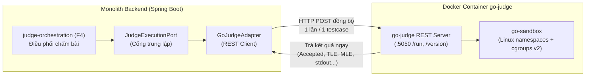

# Hướng Dẫn Thiết Lập & Triển Khai go-judge (Judge Engine) — AlgoPrep

Tài liệu này hướng dẫn chi tiết cách cài đặt, cấu hình và chạy **go-judge** trong hệ thống AlgoPrep, áp dụng cho môi trường phát triển trên **Windows 11 / WSL2** và Docker.

---

## 1. Xác Nhận Thư Mục Triển Khai

> **Đúng chính xác**: Thư mục triển khai và cấu hình của judge engine là:  
> `F:\prj_algoprep\05-coding\judge-engine`  
> (Được quy định tại tài liệu kiến trúc [SYS0201_codebase_structure.md](file:///f:/prj_algoprep/01-rd/system/SYS0201_codebase_structure.md) và [SYS0401_judge_engine.md](file:///f:/prj_algoprep/01-rd/system/SYS0401_judge_engine.md)).

Thư mục này được mount trực tiếp vào container tại `/opt/algoprep/judge-engine:ro` thông qua file [`05-coding/docker-compose.yml`](file:///f:/prj_algoprep/05-coding/docker-compose.yml).

---

## 2. Kiến Trúc Tích Hợp Trong AlgoPrep



- **Tính chất**: `go-judge` là **dịch vụ ngoài (External Service)**, hoạt động **Stateless** (không cần database hay Redis riêng).
- **Giao tiếp**: Spring Boot gọi sang `go-judge` qua REST API đồng bộ tại cổng `5050`. Kết quả chấm được trả về ngay trong response (không cần Webhook như Judge0).

---

## 3. Các Bước Triển Khai Thực Tế

### Bước 1: Chuẩn Bị Môi Trường Windows / WSL2

Đảm bảo máy đã bật ảo hóa (Virtualization) và cài đặt Docker Desktop hoặc Docker Engine trong WSL2:
```powershell
# Kiểm tra phiên bản WSL (phải là phiên bản 2)
wsl -l -v

# Kiểm tra Docker đã chạy
docker version
```

### Bước 2: Lưu Ý Về Image Mặc Định & Toolchain Compiler

> [!WARNING]
> Image chính thức `criyle/go-judge:v1.12.3` chỉ có sẵn sandbox kernel và bash, **KHÔNG CÓ sẵn compiler** (`javac`, `g++`, `python3`).
> 
> Để chấm được cả 3 ngôn ngữ cốt lõi của AlgoPrep (Java 21, C++, Python 3), bạn có 2 lựa chọn:

#### Lựa chọn A (Khuyến nghị cho Full Test): Dựng Custom Image có sẵn Toolchain
Tạo file `Dockerfile` tại `05-coding/judge-engine/Dockerfile`:
```dockerfile
FROM criyle/go-judge:v1.12.3

# Cài đặt OpenJDK 21, g++ (C++17/20), Python 3
RUN apt-get update && apt-get install -y --no-install-recommends \
    openjdk-21-jdk-headless \
    g++ \
    python3 \
    && rm -rf /var/lib/apt/lists/*
```

Build image này:
```bash
docker build -t algoprep-judge:v1 -f 05-coding/judge-engine/Dockerfile 05-coding/judge-engine
```

#### Lựa chọn B (Khung Base Prototype): Dùng image chính thức của dự án
Đã cấu hình sẵn trong [`05-coding/docker-compose.yml`](file:///f:/prj_algoprep/05-coding/docker-compose.yml) (dùng để test các lệnh shell / bash cơ bản).

### Bước 3: Cấu Hình Docker Compose Cho Windows / cgroups v2

Trong file [`05-coding/docker-compose.yml`](file:///f:/prj_algoprep/05-coding/docker-compose.yml), service `go-judge` đã được thiết lập các thông số bắt buộc:
- `privileged: true`: Cho phép sandbox tạo namespace và quản lý giới hạn tài nguyên.
- `cgroup: host` và mount `/sys/fs/cgroup:/sys/fs/cgroup:rw`: **Bắt buộc trên Docker Desktop / WSL2** để tránh lỗi `cgroup path is empty`.
- `shm_size: 256m`: Cấp bộ nhớ chia sẻ.

### Bước 4: Khởi Chạy Service

Mở terminal tại thư mục `05-coding`:
```bash
cd 05-coding

# Khởi chạy go-judge
docker compose up -d go-judge

# Kiểm tra trạng thái container (phải hiển thị healthy)
docker compose ps go-judge
```

---

## 4. Kiểm Tra Hoạt Động (Smoke Tests)

### 4.1. Kiểm tra Healthcheck và Version
Chạy lệnh PowerShell:
```powershell
curl.exe http://localhost:5050/version
```
Kết quả mong đợi: `200 OK` kèm thông tin version của `go-judge`.

### 4.2. Kiểm tra Metrics giám sát (Prometheus)
```powershell
curl.exe http://localhost:5052/metrics
```
Cổng `5052` cung cấp số liệu CPU, Memory, số lượng tiến trình cho Prometheus giám sát.

### 4.3. Chạy thử mã Python qua API `/run`
Gửi request kiểm tra khả năng chạy mã Python:
```powershell
curl.exe -X POST http://localhost:5050/run `
  -H "Content-Type: application/json" `
  -d '{
    "cmd": [{
      "args": ["/usr/bin/python3", "-c", "print(1 + 2)"],
      "env": ["PATH=/usr/bin:/bin"],
      "files": [
        {"content": ""},
        {"name": "stdout", "max": 10240},
        {"name": "stderr", "max": 10240}
      ],
      "cpuLimit": 2000000000,
      "memoryLimit": 67108864,
      "procLimit": 10
    }]
  }'
```
Kết quả mong đợi:
```json
[
  {
    "status": "Accepted",
    "exitStatus": 0,
    "time": 25000000,
    "memory": 12582912,
    "runTime": 24000000,
    "files": {
      "stdout": "3\n",
      "stderr": ""
    }
  }
]
```

---

## 5. Kết Nối Với Backend Spring Boot

Trong file cấu hình môi trường của Backend (`.env` hoặc `application.yml` của module `algoprep-judge`):

```properties
# Địa chỉ của judge-engine
JUDGE_ENGINE_BASE_URL=http://localhost:5050

# Nếu chạy Backend trong cùng Docker Network:
# JUDGE_ENGINE_BASE_URL=http://go-judge:5050
```

Trong tầng `infrastructure` của Backend, `GoJudgeAdapter` sẽ giao tiếp trực tiếp với endpoint `POST /run` để truyền mã bài nộp và testcase, sau đó map kết quả (`Accepted`, `Time Limit Exceeded`, `Memory Limit Exceeded`, `Wrong Answer`) về cho domain logic.
